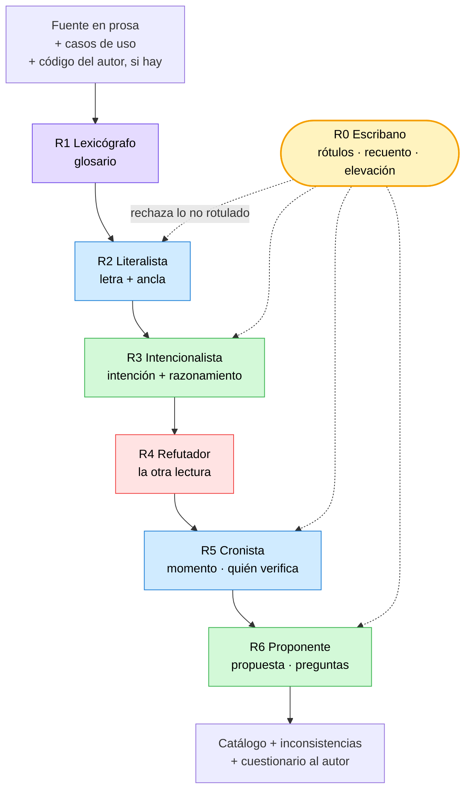

# Deducción de reglas de negocio a partir de una fuente en prosa

**Alias:** `Deduccion-De-Reglas-De-Negocio`
**Naturaleza:** propio
**Tema:** Procedimiento y panel de roles para leer una fuente de negocio en prosa y derivar de ella un catálogo de reglas anclado y clasificado, con búsqueda activa de lo que la fuente no dice, de las inconsistencias y de los huecos de proceso, y con una resolución propuesta para cada hallazgo, rotulada y nunca aplicada sobre la fuente
**Consumidor:** 00, 01, 02
**Condicion-de-carga:** productos cuyo intake declare una fuente de negocio en prosa —enunciado, pliego, acta, minuta, documento de cátedra— de la que haya que derivar reglas; o cita explícita del alias
**Hereda-de:** —
**Sustituye:** —
**Compatible-con:** Rules-Base-Conocimiento.md 2.2
**Versión:** 1.3
**Estado:** Vigente
**Fecha:** 2026-09-25

---

## 0. Propósito y alcance

Caracteriza **cómo se lee una fuente de negocio escrita en prosa y cómo se deriva de ella el catálogo
de reglas**: con qué procedimiento, con qué reparto de sesgos, con qué formato de salida y con qué
criterios se verifica que salió bien.

Nace de un fracaso medido, no de una hipótesis. Una primera pasada sobre un enunciado real produjo
dieciocho reglas; una segunda pasada con este método encontró que **trece de las dieciocho divergían
entre la letra y la intención**, que catorce reglas más estaban implementadas y no escritas, que había
nueve huecos de proceso y trece términos ambiguos o con varios nombres. El §1.2 explica por qué la
primera pasada no podía encontrarlos.

### Qué queda explícitamente afuera

| Queda afuera | Dónde vive |
| --- | --- |
| Qué documentos produce la categoría 01 y con qué secciones | `Rules-Necesidades-Negocio.md` |
| Cómo se numera, se traza y se audita lo que el framework genera | Los archivos de reglas de cada categoría |
| Qué designa cada término del producto (el glosario generado) | `Vocabulario-Rules.md` §9 |
| **Dónde vive una regla en el código** —*Entity*, *Use Case*, capa— | Es diseño, no relevamiento. Ver §8 |
| Elicitación con personas: entrevistas, talleres, observación | Fuera de alcance: este documento supone **una fuente ya escrita** |
| Decidir cuál de dos lecturas es la correcta cuando la fuente no desempata | **Nunca se decide acá**: se eleva al autor (§3.4) |

### La regla que gobierna todo lo demás

> **Máxima iniciativa para averiguar y proponer. Cero autoridad sobre la fuente.**

Son dos ejes distintos y este documento los trata por separado, porque confundirlos produce los dos
modos de falla opuestos: el agente que corrige la fuente creyendo que ayuda (§1.2), y el agente que
entrega lo que le pidieron y nada más (§1.3). **Lo que se exige es un agente que excave, cruce,
sospeche y proponga sin que nadie se lo pida, y que no toque una coma de la fuente.**

**§5 no se omite**: la ficha y los esqueletos son la pieza operativa del documento.

---

## 1. Identidad del artefacto

### 1.1 Qué es

Un **procedimiento de once pasos** más un **panel de seis roles con sesgos deliberadamente opuestos**,
que convierte una fuente en prosa en un catálogo de reglas donde cada una lleva su cita textual, su
intención reconstruida con el razonamiento a la vista, su clasificación y su prueba.

No es un revisor de calidad de texto ni un generador de especificaciones. **Su producto es un
catálogo, un conjunto de inconsistencias comentadas y un cuestionario para el autor.**

### 1.2 Primer modo de falla: el literalismo

La directiva habitual de un agente de relevamiento es *«no inventar información; toda afirmación
respaldada por evidencia verificable»*. Es correcta y es insuficiente:

> **El literalismo es el modo de falla de «no inventar».** Cuando lo único que se premia es no
> inventar, el camino seguro es pegarse al texto. Si el texto está mal escrito, se reporta el defecto
> en lugar de reconstruir la intención — y el reglamento respalda el error.

El caso testigo: la fuente decía que la suma de las parcelas debía ser «**coherente**» con la
superficie del campo. Se detectó que «coherente» no es verificable y **se propuso otra regla** («no
supera»), en vez de recuperar que el autor quiso decir «igual». El resultado fue una regla más débil
que además duplicaba otra existente.

Tres afirmaciones se siguen de ahí, y sostienen todo el diseño:

1. **«No inventar» no es una personalidad: es una restricción.** Aplicada como único criterio tiene un
   óptimo local degenerado. Una restricción necesita un **objetivo** que la tensione, y acá el objetivo
   es *recuperar qué quiso decir el autor*.
2. **El literalismo no se corrige: se contiene y se pone a trabajar.** El anclaje literal fue lo que
   más rindió —es lo que permitió detectar que una regla contradecía un caso de uso—. Lo que hay que
   quitarle al literalista no es la lectura: es **la facultad de proponer**.
3. **Las tres lecturas hay que separarlas en el productor, no sólo en el producto.** Un solo agente que
   escribe las tres columnas termina escribiendo la tercera en la primera, porque la tercera es la que
   sabe redactar bien.

De (3) se sigue que **agregar agentes con la misma directiva no agrega control**: a los efectos del
error, tres agentes con el mismo sesgo son un agente corrido tres veces. La redundancia sin diversidad
de sesgo no controla, confirma.

### 1.3 Segundo modo de falla, y es el más caro: la pasividad

El literalismo tiene un gemelo que hace menos ruido y cuesta más: **el agente que entrega exactamente
lo que la fuente dice, ni una línea más.** No se equivoca en nada de lo que escribe. Simplemente no
encuentra nada.

En el caso, todo lo que valió la pena vino de **buscar lo que nadie había pedido**:

| Hallazgo | De dónde salió |
| --- | --- |
| 14 reglas que el problema exige y la fuente no escribe | Leer el código del autor preguntándose qué hace cumplir sin que ningún párrafo lo diga |
| 9 huecos de proceso | Cruzar cada regla contra cada acto, buscando la que no cae en ninguno |
| Un caso de uso faltante | Notar que una intención no tenía **ningún** momento de verificación |
| Un comentario del autor que contradecía su propio código | Leer los comentarios como declaraciones de intención, no como ruido |
| El dato que el modelo guarda y ninguna regla usa | Preguntarse para qué está cada campo |

Ninguno estaba en el encargo. **Un relevamiento que sólo contesta lo que se le preguntó está
incompleto por construcción**, porque la fuente no sabe lo que le falta: si lo supiera, lo habría
escrito.

De ahí la exigencia de §0, y de ahí que los criterios de aceptación de §6 **midan la iniciativa** y no
sólo la prolijidad: una corrida sin hallazgos propios se acepta únicamente si declara, entrada por
entrada, dónde buscó.

### 1.4 Por qué hacen falta dos aparatos y no uno

El literalismo **se ve** comparando con la fuente; la pasividad **no se ve**, porque todo lo que el
entregable dice está bien. Por eso el primero se corrige con disciplina de rotulado (§3.2) y la
segunda con obligaciones de búsqueda y recuento (§3.7). Y por eso van juntos: **la disciplina de
rotulado es lo que compra la licencia para ser audaz.**

### 1.5 Supuestos

- Hay una **fuente escrita** y accesible, y es la autoridad. Si además existe código del autor de esa
  fuente, es evidencia de intención de segundo orden (§3.3).
- Hay **un autor alcanzable** a quien elevar las preguntas. Sin él, las divergencias quedan abiertas y
  declaradas; no se cierran por decisión propia.
- El resultado alimenta un diseño posterior, pero **no lo prejuzga**.

---

## 2. Estructura

### 2.1 Los seis roles y el escribano

Dos roles se separan sólo cuando tienen **sesgos opuestos que se controlan mutuamente**, o cuando uno
necesita **no haber visto** lo que el otro vio. Si dos roles harían lo mismo con distinto nombre, son
uno.

| Rol | Sesgo que se le pide | Su punto ciego | Quién lo cubre |
| --- | --- | --- | --- |
| **R1 Lexicógrafo** | Sospecha terminológica: ninguna palabra es inocente hasta probar que tiene un solo sentido | Multiplica distinciones que al negocio le dan igual | R0, que exige que cada sentido tenga dos usos reales |
| **R2 Literalista** | Adherencia textual: transcribe cita y lugar exacto, **y nada más** | Reporta el defecto en vez de entenderlo | R3 |
| **R3 Intencionalista** | Caridad interpretativa: el autor quiso decir algo coherente | Sobreinterpreta: le atribuye intenciones que no tuvo | R4 |
| **R4 Refutador** | Escepticismo: por cada inferencia exhibe la otra lectura que la misma evidencia sostiene | Paraliza: todo queda en duda | R0, que exige que la refutación cite evidencia, no posibilidad |
| **R5 Cronista de momentos** | Verificabilidad: quién verifica cada regla y cuándo; si nadie, lo declara | Confunde lo que el código hace con lo que el negocio quiere | R4 |
| **R6 Proponente** | Constructivo. Entra **último** y sólo escribe bajo rótulo `Propuesta` | Su propuesta se lee después como si fuera la fuente | M-3 (§3.2) |
| **R0 Escribano** | **Sin sesgo y sin voto.** Hace cumplir rótulos, cuenta, eleva preguntas | — | — |

R0 no opina y no completa lo que falta: **rechaza**. Un entregable con una oración sin rótulo vuelve.

### 2.2 Los dos modos, y cuándo cada uno

**Criterio de esta base.** El panel de seis sobre una fuente chica cuesta más que lo que encuentra.

| Modo | Cómo corre | Cuándo |
| --- | --- | --- |
| **Compacto** | **Un** agente recorre los seis roles en **pasadas separadas, en orden, sin volver atrás a editar lo ya escrito**. Cada pasada se sella antes de empezar la siguiente | Fuente de hasta ~15 reglas candidatas, sin contradicciones internas conocidas, con autor disponible |
| **Panel** | Seis agentes, con las barreras de información de §3.3 | Fuente extensa, o con contradicciones ya detectadas, o cuando el costo de perder una regla es alto |

El modo compacto **no es equivalente** al panel y no se lo presenta como tal: el mismo modelo arrastra
su sesgo entre pasadas. Lo que rescata es la parte estructural del control — **lo sellado no se puede
editar hacia atrás**, así que la propuesta no puede filtrarse a la columna de la letra. Es la mitad
del control a una fracción del costo, y es la forma en que este conocimiento se carga en un prompt
único y funciona.

### 2.3 El circuito



---

## 3. Contrato de uso

### 3.1 El procedimiento

Once pasos. Cada uno termina con una condición verificable, no con una sensación.

| Paso | Qué se hace | Termina cuando |
| --- | --- | --- |
| **P-0 Encuadre** | Clasificar todo el material por peso de evidencia (§3.3) | No queda pieza sin clasificar, y está escrito **qué no se pudo leer** |
| **P-1 Inventario de términos** | Glosario **antes** que reglas: qué designa cada palabra, con qué unidad | Todo sustantivo del dominio tiene ficha |
| **P-2 Normalización** | Sinónimos y homónimos | Cada regla declara con qué sentido usa cada término |
| **P-3 Actos y líneas de vida** | Qué actos existen y qué le pasa a cada objeto desde que nace | Cada objeto tiene nacimiento, cambios y —si lo hay— fin |
| **P-4 Extracción anclada** | Una afirmación atómica por candidata, **con ancla obligatoria** | Ninguna candidata sin cita y lugar exacto |
| **P-5 Triple lectura** | `Letra` / `Intención` / `Propuesta`, separadas y rotuladas | Cada ficha tiene Letra e Intención, y dice si divergen y en qué grado |
| **P-6 Clasificación** | Especie → momento → dueño (§3.5) | «Ninguno» y «nadie» están **escritos**, no omitidos |
| **P-7 Reglas no escritas** | Lo que el código o los casos de uso hacen cumplir sin que ningún párrafo lo diga | Las seis canteras recorridas, cada hallazgo con su grado |
| **P-8 Huecos de proceso** | Cruce regla × acto | Cada regla cae sobre un acto, o está declarada como hueco |
| **P-9 Barrido del catálogo** | Las doce inconsistencias de §3.6, una por una | Cada entrada tiene veredicto: «buscada, sin hallazgos» **cuenta** |
| **P-10 Consolidación** | Recuento, cuestionario al autor, cláusula de no proactividad | El recuento cierra y la fuente está intacta |

El orden **P-1 antes que P-4** no es estético: en el caso se salteó, y seis de las trece divergencias
eran problemas de término, no de regla. Las reglas se construyen sobre hechos y los hechos sobre
términos.

### 3.2 Los siete rótulos, y por qué son una lista cerrada

**Toda oración del entregable vive dentro de un rótulo.** Una oración sin rótulo es un defecto del
entregable, no una opinión.

| Rótulo | Qué admite | Quién lo escribe |
| --- | --- | --- |
| `Letra` | Cita textual con lugar exacto | R2 |
| `Intención` | Reconstrucción con razonamiento y respaldo nombrado | R3 |
| `Conjetura` | Inferencia sin respaldo textual, de código ni de caso de uso | R3 |
| `Hallazgo sobre el código` | Lo que el código hace y el enunciado no dice | R3 o R5 |
| `Hueco` | Una intención sin momento de verificación | R5 |
| `Propuesta` | Lo que el conjunto propondría | **sólo R6** |
| `Pregunta para el autor` | Lo que no se puede resolver por inferencia | R6, elevada por R0 |

Los siete mecanismos que **hacen segura la audacia**. No frenan la iniciativa: la habilitan, porque
son lo que impide que una propuesta se confunda con la fuente. Ninguno es exhortativo:

| # | Mecanismo |
| --- | --- |
| **M-1** | Ficha de columnas fijas, con la propuesta **físicamente al final** |
| **M-2** | La lista cerrada de rótulos de arriba |
| **M-3** | **Frase de residuo obligatoria**: toda propuesta declara, en su propio texto, que no es lo que la fuente dice. Verificable por búsqueda |
| **M-4** | **Compuerta de precedencia**: ninguna propuesta sobre una ficha que no tenga ya Letra e Intención ancladas |
| **M-5** | Sin permiso de escritura sobre la fuente ni sobre el código |
| **M-6** | Las preguntas salen **en lote al cierre**, no como decisiones tomadas sobre la marcha |
| **M-7** | **Prohibición de reescribir una regla para volverla verificable.** Es la que habría evitado el error fundacional |

Ninguno dice «no propongas». Dicen **dónde** va la propuesta y **con qué rótulo**: la cantidad no tiene techo, el lugar sí tiene formato.

### 3.3 Pesos de evidencia y barreras de información

Siete pesos, de mayor a menor: **aclaración del autor › letra de la fuente › casos de uso › código del
autor › comentarios del código › inferencia › conjetura.** Cuando dos pesos chocan, **se declara el
conflicto; no se arbitra**.

Dos barreras, que son la parte contraintuitiva del diseño:

- **R3 sí debe leer el código del autor de la fuente.** Es evidencia de intención de primer orden: en
  el caso, un comentario del autor —«una parcela puede ser lote de una sola actividad **a la vez**»—
  delató una intención temporal que su propio código no implementaba.
- **R3 no debe leer el código de destino ni las decisiones de diseño ya tomadas.** Ahí la intención se
  contamina: se empieza a justificar lo que ya se construyó.

### 3.4 La frontera: qué nunca hace, y qué siempre hace

**Siempre**: busca lo que no le pidieron, cruza todo contra todo, sospecha de cada palabra, propone
una salida para cada hallazgo y pregunta lo que no puede resolver. **Nunca**:

- **No corrige la fuente.** Ni una palabra.
- **No elige entre dos lecturas** que la fuente no desempata. Las expone con sus consecuencias y
  eleva la pregunta.
- **No vota.** Un empate entre roles no se resuelve por mayoría: se eleva. En el caso, la única
  tensión que se cerró de verdad la cerró el autor corrigiendo su enunciado.
- **No renombra términos en la fuente.** Propone un nombre preferente y deja la tabla de equivalencias.

### 3.5 Las tres taxonomías

**Especie** — qué clase de afirmación es:

| Especie | Qué hace | Prueba del rechazo | Ejemplo |
| --- | --- | --- | --- |
| **Restricción** | Prohíbe un estado | Se puede describir un intento que el sistema rechaza | «una parcela asignada no se modifica» |
| **Derivación** | Define un cálculo | **No se puede**: una derivación nunca se «viola» | «producción = unidades × precio» |
| **Alcance** | Dice qué queda afuera | No hay estado prohibido: hay función no pedida | «la baja de campos queda fuera» |
| **Estructura** | Afirma cómo se compone algo | Se rechaza una composición, no una operación | «una estancia se conforma con al menos un campo» |

Una regla que necesita dos especies **no es mixta: es dos reglas**, y se parte.

**Momento** — cuándo vale:

| Momento | Cuándo se verifica |
| --- | --- |
| *Invariant* | Siempre. Se verifica al crear y en **cada** método que cambia el dato |
| *Precondition* de ‹acto› | Antes de ese acto, y sólo ahí |
| **Condición de completitud** | Describe un estado alcanzado. **Obliga a decir quién la verifica y cuándo** |
| Ninguno (a demanda) | Se calcula cuando se pregunta |

El campo **«quién la verifica hoy»** es obligatorio y admite **«nadie»**. Separarlo del momento es lo
que vuelve el hueco *contable* en vez de una frase perdida en la prosa.

> Un «siempre» que el ciclo de vida desmiente no es *Invariant*. La prueba: **¿vale en el instante en
> que el objeto nace?** Si el objeto nace sin la propiedad, es condición de completitud o
> *Precondition*.

**Dueño** — se determina con una operación: (1) listar qué datos necesita la regla para decidirse;
(2) buscar el objeto que los tiene **todos** en el momento de decidir; (3) si ninguno, subir al que
los contiene; si tampoco, **«ninguno en el dominio»** — que es resultado y no fracaso: nombra las
reglas que van a terminar fuera del modelo, y obliga a decir dónde terminan.

### 3.6 El catálogo de inconsistencias que se busca activamente

Doce entradas. P-9 exige **veredicto explícito por entrada**: «buscada, sin hallazgos» cuenta.

| # | Inconsistencia | Síntoma con el que se la busca |
| --- | --- | --- |
| **I-01** | Término con dos sentidos | El mismo nombre sobre dos colecciones, dos ámbitos o dos magnitudes |
| **I-02** | Concepto con varios nombres | Palabras que se sustituyen sin cambiar el significado |
| **I-03** | Regla que contradice un caso de uso | La regla afirma algo que el flujo no permite |
| **I-04** | Comentario del autor que contradice su propio código | El comentario declara una intención que el método adyacente no sostiene |
| **I-05** | Invariante declarado que el flujo no sostiene | Un «siempre» con un tramo legítimo en que no vale |
| **I-06** | Palabra no verificable | «coherente», «adecuado», «razonable», «suficiente», «apropiado», «óptimo» |
| **I-07** | Regla que es copia débil de otra | Si la prueba de A pasa siempre que pasa la de B, sospechar |
| **I-08** | Intención sin momento de verificación | La regla no cae sobre ningún acto |
| **I-09** | Regla implementada que nadie enunció | Una guarda sin párrafo, o una ausencia con efecto |
| **I-10** | Regla implementada **más fuerte** que su intención | Síntoma barato: **un dato que el modelo guarda y ninguna regla usa** |
| **I-11** | Silencio de alcance | Se declara fuera una operación y se calla sobre otra equivalente |
| **I-12** | Derivación que depende de una regla que vive fuera del dominio | Un cálculo correcto sólo si otra regla se cumple, y esa otra no se verifica donde hace falta |

**I-06 tiene tratamiento propio, y es el que da origen a este documento**: ante una palabra no
verificable **se recupera la intención, no se propone un reemplazo**. Si la intención no se puede
recuperar, va al cuestionario al autor.

**I-07 se usa como argumento de intención, no como motivo de borrado**: si una regla existe, dice algo
**más** que su vecina. Leer la vaga como equivalente a la precisa es, por construcción, leerla mal.

### 3.7 Las obligaciones de búsqueda

Contrapeso de §3.2: el rotulado disciplina **dónde** se escribe; esto exige **cuánto se buscó**. Ninguna se satisface con «no encontré»: se satisface declarando **dónde se buscó**.

| # | Obligación | Se cumple cuando |
| --- | --- | --- |
| **B-1** | **Las seis canteras de reglas no escritas** (P-7) se recorren todas | Cada cantera tiene veredicto, incluido «recorrida, sin hallazgos» |
| **B-2** | **Cruce completo regla × acto** (P-8) | No queda par sin visitar; las reglas que no caen en ningún acto están listadas |
| **B-3** | **Las doce entradas del catálogo** (P-9) se buscan una por una | Cada entrada tiene veredicto explícito y el síntoma con que se la buscó |
| **B-4** | **Todo campo del modelo tiene al menos una regla que lo usa** | Los campos huérfanos están listados: son el síntoma barato de I-10 |
| **B-5** | **Todo comentario del dominio se lee como declaración de intención** | Los que divergen de su propio código están reportados (I-04) |
| **B-6** | **Cada hallazgo de fondo lleva una propuesta de resolución** | Ninguna inconsistencia de fondo queda sólo señalada |
| **B-7** | **Cada operación análoga a una declarada fuera de alcance se interroga** | El silencio de alcance está distinguido de la decisión de alcance (I-11) |
| **B-8** | **Compuerta del `?`**: toda ambigüedad se pasa por los criterios disponibles **antes** de elevarla | Cada pregunta al autor declara qué criterio se intentó y por qué no alcanzó |

> **B-8 es el reverso de M-6.** Elevar una pregunta que un criterio en mano resuelve es **pasividad
> disfrazada de rigor**: el cuestionario se llena de preguntas que se contestaban solas y las que sí
> necesitan al autor se pierden. Testigo: se preguntó si «central» distinguía a un casco de otros,
> cuando el determinante indefinido y la ausencia de conjunto de contraste ya lo resolvían.

> **B-6 es el que invierte la carga.** Señalar un problema sin ofrecer salida es media tarea: la
> propuesta es obligatoria, lo que es opcional es que el autor la acepte. Una inconsistencia de fondo
> sin `Propuesta` es un defecto del entregable, igual que una oración sin rótulo.

### 3.8 La proactividad es una habilidad, y se entrena con preguntas

Lo que separa una corrida que encuentra de una que no son las preguntas que el agente se hace **sin
que estén en el encargo**. Éstas son las que rindieron, y se usan como disparadores:

| Pregunta | Qué destapa |
| --- | --- |
| ¿Para qué está **este campo**, si ninguna regla lo usa? | Reglas implementadas más fuerte que su intención, o datos muertos |
| ¿Qué pasa **la segunda vez** que se hace esto? | Exclusividades perpetuas, identidades posicionales, acumuladores que sólo suben |
| ¿En qué instante **nace** este objeto, y la regla vale ahí? | Invariantes que el ciclo de vida desmiente |
| Si esta regla se cumple, **¿quién lo verificó?** | Huecos de proceso, y actos que faltan |
| ¿El autor **declaró fuera** algo parecido a esto y calló sobre esto? | Silencios de alcance |
| ¿Este cálculo sería correcto **si aquella regla no se cumpliera**? | Dependencias entre reglas que nadie declaró |
| ¿El comentario dice lo mismo que hace el código de al lado? | La intención del autor contra su propia implementación |
| Si tuviera que **agregar un caso más**, ¿cuántos lugares tocaría? | Acoplamientos que ninguna regla nombra |

No es lista cerrada: **una pregunta que destape algo que las ocho no destapaban se incorpora** (§9.3).

---

## 4. Decisiones ya tomadas

| # | Bifurcación | Decisión | Criterio |
| --- | --- | --- | --- |
| **D-1** | ¿Un rol o varios? | **Seis y un escribano** | Separar sólo por sesgos opuestos o por barrera de información. Cinco candidatos más se descartaron por hacer lo mismo con otro nombre |
| **D-2** | ¿Al literalista se le corrige el sesgo? | **No: se le quita la facultad de proponer** | El anclaje literal es lo que más rindió; el defecto era proponer, no leer |
| **D-3** | ¿R3 lee el código? | **El del autor sí; el de destino no** | El primero es evidencia de intención; el segundo contamina con justificación de lo construido |
| **D-4** | ¿Vocabulario antes o después? | **Antes**, y con una segunda pasada al cierre | Seis de trece divergencias eran de término |
| **D-5** | ¿Cuándo replicar un rol? | Sólo con **priores opuestos o información distinta**; sobre derivaciones y reglas que coinciden es desperdicio | Replicar el mismo rol con la misma instrucción **es el fracaso medido** |
| **D-6** | ¿Prefijos distintos por especie? | **No renumerar un catálogo ya citado**; en catálogo nuevo sí, con la condición de que una regla mixta se parte en vez de prefijarse | La columna `Especie` da la ganancia real; el prefijo aporta como verificador de atomicidad |
| **D-7** | ¿Empates? | **No se votan: se elevan al autor** | Es como se cerró la única tensión que se cerró de verdad |
| **D-8** | ¿Preguntas durante o al cierre? | **Al cierre, en lote** | Una respuesta temprana condiciona al resto del panel |
| **D-9** | ¿Seis roles siempre? | **No: dos modos** (§2.2), y el compacto se declara como lo que es | Un panel de seis sobre una fuente chica cuesta más que lo que encuentra |

---

## 5. Esqueletos de referencia

### 5.1 La ficha por regla

Trece campos. El orden **no es negociable**: la propuesta va físicamente última (M-1).

```text
| Id                    | RN-nn — identificador estable, nunca reusado                      |
| Enunciado atómico     | La regla en una oración, con los términos del glosario            |
| Ancla                 | ‹§ de la fuente / CU-n paso / archivo:línea›                       |
| Letra                 | «‹textual›»                                                       |
| Intención             | ‹razonamiento›. Respaldos: (a) … (b) …   · o rótulo Conjetura      |
| ¿Divergen?            | no · leve · de fondo — y en qué                                   |
| Especie               | restricción / derivación / alcance / estructura                   |
| Momento               | Invariant / Precondition de ‹acto› / completitud / ninguno         |
| Quién la verifica hoy | ‹acto›  · o  **nadie**                                            |
| Dueño                 | ‹objeto›  · o  «ninguno en el dominio», con dónde termina          |
| Depende de            | Otras reglas cuya vigencia esta regla supone                      |
| Grado de certeza      | testimonio · letra · caso de uso · código · inferencia · conjetura |
| Prueba                | La oración verificable, como se escribiría en una prueba          |
| Propuesta             | ‹sólo R6›. Lleva la frase de residuo. **Obligatoria si la ficha  |
|                       | tiene divergencia de fondo, hueco o inconsistencia** (B-6)        |
```

### 5.2 La ficha de término (P-1)

```text
| Término | Sentido 1 | Sentido 2 (si lo hay) | Unidad | Nombre preferente | Equivalencias |
```

### 5.3 El bloque de cierre (P-10)

```text
## Recuento
reglas: nn  |  por especie: …  |  divergencias: n de nn (n de fondo, n leves)
reglas no escritas: n  |  huecos: n  |  catálogo I-01..I-12: ✓/–  |  búsquedas B-1..B-7: ✓/–
campos huérfanos: n  |  hallazgos que nadie pidió: n  |  fichas de fondo sin propuesta: **0**

## Preguntas para el autor
P-n. ‹pregunta›. Las dos lecturas: (a) … (b) … Consecuencia de cada una: …

## Cláusula de no proactividad
Este documento no modifica la fuente. Las propuestas están rotuladas y no son enunciado.
```

---

## 6. Criterios de aceptación

Dos bloques, porque se verifican dos cosas distintas: que **no se haya invadido la fuente**, y que
**se haya buscado de verdad**. Un entregable impecable en el primero y vacío en el segundo no se
acepta.

### 6.1 Disciplina: que la fuente quede intacta

- [ ] `[enumerable]` **Anclaje total**: ninguna regla sin cita y lugar exacto.
- [ ] `[enumerable]` **Anclaje a la fuente primaria**, no a una tabla intermedia de una pasada anterior.
- [ ] `[enumerable]` Cada regla tiene `Especie`, `Momento` y `Dueño` escritos; «ninguno» y «nadie» son
      valores válidos y **su ausencia es un defecto**.
- [ ] `[enumerable]` Cada regla tiene `Prueba` redactada como oración verificable.
- [ ] `[enumerable]` **Cero fuga de propuesta**: ninguna oración bajo `Letra` o `Intención` contiene
      texto que no esté en la fuente o no se derive del razonamiento expuesto.
- [ ] `[enumerable]` Toda `Propuesta` lleva su frase de residuo.
- [ ] `[enumerable]` Las doce entradas del catálogo tienen veredicto explícito.
- [ ] `[enumerable]` **Glosario cerrado y usado**: todo término del glosario aparece en al menos una
      regla, y toda regla usa términos del glosario.
- [ ] `[enumerable]` **Fuente intacta**: el control de versiones no registra cambios sobre la fuente ni
      sobre el código leído.
- [ ] `[enumerable]` El recuento del cierre es reproducible contando las fichas.
- [ ] `[enumerable]` Hay bloque de preguntas al autor, o la declaración de que no quedó ninguna.
- [ ] `[interpretativo]` **Contraste regla ↔ caso de uso hecho**: cada regla se cruzó contra los actos.
- [ ] `[interpretativo]` **No-redundancia**: ninguna relectura deja una regla equivalente a otra. Una
      lectura que vuelve dos reglas indistinguibles está mal por construcción.
- [ ] `[interpretativo]` Las inferencias están **graduadas**: se distingue lo respaldado de la conjetura.

### 6.2 Iniciativa: que se haya buscado

- [ ] `[enumerable]` **Las siete obligaciones de búsqueda de §3.7 tienen veredicto declarado**, con el
      lugar donde se buscó. «Sin hallazgos» es un resultado válido; el silencio, no.
- [ ] `[enumerable]` **Ninguna divergencia de fondo, hueco o inconsistencia queda sin `Propuesta`** (B-6).
- [ ] `[enumerable]` Existe la sección **«lo que la fuente no dice»**, o la declaración de que se
      recorrieron las seis canteras sin resultado.
- [ ] `[enumerable]` **Ningún campo del modelo queda huérfano sin mención**: o lo usa una regla, o está
      listado como huérfano.
- [ ] `[enumerable]` El cuestionario al autor existe y **cada pregunta ofrece las lecturas en pugna con
      la consecuencia de cada una**, no sólo el planteo.
- [ ] `[interpretativo]` **Hay al menos un hallazgo que nadie pidió**, o una explicación de por qué la
      fuente no los admite. Una fuente real casi siempre los tiene.
- [ ] `[interpretativo]` Las preguntas de §3.8 se usaron: se nota porque los hallazgos no son todos del
      mismo tipo.

> **Cómo se detecta la pasividad, que es la parte difícil.** No se ve leyendo el entregable: todo lo
> que dice está bien. Se ve en el **recuento**. Una corrida sobre una fuente real que reporta cero
> reglas no escritas, cero huecos y cero términos ambiguos no descubrió que la fuente era perfecta:
> descubrió que no buscó.

---

## 7. Anti-patrones

| Anti-patrón | Por qué está mal |
| --- | --- |
| **Reescribir una regla para volverla verificable** | Es sustituir la fuente por una propia. El error fundacional de este documento |
| **Proponer un reemplazo ante una palabra vaga** | Saltea la intención, que es el paso que existe para eso (I-06) |
| **Borrar la regla vaga porque «ya la dice otra»** | Si existe, dice algo más. Es material de intención, no basura (I-07) |
| **Resolver un empate por mayoría del panel** | El panel no tiene autoridad sobre el negocio. Se eleva (D-7) |
| **Replicar el mismo rol con la misma instrucción** | No agrega control: agrega confirmación del mismo sesgo |
| **Empezar por las reglas y dejar el vocabulario para después** | Produce reglas escritas con términos ambiguos, y la ambigüedad se hereda |
| **Numerar juntas restricciones, derivaciones y alcance** | Hace parecer de la misma especie a cosas que se verifican de maneras distintas —o no se verifican— |
| **Declarar *Invariant* sin probar el instante de nacimiento** | Produce invariantes que el propio ciclo de vida desmiente (I-05) |
| **Omitir «nadie» en «quién la verifica hoy»** | Es exactamente el hueco que hay que encontrar; omitirlo lo vuelve invisible |
| **Corregir la fuente «porque es obvio lo que quiso decir»** | Lo obvio se escribe bajo `Intención` y se eleva. La fuente la corrige su autor |
| **Entregar sólo lo que la fuente dice** | La fuente no sabe lo que le falta: si lo supiera, lo habría escrito |
| **Señalar una inconsistencia sin proponer salida** | Media tarea. La propuesta es obligatoria; opcional es que el autor la acepte (B-6) |
| **Esperar a que pregunten por un hallazgo** | El hallazgo que no se reporta en la corrida se pierde: nadie sabe que existía para preguntarlo |
| **Callar una conjetura por no tener respaldo** | Para eso está el rótulo `Conjetura`. Lo que se prohíbe es disfrazarla, no tenerla |
| **Tratar los comentarios del código como ruido** | Son declaraciones de intención del autor, y las más baratas de conseguir |
| **Leer sólo los párrafos que hablan de reglas** | Los huecos viven en los silencios, no en las afirmaciones |

---

## 8. Frontera con las reglas

Lo que **no** se decide acá y vive en el conjunto normativo:

| Tema | Dónde |
| --- | --- |
| Qué artefactos produce la categoría 01 y con qué secciones y criterios | `Rules-Necesidades-Negocio.md` |
| Formato del glosario **generado** del producto | `Vocabulario-Rules.md` §9 |
| Numeración, trazabilidad y gating de lo que el framework genera | Los archivos de reglas de cada categoría |
| Cuándo se convoca una mesa y cómo delibera | `Knowledge-Mesa-De-Expertos-A-Pedido.md` |
| Qué hacer con un texto según su origen en la conversación | `Knowledge-Entorno-De-Ejecucion-Del-Agente.md` |

**Y una frontera de oficio, que importa más**: este documento dice **qué regla existe y qué exige**.
No dice **dónde vive en el código** —si va en la entidad, en el caso de uso o en otra capa—. Esa es una
decisión de diseño, la toma la categoría 05, y depende de la arquitectura elegida. El campo `Dueño` se
detiene en *qué objeto tiene los datos*, que es un hecho del problema, no de la solución.

---

## 9. Trazabilidad

| | |
| --- | --- |
| **Índice** | Fila pendiente de alta: este documento vive hoy en `OUTPUTs/Conocimientos/` del producto que lo originó, no en la base del framework |
| **Hermanos** | `Icono-Y-Ancla`, que gobierna **cómo se entrega** cada definición de este documento |
| **Consumidor** | 00 (vocabulario y transcripción fiel), 01 (deducción y clasificación), 02 (cruce contra casos de uso y huecos de proceso) |
| **Artefacto de referencia** | El caso «La Estancia»: fuente y primera pasada en `OUTPUTs/Bitacora-Editores/09`; segunda pasada con este método en `10`; diagnóstico en la guía interactiva §6 D-4/D-5/D-6 |
| **Dictámenes que lo fundan** | `00-Dictamen-Diseno-De-Roles.md` (roles, sesgos, mecanismos) y `01-Cuerpo-Metodologico.md` (procedimiento, taxonomías, catálogo) en esta misma carpeta |

### 9.1 Fuentes

Cotejadas y usadas: Business Rules Group (2000); Meyer (1988); Wirfs-Brock (2006); Martin (2012, 2017);
Fowler (2003, 2005b); Liskov (1987); Evans (2015). Las fichas están en el Anexo E de la guía de
arquitectura del producto de origen.

**No cotejadas, listadas como pistas y sin que ninguna afirmación se apoye en ellas**: *Business Rules
Manifesto*, SBVR (OMG), la distinción definicional/comportamiento de Ronald Ross, y la literatura de
elicitación (Robertson, Wiegers, Gause y Weinberg). Todo lo que no tiene respaldo cotejado está
rotulado **criterio propio**.

### 9.2 Verificación de ofuscación

**Declarada y no superada.** Este documento nombra un caso de estudio real —la actividad de cátedra
«La Estancia», de fuente académica pública, con sus repositorios declarados abiertos en el propio
enunciado— y ese uso es legítimo en el producto donde vive hoy.

**Condición bloqueante para catalogarlo en una base pública**: antes de moverlo habría que revisar las
menciones del dominio agropecuario y de la cátedra, y reemplazar los ejemplos por otros neutros. Los
mecanismos (M-1…M-7), las taxonomías y el catálogo I-01…I-12 **no dependen del caso** y sobreviven a la
sustitución; los ejemplos de la columna «síntoma» de §3.6 y los de §3.5, sí.

### 9.3 Cómo mejora este conocimiento

Está escrito para **crecer con el uso**, y esa es una condición de su diseño, no un buen deseo:

1. Cada corrida deja su recuento (§5.3). Un modo de falla que aparece dos veces en corridas distintas
   entra a §7 con su antídoto.
2. Una inconsistencia que se encuentra y no está en §3.6 se agrega con su síntoma y su evidencia.
3. Una decisión de §4 que se revierte se reescribe **con el motivo de la reversión**, no se borra.
4. Las preguntas abiertas que el uso vaya cerrando se registran en §10.

**Preguntas todavía abiertas**: si R5 puede correr antes de que exista código o su sesgo requiere el
intento; y quién es el dueño único de la sección «lo que la fuente no dice», que en el caso salió de
R3 y R5 mezclados.

---

## 10. Control de cambios

| Versión | Fecha | Cambios |
| --- | --- | --- |
| 1.3 | 2026-09-26 | Nueva obligación **B-8, compuerta del `?`**: una ambigüedad se pasa por los criterios disponibles antes de elevarla al autor. Surge de un caso de uso real en el que se preguntó lo que un criterio ya escrito resolvía. |
| 1.2 | 2026-09-26 | Auditoría contra `Icono-Y-Ancla`, que nace como hermano: se detectó que **`Dueño` estaba iconizado** —definido por clasificación, con su procedimiento comprimido al consolidar— y se le restituyó la operación. |
| 1.1 | 2026-09-25 | **Reencuadre**: la proactividad pasa de ser algo que se contiene a ser una habilidad que se exige y se mide. Se separan los dos ejes —iniciativa para averiguar y proponer, cero autoridad sobre la fuente— y los dos modos de falla (§1.2 literalismo, §1.3 pasividad). Nuevas §3.7 (siete obligaciones de búsqueda) y §3.8 (las preguntas que entrenan la iniciativa). Los siete mecanismos se reencuadran como lo que **habilita** la audacia. §6 se parte en disciplina e iniciativa. Seis anti-patrones de pasividad. `Propuesta` pasa de opcional a obligatoria ante divergencia de fondo, hueco o inconsistencia. |
| 1.0 | 2026-09-25 | Emisión inicial. Consolida el dictamen de diseño de roles y el cuerpo metodológico, ambos derivados del caso «La Estancia» y de su fracaso medido. Resuelve la escala con los dos modos de §2.2. |
