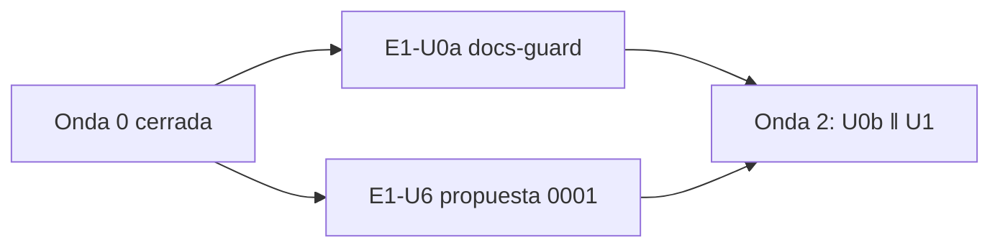

# 07 — Onda 1 de E1

## Índice

1. [Qué se hizo](#1-qué-se-hizo)
2. [Unidades](#2-unidades)
3. [Hallazgos y lecciones](#3-hallazgos-y-lecciones)
4. [Pendientes que pasan a la onda 2](#4-pendientes-que-pasan-a-la-onda-2)

## 1. Qué se hizo

La onda 1 de `N10` §14 corrió en paralelo dos unidades, una por repo. Las dos se fusionaron con la guarda G1–G4 y
citan el testimonio del PO (L2, D08 FIRME) porque son primeros merges automáticos de repo.

## 2. Unidades

| Unidad | Repo | PR | Merge (SHA) | Folio | Evidencia |
|---|---|---|---|---|---|
| E1-U0a | Lab-Documentos | [#11](https://github.com/hdcm-dev/Lab-Documentos/pull/11) | `f603984a3a4b35ea62feb7e5b3f68c0ad3331311` | 210 | `evidencia/E1-U0a/` |
| E1-U6 | Lab-E2E.WebBlazor | [#12](https://github.com/hdcm-dev/Lab-E2E.WebBlazor/pull/12) | `59399ba6678c56c3219988a5f9666fc4e0047160` | 216 | `evidencia/E1-U6/ensayo-cierre.txt` |

- **E1-U0a.** Agrega `docs-guard.yml` sobre el runner propio `[self-hosted, i7infra-dev]`; verde sobre la cabeza
  auditada `87c3b65`. El par rojo/verde se hizo en el PR #12 de Lab-Documentos (cerrado sin fusionar, rama borrada).
  Se cumplen los 4 criterios.
- **E1-U6.** Un solo archivo: `docs/propuestas/0001-Propuesta-Expediente-Documentacion-Desde-El-Codigo.md`
  (defecto H-L07, cambios C-1 a C-4 de D19/D25). Sin cambios de código; barrido S2 limpio. CI verde sobre `83542ab`.

## 3. Hallazgos y lecciones

| Id | Hallazgo | Tratamiento |
|---|---|---|
| E-F1 | Cola del runner único: 6m14s la primera vez y 15m28s tras actualizar la rama; la ejecución dura ~60 s | Esperar la corrida antes de G3 |
| — | `main` de Lab-Documentos exige `fw-ok` en modo estricto: la guarda dio `behind` | Fusionar `origin/main` en la rama antes de G1 |
| — | 8 enlaces rotos que ya había en la guía | Excluidos con nombre en `scripts/docs-guard.lychee.toml`: 7 los arregla E1-U1, 1 es el defecto plantado |
| LD-23 | `ci.yml` de Lab-E2E.WebBlazor usa `ubuntu-latest` y actions fijadas por etiqueta, no por SHA | No se tocó (fuera de alcance de U6); queda anotado |

## 4. Pendientes que pasan a la onda 2

- E1-U0b debe pasar `herramientas-ref` con el mismo SHA que su `uses:`.
- E1-U1 arregla los 7 enlaces rotos excluidos y los retira de la lista de exclusión.
- El working tree principal no se tocó (main local en `5d5c2b4`).
