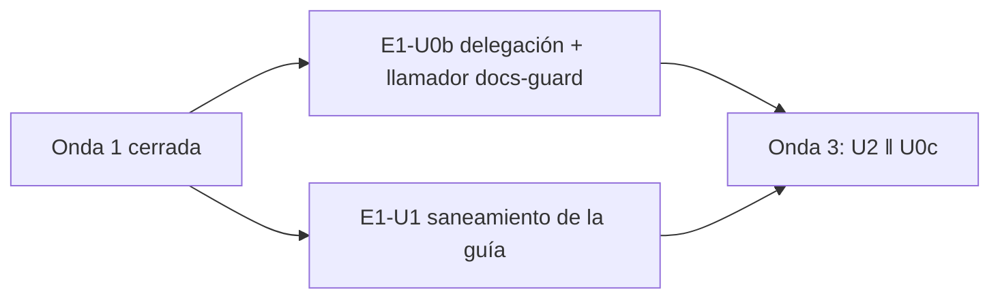

# 08 — Onda 2 de E1

## Índice

1. [Qué se hizo](#1-qué-se-hizo)
2. [Unidades](#2-unidades)
3. [Hallazgos y lecciones](#3-hallazgos-y-lecciones)
4. [Pendientes que pasan a la onda 3](#4-pendientes-que-pasan-a-la-onda-3)

## 1. Qué se hizo

La onda 2 de `N10` §14 corrió en paralelo dos unidades, una por repo. Las dos venían de una corrida anterior cortada
y se **retomaron sin duplicar** nada (commits y PR ya existentes). Ambas se fusionaron con la guarda G1–G4 releída
justo antes del merge, con merge commit atado al SHA. E1-U0b es el primer merge automático de
Lab-Documentos.Documentacion y cita el testimonio L2 del PO (D08 FIRME).

## 2. Unidades

| Unidad | Repo | PR | Merge (SHA) | Folio | Evidencia |
|---|---|---|---|---|---|
| E1-U0b | Lab-Documentos.Documentacion | [#17](https://github.com/hdcm-dev/Lab-Documentos.Documentacion/pull/17) | `34bdd44895d199c62e0bddd85b29ea8a0d4f4a78` | `211-e1-u0b.md` | `evidencia/E1-U0b/` |
| E1-U1 | Lab-Documentos | [#15](https://github.com/hdcm-dev/Lab-Documentos/pull/15) | `ad71e4745fc85b1a5889cc707ddb8f3006ac6ec2` | `211-e1-u1.md` | `evidencia/E1-U1/01-ensayo-de-cierre.txt` |

- **E1-U0b.** `CHANGELOG.md` gana la sección «Delegación del merge» (2026-10-27, responsable PO, testimonio L2).
  El llamador `docs-guard` usa `@f603984` y corrió en el runner con etiquetas `self-hosted`, `i7infra-dev`
  (job 122215336639): se cumple E-F12, así que no rige la copia con huella de D17. Par rojo/verde: rojo en
  `99eedde` (paso 2/3 enlaces, 1 error); verde en `294a2e1` con el defecto revertido (run 40522272259, 0 errores).
  Merge atado a la cabeza `0cf7e8a`. Los 3 criterios se cumplen.
- **E1-U1.** Se agregó `fa33bc0` porque el barrido S2 encontró un `owner` con nombre corto en el frontmatter de la
  guía; se alineó con el de las otras guías. lychee `--offline`: exit 0 (24 enlaces, 20 OK, 0 errores, 4 excluidos:
  el defecto plantado, 2 respaldos de cultura y 1 externo). `grep -c adoptad` = 0. Línea de base PR-1 y PR-4 en 0
  (markdownlint 0 errores; 6 bloques mermaid válidos). `scripts/ci-local.sh` verde; en el runner, `docs-guard`
  (run 40514695217) y `fw-ok` (run 40514695337). Merge atado a la cabeza `fa33bc0`. Los 3 criterios se cumplen.

Las dos ramas remotas devuelven 404, los worktrees están retirados y el working tree principal de cada repo quedó
intacto (main local: Lab-Documentos.Documentacion en `8da0cd9`, Lab-Documentos en `5d5c2b4`).

## 3. Hallazgos y lecciones

| Id | Hallazgo | Tratamiento |
|---|---|---|
| E-F1 (repite) | `fw-ok` esperó ~30 min en cola por el runner compartido con la E2E de Geometría | Esperar antes de G3 |
| U0b/LD-02, LD-05 | El PR #18 del par tenía base en la rama de #17; al borrarla GitHub lo cerró y los re-runs dieron `startup_failure` | El verde del par se lanzó por `workflow_dispatch`; no apilar PR de par sobre la rama de la unidad |
| U0b/LD-03 | Fallo de red pasajero al bajar lychee (`curl 92`) | Pase a E1-U2: el paso «herramientas» reintenta y guarda caché |
| U0b/LD-01 | `main` avanzó (#16) durante la unidad | Fusión sin actualizar la rama, admitida por no tocar los mismos archivos; queda en el folio |
| U0b/LD-04 | El repo aún no tiene cuerpo de documentación propio | `ruta: .github` como carpeta verificada |
| U1/LD-01 | Corrida anterior cortada con rama y PR ya subidos | Retomar, no rehacer |
| U1/LD-02 | `owner` con nombre corto detectado por S2 | Corregido dentro del alcance |
| U1/LD-03 | `mergeable_state` `blocked` mientras `fw-ok` estaba en cola | No es rechazo: esperar y releer |
| BIT-1 | Dos folios con el mismo número 211 (`211-e1-u0b.md`, `211-e1-u1.md`) | Anotado para la presidencia: numeración por unidad sin reserva previa |

## 4. Pendientes que pasan a la onda 3

- E1-U2: reintento y caché en el paso «herramientas» (pase de LD-03 de U0b).
- `{dir-de-trabajo}/h.cfg` quedó por si lo comparte otra unidad; retirarlo en la limpieza final.
- Abiertos que siguen: L11 (acto del PO), E-16 (avisar al PO), LD-23.
