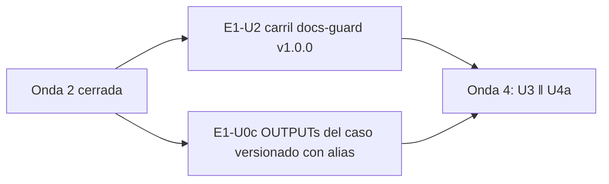

# 09 — Onda 3 de E1

## Índice

1. [Qué se hizo](#1-qué-se-hizo)
2. [Unidades](#2-unidades)
3. [Hallazgos y lecciones](#3-hallazgos-y-lecciones)
4. [Avisos al PO](#4-avisos-al-po)
5. [Pendientes que pasan a la onda 4](#5-pendientes-que-pasan-a-la-onda-4)

## 1. Qué se hizo

La onda 3 de `N10` §14 corrió dos unidades en paralelo, una en cada repo. E1-U2 venía de una corrida anterior cortada
y se **retomó sin duplicar** rama ni PR. E1-U0c empezó de cero, porque no había nada previo. Las dos se fusionaron
con la guarda G1–G4 releída justo antes del merge y con el merge commit atado al SHA. Las ramas remotas dan 404 y los
worktrees están retirados.

## 2. Unidades

| Unidad | Repo | PR | Merge (SHA) | Folio | Evidencia |
|---|---|---|---|---|---|
| E1-U2 | Lab-Documentos | [#16](https://github.com/hdcm-dev/Lab-Documentos/pull/16) | `c0766dc03fa0fcd3793a5e1185867845465ca3ed` | `212-e1-u2.md` | `evidencia/E1-U2/01`–`04` |
| E1-U0c | Lab-Documentos.Documentacion | [#20](https://github.com/hdcm-dev/Lab-Documentos.Documentacion/pull/20) | `60d94f3c3aea84205f0a0ae3e50d6b8211aacae4` | `230-e1-u0c.md` | `evidencia/E1-U0c/` (en el árbol de trabajo, fuera del PR) |

- **E1-U2.** Se retomaron los commits `265481d` y `09a4597` y el PR #16. El PR estaba `behind` porque main había
  recibido el #17, así que se trajo main con un merge (`f9ebd8a`). El único conflicto fue en `CHANGELOG`, y se
  conservaron las dos entradas. Después del merge, `ci-local.sh todo` dio verde. En el runner pasaron `docs-guard`
  (40554387515), `docs-enlaces-semanal` en seco (40554387636) y `framework-concept-demo` (40554387609), con unos
  13 min de cola. El merge quedó atado a `f9ebd8a`, y la etiqueta `docs-guard-v1.0.0` apunta a `c0766dc`.
  Criterio 5: el `workflow_dispatch` posterior al merge (run 40556547619) dio éxito y abrió el issue #18, sin rutas
  del host. Ensayo: 18 defectos plantados, cada uno en rojo sólo en su grupo; AI-3 y la base, en verde.
  E-F10: AI-3 da 0 en la guía y 13 en `Guides/`. E-F14: 4 repos y 137 MB, 16,5 s en local y 46,7 s en el
  runner. Se cumplen los 6 criterios. No se crearon contenedores.
- **E1-U0c.** La rama salió de `origin/main` `34bdd44`. Se versionó el `OUTPUTs/` completo del caso en un solo commit,
  `cc2bfd6`, con 178 archivos y sin `evidencia/local/`. Las rutas del host se reescribieron desde la raíz del
  workspace. Lo que no se publica va con alias: `KB-privada` y `INFRA-privada` (la API confirmó que los dos repos son
  privados), además de la organización, el runner y el contenedor del SDD-B, la carpeta de intermedios, la memoria del
  agente y la cuenta. La tabla de alias está en el README del expediente. La cita L10 lleva el servicio y la
  organización entre corchetes. Criterios: (1) barrido S2 vacío (el patrón de 099 §11 da 3 falsos positivos
  públicos, explicados; con el patrón B, exit 1/1); (2) `git ls-files evidencia/local` da 0; (3) `Verificar` en
  verde (run 40526214446, jobs `verificar` y `docs-guard`). El commit de merge no tiene corridas propias porque
  `verificar.yml` sólo se dispara por `pull_request` y `workflow_dispatch`.

Los mains locales del PO no se tocaron: Lab-Documentos sigue en `5d5c2b4` y Lab-Documentos.Documentacion en `8da0cd9`.

## 3. Hallazgos y lecciones

| Id | Hallazgo | Tratamiento |
|---|---|---|
| E-F1 (repite) | Unos 13 min de cola en el runner compartido | Esperar antes de G3 |
| U2/LD-01 | PR `behind` con corridas ya auditadas | Traer main con un merge, no con rebase; el conflicto de CHANGELOG conserva las dos entradas |
| U2/LD-02 | `workflow_dispatch` sólo funciona con un workflow que ya está en la rama por defecto | Criterio 5 verificado después del merge, como declaraba el PR |
| U2/LD-03 | No hay `gh` y el working tree principal no se toca | Etiqueta ligera creada por `POST /git/refs`; se puede reemplazar por una anotada sin cambiar el SHA |
| U2/LD-04 | El main local del PO tiene cambios | Alcanzabilidad comprobada con `fetch` y `origin/main` |
| U2/LD-05 | El informe del issue se corta en 60 000 bytes con `head -c` y puede dejar un `
` abierto | Deuda conocida: cortar por línea y cerrar el bloque (aditivo) |
| U0c/LD-01 | El criterio de N10 no nombra los repos privados | También van con alias (`KB-privada`, `INFRA-privada`) |
| U0c/LD-02 | La cita literal L10 nombraba un servicio y una organización privados | Esos nombres van entre corchetes dentro de la cita |
| U0c/LD-03 | El render de Markdown se traga `<x>` fuera de código | Alias sin corchetes angulares |
| U0c/LD-04 | Falsos positivos del patrón de 099 §11 (`-i` hace que `/Users/` coincida con `/users/` de la API) | Se explican; se usa el patrón B |
| U0c/LD-05 | La copia publicada y el árbol de trabajo del PO divergen | Aviso al PO (§4) |
| U0c/LD-06 | El folio lleva el SHA del merge, que no se conoce antes | El folio 230 y la evidencia de U0c quedan fuera del PR, para la resincronización |
| BIT-1 | La numeración 212 y 230 no choca con otras | El folio 211 sigue duplicado (onda 2) |

## 4. Avisos al PO

- **Antes de `git pull` en Lab-Documentos.Documentacion** hay que mover o borrar la copia sin versionar de
  `OUTPUTs/` del caso. Esa copia choca con los archivos que ahora están en main, y `git pull` no la sobrescribe
  (U0c/LD-05). Los folios y la evidencia posteriores a `cc2bfd6` (por ejemplo, 212, 230, `evidencia/E1-U0c/`)
  se resincronizan en una unidad posterior.

## 5. Pendientes que pasan a la onda 4

- Resincronizar los folios y la evidencia posteriores a `cc2bfd6` en `OUTPUTs/` (U0c/LD-05 y LD-06).
- Deuda del carril: corte del informe por línea y cierre de `
` (U2/LD-05), para una unidad próxima.
- `{dir-de-trabajo}/h.cfg` se retira en la limpieza final.
- Siguen abiertos L11 (acto del PO), E-16 (avisar al PO), LD-23 y BIT-1.
