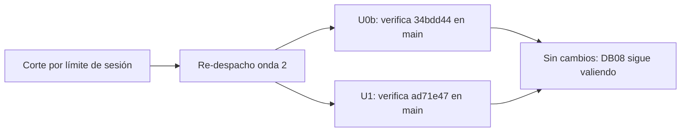

# 10 — Onda 2 de E1: reanudación (verificación)

## Índice

1. [Qué se hizo](#1-qué-se-hizo)
2. [Verificación por unidad](#2-verificación-por-unidad)
3. [Hallazgos](#3-hallazgos)
4. [Efecto sobre el punto de continuación](#4-efecto-sobre-el-punto-de-continuación)

## 1. Qué se hizo

Definición: una **reanudación de verificación** vuelve a despachar una onda ya cerrada después de un corte por límite
de sesión. No cambia nada; sólo comprueba que lo registrado sigue igual en el remoto.

Al reanudar el workflow después del límite de sesión, se volvió a despachar la onda 2 (E1-U0b ‖ E1-U1). Esa onda ya
estaba cerrada ([DB08](08-2026-10-27-Onda2.md)), y la onda 3 también ([DB09](09-2026-10-27-Onda3.md)). Las dos
unidades **no hicieron ningún cambio**: sólo verificaron el estado. No se hicieron commits, PRs ni merges nuevos, y
no se tocó ningún working tree principal.

## 2. Verificación por unidad

| Unidad | PR | Merge en `origin/main` | Rama remota | Criterios | Folio |
|---|---|---|---|---|---|
| E1-U0b | [Lab-Documentos.Documentacion#17](https://github.com/hdcm-dev/Lab-Documentos.Documentacion/pull/17) | `34bdd44895d199c62e0bddd85b29ea8a0d4f4a78` | No queda ninguna `u0b` | 3/3 | `211-e1-u0b.md` |
| E1-U1 | [Lab-Documentos#15](https://github.com/hdcm-dev/Lab-Documentos/pull/15) | `ad71e4745fc85b1a5889cc707ddb8f3006ac6ec2` | No existe | 3/3 | `211-e1-u1.md` |

- **E1-U0b.** Se confirmó la sección «Delegación del merge» del `CHANGELOG.md` (testimonio L2). También E-F12:
  `docs-guard@f603984` corrió en `[self-hosted, i7infra-dev]`. El par rojo/verde es el del PR #18: rojo en
  `99eedde` y verde en `294a2e1` por `workflow_dispatch`; #18 está cerrado sin fusionar. Las lecciones LD-01 a LD-05
  no cambian.
- **E1-U1.** Se confirmó lychee `--offline` con 0 errores, ningún `adoptad` en la línea de `llms.txt` y PR-1 y PR-4
  con línea de base 0. `ci-local.sh` está verde sobre `fa33bc0` y en el runner pasaron los runs 40514695217 y
  40514695337. Evidencia: `evidencia/E1-U1/01-ensayo-de-cierre.txt`.

## 3. Hallazgos

| Id | Hallazgo | Tratamiento |
|---|---|---|
| BIT-2 | Al reanudar, el workflow volvió a despachar una onda ya cerrada (la 2), aunque la 3 también lo estaba | Inocuo, porque las unidades verificaron antes de actuar. Para la presidencia: al reanudar, empezar por el punto de continuación de `00-Indice.md` §6 (onda 4) |
| BIT-1 (sigue) | Folio 211 repetido (`211-e1-u0b.md`, `211-e1-u1.md`) | Abierto: presidencia |
| U0b (sigue) | `{dir-de-trabajo}/h.cfg` sigue ahí | Retirarlo en la limpieza final |
| U0b/LD-03 (sigue) | `curl 92` al bajar lychee | Ya se había pasado a E1-U2 (onda 3, cerrada) |

## 4. Efecto sobre el punto de continuación

El punto de continuación no cambia: sigue en la **onda 4** (E1-U3 ‖ E1-U4a), como dice `00-Indice.md` §6.
