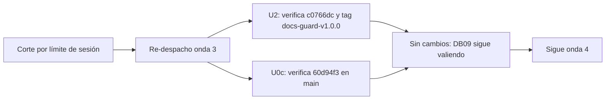

# 11 — Onda 3 de E1: reanudación (verificación)

## Índice

1. [Qué se hizo](#1-qué-se-hizo)
2. [Verificación por unidad](#2-verificación-por-unidad)
3. [Hallazgos](#3-hallazgos)
4. [Efecto sobre el punto de continuación](#4-efecto-sobre-el-punto-de-continuación)

## 1. Qué se hizo

Definición: una **reanudación de verificación** vuelve a despachar una onda ya cerrada después de un corte por límite
de sesión. No cambia nada; sólo comprueba que lo registrado sigue igual en el remoto (ver [DB10](10-2026-10-27-Onda2-Reanudacion.md)).

Tras la orden del PO «retoma tus subtareas y subagentes, el limite de la sesión terminó», el workflow volvió a
despachar la onda 3 (E1-U2 ‖ E1-U0c), cerrada en [DB09](09-2026-10-27-Onda3.md). Las dos unidades **no hicieron
ningún cambio**: no hubo commits, PRs ni merges nuevos, y no se tocó ningún working tree principal.

## 2. Verificación por unidad

| Unidad | PR | Merge en `origin/main` | Rama remota | Criterios | Folio |
|---|---|---|---|---|---|
| E1-U2 | [Lab-Documentos#16](https://github.com/hdcm-dev/Lab-Documentos/pull/16) | `c0766dc03fa0fcd3793a5e1185867845465ca3ed` (tag `docs-guard-v1.0.0`) | No existe | 6/6 | `212-e1-u2.md` |
| E1-U0c | [Lab-Documentos.Documentacion#20](https://github.com/hdcm-dev/Lab-Documentos.Documentacion/pull/20) | `60d94f3c3aea84205f0a0ae3e50d6b8211aacae4` | No queda `u0c`; tampoco worktree | 3/3 | `230-e1-u0c.md` |

- **E1-U2.** La etiqueta `docs-guard-v1.0.0` apunta a `c0766dc`, y la cabeza auditada `f9ebd8a` es alcanzable desde
  `origin/main`. Los datos coinciden con DB09: 18 defectos plantados (cada uno rojo sólo en su grupo; base y AI-3 en
  verde); runs en `[self-hosted, i7infra-dev]` `docs-guard` 40554387515, `docs-enlaces-semanal` 40554387636 y
  `framework-concept-demo` 40554387609; `workflow_dispatch` 40556547619, que abrió el issue #18. E-F10: AI-3 da 0 en
  la guía y 13 en `Guides/`. E-F14: 4 repos, 137 MB, 16,5 s en local y 46,7 s en el runner. Evidencia:
  `evidencia/E1-U2/` (01 a 04).
- **E1-U0c.** El commit `cc2bfd6` (178 archivos, todos dentro de `OUTPUTs/`) llegó a `origin/main` por el merge
  `60d94f3`. Criterios: barrido S2 vacío (`evidencia/E1-U0c/01-barrido-s2.txt`); `git ls-files` de
  `evidencia/local` da 0; `Verificar` en verde (run 40526214446, en el runner de desarrollo). Lecciones LD-01 a LD-06
  en el folio, sin cambios.

## 3. Hallazgos

| Id | Hallazgo | Tratamiento |
|---|---|---|
| BIT-3 | Segunda reanudación consecutiva que re-despacha una onda ya cerrada (antes la 2, ahora la 3) | Inocuo: las unidades verificaron antes de actuar. Para la presidencia: al reanudar, despachar desde `00-Indice.md` §6 (onda 4); no repetir ondas cerradas |
| U2/LD-05 (sigue) | El informe del issue se corta en 60 000 bytes y puede dejar un `
` abierto | Deuda conocida: cortar por línea y cerrar el bloque en una unidad posterior |
| U0c/LD-05 (sigue) | La copia local sin versionar de `OUTPUTs/` del PO choca con main | Abierto: avisar al PO (mover o borrar antes del `pull`) |
| U0c/LD-05 (sigue) | Folio 230 y posteriores sin versionar | Resincronizar con `redact.py` en una unidad posterior |
| BIT-1 (sigue) | Folio 211 repetido | Abierto: presidencia |
| U0b (sigue) | `{dir-de-trabajo}/h.cfg` compartido | Retirarlo en la limpieza final |

## 4. Efecto sobre el punto de continuación

El punto de continuación no cambia: sigue en la **onda 4** (E1-U3 ‖ E1-U4a), como dice `00-Indice.md` §6.
