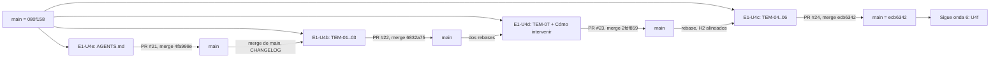

# 13 — Onda 5 de E1: E1-U4b ‖ E1-U4c ‖ E1-U4d ‖ E1-U4e

## Índice

1. [Definiciones](#1-definiciones)
2. [Qué se hizo](#2-qué-se-hizo)
3. [Resultado por unidad](#3-resultado-por-unidad)
4. [Criterios de aceptación](#4-criterios-de-aceptación)
5. [Lecciones de decisión destacadas](#5-lecciones-de-decisión-destacadas)
6. [Hallazgos e incidentes](#6-hallazgos-e-incidentes)
7. [Efecto sobre el punto de continuación](#7-efecto-sobre-el-punto-de-continuación)

## 1. Definiciones

- **Onda**: grupo de unidades de E1 que corren en paralelo porque tocan carpetas distintas (N10 §14). La onda 5
  junta cuatro unidades en Lab-Documentos: U4b, U4c y U4d escriben temas en GUIA-DIR; U4e pone `AGENTS.md` en la raíz.
- **CPA**: conformación de pull request automática (guarda G1–G4, merge atado al SHA de la cabeza, rama borrada con
  comprobación 404).
- **P-LECT**: prueba de lectura. Un lector sin contexto lee el texto y lista las preguntas que le quedaron abiertas.
- **Tema (TEM-SDEI-nn)**: capítulo del cuerpo SDEI con los seis encabezados del Profile. El ID lleva `SDEI` porque
  `TEM-01..08` ya están declarados en `Concepts/Framework-Concept`.
- **Huella AK-3**: hash del archivo exceptuado. Si el archivo cambia, la excepción deja de valer y el control vuelve
  a dar rojo.

## 2. Qué se hizo

Ninguna de las cuatro unidades encontró rastros de una corrida anterior (ni worktree, ni rama, ni PR, ni folio), así
que todas arrancaron de cero desde `080f158`. Se fusionaron en este orden: U4e, U4b, U4d y U4c. Cada PR que llegó
después tuvo que integrar el main que habían dejado los anteriores. Los conflictos fueron siempre en `CHANGELOG.md`,
`README` y `Referencias.md`, y se resolvieron conservando las entradas de todos. Las cuatro se fusionaron por CPA sin
consultar al PO (D08 firme, L2), y cada PR cita el testimonio. El bitacorista comprobó que `origin/main` de
Lab-Documentos está en `ecb63420`, que los cuatro merges están en la historia y que no queda rama remota de E1.

## 3. Resultado por unidad

| Unidad | PR | Merge (`origin/main`) | Cabeza | Runs en `[self-hosted, i7infra-dev]` | Folio | Evidencia |
|---|---|---|---|---|---|---|
| E1-U4e | [Lab-Documentos#21](https://github.com/hdcm-dev/Lab-Documentos/pull/21) | `4fa998e613932dd5b767b9c220764fb351c6553d` | `c483d80` | `docs-guard` 40580884735, mini-demo, framework-concept | `250-e1-u4e.md` | `evidencia/E1-U4e/` (01 a 03) |
| E1-U4b | [Lab-Documentos#22](https://github.com/hdcm-dev/Lab-Documentos/pull/22) | `6832a752ddbf7aaaaa555c200a9763588d8fc5ef` | `6dddbd7` | `docs-guard` 40585466886 | `218-e1-u4b.md` | `evidencia/E1-U4b/` (00 a 07) |
| E1-U4d | [Lab-Documentos#23](https://github.com/hdcm-dev/Lab-Documentos/pull/23) | `2fdf859ce3c8131ba6226951b7981e7d046468d0` | `f697528` | `docs-guard` 40588253783, `framework-concept-demo` 40588253715 | `251-e1-u4d.md` | `evidencia/E1-U4d/` (01 a 07) |
| E1-U4c | [Lab-Documentos#24](https://github.com/hdcm-dev/Lab-Documentos/pull/24) | `ecb63420d2204ab6073136275713cb6be008e99e` | `fc6351e` | `docs-guard` 40590237182 | `252-e1-u4c.md` | `evidencia/E1-U4c/` (01 a 05) |

- **E1-U4e.** `AGENTS.md` quedó en la raíz como puntero de la ruta «agente» de D27, con frontmatter
  `IDX-LABDOC-AGENTS`. Trae la ruta de lectura, la validación con `ci-local.sh`, la tabla de clases P/H y 7 anexos.
  lychee resolvió 26/26 enlaces, y un destino y un ancla rotos plantados dieron rojo. Queda fuera de AI-3 por huella
  AK-3: sin la excepción AI-3 da 1, con ella da 0, y si el archivo cambia vuelve a dar 1. Desde ahora
  `ci-local.sh` revisa el `AGENTS.md` de la raíz en enlaces, ai y estructura. Si el archivo falta, sólo avisa,
  porque otros repos usan el workflow reutilizable.
- **E1-U4b.** Escribió TEM-01 (sistema documentador), TEM-02 (ciclo documental) y TEM-03 (topología y versionado),
  con IDs TEM-SDEI-01..03, y sumó 16 referencias en `Referencias.md` §7, consultadas el 2026-10-27. reflint dio 47
  referencias y 0 errores. Hay 14, 6 y 11 fuentes por tema y un ensayo reproducible por tema. Las adopciones P1–P6
  tienen 2 o 3 repositorios cada una, todas fechadas entre 2026-01 y 2026-10. Los H2 sin número quedaron en main y
  fijaron la forma de los temas siguientes.
- **E1-U4d.** Escribió TEM-07 (marco SDD, en borrador hasta E2), con la frontera por clase de pieza: lo que se cita
  del SDD, lo que se agrega y lo que decide una persona. Trae un ensayo repetible contra el SDD de Lab-Geometria en
  `5f07b12`, con cuatro resultados: todo el árbol da traza ambigua (por `_legacy/`), sin `_legacy` da verde, con una
  versión vieja da desfasada y con un ID renumerado no resuelve. El guion se volvió a correr sobre un clon nuevo y dio
  lo mismo. También escribió `Examples/Como-Intervenir.md`, la plantilla CR-5 de cinco pasos con bloques
  entradas/salidas/validaciones, y su instancia `Examples/Como-Intervenir-Lab-Documentos.md`, que traza a
  `IDX-SDEI@2.0` (la prueba negativa da rojo). Sumó tres referencias APA.
- **E1-U4c.** Escribió TEM-04 (doble audiencia), TEM-05 (ayuda al usuario final) y TEM-06 (compuertas y CI), con
  7, 3 y 4 fuentes fechadas y un ensayo por tema. Se rebasó sobre U4b y U4d, y alineó sus encabezados a la forma de
  main. Ahora VER-T07 se cumple en los siete temas y la cadena TEM-03 a TEM-07 está enlazada en los dos sentidos.
  Además corrigió un dato del Marco §6, de PE-01 y de EJR-SDEI-04: el defecto 60/80 está en el nombre de una
  localidad (RN-LOC-01), no en un comentario.

## 4. Criterios de aceptación

| Unidad | Cumplidos | En parte | Detalle |
|---|---|---|---|
| E1-U4e | 3/3 | — | Ensayo `ci-local` en verde, 8/8 grupos |
| E1-U4b | 3/4 (1, 3, 4, 6) | 2 | Cuando se fusionó, TEM-04 no existía y el «siguiente» de TEM-03 lo nombraba sin enlazarlo. Lo cerró U4c (#24). P-LECT en 3 rondas por tema: las dudas altas pasaron de 2/5/4 a 1/3/2 y se corrigieron todas, sin una cuarta ronda |
| E1-U4d | 6/6, con dos salvedades | — | El enlace «anterior» de TEM-07 apuntaba a la fila de TEM-06 en el README hasta U4c, que ya lo enlazó. Ningún control comprueba todavía los bloques de la plantilla CR-5 (pasa a U4f/E2). P-LECT de TEM-07 en 4 rondas, con dudas altas 2, 3, 3 y 1, y la última se corrigió |
| E1-U4c | 5/5 (1, 2, 3, 4, 6) | — | El criterio 5 es de U4d. P-LECT en 3 rondas: las altas pasaron de 2/0/1 a 1/0/1 y después a 0/1/1, y se corrigieron todas, incluso las de la tercera ronda |

En ningún tema la P-LECT, con cada tema leído solo, llegó a cero estricto. Las tres unidades dejan ese umbral para
G-e de E1-G, igual que en la onda 4.

## 5. Lecciones de decisión destacadas

Las lecciones completas están en los folios: U4e tiene LD-01 a LD-06, U4b LD-01 a LD-08, U4d LD-01 a LD-08 y U4c
LD-01 a LD-09.

| Unidad | Decisión | Por qué importa para las ondas siguientes |
|---|---|---|
| U4b | IDs `TEM-SDEI-nn`, porque `TEM-01..08` ya están en `Concepts/` | El registro de IDs es único por repo (sigue LD-01 de U4a) |
| U4b, U4d | H1 «Tema 0n — …» que no empieza con el ID, y H2 sin número | Es la forma de main. U4c la adoptó al rebasar. Hay que conservarla en U4f y en E2 |
| U4c | G3 se lee por corrida de workflow: los jobs salteados por alcance (framework-concept-demo) no cuentan como reserva | Conviene decirlo explícitamente en el Knowledge de CPA |
| U4d | Ante un conflicto o un atraso por merges ajenos, rebasar y conservar las entradas de todos en CHANGELOG y Referencias | Contradice la consigna «merge, no rebase» de §6. Las dos funcionaron. La presidencia decide cuál queda |
| U4e | Si falta `AGENTS.md`, `ci-local.sh` sólo avisa | Otros repos consumen el workflow reutilizable sin `AGENTS.md` |
| U4e | El merge cita el testimonio 130 §2 L2 | Así lo pide la carta común para cada PR |

## 6. Hallazgos e incidentes

| Id | Hallazgo | Tratamiento |
|---|---|---|
| U4b · H-1 | `dg.py` rechaza `traces: []` aunque el anexo del esquema lo admite | Sin corregir. Pasa a U4f o E2 |
| U4d (E2) | En un repo con SDD propio, `dg.py` necesita poder excluir carpetas (`_legacy/`) y resolver los prefijos externos contra el mismo repo. Hoy un `CU-` que no resuelve sólo avisa | Pasa a E2 |
| U4d | Ningún control comprueba que la plantilla CR-5 tenga sus bloques | Pasa a U4f o E2 |
| U4d | El commit de merge no tiene CI porque los workflows sólo corren en `pull_request` | Anotado. Correr `workflow_dispatch` tras el merge si hace falta (como en U3) |
| U4c (corregido) | El dato 60/80 estaba en el nombre de una localidad (RN-LOC-01), no en un comentario. Se corrigió en el Marco §6, PE-01 y EJR-SDEI-04 | Cerrado |
| BIT-5 (seguridad) | U4c avisa que en `{dir-de-trabajo}/` quedó, de otra unidad, un `.cfg` con una credencial local (PE-10). El bitacorista comprobó que `h.cfg` sigue ahí | Abierto · presidencia: borrarlo ya, no esperar a la limpieza final. Rotar la credencial es un acto del PO (tiene consecuencia externa) |
| BIT-6 | `{dir-de-trabajo}/convencion-temas-sdei.txt`, citado por U4b y U4d, ya no está | La forma vigente es la de main (H1 sin ID, H2 sin número). No hace falta el archivo |
| Merge vs rebase | U4d y U4c rebasaron, U4b trajo main con merge | Ver §5 |
| Limpieza | U4e borró su worktree, su rama y los intermedios, y no dejó contenedores. `{dir-de-trabajo}/wt/` quedó vacío. No queda ninguna rama remota de E1. La única rama ajena es `cierre/0001-tpr-emulador` (BIT-4), que no se toca | Cerrado |

El árbol principal de Lab-Documentos sigue en `5d5c2b4` y el de Lab-Documentos.Documentacion en `8da0cd9`, con los
cambios del PO sin tocar. Siguen abiertos de antes: L11 (acto del PO), E-16 y U0c/LD-05 (avisar al PO), LD-23, BIT-1,
la deuda U2/LD-05 y resincronizar `OUTPUTs/` posteriores a `cc2bfd6`. A esa resincronización se suman los folios
218, 250, 251 y 252 y la evidencia de E1-U4b, U4c, U4d y U4e.

## 7. Efecto sobre el punto de continuación

La onda 5 está cerrada y `origin/main` de Lab-Documentos quedó en `ecb6342`. Ya están en main los siete temas del
cuerpo SDEI, «Cómo intervenir» con su instancia, y `AGENTS.md`. Sigue la **onda 6** (E1-U4f: piloto APA, cierre de
D28 y reconsulta de fechas), y después la onda 7 (U5) y la onda 8 (E1-G). Ver `00-Indice.md` §6.
