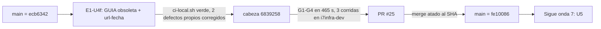

# 14 — Onda 6 de E1: E1-U4f

## Índice

1. [Definiciones](#1-definiciones)
2. [Qué se hizo](#2-qué-se-hizo)
3. [Resultado de la unidad](#3-resultado-de-la-unidad)
4. [Criterios de aceptación](#4-criterios-de-aceptación)
5. [Lecciones de decisión](#5-lecciones-de-decisión)
6. [Hallazgos e incidentes](#6-hallazgos-e-incidentes)
7. [Efecto sobre el punto de continuación](#7-efecto-sobre-el-punto-de-continuación)

## 1. Definiciones

- **Onda 6**: la sexta onda de E1 según N10 §14. Tiene una sola unidad, E1-U4f, que cierra D28: la guía de un solo
  archivo pasa a obsoleta y las citas web tienen que llevar fecha de consulta.
- **GUIA (DOC-SDT-0001)**: la guía de un solo archivo anterior al cuerpo SDEI. Su reemplazo es `IDX-SDEI`.
- **Tabla de destinos**: tabla que, para cada sección H2/H3 de GUIA, dice a qué documento del cuerpo nuevo pasó su
  contenido y si pasó completo o en parte. Si pasó en parte, dice qué quedó afuera.
- **`dg.py url-fecha`**: control nuevo de docs-guard en el grupo PR-7 (paso «fijadas»). Revisa las URL con esquema y
  las citas por dominio dentro de code spans. Cada una necesita, en su párrafo o fila, una fecha de consulta o una
  cita a `#ref-`.
- **Bloquea / avisa**: en el cuerpo nuevo el control bloquea (rojo), salvo en documentos con `status: obsoleto`. En lo
  heredado sólo avisa.
- **CPA**: conformación de pull request automática (guarda G1–G4, merge atado al SHA, rama borrada con 404).

## 2. Qué se hizo

No quedaba nada de una corrida anterior (ni worktree, ni rama, ni PR, ni folio), así que la unidad arrancó de cero
desde `origin/main` `ecb6342`, que ya tenía U3, U4b, U4c y U4d.

- GUIA quedó en `status: obsoleto`. Tiene un aviso que nombra el reemplazo (`IDX-SDEI`) y una tabla de destinos para
  sus 47 secciones H2/H3: 38 pasaron completas y 9 en parte, y cada una de estas dice qué no se trasladó. El texto
  original no se tocó. Se archiva en la versión siguiente.
- Se agregó `dg.py url-fecha`. No marca direcciones locales, dominios de ejemplo, plantillas con `…`, direcciones
  `.git` ni imágenes de contenedor con etiqueta. La autoprueba tiene fixtures rojo, verde y obsoleto.
- Se actualizaron el README del cuerpo, el Mapa, TEM-06, CQ-11, el README de docs-guard y el CHANGELOG. Se agregó la
  fecha de consulta a una cita de TEM-07 (la URL se verificó, HTTP 200).

El merge se hizo por CPA sin consultar al PO (D08 firme, L2), y el PR cita el testimonio. El bitacorista comprobó que
`origin/main` de Lab-Documentos está en `fe10086` (merge #25 sobre la cabeza `6839258`) y que no queda rama remota de
E1.

## 3. Resultado de la unidad

| Unidad | PR | Merge (`origin/main`) | Cabeza | Corridas en `[self-hosted, i7infra-dev]` | Folio | Evidencia |
|---|---|---|---|---|---|---|
| E1-U4f | [Lab-Documentos#25](https://github.com/hdcm-dev/Lab-Documentos/pull/25) | `fe10086f2b083f6cfe227da49174d204c1b0e008` | `6839258` | `docs-guard` 40593745133, `mini-demo-movilidad` 40593744997, `framework-concept-demo` 40593745265 (las tres con éxito) | `260-e1-u4f.md` | `evidencia/E1-U4f/` (01 a 04) |

En la primera corrida de `ci-local.sh` aparecieron dos defectos propios, que se corrigieron antes del push:
`RE_URL` pisaba la expresión de AI-4, y TEM-06 tenía una cita sin referencia. El commit de merge no tiene corridas
porque los workflows sólo corren en `pull_request`.

## 4. Criterios de aceptación

| # | Criterio | Resultado |
|---|---|---|
| 1 | Cada sección de GUIA tiene destino | Sí: 47 de 47, y ningún `doc_id` inexistente. Las anclas las valida lychee con `--include-fragments` |
| 2 | El cuerpo nuevo no tiene citas sin fecha | Sí: 0 errores en los 41 documentos que bloquean. GUIA da 33 avisos (5 URL y 28 por dominio). Si GUIA vuelve a borrador, da rojo con esos mismos 33 |
| 3 | El control detecta una cita sin fecha | Sí: el fixture rojo da rc=1. Una cita por dominio plantada en TEM-03 da rojo, y el aviso heredado no la detecta |

Los tres se cumplen. E-F7 queda cerrado.

## 5. Lecciones de decisión

El folio `260-e1-u4f.md` tiene 8 lecciones (LD-01 a LD-08). Las que pesan para lo que sigue:

| Decisión | Por qué importa |
|---|---|
| GUIA se declara obsoleta sin tocar su texto, y se archiva en la versión siguiente | Es reversible y deja la traza de cada sección |
| `url-fecha` bloquea en el cuerpo nuevo y avisa en lo heredado y en lo obsoleto | La regla de D28 rige sin romper la CI por la deuda vieja |
| Un `#ref-` en el mismo párrafo o fila equivale a la fecha | La fecha vive una vez en `Referencias.md` |

## 6. Hallazgos e incidentes

| Id | Hallazgo | Tratamiento |
|---|---|---|
| U4f · H-1 | El paso «avisos» repite `url-fecha` sobre el cuerpo nuevo, y los 33 avisos de GUIA aparecen como anotaciones en cada PR hasta que se archive | Abierto. Se resuelve al archivar GUIA (versión siguiente) o al sacar el cuerpo nuevo del paso «avisos» |
| U4f · H-2 | F011 decía 44 citas por dominio. Son 28: la diferencia eran nombres de archivo | Cerrado (dato corregido) |
| U4f · H-3 = BIT-5 | `{dir-de-trabajo}/h.cfg` sigue ahí. U4f no lo tocó, y el bitacorista comprobó que sigue | Abierto · presidencia: borrarlo ya. Rotar la credencial es acto del PO |
| E-F7 | Citas web sin fecha de consulta | Cerrado por U4f |
| De la onda 5 | `dg.py` rechaza `traces: []` (U4b · H-1), no hay control de los bloques de CR-5, y `dg.py` no excluye carpetas (U4d) | U4f no los trató. Pasan a E2 |
| Limpieza | Se borraron el worktree, la rama local y `{dir-de-trabajo}/u4f`. No se usaron contenedores. `{dir-de-trabajo}/wt/` quedó vacío | Cerrado |

El árbol principal de Lab-Documentos sigue en `5d5c2b4` y el de Lab-Documentos.Documentacion en `8da0cd9`, con los
cambios del PO sin tocar. A la resincronización de `OUTPUTs/` posteriores a `cc2bfd6` se suman el folio 260 y la
evidencia de E1-U4f.

## 7. Efecto sobre el punto de continuación

La onda 6 está cerrada, D28 queda cumplida en el cuerpo nuevo y `origin/main` de Lab-Documentos quedó en `fe10086`.
Sigue la **onda 7** (E1-U5), y después la onda 8 (la compuerta E1-G). Ver `00-Indice.md` §6.
