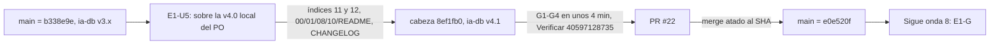

# 15 — Onda 7 de E1: E1-U5

## Índice

1. [Definiciones](#1-definiciones)
2. [Qué se hizo](#2-qué-se-hizo)
3. [Resultado de la unidad](#3-resultado-de-la-unidad)
4. [Criterios de aceptación](#4-criterios-de-aceptación)
5. [Lecciones de decisión](#5-lecciones-de-decisión)
6. [Hallazgos e incidentes](#6-hallazgos-e-incidentes)
7. [Efecto sobre el punto de continuación](#7-efecto-sobre-el-punto-de-continuación)

## 1. Definiciones

- **Onda 7**: la séptima onda de E1 según N10 §14. Tiene una sola unidad, E1-U5, que reindexa la ia-db de
  Lab-Documentos.Documentacion para que cubra todo lo que E1 agregó a Lab-Documentos.
- **ia-db**: la base de índices para agentes de Lab-Documentos.Documentacion (`ia-db/`). Tiene índices numerados, un
  README con navegación y un manifiesto con `base_commit`.
- **`base_commit`**: el commit de Lab-Documentos hasta el que llega el índice. En E1 tiene que ser el merge de U4f
  (`fe10086`).
- **Barrido S2**: grep de rutas del host, IP privadas, cuentas y nombres de repos privados, que se corre antes de cada
  push a un repo público.
- **CPA**: conformación de pull request automática (guarda G1–G4, merge atado al SHA, rama borrada con 404).

## 2. Qué se hizo

No quedaba nada de una corrida anterior (ni worktree, ni rama, ni PR, ni folio), así que la unidad arrancó de cero
desde `origin/main` `b338e9e`.

- `origin/main` tenía la ia-db v3.x. La v4.0 (2026-10-18) existía sólo como cambios sin commitear en el árbol principal
  del PO. La unidad construyó sobre la v4.0 y la publicó en el mismo PR como **v4.1** (LD-01, mismo precedente que
  U0c).
- Índices nuevos: `11_Sistema-Documentador-SDEI` (los 29 `doc_id` del cuerpo, mini demo, docs-guard y sus cuatro
  workflows, `AGENTS.md`, procedencia en el expediente 0002) y `12_Framework-Concept`.
- Se actualizaron 00, 01 (DOC-SDT-0001 pasa a obsoleto), 08, 10 y el README (navegación y manifiesto v4.1 con
  `base_commit` `fe10086f2b083f6cfe227da49174d204c1b0e008`). Los índices 02–05 y 07 conservan su corte en `5d5c2b4`
  porque sus fuentes no cambiaron. Hay una entrada nueva en el CHANGELOG.
- Por el barrido S2 se redactaron en 00, 06, 09 y 10 la cuenta personal y las IP privadas que se citaban del corpus.

El merge se hizo por CPA sin consultar al PO (D08 firme, L2), y el PR cita el testimonio. El bitacorista comprobó que
`origin/main` de Lab-Documentos.Documentacion está en `e0e520f` (merge #22 sobre la cabeza `8ef1fb0`) y que el remoto
no tiene más rama que `main`.

## 3. Resultado de la unidad

| Unidad | PR | Merge (`origin/main`) | Cabeza | Corrida en `[self-hosted, i7infra-dev]` | Folio | Evidencia |
|---|---|---|---|---|---|---|
| E1-U5 | [Lab-Documentos.Documentacion#22](https://github.com/hdcm-dev/Lab-Documentos.Documentacion/pull/22) | `e0e520f2d5ca323d46cf202aacfba8e06349e283` | `8ef1fb0` | Verificar 40597128735: jobs `verificar` y `docs-guard` con éxito | `270-e1-u5.md` | `evidencia/E1-U5/` (01 a 03) |

Ensayo previo: 185 enlaces y anclas de la ia-db, 0 rotos. De las 228 rutas citadas, 9 no existen y las 9 son
intencionales. Ningún índice pasa de 500 líneas (el mayor tiene 423), no hay duplicados y el barrido S2 quedó vacío.
El commit de merge no tiene corridas porque Verificar sólo corre en `pull_request`.

## 4. Criterios de aceptación

| # | Criterio | Resultado |
|---|---|---|
| 1 | Toda pieza nueva está indexada | Sí: 55 de 55 `.md` agregados o modificados entre `5d5c2b4` y `fe10086`, y 29 de 29 `doc_id` del cuerpo |
| 2 | `base_commit` = merge de U4f | Sí: `fe10086` |
| 3 | `llms.txt` enlazado si hay sitio | No aplica: E1 no tiene sitio, así que no se enlaza ninguno |

Los tres se cumplen.

## 5. Lecciones de decisión

El folio `270-e1-u5.md` tiene 8 lecciones (LD-01 a LD-08). Las que pesan para lo que sigue:

| Decisión | Por qué importa |
|---|---|
| LD-01: publicar la v4.0 local del PO como v4.1 en el mismo PR, en vez de reindexar sobre la v3.x de main | Es aditivo y deja una sola versión vigente. Obliga al PO a descartar su copia local antes del pull |
| Índices sin cambio en sus fuentes conservan su corte (`5d5c2b4`) | El corte de cada índice sigue diciendo hasta dónde llega de verdad |
| LD-08: la línea `Co-Authored-By` sigue el recordatorio del entorno y no la carta | Si la carta y el entorno difieren, rige el entorno. La presidencia debería alinear la carta |

## 6. Hallazgos e incidentes

| Id | Hallazgo | Tratamiento |
|---|---|---|
| U5 · P-1 | La copia local de `ia-db/` del PO (v4.0 sin commitear, más los índices 05–10 sin seguimiento) choca con main | Abierto · avisar al PO: antes del pull, `git checkout -- ia-db` y borrar los índices 05–10 sin seguimiento. Se suma a U0c/LD-05 |
| U5 · H-1 | El README raíz y `Guides/README.md` de Lab-Documentos todavía apuntan a la guía obsoleta | Registrado: para E1-G u otra unidad |
| U5 · H-2 | El diagrama del README de SDEI dice «en redacción» | Registrado: para E1-G |
| U5 · H-3 | `framework-concept-demo.yml` usa `actions/checkout@v4` sin fijar por SHA (va contra la regla de seguridad de workflows) | Registrado: para E1-G u otra unidad |
| U5 · H-4 | Framework Concept tiene 202 enlaces absolutos del workspace | Registrado: para E1-G u otra unidad |
| BIT-7 | La carta pide `Co-Authored-By: Claude Opus 5.5 (1M context)` y el entorno sin «(1M context)» (U5/LD-08) | Abierto · presidencia: alinear la carta |
| BIT-5 repite | `{dir-de-trabajo}/h.cfg` sigue ahí (U5 no lo tocó; el bitacorista comprobó que sigue) | Abierto · presidencia: borrarlo ya. Rotar la credencial es acto del PO |
| Limpieza | Se borraron el worktree, la rama local y `{dir-de-trabajo}/u5` y `u5-snap`. No se usaron contenedores. `{dir-de-trabajo}/wt/` quedó vacío | Cerrado |

El árbol principal de Lab-Documentos.Documentacion sigue en `8da0cd9` y el de Lab-Documentos en `5d5c2b4`, con los
cambios del PO sin tocar. A la resincronización de `OUTPUTs/` posteriores a `cc2bfd6` se suman el folio 270 y la
evidencia de E1-U5.

## 7. Efecto sobre el punto de continuación

La onda 7 está cerrada. La ia-db quedó en v4.1 con `base_commit` `fe10086`, y `origin/main` de
Lab-Documentos.Documentacion quedó en `e0e520f`. Sigue la **onda 8**, la compuerta E1-G. Ver `00-Indice.md` §6.
