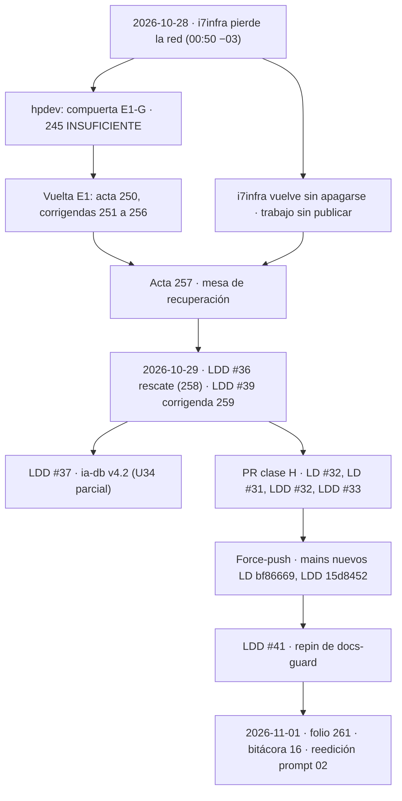

# 16 — Onda 8 de E1: compuerta, rescate y reescritura

## Índice

1. [Definiciones](#1-definiciones)
2. [Qué pasó](#2-qué-pasó)
   1. [Compuerta E1-G y caída de i7infra (2026-10-28)](#21-compuerta-e1-g-y-caída-de-i7infra-2026-10-28)
   2. [Mesa de recuperación y rescate (2026-10-28 y 29)](#22-mesa-de-recuperación-y-rescate-2026-10-28-y-29)
   3. [Clase H e ia-db v4.2 (2026-10-29)](#23-clase-h-e-ia-db-v42-2026-10-29)
   4. [Reescritura de la historia y repin (2026-10-29)](#24-reescritura-de-la-historia-y-repin-2026-10-29)
   5. [Del 2026-10-30 al 2026-11-01](#25-del-2026-10-30-al-2026-11-01)
3. [PR y merges](#3-pr-y-merges)
4. [Equivalencia de SHA por número de PR](#4-equivalencia-de-sha-por-número-de-pr)
5. [Lecciones](#5-lecciones)
6. [Hallazgos e incidentes](#6-hallazgos-e-incidentes)
7. [Efecto sobre el punto de continuación](#7-efecto-sobre-el-punto-de-continuación)

## 1. Definiciones

- **Onda 8**: la compuerta E1-G del escalón 1 (N10 §14). El `245` la resolvió INSUFICIENTE, y eso abrió una vuelta:
  E1-R (reparaciones) y E1-G2 (nueva compuerta, resolución en el `265`).
- **i7infra / hpdev**: los dos equipos de trabajo. i7infra era el principal hasta su caída. hpdev quedó como principal
  de esta línea hasta el `265` (`257` D15).
- **Clase H / clase P**: un PR de clase H toca normas, workflows o etiquetas y espera al PO. Uno de clase P es una
  reparación que un agente puede fusionar por conformación automática.
- **Reescritura**: `git filter-repo` sobre LD y LDD, con force-push de `main` (constancia `051` de FC y folio `261`).
- **Historia vieja / nueva**: los commits anteriores o posteriores al force-push del 2026-10-29 a las 22:55 −03.
- **LD / LDD**: hdcm-dev/Lab-Documentos y hdcm-dev/Lab-Documentos.Documentacion, los dos públicos.

## 2. Qué pasó

### 2.1 Compuerta E1-G y caída de i7infra (2026-10-28)

- La sesión de i7infra corrió la verificación E1-G y escribió el `290-compuerta-e1.md` («PROCEDE CON RESERVA»). Cerca
  de las 00:50 −03, i7infra perdió la red sin apagarse (`258:34-35`; `257:45`).
- hpdev dio lo de i7infra por perdido y trabajó todo el día:
  - `240`: constancia de la caída.
  - `245`: resolución de E1-G, **INSUFICIENTE, una sola vuelta**.
  - `249`: providencia de estado.
  - `250`: acta de la mesa de organización y vuelta de E1.
  - `251` a `254` y `256`: corrigendas y constancia del resguardo.
- PR de ese día: LD #26 a #28 y #30; LDD #27 y #29 a #31 (§3).

### 2.2 Mesa de recuperación y rescate (2026-10-28 y 29)

- i7infra volvió a la noche con el trabajo de E1 en su árbol, sin publicar. No había commits del expediente sólo en
  i7infra (`258:34-37`).
- El mandato del PO fue «toma como base i7infra, en esto estaba mejor que lo que tenia aquí» (`258:39-40`).
- La mesa de recuperación falló en el acta `257`:
  - P1 queda como columna.
  - Ningún folio fusionado se edita (D04).
  - Rige el `245`: el `290` entra sustituido (D03).
  - Los PR H se ajustan con merge, nunca con rebase (D06).
- **LDD #36** (merge nuevo `0bb43b7`, 2026-10-29 12:07 −03) metió el rescate como archivos nuevos:
  - los 11 folios de i7infra;
  - su evidencia;
  - las bitácoras 00 y 03–15 de esta carpeta;
  - el acta `257` y la constancia `258`, con la tabla de folios por nombre completo.
- **LDD #39** (merge nuevo `2ef8fbf`, 19:12 −03) agregó la corrigenda única `259`. Corrige por referencia `240`, `245`,
  `249`, `251` (DEC-15), `252` §4 y `256`.

### 2.3 Clase H e ia-db v4.2 (2026-10-29)

- **ia-db v4.2**: LDD #37 (merge nuevo `6a784fd`, 18:05 −03), unidad U34. Sólo re-verifica el índice 12 (Framework
  Concept) y las menciones de `GUIA-INDICE` en 00 y 10. Según el mensaje de `c3bf57c`, «los demás índices conservan su
  corte hasta cerrar la vuelta E1-R». U34 queda **parcial**.
- **Delegación del PO** (respuesta literal en el `261` §2): «busca el mejor camino que tome como base el diseño hecho
  en i7infra […] y arma una solución definitiva». Con eso se resolvió el `255` §7:
  - política de etiquetas P-ET-1 a P-ET-6;
  - T-B: tag recreado y anotado;
  - O-A: `owner:` es un rol, nunca una cuenta.
- **Merges de los cuatro PR H**, todos con merge y sin rebase (D06):
  - **LD #32** (`9f6c3fb`, 22:38 −03): `AGENTS.md`, delegaciones del merge en plural y con alcance (U13, DEF-41).
  - **LD #31** (`bf86669`, 22:50 −03): docs-guard.
    - `traces-vacio` pasa a aviso (`b3916b8`; `tools/docs-guard/dg.py:15` y `:346` en `origin/main`), alineado con el
      anexo que admite `traces: []` (PE-2).
    - `README.md` y `Guides/README.md` sin la traza ambigua a `GUIA-INDICE` (`69c80c7`).
  - **LDD #32** (`3640c33`, 22:52:46 −03): `verificar.yml` con la opción (b), el expediente fuera de la matriz de
    docs-guard (`eb70e81`).
  - **LDD #33** (`15d8452`, 22:52:53 −03): folio `255` con la premisa del tag corregida (cita a `212-e1-u2`) y la
    resolución del PO (`6b1b70c`).

### 2.4 Reescritura de la historia y repin (2026-10-29)

- **Reversión de «No reescribir».** A las 20:15 −03 el PO confirmó: «si reescribi, pero cuida lo que se ha avanzado en
  `/LAB/Lab-Documentos/Lab-Documentos/Concepts` y
  `/LAB/Lab-Documentos/Lab-Documentos/Guides/Documentacion-Tecnica/Sistema-De-Documentacion-E-Integracion`». Así
  revirtió el «No reescribir» de `250:343`, `254:141`, `257` (D02, D06, §10) y `258:101`. Lo asienta el folio `261`.
- **Ejecución.** La hizo la sesión FRAMEWORK MAUI: `git filter-repo` v2.47.0 sobre espejos, con `--replace-text`,
  `--replace-message` y mailmap (`051:20-22`). Force-push de `main` según la API `activity`:
  - LDD: 22:55:17 −03, `b9f4317` → `15d8452`.
  - LD: 22:55:31 −03, `b25b71b` → `bf86669`.
- **Árboles idénticos.**
  - LD: `e25eb95…` en los dos.
  - LDD: `05107b7…` en los dos.
  - Medido con la API (`git/commits/<viejo>`) y `git rev-parse <nuevo>^{tree}` (`261` §4). La punta no cambió.
- **Tag** `docs-guard-v1.0.0` recreado anotado:
  - `git cat-file -t` da `tag`;
  - apunta a `14d5a28`, el merge de LD #16 en la historia nueva (`261` §5).
- **Repin.** LDD #41 (`b88ec81`, 23:00 −03) fijó docs-guard en
  `bf866697b0688708eb28cdde2ffdb0a968e7a953` (`verificar.yml:73` y `:76`). Su cabeza `18cebd1` pasó `verificar` y
  `docs-guard` (corrida 40988758248).
- **Constancia de FC.** La `051` entró por LDD #42 (`8f319ce`, 23:02 −03).

### 2.5 Del 2026-10-30 al 2026-11-01

- Después del repin, esta línea no abrió PR en LD ni en LDD. Entraron LD #37 a #41 y LDD #42 a #49, todos de ramas
  `fc/*` de FRAMEWORK MAUI (API `GET /repos/hdcm-dev/<repo>/pulls?state=all`, campo `head.ref`, 2026-11-01).
- El 2026-11-01 los clones del PO estaban en `origin/main`: LD `0bed863` y LDD `8b96bc6`. Sin la ia-db v4.0 local ni la
  copia de `OUTPUTs/` sin versionar (`git status --porcelain`, sólo lectura).
- El 2026-11-01 empezó la reedición del prompt 02 de la Guía 14, en worktrees propios (`{dir-de-trabajo}/wt/dac-LD`,
  `{dir-de-trabajo}/wt/dac-LDD`) y con territorios acordados con FRAMEWORK MAUI. Ver `Reedicion-02/00-Plan.md` §5.

## 3. PR y merges

SHA de merge en la historia nueva (`git log origin/main --grep='^Merge pull request #N from'`). La columna «Viejo» es
el `merge_commit_sha` que todavía devuelve la API (historia vieja). Horas en −03.

| PR | Qué | Fecha y hora | Merge nuevo | Viejo |
|---|---|---|---|---|
| LD #26 | E1-G: reparaciones de cierre | 2026-10-28 00:40 | `721d429` | `56ea2d3` |
| LD #27 | E1-G: frontmatter YAML | 2026-10-28 08:44 | `aaf8685` | `75043a5` |
| LD #28 | `AGENTS.md`: description y huella AK-3 (H) | 2026-10-28 08:52 | `aebe9e3` | `490646b` |
| LD #30 | U27: redacción de fugas F1 y F2 | 2026-10-28 13:47 | `c41868a` | `d65d52b` |
| LDD #27 | Folios 240, 245 y 249 | 2026-10-28 13:04 | `2d3450c` | `1bfc847` |
| LDD #29 | Acta 250 y corrigenda 256 | 2026-10-28 13:22 | `c86654f` | `009d266` |
| LDD #30 | Folios 251 a 254 | 2026-10-28 13:41 | `7ea9c52` | `6ed5f91` |
| LDD #31 | U28: redacción F4 a F8 | 2026-10-28 13:52 | `07979e1` | `3e6f266` |
| LDD #36 | Rescate de i7infra, 257 y 258 | 2026-10-29 12:07 | `0bb43b7` | `5dadc00` |
| LDD #37 | ia-db v4.2 (U34 parcial) | 2026-10-29 18:05 | `6a784fd` | `be3a133` |
| LDD #39 | Corrigenda 259 | 2026-10-29 19:12 | `2ef8fbf` | `85d4220` |
| LD #32 | H: `AGENTS.md` (U13) | 2026-10-29 22:38 | `9f6c3fb` | `48cfbb3` |
| LD #31 | H: docs-guard, `traces-vacio` a aviso (U12) | 2026-10-29 22:50 | `bf86669` | `b25b71b` |
| LDD #32 | H: `verificar.yml`, opción (b) (U11) | 2026-10-29 22:52 | `3640c33` | `6483e03` |
| LDD #33 | H: folio 255 resuelto (U14) | 2026-10-29 22:52 | `15d8452` | `b9f4317` |
| LDD #41 | Repin de docs-guard a LD `bf86669` | 2026-10-29 23:00 | `b88ec81` | — (posterior) |

## 4. Equivalencia de SHA por número de PR

Los SHA de E1 que citan las bitácoras 06–15, el índice y los folios anteriores al `261` son de la historia vieja y no
se editan (`261` §7). Para los merges alcanza con esta correspondencia pública; el mapa completo está en el
`{resguardo-privado}` (`051:38-40`).

| PR | Viejo | Nuevo |
|---|---|---|
| LD #11 | `f603984` | `fdc9b06` |
| LD #15 | `ad71e47` | `068c7ec` |
| LD #16 (tag `docs-guard-v1.0.0`) | `c0766dc` | `14d5a28` |
| LD #19 | `080f158` | `e3841b6` |
| LD #20 | `e57aae2` | `c279ed1` |
| LD #21 | `4fa998e` | `45ebc1f` |
| LD #22 | `6832a75` | `d8a9427` |
| LD #23 | `2fdf859` | `02b730f` |
| LD #24 | `ecb6342` | `7f29227` |
| LD #25 (`base_commit` de la ia-db) | `fe10086` | `6878568` |
| LDD #17 | `34bdd44` | `97e30bc` |
| LDD #20 | `60d94f3` | `faaeab1` |
| LDD #22 (ia-db v4.1) | `e0e520f` | `d847198` |

Comprobación: `git merge-base --is-ancestor <viejo> origin/main` da falso para todos los viejos probados (`261` §4).

## 5. Lecciones

| # | Lección | Por qué importa |
|---|---|---|
| L1 | Lo que no se publica no existe para la otra máquina. La pérdida de i7infra fue de visibilidad, no de datos | hpdev rehízo durante un día cosas que estaban hechas (`259` §1). Publicar por unidad, aunque sea en rama, achica esa ventana |
| L2 | Una decisión que sirve de fundamento a otras («No reescribir») se revierte con un folio que diga qué fundamento cambia, no con ediciones | Las decisiones `257` D02 y D06 siguen en pie con otro fundamento (`261` §8); editarlas habría roto la regla de `257` D04 |
| L3 | Un pin por SHA no sobrevive a una reescritura: el repin va en el mismo turno que el force-push, y se mide con árboles idénticos | LDD #41 entró cinco minutos después del force-push y la CI quedó verde |
| L4 | Los controles que exigen «ancestro de main» (U30, U32) se rompen con los SHA viejos | Hay que citar el par viejo/nuevo (`261` §7) |
| L5 | La bitácora se atrasó: del 2026-10-28 al 2026-11-01 sólo hubo folios y PR, y el índice seguía en «Siguiente: onda 8» | Esta entrada y la actualización de `00-Indice.md` cierran la brecha. Cada onda o acto que cambie el punto de continuación lleva su entrada |
| L6 | Dos sesiones en los mismos repos se coordinaron cerrando ramas antes de reescribir (`051:21`) y serializando merges | Es el mismo esquema que fija `Reedicion-02/00-Plan.md` §5 para la reedición |
| L7 | Antes de citar un folio como fuente de una decisión, se comprueba con grep. `252` no contiene la frase que le atribuían la memoria y `051:13` | `261` §8 lo deja asentado sin corregir nada |

## 6. Hallazgos e incidentes

| Id | Hallazgo | Tratamiento |
|---|---|---|
| BIT-8 | No hubo bitácora de la onda 8 hasta el 2026-11-01 (L5) | Cerrado con esta entrada |
| BIT-9 | `257` D12 preveía dos entradas, «16-Onda8-E1-G» y «17-Caida-i7infra-E1-R». Esta entrada junta las dos, y el número 17 pasa a la reedición del prompt 02 | Desvío declarado. El addendum a `OUTPUTs/Reanudar.md` (U35) sigue pendiente |
| BIT-10 | `refs/pull/*` de GitHub conserva copias de la historia vieja (`051:43-45`) | Abierto · decide el PO (pedido a GitHub Support) |
| BIT-11 | `base_commit` de la ia-db (`fe10086`) y los SHA de la carátula (`5d5c2b4`, `8da0cd9`) son de la historia vieja | Se leen por §4. La ia-db se actualiza en el reindexado de cierre (U34) |
| BIT-5 | Credencial local `h.cfg` en i7infra (PE-10) | Pendiente de verificación del PO (K50-I7, `257` D08). No se comprueba desde esta línea: i7infra está en sólo lectura y no se toca |

## 7. Efecto sobre el punto de continuación

La onda 8 está cerrada:

- E1-G quedó INSUFICIENTE (`245`).
- El rescate y la corrigenda están fusionados.
- La clase H está fusionada.
- La historia está reescrita y el pin de docs-guard renovado.

Sigue la **vuelta E1-R** del acta `257` §9, con estas unidades pendientes: U20–U26, U29–U35 (U34 parcial) y K40.
Después vienen E1-G2 (U40–U43, resolución `265` con el Anexo L6 del `290` §14), U44, E2 y E3.

En paralelo corre la reedición del prompt 02 de la Guía 14 (`Reedicion-02/`).

Ver `00-Indice.md` §6.
