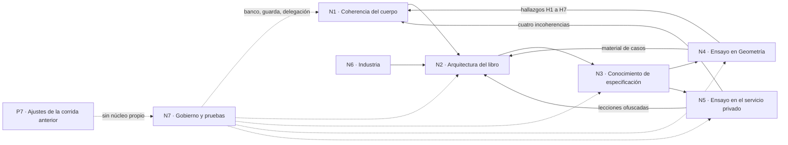
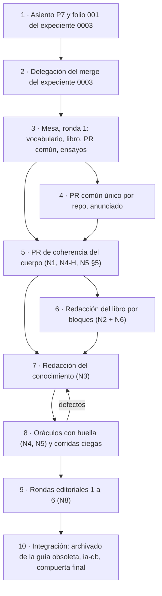

# 01 — Cohesión global de los núcleos de la reedición DocsAsCode

Documento de cohesión que pide la regla de descomposición del prompt 02 (líneas 86-92 del prompt, leído del clon del
PO). Relaciona los siete núcleos, señala dónde se contradicen, qué falta y en qué orden se integran. Es autocontenido:
cada afirmación lleva la ruta y la línea de la bitácora que la sostiene o el comando que la midió.

## Índice

1. [Convenciones y fuentes](#1-convenciones-y-fuentes)
2. [Mapa de relaciones entre núcleos](#2-mapa-de-relaciones-entre-núcleos)
   1. [Diagrama de dependencias](#21-diagrama-de-dependencias)
   2. [Tabla de vínculos](#22-tabla-de-vínculos)
   3. [Convergencias: un mismo objeto visto por varios núcleos](#23-convergencias-un-mismo-objeto-visto-por-varios-núcleos)
3. [Contradicciones entre bitácoras](#3-contradicciones-entre-bitácoras)
   1. [Resueltas por medición](#31-resueltas-por-medición)
   2. [Abiertas, para la mesa](#32-abiertas-para-la-mesa)
   3. [Cifras que parecen distintas y no lo son](#33-cifras-que-parecen-distintas-y-no-lo-son)
4. [Colisiones de nombres entre bitácoras](#4-colisiones-de-nombres-entre-bitácoras)
5. [¿Hay que corregir la segmentación?](#5-hay-que-corregir-la-segmentación)
6. [Qué falta](#6-qué-falta)
   1. [Modalidades no corridas](#61-modalidades-no-corridas)
   2. [Afirmaciones sin evidencia suficiente](#62-afirmaciones-sin-evidencia-suficiente)
   3. [Fuentes no leídas o pedidos sin respuesta](#63-fuentes-no-leídas-o-pedidos-sin-respuesta)
7. [Orden de integración](#7-orden-de-integración)
8. [Mediciones propias de esta crítica](#8-mediciones-propias-de-esta-crítica)

## 1. Convenciones y fuentes

| Abreviatura | Qué es |
| --- | --- |
| `Nx:línea` | Línea de `{dir-de-trabajo}/nucleos/Nucleo-Nx.md` (N5 es la versión ofuscada) |
| `Plan` | `{dir-de-trabajo}/wt/dac-LDD/PROMPTs/Guides/14-Sistema-De-Documentador-Tecnico/OUTPUTs/DocsAsCode-Bitacoras/Reedicion-02/00-Plan.md` |
| `Prompt` | `…/Lab-Documentos.Documentacion/PROMPTs/Guides/14-Sistema-De-Documentador-Tecnico/02-Ajuste-Coherencia-Reedicion-Documentacion.md` (clon del PO; no está en el worktree, lo registran N2:721, N3 §1, N4 §1, N6 §7 y N7 H11) |
| `SDEI/` | `{dir-de-trabajo}/wt/dac-LD/Guides/Documentacion-Tecnica/Sistema-De-Documentacion-E-Integracion/` en `0bed863` |
| `[criterio propio]` | Lectura de esta crítica, no un hecho medido |

Bitácoras leídas enteras: N1 (180 l.), N2 (721), N3 (510), N4 (361), N5 ofuscada (142), N6 (479), N7 (302)
(`wc -l` del 2026-11-01). La versión privada de N5 se consultó sólo para verificar que leyó las fuentes del contexto
del prompt (§6.3); nada de ella pasa a este documento.

## 2. Mapa de relaciones entre núcleos

### 2.1 Diagrama de dependencias

*Figura 1. Las flechas llenas son dependencias de contenido; las punteadas, de gobierno. Las flechas de N4 y N5 hacia
N1 y N2 son el retorno que el plan sólo preveía después de los ensayos (Plan §4, fase 4) y que ya ocurrió en el
relevamiento.*

### 2.2 Tabla de vínculos

| De → a | Qué pasa | Evidencia |
| --- | --- | --- |
| N1 → N2 | Qué definición manda en los 21 términos duplicados; correcciones antes de redactar | N2 §12.1 (l. 677); N1 §8 punto 1-2 (l. 170-173) |
| N6 → N2 | Casos, normas, tendencias; reverificación del portal; fuentes de *single sourcing* e ISO 15289 | N2 §9.3 y §12.1 |
| N2 → N3 | Numeración estable de las secciones que el conocimiento cita como `consulta`; sección «de la explicación al conocimiento» | N3 §7 (cuarta viñeta); N2 §12.1 |
| N3 → N4, N5 | La forma del conocimiento y el protocolo de reproducción (oráculo antes, corrida ciega) | N3 §5.6; N4 §11; N5 §6 |
| N4 → N1 | H1 a H7 sobre el cuerpo | N4 §6 |
| N5 → N1 | Cuatro incoherencias (TEM-07 capas A/B, clases de `ESC-SDEI-4`, ancla por familia, copia con huella) | N5 §5 |
| N4, N5 → N3 | Trampas (`_legacy/`, versión doble), brechas B1-B12 que el conocimiento tiene que prever | N4 §7.3; N5 §4 |
| N7 → todos | Procedimiento de pruebas por PR, guarda G1-G4, delegación faltante, territorio común | N7 §4-§6 |
| N2, N3, N1, N7 → archivos comunes | Cada uno propone cambios en `tools/docs-guard/**`, `CHANGELOG.md` o `ia-db/**` | §2.3, fila «Herramienta común» |

### 2.3 Convergencias: un mismo objeto visto por varios núcleos

| Objeto | Núcleos | Qué dice cada uno | Lectura integrada |
| --- | --- | --- | --- |
| **Herramienta común** (`tools/docs-guard/**`, `prefijos.txt`, workflows, `CHANGELOG.md`) | N1, N2, N3, N4, N5, N7 | N1-05: `PE` cambia de sentido en `prefijos.txt` (N1:83); N1-25 y N7 H3: dibujar mermaid en PR-4 (N1:103, N7:218); U4d: excluir carpetas (N1 §5); N4 caso R: precedencia de versión (N4 §5); N5 B2, B3, B8: versión de ID en sección, IDs locales, marca HTML ajena (N5 §4); N3 M-1: prefijo `KNW` y `doc_type: conocimiento` (N3:481); N2 D-N2-2: evita `LIB` para no abrir PR común (N2:273); N7 H8: `CHANGELOG` para la delegación (N7:223) | El PR común **ya es inevitable** (N1-05 y N7 H8 lo exigen aunque nadie elija `KNW` ni `LIB`). El argumento de N2 para preferir `DOC-SDEI-GUIA` pierde peso. Hay que decidir **qué entra** en ese PR y qué se difiere a un expediente de herramienta (pregunta P-04 de la propuesta de panel) |
| **Regla de traza de una página de ayuda** | N1, N4 | N1-21: las páginas de la prueba no trazan a un `RD-` (N1:99); N4 H1: trazan a casos de uso de la API y no del front (N4:262) | No se contradicen: la regla es **compuesta**. `TEM-05:88` pide «la fila `RD-` y el caso de uso de la unidad de la pantalla». El ejemplo viola **las dos mitades**. Un solo ítem, con dos defectos |
| **Guía obsoleta `DOC-SDT-0001`** | N1, N2, N3, N4, N6 | Siete remisiones vivas (N1 §3); siete filas parciales (N2 §5.4, §9.3); `TEM-03:245` la usa (N3 §7; N4 H5); arc42 y Nygard en contexto sólo viven ahí (N6 §5 punto 2) | El archivado depende de que el libro absorba el portal, arc42 y Nygard; un solo cambio |
| **Etiqueta de runner `i7infra-dev`** | N1, N2, N3, N4, N7 | N1-35, severidad baja, nota en el Marco (N1:113); N2 H-5: nombra una máquina en un repo público (N2:693); N3 §4.4: es un parámetro del laboratorio, no norma; N4 §9: Lab-Geometria comparte cola; N7: la sirve `hpdev-runner-dev` | Ver contradicción C-07 |
| **Ensayos de reproducción** | N3, N4, N5 | Tres protocolos parecidos con métricas, insumos y lugares distintos | Ver contradicciones C-03 a C-06 |
| **Sitio publicado** | N6, N7, Plan | Plan §6: «Sitio MkDocs. Se construye en contenedor»; N7 H4: LD no tiene generador, es un ensayo; N6 §5 punto 5: Material for MkDocs termina su vida el 2027-05-05 | El plan describe como pieza lo que es un ensayo; la mesa decide si hay sitio |
| **Commits que ya no existen** (`080f158`, `fe10086`) | N1, N4 | N1-17: no son ancestros de `main` y un clon nuevo falla (N1:95); N4 §5: el ensayo de TEM-07 «se reproduce» con el `dg.py` actual, pero corrido sobre el SDD de Geometría, no con el guion literal | El ensayo se reproduce en su **resultado**; el **guion** publicado no corre. Las dos cosas son ciertas |
| **Delegación del merge** | N5, N7, N4 | N7 H8: no hay delegación para el expediente 0003 en LD ni LDD; N5 §6: propone conformación automática en el repo privado; N4 §9: el PR #2 de Lab-Geometria.Documentacion es de arranque y su merge vuelve al PO | Tres repositorios, tres estados distintos de delegación; ningún núcleo los junta |

## 3. Contradicciones entre bitácoras

### 3.1 Resueltas por medición

| Id | Contradicción | Cita A | Cita B | Cómo se resuelve |
| --- | --- | --- | --- | --- |
| C-01 | **Causa del mermaid mal dibujado.** N1 la atribuye a «corchetes y rutas en las etiquetas» y propone «Etiquetas sin `[...]` ni rutas con punto» | N1:103 (N1-25) | N7:100-112: experimento de una variable; la ruta sin `@` dibuja limpio, `traces: ID@1.0` sin corchetes falla, `#64;` o espacios limpian | **Manda N7**: la causa es `@` (autoenlace de correo). La propuesta de N1 no arregla el defecto. Es un peritaje ya corrido (una variable por vez) |
| C-02 | **Herramientas del host.** N7 inventaría el host sin `dotnet` y corre la mini demo en contenedor; N1 la corre con «SDK .NET 10.0.403 del host» | N7:54 | N1:46 | Medido hoy: `which dotnet` → `/usr/bin/dotnet`; `dotnet --version` → `10.0.403` (§8). El inventario de N7 está incompleto; las dos corridas son válidas y dan verde |

### 3.2 Abiertas, para la mesa

| Id | Contradicción | Cita A | Cita B | Qué hay que decidir |
| --- | --- | --- | --- | --- |
| C-03 | **Dónde vive el ensayo del servicio privado.** N3 dice que la evidencia de C2 va «**Sólo** `{dir-de-trabajo}/privado/`»; N5 propone un PR en el repo privado de documentación, por conformación automática; el Plan (P5) dice «su repositorio de documentación (privado)» | N3:414 | N5:130-133; Plan §2 fila P5 | N3 contradice al plan; N5 lo sigue. Falta decidir si el ensayo se versiona (PR) o queda local |
| C-04 | **Oráculo de los casos C1 y C2.** N3 toma como oráculo la columna del escenario en `00-Marco.md:102-109`; N4 y N5 muestran que esa columna está mal para sus casos: XML apagado en Geometría (N4 H4), CL-06 y CL-09 faltan en `ESC-SDEI-4` y el escenario es compuesto (N5 §5 punto 2; B1) | N3:413-414 | N4:262-270 (H4); N5:102 (B1), §5 | El oráculo no puede ser una fila que los propios ensayos corrigen. Candidatos: N4 §4 para C1 y la hoja de integración privada de N5 para C2, escritos por otro agente y con huella antes de correr (N3 §5.6, paso 1) |
| C-05 | **Métrica de éxito de la reproducción.** N3: 100 % contestadas, coincidencia ≥ 85 %, 0 invenciones, 0 preguntas sin respuesta, compuerta verde; N4: ≥ 6 de 8 trampas, 100 % trazas verdes, 0 inventadas | N3:428-440 | N4:300-308 | Dos conjuntos de umbrales para la misma prueba. Unificar antes de correr (los dos dicen que el umbral lo fija la mesa) |
| C-06 | **Qué recibe el aplicador.** N3: el conocimiento, el repo del caso en su SHA y la plantilla A-01 vacía; N4: el conocimiento y `LGD/ia-db/README.md` | N3 §5.6, paso 2 | N4:276 | Además, Lab-Geometria.Documentacion tiene **dos ia-db 4.0** (local sin commitear sobre `5f07b12` y PR #3 sobre `4b114d7`; N4 §3.2). El aplicador tiene que recibir una revisión fija y versionada |
| C-07 | **Gravedad de la etiqueta de runner.** N1: baja, una nota en el Marco; N2: nombra una máquina en un repo público; N3: parámetro a sacar de la norma | N1:113 | N2:693; N3 §4.4 | El propio Marco prohíbe hosts en lo versionado (I-09 en N3 §4.1, `00-Marco.md:170`). Renombrar la etiqueta toca workflows de LD, LDD y Lab-Geometria (N4 §3.5) y el runner: clase H y archivo común |
| C-08 | **`Lanzar-Example` en el libro.** N2 lo lleva «íntegro como procedimiento» al capítulo 14.3; N1 dice que tiene rutas del workspace, versiones `latest`, túneles del usuario y que es un tool-prompt que el Mapa ubica en LDD | N2:565 | N1:110 (N1-32) | Si entra íntegro, el libro hereda los defectos y lo privado del entorno |
| C-09 | **Caso del portal de notificaciones.** N2 lo presenta en 18.1 como «el caso verificado» y le pide la reverificación a N6; N1 dice que no tiene referencia APA; N6 no lo reverificó | N2:406, §9.3 | N1:97 (N1-19); N6 (sin entrada, ver §6.3) | Hoy no está verificado. Va como **HISTÓRICO (fecha)** o se reverifica antes de redactar 18.1 |
| C-10 | **PR común: evitarlo o abrirlo.** N2 elige `DOC-SDEI-GUIA` «para no abrir un PR común»; N3 recomienda abrirlo para `KNW` | N2:273 | N3:481 | Ver §2.3, fila «Herramienta común»: el PR común se abre igual |

### 3.3 Cifras que parecen distintas y no lo son

| Cifra | N1 | N7 | Explicación verificada |
| --- | --- | --- | --- |
| Trazas | 121 / 112 / 9 (`dg.py trazas SDEI/`, N1:44) | 131 / 122 / 9 (`ci-local.sh todo`, N7 §3.1) | `ci-local.sh` suma `AGENTS.md`, `README.md` y `Guides/README.md` como punteros de trazas (`scripts/ci-local.sh:15-16` y `:56-58`, §8) |
| Diagramas | 21 en 19 archivos, sin la guía vieja (N1:48) | 27 en 20 archivos; PR-4 cuenta 28 (N7 §3.1-§3.2) | 21 + 6 de la guía obsoleta (N2 §5.4: 6 mermaid) = 27; PR-4 suma 1 de `AGENTS.md` |
| Mini demo | 22 s (N1:46) | 28 s de script, 48 s con contenedor (N7 §3.5) | Host contra contenedor con `apt-get` previo |
| Ensayo de libro | `DOC-SDEI-LIBRO` probado (N2 E4) | — | N2 recomienda `DOC-SDEI-GUIA`, que **no se ensayó**; el prefijo `DOC` es el mismo, así que el riesgo es bajo, pero el `doc_id` exacto queda sin medir |

## 4. Colisiones de nombres entre bitácoras

Al integrar, estos rótulos significan cosas distintas según quién los use. Es el mismo defecto que N1 marca en el
cuerpo (N1 §6, tipo b), ahora en el expediente.

| Rótulo | Sentidos | Dónde |
| --- | --- | --- |
| `G…` | G1-G4 = guarda de merge (N7 §4.2); G-d, G-e, G-g = grupos de hallazgos del folio 245 (N1 §5); E1-G2 = segunda compuerta de la etapa E1; «G2» = piloto en Geometría (N4:340) | N1, N4, N7 |
| `D-nn` | D-11, D-17, D-19…D-21 = deficiencias del folio 245 (N1 §5); D-01…D-17 = decisiones del aplicador del conocimiento (N3 §5.3); `dg.py` imprime «(D-17)» en el aviso `traces-vacio` (N3:158) | N1, N3 |
| `H-n` / `Hn` | Hallazgos de N2 (H-1…H-6), N4 (H1…H7), N7 (H1…H11) y U5 H-1…H-4 del expediente 0002 (N1 §5) | N1, N2, N4, N7 |
| `PE` | Patrón de ejemplo, pregunta de evaluación, pendiente del 290 (N1-05; N2 H-3; N3 §7) | N1, N2, N3 |
| `RD-` | Requerimiento documental del cuerpo; N3 evita `RD-n` para los ítems de §6 y elige `DE-n` | N3 §3.2 |

Propuesta **[criterio propio]**: en el expediente 0003, todo hallazgo se cita con el núcleo delante (`N4-H1`,
`N7-H8`), las decisiones del conocimiento llevan otro prefijo (por ejemplo `DD-nn`) y la piloto se llama «escalón 2»
(N4:341).

## 5. ¿Hay que corregir la segmentación?

| Cambio | Por qué | Evidencia |
| --- | --- | --- |
| **Agregar N8 — Edición bibliográfica y rondas editoriales** | El prompt pide seis intervenciones editoriales y expertos en edición bibliográfica (Prompt:38, :58-67, :73). Ningún núcleo releva su método: falta la guía de estilo de base (N6 §5 punto 3 la señala sin resolverla), el registro por ronda (N2 §3.2 sólo anota que en MAUI faltó) y quién aplica cada ronda. N2 diseña la arquitectura, no el proceso editorial | N6:429-432; N2 §3.2 |
| **Agregar el asiento P7 como núcleo o como tarea de N7, con bitácora** | El Plan §2 (P7) y §4 (fase 1) lo ponen en paralelo, pero no tiene bitácora; sólo N1-36 lo menciona. Es lo que el PO pidió sumar («los ajustes de coherencias que indicás», pedido del 2026-11-01) | N1:114; Plan §2 fila P7 |
| **Dar a N7 la propiedad del PR común** | Seis núcleos piden cambios en archivos comunes (§2.3) y el Plan §5 permite «un PR común a la vez por repo». Sin un dueño, cada núcleo lo da por evitable o por hecho | §2.3 |
| **No fusionar N4 con N5** | Comparten protocolo, pero uno es público y el otro privado: fusionarlos mezcla evidencia que tiene que quedar separada (Plan §7) | Plan §7; N5 (cabecera ofuscada) |
| **Mantener N1 como dueño del vocabulario** | Las decisiones de términos (N1 §8 punto 2) y la regla de N2 §9.1 («decide N1 cuál es el correcto») ya lo ubican ahí; las colisiones de §4 se suman a su lista | N2 §9.1; N1 §8 |

La segmentación N1-N7 es buena en lo temático. Los dos huecos (N8 y P7) son de **proceso**, no de contenido, y por
eso no aparecieron al segmentar por afinidad.

## 6. Qué falta

### 6.1 Modalidades no corridas

| Falta | Núcleo | Evidencia |
| --- | --- | --- |
| Prueba de reproducción del conocimiento | N3 | No existe el conocimiento (N3 §8) |
| P-LECT (lector sin contexto) del tutorial y del cuerpo: rige el folio 245, INSUFICIENTE | N1 | N1 §5, primera fila |
| Levantar y compilar la prueba de ayuda por rol | N1, N4 | N1 §7; N4 §10 |
| Render de un libro de 50 000 palabras en GitHub o en un generador | N2 | N2 §12.3, NO VERIFICADO |
| Guion de TEM-07 corrido literalmente en un clon nuevo después de remapear los SHA | N1 | N1-17 sólo midió que falla |
| Corrida de `docs-guard` con un `Conocimientos/README.md` real dentro del cuerpo | N3 | N3 §5.8 lo da por exento sin ensayo |
| `mermaid.sh` y `ci-local.sh` completos sobre los ensayos de forma del conocimiento | N3 | N3 §8 |
| Checks y `mergeable_state` de los PR #2 y #3 de Lab-Geometria.Documentacion | N4 | N4 §10 |
| PR abiertos del repo privado y estado de su CI | N5 | Resumen de N5 («No verifiqué los PR abiertos») |

### 6.2 Afirmaciones sin evidencia suficiente

| Afirmación | Dónde | Qué falta |
| --- | --- | --- |
| «Las capas A y B no existen» (TEM-07) frente a un conocimiento de lógica de decisión ya versionado | N5 §5 punto 1 | N5 mismo dice «a validar si es la misma capa A» |
| Fin de vida de Material for MkDocs: la fecha del anuncio | N6 §6 | Marcado no verificado |
| Normas 26511, 26512, 26513 y 26515 | N6 §6 | 403 en iso.org |
| Extensión del libro (50 000 a 59 000 palabras) | N2 §11 | Es una estimación rotulada; vale como plan, no como dato |
| Umbrales de la reproducción (85 %, 6 de 8) | N3 §5.6; N4 §7.3 | Rotulados como criterio propio; los fija la mesa |
| Inventario del host sin `dotnet` | N7:54 | Corregido en §3.1 (C-02) |
| «E1 rompió 23 trazas» (245 G-d) | N1 §7 | No se volvió a medir |
| Runner efímero (`TEM-06:84,168`) | N1 §7 | La API no expone la configuración |

### 6.3 Fuentes no leídas o pedidos sin respuesta

| Falta | Quién la pidió | Estado |
| --- | --- | --- |
| Reverificación del portal de notificaciones (Mintlify, 170 páginas) | N2 §9.3 | N6 no la hizo: `grep -n -i 'portal\|onesignal' Nucleo-N6.md` sólo da una mención en la l. 275. `Referencias.md:152` cita el repositorio de Mintlify, no el portal |
| Fuente de *single sourcing* e *internal developer portal* | N2 §9.3 | Sin respuesta: `grep -c -i 'single sourc\|internal developer' Nucleo-N6.md` = 0 |
| ISO/IEC/IEEE 15289:2019 | N2 §9.3 | Sin respuesta: `grep -c 15289 Nucleo-N6.md` = 0 |
| Barrido del índice de conocimientos (`Index-Knowledge.md`) | Mesa-De-Expertos-A-Pedido §3.4 | Ningún núcleo lo hizo; lo hace la propuesta de panel (§5 de `02-Propuesta-De-Panel.md`) |
| `Knowledge-Mesa-Consulta-A-Un-Tercero` | Prompt:73 | Ningún núcleo lo leyó; lo lee la propuesta de panel |
| Contexto del prompt (ia-db de Geometría, ia-db y escena del servicio privado) | Prompt:12-14 | Leído: N4 §3.2 (Geometría); la versión privada de N5 registra la ia-db y la escena (verificado con `grep` sobre la bitácora privada, sin copiar su contenido) |
| Estado de las ramas de FRAMEWORK MAUI | Plan §5 | Ningún núcleo lo releyó. Hoy no hay PR abiertos en LD ni en LDD (§8) |
| Folio 001 (apertura) del expediente 0003 | Expediente | No existe: la carpeta `actuaciones/` sólo tiene `002-constancia-coordinacion-con-framework-maui.md` y `evidencia/` está vacía (§8) |

## 7. Orden de integración

**[criterio propio]**, ajustable por la mesa. Cada paso dice qué necesita del anterior.

*Figura 2. El libro y el conocimiento se redactan sobre un cuerpo ya corregido; los oráculos se fijan antes de
correr; las rondas editoriales van al final porque los ensayos todavía pueden cambiar el texto.*

| Paso | Contenido | Necesita | Por qué en este lugar |
| --- | --- | --- | --- |
| 1 | P7 (bitácora 16, índice `00`, corrigenda del 290) y folio 001 del expediente 0003 | Nada | Son correcciones de descripción que un comando contesta; no necesitan mesa (Mesa-De-Expertos-A-Pedido §3.1, «Cuándo no hace falta una mesa») |
| 2 | Providencia de delegación del 0003 y su fila de `CHANGELOG` | Paso 1 | Sin ella, rige la conformación manual (N7 H8) |
| 3 | Mesa | Bitácoras N1-N7 y esta cohesión | Las preguntas están en `02-Propuesta-De-Panel.md` §7 |
| 4 | PR común (prefijos, lo que la mesa admita de `dg.py`, CHANGELOG), anunciado a FRAMEWORK MAUI | Veredicto de P-04 | Un PR común a la vez por repo (Plan §5) |
| 5 | Coherencia del cuerpo: N1 alta y media, N4 H1-H7, N5 §5, mermaid con `#64;` (C-01) | Pasos 3 y 4 (prefijo `PE`, vocabulario) | El libro tiene que heredar texto corregido (N1 §8 punto 1) |
| 6 | Libro, bloques B1-B6 | Paso 5; N6 completado (§6.3) | N2 §7.5 |
| 7 | Conocimiento de especificación | Numeración del libro aprobada (N3 §7) | Las remisiones `consulta` apuntan al libro |
| 8 | Oráculos y corridas ciegas C0-C2 (C3 opcional) | Paso 7; P-15 y P-16 resueltas | N3 §5.6 |
| 9 | Seis rondas editoriales | Paso 8 cerrado | Una corrección del ensayo después de la corrección de pruebas reabre todo |
| 10 | Archivado de `DOC-SDT-0001`, ia-db de LDD (archivo común), compuerta final con evidencia | Paso 9 | Archivar antes deja siete remisiones rotas (N1 §3) |

## 8. Mediciones propias de esta crítica

Todas del 2026-11-01, en hpdev.

| # | Comando | Salida |
| --- | --- | --- |
| M1 | `which dotnet; dotnet --version` | `/usr/bin/dotnet`; `10.0.403` |
| M2 | `grep -n 'trazas)\|TRAZAS_EXTRA\|DOCS_GUARD_TRAZAS_EXTRA' {dir-de-trabajo}/wt/dac-LD/scripts/ci-local.sh` | l. 15-16: «sobre RUTA y los punteros de la raíz (DOCS_GUARD_TRAZAS_EXTRA; por defecto AGENTS.md, README.md y …»; l. 57: `for t in ${DOCS_GUARD_TRAZAS_EXTRA-AGENTS.md README.md Guides/README.md}` |
| M3 | `sed -n 48p SDEI/TEM-05-Ayuda-Al-Usuario-Final.md` | «… Toda página de usuario traza a un `RD-`» |
| M4 | `sed -n 88p SDEI/TEM-05-Ayuda-Al-Usuario-Final.md` | Fila `ESC-SDEI-3`: «La fila `RD-` y el caso de uso de la unidad de la pantalla, en el registro del SDD» |
| M5 | `grep -n -i 'mintlify\|onesignal' SDEI/99-Anexos/Referencias.md` | Sólo l. 152, `ref-mintlify-docs-2026` (repositorio `mintlify/docs`, archivo `.vale.ini`) |
| M6 | `curl -s https://api.github.com/repos/hdcm-dev/{Lab-Documentos,Lab-Documentos.Documentacion}/pulls?state=open` (18:11 UTC) | Ninguno abierto en los dos |
| M7 | `ls -R …/Expedientes/0003-Reedicion-DocsAsCode-Y-Especificacion/` (worktree LDD, `8b96bc6`) | `README.md`; `actuaciones/002-constancia-coordinacion-con-framework-maui.md`; `evidencia/` vacía |
| M8 | `grep -n 'Escenario\|ESC-SDEI' SDEI/00-Marco.md` y `sed -n 100,109p` | Tabla «Qué cambia entre escenarios»: `ESC-SDEI-4` activa `CL-01 a CL-05, CL-07, CL-08, CL-11 a CL-13` (sin CL-06 ni CL-09); `ESC-SDEI-3` fuente generada «OpenAPI y comentarios XML» |

No llegó ningún mensaje de otra sesión ni texto a mitad de turno que cambiara el encargo. No se escribió en ningún
repositorio.
