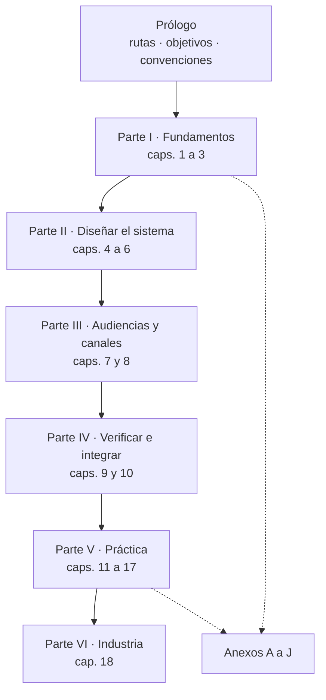

# Núcleo N2 — Arquitectura del libro `DocsAsCode-Developer-Guide.md`

## Índice

1. [Encargo, fuentes y límites](#1-encargo-fuentes-y-límites)
2. [Qué exigen el Profile y el RuleSet](#2-qué-exigen-el-profile-y-el-ruleset)
3. [Precedente: el libro de FRAMEWORK MAUI](#3-precedente-el-libro-de-framework-maui)
4. [Restricciones medidas de la compuerta](#4-restricciones-medidas-de-la-compuerta)
5. [Inventario de las fuentes](#5-inventario-de-las-fuentes)
6. [Decisiones de arquitectura para la mesa](#6-decisiones-de-arquitectura-para-la-mesa)
7. [Arquitectura del libro: partes y capítulos](#7-arquitectura-del-libro-partes-y-capítulos)
8. [Mapa fuente → capítulo](#8-mapa-fuente--capítulo)
9. [Fusiones y eliminaciones por duplicado](#9-fusiones-y-eliminaciones-por-duplicado)
10. [Anexos, glosario e índice](#10-anexos-glosario-e-índice)
11. [Extensión estimada](#11-extensión-estimada)
12. [Dependencias, hallazgos para otros núcleos y pendientes](#12-dependencias-hallazgos-para-otros-núcleos-y-pendientes)
13. [Registro de evidencias](#13-registro-de-evidencias)

---

## 1. Encargo, fuentes y límites

### 1.1 Encargo

Diseñar la arquitectura del libro unificado `Guides/Documentacion-Tecnica/Sistema-De-Documentacion-E-Integracion/DocsAsCode-Developer-Guide.md`
(Lab-Documentos, público). El libro reúne los documentos del cuerpo SDEI en uno solo, autocontenido y no delta, con
índice, secciones jerárquicas, definiciones, explicaciones, ejemplos y mermaid, y abre con una sección de fundamentos.

Lo pide el prompt en la solicitud 2 y en la regla de documentación
(`/LAB/Lab-Documentos/Lab-Documentos.Documentacion/PROMPTs/Guides/14-Sistema-De-Documentador-Tecnico/02-Ajuste-Coherencia-Reedicion-Documentacion.md:42-52`
y `:79`). La solicitud 4 suma referencias y casos de la industria (`:56`).

### 1.2 Fuentes leídas

| Fuente | Ruta | Estado |
| --- | --- | --- |
| Prompt 02 | `…/Lab-Documentos.Documentacion/PROMPTs/Guides/14-Sistema-De-Documentador-Tecnico/02-Ajuste-Coherencia-Reedicion-Documentacion.md` (clon principal, sólo lectura) | Leído entero (105 líneas) |
| Plan vigente | `{dir-de-trabajo}/wt/dac-LDD/PROMPTs/Guides/14-Sistema-De-Documentador-Tecnico/OUTPUTs/DocsAsCode-Bitacoras/Reedicion-02/00-Plan.md` | Leído entero (143 líneas) |
| Cuerpo SDEI | `{dir-de-trabajo}/wt/dac-LD/Guides/Documentacion-Tecnica/Sistema-De-Documentacion-E-Integracion/` (rama `dac/0003-base`, HEAD `0bed863`) | Inventariado entero (§5) |
| Libro precedente | `{dir-de-trabajo}/wt/dac-LD/Concepts/Framework-Concept/MAUI-Framework-Developer-Guide.md` (2857 líneas) | Leídos la portada, el índice y la estructura de capítulos |
| Bitácoras del precedente | `{dir-de-trabajo}/wt/dac-LDD/PROMPTs/Concepts/01-Framework-Concept/OUTPUTs/Bitacoras/Reedicion-04/` (`03-Plan-Del-Libro.md`, `04-Rondas-Editoriales.md`, `00-Registro-Reedicion.md`, `05-Conocimiento.md`) | Leídas enteras |
| Profile | `/IA/PROMPTs/IA.Prompts/PromptFramework/Profiles/Study-Guide-Documentation.md` | Leído entero (85 líneas) |
| RuleSet | `/IA/PROMPTs/IA.Prompts/PromptFramework/RuleSets/RuleSet-Study-Guide.md` y las reglas que enumera | RuleSet entero; reglas por sus viñetas |
| Compuerta | `{dir-de-trabajo}/wt/dac-LD/tools/docs-guard/dg.py`, `prefijos.txt`, `esquemas/cuerpo.schema.json`, `scripts/docs-guard.markdownlint-cli2.jsonc`, `.github/workflows/docs-guard.yml` | Leídos en lo pertinente y ensayados (§4) |

### 1.3 Límites

- No se escribió en los worktrees ni en los clones. Los ensayos de la compuerta corrieron sobre una copia de
  `git archive HEAD` en el scratchpad de esta sesión (§13).
- Los núcleos N1 (coherencia) y N6 (industria) todavía no tienen bitácora en `{dir-de-trabajo}/nucleos/`
  (`ls` del 2026-11-01: sólo `00-Plan.md`). Este diseño deja los huecos que ellos llenan, nombrados en §12.
- El prompt no está en el worktree `{dir-de-trabajo}/wt/dac-LDD`: existe sólo, sin versionar, en el clon principal (§13, E1). El
  plan `00-Plan.md` lo cita con la ruta del worktree.

---

## 2. Qué exigen el Profile y el RuleSet

### 2.1 Exigencias del Profile `Study-Guide-Documentation`

| # | Exigencia | Fuente | Consecuencia para el libro |
| --- | --- | --- | --- |
| PF-1 | Recorrido de aprendizaje, no fichas sueltas; el lector termina con criterio para elegir, producir y evaluar | `Study-Guide-Documentation.md:5` | El libro se ordena como recorrido (Parte I → VI) y cada capítulo cierra con preguntas guía |
| PF-2 | Marco de referencia primero: escenarios, contextos y actores, definidos una sola vez y referenciados | `:23-35` | Capítulo 3 único para el marco; los demás capítulos citan `ESC-SDEI-n` sin redefinirlo |
| PF-3 | Un tema que no se cruza con ningún escenario sobra | `:33` | Cada capítulo temático conserva «Aplicación por escenario» |
| PF-4 | De lo general a lo particular: mapa → ejes → temas → anexos | `:35` | Orden de partes: fundamentos, marco, temas, práctica, industria, anexos |
| PF-5 | Piezas: marco, mapa conceptual «estoy acá → qué aplico», documentos por tema con la misma estructura, métodos y marcos con criterios para elegir, anexos (plantillas, listas, glosario), README con ruta de lectura | `:43-50` | Mapa como capítulo 11; «Cómo decidir» como capítulo (es el «Métodos y marcos»); README del cuerpo suma la ruta «leer de corrido» |
| PF-6 | Estructura fija de cada tema: definición, aplicación por escenario, ejemplos concretos, preguntas guía, criterios de calidad, anexo con plantilla comentada | `:56-63` | Los capítulos 4 a 10 conservan las seis secciones; la plantilla de cada uno se consolida en el anexo G (decisión D-N2-5) |
| PF-7 | Formativo, trazable, consistente, interconectado, verificable (revisión final contra el mapa buscando huecos, solapamientos y contradicciones) | `:69-73` | Anexo I de correspondencia y una pasada final contra §8 de esta bitácora |
| PF-8 | Diagramas como código: mapa conceptual, escenarios↔artefactos, flujos por rol, líneas de tiempo, taxonomías | `:79` | Una figura de mapa por parte y una por capítulo como mínimo |
| PF-9 | Resultado: navegable, lector sin conocimiento previo, se ubica en un escenario y sabe qué producir | `:85` | Prólogo con rutas por perfil y capítulo 11 de entrada por situación |

### 2.2 Exigencias del RuleSet `Study-Guide` y sus reglas

El RuleSet aplica nueve reglas: All, Workflow, Evidences, Markdown, Documentation, Indexing, Agents, Dual-Audience
y Narrative-Voice (`RuleSet-Study-Guide.md:13-23`). Las que pesan sobre el libro:

| Regla | Exigencia | Fuente (`…/PromptFramework/Rules/`) |
| --- | --- | --- |
| Markdown | Encabezados sin saltos de nivel, secciones autocontenidas, tabla de contenidos; tablas sin celdas largas; código con lenguaje; Mermaid antes que ASCII; ejemplos reales o rotulados como ilustrativos; enlaces relativos, referenciar en vez de duplicar | `Rule-Markdown.md:11-33` |
| Documentation | Estado real, lo no verificable se marca; explicar, no describir; procedimientos con objetivo, prerrequisitos, pasos, resultado, validaciones y errores; **un dato vive en un solo documento**; **documentos pequeños y especializados** | `Rule-Documentation.md:11-30` |
| Evidences | No presentar como hecho lo no verificado; registrar comando, archivo o recurso con fecha | `Rule-Evidences.md:11-25` |
| Dual-Audience (cara humana) | Resumen ejecutivo al abrir; flujo de punta a punta con un caso; término definido en su primer uso y registrado en el glosario; preguntas guía al cerrar secciones densas; todo ejemplo con qué demuestra, precondiciones y resultado | `Rule-Dual-Audience.md:11-15` |
| Dual-Audience (cara agente) | Frontmatter; IDs estables con prefijo; anclas predecibles; diagramas como código; bloques entradas/salidas/validaciones en los procesos; snippets con procedencia | `Rule-Dual-Audience.md:21-26` |
| Dual-Audience (coherencia) | Ante divergencia entre caras, corregir; nunca versiones paralelas | `Rule-Dual-Audience.md:32-33` |
| Narrative-Voice | Voz de analista, una sola autoría; variar el largo de frase; prosa para causa→efecto; sin muletillas («Cabe destacar», «En resumen»…), sin cierres genéricos, sin restatear el título | `Rule-Narrative-Voice.md:13-41` |
| Indexing | Actualizar la ia-db si se generan documentos nuevos | `Rule-Indexing.md:26-29` |

### 2.3 Dos tensiones que hay que declarar

1. **Libro único frente a «documentos pequeños y especializados» y «un dato en un solo documento»**
   (`Rule-Documentation.md:28-29`). El prompt pide expresamente el documento único (`02-…md:48`). Rige el prompt;
   la tensión con la fuente única se resuelve con la decisión D-N2-1 (§6).
2. **Plantilla de anexo por tema** (Profile `:63`) frente a un libro que lee de corrido. Se resuelve con D-N2-5:
   la plantilla vive en el anexo G y el capítulo la anuncia en una línea.

---

## 3. Precedente: el libro de FRAMEWORK MAUI

### 3.1 Qué funcionó y se adopta

| Práctica | Evidencia | Cómo se adopta |
| --- | --- | --- |
| Convenciones comunes fijadas antes de redactar (títulos, numeración, figuras, citas, mermaid, glosario) | `03-Plan-Del-Libro.md:15-59` | §7.4 de esta bitácora fija las convenciones del libro SDEI |
| Jerarquía `#` libro, `##` partes, `###` capítulos, `####` secciones, `#####` subsecciones, nada más profundo | `03-Plan-Del-Libro.md:18` y la estructura real del libro (líneas 23-51) | Se adopta tal cual |
| Capítulo abre con Objetivos y Requisitos previos y cierra con «En la industria», Preguntas guía y Resumen | `03-Plan-Del-Libro.md:22` | Se adopta, adaptado: el cierre de los capítulos temáticos respeta las seis secciones del Profile |
| Vocabulario fijo con equivalente en inglés en la primera aparición | `03-Plan-Del-Libro.md:26-27` | Se adopta; el vocabulario sale del glosario SDEI |
| Redacción por bloques en paralelo, un parcial por bloque, unión al final | `03-Plan-Del-Libro.md:209-226` | Se adopta con seis bloques (§7.5) |
| Marcas de estado en negrita (NO VERIFICADO, HISTÓRICO, …) consolidadas en un anexo | `MAUI-Framework-Developer-Guide.md:85-97`; `04-Rondas-Editoriales.md:32` | Se adopta (anexo J) |
| Cifras medidas fuera del texto normativo, en una corrida fechada | `03-Plan-Del-Libro.md:40`; `04-Rondas-Editoriales.md:20` | Se adopta: los resultados de ensayos van al anexo J con fecha |
| Ronda académica con scripts: existencia de archivos citados, rangos de línea, cruce de referencias, números de sección | `04-Rondas-Editoriales.md:11-16` | Se adopta y se agrega `docs-guard` completo |
| Búsqueda de fugas (rutas de home, IPs, hosts, series) antes del PR | `04-Rondas-Editoriales.md:48`, `:103` | Se adopta |
| Mapa libro ↔ demo en un anexo | `MAUI-Framework-Developer-Guide.md:2690` (Anexo D) | Se adopta como anexo I, ampliado a libro ↔ fuentes |

### 3.2 Qué falló y se evita

| Falla | Evidencia | Cómo se evita |
| --- | --- | --- |
| Tres diagramas mermaid salían «Unsupported markdown» por etiquetas «1. …» y una URL; se detectó después de la unión | commit `888515a` en LD («FC: libro, tres diagramas mermaid que se dibujaban con "Unsupported markdown"»); pendientes en `04-Rondas-Editoriales.md:95`, `00-Registro-Reedicion.md:21` | Cada bloque corre `tools/medios/mermaid.sh` sobre su parcial antes de entregar. Etiquetas «1 · Texto», sin URL |
| `docs-guard` nunca corrió sobre el libro | `04-Rondas-Editoriales.md:75`, `:96` | El libro SDEI queda dentro de la RUTA por defecto de la compuerta (`docs-guard.yml:38`, `:63`), así que tiene que pasar desde el primer PR. Cada bloque corre `dg.py esquema/ai/trazas` |
| El corpus de FRAMEWORK MAUI no pasa el esquema de la compuerta | `dg.py esquema Concepts/Framework-Concept` → `ROJO (errores=16)` (§13, E5) | No se copia su frontmatter: el libro MAUI usa `doc_type: libro` y no trae `description` (`MAUI-Framework-Developer-Guide.md:1-12`), dos errores en SDEI (§4) |
| Marcas de unión en comentarios HTML (`<!-- GLOSARIO: … -->`) | `03-Plan-Del-Libro.md:59`, `:223` | En SDEI, AI-1 bloquea el comentario HTML (§4, E3). Las listas de unión van en archivos aparte, nunca en el parcial |
| La ronda de edición de contenido no quedó registrada: el registro de rondas empieza en la académica | `04-Rondas-Editoriales.md:5` | Cada una de las seis intervenciones deja su entrada, aunque no haya cambios |
| La mesa fue una sola pasada sin subagentes separados | `05-Conocimiento.md` (sección Mesa); `00-Registro-Reedicion.md:23` | Fuera de N2; se anota para N7 |
| Cuadro repetido («Blazor Hybrid no es esto» en dos capítulos) | `04-Rondas-Editoriales.md:68` | Regla de §9: un recuadro vive en un capítulo y los demás remiten |
| Libro y documentos fuente conviven sin regla de cuál manda | `Concepts/Framework-Concept/Developer-Guide.md:85` («Esta guía sigue siendo el índice»); no hay regla de precedencia en el libro | D-N2-1 fija la regla de precedencia y de corrección doble |
| Anexos de historia y de diferencias con un borrador (anexos G y H del libro MAUI) | `MAUI-Framework-Developer-Guide.md:2791`, `:2812` | El libro SDEI es **no delta**: no lleva anexo de diferencias con la guía obsoleta; lo que ésta tenía de único se integra o se declara excluido (§9.3) |
| Enlaces absolutos `/LAB/…` en el README que presenta el libro | `Concepts/Framework-Concept/README.md:28` | Enlaces relativos siempre (Marco §5, convención «Enlaces») |

---

## 4. Restricciones medidas de la compuerta

El libro vive dentro de la carpeta que verifica `docs-guard` por defecto y bajo un README con `corpus_id`, así que es
**cuerpo nuevo**: todo lo que falta bloquea (`README.md:148-152` del cuerpo; `docs-guard.yml:38`, `:63`).

### 4.1 Ensayo

Sobre una copia de `git archive HEAD` del worktree LD (`0bed863`) se midió primero la línea de base y después un
libro de prueba (§13, E2 a E4).

| Caso | `esquema` (PR-2) | `trazas` (PR-5) | `ai` (PR-3) |
| --- | --- | --- | --- |
| Línea de base, sin libro | verde, 0 errores | verde, 0 errores, `ids-duplicados=0` | verde, 0 errores, 28 avisos AI-4 |
| Libro con `doc_type: libro`, `doc_id: LIBRO-SDEI`, sin `description`, un comentario HTML y el encabezado `### ESC-SDEI-1 — Corpus de guías` | **ROJO, 3 errores**: falta `description`; `libro` fuera del vocabulario; prefijo `LIBRO-` fuera del registro | **ROJO, 2 errores** `id-duplicado` (`00-Marco.md:73` y el libro) | **ROJO**, AI-1 `comentario-html` |
| Libro con `doc_type: guia-de-estudio`, `doc_id: DOC-SDEI-LIBRO`, `description`, sin comentario y el escenario como `` #### 2.2.1 Corpus de guías (`ESC-SDEI-1`) `` | verde | verde, `ids-duplicados=0` | verde |

### 4.2 Reglas que salen del ensayo

| # | Regla para el libro | Por qué |
| --- | --- | --- |
| R-1 | `doc_type` del vocabulario cerrado: `guia-de-estudio` | `cuerpo.schema.json:10` |
| R-2 | `doc_id` con prefijo registrado (ver D-N2-2) | `prefijos.txt`; error `prefijo` |
| R-3 | Los diez campos más `description` de 10 a 160 caracteres | `Esquema-Frontmatter-Y-Prefijos.md:41-55` |
| R-4 | **Ningún encabezado empieza con un ID** mientras exista el documento fuente que lo declara: el número de sección va primero y el ID va entre paréntesis y en monoespaciado | `dg.py:444` (`RE_ENCABEZADO_ID`), `:654-665` (`id-duplicado`); E3 |
| R-5 | Ningún comentario HTML ni HTML oculto | AI-1 y AI-5 bloquean (`dg.py` ayuda, línea 17; E3) |
| R-6 | Bibliografía propia con anclas `<a id="ref-…"></a>`, año, título en cursiva y fecha de consulta; las citas locales `](#ref-…)` tienen que tener su entrada en el mismo archivo | `dg.py:798-829` (`reflint`, bloquea en cuerpo nuevo) |
| R-7 | URL con fecha de consulta o cita al anexo de referencias | `url-fecha` (PR-7, `ci-local.sh:20-21`) |
| R-8 | Un solo H1, sin saltos de nivel, títulos hermanos distintos, tablas con columnas consistentes | `docs-guard.markdownlint-cli2.jsonc` (MD001, MD003, MD024 hermanos, MD025, MD042, MD056) |
| R-9 | Mermaid que parsea | PR-4 (`ci-local.sh:14`) y `tools/medios/mermaid.sh` |
| R-10 | Dominios de URL fuera de `dominios.txt` sólo avisan (AI-4); no se agregan dominios sin PR común | `prefijos.txt`/`dominios.txt` son archivos de `tools/docs-guard`, comunes según `00-Plan.md` §5 |

Los IDs que el cuerpo ya declara y que el libro no puede volver a declarar en un encabezado son 29 `doc_id` y 22
declaraciones por encabezado o fila (§13, E6): `ESC-SDEI-1..4`, `CTX-SDEI-1..4`, `EJR-SDEI-01..05`, `RD-01..04`,
`RN-LOC-01..02` y, por accidente, `TEM-04`, `TEM-05` y `TEM-06` (los H1 de esos tres temas empiezan con el ID; §12.2).

---

## 5. Inventario de las fuentes

Carpeta: `{dir-de-trabajo}/wt/dac-LD/Guides/Documentacion-Tecnica/Sistema-De-Documentacion-E-Integracion/`. Líneas y palabras
medidas con `wc` el 2026-11-01 (§13, E7). La columna «Secciones» da cada encabezado `##`/`###` con su línea.

### 5.1 Documentos de recorrido

| Archivo | `doc_id` | Líneas / palabras | Mermaid | Secciones (línea) |
| --- | --- | --- | --- | --- |
| `README.md` | `IDX-SDEI` | 176 / 2030 | 1 | §1 Qué es esta guía (36) · §2 Objetivos de aprendizaje (52) · §3 Rutas de lectura (65) · §4 Tabla de contenido (102) · §5 Cómo está armado el cuerpo (131) · §6 Versión y estado (154) · §7 Origen (169) |
| `00-Marco.md` | `MARCO-SDEI` | 196 / 2697 | 1 | §1 Definiciones (33) · §2 Escenarios (54): ESC-SDEI-1 (73), -2 (80), -3 (87), -4 (93), 2.5 Qué cambia (100) · §3 Contextos (111): CTX-SDEI-1 (115), -2 (121), -3 (127), -4 (133) · §4 Actores (140) · §5 Convenciones (157) · §6 Un caso que recorre el marco (173) · §7 Preguntas guía (188) |
| `01-Mapa.md` | `MAPA-SDEI` | 131 / 1889 | 1 | §1 Cómo se usa (32) · §2 Por escenario (51) · §3 Por contexto (60) · §4 Por artefacto, catálogo CL-01..14 (74) · §5 Por actor (98) · §6 Anexos (109) · §7 Preguntas guía (122) |
| `TEM-01-Sistema-Documentador.md` | `TEM-SDEI-01` | 348 / 3767 | 1 | Definición (34): Qué es (36), Qué problema resuelve (62), Arquitectura de referencia (82), Qué no es (133) · Aplicación por escenario (145) · Ejemplos (166): caso de industria, portal de un proveedor de notificaciones (168), adopciones públicas (186), ensayo inventario (208), ensayo adopciones con fecha (244), cambio de punta a punta (266) · Preguntas guía (287) · Criterios (296) · Anexo con plantilla de inventario (307-333) · Fuentes y observaciones (334) |
| `TEM-02-Ciclo-Documental.md` | `TEM-SDEI-02` | 349 / 3932 | 1 | Definición (33): Qué es (35), Qué problema resuelve (80), RRD (105), Estados (123), Cláusulas con criterio (134), «clara» e «integración» (140), Qué no es (147) · Aplicación por escenario (159) · Ejemplos (178): fila del RRD de la mini demo (180), ensayo de la evaluación (209), cláusula con plantilla (238) · Preguntas guía (253) · Criterios (262) · Anexo con plantillas de RRD y cláusula (273-332) · Fuentes y observaciones (333) |
| `TEM-03-Topologia-Y-Versionado.md` | `TEM-SDEI-03` | 326 / 3609 | 1 | Definición (34): Qué es (36), Qué problema resuelve (92), Regla para ubicar una pieza (106), Qué no es (129) · Aplicación por escenario (139) · Ejemplos (155): `source.lock` real (157), adopciones públicas (175), ensayo traza desfasada e ID ambiguo (209), Lab-Geometria (243) · Preguntas guía (251) · Criterios (262) · Anexo con plantilla de topología (273-308) · Fuentes y observaciones (309) |
| `TEM-04-Doble-Audiencia.md` | `TEM-SDEI-04` | 279 / 3277 | 1 | Definición (32) · Aplicación por escenario (79) · Ejemplos (101): 3.1 proveedor que sirve a los dos lectores (103), 3.2 `AGENTS.md` como puntero (113), 3.3 ensayo índice para agentes (126), 3.4 ensayo anti-inyección (158), 3.5 ayuda por rol para el agente (195) · Preguntas guía (202) · Criterios (222) · Anexo con plantilla (243) |
| `TEM-05-Ayuda-Al-Usuario-Final.md` | `TEM-SDEI-05` | 281 / 3099 | 1 | Definición (33) · Aplicación por escenario (79) · Ejemplos (110): 3.1 página real con divergencia (112), 3.2 ensayo ayuda atrasada (136), 3.3 ayuda por rol (159), 3.4 idiomas (186) · Preguntas guía (194) · Criterios (223) · Anexo con plantilla de página de ayuda (238-279) |
| `TEM-06-Compuertas-Y-CI.md` | `TEM-SDEI-06` | 311 / 3599 | 2 | Definición (32): 1.1 Dos carriles (65), 1.2 Regla de bloqueo (106) · Aplicación por escenario (148) · Ejemplos (179): 3.1 compuerta de un proyecto grande (181), 3.2 compuerta de este repositorio (190), 3.3 ensayo un defecto, una línea roja (218), 3.4 control que no cumple la regla (247) · Preguntas guía (254) · Criterios (276) · Anexo (292) |
| `TEM-07-Marco-SDD.md` | `TEM-SDEI-07` | 331 / 4752 | 1 | Definición (42): Qué es (44), Qué problema resuelve (64), Qué no es (73), Definiciones (82) · Aplicación por escenario (123), lecciones de decisión (167) · Ejemplos (181): traza contra el SDD de Lab-Geometria (183), lo que el SDD no cubre (254), fases de Spec Kit y Kiro (264) · Preguntas guía (279) · Criterios (290) · Anexo (304) |

### 5.2 Anexos

| Archivo | `doc_id` | Líneas / palabras | Mermaid | Secciones (línea) |
| --- | --- | --- | --- | --- |
| `99-Anexos/Esquema-Frontmatter-Y-Prefijos.md` | `ANX-SDEI-ESQUEMA` | 202 / 1710 | 1 | §1 Definiciones (32) · §2 Diez campos más `description` (41) · §3 README del cuerpo y páginas de ayuda (57) · §4 Trazas (68) · §5 Registro de prefijos (96) · §6 RRD (141) · §7 Ejemplo completo y sus errores (160) · §8 Fuente de verdad (188) |
| `99-Anexos/Glosario.md` | `ANX-SDEI-GLOSARIO` | 78 / 1263 | 0 | §1 Siglas de los controles (26) · §2 Términos (39) |
| `99-Anexos/Referencias.md` | `ANX-SDEI-REFERENCIAS` | 176 / 1694 | 0 | §1 Norma de citación (32) · §2 Calidad de la documentación (54) · §3 Diseño instruccional y ejemplos (66) · §4 Normas y estilos (82) · §5 Modelos de lenguaje (90) · §6 Práctica de la industria (102) · §7 Versionado, estilo y adopciones (128) · §8 SDD (166). 51 entradas `ref-…` |
| `99-Anexos/Criterios-De-Calidad.md` | `ANX-SDEI-CQ` | 88 / 1008 | 1 | §1 Los catorce criterios (27) · §2 Qué automatiza la compuerta (65) · §3 Uso en una revisión (79) |
| `99-Anexos/Patrones-De-Ejemplos.md` | `ANX-SDEI-PE` | 72 / 745 | 1 | §1 Los doce patrones (28) · §2 Marcas de procedencia (47) · §3 Ciclo de vida de un ejemplo (57) |
| `99-Anexos/Lista-De-Verificacion.md` | `ANX-SDEI-VER` | 158 / 1795 | 0 | §1 Uso (35) · §2 Evidencia (41) · §3 Estructura de la guía (54) · §4 Estructura de cada tema (69) · §5 Markdown, índices y mermaid (81) · §6 Contenido (97) · §7 Cara humana (111) · §8 Cara agente (121) · §9 Voz narrativa (133) · §10 Proceso (149) |
| `99-Anexos/Como-Decidir.md` | `ANX-SDEI-DECIDIR` | 174 / 1977 | 2 | §1 Definiciones (32) · §2 Criterios (44) · §3 Escala anclada (60) · §4 Pesos, filtros y firmeza (72) · §5 Matriz trabajada (106) · §6 Quién decide (136) · §7 Preguntas guía (166) |
| `99-Anexos/Ejercicios.md` | `ANX-SDEI-EJERCICIOS` | 128 / 1013 | 0 | §1 Uso (27) · §2 Ejercicios EJR-SDEI-01..05 (39-80) · §3 Claves (81) |

### 5.3 Ejemplos

| Archivo | `doc_id` | Líneas / palabras | Mermaid | Secciones (línea) |
| --- | --- | --- | --- | --- |
| `Examples/Como-Intervenir.md` | `GP-SDEI-INTERVENIR` | 175 / 1307 | 1 | §1 Definiciones (38) · §2 Proceso de un vistazo (47) · §3-§7 Pasos ubicar (64), derivar (81), validar (99), proponer (123), mantener (143) · §8 Cómo se escribe una instancia (159) |
| `Examples/Como-Intervenir-Lab-Documentos.md` | `GP-SDEI-INTERVENIR-LD` | 35 / 337 | 0 | Una sección (15): la instancia para este repositorio |
| `Examples/Lanzar-Example.md` | `GP-SDEI-LANZAR` | 141 / 927 | 0 | Contexto (25) · Procedimiento (43): devcontainer (47), compilar (56), lanzar (65), túnel (87), verificación por URL (103), entregar (117) · Variantes (128) · Reglas (136) |
| `Examples/MovilidadUrbana-Mini-Demo/README.md` | `DEMO-MU-00` | 391 / 4075 | 1 | §1 Definiciones (33) · §2 Qué hay (48) · §3 Cómo funciona (65) · §4 Correr la verificación (92) · §5 Tutorial (116): 5.1 fila del RRD (121), 5.2 fichas (140), 5.3 página (219), 5.4 validar (259), 5.5 proponer (300; las líneas 316-345 son un bloque de texto con un ejemplo de CHANGELOG), 5.6 casos no cubiertos (346) · §6 Cuando el código cambia (357) · §7 El caso real RN-LOC-01 y el 60/80 (371) · §8 Límites (383) |
| `…/docs/_requisitos.md` | `DEMO-MU-01` | 61 / 658 | 1 | §1 Qué es (23) · §2 Requerimientos RD-01..04 (40) · §3 Cómo se lee una fila (49) |
| `…/docs/ayuda/alta-de-localidad.md` | `DEMO-MU-11` | 68 / 533 | 1 | §1 Antes de empezar (24) · §2 Pasos (29) · §3 Campos (46) · §4 Si la app no guarda (60) |
| `…/docs/fichas/RN-LOC-01.md` | (ficha `RN-LOC-01`) | 79 / 698 | 0 | §1 Ficha (25) · §2 Anclas verificables (49) · §3 Historia de la ficha (64) |
| `…/docs/fichas/RN-LOC-02.md` | (ficha `RN-LOC-02`) | 55 / 391 | 0 | §1 Ficha (24) · §2 Anclas verificables (48) |
| `…/docs/tecnica/arquitectura.md` | `DEMO-MU-*` | 72 / 557 | 1 | §1 El sistema en una línea (24) · §2 Capas (31) · §3 Dónde vive cada regla (50) · §4 Por qué no copia el código (65) |
| `…/docs/tecnica/compilar-y-primer-pedido.md` | `DEMO-MU-*` | 119 / 667 | 0 | §1 Qué necesitás (26) · §2 Código al SHA fijado (36) · §3 Compilar (48) · §4 Contrato (63) · §5 Primer pedido (85) · §6 Lo que el contrato no dice (114) |
| `…/contracts/openapi.json`, `source.lock`, `verificar.sh` | — | 704, 10, 192 líneas | — | Artefactos ejecutables de la demo: no se copian; se citan |
| `Examples/Prueba-Ayuda-Por-Rol/README.md` | — (sin frontmatter, README de subcarpeta) | 65 / 552 | 0 | Levantarla (14) · Qué probar (36) · La consola (48) |
| `Examples/Prueba-Ayuda-Por-Rol/**` (código Blazor, páginas de ayuda, consola, 7 capturas PNG) | — | ~1 300 líneas de código y páginas | — | Artefactos de la prueba de concepto: se citan y se muestran fragmentos |

### 5.4 Documento obsoleto

| Archivo | `doc_id` | Líneas / palabras | Mermaid | Nota |
| --- | --- | --- | --- | --- |
| `Sistema-Documentador-Tecnico-Guide.md` | `DOC-SDT-0001` | 841 / 12 458 | 6 | `status: obsoleto`. Su «Tabla de destinos» (líneas 30-86) ya lleva cada sección a un tema o anexo. Siete filas declaran cobertura **parcial** (líneas 39-43, 53, 56, 58, 73): lo que no se trasladó se trata en §9.3 |

Total de prosa vigente (sin el obsoleto ni el código): 54 556 palabras en 30 archivos Markdown, 21 diagramas mermaid
(§13, E7 y E8).

---

## 6. Decisiones de arquitectura para la mesa

Cada decisión trae alternativas, criterios y una recomendación. Los criterios son los del prompt (simplicidad,
practicidad, escalabilidad; `02-…md:73`) más fuente única y paso por la compuerta. La mesa decide; la recomendación
es de este núcleo **[criterio propio]**.

### 6.1 D-N2-1 — Relación entre el libro y el cuerpo

| Alternativa | Qué es | Fuente única | Compuerta | Profile | Costo |
| --- | --- | --- | --- | --- | --- |
| A. Edición de lectura | El cuerpo sigue siendo la fuente normativa; el libro es una edición que reúne y ordena, no redeclara IDs y trae un anexo de correspondencia | Riesgo de deriva, acotado por la regla de corrección doble | Pasa (ensayo §4.1) | Cumple: el cuerpo conserva marco, mapa y un documento por tema (`Profile:43-50`) | Bajo |
| B. Libro canónico | El libro pasa a ser la fuente; Marco, Mapa y temas pasan a `obsoleto` con tabla de destinos, como se hizo con `DOC-SDT-0001` | Total | Exige mover las declaraciones de ID al libro | Se aparta: un documento por tema deja de existir; la ruta «agente» pierde documentos chicos | Alto: re-apuntar Mapa, `AGENTS.md`, README, trazas `traces: [TEM-SDEI-nn]` |
| C. Libro generado | Un script concatena las fuentes | Total | Depende del generador | Cumple | Medio, pero impide las seis intervenciones editoriales que pide el prompt (`02-…md:50`, `:58-67`) |

**Recomendación: A**, con tres reglas:

1. **Precedencia.** Si el libro y un documento fuente discrepan, manda el documento fuente, y la diferencia se
   corrige en el mismo pull request. El libro lo dice en su prólogo.
2. **Corrección doble.** Toda corrección de fondo que salga de una ronda editorial (un dato, una regla, un número)
   se aplica también al documento fuente en el mismo PR; el anexo I dice dónde.
3. **Sin redeclarar.** El libro no declara IDs en encabezados (R-4) y su `traces` apunta a los `doc_id` fuente.

### 6.2 D-N2-2 — Identidad del libro

| Alternativa | Archivos comunes que toca | Semántica del prefijo |
| --- | --- | --- |
| `doc_id: DOC-SDEI-GUIA`, `doc_type: guia-de-estudio` | Ninguno | `DOC` = «documento temático por tipo de documentación» (`prefijos.txt`); continúa al `DOC-SDT-0001`, que fue la guía de un solo archivo |
| `doc_id: LIB-SDEI`, `doc_type: guia-de-estudio`, con prefijo `LIB` nuevo | `tools/docs-guard/prefijos.txt` y el anexo de esquema §5 en el mismo PR (`Esquema-…md:188-200`) | Exacta |

**Recomendación:** `DOC-SDEI-GUIA` para no abrir un PR común (`00-Plan.md` §5). Si la mesa prefiere `LIB`, va en el PR
común pequeño, anunciado a FRAMEWORK MAUI, que también usa `prefijos.txt` (prefijo `FC`).

### 6.3 D-N2-3 — Orden de los temas

| Alternativa | Ventaja | Desventaja |
| --- | --- | --- |
| Orden de las fuentes (TEM-01 → TEM-07) agrupado en tres partes | El mapa fuente→capítulo es lineal; la ruta «aprender» del README ya es ésa (`README.md:94`) | Ninguna medida |
| Reordenar por dependencia (ciclo antes que sistema) | Ninguna medida | Rompe la correspondencia con la ruta vigente |

**Recomendación:** mantener el orden y agruparlo en partes (§7).

### 6.4 D-N2-4 — Qué entra de los ejemplos

Los Markdown de los ejemplos son a la vez **piezas de muestra** (una ficha, una página de ayuda, un RRD) y tienen
`doc_id` propio (`DEMO-MU-*`). Si se copian enteros, duplican IDs (`RN-LOC-01`, `RD-01..04`) y dejan de ser
verificables por `verificar.sh`.

**Recomendación:** los archivos de `Examples/` siguen siendo los artefactos; el libro cuenta el tutorial y el caso
real, y muestra fragmentos con la marca `[Compilado: ruta, l. x–y]` (convención del cuerpo, `00-Marco.md:168`). El
código y las capturas se citan, no se copian.

### 6.5 D-N2-5 — Dónde van las plantillas de cada tema

**Recomendación:** al anexo G, una sección por tema (G.1 a G.7) más las de ayuda, RRD, cláusula e instancia de
«Cómo intervenir». Cada capítulo temático conserva su sección «Anexo» de una línea que dice qué plantilla le
corresponde. Así se respeta la estructura de seis secciones del Profile y el capítulo se lee de corrido.

### 6.6 D-N2-6 — Versión del cuerpo

Sumar un documento al cuerpo cambia su tabla de contenido. La guía obsoleta dice que «se archiva en la versión
siguiente del cuerpo» (`Sistema-Documentador-Tecnico-Guide.md:27`). Queda para la mesa si el libro abre la 2.1.0 o
viaja dentro de la 2.0.0, que sigue en borrador (`README.md:22`), y si el archivado del obsoleto entra en el mismo
cambio.

---

## 7. Arquitectura del libro: partes y capítulos

### 7.1 Vista general



*Figura N2.1: el recorrido del libro. Las partes I a IV forman la ruta «aprender»; la V, la ruta «intervenir»; los
anexos sirven a la ruta «agente».*

### 7.2 Partes y capítulos

**Prólogo. Cómo usar este libro**

- P.1 Qué es este libro y a quién sirve. P.2 Objetivos de aprendizaje `OBJ-SDEI-01..05` (citados en una tabla, no en
  encabezados). P.3 Rutas de lectura por perfil (aprender, intervenir, agente, leer de corrido) con una figura de
  dependencias entre capítulos. P.4 Convenciones del libro: marcas de estado, citas, procedencia de ejemplos,
  alias de lo privado. P.5 Relación con el cuerpo: precedencia y corrección doble (D-N2-1). P.6 Versión, estado y
  origen.

**Parte I. Fundamentos** — la sección inicial que pide el prompt (`02-…md:52`).

- **Capítulo 1. Fundamentos: la documentación tratada como código.** 1.1 El problema: documentación que envejece y
  miente. 1.2 *Docs as code*: definición y componentes. 1.3 Fuente de verdad, traza y ancla de versión. 1.4 Tipos de
  documentación y lectores (Diátaxis, ISO/IEC/IEEE 26514). 1.5 Dos audiencias: personas y agentes. 1.6 Quién decide:
  clases de intervención D/P/H y «quien verifica no redacta». 1.7 Verificar en vez de confiar: compuertas y pares
  rojo/verde. 1.8 La especificación como fuente: SDD, Dado/Cuando/Entonces, ADR, SemVer. 1.9 El texto que leen
  agentes es superficie de ataque. 1.10 Los principios del framework en una tabla (síntesis, **[criterio propio]**
  rotulado). Preguntas guía. Resumen.
- **Capítulo 2. Fundamentos didácticos y de evidencia.** 2.1 Cómo se aprende de una guía: primeros principios de
  instrucción, ejemplos trabajados, taxonomía revisada, minimalismo, *information mapping*. 2.2 Evidencia y citación:
  APA 7, fecha de consulta, hecho frente a criterio propio. 2.3 Ejemplos con procedencia y su ciclo de vida. 2.4
  Cómo se evalúa una guía (presenta CQ; la tabla completa va al anexo D). Preguntas guía. Resumen.
- **Capítulo 3. Marco de referencia.** 3.1 Definiciones del marco. 3.2 Escenarios (`ESC-SDEI-1..4`) y qué cambia
  entre ellos. 3.3 Contextos (`CTX-SDEI-1..4`). 3.4 Actores (`ACT-SDEI-1..6`), con lo que decide y lo que no cada uno.
  3.5 Convenciones del cuerpo. 3.6 Un caso que recorre el marco (el 60/80 de MovilidadUrbana). Preguntas guía.

**Parte II. Diseñar el sistema documentador**

- **Capítulo 4. Qué es un sistema documentador** (TEM-01). 4.1 Definición y qué no es. 4.2 Arquitectura de
  referencia y catálogo de clases `CL-01..14`. 4.3 Aplicación por escenario. 4.4 Ejemplos: inventario reproducible
  y un cambio de punta a punta. 4.5 Preguntas guía. 4.6 Criterios de calidad. 4.7 Anexo (→ G.1). 4.8 Fuentes y
  observaciones.
- **Capítulo 5. El ciclo documental** (TEM-02). 5.1 Definición: fases, RRD, estados, cláusulas, «clara» e
  «integración», qué no es. 5.2 Aplicación por escenario. 5.3 Ejemplos: fila real del RRD, ensayo de la evaluación,
  cláusula con plantilla. 5.4-5.7 como en el capítulo 4 (→ G.2).
- **Capítulo 6. Topología de repositorios y versionado** (TEM-03). 6.1 Definición y regla para ubicar una pieza.
  6.2 Aplicación por escenario. 6.3 Ejemplos: `source.lock` real, ensayo de la traza desfasada y el ID ambiguo,
  Lab-Geometria. 6.4-6.7 (→ G.3).

**Parte III. Audiencias y canales**

- **Capítulo 7. Doble audiencia** (TEM-04). 7.1 Definición. 7.2 Aplicación por escenario. 7.3 Ejemplos: `AGENTS.md`
  como puntero, ensayo del índice para agentes, ensayo anti-inyección, ayuda por rol para el agente. 7.4-7.6 (→ G.4).
- **Capítulo 8. Ayuda al usuario final** (TEM-05). 8.1 Definición. 8.2 Aplicación por escenario (incluye
  confidencialidad por rol y «con o sin servidor de ayuda»). 8.3 Ejemplos: página real con divergencia, ensayo de la
  ayuda atrasada, ayuda por rol, idiomas. 8.4-8.6 (→ G.5).

**Parte IV. Verificar e integrar**

- **Capítulo 9. Compuertas de calidad y CI** (TEM-06). 9.1 Definición: dos carriles y regla de bloqueo. 9.2
  Aplicación por escenario. 9.3 Ejemplos: la compuerta de este repositorio, ensayo «un defecto, una línea roja», qué
  hacer con un control que no cumple la regla. 9.4-9.6 (→ G.6).
- **Capítulo 10. Integración con un marco SDD** (TEM-07). 10.1 Definición y definiciones propias. 10.2 Aplicación
  por escenario y lecciones de decisión. 10.3 Ejemplos: traza contra el SDD de Lab-Geometria, lo que el SDD no cubre,
  fases de Spec Kit y Kiro. 10.4-10.6 (→ G.7).

**Parte V. Práctica**

- **Capítulo 11. Estoy acá: qué aplico** (01-Mapa). Tablas por escenario, por contexto y por actor, re-apuntadas a
  secciones del libro; tabla «necesito… → anexo».
- **Capítulo 12. Cómo intervenir: el proceso en cinco pasos** (Como-Intervenir y su instancia). Ubicar, derivar,
  validar, proponer, mantener, con bloques entradas/salidas/validaciones (`Rule-Dual-Audience.md:25`); la instancia
  de Lab-Documentos como ejemplo; uso de la lista de verificación.
- **Capítulo 13. Caso de estudio: la mini demo MovilidadUrbana.** Qué hay y cómo funciona; correr la verificación;
  el tutorial de una pantalla nueva; cuando el código cambia; el caso real RN-LOC-01 y el 60/80; límites. Fragmentos
  compilados del RRD, las fichas, la ayuda y la documentación técnica.
- **Capítulo 14. Caso de estudio: ayuda por rol.** La prueba de concepto en Blazor, qué probar, la consola, y el
  procedimiento para levantarla y publicarla (Lanzar-Example).
- **Capítulo 15. Decidir entre alternativas** (Como-Decidir): criterios, escala anclada, pesos, filtros y regla de
  firmeza, matriz trabajada, quién decide. Es la pieza «Métodos y marcos» del Profile (`:48`).
- **Capítulo 16. Ejercicios** `EJR-SDEI-01..05` (citados en texto, no en encabezados), con las claves en el anexo H.
- **Capítulo 17. Mantener el libro y el cuerpo.** Regla de precedencia y corrección doble, versión del cuerpo,
  estados, carril programado aplicado al propio libro.

**Parte VI. Industria**

- **Capítulo 18. El sistema documentador en la industria** (solicitud 4 del prompt). 18.1 Un portal de un proveedor
  de notificaciones: el caso verificado. 18.2 Adopciones públicas por práctica, con fecha. 18.3 Compuertas de
  proyectos grandes. 18.4 Normas y estándares. 18.5 Tendencias: SDD, `AGENTS.md`, `llms.txt`, documentación escrita
  por agentes. 18.6 Aplicaciones propias: Lab-Geometria (N4) y un servicio privado de notificaciones, nombrado por su
  alias (N5). Contenido nuevo que aporta N6, con URL y fecha de consulta.

**Anexos** A a J (§10).

### 7.3 Estructura interna de los capítulos 4 a 10

Cada capítulo temático abre con **Objetivos**, **Requisitos previos** y un **resumen ejecutivo** de tres líneas
(`Rule-Dual-Audience.md:11`), y sigue las seis secciones del Profile en este orden: definición, aplicación por
escenario, ejemplos concretos, preguntas guía, criterios de calidad, anexo. Cierra con **Fuentes y observaciones**
(hecho, interpretación, criterio propio) y **Resumen**. Los capítulos 1-3 y 11-18 no son temas: llevan Objetivos,
Preguntas guía y Resumen.

### 7.4 Convenciones del libro

| Aspecto | Regla |
| --- | --- |
| Títulos | `#` libro; `##` prólogo, partes y «Anexos»; `###` capítulos y anexos; `####` secciones «4.2»; `#####` subsecciones «4.2.1»; nada más profundo |
| IDs | Nunca al principio de un encabezado (R-4). Forma: `` #### 3.2.1 Corpus de guías (`ESC-SDEI-1`) `` |
| Figuras y tablas | «Figura 4.1.» en cursiva debajo del mermaid, con qué mirar; «Tabla 4.1.» encima |
| Mermaid | Un diagrama por idea, ≤ 15 nodos, sin `classDef` ni `style`, etiquetas «1 · Texto», sin URL; parcial pasado por `tools/medios/mermaid.sh` |
| Citas | Bibliografía `[Autor, año](#ref-…)` al anexo B; repositorio `[Compilado: ruta, l. x–y]`; criterio propio **[criterio propio]** |
| Marcas | **NO VERIFICADO**, **HISTÓRICO (fecha)**, **ESPECULACIÓN**, **[Fragmento ilustrativo: motivo]**; todas listadas en el anexo J |
| Privado | El servicio privado de notificaciones se nombra sólo con el alias **SDD-B** que ya usa el cuerpo (`00-Marco.md:96`, `:170`); sin rutas de home, IPs, hosts ni etiquetas de runner con nombre de máquina |
| Lengua | Rioplatense con voseo, como el cuerpo (`00-Marco.md:171`); término en español con su equivalente inglés en cursiva en la primera aparición |
| Enlaces | Relativos al archivo del libro; nunca `/LAB/…` |
| HTML | Sólo las anclas `<a id="ref-…"></a>` del anexo B; ningún comentario |

### 7.5 Reparto para la redacción

| Bloque | Contenido | Fuentes principales | Peso |
| --- | --- | --- | --- |
| B1 | Prólogo y Parte I | README, Marco, Referencias §1-§8, Patrones, Criterios; insumo de N6 | Define el vocabulario: los demás usan el glosario vigente y no redefinen |
| B2 | Parte II | TEM-01, TEM-02, TEM-03, Mapa §4 | |
| B3 | Partes III y IV | TEM-04 a TEM-07 | |
| B4 | Parte V, caps. 11 a 14 | Mapa, Como-Intervenir, mini demo, prueba de ayuda por rol, Lanzar | Corre `verificar.sh` de la mini demo para los fragmentos |
| B5 | Parte V, caps. 15 a 17, y Parte VI | Como-Decidir, Ejercicios, insumos de N4, N5 y N6 | Lo privado sólo con alias |
| B6 | Anexos A a J y unión | Todos; listas de glosario, referencias y marcas de B1 a B5 en archivos aparte | Renumera, une, regenera el índice |

---

## 8. Mapa fuente → capítulo

Cada sección de cada fuente tiene un destino. «Íntegro» quiere decir que el contenido pasa completo, reescrito en la
voz del libro; «Fusión» que se une con otra fuente y se escribe una vez; «Cita» que el libro muestra un fragmento y
remite al archivo; «Navegación» que la sección se vuelve parte de la estructura del libro.

### 8.1 README (`IDX-SDEI`)

| Sección (línea) | Destino | Tratamiento |
| --- | --- | --- |
| §1 Qué es esta guía (36) | P.1 | Íntegro |
| §2 Objetivos (52) | P.2 | Íntegro; los ejercicios que los comprueban, cap. 16 |
| §3 Rutas de lectura (65) | P.3 | Fusión: las rutas se re-apuntan a capítulos; se suma «leer de corrido» |
| §4 Tabla de contenido (102) | Índice general del libro y anexo I | Navegación |
| §5 Cómo está armado el cuerpo (131) | P.5 y cap. 17 | Fusión con D-N2-1 |
| §6 Versión y estado (154) | P.6 y cap. 17 | Íntegro |
| §7 Origen (169) | P.6 | Íntegro |

### 8.2 Marco (`MARCO-SDEI`)

| Sección (línea) | Destino | Tratamiento |
| --- | --- | --- |
| §1 Definiciones (33) | 3.1; las de clase D/P/H, traza, compuerta y anti-inyección también se presentan en 1.3, 1.6, 1.7 y 1.9 | Fusión con el glosario (§9.1); cada término se define una vez |
| §2 Escenarios y ESC-SDEI-1..4 (54-99) | 3.2 | Íntegro, sin ID al principio del encabezado |
| §2.5 Qué cambia entre escenarios (100) | 3.2 | Íntegro |
| §3 Contextos y CTX-SDEI-1..4 (111-139) | 3.3 | Íntegro, ídem |
| §4 Actores (140) | 3.4 | Fusión con Mapa §5 |
| §5 Convenciones (157) | 3.5 y P.4 | Íntegro; la parte editorial (citas, marcas) va a P.4 |
| §6 Un caso que recorre el marco (173) | 3.6 | Íntegro |
| §7 Preguntas guía (188) | 3.7 | Fusión con Mapa §7 |

### 8.3 Mapa (`MAPA-SDEI`)

| Sección (línea) | Destino | Tratamiento |
| --- | --- | --- |
| §1 Cómo se usa (32) | Cap. 11, introducción | Íntegro |
| §2 Por escenario (51) | 11.1 | Navegación: columnas re-apuntadas a capítulos |
| §3 Por contexto (60) | 11.2 | Navegación |
| §4 Por artefacto, catálogo CL-01..14 (74) | 4.2 (catálogo) y 11.3 (entrada «tengo esta pieza») | Fusión con TEM-01 «Arquitectura de referencia» |
| §5 Por actor (98) | 3.4 y 11.4 | Fusión con Marco §4 |
| §6 Anexos (109) | 11.5 | Navegación hacia los anexos del libro |
| §7 Preguntas guía (122) | 3.7 | Fusión |

### 8.4 Temas

| Fuente: sección (línea) | Destino | Tratamiento |
| --- | --- | --- |
| TEM-01 Qué es (36) | 1.2 (definición de *docs as code*) y 4.1 | Fusión: el capítulo 1 lleva la definición; el 4 la aplica |
| TEM-01 Qué problema resuelve (62) | 1.1 | Fusión con TEM-02 (80) |
| TEM-01 Arquitectura de referencia (82) | 4.2 | Fusión con Mapa §4 |
| TEM-01 Qué no es (133) | 4.1 | Íntegro |
| TEM-01 Aplicación por escenario (145) | 4.3 | Íntegro |
| TEM-01 Caso de industria (168) | 18.1 | Fusión con la guía obsoleta §1-§1.4 (§9.3) |
| TEM-01 Adopciones públicas (186) y ensayo con fecha (244) | 18.2 | Fusión con TEM-03 (175) |
| TEM-01 Ensayo inventario (208) | 4.4 | Íntegro |
| TEM-01 Cambio de punta a punta (266) | 4.4 | Íntegro |
| TEM-01 Preguntas (287), Criterios (296) | 4.5, 4.6 | Íntegro; criterios que repiten un CQ se citan por ID |
| TEM-01 Anexo (307-333) | G.1 | Íntegro |
| TEM-01 Fuentes y observaciones (334) | 4.8 | Íntegro |
| TEM-02 Qué es (35) | 5.1 | Íntegro |
| TEM-02 Qué problema resuelve (80) | 1.1 y 5.1 | Fusión |
| TEM-02 RRD (105), Estados (123), Cláusulas (134), «clara» e «integración» (140), Qué no es (147) | 5.1 | Íntegro |
| TEM-02 Aplicación por escenario (159) | 5.2 | Íntegro |
| TEM-02 Ejemplos (180, 209, 238) | 5.3 | Íntegro; la fila del RRD como cita del `_requisitos.md` |
| TEM-02 Preguntas (253), Criterios (262) | 5.4, 5.5 | Íntegro |
| TEM-02 Anexo (273-332) | G.2 | Íntegro |
| TEM-02 Fuentes y observaciones (333) | 5.7 | Íntegro |
| TEM-03 Qué es (36) | 6.1; «una fuente, varias salidas» también en 1.3 | Íntegro |
| TEM-03 Qué problema resuelve (92), Regla para ubicar (106), Qué no es (129) | 6.1 | Íntegro |
| TEM-03 Aplicación por escenario (139) | 6.2 | Íntegro |
| TEM-03 `source.lock` real (157), ensayo (209), Lab-Geometria (243) | 6.3 | Íntegro |
| TEM-03 Adopciones públicas (175) | 18.2 | Fusión |
| TEM-03 Preguntas (251), Criterios (262), Anexo (273-308), Fuentes (309) | 6.4, 6.5, G.3, 6.7 | Íntegro |
| TEM-04 Definición (32) | 7.1; la idea de dos audiencias, en 1.5 | Fusión parcial |
| TEM-04 Aplicación por escenario (79) | 7.2 | Íntegro |
| TEM-04 3.1 Proveedor que sirve a los dos lectores (103) | 18.1 (caso) y 7.3 (una frase que remite) | Fusión |
| TEM-04 3.2 a 3.5 (113, 126, 158, 195) | 7.3 | Íntegro; el ensayo anti-inyección también sostiene 1.9 |
| TEM-04 Preguntas (202), Criterios (222), Anexo (243) | 7.4, 7.5, G.4 | Íntegro |
| TEM-05 Definición (33) | 8.1 | Íntegro |
| TEM-05 Aplicación por escenario (79) | 8.2 | Íntegro |
| TEM-05 3.1 a 3.4 (112, 136, 159, 186) | 8.3; 3.3 «ayuda por rol» remite al cap. 14 para la prueba de concepto | Íntegro |
| TEM-05 Preguntas (194), Criterios (223), Anexo (238-279) | 8.4, 8.5, G.5 | Íntegro |
| TEM-06 Definición, 1.1 y 1.2 (32, 65, 106) | 9.1; el principio de verificar, en 1.7 | Íntegro |
| TEM-06 Aplicación por escenario (148) | 9.2 | Íntegro |
| TEM-06 3.1 Compuerta de un proyecto grande (181) | 18.3 | Fusión con lo que traiga N6 |
| TEM-06 3.2 a 3.4 (190, 218, 247) | 9.3 | Íntegro |
| TEM-06 Preguntas (254), Criterios (276), Anexo (292) | 9.4, 9.5, G.6 | Íntegro |
| TEM-07 Qué es, problema, qué no es, definiciones (44, 64, 73, 82) | 10.1; la especificación como fuente, en 1.8 | Íntegro |
| TEM-07 Aplicación por escenario y lecciones (123, 167) | 10.2 | Íntegro |
| TEM-07 Ejemplos (183, 254, 264) | 10.3; Spec Kit y Kiro también en 18.5 como tendencia | Íntegro |
| TEM-07 Preguntas (279), Criterios (290), Anexo (304) | 10.4, 10.5, G.7 | Íntegro |

### 8.5 Anexos del cuerpo

| Fuente: sección (línea) | Destino | Tratamiento |
| --- | --- | --- |
| Esquema §1 Definiciones (32) | Anexo C.1 y glosario | Fusión |
| Esquema §2 a §8 (41, 57, 68, 96, 141, 160, 188) | Anexo C.2 a C.8 | Íntegro; §4 Trazas se presenta conceptualmente en 1.3 |
| Glosario §1 Siglas (26), §2 Términos (39) | Anexo A | Fusión con todas las tablas de definiciones (§9.1) |
| Referencias §1 Norma de citación (32) | 2.2 y anexo B.1 | Fusión |
| Referencias §2 a §8 (54-176) | Anexo B, agrupado igual; las fuentes sostienen el cap. 1 y 2 | Íntegro, más las de N6 |
| Criterios §1 (27), §2 (65), §3 (79) | Anexo D; 2.4 los presenta | Íntegro |
| Patrones §1 (28) | Anexo F; 2.1 y 2.3 los presentan | Íntegro |
| Patrones §2 Marcas de procedencia (47), §3 Ciclo de vida (57) | 2.3 y P.4 | Íntegro |
| Lista de verificación §1 a §10 (35-158) | Anexo E; 12 la usa en el paso «validar» | Íntegro |
| Como-Decidir §1 a §7 (32-174) | Cap. 15 | Íntegro |
| Ejercicios §1 Uso (27), §2 EJR-SDEI-01..05 (39-80) | Cap. 16 | Íntegro, sin ID al principio del encabezado |
| Ejercicios §3 Claves (81) | Anexo H | Íntegro |

### 8.6 Ejemplos

| Fuente: sección (línea) | Destino | Tratamiento |
| --- | --- | --- |
| Como-Intervenir §1 a §8 (38-175) | Cap. 12 | Íntegro; §8 «cómo se escribe una instancia» y la plantilla, también en G.8 |
| Como-Intervenir-Lab-Documentos (15) | 12, ejemplo resuelto | Íntegro |
| Lanzar-Example: contexto, procedimiento, variantes, reglas (25-141) | 14.3 | Íntegro como procedimiento (objetivo, prerrequisitos, pasos, resultado, validaciones, errores; `Rule-Documentation.md:21`) |
| Mini demo README §1 a §8 (33-391) | Cap. 13 | Íntegro; el ejemplo de CHANGELOG (316-345) como bloque de texto |
| Mini demo `_requisitos.md` | 5.3 y 13 | Cita |
| Mini demo `ayuda/alta-de-localidad.md` | 8.3 y 13 | Cita |
| Mini demo `fichas/RN-LOC-01.md`, `RN-LOC-02.md` | 3.6, 13 | Cita; la historia de la ficha (64) se cuenta en 13 |
| Mini demo `tecnica/arquitectura.md`, `compilar-y-primer-pedido.md` | 13 | Cita |
| Mini demo `openapi.json`, `source.lock`, `verificar.sh` | 6.3, 9.3, 13 | Cita |
| Prueba de ayuda por rol `README.md` (14, 36, 48) | 14.1, 14.2 | Íntegro |
| Prueba de ayuda por rol: código, páginas, consola, capturas | 14 y 8.3 | Cita; las capturas se enlazan, no se incrustan en base64 |

### 8.7 Guía obsoleta (`DOC-SDT-0001`)

Lo que ya tiene destino completo en un tema o anexo llega al libro por ese destino (tabla de destinos, líneas
36-84). Las siete filas de cobertura parcial se tratan en §9.3.

---

## 9. Fusiones y eliminaciones por duplicado

### 9.1 Definiciones

Hay 98 términos definidos en tablas de «Definiciones», «Términos» o «Siglas» del cuerpo, y 21 se definen en dos o
tres lugares (§13, E9). Ejemplos: «compuerta» (`00-Marco.md:44`, `TEM-01…md:59`, `Glosario.md:52`), «traza»
(`00-Marco.md:46`, `Glosario.md:76`, mini demo `README.md:40`), «carril programado» (`00-Marco.md:49`,
`TEM-06…md:43`, `Glosario.md:48`).

Regla: el término se define **una vez**, en el capítulo donde aparece primero (1 o 3, casi siempre), y el anexo A lo
recoge con la sección de origen. Las otras apariciones remiten. Si dos textos dicen cosas distintas, decide N1 cuál
es el correcto antes de la redacción.

### 9.2 Qué se elimina

| Elemento | Dónde aparece | Por qué se elimina |
| --- | --- | --- |
| Índices propios de cada documento | Los 30 documentos | Los reemplaza el índice general del libro |
| Frontmatter de cada documento | Los 30 | El libro tiene uno solo |
| «Documento anterior / siguiente» | Final de README, Marco, Mapa y temas (p. ej. `00-Marco.md:196`, `01-Mapa.md:127-131`) | El orden lo da el libro |
| Tabla de contenido del README | `README.md:102-129` | La reemplaza el índice general; las filas sobreviven en el anexo I |
| Tablas de definiciones repetidas | §9.1 | Una definición por término |
| Criterios de cada tema que repiten un CQ | Secciones «Criterios de calidad» de TEM-01..07 frente a `Criterios-De-Calidad.md` | Se cita el `CQ-nn`; sólo queda el criterio propio del tema |
| Recuadros y resúmenes del mismo caso | Caso del proveedor de notificaciones en TEM-01 (168) y TEM-04 (103) | Se cuenta una vez, en 18.1 |
| Tabla de destinos de la guía obsoleta | `Sistema-Documentador-Tecnico-Guide.md:30-86` | Es delta; el anexo I la reemplaza con la correspondencia hacia el libro |

### 9.3 Lo que la guía obsoleta no trasladó

| Contenido (línea de la tabla de destinos) | Propuesta | Quién lo verifica |
| --- | --- | --- |
| Detalle de la verificación del portal del proveedor (§1-§1.4; filas 39-43) | 18.1, como caso **HISTÓRICO (fecha)** con su fecha original, o reverificado | N6 |
| Tabla de las siete familias (§5.1; fila 53), que vive en `../Creacion-Guias-Tecnicas/README.md` | 1.4, un párrafo y el enlace: es de otra guía, no se copia | N1 |
| *Internal developer portal* y *single sourcing* (§5.4; fila 56) | Entradas nuevas en el anexo A, con fuente | N6 (fuente de *single sourcing*; Backstage ya está en Referencias) |
| Inventario del SDD de Lab-Geometria al 2026-09-15 (§6.1; fila 58) | Excluido: es un estado fechado que TEM-07 ya reverificó contra una revisión más nueva | — (se declara en el anexo I) |
| Lectura de ISO/IEC/IEEE 15289:2019 (§8.1; fila 73) | 18.4 si N6 la sostiene con la muestra pública; si no, excluida y declarada | N6 |

Con esto, nada del cuerpo vigente se pierde (§8 cubre cada sección) y lo único que queda fuera está nombrado.

---

## 10. Anexos, glosario e índice

### 10.1 Anexos

| Anexo | Contenido | Fuente |
| --- | --- | --- |
| A. Glosario | Término, definición, equivalente en inglés, sigla, sección de origen; ≈ 100 entradas | Glosario + tablas de definiciones (§9.1) + §9.3 |
| B. Referencias | APA 7 con `<a id="ref-…"></a>` y fecha de consulta; agrupadas como hoy (§2 a §8) más industria | Referencias (51 entradas) + N6 |
| C. Esquema de frontmatter y prefijos | Los diez campos, README y ayuda, trazas, registro de prefijos, RRD, ejemplo con errores, fuente de verdad | Esquema |
| D. Criterios de calidad | `CQ-01..14` y qué automatiza la compuerta | Criterios |
| E. Lista de verificación | Ítems `VER-*` | Lista de verificación |
| F. Patrones de ejemplos | `PE-01..12` | Patrones |
| G. Plantillas | G.1 a G.7, una por tema; G.8 instancia de «Cómo intervenir»; G.9 página de ayuda; G.10 RRD y cláusula | Anexos de los temas y ejemplos |
| H. Claves de los ejercicios | Claves de EJR-SDEI-01..05 | Ejercicios §3 |
| I. Correspondencia | Sección del libro → documento fuente y línea; capítulo → archivos de `Examples/`; contenido excluido y por qué | Este §8 y §9.3 |
| J. Marcas de estado y ensayos fechados | Cada marca con su sección; cada ensayo con fecha, comando y resultado | Ensayos de los temas y de N4, N5, N6 |

### 10.2 Índice

- Índice general al principio, con prólogo, partes, capítulos y anexos (las anclas que genera GitHub).
- Índice de figuras y tablas no se propone: el libro MAUI no lo tiene y la compuerta no lo pide; queda a la mesa.
- Un índice analítico de términos no se propone como sección: el anexo A, con la sección de origen de cada
  término, cumple esa función.

---

## 11. Extensión estimada

Base: las palabras de cada fuente (§5) y la densidad del libro MAUI, 29 644 palabras en 2857 líneas, unas 10,4
palabras por línea (§13, E10). En ese libro la relación libro/fuentes fue de 1,09 (29 644 frente a 27 272).

| Parte | Capítulos | Palabras fuente | Palabras estimadas | Líneas estimadas | Mermaid |
| --- | --- | --- | --- | --- | --- |
| Prólogo | P | 2 030 (README) | 1 500 | 150 | 1 |
| I | 1 Fundamentos | ~1 500 dispersas + síntesis nueva | 3 500 | 340 | 3 |
| I | 2 Didáctica y evidencia | ~2 500 (Referencias §1-3, Patrones §2-3, Criterios) | 2 200 | 210 | 1 |
| I | 3 Marco | 2 697 + Mapa §5 | 2 800 | 270 | 2 |
| II | 4, 5, 6 | 3 767 + 3 932 + 3 609 + Mapa §4 | 3 000 + 3 200 + 2 800 | 870 | 4 |
| III | 7, 8 | 3 277 + 3 099 | 2 600 + 2 600 | 500 | 3 |
| IV | 9, 10 | 3 599 + 4 752 | 3 000 + 4 000 | 670 | 4 |
| V | 11 a 17 | 1 889 + 1 644 + 7 579 + 1 479 + 1 977 + 1 013 | 1 000 + 1 600 + 4 500 + 1 300 + 1 800 + 800 + 900 | 1 150 | 6 |
| VI | 18 | ~1 500 de los temas + guía obsoleta §1 + N6 | 3 500 | 340 | 2 |
| Anexos | A a J | 11 205 de anexos + plantillas | 12 400 | 1 190 | 2 |
| **Total** | | **54 556** | **≈ 50 000 a 59 000** | **≈ 4 800 a 5 700** | **≈ 28** |

El rango sale de dos fuerzas contrarias: la deduplicación (§9.2) quita entre 4 000 y 6 000 palabras; los fundamentos,
la industria y los nuevos términos suman entre 5 000 y 8 000 **[criterio propio]**. Es casi el doble que el libro
MAUI, porque el cuerpo SDEI tiene el doble de palabras.

---

## 12. Dependencias, hallazgos para otros núcleos y pendientes

### 12.1 Dependencias

| Necesito de | Qué | Para |
| --- | --- | --- |
| N1 | Qué definición manda en los 21 términos duplicados; correcciones de coherencia entre temas y ejemplos | §9.1 y redacción de los caps. 3 a 13 |
| N6 | Casos, estándares y tendencias con URL y fecha; reverificación del caso del proveedor; fuente de *single sourcing* e ISO 15289 | Caps. 1, 18 y anexos A y B |
| N3 | Qué secciones del libro cita el conocimiento de especificación | Estabilidad de la numeración |
| N4, N5 | Resultados de los ensayos | 18.6 y anexo J |
| N7 | Decisiones D-N2-1 a D-N2-6; PR común si D-N2-2 elige `LIB` | Arranque de la redacción |

### 12.2 Hallazgos para N1 (coherencia)

| # | Hallazgo | Evidencia |
| --- | --- | --- |
| H-1 | Los H1 de TEM-04, TEM-05 y TEM-06 empiezan con el ID (`# TEM-04 Doble audiencia`) y declaran `TEM-04`, `TEM-05` y `TEM-06`, distintos de sus `doc_id` `TEM-SDEI-0n`. TEM-01, 02, 03 y 07 usan «Tema 0n —» | `TEM-04-Doble-Audiencia.md:15`, `TEM-05…md:15`, `TEM-06…md:15`; §13, E6 |
| H-2 | Numeración de secciones dispar: TEM-04 a TEM-06 numeran subsecciones («3.1», «1.1») y TEM-01, 02, 03 y 07 no | Encabezados de §5.1 |
| H-3 | El prefijo `PE` es «Patrón de ejemplo» en el anexo y «pregunta de evaluación» en el registro de la compuerta; el anexo dice que en un desacuerdo manda el archivo | `Esquema-…md:117`; `tools/docs-guard/prefijos.txt` (línea `PE interno pregunta de evaluación`); `Esquema-…md:199` |
| H-4 | El registro de prefijos tiene `FC`, que la tabla del anexo no lista | `prefijos.txt` (línea `FC interno documento del Framework Concept…`); `Esquema-…md:102-127` |
| H-5 | El Marco define el runner por la etiqueta `[self-hosted, i7infra-dev]`, que nombra una máquina en un repositorio público; los workflows siguen usando esa etiqueta | `00-Marco.md:52`; `.github/workflows/docs-guard.yml:60` |
| H-6 | El README dice que cada tema tiene seis secciones, pero TEM-01, 02 y 03 suman una séptima, «Fuentes y observaciones» | `README.md:135-136`; `TEM-01…md:334`, `TEM-02…md:333`, `TEM-03…md:309` |

### 12.3 Pendientes de este núcleo

- La arquitectura es una propuesta: la valida la mesa (fase 2 del plan).
- Las estimaciones de §11 se recalculan cuando N6 entregue su volumen.
- No se ensayó el render de un libro de este tamaño en GitHub ni en MkDocs: **NO VERIFICADO**.

---

## 13. Registro de evidencias

Todas las corridas son del 2026-11-01, en hpdev.

| # | Comando o archivo | Resultado relevante |
| --- | --- | --- |
| E1 | `find {dir-de-trabajo}/wt/dac-LDD /home/…/Lab-Documentos.Documentacion/PROMPTs/Guides/14-… -maxdepth 1 -name '02-*'` | Sólo existe en el clon principal |
| E2 | `git archive HEAD` de `{dir-de-trabajo}/wt/dac-LD` (`0bed863`, rama `dac/0003-base`) al scratchpad; `python3 -I tools/docs-guard/dg.py {trazas,esquema,ai} Guides/…/Sistema-De-Documentacion-E-Integracion` | `trazas` verde, `ids-duplicados=0`; `esquema` verde, 41 con frontmatter; `ai` verde, 28 avisos AI-4 |
| E3 | Igual, con un libro de prueba (`doc_type: libro`, `doc_id: LIBRO-SDEI`, sin `description`, comentario HTML, `### ESC-SDEI-1 — Corpus de guías`) | `esquema` ROJO 3 errores; `trazas` ROJO `id-duplicado` en `00-Marco.md:73` y en el libro; `ai` ROJO AI-1 |
| E4 | Igual, con `doc_type: guia-de-estudio`, `doc_id: DOC-SDEI-LIBRO`, `description`, sin comentario, encabezado `` #### 2.2.1 Corpus de guías (`ESC-SDEI-1`) `` | Los tres controles en verde, `ids-duplicados=0` |
| E5 | `dg.py esquema Concepts/Framework-Concept` sobre la misma copia | `ROJO (errores=16)` |
| E6 | `dg.declaraciones()` sobre cada Markdown del cuerpo | 29 `doc_id`; 22 declaraciones por encabezado o fila (lista en §4.2) |
| E7 | `wc -l` y `wc -w` de cada Markdown del cuerpo | Tablas de §5; 54 556 palabras sin el obsoleto |
| E8 | `grep -c '```mermaid'` sobre las fuentes vigentes | 21 diagramas; ninguna etiqueta `["1. …` |
| E9 | Script que junta la primera columna de las tablas bajo encabezados «Definici…», «Términos», «Siglas» | 98 términos; 21 en dos o más lugares |
| E10 | `wc -w` del libro MAUI y de `0*.md`, `99-Anexos.md` y `Developer-Guide.md` de `Concepts/Framework-Concept` | 29 644 frente a 27 272 palabras; 27 mermaid |
| E11 | `grep -n 'runs-on' .github/workflows/*.yml` | Las cuatro definiciones usan `[self-hosted, i7infra-dev]` |
| E12 | `ls {dir-de-trabajo}/nucleos/` | Sólo `00-Plan.md`: N1 y N6 sin entregar |
