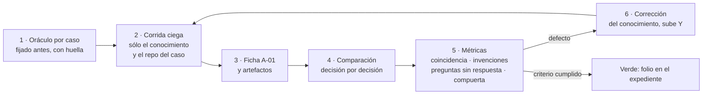

# Núcleo N3 — Forma del conocimiento de especificación DocsAsCode

## Índice

1. [Encargo y alcance](#1-encargo-y-alcance)
2. [Fuentes leídas](#2-fuentes-leídas)
3. [Hallazgos sobre la forma](#3-hallazgos-sobre-la-forma)
   1. [La regla de forma de la base](#31-la-regla-de-forma-de-la-base)
   2. [Los conocimientos ejemplares](#32-los-conocimientos-ejemplares)
   3. [El conocimiento análogo de FRAMEWORK MAUI](#33-el-conocimiento-análogo-de-framework-maui)
   4. [Choque entre la forma de la base y la compuerta del cuerpo SDEI (medido)](#34-choque-entre-la-forma-de-la-base-y-la-compuerta-del-cuerpo-sdei-medido)
4. [Clasificación del cuerpo SDEI: norma, parámetro, explicación](#4-clasificación-del-cuerpo-sdei-norma-parámetro-explicación)
   1. [Especificación normativa (invariantes)](#41-especificación-normativa-invariantes)
   2. [Decisiones parametrizables por proyecto](#42-decisiones-parametrizables-por-proyecto)
   3. [Explicación (va al libro, no al conocimiento)](#43-explicación-va-al-libro-no-al-conocimiento)
   4. [Parámetros del laboratorio escritos como norma general](#44-parámetros-del-laboratorio-escritos-como-norma-general)
5. [Propuesta de forma](#5-propuesta-de-forma)
   1. [Cabecera](#51-cabecera)
   2. [Secciones](#52-secciones)
   3. [Decisiones que toma el aplicador](#53-decisiones-que-toma-el-aplicador)
   4. [Artefactos que produce](#54-artefactos-que-produce)
   5. [Compuertas y verificaciones](#55-compuertas-y-verificaciones)
   6. [Prueba de reproducción](#56-prueba-de-reproducción)
   7. [Versionado](#57-versionado)
   8. [Dónde se indexa](#58-dónde-se-indexa)
6. [Decisiones que se elevan a la mesa](#6-decisiones-que-se-elevan-a-la-mesa)
7. [Hallazgos de coherencia para otros núcleos](#7-hallazgos-de-coherencia-para-otros-núcleos)
8. [Lo que no se hizo](#8-lo-que-no-se-hizo)

## 1. Encargo y alcance

Diseñar la **forma** del conocimiento de especificación P2:
`{dir-de-trabajo}/wt/dac-LD/Guides/Documentacion-Tecnica/Sistema-De-Documentacion-E-Integracion/Conocimientos/knowledge-DocsAsCode-Designing-Specification.md`.
El conocimiento tiene que permitir que un agente o una persona de otro contexto diseñe el sistema documentador
DocsAsCode de un proyecto nuevo o existente (prompt 02, solicitud 3, en el clon del PO
`…/Lab-Documentos.Documentacion/PROMPTs/Guides/14-Sistema-De-Documentador-Tecnico/02-Ajuste-Coherencia-Reedicion-Documentacion.md:54`;
el contexto pide aplicarlo a Geometría y al servicio privado, `:18-20`).

Esta bitácora **no redacta** el conocimiento: propone su forma, su contenido normativo y la prueba que lo valida. N3
depende de N2 (plan `00-Plan.md:59`).

Nota de lectura: el prompt 02 no está en el worktree `{dir-de-trabajo}/wt/dac-LDD` (no se versionó todavía); se leyó del clon del
PO, sólo lectura:

```text
$ ls {dir-de-trabajo}/wt/dac-LDD/PROMPTs/Guides/14-Sistema-De-Documentador-Tecnico/
Crear-Analizar-Sistema-De-Documentador-Tecnico-Guide.md  OUTPUTs
```

## 2. Fuentes leídas

| Fuente | Ruta | Para qué |
| --- | --- | --- |
| Prompt 02 | clon del PO, `PROMPTs/Guides/14-…/02-Ajuste-Coherencia-Reedicion-Documentacion.md` | Pedido y reglas |
| Plan vigente | `{dir-de-trabajo}/wt/dac-LDD/PROMPTs/Guides/14-…/OUTPUTs/DocsAsCode-Bitacoras/Reedicion-02/00-Plan.md` | Productos, núcleos, territorios |
| Regla de forma | `KB-privada/Rules/Rule-Forma-De-Conocimiento.md` (1.3, 596 líneas) | Forma común de una pieza |
| Ejemplar 1 | `IA.Knowledge.Base/Knowledges/Knowledge-Logica-De-Decision.md` (362 líneas) | Pieza con Índice y §0–§10 |
| Ejemplar 2 | `IA.Knowledge.Base/Knowledges/Knowledge-Release-Y-Despliegue-Versionado.md` (647 líneas) | Invariantes, apéndice por destino, condiciones de aplicabilidad |
| Ejemplar 3 | `IA.Knowledge.Base/Knowledges/Knowledge-Indexing.md` (321 líneas) | Pieza de construcción con variables y resultado esperado |
| Análogo | `{dir-de-trabajo}/wt/dac-LD/Concepts/Framework-Concept/Conocimientos/Knowledge-App-Hibrida-OTA-Offline-First.md` (386 líneas) | Conocimiento hermano de otra sesión (sólo lectura) |
| Cuerpo SDEI | `{dir-de-trabajo}/wt/dac-LD/Guides/Documentacion-Tecnica/Sistema-De-Documentacion-E-Integracion/**` (rama `dac/0003-base`, `0bed863`) | Fuente de lo normativo y lo parametrizable |
| Compuerta del cuerpo | `{dir-de-trabajo}/wt/dac-LD/tools/docs-guard/dg.py`, `prefijos.txt`, `esquemas/cuerpo.schema.json` | Qué exige la CI al archivo del conocimiento |
| Compuerta de la base | `IA.Knowledge.Base/tools/compuerta/verificar.py` | Verificación de la pieza en modo adoptante |

## 3. Hallazgos sobre la forma

### 3.1 La regla de forma de la base

- **Clase por prefijo.** La clase la da el prefijo del nombre de archivo y la carpeta lo sigue (`Rule-Forma-De-Conocimiento.md:73-86`).
  El nombre que fija el prompt empieza con **`knowledge-`** en minúscula (prompt `:54`). Fuera de la base F-1 no aplica,
  pero si la pieza se copia a la base se llama `Knowledge-DocsAsCode-Designing-Specification.md`. El alias
  `DocsAsCode-Designing-Specification` cumple la gramática de §3.2 y tiene 34 caracteres (máximo 64, F-6).
- **Once campos** `**Campo:** valor` antes del primer H2, ninguno vacío (§3.1). `Compatible-con` vale
  `Rule-Forma-De-Conocimiento.md 1.3`.
- **Secciones §0–§10** con carácter fijo; **§6 es la única parte normativa**, con ítems atómicos
  `[obligatorio|recomendado|permitido]` y `[enumerable|interpretativo]` (§2 y §3.4, `:110-122` y `:216-227`).
- **Fila «Origen»** con la gramática `derivado-de <repo>@<commit>:<ruta> (versión de origen X.Y)` (§3.7).
- **Regla de falla**: lo que no resuelve se informa con cita textual y no se completa por inferencia (§3.10). Es el
  comportamiento exacto que necesita la prueba de reproducción (§5.6).
- **Mapa de carga** recomendado para más de 500 líneas (F-21), por la recomendación de Agent Skills que cita la regla (§2).
- **Neutralidad.** En la base, el cuerpo de una pieza no puede usar el vocabulario de un framework. La lista de la
  compuerta incluye `\bSDD\b` y `[Cc]ategor[ií]a`:

  ```text
  $ grep -v "^#" IA.Knowledge.Base/tools/compuerta/neutralidad.txt | grep -v "^$"
  Master-Prompt	Master-Prompt
  orquestador	[Oo]rquestador
  AG-NNN	\bAG-\d
  categoría	[Cc]ategor[ií]a
  SDD	\bSDD\b
  ...
  ```

  En LD no se exige, pero si la pieza tiene que poder viajar a la base, «SDD» va al apéndice por escenario o se
  reemplaza por «marco de especificación del proyecto».

### 3.2 Los conocimientos ejemplares

| Rasgo | Logica-De-Decision | Release-Y-Despliegue-Versionado | Indexing | Qué tomar |
| --- | --- | --- | --- | --- |
| Índice al inicio | Sí (`:17-29`) | No | No | Sí: lo pide la regla del prompt (`:79`) |
| §0 con Terminología y «Qué queda afuera» | Sí (`:31-63`) | Sí | Sí | Sí |
| Invariantes, apéndice por destino y condiciones de aplicabilidad | — | §2.2, §2.3 y §2.4 (`:111-194`) | — | **Sí**: es el patrón para separar norma y parámetro |
| Variables, ejecución y resultado esperado en §3 | — | — | §3.1–§3.5 | Sí, para el procedimiento de diseño |
| §6 con prefijo de ítem propio (`RD-n`) y modo «en ejecución» | — | `:476-…` | — | Sí: ítems `DE-n` |
| §8 «Lo que necesita quien lo consume y no vive acá» | — | `:585-597` | — | Sí |

La frase de Release §2.4 resume la razón del patrón: «Sin esta tabla, la norma se replica sin su premisa y se
convierte en el manual de un solo destino» (`Knowledge-Release-Y-Despliegue-Versionado.md:179`).

### 3.3 El conocimiento análogo de FRAMEWORK MAUI

`Knowledge-App-Hibrida-OTA-Offline-First.md` **no sigue la forma de la base**:

- `Compatible-con` apunta al libro de su carpeta, no a la regla de forma (`:10`);
- tiene secciones §0–§13 temáticas en lugar de §0–§10 (salida de `grep "^## "`: «1. Cuándo usarlo», «2. Principios…»,
  «11. Checklist de arranque», «12. Referencias y casos de la industria», «13. Límites»);
- no tiene §6 normativa con niveles ni §9 con «Origen» y «Dependencias».

Lo que conviene tomar: el **«Cuándo usarlo y cuándo no»** (§1, `:44-71`), la tabla **principio → criterio → fuente**
(§2, `:72-92`), la **prioridad cuando chocan** (`:91-93`), la **checklist de arranque** (§11, `:337-354`), las
**referencias de industria** con qué toma de cada una (§12) y los **límites** (§13). Lo que no conviene copiar: la
cabecera fuera de la forma, porque deja la pieza sin verificación automática (§3.4).

La carpeta FC no es cuerpo con `corpus_id`, así que su conocimiento no necesita frontmatter: `README.md` de FC no
declara `corpus_id` (`grep -n corpus_id Concepts/Framework-Concept/README.md` no devuelve nada). El de DocsAsCode
**sí** lo necesita (§3.4).

### 3.4 Choque entre la forma de la base y la compuerta del cuerpo SDEI (medido)

`Conocimientos/` queda dentro del cuerpo SDEI, cuyo `README.md` declara `corpus_id: SDEI`. Para la compuerta, todo
archivo que no sea README dentro de un cuerpo nuevo **tiene que** tener frontmatter (`dg.py:266-273`; anexo del
esquema §1). Se ensayó en el scratchpad, con un cuerpo de prueba, contra el `dg.py` del worktree:

```text
# sin frontmatter (la forma pura de la base, como el conocimiento de FC)
ERROR sin-frontmatter: todo documento del cuerpo abre con frontmatter (N09 §7)
== PR-2 esquema: ROJO (errores=1 avisos=0)                         rc=1

# frontmatter con doc_id KNW-… y doc_type conocimiento
ERROR esquema-cuerpo: doc_type: «conocimiento» fuera del vocabulario [...]
ERROR prefijo: «KNW-» no está en el registro (prefijos.txt)
== PR-2 esquema: ROJO (errores=2 avisos=1)

# frontmatter con doc_id ANX-SDEI-… y doc_type anexo
aviso traces-vacio: traces: [] es válido, pero conviene trazar al menos al doc_id del README de su cuerpo (D-17)
== PR-2 esquema: verde (errores=0 avisos=1)
```

En el ensayo inverso, la compuerta de la base acepta una pieza con **frontmatter YAML delante de los once campos**.
Se copió `Knowledge-Logica-De-Decision.md` a una raíz parcial, se le antepuso un frontmatter y se corrió:

```text
$ python3 -I -B tools/compuerta/verificar.py --perfil nucleo --adoptante --raiz <scratch>/kb-prueba
[11] forma: piezas=1 en la forma de la base=1 fallas=0; ...
OK: las once verificaciones pasan (en modo informe: citas-piezas, dependencias, forma)
rc=0
```

**Consecuencia.** La pieza lleva **las dos cabeceras**: el frontmatter de diez campos más `description` (para
`docs-guard`) y, debajo del H1, los once campos (para la base). Las dos compuertas la pueden verificar.

- El `doc_id` necesita un prefijo registrado.
- El `doc_type` necesita un valor del vocabulario cerrado (`cuerpo.schema.json:10`).
- `version` en el frontmatter **tiene que** repetir la `Versión` de la cabecera. `dg.py:461-463` toma la versión de un
  `doc_id` del campo `version`, y así una página que traza a `@1.0` se pone en rojo cuando el conocimiento sube.

## 4. Clasificación del cuerpo SDEI: norma, parámetro, explicación

Hay pocos marcadores normativos explícitos («debe», «tiene que», «nunca»): de 0 a 7 por archivo, contados con `grep -ciw`
sobre cada `.md`. La norma está sobre todo en **tablas de convención, reglas con nombre y validaciones YAML**, no en
prosa modal. La clasificación de abajo sale de leer esas tablas.

### 4.1 Especificación normativa (invariantes)

Valen en cualquier proyecto. Pasan a §2.2 (invariantes) y a §6 (ítems `DE-n`) del conocimiento.

| Id propuesto | Invariante | Evidencia |
| --- | --- | --- |
| I-01 | La documentación vive en Git como Markdown, se revisa por PR y la verifica la CI | `README.md:41-45` (§1 del cuerpo) |
| I-02 | Todo documento lleva frontmatter con esquema cerrado; la versión del cuerpo vive sólo en su README | `00-Marco.md:161`; `99-Anexos/Esquema-Frontmatter-Y-Prefijos.md` §2 y §3 |
| I-03 | Los identificadores salen de un registro cerrado de prefijos; las trazas apuntan al ID, no a la ruta | `00-Marco.md:162` |
| I-04 | Toda traza resuelve contra el registro; un ID declarado dos veces es ambiguo; quien repite una regla traza con `@MAYOR.MENOR` | `00-Marco.md` §1, fila «Traza»; Esquema §4 |
| I-05 | Enlaces relativos dentro del repo y nunca fuera; entre repos, por SHA o etiqueta, nunca por la rama principal | `00-Marco.md:164`; `TEM-03-Topologia-Y-Versionado.md:136` |
| I-06 | Toda fuente externa con fecha de consulta; lo que no sale de una fuente se rotula como criterio propio | `00-Marco.md:165-166` |
| I-07 | Ejemplos con procedencia (`[Compilado: …]` o `[Fragmento ilustrativo: …]`); diagramas como código, con leyenda | `00-Marco.md:167-168` |
| I-08 | Estados `borrador → vigente → obsoleto`; pasar a vigente es acto humano | `00-Marco.md:169` |
| I-09 | Lo privado se nombra por alias; en lo versionado no van rutas del equipo, IP, hosts ni usuarios | `00-Marco.md:170` |
| I-10 | La clase de intervención D/P/H la fija el catálogo por clase de pieza, no se elige caso por caso | `TEM-02-Ciclo-Documental.md:66-67` |
| I-11 | Quien verifica no es quien redactó; un agente no decide nada de clase H | `00-Marco.md:153`; `00-Marco.md` §4, fila `ACT-SDEI-4` |
| I-12 | Una pieza de clase D no se edita a mano: se regenera | `Examples/Como-Intervenir.md:96` |
| I-13 | El catálogo de clases es cerrado; una pieza que no encaja abre una clase por expediente | `01-Mapa.md:76`; `Examples/Como-Intervenir.md:67` |
| I-14 | Un escenario activa, quita o sustituye piezas y controles, pero nunca agrega fases al ciclo | `00-Marco.md:58-60` |
| I-15 | Un control bloquea sólo si cumple las cinco condiciones; si no, avisa | `TEM-06-Compuertas-Y-CI.md:106-116` |
| I-16 | Quien adopta la compuerta mide primero la línea de base y sanea o acota la ruta | `TEM-06-Compuertas-Y-CI.md:118-119` |
| I-17 | Un agente fusiona sólo con la guarda G1–G4 y con la delegación asentada por escrito; con reserva, decide una persona | `TEM-06` §Definición, fila «Guarda de merge»; `00-Marco.md` §1 |
| I-18 | Un requerimiento documental es una fila con criterio Dado/Cuando/Entonces y la decisión de una persona | Esquema §6; `TEM-02` tabla de fases |
| I-19 | Una pieza que vive fuera del repo del código paga un ancla fijada y un aviso de desfase | `TEM-03-Topologia-Y-Versionado.md:129-134`; `00-Marco.md` §3, `CTX-SDEI-3` |
| I-20 | La pieza se ubica con tres preguntas: ¿la emite el build?, ¿cambia en el mismo PR que el código?, ¿habla del producto o del proyecto? | `TEM-03-Topologia-Y-Versionado.md:108-127` |

### 4.2 Decisiones parametrizables por proyecto

Son las filas de la tabla «Qué cambia entre escenarios» (`00-Marco.md:100-109`), los cuatro contextos (`00-Marco.md`
§3), la tabla «Cómo se escribe una instancia» (`Examples/Como-Intervenir.md` §8) y los pesos de «Cómo decidir»
(`99-Anexos/Como-Decidir.md:74-76`). Pasan a §3.2 del conocimiento como decisiones `D-nn` (ver §5.3).

### 4.3 Explicación (va al libro, no al conocimiento)

Pasan al libro P1, y el conocimiento remite como `consulta`:

- en cada TEM, «Qué problema resuelve», «Qué no es», «Ejemplos concretos», los ensayos reproducibles y las «Preguntas guía»;
- los casos de industria (`TEM-01` §«Un caso de industria» y §«Adopciones públicas»);
- `99-Anexos/Ejercicios.md`, `99-Anexos/Referencias.md`, `99-Anexos/Patrones-De-Ejemplos.md`;
- la matriz trabajada de `Como-Decidir.md` §5.

El conocimiento conserva sólo el **criterio** de cada decisión y la fuente que lo respalda, con el patrón de FC §2
(principio → criterio → fuente).

### 4.4 Parámetros del laboratorio escritos como norma general

Si se trasladan tal cual, el conocimiento queda atado a este laboratorio:

| Dónde | Texto | Qué es en realidad |
| --- | --- | --- |
| `99-Anexos/Como-Decidir.md:82` | F1 «no corre en el runner que fija el caso (`[self-hosted, {runner-anterior-del-cuerpo}]`)» | Parámetro: el runner que fija cada proyecto |
| `99-Anexos/Como-Decidir.md:84` | F3 «nombra un repositorio privado (se usa su alias)» | Invariante I-09, no un filtro del caso |
| `99-Anexos/Como-Decidir.md:89` | F8 «no aplica el Profile de guía de estudio» | Parámetro: sólo para cuerpos formativos (escenario 1) |
| `00-Marco.md` §1, fila «Runner» | `[self-hosted, {runner-anterior-del-cuerpo}]` | Parámetro (D-09) |
| `99-Anexos/Como-Decidir.md:74-76` | Pesos 0,15 y 0,10 | Valor por defecto razonado: se fija antes de puntuar en cada proyecto |
| `00-Marco.md:171` | Castellano rioplatense con voseo | Parámetro de idioma y estilo (D-16) |

Esa etiqueta de runner es la de todos los workflows del repo (`grep -n runs-on .github/workflows/*.yml`: los cuatro
dicen `[self-hosted, {runner-anterior-del-cuerpo}]`). Es dato de Lab-Documentos, no norma DocsAsCode.

## 5. Propuesta de forma

### 5.1 Cabecera

Hay dos bloques, en este orden. El orden y la coexistencia de los dos se ensayaron en §3.4.

```yaml
---
doc_id: KNW-SDEI-DISENO            # o ANX-SDEI-ESPECIFICACION si no hay PR común (§6, M-1)
doc_type: conocimiento             # o anexo (§6, M-1)
title: Conocimiento de especificación — diseñar el sistema documentador DocsAsCode de un proyecto
description: Qué decidir, qué producir y cómo verificar al diseñar la documentación como código de un proyecto nuevo o existente.
status: borrador
origin: ia-assisted
confidence: media
owner: Lab-Documentos — guía del sistema documentador
last_review: <AAAA-MM-DD>
audience: [humano, agente, desarrollo, analista, po]
traces: [IDX-SDEI@2.0]             # y el doc_id del libro P1 cuando exista
version: 1.0                       # repite la Versión de la cabecera de once campos
---

# Diseñar el sistema documentador DocsAsCode de un proyecto — decisiones, artefactos y compuertas

**Alias:** DocsAsCode-Designing-Specification
**Naturaleza:** propio
**Tema:** Cómo diseñar la documentación como código de un proyecto nuevo o existente: escenario y contextos, catálogo de piezas activo, topología y anclas, identificadores y trazas, compuerta con regla de bloqueo, actores y clase de intervención, canales para agentes, y la prueba que verifica el diseño
**Consumidor:** quien diseña o revisa el sistema documentador de un proyecto (persona o agente), y quien preside la mesa que lo aprueba
**Condicion-de-carga:** al arrancar la documentación de un proyecto, al adoptar la documentación como código en un proyecto que ya tiene documentos, y al revisar un diseño documental existente; se carga por secciones según el Mapa de carga de §0
**Hereda-de:** —
**Sustituye:** —
**Compatible-con:** Rule-Forma-De-Conocimiento.md 1.3
**Versión:** 1.0
**Estado:** Vigente
**Fecha:** <AAAA-MM-DD>
```

Notas:

- `Naturaleza: propio`. «Docs as code» tiene nombre establecido, pero lo que se caracteriza es *este* diseño
  (escenarios, catálogo y regla de bloqueo). La mesa lo puede discutir.
- `Condicion-de-carga` en prosa, no `—`: la pieza no actúa fuera.
- El `Estado` de la base (`Vigente | Superado`) y el `status` del cuerpo (`borrador | vigente | obsoleto`) son ejes
  distintos. Se recomienda que, mientras el cuerpo esté en `borrador`, el §0 lo diga en una línea.

### 5.2 Secciones

Se sigue la numeración §0–§10 de la regla, con subsecciones tomadas de los ejemplares. Meta: **≤ 500 líneas**
(F-21); lo explicativo va al libro.

| § | Título | Contenido | Viene de |
| --- | --- | --- | --- |
| — | Índice | Lista enlazada §0–§10 | Regla del prompt `:79`; Logica-De-Decision `:17-29` |
| 0 | Propósito y alcance | Qué caracteriza; **cuándo conviene y cuándo no** (FC §1); qué queda afuera y dónde vive (libro P1, TEM-06 para operar la compuerta, Indexing para la ia-db); terminología mínima (escenario, contexto, clase de pieza, clase de intervención, ancla, traza, compuerta, carril, guarda); **Mapa de carga** | Regla §2; FC `:17-43` |
| 1 | Identidad del artefacto | Es un conocimiento de diseño; supuestos: Git, PR, CI con checks requeridos, Markdown | Regla §1 |
| 2 | Estructura | 2.1 Las piezas del sistema (catálogo `CL-01…CL-14` condensado: qué, dónde, ancla, control, intervención); 2.2 **Invariantes** I-01…I-20 (§4.1); 2.3 **Apéndice por escenario** (los cuatro escenarios × parámetros, generalizado de `00-Marco.md:100-109`); 2.4 **Condiciones de aplicabilidad** (premisa de cada invariante y qué hacer si no se cumple); un diagrama mermaid de las piezas | Release §2.1–§2.4; `01-Mapa.md` §4 |
| 3 | Contrato de uso | 3.1 Procedimiento de diseño en ocho pasos (mermaid); 3.2 **Decisiones del aplicador** `D-01…D-17` (§5.3); 3.3 Cómo decidir entre alternativas (criterios K1–K7, escala anclada, filtros **generalizados**, regla de firmeza); 3.4 Proyecto nuevo frente a proyecto existente (inventario por comando, línea de base, heredado que avisa frente a cuerpo nuevo que bloquea, parámetro `ruta`); 3.5 Regla de falla y no inventar; 3.6 Público y privado | `Como-Decidir.md` §2–§4; `TEM-06:118-119`; Regla §3.10 |
| 4 | Decisiones ya tomadas | Tabla decisión → criterio → fuente: docs as code; esquema cerrado; ID en lugar de ruta; trazas versionadas; D/P/H por catálogo; cinco condiciones; dos carriles; anclas por SHA; RRD Dado/Cuando/Entonces; cuerpo frente a archivo único (FIRME, `Como-Decidir.md` §5) | `00-Marco.md` §5; `TEM-06` §1.2 |
| 5 | Esqueletos de referencia | 5.1 **Ficha de diseño documental** (el artefacto central, §5.4 A-01); 5.2 frontmatter mínimo; 5.3 fila del RRD; 5.4 instancia de «Cómo intervenir»; 5.5 `AGENTS.md` puntero; 5.6 registro de prefijos inicial; 5.7 llamada al workflow de la compuerta `[Fragmento ilustrativo]` | Esquema §2, §5 y §6; `Como-Intervenir.md` §8 |
| 6 | Criterios de aceptación | Ítems `DE-n` atómicos con nivel y modo. Dos clases de conformidad: **el diseño** (artefactos) y **el aplicador** (no inventa, aplica la regla de falla, no decide lo de clase H) | Regla §3.4; Release §6 |
| 7 | Anti-patrones | Arquitectura reducida a una herramienta; apuntar a la rama principal; control con falsos positivos que bloquea; agente que aprueba lo de clase H; pieza D editada a mano; clase improvisada fuera del catálogo; versionar por las dudas; privado nombrado; **copiar los parámetros del laboratorio** (runner, Profile) como norma | `TEM-03:129-137`; `TEM-06` «Qué no es»; §4.4 de esta bitácora |
| 8 | Conformidad | Consultivo; a quién se aplica; precedencia por perfil; «lo que necesita quien lo consume y no vive acá» | Regla §3.5; Release `:576-606` |
| 9 | Trazabilidad | Índice, hermanos (libro P1; el conocimiento de FC como hermano de otro dominio), artefacto de referencia (cuerpo SDEI, `docs-guard`, mini demo), **Origen** `derivado-de Lab-Documentos@<sha>:<ruta>` por archivo fuente, **Dependencias** sólo `consulta`, **Fuentes** externas con fecha de consulta | Regla §3.6 y §3.7 |
| 10 | Control de cambios | Una fila por versión | Regla §2 |

**Mermaid.** Hay dos diagramas: el procedimiento de §3.1 y el árbol de ubicación de §2 (de `TEM-03:113-121`). Se
aplica el aprendizaje de FC: «1 · Texto» en lugar de «1. Texto», y sin URLs en las etiquetas (plan `00-Plan.md:118`).

**Dependencias, sólo `consulta`.** El conocimiento tiene que ser **autocontenido**: la prueba de reproducción le da a
un agente sólo este archivo. Una dependencia `obligatoria` haría fallar esa prueba por diseño. Candidatas:

| Alias | Uso | Para qué |
| --- | --- | --- |
| `Logica-De-Decision` | consulta | Elevar o resolver una decisión (D-11) |
| `Conformacion-Pull-Request-Automatico` | consulta | La guarda de merge (I-17) |
| `Indexing` | consulta | Construir el índice para agentes (CL-08, D-12) |
| `Forma-De-Conocimiento` | consulta | La forma de esta pieza |

### 5.3 Decisiones que toma el aplicador

Cada decisión se escribe en la ficha de diseño (A-01) con su evidencia: la ruta y la línea del proyecto, o
«pendiente: <qué falta>». El «default» es lo que se aplica si no hay razón para otra cosa.

| Id | Pregunta | Opciones | Criterio | Default | Clase | Evidencia en SDEI |
| --- | --- | --- | --- | --- | --- | --- |
| D-01 | ¿En qué escenario está el proyecto? | Corpus de guías · App sin roles · Panel con roles · Servicio con paquetes · nuevo por expediente | Audiencias, roles con permisos distintos, paquetes publicados | — (se deduce) | P; H si es un escenario nuevo | `00-Marco.md` §2 |
| D-02 | ¿Qué clases de pieza se activan? | Subconjunto de CL-01…CL-14 | Fila del escenario más contextos; cada clase omitida, con su motivo | La fila del escenario | P | `00-Marco.md:104`; `01-Mapa.md` §4 |
| D-03 | ¿Hay sitio publicado? | Sí · No | Si hay sitio, se activa CL-14 y el build del sitio entra a la compuerta | No | H (publicar) | `CTX-SDEI-1` |
| D-04 | ¿Hay marco de especificación con registro de IDs? | Sí, se usa el suyo · No, fichas propias y `docs/_requisitos.md` | Existe un registro de IDs que resuelve | — | P | `CTX-SDEI-2` |
| D-05 | ¿Dónde vive cada pieza? | Build · mismo repo · repo hermano · repo dedicado | Las tres preguntas de I-20 | Mismo repo | P | `TEM-03:108-127` |
| D-06 | ¿Contra qué ancla vale cada pieza? | Commit · SHA fijado (`source.lock`/`base_commit`) · etiqueta por línea | Se deriva de D-05 y de las líneas de versión | Commit | P | `00-Marco.md` §2.5, fila «Ancla» |
| D-07 | ¿Qué prefijos e IDs? | Registro propio (internos/externos) · segmento del cuerpo si el registro es compartido | Unicidad en el registro del repo | Registro mínimo más los externos del dominio | P (registro); H (prefijo nuevo compartido) | Esquema §5 |
| D-08 | ¿Qué esquema de frontmatter? | Los diez campos más `description` · mapeo a uno existente | En un proyecto existente, lo heredado avisa y lo nuevo bloquea | Diez campos más `description` | P | Esquema §2; `TEM-06` §Definición |
| D-09 | ¿Cómo corre la compuerta? | Llamar al workflow reutilizable · copia con huella · propia; runner; guion local | Organización del runner; checks requeridos posibles | El reutilizable si la organización lo permite | H (configuración de la organización) | `CTX-SDEI-4`; `Como-Intervenir.md` §5 |
| D-10 | ¿Qué controles bloquean y cuáles avisan? | Por control | Cinco condiciones más la línea de base medida; ¿la plataforma impide o sólo avisa? | Avisa hasta línea de base 0 | P | `TEM-06:106-147` |
| D-11 | ¿Quién decide qué? | Mapeo de actores; delegación del merge sí o no | Hay delegación asentada por escrito | Sin delegación: fusiona una persona | H | `00-Marco.md` §4; `Como-Decidir.md` §6 |
| D-12 | ¿Qué canales hay para agentes? | `AGENTS.md` puntero · índice para agentes (ia-db) · `llms.txt` (sólo con sitio) | Hay agentes que trabajan en el repo; tamaño del corpus | `AGENTS.md` puntero | H (`AGENTS.md`) | `TEM-04`; CL-03 y CL-08 |
| D-13 | ¿Cómo es la ayuda al usuario final? | Ninguna · única · por rol · por idioma | Roles; idiomas; confidencialidad resuelta en el servidor | Según D-01 | P | `TEM-05` |
| D-14 | ¿Qué es privado y cómo se nombra? | Alias por destino privado | I-09; barrido antes de cada PR público | Alias más barrido | P | `00-Marco.md:170` |
| D-15 | ¿Hay un cuerpo formativo? | Sí, con Profile de guía de estudio · No | Sólo si el proyecto enseña (escenario 1) | No | P | `Como-Decidir.md:89` (F8, generalizado) |
| D-16 | ¿Idioma y estilo? | Del proyecto | Audiencia | El del proyecto | P | `00-Marco.md:171` |
| D-17 | ¿Cómo es el carril programado? | Frecuencia; días de frescura; qué vigila | Hay piezas con ancla fijada o copias | Semanal, 365 días | P | `TEM-06` §1.1 |

**Pesos para elegir entre alternativas.** Los pesos de «Cómo decidir» (`Como-Decidir.md:74-76`) entran como **valor
por defecto razonado**. El conocimiento exige fijarlos antes de puntuar y guardar su huella, como dice esa misma
sección.

### 5.4 Artefactos que produce

| Id | Artefacto | Clase | Dónde | Lo exige |
| --- | --- | --- | --- | --- |
| A-01 | **Ficha de diseño documental del proyecto**: D-01…D-17 con evidencia, catálogo activo y clases omitidas con su motivo | CL-01 (decisión de arquitectura documental) | Repo del código o hermano, según D-05 | Todos |
| A-02 | Registro de prefijos | — | Junto a la compuerta | D-07 |
| A-03 | Esquema de frontmatter (o referencia fijada al de LD) | — | Junto a la compuerta | D-08 |
| A-04 | Registro de requerimientos documentales inicial | CL-02 | Con la especificación o en `docs/_requisitos.md` | D-04 |
| A-05 | `AGENTS.md` puntero | CL-03 | Raíz de cada repo | D-12 |
| A-06 | Instancia de «Cómo intervenir» | CL-12 | Según D-05 | Todos |
| A-07 | Workflow de la compuerta más guion local | — | `.github/` más `scripts/` | D-09 |
| A-08 | Informe de línea de base y archivo de excepciones (vacío) | — | Expediente o PR de adopción | D-10 |
| A-09 | `source.lock` o `base_commit` | — | Donde la pieza no está junto al código | D-05, D-06 |
| A-10 | Carril programado | — | `.github/` | D-17 |
| A-11 | Entrada en el índice del proyecto y en el CHANGELOG | CL-08, CL-13 | Repo hermano y repo | D-12 |

### 5.5 Compuertas y verificaciones

**Sobre el conocimiento mismo** (antes de publicarlo):

| Id | Verificación | Comando | Esperado |
| --- | --- | --- | --- |
| V-K1 | Esquema, prefijo y frontmatter | `scripts/ci-local.sh todo Guides/Documentacion-Tecnica/Sistema-De-Documentacion-E-Integracion` | Verde |
| V-K2 | Mermaid | `tools/medios/mermaid.sh <md>` (plan `00-Plan.md:116`) | rc=0 |
| V-K3 | Forma de la base, en modo adoptante | Copiar como `Knowledges/Knowledge-DocsAsCode-Designing-Specification.md` a una raíz parcial y correr `python3 -I -B tools/compuerta/verificar.py --perfil nucleo --adoptante --raiz <raíz>` | `OK: las once verificaciones pasan` (ensayado con otra pieza, §3.4) |
| V-K4 | Barrido de privados | Patrones del plan (`00-Plan.md:121-122`) | 0 hallazgos |
| V-K5 | URL con fecha (`url-fecha`) | Incluido en V-K1 (PR-7) | Verde |

**Sobre lo que produce un aplicador** (se escriben como ítems `DE-n` de §6):

- los artefactos pasan la compuerta del proyecto en verde (PR-1 a PR-5; PR-6 si hay contrato);
- **par rojo/verde**: se planta una traza desfasada y la compuerta da rojo, como en el ensayo de `TEM-06` §3.3;
- la línea de base está medida y registrada antes de activar el bloqueo;
- toda afirmación sobre el proyecto en A-01 lleva ruta:línea o queda marcada «pendiente»;
- lo de clase H (D-03, D-09, D-11, D-12) queda listado para una persona y no aparece «decidido» por el agente.

### 5.6 Prueba de reproducción

**Pregunta.** ¿Alcanza el conocimiento, solo, para que alguien sin contexto diseñe el sistema documentador de un
proyecto igual que lo haría quien conoce el cuerpo?



*Diagrama: el oráculo se fija antes de correr; cada defecto vuelve al conocimiento y se corre de nuevo.*

**Casos.** Los oráculos tienen que existir antes de la corrida:

| Caso | Escenario | Repo de entrada (sólo lectura, SHA fijo) | Oráculo | Dónde queda la evidencia |
| --- | --- | --- | --- | --- |
| C0 control | Corpus de guías | Lab-Documentos | El sistema real de LD: `docs-guard`, `prefijos.txt`, `AGENTS.md`, cuerpo SDEI | `{dir-de-trabajo}/ensayos/` |
| C1 | Panel con roles | Lab-Geometria y su `.Documentacion` | `00-Marco.md:102-109` (columna del panel con roles); `TEM-03-Topologia-Y-Versionado.md:243-249`; `TEM-07` §«Resolver una traza contra el SDD real» | `ensayos/` y Lab-Geometria.Documentacion (N4) |
| C2 | Servicio con paquetes | Servicio privado de notificaciones | Su columna en `00-Marco.md:102-109` más su documentación privada | **Sólo** `{dir-de-trabajo}/privado/` (N5) |
| C3 opcional | App sin roles | La app de la mini demo, en el SHA de su `source.lock` | `Examples/MovilidadUrbana-Mini-Demo/` | `ensayos/` |

**Protocolo.**

1. **Oráculo antes.** Para cada caso, un agente distinto del que corre escribe la respuesta esperada a D-01…D-17,
   con evidencia, y se guarda su `sha256sum`. Si un valor del oráculo no se puede fijar, la decisión queda «sin
   oráculo» y no cuenta para la coincidencia. Es la misma regla de «pesos fijados antes» de `Como-Decidir.md:74-76`.
2. **Corrida ciega.** Un subagente nuevo, sin memoria ni carta con contexto del laboratorio, corre en el equipo de pruebas en un
   contenedor o worktree que tiene sólo: el archivo del conocimiento; el repo del caso en su SHA; y la plantilla A-01
   vacía. Ve LD sólo en C0, y como objeto: puede leer el proyecto, pero no el cuerpo SDEI. En C1–C3 no puede leer LD
   ni LDD.
3. **Dos corridas por caso**, independientes. Lo que cambia entre corridas mide la ambigüedad del conocimiento.
4. **Prueba negativa.** Una corrida extra de C1 con el §3.2 del conocimiento borrado. Se espera que el agente informe
   «`DocsAsCode-Designing-Specification §3.2` no resuelve» y que no complete las decisiones por inferencia (Regla §3.10).
   Si inventa, la prueba de reproducción no es confiable y se corrige la carta antes de seguir.
5. **Comparación.** Para cada decisión, una de cuatro: *coincide* · *difiere con fundamento citado* · *difiere sin
   fundamento* · *falta*. Lo que difiere con fundamento lo juzga la mesa: puede ser un error del oráculo.
6. **Métricas y umbral.** Son **[criterio propio]**, y la mesa los fija antes de correr:
   - decisiones contestadas o marcadas «pendiente» con motivo: **100 %**;
   - coincidencia en decisiones con oráculo: **≥ 85 %**, y ninguna «difiere sin fundamento» en una decisión de clase H;
   - invenciones (afirmaciones sobre el proyecto sin ruta:línea): **0**;
   - preguntas que el conocimiento no respondió y el agente tuvo que suponer: **0**. Es el mismo umbral de la prueba
     de lectura de `CQ-04` (`99-Anexos/Criterios-De-Calidad.md`, §3, paso 3);
   - artefactos A-02…A-07 de C1 corridos con `docs-guard` en un worktree de ensayo: **verde**, con un par rojo/verde.
7. **Ciclo.** Cada defecto se corrige en el conocimiento (sube `Y`, §5.7) y se vuelven a correr los casos afectados.
   La pasada final se asienta en un folio del expediente 0003. Las correcciones al libro P1 se anotan para N2.

**Lo que esta prueba no mide.** No mide si el diseño es *bueno* para el proyecto: mide si es *reproducible* desde el
conocimiento. Que sea bueno lo juzgan la mesa y el uso: los ensayos N4 y N5 continúan después del diseño.

### 5.7 Versionado

- **Versión de la pieza** `X.Y`, propia, según la Regla §3.9. Sube `X` si el cambio puede dejar no conforme a quien ya
  lo era (un `[obligatorio]` nuevo, un nivel que sube, otro `Consumidor`) o si quita o renumera una sección citada. En
  otro caso sube `Y`; las correcciones de la prueba de reproducción suben `Y`.
- **Espejo en el frontmatter.** `version: X.Y` igual a `**Versión:**`. Así, una instancia o una ficha de diseño que
  traza al `doc_id` del conocimiento con `@X.Y` se pone en rojo cuando el conocimiento sube de versión (`dg.py:461-463` y `:697-701`).
- **Independiente del cuerpo.** El cuerpo SDEI sigue su SemVer en el README (`2.0.0-borrador`). El conocimiento traza a
  `IDX-SDEI@2.0`: si el cuerpo pasa a 2.1 o a 3.0, PR-5 da rojo y obliga a revisarlo.
- **Estado.** `Vigente | Superado` en la cabecera de la base. El `status` del cuerpo pasa a `vigente` por acto humano
  (I-08), en un PR propio.
- **Control de cambios (§10).** Una fila por versión, sin reescribir.
- **Fila «Origen».** Un valor `derivado-de Lab-Documentos@<sha>:<ruta> (versión de origen 2.0)` por cada archivo del
  cuerpo del que se destila, al menos `00-Marco.md`, `01-Mapa.md`, `TEM-03`, `TEM-06`, `99-Anexos/Como-Decidir.md` y
  `99-Anexos/Esquema-Frontmatter-Y-Prefijos.md`. Vigilar la deriva frente a esos SHA queda en el carril programado.

### 5.8 Dónde se indexa

| Dónde | Qué | Territorio (plan §5) |
| --- | --- | --- |
| `Conocimientos/README.md` (nuevo, exento de frontmatter por ser README) | Tabla conocimiento · para qué · cuándo se carga, como la de FC | DocsAsCode: va en un PR de contenido |
| `README.md` del cuerpo SDEI, §4 «Tabla de contenido» | Fila nueva con el `doc_id` | DocsAsCode |
| `01-Mapa.md` §2 o §6 | Fila «diseño la documentación de un proyecto → el conocimiento» | DocsAsCode |
| `99-Anexos/Esquema-Frontmatter-Y-Prefijos.md` §2 y §5 | `doc_type` y prefijo nuevos, si la mesa elige M-1 A | DocsAsCode (el anexo); la compuerta es común |
| `tools/docs-guard/prefijos.txt` y `esquemas/cuerpo.schema.json` | Prefijo `KNW` y `doc_type: conocimiento` | **Común**: PR común pequeño, anunciado |
| LDD `ia-db/indexes/11_Sistema-Documentador-SDEI.md` y `ia-db/README.md` | Fila en la navegación | **Común** (`ia-db/**`) |
| `AGENTS.md` de LD | Puntero en la ruta «agente» | **Común** y de clase H |
| `IA.Knowledge.Base/Knowledges/` | Copia como `Knowledge-DocsAsCode-Designing-Specification.md` con `derivado-de` | Otro repo: decide el PO (§6, M-4) |
| `PROMPTs/Guides/14-…/ARTIFACTs/` | Copia que pide el contexto del prompt (`:18`) | Del PO (plan `00-Plan.md:136-140`) |

## 6. Decisiones que se elevan a la mesa

Las cuatro son aditivas y reversibles, salvo M-4, que cruza de repositorio. Cada una lleva recomendación y default.

| Id | Pregunta | Recomendación | Si nadie decide |
| --- | --- | --- | --- |
| M-1 | ¿Qué prefijo y qué `doc_type` lleva el conocimiento? | **A**: PR común pequeño con `KNW` interno y `doc_type: conocimiento`, más las filas en el anexo del esquema. Da identidad semántica y sirve para conocimientos futuros | **B**: `ANX-SDEI-ESPECIFICACION` con `doc_type: anexo` (verde medido, §3.4), sin tocar archivos comunes |
| M-2 | ¿Forma estricta de la base o forma libre como la de FC? | Estricta (§0–§10, §6 con niveles): permite verificar con V-K3 y declarar conformidad | Estricta |
| M-3 | ¿El cuerpo de la pieza es neutral (sin «SDD» fuera del apéndice por escenario)? | Sí: «marco de especificación del proyecto», y «SDD» sólo en §2.3 | Sí |
| M-4 | ¿Se copia a IA.Knowledge.Base? | Después de la prueba de reproducción en verde, y por decisión del PO | No se copia |

## 7. Hallazgos de coherencia para otros núcleos

- **N1.** `PE` significa dos cosas: `tools/docs-guard/prefijos.txt:24` dice «pregunta de evaluación» y
  `99-Anexos/Esquema-Frontmatter-Y-Prefijos.md:117` dice «Patrón de ejemplo».
- **N1.** Los filtros F1, F3 y F8 de `99-Anexos/Como-Decidir.md:82-89` mezclan parámetros del laboratorio con norma
  (§4.4).
- **N1/N2.** `TEM-03-Topologia-Y-Versionado.md:245` apoya el caso Lab-Geometria en la guía de un solo archivo, que
  está `obsoleta`. El libro tendría que citar el tema, no la guía obsoleta.
- **N2.** El libro P1 necesita una sección o un anexo «De la explicación al conocimiento» que diga qué parte del libro
  destila el conocimiento, para que la remisión `consulta` resuelva.
- **N4/N5.** El oráculo de C1 y de C2 se escribe **antes** de la corrida (§5.6, paso 1). Es trabajo de N4 y N5, no de
  N3.
- **Cohesión.** El conocimiento de FC y el de DocsAsCode van a tener formas distintas. Conviene que `01-Cohesion-Global.md`
  lo registre sin pedirle cambios a FC (su territorio).

## 8. Lo que no se hizo

- No se redactó el conocimiento: es la fase 3 del plan.
- No se corrió `scripts/ci-local.sh` completo ni mermaid: sólo `dg.py esquema` sobre un cuerpo de prueba en el scratchpad.
- No se corrió ninguna prueba de reproducción: falta el conocimiento.
- No se leyó la documentación del servicio privado: no hizo falta para la forma, y su lectura es de N5.
- Archivos de ensayo, sólo en el scratchpad de la sesión:
  `{dir-de-trabajo}/scratchpad/kb-prueba`
  y `{dir-de-trabajo}/scratchpad/dg-prueba`.
- No llegó ningún mensaje de otra sesión durante el turno.
