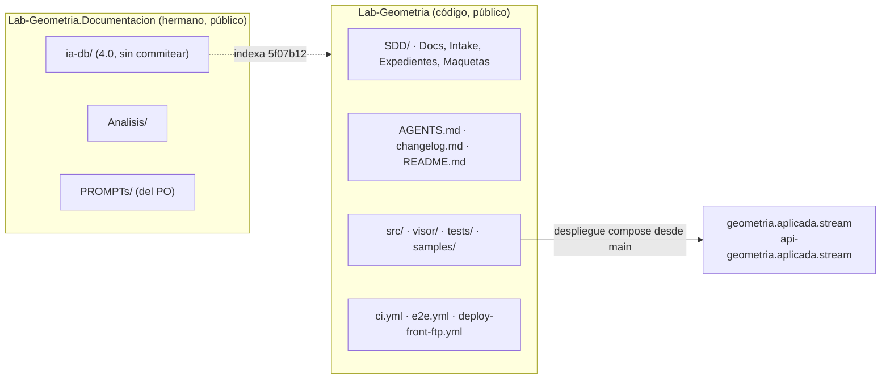

# Núcleo N4 — Aplicación a Geometría

Relevamiento del sistema de documentación **actual** de Fábrica de Geometría (repositorios públicos Lab-Geometria y
Lab-Geometria.Documentacion), su mapeo contra los conceptos del cuerpo SDEI de Lab-Documentos y el diseño del ensayo del
conocimiento de especificación sobre ese proyecto. Es autocontenido: define lo que usa y cita la evidencia de cada
afirmación.

## Índice

1. [Alcance, fuentes y convenciones](#1-alcance-fuentes-y-convenciones)
2. [Definiciones](#2-definiciones)
3. [Sistema de documentación actual de Geometría](#3-sistema-de-documentación-actual-de-geometría)
   1. [Topología de repositorios](#31-topología-de-repositorios)
   2. [ia-db](#32-ia-db)
   3. [Especificación SDD, expedientes y categoría 11](#33-especificación-sdd-expedientes-y-categoría-11)
   4. [Guías](#34-guías)
   5. [CI documental](#35-ci-documental)
   6. [Ayuda al usuario final](#36-ayuda-al-usuario-final)
   7. [Despliegue en geometria.aplicada.stream](#37-despliegue-en-geometriaaplicadastream)
   8. [Estado git (sólo lectura)](#38-estado-git-sólo-lectura)
4. [Mapeo concepto SDEI → Geometría → brecha](#4-mapeo-concepto-sdei--geometría--brecha)
5. [Ensayo de trazas corrido en el equipo de pruebas](#5-ensayo-de-trazas-corrido-en-el-equipo-de-pruebas)
6. [Hallazgos de coherencia entre SDEI y Geometría](#6-hallazgos-de-coherencia-entre-sdei-y-geometría)
7. [Propuesta: cómo ensayar el conocimiento de especificación sobre Geometría](#7-propuesta-cómo-ensayar-el-conocimiento-de-especificación-sobre-geometría)
8. [Propuesta: material de Geometría para enriquecer el libro](#8-propuesta-material-de-geometría-para-enriquecer-el-libro)
9. [Riesgos de coordinación](#9-riesgos-de-coordinación)
10. [Lo que no se verificó](#10-lo-que-no-se-verificó)
11. [Relación con los otros núcleos](#11-relación-con-los-otros-núcleos)

## 1. Alcance, fuentes y convenciones

- **Prompt y plan** leídos primero: el prompt `02-Ajuste-Coherencia-Reedicion-Documentacion.md` (sólo existe en el clon
  del PO, sin versionar en `{dir-de-trabajo}/wt/dac-LDD`; `ls` del 2026-11-01) y `Reedicion-02/00-Plan.md` (worktree `dac-LDD`).
- **Geometría** se leyó desde los clones del workspace `PROG2/Geometria/Lab-Geometria` (rama `main`, `5f07b12`) y
  `PROG2/Geometria/Lab-Geometria.Documentacion` (rama `main`, `0202722`), **sólo lectura**.
- **Cuerpo SDEI** desde `{dir-de-trabajo}/wt/dac-LD` (rama `dac/0003-base`, `0bed863`), carpeta
  `Guides/Documentacion-Tecnica/Sistema-De-Documentacion-E-Integracion/` (en adelante `SDEI/`).
- Rutas: `LG/` = `Lab-Geometria/`, `LGD/` = `Lab-Geometria.Documentacion/`. Las líneas son las del archivo en esas
  revisiones.
- Lab-Geometria es público y el PO lo dejó como caso de consulta: se nombra y se cita. El servicio privado de
  notificaciones no aparece en este núcleo salvo como alias.
- Fecha de toda consulta web: **2026-11-01**.

## 2. Definiciones

| Término | Definición usada acá |
| --- | --- |
| SDEI | Cuerpo «Sistema de Documentación e Integración» de Lab-Documentos: `00-Marco`, `01-Mapa`, `TEM-01..07`, `99-Anexos`, `Examples/` |
| Escenario / contexto / clase | Los del Marco: `ESC-SDEI-n`, `CTX-SDEI-n`, `CL-nn` (`SDEI/00-Marco.md:33-52` y §2-§4, `SDEI/01-Mapa.md` §4) |
| Escalón 2 (E2) | Etapa del expediente 0002 de LDD: «piloto en Lab-Geometria (conocimiento y aplicación)», con compuerta de dictamen (`…/0002-…/actuaciones/001-providencia-apertura.md:131`, diagrama l. 309). **No confundir con E1-G2**, que es la segunda compuerta de la etapa E1 (`…/actuaciones/253-…`, `255-…`) |
| Aplicador | Agente o persona que toma el conocimiento de especificación (P2 del plan) y lo aplica a un proyecto sin contexto previo |
| Ensayo de reproducción | Corrida del aplicador sobre Geometría cuyo resultado se compara contra una referencia medida (este núcleo) |

## 3. Sistema de documentación actual de Geometría

### 3.1 Topología de repositorios



*Diagrama: el código y su especificación SDD viven juntos; el hermano `.Documentacion` guarda índice para agentes,
análisis y prompts; el despliegue sale de `main`.*

- **Mismo repositorio** (código + especificación): `LG/SDD/` con `Docs/`, `Intake/`, `Expedientes/`, `Maquetas/`
  (`ls LG/SDD`). Es la topología que SDEI declara para Geometría (`SDEI/TEM-03-Topologia-Y-Versionado.md:42` y §«Lab-Geometria»,
  l. 243-249).
- **Repositorio hermano**: `LGD/` con `ia-db/`, `Analisis/` (2 documentos versionados), `PROMPTs/` (del PO) y
  `changelog.md` (`git -C LGD ls-files`). `LGD/Guides/` existe vacía y sin versionar.
- **Otros del mismo directorio**: `tools_json_figure_viewer` y `tup_prog_2_2026_actividad1` (material de cátedra); no
  forman parte del sistema documentador relevado.

### 3.2 ia-db

- Punto de entrada único `LGD/ia-db/README.md`, 20 índices `00_…19_` (l. 13-34), versión **4.0 generada el
  2026-11-01** sobre `LG` `5f07b12` (l. 47-49). Advierte el tamaño: 1.889 archivos versionados, 1.330 bajo `SDD/`, 679 en
  `_legacy/` (l. 6).
- Ancla de versión: revisión en el manifiesto y en la cabecera de cada índice («Revisión indexada», p. ej.
  `00_MASTER-INDEX.md:8`). **No usa el campo `base_commit`** que SDEI prescribe para CL-08 (`grep -rl base_commit LGD/ia-db`
  → nada).
- Regla de mantenimiento: no se edita a mano, se regenera o actualiza con su prompt y una tabla «ruta cambiada → índice a
  revisar» (`LGD/ia-db/README.md:143` y tabla final). Es una implementación concreta del «aviso de atraso» de CL-08,
  pero manual, no programada.
- **Estado delicado**: la 4.0 del 2026-11-01 está **sin commitear** en el clon local (33 entradas en `git status`: 13
  índices viejos modificados o borrados y 18 nuevos sin seguir). En GitHub hay **otra** 4.0, la del PR #3 (`ia-db/4.0`,
  `b47d22b`), generada el 2026-10-26 sobre `4b114d7` (`git show origin/ia-db/4.0:ia-db/README.md`, l. 38 y 142). Son dos
  4.0 distintas.

### 3.3 Especificación SDD, expedientes y categoría 11

- El corpus `LG/SDD/Docs/` gobierna el repositorio, marco SDD procedencia 13.16 (`LGD/ia-db/README.md`, resumen
  ejecutivo). Unidades de entrega en el árbol: `GeometriaFactory-Api` y `GeometriaFactory-Web` (`ls
  LG/SDD/Docs/Unidades-Entrega`).
- Identificadores versionados con encabezado `# ID — …` y línea `**Versión:** x.y`: p. ej. `CU-10005` 1.2, `CU-10004`
  1.9, `CU-00022` 1.1 (`grep '^\*\*Versión:\*\*'` sobre `Casos-De-Uso/`). Las versiones superadas se congelan en
  `_legacy/` (p. ej. `CU-08002` 1.9 y 1.10 en `Producto/Contratos-Inter-Unidad/_legacy/2026-09-1{3,4}/`).
- Expedientes: uno, `LG/SDD/Expedientes/0001-Migracion-Normativa-A-13.16`.
- **Categoría 11 (documentación de entrega)**: `LG/SDD/Docs/Producto/11-Documentacion/README.md` es un **plan**. Dice que
  «todas las celdas apuntan hoy a documentos en estado `Planificado`» (l. 75) y que sólo los ocho README de la categoría
  más `Bitacora-Eventualidades.md`, `Contrato-Agentes.md` y `AGENTS.md` están vigentes (§3.1, l. 107-113).
  `Vision-General-Sistema.md`, `Guia-Inicio-Rapido.md` y `Guia-Despliegue.md` siguen `Planificado` (l. 108-110).
- `AGENTS.md` en la raíz (98 líneas), derivado de `Contrato-Agentes.md`, con límites, delegación del merge (l. 67) y
  ruteo por intención (l. 86).
- Doble declaración de versión en el mismo documento: el README de la categoría 11 tiene `version: "1.3"` en el
  frontmatter (l. 8) y `**Versión:** 1.4` en el cuerpo (l. 22), con fila 1.4 en su control de cambios. Ver §5 caso R.

### 3.4 Guías

- No hay guías de usuario ni de desarrollador publicadas en ninguno de los dos repositorios: `LGD/Guides/` está vacía y
  sin versionar; `LGD/PROMPTs/Guides/` sólo tiene `.gitkeep` (`git ls-files`).
- Lo más cercano a guía para desarrolladores son los **20 samples ejecutables** (`LG/samples/{api,application,contracts,
  domain,infrastructure,visor}/0N-…`) indexados en `ia-db/indexes/13_Samples-Ejecutables.md`, y el `AGENTS.md`.
- Para quien integra la API: OpenAPI y explorador Scalar publicados en tiempo de ejecución
  (`LG/src/GeometriaFactory.Api/Composition/ApiDocumentation.cs:37,40,117,119`).

### 3.5 CI documental

- **Lab-Geometria no tiene control documental en CI.** Sus workflows son `ci.yml` (árbol de la solución, build, test,
  cobertura, `verify-stage-d/e/h`), `e2e.yml` y `deploy-front-ftp.yml` (`grep run: LG/.github/workflows/*.yml`). No
  menciona `docs-guard` (`git grep -l docs-guard 5f07b12` → nada).
- `e2e.yml` corre en `runs-on: [self-hosted, {runner-anterior-del-cuerpo}]` (l. 69 y 149). Esa etiqueta la atiende hoy
  `{runner-del-cuerpo}`: el último `docs-guard` de Lab-Documentos (run 41327937941, 2026-11-01 16:45 UTC) corrió ahí con
  etiquetas `['self-hosted','{runner-anterior-del-cuerpo}']` (API pública de Actions, consultada el 2026-11-01).
- **Lab-Geometria.Documentacion tiene un control documental propuesto pero sin fusionar**: el PR #2
  (`entrega/delegacion-y-verificar`, `27291b1`, abierto el 2026-10-26) agrega `.github/workflows/verificar.yml`
  (`ubuntu-latest`) y `.github/scripts/verificar.py`, que comprueba enlaces internos y la forma de la ia-db según el
  Profile Knowledge-Indexing, excluye `PROMPTs/` y sólo cuenta los enlaces que salen del repositorio
  (`git show origin/entrega/delegacion-y-verificar:.github/scripts/verificar.py`, docstring l. 1-11). Asienta también la
  delegación del merge en el README.

### 3.6 Ayuda al usuario final

- **No hay ayuda de usuario construida.** `git grep -i ayuda 5f07b12 -- src` sólo encuentra
  `WorkSubmission.razor` y `WorkView.razor` (textos de accesibilidad, como ya midió R06 §9); no hay archivos de ayuda en
  `src/GeometriaFactory.Web`; `GET https://geometria.aplicada.stream/ayuda` → **404** y `/llms.txt` → **404**
  (2026-11-01).
- Sin localización: `AddLocalization|IStringLocalizer` → 0 coincidencias en `src/`, 0 `.resx` (cierra un punto que R06
  §14 dejó sin verificar).
- **Habilitación normativa ya existe**: `Web ADR-10010` (PR #234, `5f07b12`), «La ayuda de usuario acompaña, sin resolver
  el trabajo»: ratifica la ayuda contextual, acota «sin manual» y fija el **límite didáctico** «la ayuda no entrega el
  JSON ni las clases resueltas» (`LG/SDD/Docs/Unidades-Entrega/GeometriaFactory-Web/05-Arquitectura-Tecnica/Adrs/
  ADR-10010-…md:24-26`), con métrica de validación verificable (l. 56). `Experiencia-De-Uso.md` subió a 1.5 para citarla.
  Esto resuelve el bloqueo «F1 vía normativa / F2 ADR de ayuda» que R06 §13 listaba como faltante.

### 3.7 Despliegue en geometria.aplicada.stream

| Recurso | Resultado (2026-11-01) |
| --- | --- |
| `https://geometria.aplicada.stream/` | 302 → `/ingreso` |
| `https://api-geometria.aplicada.stream/salud` | 200, `{"ready":true,"version":"1.2.0+4b114d74…"}` |
| `https://api-geometria.aplicada.stream/openapi/v1.json` | 200, `GeometriaFactory.Api \| v1`, 13 rutas |
| `https://api-geometria.aplicada.stream/documentacion` | 302 (explorador Scalar) |
| `https://geometria.aplicada.stream/ayuda`, `/llms.txt` | 404 |

- Lo desplegado es `4b114d7` (`v1.2.0`). `main` está en `5f07b12` (`git describe` → `v1.2.0-5-g5f07b12`), pero
  `git diff --name-only 4b114d7 5f07b12` sólo toca `AGENTS.md` y tres archivos de `SDD/`: **no hay deriva de código**
  entre lo publicado y `main`.
- Restricción de la ia-db: los contenedores del despliegue real son del PO (ni `exec`, ni reinicio, ni volúmenes)
  (`LGD/ia-db/README.md:129`). Todo ensayo va en instancia aparte.

### 3.8 Estado git (sólo lectura)

| Repo | Rama local | HEAD | Ramas remotas | PR abiertos (API pública, 2026-11-01) | Árbol local |
| --- | --- | --- | --- | --- | --- |
| Lab-Geometria | `main` = `origin/main` | `5f07b12` (PR #234) | `main`, `archivo/reanudacion-6-2026-09-12` | ninguno (235 refs `pull/*/head`) | limpio |
| Lab-Geometria.Documentacion | `main` = `origin/main` | `0202722` | `main`, `entrega/delegacion-y-verificar`, `ia-db/4.0` | #2 Entrega: delegación + `Verificar` (`27291b1`); #3 ia-db 4.0 sobre `4b114d7` (`b47d22b`) | **33 cambios sin commitear** (ia-db 4.0 sobre `5f07b12` y `PROMPTs/Indexado/Crear-Indexado.md`) |

Comandos: `git -C <repo> status -sb`, `git ls-remote origin`, `curl https://api.github.com/repos/hdcm-dev/<repo>/pulls?state=open`.
Etiqueta más reciente de Lab-Geometria: `v1.2.0`.

## 4. Mapeo concepto SDEI → Geometría → brecha

| Concepto SDEI (fuente) | Cómo está en Geometría (evidencia) | Brecha |
| --- | --- | --- |
| `ESC-SDEI-3` Panel con roles (`00-Marco.md:87-91`) | Roles `Student`/`Administrator` y claim `gf:role` existen (R06 §9 con rutas en `src/`) | Ninguna en la clasificación: el escenario aplica |
| `CTX-SDEI-1` con o sin sitio (`00-Marco.md:115-119`) | Sin sitio de documentación; sí sitio del producto y explorador Scalar públicos (§3.7) | El Marco dice «hoy ningún escenario publica sitio» (l. 119): cierto para documentación, pero conviene distinguir el sitio del producto y la referencia API navegable, que en Geometría sí son públicos |
| `CTX-SDEI-2` con SDD (`00-Marco.md:121-125`) | SDD 13.16 con registro de IDs y versiones (§3.3) | RRD (CL-02) inexistente; su carpeta «la fija el escalón 2» (`TEM-07:139`) |
| `CTX-SDEI-3` topología (`00-Marco.md:127-131`) | Especificación en el repo de código; ia-db en el hermano (§3.1) | Coincide con `TEM-03` §«Lab-Geometria»; la ia-db no usa `base_commit` sino una revisión en prosa |
| `CTX-SDEI-4` organización del runner (`00-Marco.md:133-138`) | Mismo propietario `hdcm-dev` que Lab-Documentos; `e2e.yml` ya usa `[self-hosted, {runner-anterior-del-cuerpo}]` | Puede llamar al `docs-guard.yml` reutilizable (`workflow_call`, `.github/workflows/docs-guard.yml:32`); no lo hace |
| CL-01 Especificación | `SDD/Docs`, CU/RN/ADR versionados | Sin brecha; trampa conocida: `_legacy/` duplica IDs (§5) |
| CL-02 RRD | No existe | Falta crear el `doc_type: rrd`; ubicación por decidir (clase H/P) |
| CL-03 `AGENTS.md` | Existe, derivado del contrato (§3.3) | Sin control que verifique sus enlaces en CI |
| CL-04 Referencia .NET (XML) | `GenerateDocumentationFile=false` (`LG/Directory.Build.props:26`) | El Marco declara «OpenAPI y comentarios XML» como fuente generada de `ESC-SDEI-3` (`00-Marco.md:107`): en Geometría la mitad XML **no está activa** |
| CL-05 Contrato REST | OpenAPI generado en ejecución (`ApiDocumentation.cs:37,117`); no hay `openapi.json` versionado ni diff | Falta emitirlo en build y el diff del contrato que pide el Mapa (CL-05) |
| CL-06 Ayuda al usuario final | Nada construido; ADR-10010 la habilita con límite didáctico (§3.6) | Toda la pieza; además, el criterio de aceptación de ADR-10010 §8 no está en ningún control de SDEI |
| CL-07 Documentación técnica | Categoría 11 con cuerpos integrador/mantenedor/operador **planificados**, no redactados (§3.3) | `TEM-07:162` dice que SDEI «cita» la categoría 11; hoy no hay qué citar salvo README, contrato de agentes y bitácora |
| CL-08 ia-db | 4.0 con manifiesto, anclada a SHA en prosa (§3.2) | Sin aviso programado de atraso; dos 4.0 divergentes (local sin commitear y PR #3) |
| CL-09 Expedientes, bitácoras, prompts | `SDD/Expedientes/0001-…` en el repo de código; `PROMPTs/` y `Analisis/` en el hermano | SDEI ubica CL-09 en el hermano: en Geometría el expediente vive con el SDD (lo dicta su marco). Declarar la sustitución |
| CL-11 Conocimiento compartido | Referencia a `Knowledge-Conformacion-Pull-Request-Automatico` y `Knowledge-Logica-De-Decision` por nombre (README del PR #2; ADR-10010 l. 61) | Sin copia fijada con huella |
| CL-13 README y CHANGELOG | `changelog.md` en ambos repos | La ia-db registra que los PR #234 y #235 no tienen entrada (`LGD/ia-db/README.md:141`, observación N-1) |
| CL-14 Canales derivados | `/llms.txt` 404 | Latente, coherente con `01-Mapa.md` §4 |
| Compuerta `docs-guard` PR-1..7 (TEM-06) | Ausente en LG; en LGD sólo `Verificar` propuesto (PR #2) | Dos verificadores de enlaces potenciales, uno por repo: el riesgo ya lo anotó el expediente 0002 (`010-informe-c-requisitos.md:231`) |
| `traces-resolve` contra un SDD (TEM-07 §ejemplo) | Ensayo reproducido en el equipo de pruebas (§5) | Sigue pendiente lo que `TEM-07:239` pide a `dg.py`: excluir carpetas y resolver prefijos externos en el mismo repo |
| Actores `ACT-SDEI-1..6` | PO, mesas de agentes, alumnos y docentes; delegación del merge asentada en `AGENTS.md:67` | Sin brecha de concepto |
| Guarda de merge (Marco §1) | G1–G4 con techo 60 min en LG (`LGD/ia-db/README.md:132`); 20 min en el PR #2 de LGD | Dos techos distintos por repo: no es contradicción, pero el libro puede usarlo como ejemplo de parámetro por repositorio |

## 5. Ensayo de trazas corrido en el equipo de pruebas

Objetivo: comprobar con el `dg.py` vigente (`{dir-de-trabajo}/wt/dac-LD/tools/docs-guard/dg.py`, último commit `b3916b8`) qué trazas
resuelven contra el SDD real en `5f07b12`. Mismo guion que `SDEI/TEM-07-Marco-SDD.md` §«Resolver una traza…», con
carpetas en `{dir-de-trabajo}/ensayos/n4-geometria/`. `geo` = `SDD/Docs` entero (1.187 `.md`); `geo-vigente` =
sin `_legacy/` (561 `.md`). Host: `{equipo-de-pruebas}`.

```text
[Compilado: salida del 2026-11-01, una línea por caso]
W1 CU-10005@1.2  geo-vigente  verde  (trazas=1 resueltas=1)
W2 CU-10005@1.1  geo-vigente  ROJO   traza-version-desfasada: la declaración está en 1.2
W3 CU-10005@1.2  geo          verde  (CU-10005 no tiene copias en _legacy)
W4 ADR-10010@1.0 geo-vigente  verde
W5 CU-10004@1.9, CU-10002@1.5 geo-vigente verde (2/2)
A1 CU-00026@1.1  geo-vigente  verde
A  CU-08002@1.11 geo          ROJO   traza-ambigua: declarado 3 veces (vigente + _legacy 2026-09-13 y 2026-09-14)
A' CU-08002@1.11 geo-vigente  verde
R  DOC-PRODUCTO-README-01@1.3 geo-vigente verde
R' DOC-PRODUCTO-README-01@1.4 geo-vigente ROJO traza-version-desfasada: la declaración está en 1.3
```

Lecturas:

1. El ensayo de `TEM-07` (`080f158`) **se reproduce** con el `dg.py` actual (`b3916b8`): `_legacy/` sigue volviendo
   ambiguas las trazas a documentos con historia.
2. `dg.py` todavía no tiene opción para excluir carpetas (`grep -i "excluir|exclude|_legacy" dg.py` → nada): los dos
   cambios que `TEM-07:239` declara pendientes siguen pendientes.
3. Las trazas a los casos de uso de la **unidad Web** (`CU-100NN`), que es lo que la regla de SDEI pide para una
   pantalla, resuelven en verde hoy.
4. **Caso R, hallazgo nuevo**: cuando un documento declara la versión dos veces (frontmatter `version: "1.3"` y cuerpo
   `**Versión:** 1.4`), `dg.py` toma la del frontmatter. Una página que traza a la versión real (1.4, la del control de
   cambios) da rojo. Es una lección para el conocimiento de especificación: **una sola fuente de versión por documento**,
   o una regla explícita de precedencia en `dg.py`.

## 6. Hallazgos de coherencia entre SDEI y Geometría

Van a N1 (coherencia del cuerpo) y a la mesa.

| # | Hallazgo | Evidencia | Propuesta [criterio propio] |
| --- | --- | --- | --- |
| H1 | La regla de SDEI dice que la pantalla traza al caso de uso **de su unidad (el front)**; el ejemplo `Prueba-Ayuda-Por-Rol` traza a casos de uso de la unidad **Api** (`CU-00022..29`) | `SDEI/TEM-07-Marco-SDD.md:260`; `SDEI/TEM-05-…:88`; `Examples/Prueba-Ayuda-Por-Rol/README.md:12` y `traces:` de `Web/Ayuda/es/**` | Retrazar las páginas del ejemplo a `CU-10002..10009` con sus versiones actuales (§3.3), o declarar el ejemplo como anterior a la regla. Ya lo había señalado R06 §9 y la regla Q38 del expediente 0002 (`011-informe-c-verificacion.md:64`) |
| H2 | El ejemplo de `TEM-07` usa `CU-08002` (contrato **inter-unidad**) como traza de «una página de ayuda» | `TEM-07:185` | Aclarar que es un ejemplo de resolución, no de la regla de pantallas; o cambiarlo a `CU-10004@1.9`, que resuelve (§5 W5) |
| H3 | `TEM-07` dice que SDEI «cita» la categoría 11 de Geometría; en Geometría esa categoría está planificada, sin contenido | `TEM-07:162`; `LG/…/11-Documentacion/README.md:75,108-110` | Decir que hoy se cita el plan y los tres artefactos vigentes |
| H4 | El Marco da «OpenAPI y comentarios XML» como fuente generada de `ESC-SDEI-3`; Geometría tiene XML apagado | `00-Marco.md:107`; `LG/Directory.Build.props:26` | Rotular la celda como «previsto» o mostrar el caso real |
| H5 | `TEM-03` y el README de `Prueba-Ayuda-Por-Rol` remiten a la guía de un solo archivo, que está `obsoleto` | `TEM-03:245`; `Prueba-Ayuda-Por-Rol/README.md:3`; `Sistema-Documentador-Tecnico-Guide.md:6` | Reapuntar al tema vigente (`TEM-03`/`TEM-05`) |
| H6 | `TEM-07` condiciona su paso a vigente a que el escalón 2 cierre con la compuerta en la CI de Lab-Geometria; el escalón 2 no empezó | `TEM-07:25-28`; `001-providencia-apertura.md:131` | El ensayo de §7 puede ser la primera mitad del escalón 2; la mesa decide si se mezclan |
| H7 | La habilitación normativa de la ayuda (ADR-10010) no aparece en SDEI | `grep ADR-10010 SDEI/` → nada | Citarla en `TEM-05`/`TEM-07` como caso real de «decisión consecuente» y de criterio de aceptación de una pieza CL-06 |

## 7. Propuesta: cómo ensayar el conocimiento de especificación sobre Geometría

[criterio propio; lo decide la mesa]

### 7.1 Qué produciría el aplicador

Un aplicador sin contexto recibe sólo el conocimiento de especificación (P2) y el punto de entrada `LGD/ia-db/README.md`.
Debe producir una **especificación documental del proyecto**, sin tocar el producto:

1. Clasificación: escenario, contextos y actores, con evidencia.
2. Catálogo activo: qué clases `CL-nn` aplican, cuáles se sustituyen (p. ej. CL-09 con el SDD) y dónde vive cada una.
3. RRD inicial (`doc_type: rrd`) con 5 a 8 filas Dado/Cuando/Entonces para alumno, administrador, integrador de la API y
   agente, cada una con su decisión pendiente (H).
4. Contrato de trazas: prefijos (`CU-100NN` para pantallas, `CU-000NN`/`RN-` para reglas), fuente de versión, exclusión
   de `_legacy/`.
5. Configuración de la compuerta: llamada al `docs-guard.yml` reutilizable desde Lab-Geometria, con las carpetas que
   recibe.
6. Hoja de integración con el SDD (anexo de `TEM-07`): qué se cita, qué se agrega, qué decide una persona.
7. Una o dos páginas de ayuda de muestra (p. ej. «Enviar un trabajo», trazada a `CU-10005@1.2`) revisadas contra el
   límite de ADR-10010 §2.3.

### 7.2 Dónde

| Producto del ensayo | Lugar | Por qué |
| --- | --- | --- |
| Corrida y evidencia | `{dir-de-trabajo}/ensayos/n4-geometria/aplicador-*/` | Fuera de todo repo hasta que la mesa la evalúe |
| Especificación documental resultante | Rama descartable en un worktree de **LGD** desde `origin/main` (p. ej. `{dir-de-trabajo}/wt/dac-LGD`, rama `dac/0003-ensayo-geometria`), carpeta `Analisis/03-Especificacion-Documental/` | Habla del proyecto y no se despliega con él (regla de `TEM-03`); no toca `ia-db/`, `README.md` ni `changelog.md`, que están en juego en los PR #2 y #3 y en el árbol sin commitear |
| Páginas de ayuda y RRD reales | Lab-Geometria, en el escalón 2 del expediente 0002, **no en este ensayo** | Cambian el producto; requieren decisión de alcance |

### 7.3 Qué se mide

| Medida | Instrumento | Umbral propuesto |
| --- | --- | --- |
| Clasificación correcta | Comparar con §4 de este núcleo | Escenario y 4 contextos iguales |
| Trampas detectadas | Lista cerrada: `_legacy/` duplica IDs; pantalla→`CU-100NN`; versión doble (caso R); XML apagado; categoría 11 planificada; límite de ADR-10010; despliegue del PO intocable; ia-db sin `base_commit` | ≥ 6 de 8 sin pista |
| Trazas propuestas resuelven | `dg.py trazas … --fuente geo-vigente` como en §5 | 100 % verde; un defecto plantado (versión vieja) da rojo |
| Afirmaciones sin evidencia | Refutador que verifica cada ruta:línea | 0 inventadas |
| Preguntas que el aplicador necesitó | Registro de la corrida | Cada pregunta = hueco del conocimiento |
| Costo | Tiempo y archivos leídos | Que no recorra `SDD/` entero (la ia-db lo prohíbe, l. 4-9) |

Las brechas que salgan vuelven a P2 y al libro (fase 4 del plan).

## 8. Propuesta: material de Geometría para enriquecer el libro

| Tema del libro | Material concreto de Geometría | Uso |
| --- | --- | --- |
| Ayuda al usuario y límites del dominio (TEM-05) | `LG/SDD/Docs/Unidades-Entrega/GeometriaFactory-Web/05-Arquitectura-Tecnica/Adrs/ADR-10010-…md` | Caso real: una restricción didáctica se vuelve criterio de aceptación de cada página |
| Decisiones y quién decide (Cómo decidir; Marco §4) | Mismo ADR, §1 (literal del PO) y §4 (alternativas) | «Decisión consecuente» que acota una heurística sin rehacer el producto |
| Trazas y versiones (TEM-03, TEM-07, Esquema) | Ensayo §5, casos A/A' y R/R' | `_legacy/` y versión doble como trampas reales, reproducibles |
| Topología (TEM-03) | §3.1 y la tabla de mantenimiento de `LGD/ia-db/README.md` | Repositorio hermano real con regla «ruta cambiada → índice a revisar» |
| Doble audiencia (TEM-04) | `LG/AGENTS.md` (ruteo por intención l. 86) y `LGD/ia-db/README.md` (entrada única, l. 1-9) | Canales para agentes en un proyecto vivo |
| Compuertas y CI (TEM-06) | `verificar.py` del PR #2 de LGD frente a `docs-guard` | Comparar dos compuertas reales y el riesgo de doble verificación |
| Marco SDD (TEM-07) | `LG/SDD/Docs/Producto/11-Documentacion/README.md` (estado triple, l. 32-38) | Frontera entre la documentación de entrega del SDD y la ayuda al usuario |
| Ejemplos (Patrones de ejemplos) | `LG/samples/**` (20, por capa y nivel) | Patrón «ejemplo ejecutable por capa» con índice propio (`ia-db/indexes/13_…`) |
| Referencia API | `ApiDocumentation.cs` y `/documentacion` público | CL-05 en ejecución y lo que falta para el diff de contrato |
| Ejercicios | Reescribir `EJR-SDEI-05` sobre `CU-10005` | Ejercicio real con resultado verificable por `dg.py` |

Además: corregir `Examples/Prueba-Ayuda-Por-Rol` según H1 sería el enriquecimiento más barato y más visible.

## 9. Riesgos de coordinación

- **LGD tiene trabajo en curso de otra sesión o del PO**: ia-db 4.0 sin commitear (2026-11-01 13:34) y PR #3 con otra
  4.0. Ningún producto de N4 debe tocar `LGD/ia-db/` ni el clon principal; si hay PR en LGD, va desde worktree y rama
  propia.
- **El PR #2 de LGD es el de arranque** (delegación + control `Verificar`): por la regla del workspace su merge vuelve al
  PO. Hasta que se fusione, LGD no tiene controles que la guarda G3 pueda leer.
- **Despliegue real**: cualquier prueba de la ayuda en ejecución usa instancia y puertos propios, nunca
  `lab-geometria-web/api`.
- **Runner**: si Lab-Geometria adopta `docs-guard` con `[self-hosted, {runner-anterior-del-cuerpo}]`, comparte la cola con su `e2e.yml` y
  con la CI de Lab-Documentos (ya pasó una espera de ~30 min, `DocsAsCode-Bitacoras/08-…-Onda2.md:60`).
- **Nombres**: «G2» designa dos cosas distintas en el expediente 0002 (compuerta de la piloto en `001`; segunda compuerta
  de E1 en `253`–`265`). Conviene que el expediente 0003 nombre la piloto como «escalón 2» y no «G2».

## 10. Lo que no se verificó

- Contenido de los índices `01`–`19` de la ia-db 4.0 local, salvo `00` (cabecera).
- Checks y `mergeable_state` de los PR #2 y #3 de LGD (sólo se listaron como abiertos).
- Qué sesión generó la ia-db 4.0 sin commitear.
- Si el `docs-guard.yml` reutilizable acepta hoy una lista de carpetas como la que pide §7.1 punto 5 (no se leyó el
  workflow completo).
- Si `Prueba-Ayuda-Por-Rol` compila hoy (no se corrió; es material de N1).

## 11. Relación con los otros núcleos

| Núcleo | Qué recibe de N4 | Qué necesita N4 de él |
| --- | --- | --- |
| N1 Coherencia | H1–H7 (§6) | Decisión sobre retrazar el ejemplo |
| N2 Libro | Material de §8 | El índice de partes para ubicar cada caso |
| N3 Conocimiento | Las 8 trampas de §7.3 y la regla «una sola fuente de versión» | La forma del conocimiento para correr el aplicador |
| N5 Servicio privado | El protocolo de §7 como plantilla, sin datos de Geometría que no apliquen | — |
| N6 Industria | — | Estándares para el RRD y el diff de contrato |
| N7 Gobierno | §9 y la propuesta de worktree `dac-LGD` | Autorización para abrir rama en LGD y orden de PR |
