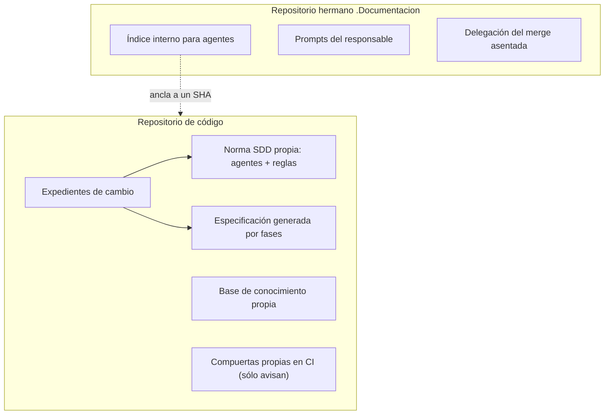

# Núcleo N5 — aplicación a un servicio privado con paquetes

> **Versión ofuscada, apta para repositorio público.** El servicio se nombra sólo por el alias del cuerpo, **SDD-B**
> (`00-Marco.md`, `ESC-SDEI-4`). No figuran su nombre, su organización, dominios, rutas, hosts, direcciones ni datos.
> La evidencia detallada (rutas, commits, salidas de comandos) existe en una bitácora privada del núcleo y queda fuera
> de lo versionado; acá sólo van las lecciones generales y las brechas en abstracto.

## Índice

1. [Qué se relevó](#1-qué-se-relevó)
2. [Cómo documenta hoy el SDD-B, en abstracto](#2-cómo-documenta-hoy-el-sdd-b-en-abstracto)
3. [Lecciones generales](#3-lecciones-generales)
4. [Tabla de brechas](#4-tabla-de-brechas)
5. [Incoherencias del cuerpo SDEI para N1](#5-incoherencias-del-cuerpo-sdei-para-n1)
6. [Cómo se ensaya el conocimiento de especificación](#6-cómo-se-ensaya-el-conocimiento-de-especificación)
7. [Riesgo de choque con otras sesiones](#7-riesgo-de-choque-con-otras-sesiones)

## 1. Qué se relevó

El SDD-B es el ejemplo de `ESC-SDEI-4` (servicio con paquetes). Se leyó su índice interno para agentes, su norma SDD
propia, su especificación generada, su CI y su escena de prueba, y se corrió `docs-guard` (de Lab-Documentos, rama
`dac/0003-base`) contra una instantánea de su especificación, en una carpeta de trabajo privada, sin modificar ningún
repositorio.

## 2. Cómo documenta hoy el SDD-B, en abstracto

*Diagrama: norma, especificación y expedientes viven con el código; el hermano guarda el índice para agentes y la
delegación.*

- La especificación declara cada ID en un encabezado (`# CU-NN — …`) seguido de un bloque de metadatos en negrita con
  `**Versión:**`. No usa frontmatter YAML.
- Los casos de uso van uno por archivo; las decisiones de arquitectura y las reglas van como secciones de un único
  documento con una sola versión.
- Hay una línea base verificada de la API pública de los paquetes (la «fuente generada» que prevé `ESC-SDEI-4`), pero
  no hay contrato REST emitido en el build, ni `AGENTS.md`, ni CHANGELOG del producto, ni ninguna traza `traces:`.
- El servicio también tiene un **panel web con roles** y textos de ayuda en pantalla.
- La versión se reparte en varias familias (servicio, paquetes, esquema de base, recursos de interfaz); sólo dos llevan
  etiqueta.
- Ninguna compuerta impide el merge (sin protección de rama); el freno real es la guarda del agente.
- Ya tiene un conocimiento compartido de decisión copiado con huella y una regla de su norma que manda consultarlo
  antes de elevar una pregunta.

## 3. Lecciones generales

1. **El registro de IDs de `docs-guard` es compatible con un SDD real que use encabezado + `**Versión:**`.** Una traza
   `CU-NN@X.Y` resolvió en verde, y una versión vieja dio rojo como promete el Marco.
2. **Un ID declarado como sección de un documento no tiene versión propia.** Trazarlo con versión da rojo
   (`traza-sin-version`); trazarlo sin versión pasa, pero entonces la subida de versión no se detecta.
3. **Los IDs locales a un documento chocan en un registro global.** Numeraciones como «flujo alternativo 01» que se
   repiten en cada caso de uso generan cientos de `id-duplicado` si la especificación entra como ruta de la compuerta.
4. **La especificación de un SDD no se pasa por `esquema`**: queda fuera del cuerpo (verde, sin frontmatter). Lo
   correcto es pasarla como `--fuente` o tomarla del registro, no migrarla a YAML.
5. **Dos compuertas pueden pelear por la misma sintaxis.** Un proyecto que marca ejemplos con comentarios HTML para su
   propia compuerta de vocabulario hace saltar AI-1; se resuelve con excepciones con huella, no reescribiendo el
   proyecto.
6. **Los escenarios se combinan.** Un servicio con paquetes puede traer un panel con roles: hereda CL-06 de
   `ESC-SDEI-3`.
7. **La topología de las piezas varía.** El índice para agentes puede vivir en el hermano y los expedientes en el
   repositorio de código: el catálogo debe admitirlo sin suponer un solo lugar.
8. **Un ancla «por línea de versión» no cubre familias sin etiqueta.** Hay que prever qué ancla usa una pieza que
   depende del esquema de base o de un recurso sin número.
9. **Un servicio con deriva declarada exige filtrar antes de trazar.** Una traza a un pasaje que declara un control
   que el código no ejerce no certifica nada del producto.
10. **El punto de entrada para agentes puede no llamarse `AGENTS.md`.** Lo que importa es que exista uno y que sus
    enlaces resuelvan.

## 4. Tabla de brechas

| Id | Brecha (abstracta) | Pieza SDEI afectada | Qué pide al conocimiento de especificación |
| --- | --- | --- | --- |
| B1 | Panel con roles dentro de un servicio con paquetes | `ESC-SDEI-4`, CL-06 | Escenarios compuestos y suma de clases |
| B2 | IDs en sección sin versión propia | Registro de IDs, `traces-resolve` | Versión por ID en sección o traza al contenedor |
| B3 | IDs locales repetidos entre documentos | Registro de IDs (`id-duplicado`) | IDs calificados o exclusión por patrón |
| B4 | Metadatos en negrita, no YAML | PR-2 esquema | Aceptar el encabezado del proyecto como declaración |
| B5 | Sin registro de requerimientos documentales | CL-02 | Crear el RRD como contenido (clase P), fuera de la norma si ésta no lo admite |
| B6 | Expedientes en el repositorio de código | CL-09, `CTX-SDEI-3` | Topología variable de CL-09 |
| B7 | Familias de versión sin etiqueta | Ancla de versión | Ancla por familia, con caso «sin etiqueta» |
| B8 | Marca HTML de otra compuerta vs AI-1 | PR-3 anti-inyección | Excepciones con huella como paso previsto |
| B9 | Ninguna compuerta bloquea | Guarda de merge | Declarar que el freno es la guarda del agente |
| B10 | Copia con huella verificada fuera de CI | CL-11, PR-7 `fijadas` | Correr la verificación de copias en CI |
| B11 | Deriva declarada y controles no ejercidos | `traces-resolve` | Filtro descripción/control antes de trazar |
| B12 | Punto de entrada para agentes con otro nombre y lugar | CL-03 | Reconocer un equivalente de `AGENTS.md` |

## 5. Incoherencias del cuerpo SDEI para N1

1. `TEM-07`, «Las lecciones de decisión, dentro del marco», dice que las capas A y B no existen; un conocimiento de
   lógica de decisión con copias con huella ya está versionado en IA.SDD desde el 2026-10-27, antes del último cambio
   del tema. A validar si es la misma capa A.
2. `00-Marco.md` §2.5: las clases activas de `ESC-SDEI-4` omiten CL-06 y CL-09, que el ejemplo real tiene.
3. `00-Marco.md` §2.5: el ancla «etiqueta por línea» no cubre familias sin etiqueta.
4. `TEM-07`, contexto `CTX-SDEI-4`: presenta como hecho que el SDD-B copia `docs-guard.yml` con huella; hoy no la
   tiene. Conviene redactarlo como condición o como paso del escalón 3.

## 6. Cómo se ensaya el conocimiento de especificación

| Aspecto | Propuesta |
| --- | --- |
| Qué se produce | Hoja de integración con el SDD (anexo de `TEM-07`), RRD mínimo, tres páginas de muestra con `traces`, `source.lock`, evidencia de `docs-guard`, informe de reproducción sin contexto con control negativo |
| Dónde | El repositorio hermano de documentación del servicio (privado), en una carpeta de análisis que no es zona del responsable; no se toca la norma, ni la especificación, ni el índice para agentes |
| Rama | Una sola, con prefijo de documentación, en un worktree propio creado desde el remoto |
| Ciclo | Un PR por el conocimiento de conformación automática: informe antes del merge, guarda G1–G4, merge atado al SHA, borrado de la rama propia |
| Oráculo | La hoja de integración que este núcleo ya midió (en la bitácora privada) |
| Retorno | Lo que falle vuelve al conocimiento y al libro **ofuscado**, como lecciones de esta tabla |

## 7. Riesgo de choque con otras sesiones

- El repositorio de código está limpio y alineado con su remoto: riesgo bajo, porque el ensayo no lo toca.
- El clon local del repositorio hermano tiene cientos de cambios sin commitear del responsable (movimientos de
  carpetas de prompts): trabajar ahí es riesgo alto; en un worktree propio, bajo.
- El índice para agentes se regeneró el mismo día y su prompt de actualización está en edición: el ensayo no lo toca.
- La escena de prueba es un recurso compartido con candado: el ensayo sólo hace lecturas.
