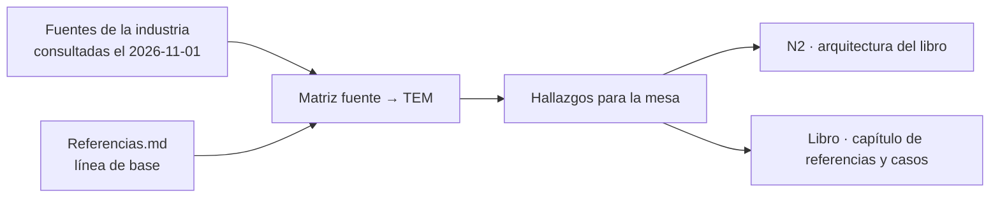

# Núcleo N6 — Industria: estándares, tendencias y casos

Bitácora del lector del núcleo N6 de la reedición DocsAsCode (plan `DB-R02-00`, §3). Releva estándares, tendencias y
casos públicos de la industria sobre *docs as code* y documentación técnica para desarrolladores, y los relaciona con
el cuerpo SDEI de Lab-Documentos. Insumo para la solicitud 4 del prompt 02 («añadir referencias y casos según lo que
se ha relevado en la industria») y para el núcleo N2 (arquitectura del libro), que depende de N6.

## Índice

1. [Alcance y método](#1-alcance-y-método)
2. [Línea de base: qué cita ya el cuerpo SDEI](#2-línea-de-base-qué-cita-ya-el-cuerpo-sdei)
3. [Fuentes relevadas](#3-fuentes-relevadas)
   1. [Marcos de organización del contenido](#31-marcos-de-organización-del-contenido)
   2. [Normas ISO/IEC/IEEE e IEC/IEEE](#32-normas-isoiecieee-e-iecieee)
   3. [Arquitectura y decisiones](#33-arquitectura-y-decisiones)
   4. [Guías de estilo](#34-guías-de-estilo)
   5. [Casos documentados de docs as code](#35-casos-documentados-de-docs-as-code)
   6. [Herramientas](#36-herramientas)
   7. [Documentación para agentes de IA](#37-documentación-para-agentes-de-ia)
   8. [Tendencias 2024–2026](#38-tendencias-20242026)
4. [Matriz fuente → capítulo del cuerpo](#4-matriz-fuente--capítulo-del-cuerpo)
5. [Hallazgos para la mesa](#5-hallazgos-para-la-mesa)
6. [No verificado y pendientes](#6-no-verificado-y-pendientes)
7. [Incidencias del encargo](#7-incidencias-del-encargo)

## 1. Alcance y método

- **Qué se leyó del cuerpo** (worktree `{dir-de-trabajo}/wt/dac-LD`, sólo lectura): `00-Marco.md`, encabezados y citas de
  `TEM-01` a `TEM-07`, y `99-Anexos/Referencias.md` completo (176 líneas). Ruta base:
  `{dir-de-trabajo}/wt/dac-LD/Guides/Documentacion-Tecnica/Sistema-De-Documentacion-E-Integracion/` (abreviada `SDEI/`).
- **Qué se consultó en la web:** cada URL de la sección 3 se abrió con WebFetch el **2026-11-01**. Lo que sólo salió de
  un buscador (WebSearch) o de fuente secundaria se marca **[no verificado]**.
- **Citas:** las citas textuales son breves y se transcriben como las devolvió la herramienta de lectura. Las
  traducciones al castellano son propias.
- **Estado de cada fuente respecto del anexo:** «En Referencias: sí (`ref-…`)» si ya tiene ancla en
  `SDEI/99-Anexos/Referencias.md`; «no» si no la tiene.
- **Relaciones con el cuerpo:** son lecturas del lector, rotuladas **[criterio propio]** cuando no son un hecho.

*Diagrama: la línea de base del anexo y las fuentes nuevas se cruzan en la matriz; los hallazgos alimentan al núcleo N2
y al capítulo de referencias del libro.*

## 2. Línea de base: qué cita ya el cuerpo SDEI

Comando: `grep -o 'ref-[a-z0-9-]*' TEM-0*.md | sort | uniq -c` y `grep -rl` por término, corridos el 2026-11-01 en
`SDEI/` excluyendo `Examples/`.

| Tema del relevamiento | ¿Está en `Referencias.md`? | Dónde lo usa el cuerpo |
| --- | --- | --- |
| Diátaxis | Sí, `ref-procida-sf` (`Referencias.md:134`) | `TEM-01-Sistema-Documentador.md:183` |
| Write the Docs, *Docs as code* | Sí, `ref-writethedocs-sf` (`Referencias.md:106`) | `TEM-01`, `TEM-06` |
| ISO/IEC/IEEE 26514:2022 | Sí, `ref-iso-26514-2022` (`Referencias.md:84`) | `TEM-02-Ciclo-Documental.md:85-88`, `TEM-05-Ayuda-Al-Usuario-Final.md:37-39`, `Patrones-De-Ejemplos.md:43` |
| ISO/IEC/IEEE 26511, 26512, 26513, 26515 | No | En ningún documento vigente |
| IEC/IEEE 82079-1 | No | En ningún documento (el hit de `grep 82079` en `TEM-03:183` es el commit `82079b4` de Backstage, no la norma) |
| arc42 | No | Sólo en `Sistema-Documentador-Tecnico-Guide.md:278`, que tiene `status: obsoleto` (línea 6) |
| C4 | No | En ningún documento (el hit de `Criterios-De-Calidad.md:52` es un nodo mermaid `C4`, no el modelo) |
| ADR de Nygard | Sí, `ref-nygard-2011` (`Referencias.md:174`) | `TEM-07` |
| MADR | No | En ningún documento |
| Guía de estilo de Google / Microsoft | No | En ningún documento |
| GOV.UK, Twilio, Stripe (Markdoc) | No (sí `ref-stripe-openapi-2026`, que es el repositorio OpenAPI, no el caso docs as code) | — |
| GitLab | Sí, `ref-gitlab-sf` y `ref-gitlab-testing-sf` (`Referencias.md:108-110`) | `TEM-02`, `TEM-06` |
| MkDocs, Antora | No | Sólo en la guía obsoleta (líneas 229, 252, 383, 394) y `TEM-01:135` («No es un generador de sitios») |
| Docusaurus | Sí, `ref-docusaurus-sf`, `ref-docusaurus-2026` | `TEM-03` |
| Vale | No como herramienta (sí repositorios con `.vale.ini`: `ref-mintlify-docs-2026`, `ref-redhat-openshift-docs-2026`, `ref-grafana-2026`) | `TEM-01` (adopciones) |
| markdownlint, lychee, mermaid | No | `TEM-06-Compuertas-Y-CI.md:83, 89, 214` (como medios de los controles) |
| AGENTS.md, llms.txt | Sí, `ref-agentsmd-sf`, `ref-howard-sf`, `ref-chatlatanagulchai-2025` | `TEM-04`, `00-Marco.md:117-119` |
| MCP como canal de documentación | No | En ningún documento (`grep -rn MCP` sin resultados fuera de `Examples/`) |

Una entrada de `TEM-06` cita un ancla vacía: `grep -o 'ref-[a-z0-9-]*'` devuelve `ref-` en ese archivo; el origen es
`TEM-06-Compuertas-Y-CI.md:95`, donde `#ref-…` aparece dentro de un *code span* como ejemplo, no como cita. No es un
defecto; se anota para que N1 no lo cuente dos veces.

## 3. Fuentes relevadas

Todas las URL de esta sección se abrieron el 2026-11-01, salvo las marcadas [no verificado].

### 3.1 Marcos de organización del contenido

**Diátaxis** — https://diataxis.fr/ (consultado el 2026-11-01).

- Afirma: «Diátaxis identifies four distinct needs, and four corresponding forms of documentation»; las cuatro formas
  son *tutorials*, *how-to guides*, *technical reference* y *explanation*.
- La página no nombra autor: confirma la marca «P» que ya tiene `ref-procida-sf`.
- Relación: `TEM-01` (separar referencia generada de prosa), `TEM-05` (la ayuda al usuario es mayormente
  *how-to*), y la arquitectura del libro (N2). **[criterio propio]** El libro podría declarar qué cuadrante de
  Diátaxis cubre cada parte.
- En Referencias: sí.

**GitLab, tipos de tema** — https://docs.gitlab.com/development/documentation/topic_types/ (consultado el 2026-11-01).

- Afirma: cada tema de una página es de un tipo: «Concept», «Task», «Reference», «Troubleshooting».
- La página no menciona Diátaxis ni DITA.
- Relación: `TEM-05` (plantilla de ayuda con «Pasos» y «Si algo sale mal», `TEM-05:263-271`, se parece a *task* +
  *troubleshooting*), `Patrones-De-Ejemplos`.
- En Referencias: no.

**GitLab, guía de estilo (SSoT y docs-first)** — https://docs.gitlab.com/development/documentation/styleguide/
(consultado el 2026-11-01).

- Afirma: «The GitLab documentation is the SSoT for all product information related to implementation, use, and
  troubleshooting»; ante una respuesta faltante, abrir un *merge request* que la agregue y compartirlo.
- Relación: `TEM-01` (fuente de verdad), `TEM-02` (el pedido de documentación entra como cambio revisado).
- En Referencias: no (sí las páginas *workflow* y *testing* del mismo sitio).

**GitHub Docs, modelo de contenido** —
https://docs.github.com/en/contributing/style-guide-and-content-model/about-the-content-model (consultado el
2026-11-01).

- Afirma: «An article is the basic unit of content for GitHub Docs»; jerarquía *top-level doc set* → *category* →
  *map topic* → *article*.
- Relación: `TEM-03` y N2 (jerarquía del libro). Complementa `ref-github-docs-2026`, que cita el repositorio.
- En Referencias: no.

### 3.2 Normas ISO/IEC/IEEE e IEC/IEEE

**ISO/IEC/IEEE 26514:2022** — https://committee.iso.org/standard/77451.html (consultado el 2026-11-01).

- Afirma: título «Systems and software engineering — Design and development of information for users»; publicada
  «2022-01»; estado «Published»; resumen: «This document covers the development process for designers and developers
  of information for users of software.»
- `https://www.iso.org/standard/77451.html` devolvió HTTP 403; la página de comité sí respondió.
- Relación: `TEM-02`, `TEM-05`. Confirma la entrada existente.
- En Referencias: sí (`ref-iso-26514-2022`).

**Familia 26511, 26512, 26513, 26515** — **[no verificado]**: sólo WebSearch del 2026-11-01. Las páginas oficiales de
ISO (`iso.org/standard/70880.html`) devolvieron HTTP 403.

- El buscador asocia cada parte a un rol: 26511 gestión de la información para usuarios; 26512 adquirentes y
  proveedores; 26513 prueba y revisión; 26515 desarrollo en entorno ágil. Las ediciones vigentes (2017, 2018) no
  quedaron confirmadas: las fuentes secundarias se contradicen.
- Resultados del buscador, no abiertos: https://shop.standards.ie/en-ie/standards/iso-iec-ieee-26511-2011-599480_saig_iso_iso_1372721,
  https://www.nic.cz/files/tww/2019/TWW19-Standards-Lena-CZNIC.pdf.
- Relación **[criterio propio]**: 26513 con `TEM-06` (revisión y prueba de la documentación), 26515 con `TEM-02` (ciclo
  iterativo), 26511 con el gobierno del cuerpo (actores, `00-Marco.md:140-155`).
- En Referencias: no. **No citar en el libro hasta abrir la ficha oficial de cada parte.**

**IEC/IEEE 82079-1:2019** — https://webstore.iec.ch/en/publication/29075 (consultado el 2026-11-01).

- Afirma: título «Preparation of information for use (instructions for use) of products - Part 1: Principles and
  general requirements»; edición 2.0; publicada el 2019-05-16; «jointly developed and published by IEC, IEEE, and
  ISO».
- Lo demás del resumen (norma horizontal, reemplaza IEC 82079-1:2012, métodos empíricos de evaluación) salió del
  buscador: **[no verificado]** en la fuente primaria.
- Relación: `TEM-05` (ayuda al usuario final). **[criterio propio]** Es la norma de «información para el uso» de
  productos en general; 26514 es la específica de software. El libro puede citarla como contexto, no como regla.
- En Referencias: no.

### 3.3 Arquitectura y decisiones

**arc42** — https://arc42.org/overview y https://docs.arc42.org/home/ (consultados el 2026-11-01).

- Afirma: plantilla de doce secciones, de «Introduction & Goals» a «Glossary»; la 9 es «Architectural Decisions»;
  «open source and free, including for commercial use» (paráfrasis de la herramienta). El sitio de documentación se
  presenta como «The working reference for the arc42 architecture template», creado por Gernot Starke, licencia CC
  BY-SA 4.0.
- Relación: `TEM-07` (lugar de la especificación y el diseño). Hoy sólo lo cita la guía obsoleta
  (`Sistema-Documentador-Tecnico-Guide.md:278`): **al fusionar en el libro, la cita se pierde si no se la lleva al
  anexo.**
- En Referencias: no.

**C4 model** — https://c4model.com/ y https://c4model.com/diagrams (consultados el 2026-11-01).

- Afirma: «The C4 model is an easy to learn, developer friendly approach to software architecture diagramming»; autor
  Simon Brown; cuatro niveles (System context, Container, Component, Code) y tres diagramas de apoyo (System
  landscape, Dynamic, Deployment).
- Mermaid tiene sintaxis C4 con funciones incompletas: «The following unfinished features are not supported in the
  short term» (https://mermaid.js.org/syntax/c4.html, consultado el 2026-11-01).
- Relación: convención de diagramas (`00-Marco.md:167`, `CQ-13`) y `TEM-07`. **[criterio propio]** Si el libro usa C4,
  conviene `flowchart` mermaid con la notación C4 antes que la sintaxis `C4Context`, por lo incompleto y porque la
  compuerta valida mermaid (`TEM-06:214`).
- En Referencias: no.

**ADR (organización adr.github.io)** — https://adr.github.io/ (consultado el 2026-11-01).

- Afirma: «An Architectural Decision Record (ADR) captures a single AD and its rationale»; el post de Nygard de 2011
  «popularized the concept».
- En Referencias: no (sí el post de Nygard, `ref-nygard-2011`).

**MADR** — https://adr.github.io/madr/ y https://github.com/adr/madr (consultados el 2026-11-01).

- Afirma: «Markdown Architectural Decision Records»; versión 4.0.0 del 2024-09-17; secciones: título, *Context and
  Problem Statement*, *Decision Drivers* (opcional), *Considered Options*, *Decision Outcome* (con *Consequences* y
  *Confirmation* opcionales), *Pros and Cons of the Options*, *More Information*.
- Relación: `TEM-07` y `Esquema-Frontmatter-Y-Prefijos` (prefijo de decisiones). **[criterio propio]** La sección
  *Confirmation* de MADR 4 es el análogo de la verificación Dado/Cuando/Entonces del RRD (`00-Marco.md:48`).
- En Referencias: no.

### 3.4 Guías de estilo

**Google developer documentation style guide** — https://developers.google.com/style (consultado el 2026-11-01).

- Afirma: «provides editorial guidelines for writing clear and consistent technical documentation»; «This guide
  contains guidelines, not rules. Depart from it when doing so improves your content»; precedencia: «Refer to
  project-specific guidelines first, then this guide, and finally third-party references.»
- Relación: `00-Marco.md:157-171` (convenciones) y ronda de corrección de estilo del plan (§4.5.3). **[criterio
  propio]** La regla de precedencia es la misma que aplica el cuerpo: sus convenciones mandan y el resto es consulta.
- En Referencias: no.

**Google, documentation best practices (docguide)** —
https://google.github.io/styleguide/docguide/best_practices.html (consultado el 2026-11-01).

- Afirma: «Change your documentation in the same CL as the code change»; «A small set of fresh and accurate docs is
  better than a large assembly of "documentation" in various states of disrepair»; «Dead docs are bad».
- Relación: `TEM-03` (ancla de versión: misma revisión que el código), `TEM-02` (estado `obsoleto`). Complementa
  `ref-winters-2020`.
- En Referencias: no.

**Microsoft Writing Style Guide** — https://learn.microsoft.com/en-us/style-guide/welcome/ (consultado el 2026-11-01).

- Afirma: «your guide to writing style and terminology for all communication»; «It replaces the Microsoft Manual of
  Style» (metadato `description`); voz «warm and relaxed, crisp and clear, and ready to lend a hand». La página se
  publica desde Git (`original_content_git_url` en `MicrosoftDocs/microsoft-style-guide-pr`, commit `e19faaa`).
- Relación: igual que la de Google; además es un ejemplo de guía de estilo mantenida como docs as code.
- En Referencias: no.

**Write the Docs, lista de guías de estilo** — https://www.writethedocs.org/guide/writing/style-guides/ (consultado el
2026-11-01).

- Afirma: lista «Google developer documentation», «Microsoft Writing Style Guide», «The Red Hat Style Guide», «Writing
  for gov.uk», entre otras; aconseja partir de una guía existente porque «can also help you figure out which things
  matter in your style guide».
- En Referencias: no.

### 3.5 Casos documentados de docs as code

**Write the Docs, *Docs as code*** — https://www.writethedocs.org/guide/docs-as-code/ (consultado el 2026-11-01).

- Afirma: «Documentation as Code (*Docs as Code*) refers to a philosophy that you should be writing documentation with
  the same tools as code»: *Issue Trackers*, *Version Control (Git)*, *Plain Text Markup*, *Code Reviews*,
  *Automated Tests*.
- Casos que la página enlaza como charlas: Google (MacNamara, 2015), UK Government Digital Service (Lambourne, 2019),
  AWS (Riefer Johnston y May, 2022), Rackspace, Capital One, Pantheon, F5, platformOS.
- Relación: `TEM-01`, `TEM-06`. Los cinco elementos se mapean uno a uno con el cuerpo **[criterio propio]**: issue →
  RRD y carril programado; Git → topología; Markdown → frontmatter; revisión → PR con guarda; pruebas → `docs-guard`.
- En Referencias: sí (`ref-writethedocs-sf`); la lista de casos no se aprovecha hoy.

**GOV.UK (Government Digital Service)**

- https://github.com/alphagov/tech-docs-template (consultado el 2026-11-01): «The Tech Docs Template is a Middleman
  template that you can use to build technical documentation using a GOV.UK style.» Sin aviso de archivo.
- La charla de Lambourne («The UK government meets docs as code», Write the Docs Prague 2019) figura en la página de
  Write the Docs; su ficha `writethedocs.org/videos/prague/2019/...` devolvió HTTP 404. Que el equipo separó la
  documentación para usuarios en un repositorio aparte y dejó la interna junto al código sale de notas de un asistente
  vistas por el buscador: **[no verificado]**.
- `https://www.gov.uk/service-manual/technology/documenting-your-code` devolvió 404.
- Relación: `TEM-03` (topología: repositorio dedicado para usuarios, mismo repositorio para lo interno), sólo si se
  verifica.
- En Referencias: no.

**Twilio** — https://twilio.com/en-us/blog/developers/new-era-for-twilio-documentation (consultado el 2026-11-01).

- Afirma (Molina y Christensen, 2024-07-08): el equipo «decided to embrace the Docs as Code philosophy»; «more than
  5,000 pages» y «nearly 20,000 code samples» en nueve lenguajes; construyen con MDX; «As Twilio has moved to the
  OpenAPI specification» desarrollan un generador de ejemplos de código.
- Relación: `TEM-01` (caso de industria: prosa escrita + referencia generada, mismo patrón que el portal de
  `TEM-01:168-183`), `TEM-03`.
- En Referencias: no.

**Twilio, Docs AI Buddy** — https://www.twilio.com/en-us/blog/developers/open-source-docs-ai-buddy-prompts (consultado
el 2026-11-01).

- Afirma (2025-12-17): «a suite of AI-powered documentation assistants»; los *prompts* se publican, «the web app
  itself is not open source»; repositorio https://github.com/twilio-labs/docs-ai-buddy (no abierto: **[no
  verificado]** su contenido).
- Relación: `TEM-02` y `ACT-SDEI-4` (agente que propone, persona que decide).
- En Referencias: no.

**Stripe, Markdoc** — https://markdoc.dev/ (consultado el 2026-11-01).

- Afirma: «Markdoc is a Markdown-based syntax and toolchain for creating custom documentation sites»; «Stripe created
  Markdoc to power our public docs».
- La fecha de apertura (2022) sale sólo del buscador: **[no verificado]**.
- Relación: `TEM-01` (caso de industria), `CTX-SDEI-1` (sitio).
- En Referencias: no (sí `ref-stripe-openapi-2026`).

**GitLab handbook (handbook-first)** — **[no verificado]**. Las páginas
`handbook.gitlab.com/handbook/about/handbook-usage/` y `.../all-remote/handbook-first/` se abrieron, pero la
herramienta sólo devolvió la navegación (más de 230 000 caracteres de menú). No hay cita.

### 3.6 Herramientas

| Herramienta | URL consultada el 2026-11-01 | Qué afirma | Relación | En Referencias |
| --- | --- | --- | --- | --- |
| Material for MkDocs | https://squidfunk.github.io/mkdocs-material/ | «End of life on May 5, 2027»; «Zensical is our modern successor to Material for MkDocs, built to work with your existing MkDocs projects» | `CTX-SDEI-1`, plan §6 (sitio MkDocs) | No |
| Docusaurus | https://docusaurus.io/docs | Funciones: «Document Versioning», «Internationalization (i18n)», «Powered by MDX» | `TEM-03` | Sí (`ref-docusaurus-sf`) |
| Antora | https://docs.antora.org/antora/latest/ | «The Static Site Generator for Tech Writers»; contenido en «one or more content (git) repositories»; AsciiDoc | `TEM-03` (varios repositorios) | No |
| Vale | https://docs.vale.sh/ | «Vale is a command-line tool that brings code-like linting to prose»; foco en estilo, no gramática | `TEM-06` (estilo), `TEM-01` | No (sí repos con `.vale.ini`) |
| Paquetes de Vale | https://github.com/errata-ai/packages | Ejemplos de configuración `Packages = Microsoft` y el paquete Google por URL versionada | `TEM-06` | No |
| markdownlint | https://github.com/DavidAnson/markdownlint | «A Node.js style checker and lint tool for Markdown/CommonMark files» | `TEM-06:83, 214` | No |
| lychee | https://github.com/lycheeverse/lychee | «Fast, async, stream-based link checker written in Rust»; ejemplo `lychee-v0.24.2` | `TEM-06:89, 214` | No |
| Mermaid | https://mermaid.js.org/intro/ | «a JavaScript based diagramming and charting tool that renders Markdown-inspired text definitions»; «Doc-Rot is a Catch-22 that Mermaid helps to solve» | `00-Marco.md:167`, `CQ-13` | No |
| GitLab, pruebas de docs | https://docs.gitlab.com/development/documentation/testing/ | Vale y markdownlint corren en el job `docs-lint markdown`; `docs-lint links` revisa enlaces relativos en MR; los que requieren red se omiten | `TEM-06` (carril PR sin red) | Sí (`ref-gitlab-testing-sf`) |

**[no verificado]**: el modo mantenimiento de Material y la fecha del anuncio (noviembre de 2025) salen del buscador;
lo verificado es la fecha de fin de vida en la portada.

### 3.7 Documentación para agentes de IA

**AGENTS.md** — https://agents.md/ (consultado el 2026-11-01).

- Afirma: «A simple, open format for guiding coding agents»; «used by over 60k open-source projects»; «AGENTS.md is
  now stewarded by the Agentic AI Foundation under the Linux Foundation».
- La administración por la Linux Foundation es un dato nuevo respecto de la consulta del 2026-10-26.
- En Referencias: sí (`ref-agentsmd-sf`); conviene actualizar la entrada con fecha 2026-11-01.

**GitHub Copilot y AGENTS.md** —
https://docs.github.com/en/copilot/how-tos/configure-custom-instructions/add-repository-instructions (consultado el
2026-11-01).

- Afirma: «You can create one or more `AGENTS.md` files, stored anywhere within the repository»; «the nearest
  `AGENTS.md` file in the directory tree will take precedence»; alternativa `.github/copilot-instructions.md`.
- Relación: `TEM-04:113` («`AGENTS.md` como puntero»). **[criterio propio]** La regla del más cercano habilita un
  `AGENTS.md` por cuerpo documental sin pisar el de la raíz.
- En Referencias: no.

**llms.txt** — https://llmstxt.org/ (consultado el 2026-11-01).

- Afirma: «We propose adding a `/llms.txt` markdown file to websites to provide LLM-friendly content»; autor Jeremy
  Howard; publicado el 2024-09-03; H1 obligatorio, *blockquote* de resumen, secciones H2 de enlaces; páginas `.md` en
  la misma URL.
- En Referencias: sí (`ref-howard-sf`, sin año); la fecha de publicación permite pasar de «s. f.» a «2024, 3 de
  septiembre».

**Mintlify, generación de llms.txt** — https://www.mintlify.com/docs/ai/llmstxt (consultado el 2026-11-01).

- Afirma: «automatically hosts an `llms.txt` file at the root of your project»; `llms-full.txt` «combines your entire
  documentation site into a single file».
- Relación: `CTX-SDEI-1` (con sitio, `llms.txt` es canal derivado, clase D).
- En Referencias: no.

**Microsoft Learn MCP Server** — https://learn.microsoft.com/en-us/training/support/mcp (consultado el 2026-11-01).

- Afirma: «enables clients like GitHub Copilot and other AI agents to bring trusted and up-to-date information directly
  from Microsoft's official documentation»; servidor MCP remoto, endpoint `https://learn.microsoft.com/api/mcp`, sin
  autenticación; el servicio de conocimiento se refresca de forma incremental y completo una vez por día.
- Relación: `TEM-04` (canales para agentes). Es un **tercer canal** que el cuerpo no menciona: además del Markdown y
  de `llms.txt`, la documentación servida por protocolo.
- En Referencias: no.

### 3.8 Tendencias 2024–2026

Las dos fuentes siguientes son de un proveedor comercial (GitBook): datos útiles como tendencia, no como medición
independiente. Ambas páginas muestran una fecha de metadatos (2026-10-30) distinta de la del encabezado.

**GitBook, tráfico de IA en documentación** — https://www.gitbook.com/blog/ai-docs-data-2025 (consultado el
2026-11-01; encabezado 2026-02-04).

- Afirma: los lectores de IA pasaron de «roughly 9% of total traffic» en enero de 2025 a «over 40%» a fin de año en
  los sitios publicados con GitBook; los humanos seguían siendo «60% of total views».
- Método: «all docs sites published using GitBook over the last 12 months».
- Relación: `TEM-04` (doble audiencia como hecho de tráfico, no sólo como diseño).

**GitBook, *State of Docs 2026*** — https://gitbook.com/blog/state-of-docs-2026 (consultado el 2026-11-01; encabezado
2026-03-18).

- Afirma: «76% of respondents now use AI regularly in their docs workflows»; «70% of teams now factor AI into their
  information architecture decisions»; más de 1 100 encuestados.
- Las cifras de descubrimiento por búsqueda con IA (35 %), asistentes (18 %) y MCP (16 %), y «mantener los docs en
  sincronía es el mayor desafío», salieron de resúmenes secundarios en el buscador y **no están en la página
  abierta**: [no verificado].
- Relación: `TEM-02` (el agente redacta, la persona revisa: «56% say they spend less time writing and more time
  editing and reviewing»), `TEM-04`.

**Otras tendencias con fuente abierta:**

- Agentes que leen la documentación por protocolo (MCP de Microsoft Learn, 3.7).
- Formato de instrucciones para agentes bajo una fundación neutral (AGENTS.md, 3.7).
- Fin de vida de Material for MkDocs (2027-05-05) y sucesor Zensical (3.6).
- Equipos de documentación grandes que pasan a MDX en Git con revisión por PR (Twilio, 3.5).

## 4. Matriz fuente → capítulo del cuerpo

| Fuente | 00-Marco | TEM-01 | TEM-02 | TEM-03 | TEM-04 | TEM-05 | TEM-06 | TEM-07 | En Referencias |
| --- | --- | --- | --- | --- | --- | --- | --- | --- | --- |
| Diátaxis | | ● | | | | ● | | | Sí |
| WtD Docs as code (+ casos) | | ● | | | | | ● | | Sí |
| GitLab topic types / SSoT | | ● | ● | | | ● | | | No |
| GitHub content model | | | | ● | | | | | No |
| ISO/IEC/IEEE 26514 | | | ● | | | ● | | | Sí |
| 26511/12/13/15 [no verificado] | | | ● | | | | ● | | No |
| IEC/IEEE 82079-1 | | | | | | ● | | | No |
| arc42 | | | | | | | | ● | No |
| C4 (+ mermaid C4) | ● | | | | | | | ● | No |
| ADR (adr.github.io) / MADR 4.0.0 | | | | | | | | ● | No (sí Nygard) |
| Google style + docguide | ● | | ● | ● | | | | | No |
| Microsoft Writing Style Guide | ● | | | | | | | | No |
| GOV.UK tech-docs-template | | ● | | ● | | | | | No |
| Twilio (docs as code, AI Buddy) | | ● | ● | ● | | | | | No |
| Stripe Markdoc | | ● | | | | | | | No |
| MkDocs Material / Zensical, Antora, Docusaurus | ● | ● | | ● | | | | | Sólo Docusaurus |
| Vale, markdownlint, lychee, mermaid | ● | | | | | | ● | | No (como herramientas) |
| AGENTS.md, Copilot | | | | | ● | | | | AGENTS.md sí; Copilot no |
| llms.txt, Mintlify llms.txt | ● | | | | ● | | | | llms.txt sí |
| Microsoft Learn MCP | ● | | | | ● | | | | No |
| GitBook (tráfico IA, State of Docs 2026) | | | ● | | ● | | | | No |

*Columna 00-Marco: la fuente toca un contexto (`CTX-SDEI-1`) o una convención (§5).*

## 5. Hallazgos para la mesa

Hechos (con evidencia en la sección 3) y propuestas **[criterio propio]** separadas.

1. **El cuerpo no tiene anexo de herramientas.** `TEM-06:83` dice que las herramientas «son medios de un control, no
   tema», pero `Referencias.md` no cita markdownlint, lychee, mermaid ni Vale (§2). La regla del anexo pide software
   «con la versión usada» (`Referencias.md:38`). Propuesta: una sección «Herramientas» en el anexo, con la versión que
   fija la CI.
2. **arc42 y la cita de Nygard en contexto se pierden al unificar.** Sólo la guía obsoleta los desarrolla
   (`Sistema-Documentador-Tecnico-Guide.md:6, 278`). El libro (P1) tiene que llevarlos al anexo si los conserva.
3. **No hay guía de estilo externa declarada.** La ronda de corrección de estilo (plan §4.5.3) necesita una base.
   Google establece la precedencia «project-specific guidelines first» (3.4), compatible con `00-Marco.md:157-171`.
   Propuesta: declarar las convenciones del cuerpo como guía propia y Google o Microsoft como consulta de segundo
   nivel. Para castellano, ninguna de las dos aplica directamente: decide la mesa.
4. **Tercer canal para agentes.** El cuerpo conoce Markdown, `AGENTS.md` y `llms.txt` (`00-Marco.md:117-119`). La
   industria ya sirve documentación por MCP (Microsoft Learn, 3.7). Propuesta: mencionarlo en `TEM-04` como canal de
   `CTX-SDEI-1` con sitio, sin volverlo requisito.
5. **Riesgo de herramienta en el plan.** El plan prueba con un sitio MkDocs (`00-Plan.md`, §6). Material for MkDocs
   tiene fin de vida el 2027-05-05 (3.6). Propuesta: el libro no debe atar el modelo a ese tema; si cita un generador,
   como ejemplo y con fecha.
6. **Taxonomía de contenido.** Diátaxis (4 formas) y GitLab (4 tipos) coinciden en separar tarea, referencia y
   concepto. Propuesta para N2: rotular cada parte del libro por su forma Diátaxis; la plantilla de `TEM-05` ya es
   tarea + resolución de problemas.
7. **Casos de industria nuevos con fuente primaria:** Twilio (2024), Stripe Markdoc, GOV.UK tech-docs-template, la
   lista de charlas de Write the Docs. El cuerpo hoy apoya «adopciones» en commits de repositorios (`Referencias.md:128-164`);
   estos casos agregan el **porqué** (relatos de migración) que los commits no dan.
8. **Normas: citar sólo lo abierto.** 26514 y 82079-1 quedan verificadas; 26511/12/13/15 no (403 en ISO). No entran
   al libro hasta abrir la ficha oficial.
9. **Actualizaciones de entradas existentes:** `ref-howard-sf` puede pasar a 2024-09-03; `ref-agentsmd-sf` puede sumar
   la administración por la Linux Foundation y «over 60k» proyectos; `ref-procida-sf` mantiene «P» (la página sigue
   sin nombrar autor).
10. **Decisiones con verificación.** MADR 4.0.0 agrega *Confirmation* a la decisión (3.3). Propuesta para `TEM-07`:
    citarlo como forma de ADR alineada con el criterio verificable del RRD.
11. **Tendencia AI-first con cautela.** Las cifras de GitBook son de un proveedor y de su propia base de clientes
    (3.8). Si el libro las usa, con esa salvedad explícita.

## 6. No verificado y pendientes

| Ítem | Estado | Qué falta |
| --- | --- | --- |
| ISO/IEC/IEEE 26511, 26512, 26513, 26515 | [no verificado] | Abrir la ficha oficial (iso.org da 403 a la herramienta; probar committee.iso.org o IEEE SA) |
| 82079-1: reemplazo de la edición 2012, métodos empíricos | [no verificado] | Leer el resumen completo en la IEC |
| GDS: repositorio aparte para usuarios | [no verificado] | Ver la charla de Lambourne o un post de GDS |
| GitLab handbook-first | [no verificado] | La herramienta no devolvió el cuerpo de la página |
| Markdoc abierto en 2022 | [no verificado] | Post original de Stripe |
| Material en modo mantenimiento desde nov. 2025 | [no verificado] | Post del blog de Material |
| State of Docs 2026: 35 % / 18 % / 16 %, sincronía | [no verificado] | No están en la página abierta; buscar el informe completo |
| twilio-labs/docs-ai-buddy | [no verificado] | Abrir el repositorio |
| Versiones vigentes de markdownlint y lychee | Parcial | La CI de LD fija versiones; tomarlas de ahí (N1/N7) |

No se citó ninguna URL que no se haya abierto, salvo las dos de la familia 26511 listadas como resultado de buscador y
`twilio-labs/docs-ai-buddy`, rotuladas como tales.

## 7. Incidencias del encargo

- El prompt `02-Ajuste-Coherencia-Reedicion-Documentacion.md` **no está** en el worktree `{dir-de-trabajo}/wt/dac-LDD` (`wc` dio «No
  existe el fichero»); se leyó, sólo lectura, del clon principal
  `/LAB/Lab-Documentos/Lab-Documentos.Documentacion/PROMPTs/Guides/14-Sistema-De-Documentador-Tecnico/`.
  Coincide con el desvío de archivos sin versionar que declara el plan (§8).
- No llegaron mensajes de otras sesiones durante el turno.
- No se escribió en repositorios ni en `PROMPTs/`; no se nombró ningún proyecto privado.
