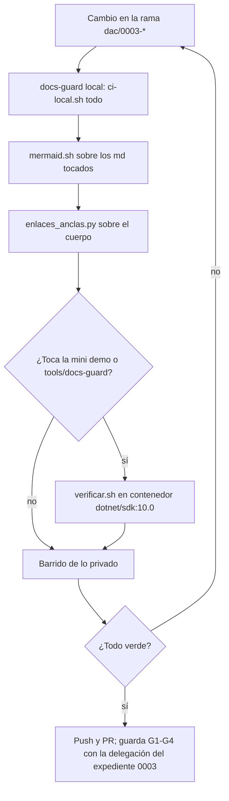

# Núcleo N7 — Gobierno y pruebas en el equipo de pruebas

## Índice

1. [Alcance y fuentes](#1-alcance-y-fuentes)
2. [Banco de pruebas disponible en el equipo de pruebas](#2-banco-de-pruebas-disponible-en-el-equipo-de-pruebas)
3. [Línea base sobre LD](#3-línea-base-sobre-ld)
   1. [docs-guard con el layout de la CI](#31-docs-guard-con-el-layout-de-la-ci)
   2. [Mermaid dibujado (mermaidsh)](#32-mermaid-dibujado-mermaidsh)
   3. [Sitio: generador y ensayo MkDocs](#33-sitio-generador-y-ensayo-mkdocs)
   4. [Enlaces y anclas con verificador propio](#34-enlaces-y-anclas-con-verificador-propio)
   5. [Mini demo MovilidadUrbana](#35-mini-demo-movilidadurbana)
   6. [Medición informativa sobre LDD](#36-medición-informativa-sobre-ldd)
4. [CI y gobierno de los PR](#4-ci-y-gobierno-de-los-pr)
   1. [Workflows y checks obligatorios](#41-workflows-y-checks-obligatorios)
   2. [La guarda de la conformación automática](#42-la-guarda-de-la-conformación-automática)
   3. [Delegaciones vigentes y el hueco del expediente 0003](#43-delegaciones-vigentes-y-el-hueco-del-expediente-0003)
5. [Hallazgos](#5-hallazgos)
6. [Procedimiento de pruebas propuesto para cada PR](#6-procedimiento-de-pruebas-propuesto-para-cada-pr)
7. [Comandos reproducibles](#7-comandos-reproducibles)
8. [Notas de la corrida](#8-notas-de-la-corrida)

## 1. Alcance y fuentes

- **Encargo:** relevar el banco de pruebas de {equipo-de-pruebas} y correr la línea base sobre `{dir-de-trabajo}/wt/dac-LD` (rama `dac/0003-base`,
  en `0bed863`, que es `origin/main` de LD al 2026-11-01).
- **Plan vigente:** `{dir-de-trabajo}/wt/dac-LDD/PROMPTs/Guides/14-Sistema-De-Documentador-Tecnico/OUTPUTs/DocsAsCode-Bitacoras/Reedicion-02/00-Plan.md`
  §6 (pruebas) y §5 (coordinación).
- **Prompt:** leído de `/LAB/Lab-Documentos/Lab-Documentos.Documentacion/PROMPTs/Guides/14-Sistema-De-Documentador-Tecnico/02-Ajuste-Coherencia-Reedicion-Documentacion.md`
  (sólo lectura). **No está en el worktree** `{dir-de-trabajo}/wt/dac-LDD`: es un archivo sin versionar del clon del PO.
- **Evidencia:** todo en `{dir-de-trabajo}/nucleos/evidencia-N7/`. Ningún archivo versionado se modificó
  (`git -C {dir-de-trabajo}/wt/dac-LD status --short` vacío al cierre).

## 2. Banco de pruebas disponible en el equipo de pruebas

Medido el 2026-11-01 con `which`, `docker images`, `nproc`, `free -g`, `df -h /vm`.

| Recurso | Valor | Uso en la reedición |
|---|---|---|
| CPU / RAM | 8 núcleos; 30 GiB (15 GiB disponibles) | Suficiente para todo lo de abajo en serie |
| Disco `/vm` | 523 G, **91 % usado** (49 G libres) | Riesgo: no dejar sitios ni renders grandes; limpiar al cerrar |
| Host | `node` v22.23.4, `npm`, `npx`, `python3` 3.11.2, `curl`, `docker` | Bastan para `scripts/ci-local.sh` sin contenedor (su línea 28: «No usa contenedores: el runner tampoco») |
| Imagen `minlag/mermaid-cli:11.4.2` | 1,92 GB, presente | `tools/medios/mermaid.sh` |
| Imagen `python:3.12-slim` | presente | Ensayo MkDocs efímero (pip dentro del contenedor) |
| Imagen `mcr.microsoft.com/dotnet/sdk:10.0` | presente | Mini demo MovilidadUrbana (`verificar.sh`) |
| Imágenes `pandoc/core:3.5`, `mcr.microsoft.com/playwright:v1.62.1-noble`, `koalaman/shellcheck:v0.10.0`, `alpine:3` | presentes | Disponibles para diseño editorial/pruebas de PDF si la mesa lo pide; no usadas |
| Runner de CI | `{runner-del-cuerpo}` con etiquetas `[self-hosted, {runner-anterior-del-cuerpo}]` | Corrió los últimos jobs de LD y LDD (evidencia `07-api-github.txt`) |

Nada se instaló en el host. La caché de docs-guard (lychee 0.18.1, mermaid 11.4.1 por lockfile) quedó en
`{dir-de-trabajo}/cache-docs-guard`.

## 3. Línea base sobre LD

### 3.1 docs-guard con el layout de la CI

- **Qué corre la CI:** `.github/workflows/docs-guard.yml` llama a `scripts/ci-local.sh <grupo> "$RUTA"` por cada grupo
  (PR-1 a PR-7, autoprueba, avisos) y agrega estricto. El script local reproduce los mismos pasos en el mismo orden
  (`scripts/ci-local.sh:220`, `GRUPOS=(enlaces esquema ai estructura trazas contrato fijadas autoprueba)`).
- **Resultado:** **verde**, rc=0, 17 s (`evidencia-N7/01-ci-local-todo.txt`).

| Grupo | Resultado | Cifras |
|---|---|---|
| PR-1 enlaces | verde | lychee: 622 total, 569 OK, 0 errores, 53 excluidos; fuera-del-repo 0 |
| PR-2 esquema | verde | 41 archivos con frontmatter; 1 README del cuerpo sin frontmatter (permitido) |
| PR-3 anti-inyección | verde | 29 avisos: AI-4=28 (dominios de `99-Anexos/Referencias.md`), AI-3=1 (`AGENTS.md:17`) |
| PR-4 estructura | verde | markdownlint-cli2 0.17.2 sin errores; mermaid **28 bloques, 0 inválidos** (27 del cuerpo + 1 de `AGENTS.md`) |
| PR-5 trazas | verde | 131 trazas, 122 resueltas, 9 avisos `traza-no-verificable` (CU-000xx de la prueba de ayuda por rol, sin `source.lock`) |
| PR-6 contrato | verde | 1 contrato |
| PR-7 fijadas y reflint | verde | 0 piezas; 51 referencias; avisos `dominio-sin-referencia`/`url-sin-fecha` en `Sistema-Documentador-Tecnico-Guide.md:93,103,112` |
| autoprueba | verde | todos los pares rojo/verde y AK-7 |

- **Avisos no bloqueantes** (`02-ci-local-avisos.txt`): 11, entre ellos `Examples/Lanzar-Example.md:18` (cita-linea con
  ruta absoluta del workspace) y `Examples/Prueba-Ayuda-Por-Rol/README.md:24` (`http://localhost:5190` sin fecha).

### 3.2 Mermaid dibujado (mermaid.sh)

- **Uso** (`/tools/medios/mermaid.sh`, cabecera): `mermaid.sh <archivo.md>... [-o carpeta]`;
  dibuja cada bloque en SVG y PNG en un contenedor efímero y sale 1 si un diagrama no compila o si el SVG contiene
  «Unsupported markdown».
- **Resultado:** 27 diagramas en 20 archivos; **25 ok, 2 MAL DIBUJADO**; rc distinto de 0; 163 s
  (`03-mermaid-sh.txt`, renders en `mermaid-render/`).

| Diagrama | Origen | Falla |
|---|---|---|
| 006 | `99-Anexos/Esquema-Frontmatter-Y-Prefijos.md:82` (etiqueta `traces: [ID@1.0]`) | `Unsupported markdown: link` |
| 010 | `Examples/MovilidadUrbana-Mini-Demo/docs/_requisitos.md:56` (etiqueta `RN-LOC-01@1.1, RN-LOC-02@1.0`) | `Unsupported markdown: link` (dos) |

- **Causa aislada por experimento** (`mermaid-hipotesis/resultado.txt`): la notación de traza `ID@versión` dentro de
  una etiqueta la toma mermaid como autoenlace de correo.

| Variante de etiqueta | Resultado |
|---|---|
| `traces: ID@1.0` (sin corchetes) | link |
| `traces: [ID@1.0]` | link |
| `docs/ayuda/alta-de-localidad.md` (sin `@`) | limpio |
| `traces: RD-01, RN-LOC-01@1.1` | link |
| `traces: ID#64;1.0` (entidad) | **limpio** |
| `traces: ID @ 1.0` (con espacios) | **limpio** |
| `` traces: `ID@1.0` `` | codespan (también falla) |

- **Brecha de la compuerta:** PR-4 valida con `mermaid.parse` (sintaxis) y no ve este defecto, que sólo aparece al
  dibujar. Se suma a lo aprendido por FRAMEWORK MAUI (plan §6: «1 · Texto» y sin URLs): **tampoco `@` en etiquetas**;
  usar `#64;` o espacios.

### 3.3 Sitio: generador y ensayo MkDocs

- **LD no construye sitio.** No hay `mkdocs.yml`, `docusaurus.config*`, `docfx.json`, `conf.py`, `book.toml`, `hugo.*`
  ni `antora*.yml` (búsqueda con `find` en `{dir-de-trabajo}/wt/dac-LD`), y ningún workflow de `.github/workflows/` publica páginas.
  El cuerpo menciona MkDocs sólo como ejemplo de generador (`TEM-01-Sistema-Documentador.md:135`,
  `Sistema-Documentador-Tecnico-Guide.md:383`). El plan §6 («Sitio MkDocs se construye en contenedor») describe un
  ensayo, no una pieza existente.
- **Ensayo efímero** (copia del cuerpo en `evidencia-N7/sitio-ensayo/docs`, `mkdocs.yml` propio, MkDocs 1.6.1 y
  mkdocs-material 9.5.39 instalados dentro de `python:3.12-slim`):

| Corrida | rc | Tiempo | Advertencias | Detalle |
|---|---|---|---|---|
| slugify por defecto (`04-mkdocs-ensayo.txt`) | 0 | 22 s (build 1,21 s) | 138 | 83 «no such anchor», 22 «not found among documentation files», 3 «unrecognized relative link» |
| slugify `pymdownx.slugs.slugify` `case: lower` (`05-mkdocs-slug-gfm.txt`) | 0 | 19 s (build 1,23 s) | 25 | **0 de anclas**; quedan las 22 de salida del cuerpo y 3 de carpeta |

- **Lectura:** las 83 anclas «rotas» eran del slug por defecto, que descarta las letras acentuadas («qué» → «qu»); con
  slug compatible con GitHub no queda ninguna. Las 22 restantes son enlaces que salen del `docs_dir`
  (`../../../AGENTS.md`, `../Creacion-Guias-Tecnicas/…`, `tools/docs-guard/…`, `CHANGELOG.md`): válidos en el repo,
  inalcanzables en un sitio armado sólo con el cuerpo. Sitio resultante: 43 HTML, 6,6 MB.

### 3.4 Enlaces y anclas con verificador propio

- **Script:** `evidencia-N7/scripts/enlaces_anclas.py` (sólo biblioteca estándar, sin red; slug al estilo GitHub con
  sufijo `-n` para encabezados repetidos; ignora bloques y código en línea).
- **Resultado** (`06-enlaces-anclas.txt`): 42 archivos, 648 enlaces relativos, **3 errores, 0 anclas rotas**.
- **Los 3 errores son exactamente las exclusiones declaradas** de `scripts/docs-guard.lychee.toml:6-10`: dos páginas
  sin traducir del respaldo de cultura (`Web/Ayuda/en/alumno/enviar-un-trabajo.md:28`, `Web/Ayuda/en/comun/ingresar.md:13`)
  y el enlace roto plantado (`Consola/Ayuda/administrador/habilitar-cuentas.md:14`). Coincide con lychee: la línea base
  de enlaces y anclas está limpia y dos verificadores independientes lo confirman.

### 3.5 Mini demo MovilidadUrbana

- No es parte de docs-guard: la corre `.github/workflows/mini-demo-movilidad.yml` en PR que tocan la demo,
  `tools/docs-guard/**` o el propio workflow.
- **Corrida en contenedor efímero** `mcr.microsoft.com/dotnet/sdk:10.0` (python3 instalado dentro del contenedor):
  **verde**; C1–C4 verdes, A1 sin deriva frente a `main` de Lab-E2E.WebBlazor (`59399ba`); 28 s de pared del script,
  48 s con el contenedor (`08-mini-demo-verificar.txt`). La carpeta de trabajo (92 MB, de root) se borró al cerrar.

### 3.6 Medición informativa sobre LDD

- `verificar.yml` de LDD corre docs-guard **sólo sobre `.github`** (`{dir-de-trabajo}/wt/dac-LDD/.github/workflows/verificar.yml:70-71`).
  Las bitácoras y el expediente 0003 **no tienen compuerta**.
- Corrida local informativa (`09-ldd-informativo.txt`) sobre `Reedicion-02/` y el expediente 0003: PR-1 y PR-4 verdes;
  PR-2 rojo (11 y 9 errores) y PR-5 rojo (2 y 1): esperable, porque el esquema del cuerpo no es el de bitácoras y
  folios. Sirve de constancia de que no hay que exigirles PR-2 del cuerpo, sí enlaces y estructura.

## 4. CI y gobierno de los PR

### 4.1 Workflows y checks obligatorios

| Repo | Workflow | Disparo | Runner | ¿Obligatorio en main? |
|---|---|---|---|---|
| LD | `docs-guard.yml` | todo PR, push a main | `[self-hosted, {runner-anterior-del-cuerpo}]` (`docs-guard.yml:60`) | **No** |
| LD | `framework-concept-demo.yml`, job `fw-ok` (`:166`) | todo PR (sin `paths`); la demo sólo si el PR toca `Concepts/Framework-Concept/Demo/**` o el workflow | idem | **Sí, único** |
| LD | `mini-demo-movilidad.yml` | PR con `paths` de la demo, `tools/docs-guard/**` o el workflow | idem | No |
| LD | `docs-enlaces-semanal.yml` | cron `17 6 * * 1` | idem | No |
| LDD | `verificar.yml` (jobs `verificar` y `docs-guard (.github)`) | todo PR, push a main | idem; llama a docs-guard de LD fijado en `bf86669` (`verificar.yml:73`) | **Sin protección** (rama `main` `protected=false`) |

- Fuente: API pública de GitHub consultada el 2026-11-01 (`07-api-github.txt`):
  `https://api.github.com/repos/hdcm-dev/Lab-Documentos/branches/main` → `required_status_checks.contexts: ["fw-ok"]`;
  `…/Lab-Documentos.Documentacion/branches/main` → `protected: false`; rulesets vacíos en ambos.
- Para un PR que sólo toca el cuerpo SDEI, `fw-ok` da verde «por omisión declarada» (`framework-concept-demo.yml:54-77`).
- Últimas corridas en main: LD docs-guard verde en `0bed863` (2026-11-01 16:45Z); LDD Verificar verde en `8b96bc6`;
  ambas en `{runner-del-cuerpo}`.
- El pin de LDD (`bf86669`) quedó atrás de LD main (`0bed863`), pero `git diff --stat bf86669 0bed863 -- scripts tools/docs-guard .github`
  sale vacío: **no hay deriva de herramientas**. Subir el pin es clase H (`verificar.yml:72`).

### 4.2 La guarda de la conformación automática

Fuente: `KB-privada/Knowledges/Knowledge-Conformacion-Pull-Request-Automatico.md`
§3.1–§3.5 (líneas 92–176) y §5.2.

- **G1:** PR abierto y `head.sha` igual al SHA auditado.
- **G2:** `mergeable == true` y `mergeable_state == clean`; cualquier otro valor es reserva (`unknown` = relee).
- **G3:** al menos una corrida para ese SHA y **todas** en éxito; cero corridas es reserva.
- **G4:** sin reserva declarada.
- **Techo e intervalo** los fija la delegación; el merge va con `merge_method: merge` atado al SHA; la rama se borra
  sólo si la respuesta dice `merged: true`; después se releen los controles del commit de merge.
- **Reservas:** decisión que no corresponde al agente, efecto no medido, cambio irreversible, guarda que no pasa,
  cuestionamiento del PO, o falla que ya estaba en main.
- **Paralelo:** sólo en `git worktree` propio (§3.5), que es lo que hace esta reedición.
- **Consecuencia para LD:** aunque docs-guard no sea check obligatorio de la rama, **G3 lo vuelve bloqueante**, porque
  exige que todas las corridas del SHA terminen en éxito. En LDD, sin protección, G3 es la única barrera.

### 4.3 Delegaciones vigentes y el hueco del expediente 0003

- `{dir-de-trabajo}/wt/dac-LD/AGENTS.md:54`: «vale la delegación cuyo alcance incluye el PR».
- Delegaciones asentadas: expediente 0001 de Framework Concept (60 min / 30 s; `CHANGELOG.md` de LD, «Delegación del
  merge» del 2026-10-25; LDD `CHANGELOG.md:45`) y expediente 0002 de DocAsCode (120 min / 30 s; LD
  `CHANGELOG.md:285-292`; LDD `CHANGELOG.md:30-37`).
- **No hay delegación para el expediente 0003**: `grep -n 0003` sobre ambos `CHANGELOG.md` no devuelve nada, y el
  expediente 0003 sólo tiene el folio `002-constancia-coordinacion-con-framework-maui.md` (no hay folio 001 ni
  providencia de delegación). Por §3.1 del conocimiento, **«si el agente no la encuentra, rige el padre»**: los PR de
  la reedición quedarían en conformación manual.

## 5. Hallazgos

| # | Hallazgo | Evidencia | Consecuencia propuesta |
|---|---|---|---|
| H1 | docs-guard sobre el cuerpo SDEI: **verde** | `01-ci-local-todo.txt` | Línea base limpia; todo rojo nuevo es del PR |
| H2 | **2 diagramas mal dibujados** por `@` en etiquetas (notación `ID@versión`) | `03-mermaid-sh.txt`, `mermaid-hipotesis/resultado.txt` | Corregir en un PR de contenido de N1 (`#64;` o espacios); sumarlo a la regla de etiquetas del libro |
| H3 | PR-4 (`mermaid.parse`) no detecta «Unsupported markdown» | §3.2 | `mermaid.sh` pasa a ser control local obligatorio antes de cada PR; llevarlo a la CI es un PR común (`tools/docs-guard`) a decidir por la mesa |
| H4 | LD no tiene generador de sitio; un ensayo MkDocs compila en ~20 s | §3.3 | Si el libro se publica como sitio, fijar slug compatible con GitHub; si no, el plan §6 debería decir «ensayo» |
| H5 | Enlaces y anclas: 0 rotos fuera de los 3 plantados/declarados | `06-enlaces-anclas.txt` | El verificador propio sirve de segunda opinión en cada PR |
| H6 | Mini demo verde en contenedor, sin deriva | `08-mini-demo-verificar.txt` | Correrla si un PR toca la demo |
| H7 | Único check requerido en LD: `fw-ok`; LDD sin protección | `07-api-github.txt` | La guarda G3 es la que hace bloqueante a docs-guard y a Verificar |
| H8 | **Sin delegación de merge para el expediente 0003** | §4.3 | Asentarla antes del primer merge automático (providencia en el expediente + entrada de CHANGELOG, que es archivo común: PR común anunciado). Hasta entonces, rige la conformación manual |
| H9 | Bitácoras y expediente de LDD sin compuerta | `verificar.yml:70-71`, `09-ldd-informativo.txt` | Medir local PR-1 y PR-4 sobre lo que se agrega |
| H10 | `/vm` al 91 % | `df -h /vm` | Limpiar renders, sitios y cachés al cierre |
| H11 | El prompt 02 no está versionado ni en el worktree LDD | §1 | Se lee del clon del PO; no copiarlo a `PROMPTs/` |

## 6. Procedimiento de pruebas propuesto para cada PR

Se corre en el equipo de pruebas sobre el worktree de la rama del PR, antes de empujar, y se adjunta el resumen al cuerpo del PR.



1. **docs-guard local** (bloquea): `scripts/ci-local.sh todo` desde la raíz del worktree de LD. Debe dar
   `== docs-guard: verde`. Para PR en LDD: correr `enlaces` y `estructura` sobre las carpetas tocadas (§3.6).
2. **mermaid.sh** (bloquea) sobre cada `.md` tocado que tenga mermaid. Cero «NO COMPILA» y cero «MAL DIBUJADO».
3. **Enlaces y anclas propio** (bloquea salvo los 3 declarados): `enlaces_anclas.py`; cualquier error fuera de los tres
   de `docs-guard.lychee.toml:6-10` es defecto del PR.
4. **Mini demo** (bloquea si aplica): sólo si el PR toca `Examples/MovilidadUrbana-Mini-Demo/**` o `tools/docs-guard/**`.
5. **Ensayo MkDocs** (informativo): sólo para el PR del libro unificado (P1) o si la mesa decide publicar sitio, con el
   slug compatible con GitHub. Criterio: 0 advertencias de anclas.
6. **Barrido de lo privado** (bloquea en repos públicos): `grep -rniE` sobre el diff con los nombres de repos privados,
   IPs, hostnames, `/home/`, seriales; la lista concreta vive en `{dir-de-trabajo}/privado/` y no se copia a repos
   públicos.
7. **Después del PR:** la guarda G1–G4 (§4.2) con los parámetros de la delegación del expediente 0003; un merge por
   repo a la vez, anunciado («fusiono LD #N»), y `update-branch` si queda `behind` (plan §5).

## 7. Comandos reproducibles

```bash
# Variables comunes
E={dir-de-trabajo}/nucleos/evidencia-N7
export DOCS_GUARD_CACHE={dir-de-trabajo}/cache-docs-guard GITHUB_ACTIONS=false

# 1. docs-guard con el layout de la CI (RUTA por defecto = cuerpo SDEI)
cd {dir-de-trabajo}/wt/dac-LD && bash scripts/ci-local.sh todo > $E/01-ci-local-todo.txt 2>&1
bash scripts/ci-local.sh avisos > $E/02-ci-local-avisos.txt 2>&1

# 2. Mermaid dibujado
cd {dir-de-trabajo}/wt/dac-LD && grep -rl '```mermaid' Guides/Documentacion-Tecnica/Sistema-De-Documentacion-E-Integracion | sort \
  | xargs bash /tools/medios/mermaid.sh -o $E/mermaid-render > $E/03-mermaid-sh.txt 2>&1

# 3. Ensayo MkDocs efímero (copia del cuerpo; mkdocs.yml y mkdocs-slug-gfm.yml en $E/sitio-ensayo)
docker run --rm -u "$(id -u):$(id -g)" -e HOME=/tmp -v $E/sitio-ensayo:/s -w /s python:3.12-slim sh -c \
  'pip install -q --target /tmp/py "mkdocs==1.6.1" "mkdocs-material==9.5.39"; PYTHONPATH=/tmp/py python -m mkdocs build -f mkdocs-slug-gfm.yml'

# 4. Enlaces y anclas sin red
cd {dir-de-trabajo}/wt/dac-LD && python3 -I $E/scripts/enlaces_anclas.py . \
  Guides/Documentacion-Tecnica/Sistema-De-Documentacion-E-Integracion AGENTS.md

# 5. Mini demo en contenedor efímero
docker run --rm -v {dir-de-trabajo}/wt/dac-LD:/ld:ro -v $E/mini-demo-trabajo:/trabajo -e TRABAJO=/trabajo -e HOME=/tmp -w /ld \
  mcr.microsoft.com/dotnet/sdk:10.0 bash -c 'apt-get update -qq && apt-get install -y -qq python3; \
  git config --global --add safe.directory "*"; \
  bash Guides/Documentacion-Tecnica/Sistema-De-Documentacion-E-Integracion/Examples/MovilidadUrbana-Mini-Demo/verificar.sh todo'
docker run --rm -v $E:/e alpine:3 rm -rf /e/mini-demo-trabajo   # la carpeta queda de root

# 6. Protección de main (API pública, sin credencial)
curl -s https://api.github.com/repos/hdcm-dev/Lab-Documentos/branches/main
curl -s https://api.github.com/repos/hdcm-dev/Lab-Documentos.Documentacion/branches/main
```

## 8. Notas de la corrida

- No hubo mensajes de otras sesiones a mitad de turno.
- No se usó credencial: la protección de rama se leyó del endpoint público `branches/main` (el de `protection` da 401
  sin credencial).
- No se escribió en {equipo-anterior} ni en los clones principales; no se hicieron commits, push ni PR.
- Contenedores efímeros usados: `minlag/mermaid-cli:11.4.2`, `python:3.12-slim`, `mcr.microsoft.com/dotnet/sdk:10.0`,
  `alpine:3`; ninguno quedó vivo.
