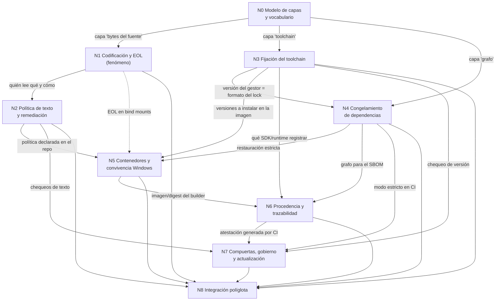

# Bitácora 02 — Cohesión global

Este documento es el que permite trabajar cada núcleo por separado sin perder el modelo completo. Fija tres cosas: el grafo de dependencias entre núcleos y lo que cada uno le entrega al siguiente; las contradicciones previsibles con su regla de resolución; y la trazabilidad desde cada pedido o regla del PO hasta el núcleo que lo atiende y la sección de la guía donde va a quedar.

## Índice

- [1. Grafo de dependencias](#1-grafo-de-dependencias)
- [2. Qué entrega cada núcleo a los demás](#2-qué-entrega-cada-núcleo-a-los-demás)
- [3. Vínculos transversales](#3-vínculos-transversales)
- [4. Contradicciones previsibles y regla de resolución](#4-contradicciones-previsibles-y-regla-de-resolución)
- [5. Trazabilidad pedido → núcleo → sección de la guía](#5-trazabilidad-pedido--núcleo--sección-de-la-guía)
- [6. Estructura prevista de la guía](#6-estructura-prevista-de-la-guía)
- [7. Orden de trabajo e integración](#7-orden-de-trabajo-e-integración)
- [8. Trazabilidad a las comisiones de la mesa](#8-trazabilidad-a-las-comisiones-de-la-mesa)

## 1. Grafo de dependencias

Una flecha `A --> B` significa «B necesita el resultado de A para poder afirmarse». La etiqueta dice qué viaja.

El grafo no tiene ciclos. La única arista punteada (N1 → N5) es una dependencia débil: N5 puede escribirse con la política de N2, pero el diagnóstico de los problemas de bind mount necesita el detalle del fenómeno.

## 2. Qué entrega cada núcleo a los demás

| Núcleo | Entrega (contrato de salida) | Consumidores |
|---|---|---|
| N0 | Tabla de capas con su fuente de verdad; glosario canónico (fijar, congelar, reproducible, determinista, hermético, deriva). | todos |
| N1 | Matriz «lector × presencia de BOM × codificación real → comportamiento», verificada con E1; ejemplo sintético del caso disparador. | N2, N5, N8 |
| N2 | Política recomendada y sus variantes; plantillas `.editorconfig` y `.gitattributes` comentadas; procedimiento de migración; chequeo reutilizable. | N5, N7, N8 |
| N3 | Archivo de fijación por ecosistema y su comportamiento ante versión ausente; distinción declarar/hacer cumplir. | N4, N5, N6, N7, N8 |
| N4 | Comando de restauración estricta por ecosistema y su falla verificada; criterio CPM frente a lock file. | N5, N6, N7, N8 |
| N5 | Qué capas fija un devcontainer y cuáles no; plantilla `devcontainer.json`; reglas de convivencia con Visual Studio en Windows y WSL. | N6, N8 |
| N6 | Conjunto mínimo de metadatos de procedencia; propiedades de determinismo .NET; SBOM y procedencia por ecosistema. | N7, N8 |
| N7 | Diseño «misma compuerta en local y en CI»; lista de verificación del revisor; proceso de descongelamiento. | N8 |
| N8 | Estructura de repo políglota de referencia; resolución de choques entre ecosistemas; build orquestada. | guía completa (integración) |

## 3. Vínculos transversales

Además de las dependencias, hay hilos que atraviesan varios núcleos y que la guía tiene que mantener con un solo sentido:

- **El caso disparador** se presenta en la introducción, se explica en N1, se resuelve en N2, se previene en N7 y reaparece en N8 como choque de convenciones. Es el hilo narrativo de toda la guía (Rule-Dual-Audience: «narrar de punta a punta con un caso concreto»).
- **La pregunta «¿lo resuelve un contenedor?»** se formula en N0, se contesta parcialmente en cada núcleo (qué de esa capa fija un contenedor) y se cierra en N5.
- **La estación Windows con Visual Studio** aparece como escenario en todos los núcleos (ver BIT-15-03, escenario ESC-01): ningún núcleo puede dar una recomendación que sólo funcione en Linux sin decirlo.
- **Declarar frente a hacer cumplir**: N2 (`.editorconfig` declara, el chequeo hace cumplir), N3 (`engines` declara, `engine-strict` o el gestor hace cumplir), N4 (el lock declara, la restauración estricta hace cumplir), N7 (la CI hace cumplir todo). La guía usa el mismo par de términos en los cuatro.
- **Laboratorio `Examples/`**: cada núcleo con validación E1 deja una carpeta propia; N8 reutiliza las anteriores y no duplica código.
- **Guías hermanas** de `LAB/Lab-Documentos/Guides/` (GitFlow, Despliegue): se enlazan donde la frontera lo pida (N7 con flujo de ramas y PR; N6 con despliegue), sin repetir su contenido ni editarlas.

## 4. Contradicciones previsibles y regla de resolución

| Tensión | Núcleos | Regla de resolución |
|---|---|---|
| UTF-8 **con** BOM resuelve el caso .NET en ambas plataformas, pero el BOM puede ser indeseable en otros tipos de archivo (scripts con shebang, algunos JSON o archivos que leen herramientas Unix). **[C: a verificar por tipo de archivo]** | N1, N2, N8 | La política se declara **por extensión** en `.editorconfig`/`.gitattributes`; la guía no da una regla global sin decir a qué archivos aplica. Gana la evidencia E1 de cada lector. |
| `core.autocrlf` local frente a `.gitattributes` del repo. | N2, N5 | La política vive en el repo, no en la configuración de cada máquina; la guía explica la precedencia con fuente de git-scm.com. |
| Fijar la imagen por digest frente a recibir parches de seguridad. | N5, N7 | Digest en CI y en el devcontainer, con actualización controlada por N7 (el descongelamiento es un PR revisable). Criterio propio declarado como tal, a someter a la mesa. |
| `rollForward` permisivo (comodidad del dev en Windows) frente a exactitud (reproducibilidad). | N3, N6 | La guía presenta ambas opciones por escenario; la CI usa la opción que N6 necesite para registrar la versión exacta. |
| CPM (versión directa centralizada) frente a lock file (grafo completo): parecen redundantes. | N4 | No se presentan como alternativas: se explica qué capa fija cada uno y que pueden convivir. A confirmar con fuente oficial. |
| «Un devcontainer para todos» frente a desarrolladores que no pueden o no quieren usar contenedores. | N5, N7 | La compuerta de CI es la fuente de verdad; el devcontainer es una comodidad que la reproduce, no un requisito (SUP-05). |
| Una imagen multi-runtime frente a imágenes por componente. | N5, N8 | Criterio por contexto en N8; no hay respuesta única. |
| Profundidad técnica frente a guía formativa autocontenida en un solo archivo. | todos | El texto principal forma criterio; el detalle de comandos va a anexos y a `Examples/` con enlace. |

## 5. Trazabilidad pedido → núcleo → sección de la guía

Los IDs `P-` identifican pedidos del contexto y las solicitudes; los `R-` son las reglas del prompt (ver BIT-15-00 §2). La columna de sección usa la numeración prevista en §6.

| ID | Pedido o regla del PO (parafraseado, sin datos privados) | Núcleo(s) | Sección prevista |
|---|---|---|---|
| P-01 | Código fuente en cp1252 que en Linux se lee como UTF-8, falla al compilar y corrompe acentos; en Windows funciona. | N1 | §1 (caso), §4 |
| P-02 | Se desarrolla con Visual Studio en Windows y a la vez en Linux o en devcontainers. | N5; marco de referencia | §2, §8 |
| P-03 | Mantener un criterio unificado de codificación para no tener commits con cambios de BOM. | N2, N7 | §5, §10 |
| P-04 | Congelar paquetes NuGet. | N4 | §7 |
| P-05 | Congelar versiones de compiladores y SDK. | N3 | §6 |
| P-06 | ¿Se puede lograr con contenedores? | N0, N5 | §3, §8 |
| P-07 | Cómo integrarlo cuando hay herramientas en Windows y en Linux. | N5, N7 | §8, §10 |
| P-08 | Saber con qué entorno se ensambló cada pieza. | N0, N6 | §3, §9 |
| P-09 | Analizar las estrategias actuales de la industria para .NET, Node.js y Python. | N1–N7 (cada uno cubre los tres) | §4–§10 |
| P-10 | En especial, qué pasa al integrarlos en una única solución. | N8 | §11 |
| P-11 | Reeditar el prompt sobre el marco de mesa y plantear el caso a la mesa (didáctica, edición, senior .NET, arquitectura, desarrolladores; evaluar si falta un experto). | — (proceso) | `OUTPUTs/Metodlogia-Entorno-Desarrollo.md`; BIT-15-00 §4 |
| P-12 | La mesa relee el documento final y corrige edición, compresión y coherencia. | — (proceso) | ciclo de relectura integral (DC-04) |
| R-01 | Secciones jerárquicas con índice; definiciones, explicaciones, ejemplos, mermaid. | todos | índice §0; estructura interna común (§6) |
| R-02 | Autocontenido, no delta. | todos | guía completa; glosario Anexo C |
| R-03 | Snippets representativos; preguntas guía con respuestas formadoras de criterio. | todos | subsección «Preguntas guía» de cada §4–§11 |
| R-04 | Descomposición conceptual, cohesión global, integración. | N0–N8 | esta bitácora; §11 como integración |
| R-05 | Registros retomables en la bitácora. | — | `OUTPUTs/Bitcora/` |
| R-06/07 | No inventar; toda afirmación con evidencia verificable. | todos | Anexo D (referencias con fecha), `Examples/` (E1) |
| R-PROF | Marco de referencia (escenarios, contextos, actores); mapa conceptual; anexos con plantillas, listas y glosario. | marco; N0 | §2, §3, Anexos A–C |

Chequeo mecánico de esta tabla: todo pedido P-01…P-10 tiene al menos un núcleo; todo núcleo N0…N8 aparece al menos una vez (N0: P-06, P-08; N1: P-01; N2: P-03; N3: P-05; N4: P-04; N5: P-02, P-06, P-07; N6: P-08; N7: P-03, P-07; N8: P-10). No hay núcleo huérfano ni pedido sin núcleo.

## 6. Estructura prevista de la guía

Un solo archivo (DC-01). Cada sección temática §4–§11 sigue la estructura del Profile: Definición → Aplicación por escenario y contexto → Ejemplos (con snippet y referencia a `Examples/`) → Preguntas guía con respuesta → Criterios de calidad → Plantilla comentada (en el anexo si es larga).

| § | Título tentativo | Núcleo | Pieza del Profile |
|---|---|---|---|
| 0 | Índice y ruta de lectura | — | README |
| 1 | El caso: el mismo código, dos resultados | N1 (presentación) | resumen ejecutivo |
| 2 | Marco de referencia: escenarios, contextos y actores | marco | marco de referencia |
| 3 | El entorno como pila de capas | N0 | mapa conceptual |
| 4 | Codificación y finales de línea | N1 | documento temático |
| 5 | Una política de texto para el repositorio | N2 | documento temático |
| 6 | Fijar el toolchain | N3 | documento temático |
| 7 | Congelar las dependencias | N4 | documento temático |
| 8 | Contenedores, devcontainers y estaciones Windows | N5 | documento temático + métodos y marcos |
| 9 | Procedencia: saber con qué se construyó | N6 | documento temático |
| 10 | Compuertas y gobierno del entorno | N7 | documento temático |
| 11 | Una sola solución con .NET, Node.js y Python | N8 | integración |
| A | Plantillas comentadas | N2–N6, N8 | anexo |
| B | Listas de verificación por actor | N7, marco | anexo |
| C | Glosario | N0 | anexo |
| D | Referencias con fecha de consulta | todos | anexo (Rule-Evidences) |
| E | Laboratorio `Examples/`: cómo reproducir cada experimento | todos | anexo |

## 7. Orden de trabajo e integración

1. **N0 primero**: fija el vocabulario; sin él los demás núcleos no pueden validarse por coherencia.
2. **N1 y N3 en paralelo**: no dependen entre sí.
3. **N2 y N4 en paralelo**, cada uno después de su predecesor.
4. **N5**, una vez que N1–N4 tienen sus plantillas y experimentos.
5. **N6**, sobre N3–N5.
6. **N7**, sobre N2, N3, N4 y N6.
7. **N8 como integración**: consolida, resuelve las tensiones de §4 y reconstruye el modelo completo; si una tensión obliga a cambiar la recomendación de un núcleo anterior, el cambio se hace **en el núcleo de origen** (principio de reparación en la capa de origen del marco) y N8 se revalida.
8. Relectura integral de la mesa (DC-04): recorre la guía completa contra esta tabla de trazabilidad buscando huecos, solapamientos y contradicciones.

## 8. Trazabilidad a las comisiones de la mesa

Propuesta del analista para la mesa de convocatoria (no vinculante; la mesa decide):

| Comisión | Núcleos que juzga | No le corresponde |
|---|---|---|
| Didáctica | marco de referencia, preguntas guía de todos, progresión §1→§11 | corrección técnica |
| Edición de material bibliográfico | forma, índice, autocontención, voz, referencias (Anexo D) | corrección técnica |
| Senior .NET | N1 (Roslyn/MSBuild), N3 (`global.json`), N4 (NuGet), N6 (determinismo, SourceLink) | Node, Python |
| Arquitectura de software | N0, N5, N8, coherencia del modelo de capas | detalle de comandos por ecosistema |
| Desarrollador / implementador ingenuo (estación Windows + VS) | reproducibilidad de cada ejemplo desde Windows y desde Linux | decisiones de política |
| Ad hoc DevOps / cadena de suministro (propuesto) | N5, N6, N7 | pedagogía, forma |
| Ad hoc Node.js + Python (propuesto) | N1, N3, N4, N6 en sus ecosistemas; N8 | .NET |
| Verificación / QA y abogado del diablo (núcleo permanente del marco) | todos, por evidencia y por refutación | — |
