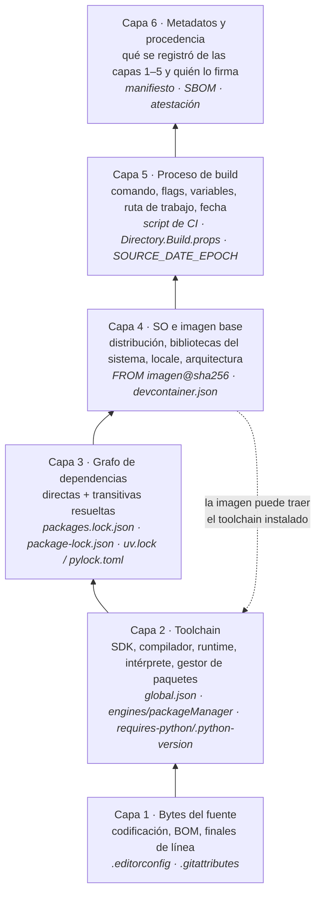

# N0 — Modelo de capas del entorno y vocabulario de reproducibilidad

El pedido del PO usa una sola palabra, «congelar», para tres cosas que se fijan con archivos, herramientas y comandos distintos: la versión de los paquetes NuGet, la del compilador y SDK, y el entorno completo dentro de un contenedor. Este núcleo separa esas cosas en capas, le da a cada una su fuente de verdad versionada y fija el vocabulario que el resto de la guía usa con un único sentido. Todo lo que sigue se apoya en documentación oficial consultada el 2026-10-07 o en los experimentos E0-1 a E0-6 (más E0-2b y E0-5b, agregados en la verificación adversarial), corridos ese mismo día; lo que es criterio del autor está marcado **[criterio propio]**.

## Índice

- [1. Definiciones canónicas](#1-definiciones-canónicas)
- [2. El entorno como pila de capas](#2-el-entorno-como-pila-de-capas)
- [3. Qué capa fija cada mecanismo y cuál deja libre](#3-qué-capa-fija-cada-mecanismo-y-cuál-deja-libre)
- [4. Reproducible, determinista, hermética](#4-reproducible-determinista-hermética)
- [5. Por qué el mismo commit da resultados distintos](#5-por-qué-el-mismo-commit-da-resultados-distintos)
- [6. ¿Lo resuelve un contenedor?](#6-lo-resuelve-un-contenedor)
- [7. Estrategias por ecosistema y en la integración](#7-estrategias-por-ecosistema-y-en-la-integración)
- [8. Snippets representativos](#8-snippets-representativos)
- [9. Experimentos](#9-experimentos)
- [10. Preguntas guía](#10-preguntas-guía)
- [11. Errores frecuentes](#11-errores-frecuentes)
- [12. Dependencias y tensiones con otros núcleos](#12-dependencias-y-tensiones-con-otros-núcleos)
- [13. Observaciones, supuestos y pendientes](#13-observaciones-supuestos-y-pendientes)
- [14. Evidencias](#14-evidencias)
- [15. Verificación adversarial](#15-verificación-adversarial)

## 1. Definiciones canónicas

La tabla es el glosario que la guía hereda (Anexo C). La columna «No confundir con» existe porque casi todos estos términos se usan en la industria con más de un sentido; la guía elige uno y lo sostiene.

| Término | Definición adoptada | Fuente / naturaleza | No confundir con |
|---|---|---|---|
| **Entorno de construcción** | Todo lo que, además del código fuente, influye en los bytes del artefacto: dependencias y sus versiones, toolchain, flags de build, variables de entorno que el sistema de build lee (p. ej. el *locale*), sistema operativo y su configuración. | reproducible-builds.org lo enumera como «relevant attributes of the build environment» [EV-01]. | «La máquina del desarrollador». La máquina es una forma de aportar el entorno, no el entorno. |
| **Capa** | Subconjunto del entorno que se declara en un mismo tipo de archivo, lo lee una misma herramienta y falla de un mismo modo cuando no se declara. | [criterio propio], coherente con el criterio de segmentación de BIT-15-01. | Capa de imagen de Docker (*layer*): es un concepto del sistema de archivos de la imagen, no de este modelo. |
| **Fuente de verdad** | El archivo versionado en el repo que define el valor de una capa. Si no existe, el valor lo aporta quien construye (su máquina, su IDE, la imagen). | [criterio propio]. | Documentación o wiki: no la lee ninguna herramienta. |
| **Declarar / hacer cumplir** | Declarar es escribir el valor en la fuente de verdad; hacer cumplir es que una herramienta falle si el entorno real no coincide. `engines` de npm declara y sólo advierte salvo `engine-strict` [EV-17], también en el propio proyecto (E0-2b); `npm ci` [EV-11], `dotnet restore --locked-mode` [EV-08] y `uv lock --locked` [EV-12] hacen cumplir. | npm, NuGet, uv. Par de términos fijado en BIT-15-02 §3. | Que exista el archivo no implica que alguien lo verifique. |
| **Rango** | Conjunto de versiones aceptables para una dependencia o herramienta. Cuál de ellas se elige lo decide la **política de resolución** del ecosistema, que no es la misma en todos: NuGet elige la más baja que satisface un mínimo [EV-09] y la más alta sólo con versión flotante (`6.*`) [EV-10]; npm con `^` acepta cambios de *minor* y *patch* [EV-14] y `npm install` instaló la más alta (E0-3a); uv resolvió la más alta (E0-3c). | NuGet, npm, PEP 440 [EV-15]. | «Versión». `Version="13.0"` en un `.csproj` es un rango con mínimo inclusivo, no una versión [EV-10]. |
| **Fijar** (*pin*) | Declarar **una** versión exacta en la fuente de verdad: `[13.0.1]` en NuGet [EV-10], `==` en Python [EV-15], `"version"` + `"rollForward": "disable"` en `global.json` [EV-05], una imagen por digest [EV-16]. Fija **una** entrada; no dice nada de las transitivas. | Fabricantes citados. | Congelar. Fijar las versiones directas no congela el grafo transitivo. |
| **Congelar** (*lock*) | Registrar en un archivo generado por la herramienta el **resultado completo de la resolución** (directas y transitivas, con versión exacta y, cuando el formato lo prevé, hash de integridad), para que una instalación posterior repita el mismo árbol. `package-lock.json` [EV-13], `packages.lock.json` [EV-08], `uv.lock` [EV-12], `pylock.toml` [EV-18], `devcontainer-lock.json` para las *features* de un devcontainer [EV-21]. | Fabricantes citados. | «Congelar el entorno». Un lock congela la capa 3 y nada más. |
| **Restauración estricta** | Modo de instalación que usa el lock y **falla** si el lock no coincide con lo declarado, en lugar de reescribirlo: `npm ci`, `dotnet restore --locked-mode`, `uv lock --locked` / `uv sync --locked`. | [EV-08], [EV-11], [EV-12]; E0-3a/b/c. | `npm install` o `dotnet restore` sin modo estricto: con un lock presente lo usan, pero si detectan cambios lo regeneran [EV-08]. |
| **Determinista** | Propiedad de **una herramienta o proceso**: con entradas idénticas produce salidas idénticas byte a byte. En C#, `Deterministic` (por defecto `true` en proyectos modernos) reemplaza la marca de tiempo y el MVID por valores derivados de un hash de las entradas [EV-04]. | learn.microsoft.com [EV-04]; reproducible-builds.org [EV-03]. | Reproducible. Las «entradas» del compilador incluyen el directorio actual y la página de códigos por defecto [EV-04]: un compilador determinista da otra salida si cambia la ruta (E0-5). |
| **Reproducible** | Propiedad de **una build completa**: dados el mismo fuente, el mismo entorno de construcción y las mismas instrucciones, cualquiera puede recrear copias idénticas bit a bit de los artefactos especificados [EV-01]. Se verifica comparando hashes; los logs quedan fuera [EV-01]. | reproducible-builds.org [EV-01]. | «Funciona igual». Dos binarios que se comportan igual pero difieren en un byte no son una build reproducible. |
| **Hermética** | Propiedad del **sistema de build**: aísla la build de los cambios del host, trata las herramientas como fuente (las descarga y administra en árboles controlados) y usa el hash del control de versiones para identificar los cambios en las entradas [EV-06]. SLSA usa el término en un sentido más estrecho, «aproximadamente, que la build corrió sin acceso a la red», y lo dejó fuera de la v1.0 [EV-07a], [EV-07b]. | Bazel [EV-06]; SLSA [EV-07a/b]. | Contenedor. Un contenedor aísla el SO, pero si la build descarga paquetes por rango o lee variables del host no es hermética. |
| **Deriva** (*drift*) | Diferencia entre el entorno que el repo declara y el que efectivamente construye, o entre dos entornos que se suponen iguales, que aparece **sin un commit que la explique**: una etiqueta de imagen que se movió (E0-4), un SDK que Visual Studio actualizó [EV-05], un rango que resolvió una versión nueva (E0-3a). | [criterio propio]. No se encontró una definición normativa; el término se usa en la industria sin una fuente única. | Actualización deliberada: si pasa por un PR que cambia la fuente de verdad, no es deriva. |
| **Registro del entorno** | Información sobre el entorno que se **define** como parte del proceso o se **graba** durante la build, para que otros puedan reconstruirla [EV-02]. Debian, Arch y el ecosistema JVM usan archivos *buildinfo* con formatos propios [EV-02]. | reproducible-builds.org [EV-02]. | Procedencia. |
| **Procedencia** (*provenance*) | Atestación que identifica sin ambigüedad el artefacto por su digest criptográfico y describe cómo se produjo [EV-07c]. En SLSA v1.2, Build L1 exige que exista; L2, que la emita y firme una plataforma de build alojada (no una estación de trabajo); L3, que no se pueda falsificar y que la build corra aislada [EV-07c]. | slsa.dev [EV-07c]. | Registro del entorno sin firmar (como el manifiesto de E0-6): sirve para diagnosticar, no prueba nada ante un tercero. Detalle en N6. |

## 2. El entorno como pila de capas

Se modelan seis capas. El orden no es arbitrario: cada capa consume a la anterior, y la falla de una capa inferior no se arregla en una superior (un lock file no compensa un fuente en una codificación que el compilador no lee).



La flecha punteada marca la única interacción que rompe el apilamiento estricto: una imagen de contenedor suele **traer** instalado el toolchain, de modo que la capa 4 puede terminar aportando el valor de la capa 2. Eso no convierte a la imagen en la fuente de verdad del toolchain: si el repo no lo declara, la capa 2 queda definida por quien eligió la imagen, y el E0-2 muestra que dos imágenes oficiales dan dos compiladores distintos.

| Capa | Qué contiene | Fuente de verdad en el repo (.NET · Node.js · Python) | Si el repo calla, la aporta… | Cómo se rompe | Experimento |
|---|---|---|---|---|---|
| 1 · Bytes del fuente | Codificación del texto, BOM, finales de línea. | `.editorconfig` (`charset`, `end_of_line`) y `.gitattributes` (`text`, `eol`) para los tres; detalle en N1/N2. | El editor y la configuración de git de cada estación. | Un archivo en cp1252 compila en una plataforma y falla en otra; commits cuyo único cambio es el BOM o el EOL. | E0-1 |
| 2 · Toolchain | SDK/compilador, runtime, intérprete, gestor de paquetes (que también es herramienta). | `global.json` · `engines`, `packageManager` (campo de Corepack, que Node.js distribuye sólo de la 14.19.0 a la 24.x [EV-27]) · `requires-python`, `.python-version` (este último sin fuente verificada en N0; lo cubre N3); detalle en N3. | El SDK más alto instalado [EV-05]; lo que haya en el `PATH`; lo que traiga la imagen. | Mismo fuente, otra DLL (E0-2); un SDK más nuevo agrega `PackageReference` implícitos y el restore en modo estricto falla [EV-08]. | E0-2 |
| 3 · Grafo de dependencias | Versiones exactas de directas y transitivas, con integridad. | `packages.lock.json` (+ CPM para las directas) · `package-lock.json` · `uv.lock` o `pylock.toml`; detalle en N4. | El resolvedor, el día en que corre, contra el estado del registro ese día. | Un rango resuelve otra versión al publicarse una nueva [EV-08]; el lock se regenera en silencio sin modo estricto. | E0-3a/b/c |
| 4 · SO e imagen base | Distribución y versión, bibliotecas del sistema, *locale*, zona horaria, arquitectura. | `Dockerfile` con `FROM …@sha256:…`, `devcontainer.json` (`image`) y `devcontainer-lock.json` para *features*; detalle en N5. | El host (Windows, Linux, macOS) o la etiqueta de imagen el día en que se descargó. | La etiqueta se mueve: mismo nombre, otros bytes (E0-4); en los digests observados, `sdk:8.0` es Debian 12 y `sdk:10.0` es Ubuntu 24.04 (E0-6). | E0-4, E0-6 |
| 5 · Proceso de build | Comando y flags, configuración (`Release`), variables de entorno leídas, ruta de trabajo, fecha y hora. | Script de build versionado y propiedades de MSBuild (`Deterministic`, `ContinuousIntegrationBuild`, `PathMap`) · scripts de `package.json` · backend de build en `pyproject.toml`; `SOURCE_DATE_EPOCH` como convención transversal [EV-19]. | Lo que cada persona tipea o configura en su IDE. | Rutas absolutas y fechas incrustadas en el binario; `ContinuousIntegrationBuild` sin efecto fuera de un repo git (E0-5). | E0-5 |
| 6 · Metadatos y procedencia | Registro de las capas 1–5 asociado al artefacto; SBOM; atestación firmada. | Script de registro, SBOM y atestación generados por la CI; detalle en N6. | Nadie: si no se graba en el momento de la build, se pierde. | No se puede contestar «¿con qué se construyó esto?» después del hecho. | E0-6 |

## 3. Qué capa fija cada mecanismo y cuál deja libre

La pregunta del PO («congelar NuGet, compiladores, SDK… ¿mediante contenedores?») se contesta leyendo esta tabla por filas: ningún mecanismo fija más de una o dos capas, y la mayoría deja libre algo que el usuario cree cubierto.

| Mecanismo | Ecosistema | Capa que fija | Qué deja libre | Declara o hace cumplir | Evidencia |
|---|---|---|---|---|---|
| `global.json` con `version` y `rollForward: disable` | .NET | 2 (SDK exacto, y con él el compilador) | El runtime con que corre la app (se elige por `TargetFramework`) [EV-05]; las capas 3–5. | Hace cumplir: el CLI falla si no encuentra el SDK. | [EV-05], E0-2 |
| `global.json` con `rollForward: latestFeature` (o sin `global.json`) | .NET | 2, como rango | Qué SDK concreto dentro del rango, que decide cada máquina. Sin `global.json` se usa el más alto instalado [EV-05]. | Hace cumplir el piso, no el valor. | [EV-05], E0-2 |
| `TargetFramework` (`net8.0`) | .NET | API contra la que se compila y runtime objetivo | El SDK y el compilador: la misma DLL `net8.0` salió distinta con SDK 8 y 10. | — | [EV-05], E0-2 |
| `PackageReference Version="x"` | .NET | 3, sólo directas, como rango con mínimo inclusivo | Transitivas; la versión elegida cambia si se publica una que encaja mejor [EV-08]. | Declara. | [EV-09], [EV-10], E0-3b |
| CPM (`Directory.Packages.props`) | .NET | 3, versiones directas en un único lugar; con *transitive pinning*, también las transitivas que se promueven | El grafo completo resuelto: no es un lock. | Declara. | [EV-20] |
| `packages.lock.json` + `--locked-mode` | .NET | 3, grafo completo | Capas 1, 2, 4, 5. Si cambia el SDK pueden cambiar los paquetes implícitos y fallar el modo estricto [EV-08]. | Hace cumplir con `--locked-mode`; sin él, se regenera si cambian las dependencias declaradas [EV-08]. | [EV-08], E0-3b |
| `Deterministic=true` | .NET | 5, parcial: elimina marca de tiempo y MVID aleatorios | Las demás entradas que el compilador considera: ruta actual, página de códigos, versión exacta del compilador, plataforma CLR, etc. [EV-04]. | Hace cumplir dentro del compilador. | [EV-04], E0-5 |
| `ContinuousIntegrationBuild=true` / `PathMap` | .NET | 5, normaliza rutas incrustadas | `ContinuousIntegrationBuild` sólo normaliza las raíces declaradas como `SourceRoot`; sin repo git (o con las consultas al control de versiones apagadas) no normalizó nada, y con un `SourceRoot` a mano sí (E0-5 caso 4, E0-5b). `PathMap` explícito normaliza sin git (E0-5b) pero rompe los puntos de interrupción en depuración local [EV-22]. | Hace cumplir. | [EV-22], [EV-23], E0-5, E0-5b |
| `package.json` `dependencies` con `^`/`~` | Node.js | 3, directas, como rango | Transitivas; la versión elegida cambia con cada publicación compatible. | Declara. | [EV-14], E0-3a |
| `package-lock.json` + `npm ci` | Node.js | 3, árbol completo con `integrity` | Versión de Node y de npm (capa 2), capas 4–5. | `npm ci` hace cumplir: falla ante desajuste y nunca escribe el lock [EV-11]. | [EV-11], [EV-13], E0-3a |
| `engines` | Node.js | 2, como rango | Todo, salvo que el usuario active `engine-strict`; sólo advierte [EV-17], también en el propio proyecto (E0-2b: `EBADENGINE`, código 0; con `--engine-strict`, código 1). | Declara. | [EV-17], E0-2b |
| `requires-python` | Python | 2, como requisito del proyecto | Qué intérprete concreto se usa. | Declara (metadato) [EV-24]. | [EV-24] |
| `uv.lock` + `--locked` | Python | 3, grafo universal (todas las combinaciones de SO, arquitectura y versión de Python) | Versión de uv (capa 2), capas 4–5. No se considera desactualizado porque salgan versiones nuevas [EV-12]. | `--locked` hace cumplir [EV-12]. | [EV-12], E0-3c |
| `pylock.toml` | Python | 3, formato estándar e independiente de la herramienta (PEP 751) | Lo mismo que `uv.lock`; uv lo exporta pero no lo usa como lock propio [EV-12b]. | Depende del instalador que lo consuma. | [EV-18], [EV-12b] |
| Imagen por etiqueta (`sdk:8.0`) | Contenedores | 4 y 2 **el día de la descarga** | Todo lo demás, y la propia capa 4 a futuro: la etiqueta es mutable [EV-16]. | Ni declara un valor estable. | [EV-16], E0-4 |
| Imagen por digest (`sdk@sha256:…`) | Contenedores | 4 (y la 2 si viene instalada en la imagen) | Capas 1, 3, 5, 6. Renuncia a los parches automáticos de seguridad [EV-16]. | Hace cumplir: el digest nombra bytes. | [EV-16], E0-4 |
| `devcontainer.json` + `devcontainer-lock.json` | Dev Containers | 4 (imagen) y las *features* con versión, recurso resuelto y hash | Capas 1, 3, 5, 6; la imagen sigue dependiendo de cómo se la nombre. | El lock de *features* registra integridad [EV-21]. | [EV-21] |
| `SOURCE_DATE_EPOCH` | Transversal | 5, la fecha que las herramientas incrustan | Todo lo que no lea esa variable. | Convención: sólo actúa en herramientas que la consumen [EV-19]. | [EV-19] |

## 4. Reproducible, determinista, hermética

Las tres palabras describen objetos distintos y no se implican en el orden que suele suponerse. **Determinista** es una propiedad de cada herramienta: el compilador de C# con `Deterministic=true` produce la misma DLL si recibe las mismas entradas [EV-04]. **Reproducible** es una propiedad de la build entera: otra persona, con el mismo fuente, el mismo entorno y las mismas instrucciones, obtiene los mismos bytes [EV-01]. **Hermética** es una propiedad del sistema de build: impide que el host se cuele en las entradas [EV-06].

El E0-5 muestra la distancia entre la primera y la segunda. Con SDK 8.0.425 y el mismo directorio, dos compilaciones dieron el mismo hash (`56abc6…`), incluso en dos contenedores distintos (E0-2 repitió ese hash). Con el mismo SDK y otro directorio, el hash cambió: la DLL guarda la ruta absoluta del `.pdb`, y la documentación del compilador lista «the current directory path» entre las entradas que afectan el determinismo [EV-04]. El compilador era determinista y la build no era reproducible entre máquinas. Recién con `ContinuousIntegrationBuild=true` **y** el fuente dentro de un repositorio git, la ruta quedó normalizada (`/_/obj/…`) y los hashes coincidieron. El E0-5b muestra por qué: la normalización mapea los ítems `SourceRoot`, que dentro de un repo git aporta la consulta al control de versiones; con git pero esas consultas apagadas no normaliza, y sin git pero con un `SourceRoot` declarado a mano sí. La documentación de `ContinuousIntegrationBuild` no menciona ese requisito [EV-23].

Hermética es la más exigente y la menos estandarizada. Bazel la define por aislamiento del host y gestión de las herramientas como fuente [EV-06]; SLSA la usa como «sin acceso a la red» y la dejó fuera de la v1.0 por riesgo de cambios incompatibles [EV-07a], [EV-07b]. Ningún nivel de la especificación SLSA vigente (v1.2) exige builds herméticas [EV-07c]; las builds reproducibles y herméticas figuran sólo como candidatas a un futuro Build L4 [EV-07d].

**¿Cuál necesita un equipo como el del caso?** [criterio propio, a someter a la mesa]

| Necesidad | Propiedad suficiente | Por qué no hace falta más |
|---|---|---|
| Que la build no se rompa al pasar de Windows a Linux o al devcontainer. | Capas 1–4 **declaradas y verificadas** (no hace falta igualdad de bytes). | El problema del caso es de entradas distintas, no de bytes de salida. |
| Saber con qué se construyó una pieza ya publicada. | Registro del entorno por capa, grabado por la CI (capa 6). | Alcanza con poder reconstruir el entorno; no hace falta que dos builds coincidan. |
| Demostrar que un binario publicado sale de un commit dado (auditoría, cadena de suministro). | Build **reproducible** del artefacto que se publica + procedencia (N6). | Es el único caso en que la igualdad bit a bit paga su costo. |
| Aislar por completo la build del host y de la red. | Hermética. | Exige un sistema de build que gestione las herramientas como fuente (tipo Bazel) o un *mirror* de paquetes; para un equipo chico con .NET, Node y Python el costo excede el beneficio salvo requisito externo. |

## 5. Por qué el mismo commit da resultados distintos

Un commit identifica la capa 1 y, si el repo los versiona, los archivos que declaran las capas 2–5. No identifica los valores de las capas que el repo no declara. Cada fila es una causa observada en el laboratorio:

| Causa | Capa | Observación (E1) |
|---|---|---|
| El compilador lee los mismos bytes con otra codificación. | 1 | cp1252 en Linux: `error CS1056: Unexpected character '�'`; el mismo texto en UTF-8 compila (E0-1). El compilador intenta primero UTF-8 y `CodePage` permite indicar otra [EV-25]; si no se especifica la codificación, la codificación por defecto (la página de códigos actual) es una entrada del compilador [EV-04], y por eso puede diferir entre plataformas (no probado en Windows; N1). |
| Cada máquina usa otro SDK. | 2 | Sin `global.json`: 8.0.425/Roslyn 4.11 frente a 10.0.400/Roslyn 5.9; misma DLL `net8.0`, hashes `56abc6…` y `61fbcf…` (E0-2). |
| El rango resolvió otra versión. | 3 | `^2.0.0` → 2.1.3 sin lock, 2.0.0 con lock (E0-3a). |
| La etiqueta de imagen se movió. | 4 | `sdk:8.0` local (2026-09-19) y remota (2026-10-06) con digests distintos y el mismo SDK 8.0.425 (E0-4). |
| La ruta de trabajo quedó incrustada. | 5 | `/w/a` frente a `/home/x/otra`: hashes distintos (E0-5). |
| Nadie registró el entorno. | 6 | Sin manifiesto, las diferencias anteriores se infieren; con manifiesto, se leen en un `diff` (E0-6). |

## 6. ¿Lo resuelve un contenedor?

En parte, y sólo en las capas que el contenedor efectivamente aporta. La respuesta completa es de N5; acá queda la forma de la respuesta, que todos los núcleos usan:

| Capa | ¿La fija el contenedor? | Matiz |
|---|---|---|
| 1 · Bytes | No. | Si el código se monta desde el host, los bytes que escribió el editor de Windows llegan iguales. Si se clona, la codificación llega igual pero los finales de línea de los archivos marcados `text` pueden convertirse al hacer checkout según `eol`, `core.autocrlf`/`core.eol` y la plataforma [EV-29]. |
| 2 · Toolchain | Sí, si viene instalado en la imagen **y** la imagen se nombra por digest. | Por etiqueta, el SDK puede cambiar entre descargas; sin `global.json`, el repo no se entera. |
| 3 · Grafo | No. | Sin lock y restauración estricta, el contenedor resuelve rangos como cualquier máquina. |
| 4 · SO | Sí, por digest. Por etiqueta, no (E0-4). | Fijar el digest renuncia a los parches automáticos [EV-16]; la actualización pasa a ser un PR (N7). |
| 5 · Proceso | Parcialmente: iguala rutas y variables si todos usan el mismo `devcontainer.json`. | Quien construye en Visual Studio sobre Windows queda afuera. |
| 6 · Metadatos | No. | El contenedor no registra nada por sí solo. |

## 7. Estrategias por ecosistema y en la integración

La columna «Tipo» separa lo que recomienda el fabricante, lo que es convención extendida sin respaldo normativo y lo que es criterio de esta guía.

| Ecosistema | Estrategia | Tipo | Evidencia |
|---|---|---|---|
| .NET | Fijar el SDK en `global.json`; con lock files, `rollForward: disable` para que SDK y grafo cambien juntos. | Fabricante | [EV-05], [EV-08] |
| .NET | `RestorePackagesWithLockFile` y `--locked-mode` en CI; versionar el lock en aplicaciones, no en bibliotecas que consumen otros. | Fabricante | [EV-08] |
| .NET | `ContinuousIntegrationBuild=true` condicionado a la variable de la CI. | Fabricante | [EV-23] |
| .NET | Visual Studio instala una sola copia del SDK y al actualizarse borra la anterior; para sostener un `global.json` exacto hay que instalar el SDK independiente. | Fabricante | [EV-05] |
| Node.js | Versionar `package-lock.json` e instalar con `npm ci` en entornos automatizados. | Fabricante | [EV-11], [EV-13] |
| Node.js | `engines` es sólo advertencia salvo `engine-strict`. | Fabricante | [EV-17] |
| Node.js | `.nvmrc` / `.node-version` para la versión de Node. | Convención de gestores de versión **sin verificar en N0** (no lleva fuente acá); la verifica N3. | — |
| Python | `uv.lock` versionado, `--locked` en CI; exportar a `pylock.toml` si otra herramienta lo necesita. | Fabricante (uv) / estándar (PEP 751) | [EV-12], [EV-12b], [EV-18] |
| Python | A partir de Python 3.15 el modo UTF-8 es el predeterminado: cambia la capa 1 para lecturas de texto sin codificación explícita. Al 2026-10-07 la 3.15.0 todavía no salió: su calendario la espera para el 2026-10-09 [EV-28]. | Estándar (PEP 686) | [EV-26], [EV-28] |
| Contenedores | Imagen base por digest, actualizada por un bot que abre PR (Dependabot) o con alertas de imagen desactualizada. | Fabricante (Docker) | [EV-16] |
| Integración | Un archivo de fijación y un lock **por ecosistema**, todos en el mismo repo, y un único registro del entorno por build que los cubra a todos (E0-6 lee cualquier lock que encuentre). | [criterio propio]; detalle en N8. | E0-6 |
| Integración | La política de la capa 1 se declara una vez en la raíz, por extensión, porque los tres compiladores e intérpretes leen los mismos bytes con reglas distintas. | [criterio propio]; detalle en N1/N2/N8. | E0-1, [EV-25], [EV-26] |
| Integración | La CI es la fuente de verdad del entorno; el devcontainer la reproduce para quien quiera, sin ser requisito. | [criterio propio], alineado con SUP-05 (BIT-15-02 §4). | — |

## 8. Snippets representativos

Los tres primeros declaran una capa cada uno; el cuarto muestra cómo se ve una capa 4 fijada; el quinto, el registro de la capa 6.

```jsonc
// global.json — capa 2. Versión exacta: si la máquina no tiene 8.0.425, el CLI falla
// en lugar de usar otra (E0-2). Pensado para repos con lock files [EV-05].
{
  "sdk": { "version": "8.0.425", "rollForward": "disable" }
}
```

```xml
<!-- Directory.Build.props — capas 3 y 5 para todos los proyectos .NET del repo. -->
<Project>
  <PropertyGroup>
    <!-- Capa 3: generar y usar packages.lock.json [EV-08] -->
    <RestorePackagesWithLockFile>true</RestorePackagesWithLockFile>
  </PropertyGroup>
  <!-- Capas 3 y 5 sólo en la CI: restauración estricta y rutas normalizadas.
       En local se deja libre para no romper la depuración [EV-22], [EV-23]. -->
  <PropertyGroup Condition="'$(GITHUB_ACTIONS)' == 'true' Or '$(TF_BUILD)' == 'true'">
    <RestoreLockedMode>true</RestoreLockedMode>
    <ContinuousIntegrationBuild>true</ContinuousIntegrationBuild>
  </PropertyGroup>
</Project>
```

```bash
# Capa 3 en los tres ecosistemas: los tres comandos FALLAN si el lock no coincide
# con lo declarado, en vez de reescribirlo (E0-3a/b/c).
dotnet restore --locked-mode
npm ci
uv sync --locked
```

```dockerfile
# Capa 4 (y 2, porque la imagen trae el SDK). La etiqueta queda como comentario
# legible; lo que manda es el digest [EV-16].
# mcr.microsoft.com/dotnet/sdk:8.0, digest observado el 2026-10-07 en el registro (E0-4)
FROM mcr.microsoft.com/dotnet/sdk@sha256:ec9c0a0dc5f60adc2065762050638dd5ed5facfc53716d4580a42d86027c8e80
```

```jsonc
// Capa 6 — fragmento del manifiesto que emite registrar-entorno.sh (E0-6).
// No está firmado: sirve para comparar entornos, no como procedencia (N6).
{
  "capa1_fuente":    { "commit": "95e6a39…", "arbol_con_cambios_sin_commit": false },
  "capa2_toolchain": { "dotnet_sdk": "8.0.425", "global_json": "4fb1a198…" },
  "capa4_so_imagen": { "os": "Debian GNU/Linux 12 (bookworm)", "imagen_digest": "sha256:78235e09…" },
  "capa5_proceso":   { "SOURCE_DATE_EPOCH": null, "ruta_de_trabajo": "/repo" }
}
```

## 9. Experimentos

Ruta base: `LAB/Lab-Documentos/Guides/Metodologia-Entorno-Desarrollo/Examples/N0-modelo-de-capas-y-reproducibilidad/` (en adelante `N0/`). Comando global: `./correr-todo.sh` (≈ 1 min con imágenes locales; rc=0 el 2026-10-07, en la corrida original y en la de verificación, 1 min 11 s). Las salidas completas están en `N0/salidas/`.

| ID | Comando (desde `N0/`) | Salida resumida (2026-10-07) | Ruta |
|---|---|---|---|
| E0-1 | `docker run --rm -v "$PWD/capa1-bytes":/src:ro mcr.microsoft.com/dotnet/sdk:8.0 bash /src/experimento.sh` | cp1252: bytes `c7 … f3`, `error CS1056: Unexpected character '�'` y `CS1001`. UTF-8: bytes `c3 87 … c3 b3`, `Build succeeded`, `Texto: acción`. | `N0/capa1-bytes/`, `N0/salidas/E0-1-capa1-bytes.txt` |
| E0-2 | `for t in 8.0 10.0; do docker run --rm -e IMAGEN=sdk:$t -v "$PWD/capa2-toolchain":/src:ro -v "$PWD/capa5-proceso":/calc:ro mcr.microsoft.com/dotnet/sdk:$t bash /src/experimento.sh; done` | sdk:8.0 → 8.0.425, Roslyn `4.11.0-3.25569.22`, DLL `56abc6012297e83e`. sdk:10.0 → 10.0.400, Roslyn `5.9.0-1.26379.115`, DLL `61fbcfd204091949`. `8.0.100`+`disable`: «A compatible .NET SDK was not found» en ambas. `latestFeature`: 8.0.425 en sdk:8.0; error en sdk:10.0. | `N0/capa2-toolchain/`, `N0/salidas/E0-2-capa2-toolchain.txt` |
| E0-3a | `docker run --rm -v "$PWD/capa3-grafo/npm":/src:ro node:22-bookworm-slim bash /src/experimento.sh` | `^2.0.0` sin lock → `ms` 2.1.3; lock en 2.0.0 + `npm ci` → 2.0.0, `integrity sha512-…`; rango editado sin relockear → `npm error code EUSAGE … package.json and package-lock.json … in sync`, código 1. | `N0/capa3-grafo/npm/`, `N0/salidas/E0-3a-capa3-grafo-npm.txt` |
| E0-3b | `docker run --rm -v "$PWD/capa3-grafo/nuget":/src:ro mcr.microsoft.com/dotnet/sdk:8.0 bash /src/experimento.sh` | `13.0` → 13.0.1; `13.*` → 13.0.4; lock 13.0.1 + versión editada a 13.0.3 + `--locked-mode` → `error NU1004: … has changed from [13.0.1, ) to [13.0.3, ) …`, código 1. | `N0/capa3-grafo/nuget/`, `N0/salidas/E0-3b-capa3-grafo-nuget.txt` |
| E0-3c | `docker run --rm -v "$PWD/capa3-grafo/uv":/src:ro python:3.12-slim bash /src/experimento.sh` | `six>=1.10` → 1.17.0; rango editado → `error: The lockfile at uv.lock needs to be updated, but --locked was provided.` en `uv lock` y `uv sync`, código 1. | `N0/capa3-grafo/uv/`, `N0/salidas/E0-3c-capa3-grafo-uv.txt` |
| E0-4 | `bash capa4-imagen/experimento.sh` (en el host) | `sdk:8.0`: local `sha256:78235e09…` (2026-09-19) ≠ registro `sha256:ec9c0a0d…` (2026-10-06), ambos `DOTNET_SDK_VERSION=8.0.425`. Docker Hub: «SIN DATO» (en la verificación, `401 Unauthorized` al pedir el token). | `N0/capa4-imagen/`, `N0/salidas/E0-4-capa4-imagen.txt` |
| E0-5 | `docker run --rm -v "$PWD/capa5-proceso":/src:ro mcr.microsoft.com/dotnet/sdk:8.0 bash /src/experimento.sh` | (1) misma ruta: iguales. (2) `Deterministic=false`: distintos. (3) rutas distintas: distintos, `.pdb` en `/home/x/otra/obj/…`. (4) + `ContinuousIntegrationBuild` sin git: distintos. (5) + `ContinuousIntegrationBuild` con git: iguales, `.pdb` en `/_/obj/…`. | `N0/capa5-proceso/`, `N0/salidas/E0-5-capa5-proceso.txt` |
| E0-2b | `docker run --rm -v "$PWD/capa2-toolchain":/src:ro node:22-bookworm-slim bash /src/engines-npm.sh` | node v22.23.2 · npm 10.9.8. `engines.node: "<1"`: `npm warn EBADENGINE Unsupported engine`, código 0. Con `--engine-strict`: `npm error notsup Not compatible with your version of node/npm`, código 1. | `N0/capa2-toolchain/engines-npm.sh`, `N0/salidas/E0-2b-engines-npm.txt` |
| E0-5b | `docker run --rm -v "$PWD/capa5-proceso":/src:ro mcr.microsoft.com/dotnet/sdk:8.0 bash /src/verificacion-sourceroot.sh` | (a) git + CI + `EnableSourceControlManagerQueries=false`: `/home/x/otra/obj/…/Calculo.pdb`. (b) sin git + CI + `SourceRoot` a mano: `/_1/obj/…`. (c) sin git + `PathMap=/home/x/otra/=/_/`: `/_/obj/…`. | `N0/capa5-proceso/verificacion-sourceroot.sh`, `N0/salidas/E0-5b-verificacion-sourceroot.txt` |
| E0-6 | `bash capa6-procedencia/experimento.sh` (en el host) | Mismo commit `95e6a39…` en sdk:8.0 y sdk:10.0; el `diff` marca capa 2 (`8.0.425` frente a `ERROR: 'dotnet --version' falló`) y capa 4 (Debian 12 frente a Ubuntu 24.04.4, digests distintos). | `N0/capa6-procedencia/`, `N0/salidas/E0-6-capa6-procedencia.txt` |

## 10. Preguntas guía

**¿Qué capas hay que registrar para afirmar con qué entorno se construyó una pieza?**
Las seis, pero de dos formas distintas. Las capas 1–4 se registran sobre todo por referencia: el commit identifica los archivos que las declaran (`.gitattributes`, `global.json`, locks, `Dockerfile` con digest), siempre que existan y que el árbol esté limpio. Lo que el repo no declara —el SDK efectivamente usado, el digest real de la imagen, la ruta, las variables— hay que grabarlo en el momento de la build, porque después no se puede reconstruir [EV-02]. Aplica a todo artefacto que salga de la CI hacia un ambiente; para builds locales de trabajo diario alcanza con que el repo declare. Si el destinatario es un tercero que tiene que confiar en el registro, además hay que firmarlo: eso es procedencia (N6).

**¿Qué diferencia hay entre una build reproducible, una determinista y una hermética, y cuál necesita mi equipo?**
Determinista habla de una herramienta, reproducible de la build completa, hermética del sistema de build que la ejecuta (§4). Un equipo con estaciones Windows, Linux y devcontainers necesita primero que las capas 1–4 estén declaradas y verificadas: con eso desaparecen los «funciona en mi máquina». Necesita reproducibilidad bit a bit sólo para los artefactos que alguien tiene que verificar contra el fuente, y hermeticidad sólo si un requisito externo la exige. El E0-5 sirve de prueba de que no conviene prometer reproducibilidad sin haberla medido: el compilador era determinista y aun así la ruta cambió el binario.

**¿Qué capa fija cada mecanismo y cuál deja libre?**
La tabla del §3 es la respuesta; la regla para usarla es leer la columna «Qué deja libre» antes que «Qué fija». Un lock file deja libre el toolchain; `global.json` deja libres los paquetes; una imagen por etiqueta deja libre la propia imagen. Aplica cada vez que alguien proponga un mecanismo como solución general: si no puede nombrar qué deja libre, todavía no lo entendió.

**¿Por qué el mismo commit da resultados distintos en dos máquinas?**
Porque el commit fija los archivos que el repo versiona y nada más. Si el repo no declara una capa, la aporta la máquina, y dos máquinas aportan valores distintos (§5). El diagnóstico práctico es comparar registros por capa (E0-6) y buscar la primera capa, de abajo hacia arriba, donde difieren: es inútil comparar locks si los bytes del fuente ya son distintos.

**¿«Congelar» y «fijar» son lo mismo?**
No. Fijar es elegir **una** versión para **una** entrada declarada; congelar es guardar el **resultado completo** de una resolución, incluidas las transitivas. En NuGet conviven: CPM centraliza y fija las directas [EV-20] y `packages.lock.json` congela el grafo [EV-08]. Aplica al leer cualquier recomendación de «congelar versiones»: preguntar siempre de qué capa y si incluye las transitivas.

**¿Un rango es siempre peligroso?**
No, y no se resuelve igual en todos lados. En NuGet un mínimo sin techo resuelve la versión más baja disponible y sólo cambia si se publica una más cercana al mínimo o se borra la elegida [EV-08], [EV-09]; en npm, un `^` toma la más alta compatible (E0-3a). El rango es correcto en la declaración —NuGet desaconseja techos en paquetes ajenos [EV-10]— siempre que haya un lock que congele el resultado y un modo estricto en CI.

**¿El contenedor reemplaza al `global.json` o al lock?**
No. Una imagen por digest fija SO y, si lo trae, el toolchain; pero quien trabaje en Visual Studio sobre Windows no usa esa imagen, y el grafo se resuelve igual que afuera (§6). La fuente de verdad tiene que estar en archivos que lean todas las herramientas, con o sin contenedor.

## 11. Errores frecuentes

| Error | Por qué es un error | Capa | Evidencia |
|---|---|---|---|
| Creer que `TargetFramework=net8.0` fija el compilador. | El compilador lo elige el SDK; con SDK 10 la misma DLL `net8.0` sale distinta. | 2 | E0-2 |
| Leer `Version="13.0"` como versión exacta. | Es un mínimo inclusivo; la exacta es `[13.0]`. | 3 | [EV-10], E0-3b |
| Tener lock file pero restaurar sin modo estricto en CI. | Sin modo estricto, NuGet regenera el lock si detecta cambios [EV-08]; `npm install` lo reescribe. | 3 | [EV-08], E0-3a/b |
| Usar `rollForward` permisivo junto con lock files. | Un SDK distinto puede cambiar los `PackageReference` implícitos y romper el modo estricto. | 2–3 | [EV-08], [EV-05] |
| Confiar en que la etiqueta `sdk:8.0` es «la misma imagen» en todas las máquinas. | La etiqueta es mutable; en E0-4 cambió con el mismo SDK. | 4 | [EV-16], E0-4 |
| Afirmar «build reproducible» porque `Deterministic=true` está activo. | El determinismo del compilador no cubre la ruta ni el resto de las entradas. | 5 | [EV-04], E0-5 |
| Activar `ContinuousIntegrationBuild` y suponer rutas normalizadas sin verificar. | Sólo mapea los `SourceRoot`; fuera de un repo git (o sin las consultas al control de versiones) no normalizó. | 5 | E0-5, E0-5b |
| Llamar «hermética» a una build en contenedor. | El contenedor no impide que la build descargue por rango ni lea variables del host. | 4–5 | [EV-06], [EV-07b] |
| Tratar un manifiesto sin firmar como procedencia SLSA. | SLSA L2 exige que la emita y firme una plataforma de build alojada. | 6 | [EV-07c] |
| Registrar la salida de un comando sin mirar su código de retorno. | La primera versión de `registrar-entorno.sh` grabó una línea suelta de un error como si fuera la versión del SDK; se corrigió para registrar el fallo. | 6 | E0-6 |

## 12. Dependencias y tensiones con otros núcleos

N0 no depende de ningún núcleo. Lo que entrega y las tensiones que deja abiertas:

| Hacia | Qué entrega N0 | Tensión o aviso |
|---|---|---|
| N1 | Capa 1 como insumo del compilador; E0-1 reproduce el caso en forma mínima. | N1 debe explicar por qué Windows **no** falla con el mismo archivo; N0 sólo citó que el compilador intenta UTF-8 primero [EV-25] y que la página de códigos es una entrada [EV-04]. No se probó en Windows. |
| N2 | La regla «la política vive en el repo, no en la estación». | — |
| N3 | Capa 2; la observación de que la imagen puede aportar la capa 2 sin que el repo lo sepa. | `rollForward: disable` (exactitud, recomendado con locks [EV-05]) frente a la comodidad de Visual Studio, que instala un único SDK y borra el anterior al actualizarse [EV-05]. Tensión ya prevista en BIT-15-02 §4. |
| N4 | Distinción fijar/rango/congelar/restauración estricta; políticas de resolución distintas por ecosistema (E0-3a/b/c). | CPM y lock file no son alternativas: fijan cosas distintas [EV-08], [EV-20]. |
| N5 | Tabla «¿lo resuelve un contenedor?» (§6); E0-4 como evidencia de etiqueta mutable. | Digest frente a parches de seguridad [EV-16]: decidir en N5/N7. `sdk:8.0` es Debian 12 y `sdk:10.0` Ubuntu 24.04.4 (E0-6): subir de SDK por etiqueta también cambia el SO. |
| N6 | Distinción registro del entorno / procedencia; `registrar-entorno.sh` como punto de partida; hallazgo de E0-5 sobre `ContinuousIntegrationBuild` sin git. | El mecanismo (la normalización mapea `SourceRoot`, que en un repo git aporta la consulta al control de versiones) quedó probado por E1 (E0-5b), no por documentación: N6 puede buscar la fuente oficial. `PathMap` explícito ya se probó (E0-5b). |
| N7 | Restauración estricta y fijación de imagen como compuertas candidatas. | — |
| N8 | Un lock y un archivo de fijación por ecosistema; un registro único por build. | Los tres ecosistemas resuelven rangos con políticas distintas: una regla de equipo como «se aceptan rangos» significa cosas distintas en `.csproj`, `package.json` y `pyproject.toml`. |

## 13. Observaciones, supuestos y pendientes

**Hechos (verificados).**
- La etiqueta `mcr.microsoft.com/dotnet/sdk:8.0` apuntaba el 2026-10-07 a un digest distinto del que este host tenía en caché desde el 2026-09-19, con el mismo SDK 8.0.425 (E0-4).
- La normalización de rutas con `ContinuousIntegrationBuild=true` no ocurrió fuera de un repo git y sí dentro (E0-5).
- `sdk:8.0` y `sdk:10.0` usan sistemas operativos base distintos en los digests observados (E0-6).
- `ContinuousIntegrationBuild` normaliza sólo las raíces `SourceRoot`: con git y las consultas al control de versiones apagadas no normaliza; sin git y con `SourceRoot` a mano, sí (E0-5b).
- `engines` sólo advierte también en el propio proyecto; `--engine-strict` lo hace cumplir (E0-2b).

**Interpretaciones.**
- Que la diferencia de digest en E0-4 se deba a parches del SO es una inferencia: las variables de versión de .NET no cambiaron y la fecha de creación sí, pero no se compararon los paquetes del sistema.
- Que el componente que aporta los `SourceRoot` sea el Source Link incluido en el SDK desde .NET 8 [EV-23b] es plausible (E0-5b apagó `EnableSourceControlManagerQueries`, la consulta al control de versiones), pero ninguna página oficial consultada lo dice.

**Supuestos.**
- El vocabulario se fija en español con el término inglés entre paréntesis la primera vez (convención del repositorio: patrón en inglés, dominio en español).
- «Deriva» se define por criterio propio; no se encontró fuente normativa.

**Limitaciones.**
- No se corrió nada en Windows ni con Visual Studio: todo lo que el núcleo dice de ESC-01 viene de documentación [EV-05].
- Las URL de npm citadas son de la v11; los experimentos corrieron con npm 10.9.8. El comportamiento observado (E0-2b, E0-3a) coincide con lo documentado.
- Docker Hub no respondió a la consulta sin descargar (`401 Unauthorized` al pedir el token, observado en la verificación): E0-4 sólo tiene dato del registro de Microsoft.
- No se verificó un caso de reproducibilidad en Node ni en Python (empaquetado con `SOURCE_DATE_EPOCH`); queda para N6.

**Pendientes.**
- N6: buscar fuente oficial del mecanismo `SourceRoot` que E0-5b probó por E1 (el `PathMap` explícito ya se probó en E0-5b).
- N1: verificar el comportamiento en Windows (página de códigos del sistema) para cerrar la asimetría del caso.
- N5: decidir la política digest/parches y el mecanismo de actualización.

## 14. Evidencias

Todas las URL se consultaron el 2026-10-07. Los experimentos se corrieron el 2026-10-07 en un host Linux x86_64 con Docker.

| ID | Afirmación | Fuente o experimento | Fecha |
|---|---|---|---|
| EV-01 | Definición de build reproducible; atributos relevantes del entorno; los artefactos excluyen logs. | https://reproducible-builds.org/docs/definition/ | 2026-10-07 |
| EV-02 | El entorno se define en el proceso o se graba durante la build; formatos *buildinfo* por ecosistema. | https://reproducible-builds.org/docs/recording/ | 2026-10-07 |
| EV-03 | Fuentes de variación: orden del sistema de archivos, marcas de tiempo, ruta de build, locale, zona horaria, aleatoriedad. | https://reproducible-builds.org/docs/deterministic-build-systems/ | 2026-10-07 |
| EV-04 | `Deterministic` por defecto `true`; entradas que afectan el determinismo (ruta actual, página de códigos, versión exacta del compilador, plataforma CLR…). | https://learn.microsoft.com/en-us/dotnet/csharp/language-reference/compiler-options/code-generation#deterministic | 2026-10-07 |
| EV-05 | `global.json` elige el SDK, no el runtime; valores de `rollForward`; sin `global.json` se usa el SDK más alto; `disable` recomendado con lock files; Visual Studio instala una sola copia del SDK. | https://learn.microsoft.com/en-us/dotnet/core/tools/global-json | 2026-10-07 |
| EV-06 | Definición de build hermética; aislamiento; herramientas como fuente; el hash del control de versiones identifica los cambios en las entradas. | https://bazel.build/basics/hermeticity | 2026-10-07 |
| EV-07a | Versión vigente de SLSA: v1.2 (aprobada). | https://slsa.dev/spec/ | 2026-10-07 |
| EV-07b | Las builds herméticas (antiguo L4) se postergaron en la v1.0. | https://slsa.dev/spec/v1.0/whats-new | 2026-10-07 |
| EV-07c | Definición de procedencia; Build L1/L2/L3; *hosted* en L2–L3, *isolated* en L3; «Hermetic… roughly means… no network access», no exigido en ningún nivel. | https://slsa.dev/spec/v1.2/build-requirements | 2026-10-07 |
| EV-07d | Builds herméticas y reproducibles sólo como requisitos candidatos de un futuro Build L4. | https://slsa.dev/spec/v1.2/future-directions | 2026-10-07 |
| EV-08 | Lock file de NuGet: casos en que el grafo cambia sin cambiar el proyecto; `RestorePackagesWithLockFile`; regeneración sin modo estricto; `--locked-mode`; SDK y `PackageReference` implícitos; versionar el lock en aplicaciones. | https://learn.microsoft.com/en-us/nuget/consume-packages/package-references-in-project-files#locking-dependencies | 2026-10-07 |
| EV-09 | `Version="3.6.0"` significa ≥ 3.6.0 con preferencia por la más baja. | https://learn.microsoft.com/en-us/nuget/consume-packages/package-references-in-project-files#controlling-dependency-version | 2026-10-07 |
| EV-10 | Notación de rangos de NuGet (`1.0` mínimo inclusivo, `[1.0]` exacta, `6.*` la más alta); evitar techos en paquetes ajenos. | https://learn.microsoft.com/en-us/nuget/concepts/package-versioning#version-ranges | 2026-10-07 |
| EV-11 | `npm ci`: exige lock, falla ante desajuste, nunca escribe `package.json` ni el lock, borra `node_modules`. | https://docs.npmjs.com/cli/v11/commands/npm-ci | 2026-10-07 |
| EV-12 | `uv lock --locked` falla si el lock no está al día; no se considera desactualizado por versiones nuevas. | https://docs.astral.sh/uv/concepts/projects/sync/ | 2026-10-07 |
| EV-12b | `uv.lock` universal (todos los marcadores), versionado, no editable a mano; export a `pylock.toml`, que uv no usa como lock propio. | https://docs.astral.sh/uv/concepts/projects/layout/ | 2026-10-07 |
| EV-13 | `package-lock.json` describe el árbol exacto, se versiona, incluye `lockfileVersion` e `integrity`. | https://docs.npmjs.com/cli/v11/configuring-npm/package-lock-json | 2026-10-07 |
| EV-14 | Semántica de `~` y `^` en npm. | https://docs.npmjs.com/about-semantic-versioning | 2026-10-07 |
| EV-15 | `~=` y `==` en especificadores de versión de Python. | https://packaging.python.org/en/latest/specifications/version-specifiers/ | 2026-10-07 |
| EV-16 | Las etiquetas de imagen son mutables; fijar por digest renuncia a parches automáticos; Docker Scout y Dependabot como mitigación. | https://docs.docker.com/build/building/best-practices/ | 2026-10-07 |
| EV-17 | `engines` es advertencia salvo `engine-strict`. | https://docs.npmjs.com/cli/v11/configuring-npm/package-json#engines | 2026-10-07 |
| EV-18 | `pylock.toml`: especificación creada por PEP 751, aprobada en abril de 2025, aclarada en marzo de 2026; propósito: instalación reproducible. | https://packaging.python.org/en/latest/specifications/pylock-toml/ | 2026-10-07 |
| EV-19 | `SOURCE_DATE_EPOCH` como variable estándar para salidas reproducibles. | https://reproducible-builds.org/docs/source-date-epoch/ | 2026-10-07 |
| EV-20 | CPM: `Directory.Packages.props`, `ManagePackageVersionsCentrally`, `PackageVersion`; *transitive pinning*. | https://learn.microsoft.com/en-us/nuget/consume-packages/central-package-management | 2026-10-07 |
| EV-21 | `devcontainer-lock.json`: versión, recurso resuelto con sha256 e integridad por *feature*. | https://github.com/devcontainers/spec/blob/main/docs/specs/devcontainer-lockfile.md | 2026-10-07 |
| EV-22 | `PathMap`: mapea rutas físicas; rompe puntos de interrupción en depuración local; el compilador escribe la ruta del PDB en el PE. | https://learn.microsoft.com/en-us/dotnet/csharp/language-reference/compiler-options/advanced#pathmap | 2026-10-07 |
| EV-23 | `ContinuousIntegrationBuild`: normaliza rutas en builds oficiales; ejemplo condicionado a `GITHUB_ACTIONS` / `TF_BUILD`. | https://learn.microsoft.com/en-us/dotnet/core/project-sdk/msbuild-props | 2026-10-07 |
| EV-23b | Source Link incluido y habilitado por defecto en el SDK desde .NET 8 para repos git en los proveedores listados. | https://github.com/dotnet/sourcelink/blob/main/README.md | 2026-10-07 |
| EV-24 | `requires-python`: requisitos de versión de Python del proyecto. | https://packaging.python.org/en/latest/specifications/pyproject-toml/#requires-python | 2026-10-07 |
| EV-25 | El compilador intenta interpretar todos los fuentes como UTF-8; `CodePage` indica otra página de códigos. | https://learn.microsoft.com/en-us/dotnet/csharp/language-reference/compiler-options/advanced#codepage | 2026-10-07 |
| EV-26 | PEP 686 (Final): modo UTF-8 por defecto desde Python 3.15. | https://peps.python.org/pep-0686/ | 2026-10-07 |
| EV-27 | `packageManager` es el campo de Corepack (`yarn`, `npm`, `pnpm`, con hash opcional); Corepack se distribuye con Node.js de la 14.19.0 hasta la 25.0.0 exclusive. `https://nodejs.org/api/corepack.html` redirige (308) a este README. | https://github.com/nodejs/corepack | 2026-10-07 |
| EV-28 | Calendario de Python 3.15: 3.15.0 final esperada el 2026-10-09. | https://peps.python.org/pep-0790/ | 2026-10-07 |
| EV-29 | Con `text`, git normaliza a LF en el índice y al hacer checkout puede convertir a CRLF según `eol`, `core.autocrlf`/`core.eol` y la plataforma. | https://git-scm.com/docs/gitattributes | 2026-10-07 |
| E0-1 | cp1252 falla en Linux con CS1056; UTF-8 compila. | `N0/capa1-bytes/experimento.sh`; `N0/salidas/E0-1-capa1-bytes.txt` | 2026-10-07 |
| E0-2 | SDK y compilador por imagen; `global.json` rechaza SDK; misma DLL `net8.0` distinta con SDK 8 y 10. | `N0/capa2-toolchain/experimento.sh`; `N0/salidas/E0-2-capa2-toolchain.txt` | 2026-10-07 |
| E0-3a/b/c | Rango → versión según ecosistema; lock + modo estricto falla ante desajuste en npm, NuGet y uv. | `N0/capa3-grafo/*/experimento.sh`; `N0/salidas/E0-3*.txt` | 2026-10-07 |
| E0-4 | Etiqueta `sdk:8.0` movida con el mismo SDK. | `N0/capa4-imagen/experimento.sh`; `N0/salidas/E0-4-capa4-imagen.txt` | 2026-10-07 |
| E0-5 | Determinista ≠ reproducible; ruta incrustada; `ContinuousIntegrationBuild` normaliza sólo con git. | `N0/capa5-proceso/experimento.sh`; `N0/salidas/E0-5-capa5-proceso.txt` | 2026-10-07 |
| E0-2b | `engines` advierte (código 0) en el propio proyecto; `--engine-strict` falla (código 1). | `N0/capa2-toolchain/engines-npm.sh`; `N0/salidas/E0-2b-engines-npm.txt` | 2026-10-07 |
| E0-5b | La normalización de `ContinuousIntegrationBuild` depende de `SourceRoot`; `PathMap` explícito normaliza sin git. | `N0/capa5-proceso/verificacion-sourceroot.sh`; `N0/salidas/E0-5b-verificacion-sourceroot.txt` | 2026-10-07 |
| E0-6 | Manifiesto por capa y `diff` entre dos imágenes con el mismo commit. | `N0/capa6-procedencia/`; `N0/salidas/E0-6-capa6-procedencia.txt` | 2026-10-07 |

## 15. Verificación adversarial

Verificación del 2026-10-07, hecha por un agente distinto del investigador, partiendo de que cada afirmación podía ser falsa o estar vencida. Método: se reabrieron todas las URL de §14 y se cotejó lo que dicen hoy contra lo que se les atribuye; se volvió a correr `./correr-todo.sh` (rc=0, 1 min 11 s) y se comparó cada salida con la original; se agregaron dos experimentos donde una afirmación quedaba sin respaldo, y se buscaron nombres privados en el núcleo y en el laboratorio (no se encontró ninguno).

**Re-ejecución.** Los ocho experimentos (E0-1, E0-2, E0-3a/b/c, E0-4, E0-5, E0-6) dieron los mismos resultados. Sólo cambiaron las rutas temporales (`/tmp/tmp.*`), el tiempo de resolución de uv, la marca `registrado_utc` de E0-6 y los dos hashes del caso (2) de E0-5 (`Deterministic=false`), que tienen que cambiar en cada corrida: los dos siguen siendo distintos entre sí, que es lo que el caso demuestra. Los hashes `56abc6012297e83e`, `61fbcfd204091949`, `21dab666f876238d` y `3875c6badec185ff`, los digests de E0-4 y el diff de E0-6 se repitieron exactos.

**Fuentes confirmadas tal como se citan.** EV-01, EV-02, EV-03, EV-04 (incluida la lista de entradas: ruta actual, versión exacta del compilador, codificación por defecto, plataforma CLR), EV-05 (incluidos `disable` recomendado con lock files y la advertencia de Visual Studio), EV-07a (v1.2 aprobada), EV-07b, EV-07c (*Hosted* marcado sólo en L2 y L3 en la tabla de la página; un resumen automático decía L1–L3 y se descartó cotejando el HTML), EV-08, EV-09, EV-10, EV-11, EV-12, EV-12b, EV-13, EV-14, EV-15, EV-16, EV-17, EV-18, EV-19, EV-20, EV-21, EV-22, EV-23, EV-23b, EV-24, EV-25 y EV-26.

**Corregido.**

| # | Dónde | Qué decía | Qué dice ahora | Por qué |
|---|---|---|---|---|
| 1 | §5, fila capa 1 | «El compilador … sólo usa otra página de códigos si se la indica `CodePage` [EV-25]». | Intenta UTF-8 primero; si no se especifica la codificación, la página de códigos por defecto es una entrada [EV-04], por eso puede diferir entre plataformas. | EV-25 no dice «sólo»; EV-04 dice lo contrario (*«the default encoding (or the current code page) if the encoding isn't specified»*). La afirmación original habría tapado justo la asimetría Windows/Linux del caso. |
| 2 | §2, capa 2 | `packageManager` sin fuente. | Campo de Corepack, que Node.js distribuye de la 14.19.0 a la 24.x [EV-27]. | La documentación de `package.json` de npm no define ese campo, y la página de Corepack en nodejs.org ahora redirige (308) al repositorio de Corepack, que dice que no se distribuye desde Node 25. `.python-version` quedó rotulado como sin verificar en N0. |
| 3 | §7, PEP 686 | «A partir de Python 3.15…» sin estado de la versión. | Aclara que la 3.15.0 se espera para el 2026-10-09 [EV-28]. | Al día de hoy el modo UTF-8 por defecto no está en ninguna versión estable. |
| 4 | §9 E0-4 y §13 | Docker Hub «401/429». | `401 Unauthorized` al pedir el token. | En la re-ejecución sólo se observó 401; el 429 no consta en ninguna salida. |
| 5 | §3, §4, §11, §12, §13 | La dependencia de git de `ContinuousIntegrationBuild` era una interpretación sin verificar (Source Link). | La normalización mapea los ítems `SourceRoot`; con git pero las consultas al control de versiones apagadas no normaliza; sin git y con `SourceRoot` a mano, sí; `PathMap` explícito normaliza sin git (E0-5b). | Se pasó de interpretación a hecho E1. Que el componente sea Source Link sigue como interpretación, porque ninguna página oficial lo dice; EV-23 no menciona el requisito. Se cerró el pendiente de N6 de probar `PathMap`. |
| 6 | §6, capa 1 | «Se monta o se clona: los bytes … llegan iguales». | Montado, iguales; clonado, los finales de línea pueden convertirse en el checkout [EV-29]. | Generalización falsa para el clon: `gitattributes` documenta la conversión LF→CRLF según `eol`, `core.autocrlf` y la plataforma. |
| 7 | §1, Hermética; EV-06 | «Identifica las entradas por hash». | «Usa el hash del control de versiones para identificar los cambios en las entradas». | Es lo que dice Bazel; la frase original sugería *content-addressing* de todas las entradas. |
| 8 | §2, capa 4 | «`sdk:8.0` es Debian 12 y `sdk:10.0` es Ubuntu 24.04». | «En los digests observados». | E0-6 corrió sobre las imágenes en caché; la etiqueta es mutable (E0-4), así que la afirmación vale para esos digests. |
| 9 | §4 | «Ningún nivel de SLSA v1.2 exige builds reproducibles ni herméticas [EV-07c]». | Herméticas: EV-07c. Reproducibles y herméticas como candidatas a un futuro Build L4: EV-07d. | EV-07c no menciona la reproducibilidad: la afirmación se apoyaba en una ausencia. *Future directions* lo dice explícitamente. |

**Agregado.** E0-2b (npm `engines` en el propio proyecto: advierte con código 0; `--engine-strict` falla con código 1) y E0-5b (mecanismo `SourceRoot` y `PathMap` explícito), con scripts en el laboratorio, salidas en `N0/salidas/` y entradas en `correr-todo.sh` y en el README del laboratorio. En ese README también se corrigió «401/429» y se rotuló como inferencia que E0-4 haya cambiado «la capa de SO».

**Retirado.** Nada se retiró por completo. `.nvmrc`/`.node-version` (§7) y `.python-version` (§2) quedaron rotulados como no verificados en N0.

**Notas para la mesa.** Las URL de npm son de la v11 y los experimentos corrieron con npm 10.9.8. El comportamiento coincide, pero no es la misma versión. Ninguna afirmación sobre Windows o Visual Studio se probó: todas siguen apoyadas sólo en documentación (§13, Limitaciones).

## Nota de integración (2026-10-07)

Registrada por la fase de integración (BIT-15-04 §5). No reescribe el texto verificado de este núcleo; la guía usa la versión reparada.

- **Capa 6, alcance del SBOM** (propuesta de N8 §12): un SBOM puede describir el artefacto entregado, las dependencias declaradas en los locks o el entorno de build; en una build políglota son documentos distintos (N8 E8-6). Guía §3.2 y §11.2.8.
- **Condición de CI** (BIT-15-04 CI-01): el snippet de `Directory.Build.props` de §8 queda reemplazado en la guía por una única condición `'$(CI)' == 'true' Or '$(TF_BUILD)' == 'true' Or '$(GITHUB_ACTIONS)' == 'true'`, verificada en EA-1 (`Examples/A-plantillas/`).
