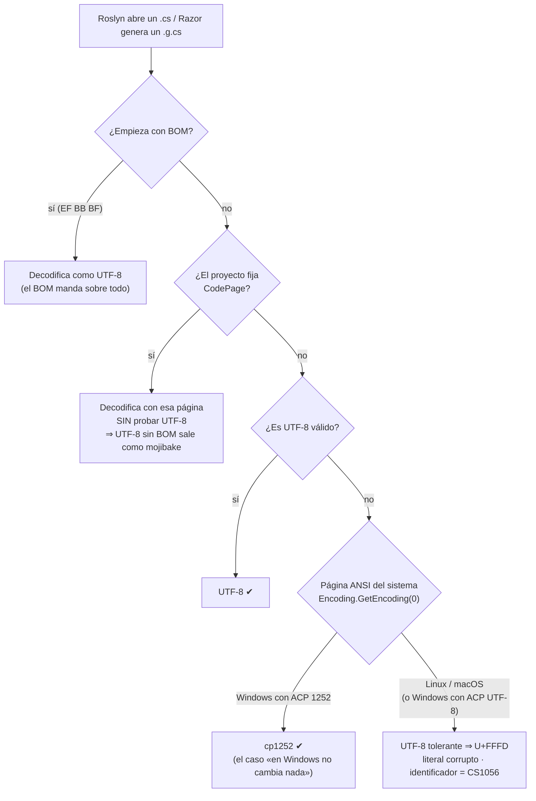

# N1 — Codificación de texto y finales de línea: el fenómeno

Un archivo de texto no dice en qué codificación está escrito. Cada programa que lo lee la **supone**, y lo hace con reglas propias: el compilador de C# prueba UTF-8 y, si falla, usa la página de códigos ANSI del sistema; Node.js decodifica siempre como UTF-8 y reemplaza lo que no entiende; Python exige UTF-8 o una declaración explícita y, si no la encuentra, se niega a compilar. El caso que dispara la guía —un sistema .NET heredado, unos cien archivos `.cs`/`.razor` guardados en Windows-1252, que compila en Windows y en Linux falla en un identificador con `Ç` y muestra los acentos como `?`— es la consecuencia directa de que la «página ANSI del sistema» vale 1252 en una estación Windows en español y UTF-8 en Linux. Este núcleo explica ese mecanismo lector por lector, lo reproduce con un ejemplo sintético y entrega a N2 la matriz de comportamiento sobre la que se decide la política.

Todo lo que sigue sale de documentación oficial o código fuente consultados el 2026-10-07 ([§14](#14-evidencias)) o de los experimentos E1-N1-01 a E1-N1-13, corridos ese mismo día en contenedores ([§9](#9-experimentos)). Lo que es criterio del autor está marcado **[criterio propio]**; lo que no se pudo verificar, **[no verificado]**. La verificación adversarial del mismo día está en [§15](#15-verificación-adversarial).

## Índice

- [1. Definiciones](#1-definiciones)
- [2. El mecanismo del caso disparador](#2-el-mecanismo-del-caso-disparador)
- [3. Cómo supone la codificación cada lector](#3-cómo-supone-la-codificación-cada-lector)
- [4. Finales de línea: cuándo son sólo ruido y cuándo cambian el programa](#4-finales-de-línea-cuándo-son-sólo-ruido-y-cuándo-cambian-el-programa)
- [5. Editores y git: quién reescribe los bytes](#5-editores-y-git-quién-reescribe-los-bytes)
- [6. Qué propone la industria hoy](#6-qué-propone-la-industria-hoy)
- [7. Integración en una única solución](#7-integración-en-una-única-solución)
- [8. Snippets representativos](#8-snippets-representativos)
- [9. Experimentos](#9-experimentos)
- [10. Preguntas guía](#10-preguntas-guía)
- [11. Errores frecuentes](#11-errores-frecuentes)
- [12. Dependencias y tensiones con otros núcleos](#12-dependencias-y-tensiones-con-otros-núcleos)
- [13. Observaciones, supuestos y pendientes](#13-observaciones-supuestos-y-pendientes)
- [14. Evidencias](#14-evidencias)
- [15. Verificación adversarial](#15-verificación-adversarial)

## 1. Definiciones

Las definiciones extienden la capa 1 («bytes del fuente») del modelo de N0 sin redefinir sus términos.

| Término | Definición adoptada | Fuente | No confundir con |
|---|---|---|---|
| **Codificación** (*encoding*) | Regla que traduce caracteres Unicode a bytes y viceversa. El mismo carácter `ó` (U+00F3) es el byte `F3` en Windows-1252 y los bytes `C3 B3` en UTF-8. | Unicode FAQ [EV1-27]; E1-N1-09. | Juego de caracteres (*charset*): EditorConfig usa la palabra `charset` para lo que acá se llama codificación [EV1-21]. |
| **Windows-1252 (cp1252)** | Codificación de un byte por carácter usada como página ANSI en Windows configurado para idiomas de Europa occidental. Coincide con ISO-8859-1 salvo en los 32 bytes `80–9F`, que en Latin-1 son controles C1 y en cp1252 son casi todos caracteres imprimibles (`€`, comillas tipográficas, `…`); cinco quedan sin asignar. | E1-N1-12; .NET Core sólo la trae con `CodePagesEncodingProvider` [EV1-05]. | Latin-1 (ISO-8859-1): `file` los informa igual («ISO-8859 text») mientras no aparezca ningún byte `80–9F`; con uno, dice «Non-ISO extended-ASCII text» (E1-N1-09, E1-N1-13). EditorConfig sólo ofrece `latin1` [EV1-21]. |
| **Página de códigos ANSI del sistema** (ACP) | La codificación que Windows usa para las API «-A» y que .NET expone como `Encoding.GetEncoding(0)`. En Windows es la configurada en la región del sistema (1252 en una instalación en español); en Linux y macOS .NET devuelve UTF-8. Windows permite fijarla en UTF-8 con la opción *Beta: Use Unicode UTF-8 for worldwide language support*. | [EV1-05], [EV1-08]; E1-N1-02. | El *locale* de Linux (`LANG`/`LC_ALL`): .NET no lo usa para esto (E1-N1-01 da el mismo resultado con `LC_ALL=es_AR.ISO-8859-1`). |
| **BOM** (*byte order mark*) | El carácter U+FEFF al principio del texto. En UTF-8 son los bytes `EF BB BF` y no indican orden de bytes: sólo funcionan como **firma** de que el archivo es UTF-8. El estándar Unicode dice que su uso «no es obligatorio» para UTF-8 [EV1-31]; la FAQ advierte que algunos receptores no lo esperan y que interfiere con formatos que esperan ASCII al inicio, como el `#!` de los scripts [EV1-27]. | Unicode 18.0 §2.6 [EV1-31]; Unicode FAQ [EV1-27]. | «UTF-8 con firma» (nombre que le da Visual Studio) es lo mismo; `utf-8-sig` es el códec de Python que lo agrega o quita [EV1-15]. |
| **Carácter de reemplazo** | U+FFFD (`�`). Lo produce un decodificador UTF-8 tolerante cuando encuentra bytes inválidos. En UTF-8 son los bytes `EF BF BD`. | Node `Buffer` [EV1-09]; E1-N1-01/04/05. | `?`: es lo que aparece cuando U+FFFD se vuelve a codificar en una codificación que no lo tiene (una consola ISO-8859-1, E1-N1-01 con `LC_ALL`). |
| **Mojibake** | Texto legible pero equivocado que resulta de decodificar con una codificación distinta de la usada al escribir: `ó` en lugar de `ó` cuando UTF-8 se lee como cp1252 o Latin-1. | E1-N1-01, E1-N1-07. | Carácter de reemplazo: el mojibake no pierde bytes y es reversible; U+FFFD sí los pierde. |
| **Final de línea** (EOL) | Secuencia que separa líneas: LF (`0A`) en Linux y macOS, CRLF (`0D 0A`) en la convención de Windows. | git [EV1-18]; especificación de C# [EV1-07]. | Salto de línea lógico: varios lenguajes normalizan CRLF a LF al leer el fuente (§4). |
| **Normalización de EOL** | Conversión que hace git entre el índice (lo que se guarda) y el árbol de trabajo (lo que se ve en disco) según `text`/`eol` en `.gitattributes` o, si no hay atributos, según `core.autocrlf`. | [EV1-18], [EV1-19]. | Lo que hace un editor al guardar: es otro actor (§5). |
| **Lector** | Cualquier programa que convierte los bytes del archivo en caracteres: compilador, generador de código, intérprete, cargador de módulos, función de E/S, editor, herramienta de diff. | [criterio propio]. | «Herramienta»: git almacena bytes y sólo interpreta EOL; no es lector de codificación salvo con `working-tree-encoding` [EV1-18]. |

## 2. El mecanismo del caso disparador

### 2.1 Qué hace Roslyn con un archivo sin BOM

El compilador de C# lee cada fuente con `EncodedStringText.Create`. Si el proyecto **no** indica página de códigos, intenta primero UTF-8 en modo estricto (un decodificador que lanza excepción ante bytes inválidos). Si falla, decodifica con una codificación de *fallback* que el código define así: «la página ANSI por defecto; si no, 1252; si no, Latin-1» [EV1-01]. Si el archivo empieza con BOM, el BOM gana y nada de lo anterior se aplica [EV1-01].

La «página ANSI por defecto» es `Encoding.GetEncoding(0)`. La documentación de `CodePagesEncodingProvider` dice que, con código de página 0, en Windows devuelve la página activa del sistema y en otras plataformas devuelve `null` para que .NET use su valor por defecto, que es UTF-8 [EV1-05], [EV1-06]. E1-N1-02 lo confirma: en Linux `GetEncoding(0)` devuelve `utf-8` aun con el proveedor registrado. El propio equipo de Roslyn lo fijó en una prueba al corregir una regresión en abril de 2026: el fallback «no es UTF-8 en Windows» y «es UTF-8 en Linux/macOS, donde no hay página heredada» [EV1-02].

El resultado es que, en Linux, el segundo intento usa otra vez UTF-8, pero ahora tolerante: cada byte de cp1252 que no forma una secuencia UTF-8 válida se convierte en U+FFFD. En Windows con ACP 1252 el segundo intento usa cp1252 y el archivo se lee bien. **Mismo archivo, mismo SDK, distinto texto**: el compilador es determinista respecto de sus entradas, pero la página ANSI del sistema es una de esas entradas (N0 la lista como parte del entorno).



La rama «Windows con ACP UTF-8» es una deducción de [EV1-01], [EV1-05] y [EV1-08], no un experimento: con la opción beta de UTF-8 activada, una estación Windows se comportaría como Linux **[no verificado en Windows]**.

### 2.2 Por qué el identificador rompe y el literal sólo se corrompe

La especificación de C# admite en un identificador cualquier carácter de las categorías Unicode de letra (`\p{L}`) y número-letra (`\p{Nl}`) [EV1-07]. `Ç` (U+00C7) es una letra, así que `Çaudal` (el identificador sintético del laboratorio) es un identificador legal. Pero después de la decodificación tolerante el compilador ya no ve `Ç`: ve U+FFFD, que es un símbolo (categoría `So`; `Ç` es `Lu`, según `unicodedata` de Python 3.12.14, que trae Unicode 15.0.0: E1-N1-12), no una letra. El analizador léxico no puede formar un token con él y emite `CS1056: Unexpected character '�'`, seguido de errores en cascada (`CS1519`) (E1-N1-01). Dentro de un literal de cadena, en cambio, cualquier carácter es válido: U+FFFD entra al string sin queja y la compilación termina bien. La corrupción aparece recién en ejecución, en la pantalla, en un log o en la base de datos.

Esa asimetría explica por qué el caso se descubre tarde: si el código heredado no hubiera tenido **un** identificador acentuado, la build en Linux habría pasado y los textos corruptos habrían llegado a producción. **[criterio propio]** Un build verde en Linux no prueba que la codificación esté bien; sólo prueba que no hay identificadores no ASCII.

### 2.3 Por qué el PO vio `?` y no `�`

En E1-N1-01 el programa compilado en Linux guarda U+FFFD en el string. Si la consola usa UTF-8 se ve `�`; con `LC_ALL=es_AR.ISO-8859-1` la misma salida se ve `Atenci?n` (último caso de E1-N1-01), porque al volver a codificar U+FFFD en una codificación que no lo tiene .NET lo sustituye por `?`. **[interpretación]** El `?` del caso real es probablemente la misma U+FFFD vista a través de una consola, un log o una columna de base de datos que no es UTF-8; el dato ya estaba perdido en el ensamblado.

### 2.4 Razor

El generador de Razor produce un `.g.cs` a partir del `.razor` y lo pasa a Roslyn. En E1-N1-04 el `.razor` en cp1252 genera un `.g.cs` con `EF BF BD` donde el original tenía `F3`, tanto en el texto HTML como en el literal C# del bloque `@code`; con UTF-8, con o sin BOM, sale `C3 B3`. El síntoma es el del literal: compila y corrompe. **[no verificado]** No se encontró documentación de Razor que describa su detección de codificación; el comportamiento se afirma sólo por E1 en SDK 8.0.425 y 10.0.400.

### 2.5 `CodePage`: un remedio con dos trampas

La propiedad MSBuild `CodePage` (opción `-codepage`) le dice al compilador qué página usar. La documentación afirma que «el compilador primero intenta interpretar todos los fuentes como UTF-8» y que `CodePage` se usa si los fuentes están en otra codificación [EV1-04]. El código y el experimento dicen otra cosa: con `CodePage` presente, Roslyn **no** prueba UTF-8 (`detectEncoding = defaultEncoding == null`) [EV1-01], y un `.cs` en UTF-8 sin BOM compilado con `-p:CodePage=1252` produce `Atención` con largo 39 en lugar de 36 (E1-N1-01, SDK 8 y 10). Sólo los archivos con BOM quedan a salvo. Es una contradicción entre documentación y comportamiento que se registra en [§13](#13-observaciones-supuestos-y-pendientes).

La segunda trampa es de versión. En SDK 8.0.425 la build con `CodePage=1252` falla con `CS2016: Code page '1252' is invalid or not installed` cuando compila el servidor de compilación (VBCSCompiler), salvo que ese proceso haya pasado antes por el camino de *fallback*, que es el que registra el proveedor de páginas de códigos; sin servidor (`UseSharedCompilation=false`) compila. En SDK 10.0.400 compila siempre (E1-N1-03). El código de Roslyn de 2024 registraba el proveedor sólo dentro de `CreateFallbackEncoding` [EV1-03], y `CommandLineParser.TryParseEncodingName` resolvía la página de `CodePage` con un `Encoding.GetEncoding(n)` directo, sin registrarlo [EV1-32]; el actual resuelve esa página con `TryGetCodePageEncoding`, que registra el proveedor antes de pedirla, y además `BuildClient.Run` lo registra al arrancar el compilador [EV1-01], [EV1-02]. El cambio entró en noviembre de 2025 (dotnet/roslyn #81382), a raíz de un informe de que, con Visual Studio 2026, **en Windows** toda build con `<CodePage>1252</CodePage>` fallaba con el mismo `CS2016` [EV1-30]. Las imágenes usadas traen Roslyn 4.11.0 (SDK 8.0.425) y 5.9.0 (SDK 10.0.400) (`csc -version`, corrido el 2026-10-07). **[interpretación]** La falla de SDK 8 depende del estado del proceso servidor; eso la hace intermitente entre máquinas y entre corridas. El informe de Windows muestra que `CS2016` con `CodePage` no es un problema exclusivo de Linux, sino de la versión del compilador.

**[criterio propio]** `CodePage` sirve para compilar *hoy* un árbol homogéneamente cp1252 en Linux (mejor con `UseSharedCompilation=false` en SDK 8), pero no es política: rompe el primer archivo UTF-8 sin BOM que alguien agregue. La remediación (pasar a UTF-8) y su variante (con o sin BOM) se deciden en N2.

## 3. Cómo supone la codificación cada lector

Esta es la matriz que N1 entrega a N2, N5 y N8. Cada celda dice qué pasa con los mismos bytes; la columna «Evidencia» indica de dónde sale.

| Lector | Sin BOM, UTF-8 | Sin BOM, cp1252 | Con BOM UTF-8 | CRLF | ¿Se puede declarar la codificación? | Evidencia |
|---|---|---|---|---|---|---|
| Roslyn (C#) en Linux, macOS | correcto | literal → U+FFFD; identificador → `CS1056` | correcto; gana sobre `CodePage` | se conserva dentro de literales verbatim/crudos | `CodePage` (afecta a **todos** los fuentes y desactiva el intento UTF-8) | E1-N1-01/02; [EV1-01], [EV1-05] |
| Roslyn (C#) en Windows, ACP 1252 | correcto | correcto (fallback 1252) | correcto | ídem | ídem | [EV1-01], [EV1-02], [EV1-05] **[no verificado en Windows]** |
| Razor (generador) | correcto | U+FFFD en HTML y en `@code` | correcto | — **[no medido]** | no se encontró opción documentada | E1-N1-04 |
| Node.js `require`/`import` | correcto | U+FFFD, sin error | correcto: U+FEFF es espacio en blanco para ECMAScript; `require` de `.json` lo quita | template literal: CRLF → LF | no: el cargador CommonJS lee siempre con `'utf8'` | E1-N1-05; [EV1-09], [EV1-10], [EV1-11] |
| Node.js `fs.readFileSync(f,'utf8')` | correcto | U+FFFD, sin error | **conserva** U+FEFF como primer carácter | se conserva | sí, por llamada; `TextDecoder({fatal:true})` detecta bytes inválidos | E1-N1-05; [EV1-09], [EV1-12] |
| `JSON.parse` (Node) | correcto | — | **`SyntaxError`** | irrelevante | — | E1-N1-05; RFC 8259 permite pero no obliga a ignorarlo [EV1-13] |
| Python, código fuente | correcto (UTF-8 es el default) | **`SyntaxError: Non-UTF-8 code`** | correcto (se ignora) | normalizado a LF | sí: `# -*- coding: cp1252 -*-` en la línea 1 o 2 (PEP 263) | E1-N1-06; [EV1-14], [EV1-15] |
| Python `open()` sin `encoding=` | según *locale*: correcto en `C.UTF-8`; mojibake `ó` en ISO-8859-1 | según *locale* | conserva `\ufeff` con `utf-8`; lo quita `utf-8-sig` | modo texto lo traduce a `\n` | sí, por llamada; modo UTF-8 (`-X utf8`, `PYTHONUTF8=1`) para todo el proceso | E1-N1-06/07; [EV1-16], [EV1-17], [EV1-29] |
| git (almacenamiento y diff) | bytes | bytes; ningún aviso | bytes: el BOM es un cambio en la línea 1 | diff de **todas** las líneas; normalizable con `.gitattributes` | `working-tree-encoding` (convierte a UTF-8 en el repo) | E1-N1-08; [EV1-18], [EV1-19] |
| Script con `#!/bin/sh` | correcto | — | `#!` deja de ser lo primero: lanzado desde dash o bash, el shell ignora el shebang, da error en la línea 1 y **ejecuta el resto con sí mismo** (exit 0); lanzado sin shell (`execve`), `Exec format error` | **falla** en los tres casos (`not found`, `required file not found`, `ENOENT`) | no | E1-N1-09, E1-N1-11; [EV1-27] |
| VS Code | abre como `files.encoding` (`utf8` por defecto) | sin `files.autoGuessEncoding` (falso por defecto) lo abre como UTF-8 | siempre detecta el BOM primero | `files.eol` = `auto` (EOL por defecto del sistema operativo) | `files.encoding` por lenguaje; EditorConfig sólo con extensión | [EV1-24], [EV1-25], [EV1-26] |
| Visual Studio | detecta y muestra la codificación en el margen | **[no verificado]** | ídem | «puede» pedir normalizar al abrir finales de línea no reconocidos | EditorConfig `charset` y `end_of_line` | [EV1-22], [EV1-23] |

Tres lecturas que forman criterio:

- **El BOM tiene valor sólo para quien adivina.** Roslyn y los editores lo usan como firma; Python y Node lo toleran en el fuente; pero `JSON.parse`, `fs.readFileSync` y el shell lo tratan como un carácter más y fallan, lo arrastran o, en el caso del shell, ejecutan el script con otro intérprete que el declarado sin que el código de salida lo delate (E1-N1-11).
- **Nadie falla ruidosamente ante cp1252 salvo Python.** Roslyn sólo falla si el carácter cae en un identificador; Node y Razor nunca. Python es el único lector de los relevados que se niega a adivinar.
- **Python es el único que permite declarar la codificación por archivo.** C# la declara por compilación entera, Node no la declara, y git la declara por ruta pero para convertir, no para leer.

## 4. Finales de línea: cuándo son sólo ruido y cuándo cambian el programa

En la mayor parte del código CRLF y LF son equivalentes para el compilador: el diff cambia y el programa no. Hay tres excepciones medidas:

1. **Literales multilínea de C#.** Un literal crudo `"""…"""` de dos líneas tiene 7 caracteres con LF y 8 con CRLF, y `Contains('\r')` pasa a ser verdadero (E1-N1-01). La especificación de C# lo advierte para los literales verbatim: los saltos de línea forman parte del string y una herramienta que traduzca `\n` ↔ `\r\n` «cambia el comportamiento de la aplicación»; además recomienda que una transformación desde otra codificación traduzca los saltos de línea a CRLF justamente porque afectan esos literales [EV1-07]. Un `core.autocrlf=true` en Windows y `eol=lf` en Linux producen, entonces, **dos binarios distintos** desde el mismo commit.
2. **Scripts de shell.** Un `#!/bin/sh` seguido de CR no se puede ejecutar: dash dice `not found`, bash `cannot execute: required file not found` y un `execve` sin shell devuelve `ENOENT` (E1-N1-09, E1-N1-11). **[interpretación]** El `ENOENT` es coherente con que el kernel busque un intérprete llamado `/bin/sh\r`; no se inspeccionó el kernel.
3. **Datos leídos sin traducción.** Python en modo texto traduce CRLF a `\n` al leer, pero con `newline=""` conserva `\r\n` (E1-N1-06); `fs.readFileSync` en Node no traduce nada.

En cambio, JavaScript y Python normalizan el fuente: ECMA-262 normaliza `<CR><LF>` y `<CR>` a `<LF>` en los template literals [EV1-11] y la referencia de Python dice que las tres formas de fin de línea se reemplazan por un LF [EV1-15]; E1-N1-05 y E1-N1-06 dan la misma longitud con LF y con CRLF.

## 5. Editores y git: quién reescribe los bytes

El commit «con cambios de BOM» que el PO quiere evitar no lo produce el compilador: lo produce un programa que **escribe** el archivo con otra codificación o EOL que la que tenía. Los candidatos y su configuración por defecto:

| Actor | Qué hace por defecto | Configuración que lo cambia | Evidencia |
|---|---|---|---|
| `dotnet new` (plantillas del SDK) | Crea `Program.cs` y `.csproj` **con BOM**; en SDK 8 con CRLF, en SDK 10 con LF. Su `.editorconfig` no declara `charset`; el de SDK 8 declara `end_of_line = crlf` para `*.cs`. | Ninguna: es lo que trae la plantilla. | E1-N1-10 |
| VS Code | Abre y guarda con `files.encoding` = `utf8` (sin BOM); detecta el BOM antes que nada y por lo tanto lo conserva; no adivina otras codificaciones salvo `files.autoGuessEncoding: true`; `files.eol` = `auto` (LF en Linux/macOS, CRLF en Windows) para archivos nuevos. No lee `.editorconfig` sin la extensión EditorConfig, que aplica `end_of_line` **al guardar**. | `files.encoding`, `files.autoGuessEncoding`, `files.eol` (por lenguaje); extensión EditorConfig. | [EV1-24], [EV1-25], [EV1-26] |
| Visual Studio | Detecta la codificación al abrir, la muestra en el margen y permite reabrir o guardar con otra. Puede pedir normalizar al abrir un archivo con finales de línea no reconocidos. Lista `charset` y `end_of_line` entre las propiedades de EditorConfig que soporta, pero aplica EditorConfig sólo a líneas nuevas; el código existente cambia con *Format Document* o *Code Cleanup* (la documentación lo ejemplifica con espacios en blanco; no dice si `charset` reescribe un archivo existente: **[no verificado]**). | *Save with Encoding*, EditorConfig. | [EV1-22], [EV1-23] |
| git con `core.autocrlf=true` | Escribe CRLF al hacer checkout y lo vuelve a LF al indexar; `git status` queda limpio aunque el disco tenga CRLF. Pro Git lo aconseja en Windows. | `.gitattributes` con `text`/`eol` tiene precedencia; sin atributos manda `core.autocrlf`. | E1-N1-08; [EV1-18], [EV1-19], [EV1-20] |

**[interpretación, a verificar en N2 con un escenario E3]** El ciclo típico de un commit de BOM en un equipo mixto es: Visual Studio o `dotnet new` crean el archivo con BOM; alguien lo edita en VS Code y lo guarda… y VS Code **conserva** el BOM, porque lo detectó. El BOM desaparece o aparece cuando una herramienta **reescribe el archivo entero** con su propio default: una conversión masiva, un formateador, un generador, o el *Save with Encoding* de Visual Studio. El caso del PO es de esa clase (una conversión de cien archivos), y es legítima; lo que N2 tiene que evitar es que se repita en sentido contrario.

**[no verificado]** Qué hace VS Code al **guardar** un archivo cp1252 abierto como UTF-8: el código decodifica con reemplazo [EV1-25], de modo que lo esperable es que escriba `EF BF BD` y pierda el carácter original. No se automatizó un editor para comprobarlo.

## 6. Qué propone la industria hoy

Se distinguen tres niveles: **[fabricante]** lo que recomienda o hace por defecto quien mantiene la herramienta; **[convención]** lo que es práctica extendida sin un dueño normativo; **[criterio propio]** lo que propone esta guía.

### 6.1 .NET

- **[fabricante]** `Encoding.Default` es UTF-8 en .NET Core y posteriores, «para favorecer la compatibilidad multiplataforma», y la documentación desaconseja depender de la codificación por defecto del sistema [EV1-06].
- **[fabricante]** El compilador prueba UTF-8 primero y ofrece `CodePage` para fuentes en otra codificación [EV1-04] (con las salvedades de §2.5).
- **[fabricante]** Las plantillas del SDK crean archivos UTF-8 **con BOM** (E1-N1-10). Es lo que Microsoft hace, no una recomendación escrita: no se encontró un documento de .NET que recomiende o desaconseje el BOM para `.cs` **[no verificado]**.
- **[fabricante]** Visual Studio sigue EditorConfig, incluido `charset` [EV1-22].

### 6.2 Node.js

- **[fabricante]** UTF-8 es la codificación por defecto de `Buffer` y la que usa el cargador de módulos; no hay forma de declarar otra para el fuente [EV1-09], [EV1-10].
- **[estándar]** ECMA-262 trata U+FEFF (`<ZWNBSP>`) como espacio en blanco en el fuente [EV1-11]; RFC 8259 prohíbe **emitir** BOM en JSON transmitido por red y permite ignorarlo al leer [EV1-13]. `JSON.parse` de V8 no lo ignora (E1-N1-05).
- **[convención]** Archivos UTF-8 sin BOM y LF.

### 6.3 Python

- **[fabricante]** El fuente es UTF-8 por defecto; otra codificación exige declaración PEP 263 [EV1-14], [EV1-15].
- **[fabricante]** `open()` sin `encoding=` depende del *locale* hasta 3.14. PEP 597 agrega `EncodingWarning` (opcional) para detectar esas llamadas [EV1-29]; PEP 540 crea el modo UTF-8 [EV1-17]; PEP 686, en estado *Final*, lo activa por defecto desde Python 3.15 [EV1-16], cuya versión final está programada para el 2026-10-09 [EV1-28]. Al 2026-10-07 ninguna versión estable lo tiene activo por defecto.
- **[observado]** El valor por defecto de `open()` también depende de la imagen: `python:3.12-slim` define `LANG=C.UTF-8` (modo UTF-8 apagado, `open()` usa UTF-8 por el locale) y `python:3-slim` (3.14.7) no define `LANG` (locale C ⇒ modo UTF-8 encendido automáticamente) (E1-N1-06).

### 6.4 git y EditorConfig

- **[fabricante]** git trata como texto cualquier codificación superconjunto de ASCII y no la interpreta; `working-tree-encoding` existe para archivos que no pueden guardarse en UTF-8 y la documentación enumera sus riesgos (clientes que no lo soportan, como JGit y libgit2; conversiones no reversibles; costo) y recomienda usarlo «sólo si no se puede almacenar el archivo en UTF-8» [EV1-18].
- **[fabricante]** Para los finales de línea, git documenta `text=auto` + `git add --renormalize .` como procedimiento para introducir la normalización [EV1-18]; Pro Git aconseja `core.autocrlf=true` en Windows e `input` en Linux/macOS [EV1-20]. **[criterio propio]** Ese consejo es por máquina; un repo compartido necesita la política en `.gitattributes`, que tiene precedencia (lo desarrolla N2).
- **[estándar de facto]** EditorConfig 0.17.2 ofrece `charset` = `latin1`, `utf-8`, `utf-8-bom`, `utf-16be`, `utf-16le` y `end_of_line` = `lf`, `cr`, `crlf`, y dice textualmente que «el uso de `utf-8-bom` se desaconseja» [EV1-21]. No hay valor para cp1252. Es el único texto normativo relevado que toma posición sobre el BOM en archivos de código; pesa en la tensión T-N1-01.

## 7. Integración en una única solución

Cuando .NET, Node.js y Python conviven en un repositorio, la pregunta deja de ser «qué codificación usa cada uno» y pasa a ser «qué codificación tolera **todo lector que toque cada extensión**». Tres choques aparecen siempre:

1. **El BOM que .NET pone y Node no quiere.** `dotnet new` crea `.csproj` y `.cs` con BOM (E1-N1-10). Si una herramienta Node lee un `.json` del árbol con `fs.readFileSync` + `JSON.parse` —un `appsettings.json` guardado con BOM, por ejemplo— falla con `SyntaxError` (E1-N1-05). La política tiene que ser **por extensión**, como anticipó BIT-15-02 §4.
2. **El CRLF que Windows pone y el contenedor no tolera.** Un `.sh` que se ejecuta dentro de un devcontainer o de la CI no puede tener CRLF ni BOM (E1-N1-09, E1-N1-11), aunque el resto del repo use CRLF en Windows. Esto es la arista punteada N1 → N5 del grafo de cohesión: en un *bind mount* el contenedor ve los bytes que escribió Windows.
3. **Un único archivo puede tener varios lectores.** Un `.json` lo leen MSBuild, Node y Python; un `.cs` sólo Roslyn. La codificación correcta de un archivo es la que acepta su lector **más estricto**: para `.json`, `.sh`, `.py`, `.js` el más estricto rechaza el BOM o el cp1252; para `.cs` y `.razor` ninguno lo rechaza, pero Roslyn en Linux necesita UTF-8 válido.

**[criterio propio, a someter a N2 y N8]** De la matriz de §3 se sigue que «UTF-8 válido en todos los archivos de texto» es la única condición que todos los lectores relevados aceptan sin configuración, y que el BOM es aceptable sólo en extensiones cuyos lectores lo toleran (`.cs`, `.razor`, `.csproj`, `.sln`, `.js`/`.mjs` como módulo, `.py`) y peligroso en las que lee un parser estricto o el kernel (`.json`, `.sh`, archivos que se concatenan o se leen con `fs`). En un `.sh` el daño es silencioso: según quién lo lance, el script corre con otro intérprete y termina con exit 0 (E1-N1-11). Si conviene o no **exigir** BOM en `.cs` para blindarse contra un `CodePage` o una ACP heredada, es la decisión central de N2.

## 8. Snippets representativos

Diagnóstico sin editor, en cualquier shell POSIX (es lo que hace `e1-diagnostico.sh`):

```sh
# ¿Tiene BOM? Los tres primeros bytes de un UTF-8 con BOM son ef bb bf.
head -c3 Archivo.cs | od -An -tx1
# ¿Es UTF-8 válido? iconv falla (exit != 0) en el primer byte inválido.
iconv -f UTF-8 -t UTF-8 Archivo.cs >/dev/null && echo "UTF-8 válido" || echo "NO es UTF-8"
# ¿Cuántos CR tiene? 0 = LF puro.
tr -cd '\r' < Archivo.cs | wc -c
# Inventario: todo fuente del árbol que no sea UTF-8 válido.
find . -type f \( -name '*.cs' -o -name '*.razor' \) -exec sh -c \
  'iconv -f UTF-8 -t UTF-8 "$1" >/dev/null 2>&1 || echo "no-UTF-8: $1"' _ {} \;
# Lo que git cree de cada archivo: EOL en el índice, en disco y atributos aplicados.
git ls-files --eol
```

Lectura de los bytes de un carácter conocido para distinguir las dos codificaciones (E1-N1-09):

```text
ó en cp1252 : f3          ó en UTF-8 : c3 b3          ó leído mal : c3 83 c2 b3 (mojibake) o ef bf bd (U+FFFD)
```

El fragmento del compilador que explica todo el caso (Roslyn, `EncodedStringText.cs`, rama `main` al 2026-10-07 [EV1-01], recortado y comentado):

```csharp
// Si no se indicó codificación (no hay CodePage), se intenta UTF-8 estricto…
bool detectEncoding = defaultEncoding == null;
if (detectEncoding)
{
    try { return Decode(stream, s_utf8Encoding /* throwOnInvalidBytes: true */, …); }
    catch (DecoderFallbackException) { /* …y si falla, se cae al fallback */ }
}
// …que es la página ANSI del sistema: 1252 en un Windows en español, UTF-8 en Linux.
return Decode(stream, defaultEncoding ?? getEncoding.Value /* CreateFallbackEncoding() */, …);
```

Python: hacer explícito lo que hoy depende del entorno.

```python
# Leer texto propio: siempre con encoding explícito (independiente del locale, E1-N1-07).
with open("datos.txt", encoding="utf-8") as f: ...
# Leer algo que puede venir con BOM (p. ej. un CSV exportado desde Windows).
with open("export.csv", encoding="utf-8-sig", newline="") as f: ...
# Detectar las llamadas sin encoding= en el propio código y en dependencias (PEP 597).
#   python -X warn_default_encoding -m pytest
```

Node.js: leer un JSON que puede traer BOM sin romper.

```js
import { readFileSync } from "node:fs";
// fs no quita el BOM; TextDecoder sí (ignoreBOM: false es el default) y fatal:true rechaza bytes no UTF-8.
const texto = new TextDecoder("utf-8", { fatal: true }).decode(readFileSync("config.json"));
const config = JSON.parse(texto);
```

## 9. Experimentos

Todos en `LAB/Lab-Documentos/Guides/Metodologia-Entorno-Desarrollo/Examples/N1-codificacion-y-finales-de-linea/`; el `README.md` de la carpeta tiene los comandos exactos y `salidas/` la salida completa. Se corrieron el 2026-10-07 con SDK 8.0.425 (Debian 12; Roslyn 4.11.0), SDK 10.0.400 (Ubuntu 24.04; Roslyn 5.9.0), Node v22.23.2, v20.20.2 y v24.21.0, Python 3.12.14 y 3.14.7, git 2.39.5, `file` 5.46. Estado de soporte a esa fecha: .NET 8 está en mantenimiento hasta el 2026-11-10 y el SDK 10 vigente es 10.0.401 (la imagen local trae 10.0.400) [EV1-33]; Node 20 dejó de tener soporte el 2026-04-30 y Node 24 es la LTS activa [EV1-34]. Los resultados de Node 24 son idénticos a los de Node 22.

| ID | Comando (desde la carpeta) | Salida resumida | Archivo de salida |
|---|---|---|---|
| E1-N1-01 | `docker run --rm -v "$PWD":/w -w /w mcr.microsoft.com/dotnet/sdk:8.0 sh e1-roslyn.sh` (y `sdk:10.0` con `-e TF=net10.0`) | cp1252 literal: `U+ FFFD 006E 003A`; cp1252 identificador: `CS1056 Unexpected character '�'`; UTF-8 y UTF-8+BOM: `00F3`; CRLF: `Bloque : 8 chars … contieneCR=True`; cp1252 + `CodePage=1252`: correcto; UTF-8 sin BOM + `CodePage=1252`: `Atención`, `Largo 39`; UTF-8+BOM + `CodePage=1252`: correcto; cp1252 con `LC_ALL=es_AR.ISO-8859-1`: `Atenci?n`. | `salidas/e1-roslyn-sdk8.txt`, `e1-roslyn-sdk10.txt` |
| E1-N1-02 | `docker run --rm -v "$PWD":/w -w /w/sonda-codepage mcr.microsoft.com/dotnet/sdk:8.0 sh -c 'dotnet run -v q; rm -rf bin obj'` (y `sdk:10.0` con `-e TF=net10.0`) | `Encoding.Default: utf-8` · `GetEncoding(0) con provider: utf-8` · `1252 sin provider: NotSupportedException`. Igual en SDK 10. | `salidas/e1-sonda-codepage-sdk8.txt`, `e1-sonda-codepage-sdk10.txt` |
| E1-N1-03 | `… sdk:8.0 sh e1-roslyn-codepage-servidor.sh` y `… sdk:10.0 …` | SDK 8: frío `CS2016`, otra vez `CS2016`, calentado con UTF-8 `CS2016`, calentado con cp1252 `Build succeeded`, sin servidor `Build succeeded`. SDK 10: todo `Build succeeded`. | `salidas/e1-roslyn-codepage-servidor.txt` |
| E1-N1-04 | `… sdk:8.0 sh e1-razor.sh` | cp1252: `"Configuraci�n"`, bytes `ef bf bd`; UTF-8 y UTF-8+BOM: `c3 b3`. Igual en SDK 10. | `salidas/e1-razor-sdk8.txt`, `e1-razor-sdk10.txt` |
| E1-N1-05 | `docker run --rm -v "$PWD":/w -w /w node:22-bookworm-slim node e1-node.mjs` | cp1252: `U+[FFFD …]`; BOM en módulo: ignorado; `fs.readFileSync(…)[0] = U+FEFF`; `JSON.parse(config-utf8bom.json) -> SyntaxError`; `require(config-utf8bom.json) OK`; template literal CRLF `length=7`; `TextDecoder({fatal:true})` → `ERR_ENCODING_INVALID_ENCODED_DATA`. Igual en Node 20. | `salidas/e1-node.txt`, `e1-node-24.txt` |
| E1-N1-06 | `docker run --rm -v "$PWD":/w -w /w python:3.12-slim sh e1-python.sh` (y `python:3-slim`) | `SyntaxError: Non-UTF-8 code starting with '\xf3' … no encoding declared`; con PEP 263, BOM o CRLF: correcto; `EncodingWarning: 'encoding' argument not specified`; `utf-8 -> '\ufeff'`, `utf-8-sig -> 't'`; `newline="" -> '\r\n'`. | `salidas/e1-python.txt` |
| E1-N1-07 | `docker run --rm -v "$PWD":/w -w /w python:3.12-slim sh e1-python-locale.sh` | Con `LC_ALL=es_AR.ISO-8859-1`: `open() usa ISO-8859-1`, lee `'Atenci\xc3\xb3n'`; con `-X utf8` o `encoding="utf-8"`: `'Atenci\xf3n'`. Igual en 3.14.7. | `salidas/e1-python-locale.txt` |
| E1-N1-08 | `… sdk:8.0 sh e1-git.sh` | BOM: `1 insertion(+), 1 deletion(-)`, sólo difiere `357 273 277`; CRLF: `10 insertions(+), 10 deletions(-)`, `--ignore-cr-at-eol: 0`; cp1252: ningún aviso; `text=auto eol=lf`: `i/lf w/crlf`, nada que commitear; `working-tree-encoding=CP1252`: índice `c3 b3`, disco `f3`; `autocrlf=true`: `w/crlf`, `git status` limpio; `--renormalize`: `i/crlf` → `i/lf`. | `salidas/e1-git.txt` |
| E1-N1-09 | `… sdk:8.0 sh e1-diagnostico.sh` (y en el host con `file`) | Tabla BOM / UTF-8 válido / bytes altos / CR por archivo; `file`: `ISO-8859 text` para el cp1252 del laboratorio (sin bytes `80–9F`); `./con-bom.sh: 1: M-oM-;M-?#!/bin/sh: not found` (los bytes del BOM vistos con `cat -A`); `./crlf.sh: not found`. | `salidas/e1-diagnostico.txt`, `e1-diagnostico-host-con-file.txt` |
| E1-N1-10 | `… sdk:8.0 sh e1-plantillas-dotnet.sh` (y `sdk:10.0`) | SDK 8: `Program.cs ef bb bf, CR: 2`, `.editorconfig end_of_line = crlf`, sin `charset`. SDK 10: `ef bb bf, CR: 0`, sin `charset` ni `end_of_line`. | `salidas/e1-plantillas-dotnet.txt` |
| E1-N1-11 | `docker run --rm -v "$PWD":/w -w /w python:3.12-slim sh e1-shebang.sh` | `con-bom.sh`: dash `M-oM-;M-?#!/bin/sh: not found` + `hola` (exit 0), bash `No such file or directory` + `hola` (exit 0), `subprocess` sin shell `OSError 8 Exec format error`. `crlf.sh`: dash `not found` (127), bash `cannot execute: required file not found` (127), `FileNotFoundError 2`. | `salidas/e1-shebang.txt` |
| E1-N1-12 | `docker run --rm -v "$PWD":/w -w /w python:3.12-slim python -I e1-unicode.py` | Unicode 15.0.0; `Ç` `Lu`, `ó` `Ll`, U+FFFD `So`, U+FEFF `Cf`; cp1252 ≠ Latin-1 en 32 bytes `0x80–0x9f`, todos controles C1 en Latin-1; sin carácter en cp1252: `0x81 0x8d 0x8f 0x90 0x9d`. | `salidas/e1-unicode.txt` |
| E1-N1-13 | `sh e1-file.sh` (en el host) | `file-5.46`: sin bytes `80–9F` → `ISO-8859 text`; con `€` (`0x80`) o `“”` (`0x93/0x94`) → `Non-ISO extended-ASCII text`. | `salidas/e1-file.txt` |

## 10. Preguntas guía

**¿Por qué un `.cs` en cp1252 compila en Windows y falla o corrompe literales en Linux?**
Porque Roslyn no sabe en qué codificación está un archivo sin BOM: prueba UTF-8 y, si los bytes no son UTF-8 válido, usa la página ANSI del sistema. En un Windows en español esa página es 1252 y el archivo se lee bien; en Linux y macOS es UTF-8, el segundo intento es tolerante y cada byte inválido se vuelve U+FFFD (§2.1, E1-N1-01/02). *Aplica* a todo fuente sin BOM que tenga bytes por encima de `7F` y no sea UTF-8 válido. *No aplica* a archivos ASCII puro (son idénticos en las dos codificaciones: `Program.cs` en E1-N1-09) ni a archivos con BOM.

**¿Por qué un identificador no ASCII rompe la compilación y un literal sólo se corrompe?**
Porque U+FFFD no es una letra: puede vivir dentro de un string, pero no puede formar parte de un nombre (§2.2). *Criterio*: la build en Linux es un detector incompleto; detecta cp1252 sólo si cae en un identificador. Para saber si hay texto corrompido hay que **inspeccionar los bytes** (`iconv`), no compilar.

**¿Qué cambia el BOM para Roslyn, Node, Python y git?**
Para Roslyn es decisivo: con BOM el archivo se lee como UTF-8 en cualquier plataforma y con cualquier `CodePage` (E1-N1-01). Para Node es inocuo en módulos (es espacio en blanco para ECMAScript) y dañino en datos: `fs` lo conserva y `JSON.parse` falla (E1-N1-05). Para Python es inocuo en el fuente y visible en datos si se abre con `utf-8` en vez de `utf-8-sig` (E1-N1-06). Para git es un cambio de tres bytes en la primera línea, invisible en la mayoría de las vistas de diff (E1-N1-08). Para un script es peor que fatal: si lo lanza un shell, el shebang se ignora y el script corre con ese shell, con exit 0; si lo lanza un programa sin shell, `Exec format error` (E1-N1-11). *Criterio*: el BOM se decide por extensión y por lector, nunca globalmente.

**¿Cómo se diagnostica la codificación real de un archivo?**
Con tres preguntas que no dependen de ningún editor: ¿empieza con `EF BB BF`? ¿pasa `iconv -f UTF-8 -t UTF-8`? ¿tiene bytes mayores que `7F`? Si no es UTF-8 válido y tiene bytes altos, es una codificación de un byte (cp1252 o Latin-1); el byte de un carácter conocido lo confirma (`ó` = `F3`). `file` ayuda, pero es heurístico y sólo separa cp1252 de Latin-1 cuando el archivo tiene algún byte `80–9F` (§8, E1-N1-09, E1-N1-13). *Criterio*: un editor que «muestra bien» el archivo no es diagnóstico, porque ya adivinó.

**¿Qué editor reescribe la codificación o los finales de línea al guardar, y bajo qué configuración?**
VS Code guarda nuevos archivos en UTF-8 sin BOM (`files.encoding` = `utf8`; el BOM es otro valor, `utf8bom`) y con el EOL del sistema operativo (`files.eol` = `auto`), conserva el BOM de los que ya lo tienen y, sin `autoGuessEncoding`, abre un cp1252 como UTF-8; con la extensión EditorConfig aplica `end_of_line` al guardar. Visual Studio detecta la codificación, respeta EditorConfig para líneas nuevas y cambia la codificación sólo con *Save with Encoding*. `dotnet new` escribe BOM. git con `core.autocrlf=true` reescribe EOL en cada checkout (§5). *Criterio*: el cambio invisible lo introduce el último programa que **reescribió el archivo entero**; la política (N2) tiene que declarar la codificación en un lugar que todos esos programas lean.

**¿Alcanza con `-p:CodePage=1252` para compilar el código heredado en Linux?**
Sirve como paliativo si **todo** el árbol es cp1252, pero rompe cualquier archivo UTF-8 sin BOM y en SDK 8 puede fallar con `CS2016` según el estado del servidor de compilación (§2.5, E1-N1-01/03). *Aplica* como paso transitorio documentado; *no aplica* como política.

**¿Un contenedor resuelve el problema?**
No por sí solo. El contenedor fija el SDK y el SO, y con ellos fija que la página ANSI sea UTF-8: hace que el problema sea **reproducible**, que ya es mucho, pero no cambia los bytes del archivo. El archivo en cp1252 sigue fallando adentro; es precisamente donde aparece (BIT-15-03, ESC-04). La respuesta está en la capa 1, no en la 4.

**¿Por qué un cambio de EOL puede cambiar el binario y no sólo el diff?**
Porque los literales verbatim y crudos de C# incluyen los saltos de línea del archivo (§4, E1-N1-01). JavaScript y Python normalizan su fuente; C# no. *Aplica* a cualquier literal multilínea de C# y a los scripts de shell.

## 11. Errores frecuentes

| Error | Por qué ocurre | Cómo se evita | Evidencia |
|---|---|---|---|
| Concluir que «compila en Linux» significa «la codificación está bien». | Los literales con U+FFFD compilan. | Inventariar con `iconv` (§8). | E1-N1-01, E1-N1-09 |
| Agregar `<CodePage>1252</CodePage>` al proyecto para que Linux compile. | Desactiva el intento UTF-8 para todos los fuentes. | Remediar los archivos (N2); usar `CodePage` sólo como paso transitorio. | E1-N1-01, E1-N1-03 |
| Leer el `?` en la salida como el carácter guardado. | Es U+FFFD re-codificado por una salida no UTF-8. | Inspeccionar los code points (`U+FFFD`) o los bytes, no la consola. | E1-N1-01 |
| Configurar la codificación con `core.autocrlf` o en el editor de cada uno. | Es configuración por máquina; el repo no la ve. | Declararla en `.gitattributes`/`.editorconfig` (N2). | [EV1-18], [EV1-20] |
| Usar `working-tree-encoding` para «convivir» con cp1252. | El repo pasa a UTF-8 pero los clientes que no lo soportan (JGit, libgit2) y las conversiones no reversibles generan errores. | Usarlo sólo si un archivo **no puede** estar en UTF-8, como dice git. | [EV1-18], E1-N1-08 |
| Aplicar BOM a todo el repo porque «resuelve .NET». | `.json`, `.sh` y lecturas con `fs` lo tratan como dato; un `.sh` con BOM corre con otro intérprete y sale con 0. | Política por extensión (§7). | E1-N1-05, E1-N1-09, E1-N1-11 |
| Abrir archivos en Python sin `encoding=`. | El resultado depende del *locale* del proceso (y de la imagen). | `encoding="utf-8"` explícito; `-X warn_default_encoding` en CI. | E1-N1-06/07, [EV1-29] |
| Confiar en `file` para distinguir cp1252 de Latin-1. | Informa «ISO-8859 text» para ambos mientras no haya bytes `80–9F`; si los hay, dice «Non-ISO extended-ASCII text», sin nombrar cp1252. | Mirar bytes en `80–9F` (sólo cp1252 los usa para caracteres imprimibles). | E1-N1-09, E1-N1-12, E1-N1-13 |

## 12. Dependencias y tensiones con otros núcleos

| Núcleo | Relación | Qué toma o entrega N1 |
|---|---|---|
| N0 | depende | Usa la capa 1 («bytes del fuente») y el par declarar/hacer cumplir. Aporta un caso concreto de «entrada no declarada»: la página ANSI del sistema es una entrada del compilador que cambia entre hosts. |
| N2 | alimenta (fuerte) | Entrega la matriz de §3, el inventario con `iconv`, la evidencia de que `CodePage` no es política, el comportamiento de `.gitattributes` (`text`, `eol`, `--renormalize`, `working-tree-encoding`) y lo que escriben las plantillas y los editores. **Tensión T-N1-01:** la remediación del caso usó UTF-8 **con** BOM; la industria Node/Python/Unicode prefiere **sin** BOM; .NET lo pone por defecto. N2 decide por extensión. |
| N3 | lateral | La falla `CS2016` con `CodePage` depende de la versión del SDK (8 frente a 10): un ejemplo de por qué fijar el SDK importa también en la capa 1. |
| N5 | débil (arista punteada) | Un *bind mount* expone en el contenedor los bytes que escribió Windows: CRLF y BOM en `.sh` rompen dentro del contenedor (E1-N1-09). Las imágenes oficiales de Python difieren en `LANG` (E1-N1-06): el *locale* es parte de lo que la imagen fija. |
| N6 | lateral | El EOL de un literal C# cambia el binario (E1-N1-01): una build reproducible exige EOL normalizado en el repo, no sólo SDK fijo. |
| N7 | alimenta | El chequeo `iconv` + `head -c3` + `tr -cd '\r'` es la base de la compuerta que hace cumplir la política. |
| N8 | alimenta | §7: el lector más estricto define la codificación de cada extensión; `.json` y `.sh` son los puntos de choque entre ecosistemas. |

**Tensión T-N1-02 (documentación frente a comportamiento).** La documentación de `CodePage` dice que el compilador «primero intenta» UTF-8; el código y E1-N1-01 muestran que con `CodePage` no lo intenta. La guía debe citar el comportamiento observado y mencionar la discrepancia, no repetir la documentación.

## 13. Observaciones, supuestos y pendientes

**Hechos (con evidencia).**

- El diagnóstico del caso real («Roslyn en Linux los lee como UTF-8», «en Windows no cambia nada») es correcto en lo esencial y queda explicado por [EV1-01], [EV1-05] y E1-N1-01/02. La salvedad: en Linux Roslyn no lee el archivo «como UTF-8» a secas; lo intenta estricto, falla y vuelve a leerlo con UTF-8 tolerante porque esa es la página ANSI que .NET reporta allí.
- El síntoma «los textos con acentos salían con `?`» es compatible con U+FFFD mostrada por una salida no UTF-8 (E1-N1-01).
- Roslyn tuvo una regresión, introducida en febrero de 2026 (dotnet/roslyn #82159, 2026-02-10) y corregida en abril (#83320, 2026-04-24), en la que el fallback devolvía UTF-8 también en Windows [EV1-02]. No se determinó qué versiones de SDK la distribuyeron.
- `CS2016` con `CodePage=1252` también ocurrió en Windows con Visual Studio 2026 (informe de noviembre de 2025, corregido en dotnet/roslyn #81382) [EV1-30].
- Docker Hub rechazó las descargas de `python:3.15-*` y `python:3.14-slim` durante la sesión (`toomanyrequests`; en la verificación adversarial, `unauthorized` para `python:3.15-rc-slim`); E1-N1-06/07 se corrieron con 3.12.14 y 3.14.7 (`python:3-slim`).

**Interpretaciones (declaradas como tales).**

- La intermitencia de `CS2016` en SDK 8 se atribuye al registro tardío del proveedor de páginas de códigos en el proceso servidor ([EV1-03] frente a [EV1-01]); es coherente con los cinco casos de E1-N1-03, pero no se depuró el servidor.
- El ciclo de «commits de BOM» de §5 se infiere de los defaults documentados; no se observó en un equipo real.

**Supuestos.**

- SUP-N1-01: la estación Windows del caso tiene ACP 1252 (región en español sin la opción beta UTF-8). Si tuviera ACP UTF-8, el caso habría fallado también en Windows.
- SUP-N1-02: macOS se comporta como Linux para Roslyn. Sostenido por la prueba que el equipo de Roslyn agregó en [EV1-02] («UTF-8 en Linux/macOS»), no por un experimento propio. Resuelve el **[C: a verificar en N1]** de BIT-15-03 §1.

**Pendientes.**

- P-N1-01: correr `work/dotnet/cp1252-lf` en una estación Windows (ESC-01) para pasar de **[no verificado]** a E1 la rama Windows del diagrama de §2.1, incluida la variante con ACP UTF-8.
- P-N1-02: repetir E1-N1-06/07 con `python:3.15` cuando esté publicada (final programada para el 2026-10-09 [EV1-28]) para confirmar el cambio de PEP 686.
- P-N1-03: verificar con un escenario E3 qué escribe VS Code al guardar un cp1252 abierto como UTF-8, y qué hace Visual Studio al guardar un archivo sin BOM.
- P-N1-04: buscar documentación de Razor sobre detección de codificación; hoy sólo hay E1.
- P-N1-05: buscar si Microsoft recomienda o desaconseja explícitamente el BOM para fuentes C#; hoy sólo consta lo que hacen las plantillas (E1-N1-10).

## 14. Evidencias

Fecha de consulta de todas las fuentes: **2026-10-07**. Los experimentos se corrieron el mismo día.

| ID | Afirmación que respalda | Fuente | Fecha |
|---|---|---|---|
| EV1-01 | Roslyn prueba UTF-8 estricto sin `CodePage`; si falla usa ANSI → 1252 → Latin-1; con `CodePage` no prueba UTF-8; el BOM manda. | `dotnet/roslyn`, `src/Compilers/Core/Portable/EncodedStringText.cs`, commit `9c298328ef` (2026-04-24): https://github.com/dotnet/roslyn/blob/main/src/Compilers/Core/Portable/EncodedStringText.cs | 2026-10-07 |
| EV1-02 | Regresión del fallback y prueba «no UTF-8 en Windows / UTF-8 en Linux y macOS»; registro del proveedor de páginas de códigos. | PR dotnet/roslyn #83320, fusionado 2026-04-24: https://github.com/dotnet/roslyn/pull/83320 | 2026-10-07 |
| EV1-03 | En 2024 el proveedor se registraba sólo dentro de `CreateFallbackEncoding`. | `EncodedStringText.cs` en commit `5a5e8027cb` (2024-05-20): https://github.com/dotnet/roslyn/blob/5a5e8027cb/src/Compilers/Core/Portable/EncodedStringText.cs | 2026-10-07 |
| EV1-04 | `CodePage`/`-codepage`: «el compilador primero intenta interpretar todos los fuentes como UTF-8» (texto contradicho por EV1-01 y E1-N1-01). | https://learn.microsoft.com/en-us/dotnet/csharp/language-reference/compiler-options/advanced#codepage (ms.date 2026-07-16) | 2026-10-07 |
| EV1-05 | `GetEncoding(0)`: en Windows la página activa del sistema; en otras plataformas `null` ⇒ UTF-8. .NET Core sólo trae ASCII, Latin-1, UTF-7/8/16/32 sin el proveedor. | https://learn.microsoft.com/en-us/dotnet/api/system.text.codepagesencodingprovider.getencoding | 2026-10-07 |
| EV1-06 | `Encoding.Default` es UTF-8 en .NET Core y posteriores; se desaconseja depender del default. | https://learn.microsoft.com/en-us/dotnet/api/system.text.encoding.default | 2026-10-07 |
| EV1-07 | Identificadores: `[\p{L}\p{Nl}]`; un compilador conforme debe aceptar UTF-8 (y puede aceptar otras codificaciones); nota sobre CRLF al transformar desde otra codificación; nota de §6.4.5.6: los saltos de línea de un verbatim son parte del string y traducirlos «cambia el comportamiento de la aplicación». | https://learn.microsoft.com/en-us/dotnet/csharp/language-reference/language-specification/lexical-structure (ms.date 2026-09-22) | 2026-10-07 |
| EV1-08 | ACP de Windows; opción *Beta: Use Unicode UTF-8 for worldwide language support*; `CP_ACP` = UTF-8 sólo si se configura. | https://learn.microsoft.com/en-us/windows/apps/design/globalizing/use-utf8-code-page (ms.date 2025-07-17) | 2026-10-07 |
| EV1-09 | `'utf8'` es la codificación por defecto de `Buffer`; los bytes inválidos se decodifican como U+FFFD. | https://nodejs.org/docs/latest-v22.x/api/buffer.html (sección *Buffers and character encodings*) | 2026-10-07 |
| EV1-10 | El cargador CommonJS lee los módulos con `fs.readFileSync(filename, 'utf8')`; `stripBOM` se aplica a `.json`. | `nodejs/node` rama `v22.x`: `lib/internal/modules/cjs/loader.js` y `lib/internal/modules/helpers.js` | 2026-10-07 |
| EV1-11 | U+FEFF es espacio en blanco en el fuente ECMAScript; en template literals `<CR><LF>` y `<CR>` se normalizan a `<LF>`. | ECMA-262 (borrador 2027), §12.2 y §12.9.6: https://tc39.es/ecma262/multipage/ecmascript-language-lexical-grammar.html | 2026-10-07 |
| EV1-12 | `TextDecoder`: `ignoreBOM` y `fatal` falsos por defecto; con `ignoreBOM` falso el BOM inicial se descarta. | WHATWG Encoding Standard: https://encoding.spec.whatwg.org/#interface-textdecoder | 2026-10-07 |
| EV1-13 | JSON: no se debe agregar BOM al transmitir; un parser puede ignorarlo. | RFC 8259 §8.1: https://www.rfc-editor.org/rfc/rfc8259#section-8.1 | 2026-10-07 |
| EV1-14 | Declaración de codificación en línea 1 o 2; BOM UTF-8 equivale a declarar UTF-8. | PEP 263: https://peps.python.org/pep-0263/ | 2026-10-07 |
| EV1-15 | Sin declaración, el fuente es UTF-8; el BOM inicial se ignora; LF, CRLF y CR se reemplazan por LF. | Python 3.14.8, *Lexical analysis* §2.1.2 y §2.1.4: https://docs.python.org/3/reference/lexical_analysis.html | 2026-10-07 |
| EV1-16 | PEP 686 (*Final*): modo UTF-8 por defecto desde Python 3.15; se desactiva con `PYTHONUTF8=0` o `-X utf8=0`. | https://peps.python.org/pep-0686/ | 2026-10-07 |
| EV1-17 | PEP 540 (*Final*, 3.7): modo UTF-8 con `-X utf8` o `PYTHONUTF8=1`; se activa solo con el locale POSIX/C. | https://peps.python.org/pep-0540/ | 2026-10-07 |
| EV1-29 | PEP 597 (*Final*, 3.10): `EncodingWarning` con `-X warn_default_encoding` o `PYTHONWARNDEFAULTENCODING`; `encoding="locale"`. | https://peps.python.org/pep-0597/ | 2026-10-07 |
| EV1-18 | `text`, `text=auto`, `eol`; `working-tree-encoding` y sus riesgos; `git add --renormalize .`. | git 2.56.0, *gitattributes*: https://git-scm.com/docs/gitattributes | 2026-10-07 |
| EV1-19 | `core.autocrlf=true` equivale a `text=auto` + `core.eol=crlf`; `input` no convierte a la salida; `core.safecrlf`. | git 2.56.0, *git-config*: https://git-scm.com/docs/git-config | 2026-10-07 |
| EV1-20 | Pro Git: `core.autocrlf true` en Windows, `input` en Linux/macOS, `false` en proyectos sólo Windows. | https://git-scm.com/book/en/v2/Customizing-Git-Git-Configuration | 2026-10-07 |
| EV1-21 | EditorConfig 0.17.2: valores de `charset` y `end_of_line`; «Use of utf-8-bom is discouraged». | https://spec.editorconfig.org/ | 2026-10-07 |
| EV1-22 | Visual Studio soporta `charset` y `end_of_line` de EditorConfig; sólo afecta líneas nuevas salvo *Format Document*/*Code Cleanup*. | https://learn.microsoft.com/en-us/visualstudio/ide/create-portable-custom-editor-options?view=visualstudio (ms.date 2026-02-19) | 2026-10-07 |
| EV1-23 | Visual Studio detecta y muestra la codificación; *Save with Encoding*; ofrece normalizar EOL inconsistentes. | https://learn.microsoft.com/en-us/visualstudio/ide/encodings-and-line-breaks?view=visualstudio (ms.date 2025-11-26) | 2026-10-07 |
| EV1-24 | VS Code: `files.encoding` = `utf8`, `files.autoGuessEncoding` = `false`, `files.eol` = `auto`. | `microsoft/vscode`, `src/vs/workbench/contrib/files/browser/files.contribution.ts`, último commit 2026-09-22 | 2026-10-07 |
| EV1-25 | VS Code detecta el BOM antes que cualquier otra cosa al abrir. | `microsoft/vscode`, `src/vs/workbench/services/textfile/common/encoding.ts` (`detectEncodingFromBuffer`) | 2026-10-07 |
| EV1-26 | Extensión EditorConfig para VS Code: soporta `charset`; `end_of_line` se aplica al guardar. | https://marketplace.visualstudio.com/items?itemName=EditorConfig.EditorConfig | 2026-10-07 |
| EV1-27 | BOM = U+FEFF = `EF BB BF`; en UTF-8 es sólo firma; algunos receptores no lo esperan e interfiere con formatos que esperan ASCII al inicio (cita el `#!`). La FAQ **no** dice que no se recomiende. | Unicode FAQ *UTF-8, UTF-16, UTF-32 & BOM*: https://www.unicode.org/faq/utf_bom.html | 2026-10-07 |
| EV1-28 | Python 3.15.0 final programada para el 2026-10-09; 3.15.0rc3 publicada el 2026-10-02. | PEP 790: https://peps.python.org/pep-0790/ | 2026-10-07 |
| EV1-30 | `CS2016: Code page '1252' is invalid or not installed` en Windows con VS 2026 y `<CodePage>1252</CodePage>`; corregido registrando el proveedor cuando `GetEncoding` falla. | Issue dotnet/roslyn #81381 (2025-11-20) y PR #81382 (fusionado 2025-11-26): https://github.com/dotnet/roslyn/issues/81381 , https://github.com/dotnet/roslyn/pull/81382 | 2026-10-07 |
| EV1-31 | «Use of a BOM is not required for UTF-8, but may be encountered…» (sin «nor recommended»). | The Unicode Standard 18.0, cap. 2 §2.6: https://www.unicode.org/versions/Unicode18.0.0/core-spec/chapter-2/ | 2026-10-07 |
| EV1-32 | En 2024 `TryParseEncodingName` resolvía `CodePage` con `Encoding.GetEncoding((int)codepage)` sin registrar el proveedor; hoy delega en `EncodedStringText.TryGetCodePageEncoding`. | `CommandLineParser.cs` en `5a5e8027cb` y en `main`: https://github.com/dotnet/roslyn/blob/main/src/Compilers/Core/Portable/CommandLine/CommandLineParser.cs | 2026-10-07 |
| EV1-33 | .NET 8: `maintenance`, fin 2026-11-10, SDK 8.0.425; .NET 10: `active`, SDK 10.0.401. | https://builds.dotnet.microsoft.com/dotnet/release-metadata/releases-index.json | 2026-10-07 |
| EV1-34 | Node 20: fin 2026-04-30; Node 22: mantenimiento hasta 2027-04-30; Node 24: LTS activa. | https://github.com/nodejs/Release/blob/main/schedule.json | 2026-10-07 |
| E1-N1-01 … E1-N1-13 | Ver [§9](#9-experimentos). | `Examples/N1-codificacion-y-finales-de-linea/salidas/` | 2026-10-07 |

## 15. Verificación adversarial

Hecha el 2026-10-07 por un verificador sin voto, partiendo de que cada afirmación podía ser falsa o estar vencida. Método: se reabrió cada fuente de §14 (documentación de Microsoft, Node, Python, git, EditorConfig, Unicode, RFC y WHATWG por su URL; código de Roslyn, Node y VS Code por su archivo crudo y la API de GitHub) y se volvieron a correr los diez experimentos con `correr-todo.sh` (3 min), comparando contra las salidas anteriores. Se agregaron tres experimentos (E1-N1-11 a 13) para cerrar afirmaciones que no tenían prueba propia.

### 15.1 Resultado de la re-ejecución

Los diez experimentos reprodujeron sus salidas byte a byte, salvo el cambio de columna esperable en E1-N1-01 (`Alarma.cs(4,34)` → `(4,30)`) por el renombre del identificador (C-01). Además:

- E1-N1-02, **tal como estaba escrito en §9** (sin `-e TF=…`), fallaba con `NETSDK1013: The TargetFramework value '' was not recognized`: `Sonda.csproj` asignaba el valor por defecto de `TF` después de usarlo. Se corrigió el `.csproj` y se volvió a correr en SDK 8 y 10 (mismo resultado en ambos).
- `e1-diagnostico.sh` en el host imprimía vacía la línea de bytes de `ó` (un `grep -ao` con locale UTF-8) y errores de `chmod`; se corrigió con `LC_ALL=C` y la salida del host ya muestra `f3`.

### 15.2 Corregido

| # | Dónde | Decía | Dice ahora | Por qué |
|---|---|---|---|---|
| C-01 | §2.2; `generar.py`; README | un identificador con `Ç` casi idéntico al del caso real (no se repite acá) | `Çaudal` | Privacidad: era casi idéntico a un identificador del repositorio privado del caso. Se cambió el ejemplo sintético y se re-ejecutó E1-N1-01. |
| C-02 | §1 (BOM), EV1-27 | «Unicode no lo exige **ni lo recomienda** para UTF-8», atribuido a la FAQ | «no es obligatorio» (Unicode 18.0 §2.6, EV1-31) + la advertencia de la FAQ | La FAQ no contiene esa frase y el texto vigente del estándar sólo dice «not required». |
| C-03 | §2.2 | `unicodedata` «con Unicode 15.1» | Unicode 15.0.0 | Python 3.12.14 reporta `unidata_version` 15.0.0 (E1-N1-12). |
| C-04 | §1 (cp1252) | «Coincide con ISO-8859-1 salvo en `80–9F`» con fuente EV1-05 | misma afirmación con fuente E1-N1-12 | EV1-05 no dice eso; se probó. |
| C-05 | §1, §10, §11, §9 | `file` «no distingue cp1252 de Latin-1» | sólo cuando no hay bytes `80–9F`; con ellos dice «Non-ISO extended-ASCII text» | Generalización desde un único archivo de prueba; E1-N1-13 la refuta. |
| C-06 | §3, §4, §7, §10, §11 | un script con BOM «falla» | lanzado desde dash o bash **corre igual** con ese shell y sale con 0; sin shell, `Exec format error` | E1-N1-09 mostraba sólo la primera línea de la salida (`head -1`); E1-N1-11 muestra la salida entera y el código de salida. El caso es peor que una falla. |
| C-07 | §4 | CRLF hace que el sistema «busque un intérprete llamado `sh\r`» (como hecho) | rotulado **[interpretación]**, con los mensajes reales de dash, bash y `execve` | Lo observado es `ENOENT`; el nombre `sh\r` no aparece en ninguna salida. |
| C-08 | §2.5 | el Roslyn actual registra el proveedor «al resolver una página pedida por nombre» | al resolver la página de `CodePage` (un número) con `TryGetCodePageEncoding`, y además en `BuildClient.Run` | Lectura del código vigente y de `CommandLineParser` (EV1-01, EV1-02, EV1-32). |
| C-09 | §2.5, §13 | `CS2016` presentado como problema de SDK 8 en Linux | también ocurrió en Windows con VS 2026; se corrigió en #81382 (nov. 2025); versiones de Roslyn medidas (4.11.0 y 5.9.0) | EV1-30 y `csc -version`. La interpretación del servidor sale reforzada, no refutada. |
| C-10 | §13 | regresión «corregida en abril de 2026» | introducida por #82159 (2026-02-10), corregida por #83320 (2026-04-24) | Cuerpo del PR #83320 (EV1-02). |
| C-11 | §6.4, EV1-21 | EditorConfig sólo como lista de valores | agrega «Use of utf-8-bom is discouraged» | Omisión relevante para T-N1-01: es la única toma de posición normativa sobre el BOM en código. |
| C-12 | §3, §5 (Visual Studio) | «ofrece normalizar EOL inconsistentes al abrir»; «lo existente cambia con *Format Document*» para `charset` y `end_of_line` | «puede pedir» normalizar finales de línea no reconocidos; para `charset` sobre archivos existentes, **[no verificado]** | EV1-23 dice «might prompt»; EV1-22 ejemplifica sólo con espacios en blanco. |
| C-13 | EV1-07, §4 | «UTF-8 obligatorio para un compilador conforme» | debe **aceptar** UTF-8 y puede aceptar otras; se agrega la nota de §6.4.5.6 sobre saltos de línea en verbatim | Redacción ambigua frente al texto de la especificación. |
| C-14 | §9 | versiones sin estado de soporte; Node 20 como versión de prueba | .NET 8 en mantenimiento hasta 2026-11-10; SDK 10 vigente 10.0.401; Node 20 sin soporte desde 2026-04-30; se agregó corrida con Node 24.21.0 (idéntica) | EV1-33, EV1-34. |
| C-15 | §9 (E1-N1-02) | comando que fallaba | comando que funciona, más la corrida en SDK 10 | Ver §15.1. |

### 15.3 Retirado

| # | Afirmación | Por qué |
|---|---|---|
| R-01 | «Unicode … **ni lo recomienda** para UTF-8» | Sin fuente vigente que lo diga (C-02). Se reemplazó por lo que sí dice el estándar. |

### 15.4 Verificado sin cambios

- Roslyn: UTF-8 estricto primero, fallback ANSI → 1252 → Latin-1, `detectEncoding = defaultEncoding == null`, el BOM manda (EV1-01, commit `9c298328ef` sigue siendo el último del archivo); el texto de EV1-03 en `5a5e8027cb`.
- Microsoft Learn: `CodePage` sigue diciendo «first attempts to interpret all source files as UTF-8» (ms.date 2026-07-16), así que T-N1-02 sigue en pie; `GetEncoding(0)` en Windows / `null` fuera de Windows y la lista de codificaciones nativas de .NET Core; `Encoding.Default` = UTF-8 «for better cross-platform compatibility» y la advertencia contra el default; la opción *Beta: Use Unicode UTF-8 for worldwide language support* y `CP_ACP`; las fechas ms.date citadas.
- Node: `'utf8'` default y U+FFFD (EV1-09); el cargador CJS lee con `fs.readFileSync(filename, 'utf8')` y aplica `stripBOM` sólo a `.json` (v22.x y `main`).
- ECMA-262 2027: `<ZWNBSP>` en `WhiteSpace` (§12.2) y normalización `<CR><LF>`/`<CR>` → `<LF>` (§12.9.6). WHATWG: `fatal` e `ignoreBOM` falsos por defecto. RFC 8259 §8.1 tal como se cita.
- Python: PEP 263, 540, 597 y 686 en estado *Final* (686 con versión 3.15); PEP 790 da 3.15.0rc3 el 2026-10-02 y la final «expected» el 2026-10-09; la referencia léxica es la de Python 3.14.8 y dice lo citado en §2.1.2 y §2.1.4.
- git 2.56.0 (2026-09-28): `gitattributes` y `git-config` dicen lo atribuido (superconjuntos de ASCII, riesgos de `working-tree-encoding` con JGit/libgit2, «only if you cannot store a file in UTF-8», `--renormalize`, equivalencia de `core.autocrlf=true`, `input`). Pro Git: `true` en Windows, `input` en Linux/macOS.
- VS Code (`main`, último cambio del archivo 2026-09-22): `files.encoding` = `utf8`, `files.autoGuessEncoding` = `false`, `files.eol` = `auto` («operating system specific»), detección de BOM primero; la extensión EditorConfig aplica `end_of_line` «on save».
- Ninguna otra mención a nombres, rutas o identificadores privados en el núcleo ni en el laboratorio (búsqueda por los nombres de la organización, sus proyectos y el identificador original).

### 15.5 Lo que sigue sin verificar

- La rama Windows del diagrama de §2.1 (P-N1-01): no hay estación Windows en este entorno.
- El cambio de PEP 686 en una 3.15 real (P-N1-02): Docker Hub negó la imagen `python:3.15-rc-slim` (`unauthorized`).
- El comportamiento de VS Code y Visual Studio al **guardar** (P-N1-03) y si `charset` de EditorConfig reescribe archivos existentes en Visual Studio.
- Que VS Code no lea `.editorconfig` sin la extensión: se sostiene en la página de la extensión (EV1-26) y en que `files.contribution.ts` no menciona EditorConfig; no hay una afirmación oficial en negativo.

## Nota de integración (2026-10-07)

Registrada por la fase de integración (BIT-15-04 §5). No reescribe el texto verificado de este núcleo; la guía usa la versión reparada.

- **Matriz lector × bytes** (propuesta de N8 §12): se agrega la fila «JSON en cp1252 leído con `readFileSync` + `JSON.parse` → U+FFFD sin error» (Node) frente a `UnicodeDecodeError` (Python `json.load(open(…, encoding='utf-8'))`), de N8 E8-1. Guía §4.2.4.
- **Script con BOM**: la guía adopta la formulación de N8 (el resultado depende de quién lo lance: shell o `execvp` → corre con `/bin/sh` y exit 0; `execve` directo → `Exec format error`), que contiene a la de este núcleo (BIT-15-04 CI-09).
