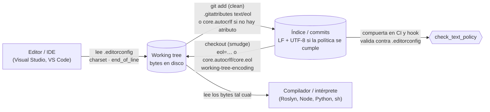
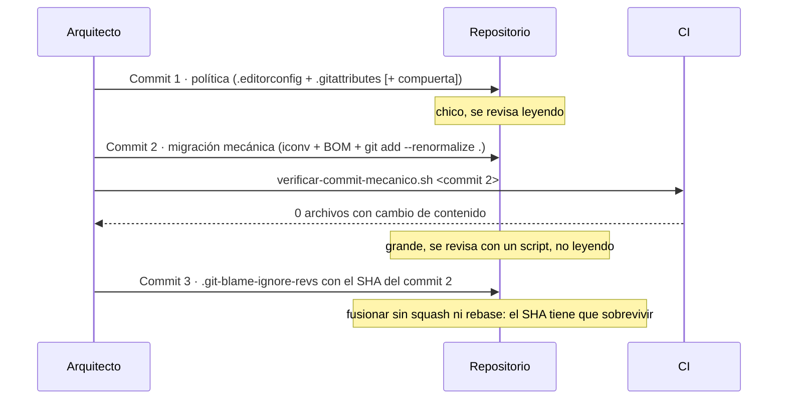

# N2 — Política de texto del repositorio y remediación de código heredado

El caso que dispara la guía terminó con un commit de cien archivos `.cs`/`.razor` pasados de Windows-1252 a UTF-8 con BOM. Ese commit arregló el síntoma, pero no dejó escrito en el repositorio **qué** codificación y qué fin de línea corresponden a cada tipo de archivo, ni **quién** lo verifica la próxima vez que un editor guarde en cp1252 o agregue un BOM. Este núcleo responde a eso con un ciclo de cuatro pasos (decidir, declarar, verificar, migrar) y lo apoya en documentación oficial consultada el 2026-10-07 y en seis experimentos (E2-1 a E2-6) corridos ese día en contenedores. Lo que es criterio del autor va marcado **[criterio propio]**; lo que es convención de proyectos de referencia, **[convención]**; lo que dice el fabricante o el estándar, con su `EV-nn`.

El fenómeno (qué hace cada lector con cada combinación de bytes) es materia de N1. Acá se da por sabido lo que N1 demuestra y se usa una sola afirmación de esa capa: el compilador de C# intenta primero leer cada fuente como UTF-8 [EV-15]; si los bytes no son UTF-8 válidos, el resultado depende de la plataforma (N1).

## Índice

- [1. Definiciones](#1-definiciones)
- [2. Quién lee cada archivo y quién manda](#2-quién-lee-cada-archivo-y-quién-manda)
- [3. Decidir: codificación y fin de línea por extensión](#3-decidir-codificación-y-fin-de-línea-por-extensión)
- [4. Declarar: .editorconfig y .gitattributes](#4-declarar-editorconfig-y-gitattributes)
- [5. Verificar: hook, CI y formateadores](#5-verificar-hook-ci-y-formateadores)
- [6. Migrar un código heredado](#6-migrar-un-código-heredado)
- [7. working-tree-encoding o convertir](#7-working-tree-encoding-o-convertir)
- [8. Estrategias por ecosistema y en la integración](#8-estrategias-por-ecosistema-y-en-la-integración)
- [9. Tabla comparativa](#9-tabla-comparativa)
- [10. Experimentos](#10-experimentos)
- [11. Preguntas guía](#11-preguntas-guía)
- [12. Errores frecuentes](#12-errores-frecuentes)
- [13. Aplicación por escenario y por actor](#13-aplicación-por-escenario-y-por-actor)
- [14. Dependencias y tensiones con otros núcleos](#14-dependencias-y-tensiones-con-otros-núcleos)
- [15. Observaciones, supuestos y pendientes](#15-observaciones-supuestos-y-pendientes)
- [16. Evidencias](#16-evidencias)
- [17. Verificación adversarial](#17-verificación-adversarial)

## 1. Definiciones

| Término | Definición adoptada | Fuente / naturaleza | No confundir con |
|---|---|---|---|
| **Política de texto** | Para cada tipo de archivo del repositorio: codificación canónica, presencia o ausencia de BOM, fin de línea en el índice y en el working tree. Se declara en archivos versionados y se hace cumplir con una compuerta. | [criterio propio]; aplica a la capa 1 del modelo de N0. | Preferencias del editor de cada uno: no viajan con el repositorio. |
| **Codificación canónica** | La que el repositorio fija para un tipo de archivo. En esta guía, UTF-8 para todo el texto. | [criterio propio] apoyado en [EV-17], [EV-18], [EV-20]. | La codificación «del sistema» o «ANSI»: depende de la máquina. |
| **BOM** (*byte order mark*) | En UTF-8, los bytes `EF BB BF` al principio del archivo. No indica orden de bytes: funciona sólo como **firma** de que el archivo es UTF-8 [EV-16]. | unicode.org [EV-16]. | La codificación misma: un archivo UTF-8 con o sin BOM tiene el mismo texto. |
| **Índice** y **working tree** | El índice es lo que git guarda y compara; el working tree es lo que está en disco y leen el editor y el compilador. Con atributos de texto, git normaliza al pasar del working tree al índice (*clean*) y puede convertir al volver (*smudge*) [EV-01]. | git-scm.com [EV-01]. | «El repositorio» a secas: la frase oculta cuál de las dos copias se mira. |
| **Normalizar** / **renormalizar** | Normalizar: que git guarde LF en el índice para los archivos de texto [EV-01]. Renormalizar: volver a pasar por el *clean* todos los archivos versionados después de cambiar la política, con `git add --renormalize .` [EV-05], [EV-07]. | git-scm.com. | Convertir la codificación: git no cambia la codificación salvo con `working-tree-encoding` [EV-04]. |
| **`working-tree-encoding`** | Atributo de git que guarda el archivo en UTF-8 en el índice y lo reescribe en otra codificación en el working tree [EV-04]. | git-scm.com [EV-04]. | Una conversión: el working tree sigue en la codificación vieja (E2-4). |
| **Commit mecánico** | Commit que sólo cambia codificación, BOM y fin de línea; si se decodifica cada archivo y se quitan BOM y CR, el texto antes y después es idéntico. Se puede **verificar** con un script (E2-2). | [criterio propio]. | «Commit de formato» en general, que puede tocar sangrías o nombres. |
| **Aislar de `blame`** | Listar el SHA del commit mecánico en `.git-blame-ignore-revs` para que `git blame` atribuya cada línea al commit anterior que la cambió [EV-08], [EV-09]. | git-scm.com, docs.github.com. | Reescribir la historia: el commit sigue existiendo. |
| **Compuerta** | Chequeo automático que **falla** si la política no se cumple. Corre igual como hook local y en la CI. | Par «declarar / hacer cumplir» de BIT-15-02 §3 y N0. | Un linter que sólo avisa. |

## 2. Quién lee cada archivo y quién manda

Tres archivos dicen cosas sobre los bytes del texto, y cada uno lo lee un actor distinto. La confusión del caso nace de suponer que uno de ellos alcanza para todo.



| Archivo o ajuste | Quién lo lee | Cuándo actúa | Qué decide | Viaja con el repo |
|---|---|---|---|---|
| `.editorconfig` | El editor: Visual Studio lo trae de fábrica y soporta `charset` y `end_of_line` [EV-13], [EV-14]; VS Code necesita la extensión EditorConfig [EV-13]. También `dotnet format` [EV-24] y la compuerta de este laboratorio. | Al **guardar**. En Visual Studio, el formato de las líneas existentes (sangría, espacios) no cambia hasta *Format Document* o *Code Cleanup* [EV-14]; la página no dice si eso alcanza a `charset` y `end_of_line` al guardar un archivo existente, y no se probó (pendiente ESC-01). | Codificación y BOM al guardar; fin de línea de lo que se escribe. | Sí. |
| `.gitattributes` | git. | En `git add`/commit (*clean*) y en checkout (*smudge*) [EV-01]. | Si el archivo es texto, LF en el índice, fin de línea en el working tree, re-codificación con `working-tree-encoding` [EV-01], [EV-02], [EV-04]. | Sí. |
| `core.autocrlf`, `core.eol` | git, desde la configuración de **cada máquina**. | Igual que los atributos, pero sólo donde el atributo no dice nada [EV-02], [EV-06]. | `true` equivale a `text=auto` en todos los archivos más `core.eol=crlf`; `input` no convierte al hacer checkout; `core.eol` se ignora si `core.autocrlf` es `true` o `input` [EV-06]. | No. |
| El compilador o intérprete | — | Al construir o ejecutar. | Nada: lee los bytes del working tree (E2-4). | — |

**Precedencia.** El atributo gana. Si `eol` está especificado para una ruta, el working tree usa ese valor; sólo cuando `eol` no está especificado lo deciden `core.autocrlf` o `core.eol` [EV-02]; si el atributo `text` no está especificado, git usa `core.autocrlf` para decidir si convierte [EV-02]. GitHub lo resume desde el punto de vista del equipo: un `.gitattributes` commiteado «overrides the `core.autocrlf` setting for all repository contributors» [EV-10]. El E2-1 lo verifica: con `* text=auto eol=lf`, el checkout da LF bajo `core.autocrlf=true`, `input`, `false` y `core.eol=crlf`, y `*.cmd text eol=crlf` da CRLF en los cuatro casos.

Entre varios archivos de atributos, manda `$GIT_DIR/info/attributes`, después el `.gitattributes` más cercano a la ruta, después los de directorios superiores, y al final los globales y de sistema [EV-03]. En `.editorconfig` la regla es parecida: se buscan desde el directorio del archivo hacia arriba, la búsqueda se detiene en el que tiene `root = true` y, ante pares repetidos, gana el más cercano [EV-12].

**`.editorconfig` y git no se hablan.** git no lee `.editorconfig`: en el E2-1 (sección C) un `.editorconfig` que pide CRLF y BOM no cambia nada de lo que git guarda o materializa. Por eso la política se declara **dos veces**, una para cada lector, y las dos declaraciones tienen que coincidir.

## 3. Decidir: codificación y fin de línea por extensión

### 3.1 Fin de línea

Hay dos políticas defendibles para el working tree, y el E2-1 muestra la diferencia:

- **`* text=auto`** sin `eol` (lo que usa `dotnet/runtime` [EV-26] y lo que propone GitHub como base [EV-10]): el índice queda en LF, pero el working tree lo decide cada máquina. Con `core.autocrlf=true` (lo que Pro Git recomienda en Windows [EV-11]) los archivos aparecen con CRLF; en Linux, con LF.
- **`* text=auto eol=lf`**: índice y working tree en LF en todas las máquinas.

**[criterio propio]** Para un equipo que construye en Windows y en Linux a la vez, se recomienda la segunda. El motivo no es estético: el fin de línea del fuente **entra en el binario**. En el E2-1 (sección D), el literal verbatim `@"a⏎b"` compila a los bytes `61-0A-62` con LF y a `61-0D-0A-62` con CRLF: el mismo commit produce dos programas distintos según la máquina que lo materializó, lo que rompe la reproducibilidad que persigue N6. Visual Studio declara soportar `end_of_line` del `.editorconfig` [EV-14], de modo que trabajar en Windows con LF no debería requerir configuración local (**no probado en Windows**; ver §15). Las excepciones son las que exige el consumidor: `*.cmd`/`*.bat` con CRLF (`dotnet/runtime` y `vscode` para los dos; `cpython` para `*.bat`) y `*.sh` con LF explícito (`dotnet/runtime`, `vscode`, `dotnet/roslyn`, `dotnet/aspnetcore`; `cpython` no tiene regla para `*.sh`) [EV-26].

### 3.2 Codificación y BOM

UTF-8 para todo el texto no tiene alternativa seria: el JSON que se intercambia entre sistemas fuera de un ecosistema cerrado «MUST be encoded using UTF-8» [EV-17], Python asume UTF-8 en el fuente desde PEP 3120 [EV-20] y PEP 8 lo pide para la biblioteca estándar [EV-18], y el compilador de C# intenta UTF-8 primero [EV-15]. La decisión real es **dónde va BOM**. La firma ayuda a herramientas que adivinan la codificación, pero «interferirá con cualquier protocolo o formato que espere caracteres ASCII específicos al principio, como `#!` en los scripts de Unix» [EV-16], y RFC 8259 prohíbe agregarla al principio de un JSON transmitido por red [EV-17] (la RFC no habla de archivos de configuración en disco; para esos, el argumento es el E2-5).

| Tipo de archivo | Política recomendada | Por qué | Naturaleza |
|---|---|---|---|
| `*.sh`, scripts con shebang | UTF-8 **sin** BOM, LF | Con BOM, `execve` falla con `Exec format error`; invocado desde `sh` (dash en la imagen Debian del laboratorio), la primera línea falla como comando (`not found`) y el resto corre con `sh` aunque el shebang pida otro intérprete (E2-5). | [EV-16] + E2-5 |
| `*.json` (incl. `package.json`, `appsettings.json`) | UTF-8 **sin** BOM | `JSON.parse` en Node, `json.load(encoding='utf-8')` en Python y `JsonDocument.Parse(bytes)` en .NET fallan con BOM; `require()`, `npm run` y `File.ReadAllText` lo toleran (E2-5). RFC 8259 prohíbe el BOM sólo en JSON transmitido por red y deja a los lectores ignorarlo («MAY ignore») [EV-17]: para archivos en disco la razón es el E2-5, no la RFC. | E2-5 (+ [EV-17] por analogía) |
| `*.py`, `pyproject.toml` | UTF-8 **sin** BOM | El intérprete acepta BOM en el fuente [EV-19], pero `tomllib` falla con BOM en `pyproject.toml` (E2-5) y PEP 8 pide UTF-8 sin declaración [EV-18]. | [EV-18], [EV-19] + E2-5 |
| `*.js`, `*.ts`, `*.css`, `*.md`, `*.yml` | UTF-8 **sin** BOM, LF | Prettier usa `endOfLine: "lf"` por defecto desde la 2.0 [EV-21]; Node lee los fuentes UTF-8 sin BOM sin configuración (N1). Ojo: las plantillas web del SDK traen un `.js` con BOM (1 de 1 en SDK 8, 1 de 2 en SDK 10; E2-6), que la compuerta marcaría al agregarlo. | [convención] + E2-6 |
| `*.cs` | UTF-8; **con o sin** BOM, una sola de las dos, declarada | El compilador no necesita BOM [EV-15]; `dotnet format whitespace` hace cumplir `charset` en los dos sentidos (E2-6). Las plantillas del SDK no son homogéneas: `Program.cs` de `console` con BOM, los `.cs` de `webapp`/`blazor` sin BOM y los `.cshtml.cs` mezclados (1 de 3 con BOM) (E2-6). `dotnet/roslyn` declara `utf-8-bom` [EV-26]; `dotnet/aspnetcore` declara `utf-8` para todo salvo vistas y archivos de *snapshot* de pruebas [EV-26]. | [convención] dividida; [criterio propio] abajo |
| `*.razor`, `*.cshtml` | UTF-8 **con** BOM | En las tres plantillas probadas (`webapp`, `blazor`, `razorcomponent`) todos salen con BOM: `.razor` 10 de 10 (SDK 8) y 12 de 12 (SDK 10), `.cshtml` 7 de 7 en los dos (E2-6); `dotnet/aspnetcore` declara lo mismo [EV-26]. Pedir «sin BOM» obliga a corregir cada archivo nuevo. | [convención] + E2-6 |
| `*.sln` | UTF-8 **con** BOM | `dotnet sln add` (SDK 8) le vuelve a poner BOM aunque se lo hayan quitado (E2-6). | E2-6 |
| `*.slnx`, `*.csproj`, `*.props`, `*.targets` | UTF-8 sin BOM | La CLI no le agrega BOM a un `.csproj` (SDK 8 y 10) ni a un `.slnx` (SDK 10) que no lo tienen al editarlos (E2-6; no se probó el caso inverso, si conserva un BOM existente); `dotnet/runtime` declara `utf-8` para proyectos y `.slnx` [EV-26]. Un `.csproj` con BOM también compila (E2-5): es una elección, no una restricción. | [convención] + E2-6 |
| `*.cmd`, `*.bat` | UTF-8 sin BOM (o ASCII), **CRLF** | CRLF: convención de `dotnet/runtime` y `vscode` (`*.cmd` y `*.bat`), `cpython` (`*.bat`) y `node` (sólo archivos puntuales: `vcbuild.bat`, un `.cmd` de `tools/msvs`) [EV-26]. Ninguno declara `charset` para estos archivos: «sin BOM» es **[criterio propio]**. | [convención] |
| `*.ps1` | UTF-8 (con BOM si se usa Windows PowerShell 5.1 con texto no ASCII) | **No verificado en este núcleo**: queda pendiente para N8. | pendiente |

**[criterio propio] Para `*.cs`.** En un repositorio nuevo, UTF-8 **sin** BOM, porque el compilador no lo necesita y `dotnet format` corrige lo que traigan las plantillas. En un repositorio heredado que **ya** se convirtió a UTF-8 con BOM, como el del caso, la política correcta es declarar `utf-8-bom` para `*.cs` (variante B de la plantilla): cumple lo mismo y evita un segundo commit masivo sólo para quitar firmas. Lo que no es aceptable es no declarar nada, porque entonces cada editor decide y aparecen los commits cuyo único cambio es el BOM.

## 4. Declarar: .editorconfig y .gitattributes

Las plantillas completas están en el laboratorio (`politica/.editorconfig`, `politica/.gitattributes`). Lo esencial:

```ini
# .editorconfig — lo leen los editores al guardar y la compuerta al verificar; git NO.
root = true

[*]
# Los comentarios van en línea propia: `charset = utf-8 # x` asignaría "utf-8 # x" [EV-12].
charset = utf-8
end_of_line = lf
insert_final_newline = true

[*.{cmd,bat}]
end_of_line = crlf

# Las plantillas del SDK crean las vistas con BOM (E2-6).
[*.{razor,cshtml}]
charset = utf-8-bom

# `dotnet sln add` repone el BOM (E2-6). El .slnx no.
[*.sln]
charset = utf-8-bom

# Variante B: heredado ya convertido a UTF-8 CON BOM.
# [*.cs]
# charset = utf-8-bom
```

```gitattributes
# .gitattributes — lo lee git; gana sobre core.autocrlf/core.eol de cada máquina [EV-02], [EV-10].
* text=auto eol=lf
*.cmd text eol=crlf
*.bat text eol=crlf
*.sh  text eol=lf
*.png binary
*.jpg binary
*.pdf binary
```

Tres detalles que la sintaxis no avisa:

- `text=auto` **no convierte** un archivo que ya estaba en git con CRLF: «If it is text and the file was not already in Git with CRLF endings, line endings are converted» [EV-01]. En el E2-3, un heredado commiteado con CRLF antes de la política sigue `i/crlf` aunque alguien lo edite después. Por eso declarar sin renormalizar deja la política a medias.
- Especificar `eol` activa `text` aunque no se lo nombre [EV-02].
- `binary` es un macro atributo equivalente a `-diff -merge -text` [EV-27]; sin él, un binario que git clasifique por error como texto puede quedar corrompido por la conversión de CRLF, cosa que la documentación de `core.safecrlf` reconoce; `core.safecrlf` rechaza (`true`) o advierte (`warn`) cuando la conversión no es reversible, pero no distingue un binario de un texto con finales mezclados [EV-06].

## 5. Verificar: hook, CI y formateadores

Declarar no alcanza: Visual Studio no reformatea lo que ya está hasta que se lo pide [EV-14]; VS Code sin la extensión ni siquiera lo lee [EV-13]; y las plantillas del SDK producen archivos con BOM y CRLF aunque el repositorio diga otra cosa (E2-6). La compuerta es la que convierte la política en algo que se cumple.

**Qué verifica la compuerta del laboratorio** (`tools/check_text_policy.py`), siempre sobre el **contenido del índice**, que es lo que se commitea:

1. Que cada archivo de texto sea UTF-8 válido. Un byte inválido casi siempre delata cp1252 o latin1: `src/B.cs: no es UTF-8 válido (byte 0xf3 en offset 75; ¿cp1252?)` (E2-3).
2. Que el BOM coincida con el `charset` que `.editorconfig` resuelve para esa ruta. La compuerta **no repite la política**: la lee con la implementación de referencia de EditorConfig, así que cambiar la política es cambiar un archivo.
3. Que git no vea CRLF en el índice (`git ls-files --eol` informa `i/crlf` o `i/mixed`).

Corre en tres modos: todos los archivos, `--staged` para el hook `pre-commit`, y `--base <rama>` para revisar sólo lo que cambia un PR. En el E2-3, la rama de PR con cp1252, dos BOM indebidos y un heredado editado con CRLF produce cuatro violaciones y sale con código 1; el hook rechaza el commit con BOM; y `git commit --no-verify` lo saltea. Esto último es la razón para que la misma compuerta corra en la CI: el hook es comodidad para el desarrollador, la CI es el árbitro (N7).

```yaml
# Paso de CI ilustrativo (NO ejecutado en este laboratorio; la compuerta sí, en E2-3).
# Necesita la historia de la rama base para --base (fetch-depth: 0 trae toda la historia).
# actions/checkout: última versión mayor v7 (v7.0.1, 2026-07-20) al 2026-10-07 [EV-29].
- uses: actions/checkout@v7
  with: { fetch-depth: 0 }
- run: pip install EditorConfig==0.17.1
- run: python3 tools/check_text_policy.py --base origin/${{ github.base_ref }}
```

**Herramientas existentes, y sus límites.**

| Herramienta | Qué cubre | Límite observado o documentado |
|---|---|---|
| `dotnet format whitespace --verify-no-changes` | Charset y EOL de los `.cs` según `.editorconfig`; falla con `CHARSET` en los dos sentidos y `dotnet format whitespace` lo corrige (E2-6). | Su documentación lo presenta como formateador de código y no menciona `charset` [EV-24]: el comportamiento sale de E2-6. No se probó sobre `.razor`, `.json` ni `.sh`; para esos archivos no se lo puede dar por compuerta. |
| `pre-commit-hooks` (`fix-byte-order-marker`, `mixed-line-ending`) | Quita BOM; detecta o corrige finales de línea mezclados [EV-25]. | `fix-byte-order-marker` quita **todos** los BOM: choca con una política que los exige en `.razor`/`.sln` si no se excluyen esas rutas. No valida cp1252. |
| `git ls-files --eol` | Diagnóstico de EOL en índice y working tree y del atributo efectivo (E2-1, E2-3). | No mira codificación ni BOM. |
| Compuerta del laboratorio | Las tres reglas, leyendo `.editorconfig`. | Ejemplo didáctico; no maneja `working-tree-encoding` distinto de UTF-8 en el working tree (no lo necesita: mira el índice). |

## 6. Migrar un código heredado

El procedimiento separa tres commits porque cada uno se revisa de una forma distinta. El E2-2 lo corre completo sobre un heredado sintético en cp1252 con CRLF que en Linux falla con `error CS1056: Unexpected character '�'`.



**Paso 0. Congelar el resto del trabajo.** El commit mecánico toca cien archivos; cualquier rama abierta va a tener conflictos con él. Conviene hacerlo con las ramas fusionadas o avisadas, y nunca mezclado con un cambio funcional. GitHub recomienda commitear lo pendiente antes de renormalizar [EV-10].

**Paso 1. Commit de política.** `.editorconfig` y `.gitattributes`. En el E2-2, apenas se commitea, `git status` ya muestra como modificado un archivo que nadie tocó (`scripts/deploy.sh`): su CRLF del índice ya no coincide con la política. Es el síntoma esperado de que falta renormalizar, no un cambio real. Y `git status` no los lista a todos (otros seis archivos en la misma situación no aparecen, en las dos corridas del 2026-10-07), así que no sirve para saber qué falta. Por qué aparece uno y no los otros no se investigó.

**Paso 2. Commit mecánico.** `tools/migrar-a-utf8.sh CP1252`:

```bash
# Por cada archivo que git considera texto:
iconv -f UTF-8 -t UTF-8 "$f" >/dev/null 2>&1 \
  || iconv -f CP1252 -t UTF-8 "$f" > "$tmp"     # sólo lo que NO es UTF-8 válido
charset=$(editorconfig "$PWD/$f" | sed -n 's/^charset=//p')   # BOM según la política
# ...agrega o quita EF BB BF según charset...
git add --renormalize .                           # CRLF -> LF en el índice según .gitattributes
```

Sólo con `iconv`, git ve cinco archivos modificados; después de `git add --renormalize .` entran también los que sólo tenían CRLF (siete en total, E2-2). `--renormalize` aplica el *clean* «freshly to all tracked files» y no toca los CR sueltos [EV-07].

El límite de la detección es explícito: un archivo cp1252 cuyos bytes casualmente formen UTF-8 válido (por ejemplo, el texto `é`) no se detecta. En cien archivos de código con acentos y eñes en español es improbable, pero el diff del commit hay que mirarlo igual.

**Paso 3. Verificar que es mecánico.** `tools/verificar-commit-mecanico.sh <sha> CP1252` decodifica cada archivo antes (desde cp1252 si no era UTF-8) y después, quita BOM y CR y compara hashes. En el E2-2 da `verificados 7 archivo(s); 0 con cambio de contenido`. En la contraprueba, una migración que además cambia `=> 42` por `=> 43` se rechaza: `CONTENIDO  src/Sensor.cs` y código de salida 1. Esto permite que el revisor apruebe un diff de cien archivos sin leerlo línea por línea **[criterio propio]**.

**Paso 4. Refrescar los working trees.** Después del commit, los archivos en disco siguen con CRLF hasta el próximo checkout (E2-2: `CR en src/Util.cs antes: 2`). `git rm -rq --cached . && git reset -q --hard` los vuelve a materializar con la política (`después: 0`). Cada desarrollador lo hace una vez después de traer el cambio.

**Paso 5. Aislar de `blame`.** Se agrega `.git-blame-ignore-revs` en un commit **posterior**, porque el SHA del commit mecánico no existe hasta que se crea. Sin el archivo, `git blame src/Mensajes.cs` atribuye las seis líneas al migrador; con `--ignore-revs-file`, vuelven a Ana y a Bruno, incluida la línea que Bruno cambió después del heredado (E2-2). Con `git config blame.ignoreRevsFile .git-blame-ignore-revs` el `blame` a secas ya lo ignora [EV-08]; GitHub lo aplica solo en su vista si el archivo está en la raíz del repositorio [EV-09].

**Lo que rompe el aislamiento.** Un `--amend`, un rebase o un *squash merge* cambian el SHA. En el E2-2, el mismo commit enmendado pasa de `137f241f67a8` a `1b4d04284476` (corrida registrada en `salidas/`; los SHA cambian en cada corrida porque llevan la fecha del commit), que ya no coincide con el archivo. **[criterio propio]** El PR de migración se fusiona con merge commit, o el `.git-blame-ignore-revs` se escribe después de fusionar, con el SHA definitivo.

## 7. working-tree-encoding o convertir

`working-tree-encoding` resuelve un problema distinto del caso. git lo describe para archivos que **no pueden** guardarse en UTF-8 y que, sin el atributo, git trataría como binarios (UTF-16, por ejemplo) [EV-04]. En el E2-4 se ve el beneficio: un `.ps1` en UTF-16LE sin el atributo da `Binary files … differ`; con `working-tree-encoding=UTF-16LE`, el diff muestra el texto cambiado.

Sobre el caso del PO no sirve. Un `.cs` en cp1252 con el atributo `working-tree-encoding=CP1252` queda en UTF-8 en el índice, pero el clon lo vuelve a escribir en cp1252 en el working tree, que es lo que lee el compilador: la build en Linux falla con el mismo `CS1056` (E2-4). Que pase igual en un clon en Windows se deduce de la documentación (la re-codificación ocurre en cada checkout [EV-04]), no se probó; ahí el cp1252 compilaría por el comportamiento que documenta N1, y el problema volvería a quedar oculto. Además, la documentación de git advierte que JGit, libgit2 y versiones de git anteriores a marzo de 2018 no lo soportan y verían el contenido UTF-8 del índice, que conviene asegurarse de que todos los clientes lo soporten, que la conversión a codificaciones no UTF puede no ser reversible y que agrega costo a `checkout` y `add` [EV-04]. Su propia recomendación: usarlo «only if you cannot store a file in UTF-8 encoding» [EV-04].

| Situación | Qué hacer |
|---|---|
| El archivo lo consume una herramienta que **exige** otra codificación (por ejemplo, el formato de un sistema externo que sólo acepta UTF-16; qué herramientas concretas lo exigen hoy no se verificó en N2). | `working-tree-encoding`, con todos los clientes del equipo verificados. |
| El archivo lo lee un compilador o intérprete que entiende UTF-8 (C#, Razor, JS/TS, Python). | Convertir una vez a UTF-8 (§6). |
| Codificación con problemas de ida y vuelta (por ejemplo, Shift-JIS). | Si no hay alternativa, `working-tree-encoding` más `core.checkRoundtripEncoding` [EV-04], [EV-06]. |

## 8. Estrategias por ecosistema y en la integración

**.NET.** El fabricante no fija una codificación para los fuentes: el compilador intenta UTF-8 primero y ofrece `CodePage` para fuentes en otra codificación [EV-15]. Visual Studio soporta `charset` y `end_of_line` del `.editorconfig` [EV-14] y, desde 2025, permite elegir la codificación con que guarda los archivos (Tools > Options > Environment > Documents) [EV-22]; es un ajuste por máquina que no reemplaza la declaración del repositorio. `dotnet new editorconfig` del SDK 8 genera `end_of_line = crlf` para `*.cs`, una trampa para un equipo con Linux; la plantilla del SDK 10 ya no lo declara, y ninguna de las dos declara `charset` (E2-6). Las convenciones de los repositorios de Microsoft difieren entre sí [EV-26]. La herramienta de verificación propia es `dotnet format whitespace --verify-no-changes` (E2-6).

**Node.js.** La convención es UTF-8 sin BOM y LF: `nodejs/node` declara `charset = utf-8` y `end_of_line = lf` para todo, salvo `vcbuild.bat` con CRLF [EV-26], y Prettier normaliza a LF por defecto [EV-21]. El riesgo concreto del BOM está en los JSON que se leen con `JSON.parse(fs.readFileSync(...))` (E2-5).

**Python.** UTF-8 sin declaración es la norma de la biblioteca estándar [EV-18] y el default del lenguaje [EV-20]; el BOM en el fuente se tolera [EV-19], pero `pyproject.toml` con BOM rompe `tomllib` y un JSON con BOM rompe `json.load` salvo con `utf-8-sig` (E2-5). `cpython` declara CRLF para `.bat`, `.ps1`, `.sln` y `.proj` [EV-26].

**En la integración (anticipo de N8).** Las tres convenciones coinciden en lo esencial (UTF-8, LF, sin BOM) y chocan en dos lugares: las vistas Razor y el `.sln`, donde las herramientas de .NET ponen BOM, y los scripts compartidos (`.sh`, `.cmd`), donde manda el sistema que los ejecuta. Un único `.editorconfig` raíz con secciones por extensión y un único `.gitattributes` raíz alcanzan para expresarlo; la compuerta, al leer el `.editorconfig`, cubre los tres ecosistemas con un solo chequeo **[criterio propio]**.

## 9. Tabla comparativa

| Mecanismo | Capa que fija | Lo lee | Hace cumplir | Depende de la máquina | Cuándo usarlo |
|---|---|---|---|---|---|
| `core.autocrlf` | EOL (sólo donde no hay atributo) | git local | No | Sí | Como red de seguridad personal; nunca como política. |
| `.gitattributes` `text`/`eol` | EOL en índice y working tree | git | Sí, al hacer `add`/checkout | No | Siempre. |
| `.gitattributes` `working-tree-encoding` | Codificación en el working tree | git (no JGit/libgit2) | Sí, en git | No | Sólo si el archivo no puede estar en UTF-8. |
| `.editorconfig` `charset`/`end_of_line` | Codificación, BOM y EOL al guardar | Editor, `dotnet format`, compuerta | No por sí mismo | No | Siempre, coincidiendo con `.gitattributes`. |
| Ajuste de codificación del IDE | Codificación al guardar | Visual Studio [EV-22], VS Code (`files.encoding`, de usuario o de *workspace*) [EV-28] | No | Sí (salvo que la configuración de *workspace* de VS Code se versione con el repositorio: **[criterio propio]**, no verificado) | Complemento personal. |
| `dotnet format whitespace --verify-no-changes` | Charset y EOL de `.cs` | SDK | Sí | No | Compuerta de .NET. |
| Compuerta propia (`check_text_policy.py`) | UTF-8 válido, BOM, LF en índice | CI y hook | Sí | No | Compuerta transversal a los tres ecosistemas. |
| `git add --renormalize .` | EOL del índice existente | git | — | No | Una vez, al introducir o cambiar la política. |
| `.git-blame-ignore-revs` | Atribución de `blame` | git con config, GitHub | — | El `git` local necesita `blame.ignoreRevsFile` | Después de cada commit mecánico. |

## 10. Experimentos

Todos en `LAB/Lab-Documentos/Guides/Metodologia-Entorno-Desarrollo/Examples/N2-politica-de-texto-y-remediacion/`, corridos el 2026-10-07. Imagen del laboratorio: `mcr.microsoft.com/dotnet/sdk:8.0@sha256:78235e09…` + `EditorConfig==0.17.1` (git 2.39.5, SDK 8.0.425). `./correr-todo.sh` corre los seis; salida completa en `salidas/`.

| ID | Comando | Salida resumida | Ruta |
|---|---|---|---|
| E2-1 | `docker run --rm --user "$(id -u):$(id -g)" -e HOME=/tmp -v "$PWD":/lab -w /lab lab-n2-texto:local bash e1-precedencia/run.sh` | A: sin atributos, el mismo archivo CRLF entra `i/crlf` (autocrlf=false) o `i/lf` (autocrlf=true). B: con `* text=auto eol=lf`, `win.txt` 0 CR y `build.cmd` 2 CR con `autocrlf=true/input/false` y `core.eol=crlf`. B2: con `* text=auto` sin `eol`, 2 CR con `autocrlf=true` y 0 con `false`. C: `.editorconfig` con `end_of_line=crlf`/`utf-8-bom` no altera nada en git. D: `largo=3 bytes=61-0A-62` con LF; `largo=4 bytes=61-0D-0A-62` con CRLF. | `e1-precedencia/`, `salidas/e1-precedencia.txt` |
| E2-2 | `… bash e2-migracion/run.sh` | Antes: `error CS1056: Unexpected character '�'` en `Sensor.cs` y `Program.cs`. Política: 2 archivos. Migración: `4 convertidos, 1 BOM agregados` (el `.razor`), 7 archivos tras `--renormalize`. Verificación: `0 con cambio de contenido`; contraprueba: `CONTENIDO src/Sensor.cs`, exit 1. Working tree: 2 CR → 0. Después: `0 Error(s)` y `Atención: lectura fuera de rango (42)`. `blame` sin ignorar: 6 líneas del migrador; con ignorar: Ana y Bruno. `--amend` cambia el SHA. | `e2-migracion/`, `salidas/e2-migracion.txt` |
| E2-3 | `… bash e3-compuerta/run.sh` | Base: 1 violación (heredado CRLF no renormalizado). PR: 4 violaciones (cp1252 en `B.cs`, BOM en `tool.py` y `run.sh`, `i/crlf` en el heredado editado), exit 1. Hook: commit rechazado; `--no-verify`: aceptado. Variante B: `src/A.cs: falta el BOM`. Tras `git add --renormalize`: 0 violaciones. | `e3-compuerta/`, `salidas/e3-compuerta.txt` |
| E2-4 | `… bash e4-working-tree-encoding/run.sh` | `.ps1` UTF-16LE: sin atributo `Binary files … differ`; con atributo, diff de texto; índice UTF-8, working tree no. `.cs` cp1252 con `working-tree-encoding=CP1252`: índice UTF-8, working tree del clon cp1252, build `CS1056`. Bytes: índice `… c3 9a …`, working tree `… da …`. | `e4-working-tree-encoding/`, `salidas/e4-working-tree-encoding.txt` |
| E2-5 | `bash e5-bom-por-lector/run.sh` (en el host; un contenedor por ecosistema, imágenes por digest) | Shebang con BOM: `OSError: [Errno 8] Exec format error` y `exec ./con-bom.sh: exec format error`; desde `sh` (dash), `1: #!/bin/sh: not found` y sigue con `exit=0`. Node 22.23.2: `JSON.parse` → `SyntaxError`; `require` ok; `npm run` ok. Python 3.12.14: `JSONDecodeError: Unexpected UTF-8 BOM`; `utf-8-sig` ok; `tomllib` → `TOMLDecodeError`. .NET 8: `JsonDocument.Parse(bytes)` → `'0xEF' is an invalid start of a value`; `File.ReadAllText` ok; `.csproj` con BOM compila. | `e5-bom-por-lector/`, `salidas/e5-bom-por-lector.txt` |
| E2-6 | `for v in 8.0 10.0; do docker run … mcr.microsoft.com/dotnet/sdk:$v bash e6-plantillas-dotnet/run.sh; done` | SDK 8: `Program.cs`, `.csproj`, `.sln` con BOM y CRLF; `.editorconfig` generado con `end_of_line = crlf` en `[*.cs]` y sin `charset`. SDK 10: mismos BOM, `.slnx` sin BOM, sin CRLF en `console`, sin `end_of_line`. Web: `.razor` con BOM 10/10 (SDK 8) y 12/12 (SDK 10), `.cshtml` 7/7 en ambos; `.cs` 0/2 con BOM, `.cshtml.cs` 1/3, `.js` con BOM 1/1 (SDK 8) y 1/2 (SDK 10); todos con CRLF. `dotnet format whitespace --verify-no-changes`: `error CHARSET` exit 2 en los dos sentidos; `dotnet format whitespace` lo corrige. `dotnet sln add` repone el BOM del `.sln`; a `.csproj` y `.slnx` sin BOM no se lo agrega. | `e6-plantillas-dotnet/`, `salidas/e6-plantillas-dotnet.txt` |

## 11. Preguntas guía

**¿UTF-8 con o sin BOM para C# y Razor?** Para Razor, con BOM: es lo que producen las tres plantillas web probadas del SDK 8 y 10 y lo que declara `dotnet/aspnetcore` (E2-6, [EV-26]); elegir lo contrario genera trabajo en cada archivo nuevo. Para C#, cualquiera de las dos, pero una sola y declarada: el compilador no la necesita [EV-15] y `dotnet format` hace cumplir la que se elija (E2-6). *Aplica:* repositorio nuevo → sin BOM; heredado ya convertido con BOM, como el del caso → declarar `utf-8-bom` para `*.cs` y no tocar más.

**¿Y para JS/TS, Python, JSON, shell, `.sln` y `.csproj`?** Sin BOM en todo lo que no sea .NET: el BOM rompe shebangs, `JSON.parse`, `json.load` y `tomllib` (E2-5). `.sln` con BOM porque la CLI lo repone; `.csproj` y `.slnx` sin BOM, porque la CLI no se lo agrega al editarlos (E2-6). *Aplica:* cuando un mismo repositorio mezcla ecosistemas, la regla es por extensión, nunca global.

**¿Qué manda cuando `.editorconfig`, `.gitattributes` y `core.autocrlf` difieren?** No compiten: actúan en momentos distintos. El editor obedece al `.editorconfig` al guardar; git obedece al `.gitattributes` al commitear y al materializar, y usa `core.autocrlf` sólo donde el atributo no dice nada [EV-02]. Si `.editorconfig` dice CRLF y `.gitattributes` dice `eol=lf`, el editor escribe CRLF, git guarda LF y el próximo checkout trae LF: el archivo «cambia solo». *Aplica:* cada vez que aparece un diff de EOL que nadie hizo, buscar dónde se contradicen los dos archivos.

**¿Por qué no alcanza con pedirle a todos `core.autocrlf=true`?** Porque es configuración de cada máquina y no viaja con el repositorio [EV-06], [EV-10]: basta un desarrollador o una imagen de CI con otro valor para que el mismo archivo entre distinto (E2-1, sección A). Además, deja el working tree con CRLF en Windows y LF en Linux, y eso cambia el binario (E2-1, sección D). *Aplica:* `core.autocrlf` es un ajuste personal razonable para repositorios **sin** `.gitattributes`; en uno con política, sobra.

**¿Cómo convierto cien archivos heredados sin mezclar con cambios funcionales ni ensuciar `blame`?** Tres commits: política, migración mecánica verificada por script, `.git-blame-ignore-revs` (§6). Fusión sin squash ni rebase. *Aplica:* siempre que la conversión toque más archivos de los que un revisor puede leer; para dos o tres archivos, alcanza con un commit separado del cambio funcional.

**¿Cómo detecto en un PR que se reintrodujo cp1252, BOM o CRLF?** Con una compuerta que mire el índice, no el working tree, y que lea la política del `.editorconfig`: UTF-8 válido, BOM según `charset`, LF según `git ls-files --eol` (E2-3). La misma compuerta como hook y en la CI, porque el hook se saltea con `--no-verify`. *Aplica:* en cualquier repositorio donde convivan editores de Windows y de Linux; en uno de un solo desarrollador con un solo editor, el `.editorconfig` puede alcanzar.

**¿Cuándo `working-tree-encoding` y cuándo convertir de una vez?** `working-tree-encoding` sólo cuando el consumidor exige una codificación distinta de UTF-8 y se quiere que git vea texto; nunca para fuentes que el compilador puede leer en UTF-8, porque el working tree sigue en la codificación vieja y el compilador lee el working tree (E2-4, [EV-04]). *Aplica:* un archivo que su consumidor sólo acepta en UTF-16 sí (el E2-4 lo muestra con un archivo sintético); `.cs` en cp1252 no.

**¿Qué pasa con las ramas abiertas cuando se fusiona el commit mecánico?** Van a tener conflictos en cada línea tocada, porque cambiaron los bytes de todas. **[criterio propio]** Programar la migración con las ramas fusionadas; para las que no se puedan cerrar, correr el mismo `migrar-a-utf8.sh` en la rama antes de traer `main`, de modo que ambos lados hablen la misma codificación.

## 12. Errores frecuentes

| Error | Consecuencia | Corrección |
|---|---|---|
| Declarar la política sólo en `.editorconfig`. | git no la lee (E2-1, C): el índice sigue aceptando CRLF de quien no use un editor compatible. | Declarar también en `.gitattributes`, con valores que coincidan. |
| Agregar `.gitattributes` y no renormalizar. | Los archivos que ya estaban con CRLF siguen así aunque se editen (`text=auto`, [EV-01], E2-3); `git status` muestra modificados que nadie tocó (E2-2). | `git add --renormalize .` en el commit mecánico. |
| Confiar en `git status` para saber qué falta renormalizar. | Lista algunos archivos y omite otros (E2-2). | Usar `git ls-files --eol` o la compuerta. |
| Mezclar la conversión con un cambio funcional. | El cambio queda escondido en un diff de cien archivos; `blame` lo atribuye a «normalización». | Commit mecánico separado y verificado por script (E2-2). |
| Fusionar el PR de migración con squash o rebase. | El SHA de `.git-blame-ignore-revs` deja de existir (E2-2, paso 9). | Merge commit, o escribir el archivo después de fusionar. |
| Usar `working-tree-encoding=CP1252` para «arreglar» fuentes heredados. | El compilador sigue viendo cp1252 en cualquier clon (E2-4). | Convertir a UTF-8. |
| Poner `fix-byte-order-marker` de pre-commit sobre todo el repositorio. | Quita el BOM que la política exige en `.razor`/`.sln` [EV-25]; pelea con la plantilla. | Excluir esas rutas o usar una compuerta que lea el `.editorconfig`. |
| Usar el `.editorconfig` de `dotnet new editorconfig` (SDK 8) sin revisarlo. | Declara `end_of_line = crlf` para `*.cs` (E2-6), en contra de `eol=lf`. | Revisar la sección de nuevas líneas antes de commitearlo. |
| Comentarios al final de una línea en `.editorconfig`. | El comentario pasa a ser parte del valor [EV-12]. | Comentarios en línea propia. |
| Un shebang guardado con BOM «porque funciona desde la terminal». | `sh` lo rescata y lo corre con `sh` aunque pida otro intérprete; el script como comando de un contenedor (`docker run <imagen> ./script.sh`) o un `execve` directo fallan (E2-5). | UTF-8 sin BOM para `*.sh` y archivos con shebang. |

## 13. Aplicación por escenario y por actor

| Escenario (BIT-15-03) | Qué cambia para N2 |
|---|---|
| ESC-01 Windows + Visual Studio | Donde el problema no se ve: el cp1252 compila (lo demuestra N1, no este núcleo). Visual Studio declara soportar `charset`/`end_of_line` del `.editorconfig` [EV-14] (su efecto sobre archivos existentes, pendiente: §15); el hook local es la primera red. `core.autocrlf=true` deja de importar donde hay atributos. |
| ESC-02 Linux nativo | Donde el problema aparece. VS Code necesita la extensión EditorConfig [EV-13]; sin ella, la compuerta es la única defensa. |
| ESC-03 WSL 2 | Dos configuraciones de git (Windows y WSL) sobre el mismo repositorio; con `eol` en los atributos, ninguna decide. Detalle de rutas y rendimiento en N5. |
| ESC-04 Devcontainer | El bind mount muestra los bytes que escribió el host: si el working tree de Windows tiene CRLF por `core.autocrlf` y no hay `eol=lf`, el contenedor ve CRLF (detalle en N5). |
| ESC-05 CI | El árbitro: corre la compuerta en modo `--base` y `dotnet format whitespace --verify-no-changes`. |

| Actor | Le toca |
|---|---|
| ACT-ARQ | Decidir la tabla de §3, escribir los dos archivos, programar y firmar la migración. |
| ACT-DEV | Instalar el hook (`git config core.hooksPath .githooks`), tener un editor que lea `.editorconfig`, refrescar el working tree una vez después de la migración. |
| ACT-OPS | Correr la compuerta en la CI con la misma versión de la herramienta que el hook. |
| ACT-REV | Rechazar cualquier diff que cambie BOM o EOL fuera de un commit mecánico verificado; mirar con lupa cambios a `.gitattributes`/`.editorconfig`. |

## 14. Dependencias y tensiones con otros núcleos

| Núcleo | Relación | Tensión o nota |
|---|---|---|
| N0 | N2 es la fuente de verdad de la capa 1 («bytes del fuente»). | N0 enumera la página de códigos entre las entradas que afectan el determinismo [N0 EV-04]; N2 la saca de la ecuación al exigir UTF-8 válido. |
| N1 | Depende: usa la matriz de lectores de N1 y sólo agrega los archivos de configuración (E2-5). | Coordinar que N1 no repita E2-5 ni N2 repita la matriz de fuentes. La afirmación sobre el respaldo a otra página de códigos cuando no hay UTF-8 válido queda en N1. |
| N4 | Los lock files (`package-lock.json`, `packages.lock.json`, `uv.lock`) son JSON/TOML generados. | Deben quedar UTF-8 sin BOM y LF; si un generador escribiera otra cosa, la compuerta lo rechazaría y habría que excluir la ruta. **No verificado** en N2: pedir a N4 que confirme bytes de sus locks. |
| N5 | Alimenta: la política declarada es lo que el devcontainer «congela» de la capa 1. Con `* text=auto` sin `eol`, un working tree materializado con `core.autocrlf=true` queda con CRLF (E2-1, B2). Que un bind mount desde Windows lo muestre así dentro del contenedor es inferencia **no probada** en N2 (se le pide a N5): argumento a favor de `eol=lf`. |
| N6 | El EOL del working tree cambia el binario (E2-1, D). | Una build reproducible entre Windows y Linux exige `eol=lf` (o `eol` explícito) para los fuentes. |
| N7 | Entrega la compuerta y la regla de «commit mecánico verificado». | El hook se saltea con `--no-verify` (E2-3): sin CI la política se degrada. Plataformas sin protección de rama sólo pueden avisar. |
| N8 | Entrega la tabla por extensión; choque de convenciones en `.razor`, `.sln`, scripts. | `.ps1` y Windows PowerShell 5.1 quedan pendientes para N8. |

## 15. Observaciones, supuestos y pendientes

**Hechos verificados.** Todo lo de §10 y las citas de §16.

**Interpretaciones del autor.**
- La recomendación `eol=lf` para todo el working tree se apoya en E2-1 (D) y en el objetivo de reproducibilidad de N6; proyectos de referencia como `dotnet/runtime` eligen `* text=auto` sin `eol` [EV-26]. Es una decisión, no una regla de la industria.
- La política de BOM para `*.cs` queda abierta entre dos variantes igual de válidas; la elección por estado del repositorio (nuevo o heredado ya convertido) es criterio propio.

**Supuestos.**
- Visual Studio en Windows trabaja sin fricción con archivos LF cuando el `.editorconfig` declara `end_of_line = lf`: se apoya en [EV-14] (propiedad soportada), pero **no se probó** en una estación Windows. Requiere verificación manual en ESC-01.
- Que la opción de codificación por defecto de Visual Studio [EV-22] incluya UTF-8 sin firma: la entrada del blog no lo detalla; no se usa como argumento.
- Que Visual Studio aplique `charset` y `end_of_line` del `.editorconfig` a un archivo **existente** al guardarlo: [EV-14] sólo documenta que el formato de las líneas existentes no cambia hasta *Format Document*; el efecto sobre BOM y EOL no está documentado ni probado. Requiere verificación manual en ESC-01.

**Pendientes.**
- Verificar en una estación Windows real (ESC-01): qué escribe Visual Studio al crear un `.cs` o un `.razor` nuevo con la plantilla de `.editorconfig` de N2.
- `.ps1`: BOM y Windows PowerShell 5.1 frente a PowerShell 7 (para N8).
- Confirmar con N4 los bytes de los lock files generados por cada gestor.
- GitLab y otras plataformas: soporte de `.git-blame-ignore-revs` en su vista de `blame` (sólo se verificó GitHub [EV-09]).
- El paquete `python3` de la imagen del laboratorio no está fijado por versión (sale de Debian); la compuerta requiere Python 3.9+ por inspección (anotaciones `list[str]`; el paquete `EditorConfig` 0.17.1 declara `requires_python >=3.9`), pero sólo se corrió con Python 3.11.2 (el de la imagen).

## 16. Evidencias

Todas las URL se consultaron el 2026-10-07. Los experimentos se corrieron el 2026-10-07 en un host Linux x86_64 con Docker. Las páginas de git-scm.com mostraban la versión 2.56.0; los textos de `git-config`, `git-add` y `git-blame` se cotejaron además con los manuales locales de git 2.47.3.

| ID | Afirmación | Fuente o experimento | Fecha |
|---|---|---|---|
| EV-01 | `text` normaliza a LF en el índice; `text=auto` no convierte archivos ya guardados con CRLF. | https://git-scm.com/docs/gitattributes (sección `text`) | 2026-10-07 |
| EV-02 | `eol` fija el EOL del working tree y activa `text`; si `eol` no está especificado lo deciden `core.autocrlf`/`core.eol`; si `text` no está especificado, `core.autocrlf`. | https://git-scm.com/docs/gitattributes (secciones `text`, `eol`) | 2026-10-07 |
| EV-03 | Precedencia: `$GIT_DIR/info/attributes` > `.gitattributes` más cercano > superiores > global y sistema. | https://git-scm.com/docs/gitattributes (DESCRIPTION) | 2026-10-07 |
| EV-04 | `working-tree-encoding`: UTF-8 en el índice, re-codificación en checkout; JGit/libgit2 y git anterior a marzo de 2018 no lo soportan; ida y vuelta, `core.checkRoundtripEncoding`; costo; usar sólo si no se puede guardar en UTF-8. | https://git-scm.com/docs/gitattributes (`working-tree-encoding`) | 2026-10-07 |
| EV-05 | Procedimiento: `echo "* text=auto" >.gitattributes; git add --renormalize .`. | https://git-scm.com/docs/gitattributes (`text`, ejemplo de normalización) | 2026-10-07 |
| EV-06 | `core.autocrlf=true` equivale a `text=auto` + `core.eol=crlf`; `input` no convierte al hacer checkout; `core.eol` se ignora si `core.autocrlf` es `true`/`input`; `core.safecrlf`; `core.checkRoundtripEncoding` (default SHIFT-JIS). | https://git-scm.com/docs/git-config ; `man git-config` (git 2.47.3) | 2026-10-07 |
| EV-07 | `git add --renormalize` aplica el *clean* a todos los archivos versionados; implica `-u`; los CR sueltos no se tocan. | https://git-scm.com/docs/git-add ; `man git-add` (git 2.47.3) | 2026-10-07 |
| EV-08 | `--ignore-rev`, `--ignore-revs-file`, `blame.ignoreRevsFile`, `blame.markIgnoredLines`, `blame.markUnblamableLines`. | https://git-scm.com/docs/git-blame ; https://git-scm.com/docs/git-config | 2026-10-07 |
| EV-09 | GitHub ignora en la vista de blame las revisiones de `.git-blame-ignore-revs` en la raíz del repositorio. | https://docs.github.com/en/repositories/working-with-files/using-files/viewing-and-understanding-files | 2026-10-07 |
| EV-10 | `.gitattributes` «overrides the `core.autocrlf` setting for all repository contributors»; ejemplo con `*.sln text eol=crlf`; commitear lo pendiente y `git add --renormalize .`. | https://docs.github.com/en/get-started/git-basics/configuring-git-to-handle-line-endings | 2026-10-07 |
| EV-11 | Pro Git: `core.autocrlf true` en Windows, `input` en Linux/macOS. | https://git-scm.com/book/en/v2/Customizing-Git-Git-Configuration | 2026-10-07 |
| EV-12 | EditorConfig 0.17.2: `charset` = `latin1`, `utf-8`, `utf-8-bom`, `utf-16be`, `utf-16le`; `end_of_line`; `root`; el más cercano gana; sin comentarios al final de línea; `unset`. | https://spec.editorconfig.org/ | 2026-10-07 |
| EV-13 | Visual Studio soporta EditorConfig sin plugin; VS Code requiere plugin. | https://editorconfig.org/ | 2026-10-07 |
| EV-14 | Visual Studio soporta `end_of_line` y `charset`; `.editorconfig` prevalece sobre las opciones del editor; el código existente no se reformatea hasta *Format Document*/*Code Cleanup*. | https://learn.microsoft.com/en-us/visualstudio/ide/create-portable-custom-editor-options (ms.date 2026-02-19) | 2026-10-07 |
| EV-15 | `CodePage`: «The compiler first attempts to interpret all source files as UTF-8»; para otra codificación con caracteres fuera de ASCII, usar `CodePage`. | https://learn.microsoft.com/en-us/dotnet/csharp/language-reference/compiler-options/advanced#codepage (ms.date 2026-07-16) | 2026-10-07 |
| EV-16 | El BOM en UTF-8 es sólo firma; algunos receptores no lo esperan; interfiere con `#!`; evitarlo en protocolos que esperan ASCII. | https://www.unicode.org/faq/utf_bom.html | 2026-10-07 |
| EV-17 | JSON intercambiado entre sistemas fuera de un ecosistema cerrado MUST ser UTF-8; MUST NOT agregar BOM al principio de un JSON transmitido por red; los lectores MAY ignorarlo. | https://www.rfc-editor.org/rfc/rfc8259#section-8.1 | 2026-10-07 |
| EV-18 | PEP 8: UTF-8 sin declaración de codificación en la distribución principal. | https://peps.python.org/pep-0008/#source-file-encoding | 2026-10-07 |
| EV-19 | PEP 263: la firma UTF-8 se interpreta como UTF-8; con BOM, la única declaración admitida es `utf-8`. | https://peps.python.org/pep-0263/ | 2026-10-07 |
| EV-20 | PEP 3120 (Final): codificación por defecto del fuente UTF-8. | https://peps.python.org/pep-3120/ | 2026-10-07 |
| EV-21 | Prettier: `endOfLine` por defecto `"lf"` desde la 2.0. | https://prettier.io/docs/options#end-of-line | 2026-10-07 |
| EV-22 | Visual Studio: opción «Save files with the following encoding» en Tools > Options > Environment > Documents (entrada del 28-04-2025). | https://devblogs.microsoft.com/visualstudio/set-the-default-file-encoding/ | 2026-10-07 |
| EV-23 | .NET 10: `dotnet new sln` crea `.slnx`; `--format sln` para el formato anterior. | https://learn.microsoft.com/en-us/dotnet/core/compatibility/sdk/10.0/dotnet-new-sln-slnx-default | 2026-10-07 |
| EV-24 | `dotnet format` formatea según `.editorconfig`; `whitespace` sólo reglas de espacio; `--verify-no-changes` sale con código distinto de cero si habría cambios. | https://learn.microsoft.com/en-us/dotnet/core/tools/dotnet-format (ms.date 2026-09-15) | 2026-10-07 |
| EV-25 | `fix-byte-order-marker` «removes UTF-8 byte order marker»; `mixed-line-ending` con `--fix=auto/crlf/lf/no`. | https://github.com/pre-commit/pre-commit-hooks (v6.0.0) | 2026-10-07 |
| EV-26 | Convenciones: `dotnet/runtime` (`* text=auto`, `*.sh eol=lf`, `*.cmd/*.bat eol=crlf`; `charset = utf-8` para proyectos y `.slnx`; `.editorconfig` @ `860eddba936f`); `dotnet/roslyn` (`charset = utf-8-bom` para `*.cs`; @ `3f8a5d42b78b`); `dotnet/aspnetcore` (`charset = utf-8` general, `utf-8-bom` para `*.razor`/`*.cshtml`; @ `bda7089ab86a`); `nodejs/node` (`utf-8`, `lf`; @ `11f76b45ab24`); `microsoft/vscode` (`* text=auto`, `.bat/.cmd eol=crlf`, `.sh eol=lf`, `.ps1 eol=lf`); `python/cpython` (`*.bat`, `*.ps1`, `*.sln`, `*.proj` con CRLF vía el macro `dos`; sin regla para `*.sh`; @ `7a70afa199a9`); `dotnet/roslyn` y `dotnet/aspnetcore` también declaran `*.sh eol=lf` en su `.gitattributes`. SHA re-consultados el 2026-10-07 en la verificación adversarial: sin cambios. | `https://raw.githubusercontent.com/<repo>/HEAD/.gitattributes` y `.editorconfig`; SHA del último commit de `.editorconfig` vía API de GitHub | 2026-10-07 |
| EV-27 | El macro atributo `binary` equivale a `[attr]binary -diff -merge -text`. | https://git-scm.com/docs/gitattributes (USING MACRO ATTRIBUTES) ; `man gitattributes` (git 2.47.3) | 2026-10-07 |
| EV-28 | VS Code: la codificación se fija con `files.encoding` en la configuración de usuario o de *workspace*. | https://code.visualstudio.com/docs/editing/codebasics | 2026-10-07 |
| EV-29 | `actions/checkout`: última versión v7.0.1 (2026-07-20); `fetch-depth: 0` trae toda la historia. | https://github.com/actions/checkout (README y API de *releases*) | 2026-10-07 |
| E2-1 | Precedencia `.gitattributes` > `core.autocrlf`/`core.eol`; `.editorconfig` no actúa en git; el EOL entra en el binario. | `Examples/N2-…/e1-precedencia/run.sh`; `salidas/e1-precedencia.txt` | 2026-10-07 |
| E2-2 | Migración en tres commits, verificación mecánica, `blame` aislado, SHA frágil. | `e2-migracion/run.sh`; `salidas/e2-migracion.txt` | 2026-10-07 |
| E2-3 | Compuerta en PR y hook; `--no-verify`; `text=auto` y CRLF preexistente. | `e3-compuerta/run.sh`; `salidas/e3-compuerta.txt` | 2026-10-07 |
| E2-4 | `working-tree-encoding`: diff de UTF-16 sí; fuente cp1252 no. | `e4-working-tree-encoding/run.sh`; `salidas/e4-working-tree-encoding.txt` | 2026-10-07 |
| E2-5 | BOM en shebang, JSON, TOML, `.csproj` frente a Node, Python, .NET y `execve`. | `e5-bom-por-lector/run.sh`; `salidas/e5-bom-por-lector.txt` | 2026-10-07 |
| E2-6 | BOM/EOL de las plantillas de SDK 8 y 10; `.editorconfig` generado; `dotnet format` y `charset`; `dotnet sln add` y el BOM. | `e6-plantillas-dotnet/run.sh`; `salidas/e6-plantillas-dotnet.txt` | 2026-10-07 |

## 17. Verificación adversarial

Verificación hecha el 2026-10-07 por un verificador sin voto, con la presunción de que cada afirmación podía ser falsa. Método: se re-abrieron todas las fuentes de §16 (git-scm.com 2.56.0 para `gitattributes`, `git-config`, `git-add`, `git-blame` y Pro Git; docs.github.com; spec.editorconfig.org 0.17.2; editorconfig.org; learn.microsoft.com; unicode.org; rfc-editor.org; peps.python.org; prettier.io; devblogs.microsoft.com; README de `pre-commit-hooks`, última versión v6.0.0) y se bajaron otra vez los `.gitattributes`/`.editorconfig` de los seis repositorios de [EV-26] con el SHA del último commit de `.editorconfig` (los seis coinciden con los registrados). Los seis experimentos se re-ejecutaron con `correr-todo.sh` sobre una copia del laboratorio (exit 0 en los seis); la salida coincide con `salidas/` salvo los SHA de commit (llevan fecha), el orden en que se intercalan stdout y stderr en E2-5 y cuatro advertencias de git (`CRLF will be replaced by LF`) más en E2-2, que no cambian ninguna conclusión. Versiones confirmadas en la imagen: git 2.39.5, SDK 8.0.425, Python 3.11.2, `EditorConfig` 0.17.1, `/bin/sh` → dash. No se encontraron nombres privados en el núcleo ni en el laboratorio.

**Corregido.**

| # | Dónde | Qué decía | Qué dice ahora y por qué |
|---|---|---|---|
| 1 | §3.1 | `*.sh` con LF explícito «como hacen `dotnet/runtime`, `vscode` y `cpython`». | `cpython` no tiene regla para `*.sh` en su `.gitattributes` (sólo `*.bat` con CRLF); se separaron las dos listas y se agregaron `roslyn` y `aspnetcore`, que sí declaran `*.sh eol=lf`. |
| 2 | §3.2, tabla, fila `*.cmd`/`*.bat` | Convención de `dotnet/runtime`, `vscode`, `node` y `cpython`. | `node` sólo declara CRLF para dos archivos puntuales y `cpython` sólo para `*.bat`; ninguno declara `charset`, así que «sin BOM» queda como criterio propio. |
| 3 | §3.2 y [EV-17] | «JSON entre sistemas MUST…»; la RFC «prohíbe agregarla a un JSON transmitido». | La RFC limita la obligación de UTF-8 a JSON intercambiado fuera de un ecosistema cerrado y la prohibición del BOM a JSON transmitido por red; para archivos en disco la razón es E2-5. |
| 4 | §3.2, fila Razor; §11 | Las plantillas crean **siempre** con BOM: «12 de 12 `.razor`». | 12/12 es el SDK 10; el SDK 8 da 10/10. «Siempre» se acotó a las tres plantillas probadas. |
| 5 | §3.2, fila `*.cs`; §10 E2-6 | El `.cs` de `webapp`/`blazor` sin BOM. | Se agrega lo que la salida también muestra: `.cshtml.cs` 1 de 3 con BOM y un `.js` de plantilla con BOM (relevante para la fila `*.js`). |
| 6 | §3.2, fila `.csproj`/`.slnx`; §10; §11 | «La CLI respeta el BOM existente». | E2-6 sólo prueba que la CLI no le **agrega** BOM a un archivo que no lo tiene; el caso inverso no se probó. |
| 7 | §2, tabla; §5 | Visual Studio aplica `.editorconfig` «sólo para líneas nuevas» (incluido charset/EOL). | [EV-14] habla del formato de líneas existentes (el ejemplo es la sangría); para `charset`/`end_of_line` en un archivo existente no hay documentación ni prueba. Pasó a supuesto pendiente (§15). |
| 8 | §3.1 | Trabajar en Windows con LF «no requiere configuración local». | Rotulado como no probado en Windows; la fuente sólo dice que la propiedad está soportada. |
| 9 | §4 | `core.safecrlf` «sólo lo advierte si está activo». | `core.safecrlf=true` rechaza y `warn` advierte cuando la conversión no es reversible; la documentación admite que no distingue un binario mal clasificado de un texto con finales mezclados. |
| 10 | §5, YAML de CI | `actions/checkout@v4`. | La última versión mayor al 2026-10-07 es v7 (v7.0.1, 2026-07-20) [EV-29]; el ejemplo sigue sin ejecutarse. |
| 11 | §6, paso 5 | El commit enmendado pasa «de `500bcdaeb8c1`». | Ese SHA no aparece en `salidas/e2-migracion.txt` (dice `137f241f67a8` → `1b4d04284476`); se citan esos y se aclara que cambian en cada corrida. |
| 12 | §7 | «Todo clon, en Linux o en Windows, lo vuelve a escribir en cp1252». | Sólo se probó en Linux; lo de Windows sale de la documentación de git y se rotula así. |
| 13 | §14, fila N5 | «Bind mount desde Windows … muestra CRLF dentro del contenedor (E2-1, B2)». | E2-1 B2 no prueba un bind mount; prueba el checkout con `core.autocrlf=true`. Lo del contenedor queda como inferencia para N5. |
| 14 | §13, ESC-01 | «El cp1252 compila.» | Se atribuye a N1: no hay experimento de N2 en Windows. |
| 15 | §3.2, fila `*.sh`; §10 E2-5; §12 | `sh` «ignora la primera línea»; «un `ENTRYPOINT`». | El `sh` probado es dash, y la primera línea no se ignora: falla como comando (`not found`) y el script sigue con `exit=0`. Lo probado es el comando de un contenedor (`docker run <imagen> ./script`), no un `ENTRYPOINT`. |
| 16 | §15 | La compuerta «sólo requiere Python 3.9+». | Sale de inspeccionar el código y de `requires_python` del paquete, pero sólo se corrió con 3.11.2. |
| 17 | §9 | Ajuste de codificación del IDE en VS Code, sin fuente. | Se agrega [EV-28] (`files.encoding`). Lo de versionar la configuración de *workspace* queda como criterio propio. |

**Retirado.**

| # | Dónde | Qué | Por qué |
|---|---|---|---|
| 1 | §7 tabla y §11 | Los ejemplos «un `.rc` o un `.ps1` en UTF-16» como archivos que **exigen** otra codificación. | No hay fuente de que hoy `rc.exe` o PowerShell exijan UTF-16. El E2-4 usa un archivo sintético con extensión `.ps1`, y eso no demuestra el requisito. Se reemplazó por un caso genérico. |

**Verificado sin cambios (muestra de lo más expuesto).** Los textos de `gitattributes` sobre `text=auto` y CRLF previo, `eol` implica `text`, precedencia de archivos, `working-tree-encoding` (JGit/libgit2, «as of March 2018», ida y vuelta, costo, «only if you cannot store a file in UTF-8»), `binary`; `core.autocrlf=true` ≡ `text=auto` + `core.eol=crlf`, `input` sin conversión de salida, `core.eol` ignorado con `true`/`input`, `core.checkRoundtripEncoding` = SHIFT-JIS; `--renormalize` (implica `-u`, CR sueltos); opciones de `blame`; GitHub y `.git-blame-ignore-revs` en la raíz; la frase «overrides the `core.autocrlf` setting…»; Pro Git `true`/`input`; spec de EditorConfig (valores de `charset`, `root`, el más cercano gana, sin comentarios al final de línea); Visual Studio nativo y VS Code con extensión; `CodePage` («first attempts to interpret all source files as UTF-8»); FAQ de Unicode sobre `#!`; PEP 8, PEP 263 y PEP 3120 (Final); Prettier `lf` desde 2.0.0; entrada del blog de Visual Studio del 28-04-2025 que presenta la opción como «new feature»; `.slnx` por defecto en .NET 10; `dotnet format` y `--verify-no-changes`; `fix-byte-order-marker` y `mixed-line-ending`; `EditorConfig` 0.17.1 sigue siendo la última versión en PyPI.

**Límites de esta verificación.** Todo corrió en Linux: lo que el núcleo dice de Windows sigue apoyado sólo en documentación (ver §15). Los experimentos de git usan git 2.39.5 y las fuentes, git 2.56.0. Para las afirmaciones usadas no se encontraron diferencias entre las dos documentaciones, pero no se re-corrió E2-1 con un git reciente.

## Nota de integración (2026-10-07)

Registrada por la fase de integración (BIT-15-04 §5). No reescribe el texto verificado de este núcleo; la guía usa la versión reparada.

- **`.ps1`**: pendiente cerrado por N8 §5.1: `utf-8-bom` si el equipo usa Windows PowerShell 5.1 con texto no ASCII (about_Character_Encoding).
- **Locks**: sección final `[{packages.lock.json,package-lock.json,uv.lock}] insert_final_newline = unset` (NuGet escribe el lock sin salto final; N7 E7-02, N8 §16.2); los locks no se marcan `linguist-generated` en `.gitattributes` (GitHub los ocultaría en el diff).
- **YAML de CI de §5**: la guía fija `actions/checkout` por SHA (`3d3c42e5… # v7.0.1`), según N7 (BIT-15-04 CI-08).
- **Hooks genéricos** (`fix-byte-order-marker`): la guía adopta el criterio de N7 E7-02 (orquestar con el framework, hacer cumplir con el chequeo que lee `.editorconfig`).
