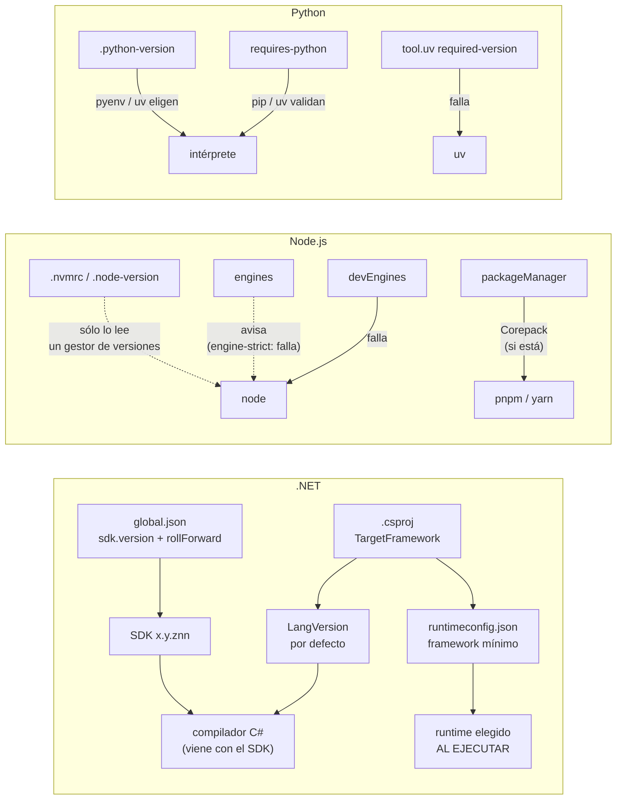

# N3 — Fijación del toolchain

El pedido del PO pone en la misma frase «versiones de compiladores, sdk» y los paquetes NuGet. Este núcleo se ocupa sólo de la primera mitad: la herramienta que transforma el fuente en artefacto (SDK, compilador, runtime, intérprete) y la que trae las dependencias (gestor de paquetes). La investigación confirma la hipótesis de la descomposición: los archivos, los comandos y las fallas son otros que los del grafo de dependencias, y además la versión del toolchain **altera el lock file** de .NET aunque el código no cambie (experimento 06). Por eso N4 depende de N3 y no al revés.

Todo lo afirmado lleva fuente oficial con fecha de consulta (2026-10-07) o un experimento ejecutado (E1) en el laboratorio. Lo que es criterio propio se marca **[criterio]**; lo que no se pudo verificar, **[no verificado]**.

## Índice

- [1. Definiciones](#1-definiciones)
- [2. Tres preguntas que «la versión» mezcla](#2-tres-preguntas-que-la-versión-mezcla)
- [3. .NET](#3-net)
- [4. Node.js](#4-nodejs)
- [5. Python](#5-python)
- [6. Gestores de versión](#6-gestores-de-versión)
- [7. Integración en una única solución](#7-integración-en-una-única-solución)
- [8. Aplicación por escenario](#8-aplicación-por-escenario)
- [9. Tabla comparativa](#9-tabla-comparativa)
- [10. Snippets representativos](#10-snippets-representativos)
- [11. Experimentos](#11-experimentos)
- [12. Preguntas guía](#12-preguntas-guía)
- [13. Errores frecuentes](#13-errores-frecuentes)
- [14. Dependencias y tensiones con otros núcleos](#14-dependencias-y-tensiones-con-otros-núcleos)
- [15. Observaciones y límites](#15-observaciones-y-límites)
- [16. Evidencias](#16-evidencias)
- [17. Verificación adversarial](#17-verificación-adversarial)

## 1. Definiciones

Los términos *fijar*, *rango*, *congelar* y *deriva* se usan con el sentido que define N0. Este núcleo agrega los siguientes.

| Término | Definición en esta guía |
|---|---|
| **Toolchain** | Conjunto de herramientas que transforman el fuente y resuelven dependencias: SDK, compilador, runtime o intérprete, gestor de paquetes. Es la segunda capa del modelo N0, entre los bytes del fuente y el grafo de dependencias. |
| **SDK de .NET** | Paquete que trae la CLI `dotnet`, MSBuild, el compilador de C# (Roslyn) y un runtime. Su versión tiene la forma `x.y.znn`: `x.y` es la versión de .NET, `z` la **banda de características** (*feature band*, trimestral) y `nn` el parche mensual [EV-07]. |
| **Runtime** | Lo que ejecuta el programa: el runtime de .NET (`Microsoft.NETCore.App`), Node.js o el intérprete de Python. En .NET se elige **al ejecutar** y no lo fija el SDK [EV-04, E1-02]. |
| **TFM** (*target framework moniker*) | Superficie de API contra la que se compila (`net8.0`). Determina la versión de C# por defecto y el runtime mínimo que pide el artefacto [EV-03, EV-04]. |
| **LangVersion** | Versión del lenguaje C# que el compilador acepta. Si no se declara, la deriva del TFM [EV-03]. |
| **Gestor de paquetes** | npm, pnpm, Yarn, pip, uv, NuGet (integrado al SDK). Su versión condiciona el formato y el contenido del lock file (ver N4). |
| **Gestor de versiones** | Herramienta que instala varias versiones de un runtime y elige cuál usar por directorio: nvm, fnm, pyenv, uv, mise, asdf. No es parte del toolchain: es un mecanismo para **obtenerlo**. |
| **Declarar** | Escribir en un archivo del repositorio qué versión se espera (`global.json`, `.nvmrc`, `engines`, `requires-python`, `.python-version`). |
| **Hacer cumplir** | Que alguna herramienta **falle** cuando lo instalado no coincide con lo declarado. Puede hacerlo la propia herramienta (`dotnet` con `global.json`), una opción que hay que activar (`engine-strict`), un intermediario (Corepack, uv) o un chequeo propio en local y en CI (N7). |
| **Fijación exacta / rango / piso** | Exacta: una sola versión admitida (`rollForward: disable`). Rango: un conjunto acotado (`latestFeature` dentro de 8.0; `>=24 <25`). Piso: sólo un mínimo (`latestMajor`; `>=3.13`). Un piso no fija nada en el sentido de N0. |

## 2. Tres preguntas que «la versión» mezcla

Cuando un equipo dice «estamos en .NET 8» puede estar respondiendo tres cosas distintas, y cada una se fija en un archivo distinto. La primera es **con qué herramienta se compila**: eso es el SDK, y en .NET lo elige `global.json`; sin ese archivo, `dotnet` usa el SDK más alto instalado aunque el proyecto apunte a una versión anterior [EV-04]. La segunda es **contra qué API y con qué lenguaje**: eso es el TFM del `.csproj`, que a su vez fija la versión de C# por defecto. La tercera es **con qué runtime corre el artefacto**: eso se decide en la máquina que lo ejecuta, según el `runtimeconfig.json` generado y la política de *roll forward* del runtime.

El experimento E1-02 las separa con un mismo proyecto `net8.0`: compilado con el SDK 8.0.425 usa el compilador C# 4.11.0 y compilado con el SDK 10.0.400 usa el 5.9.0, pero en los dos casos la versión de lenguaje es 12.0, porque la fija el TFM. El binario compilado con el SDK 10 pide el runtime 8.0.0 y **no arranca** en una máquina que sólo tiene el runtime 10, salvo que se fuerce `DOTNET_ROLL_FORWARD=Major`.

En Node.js y Python las tres preguntas se aplastan en una: el intérprete es a la vez herramienta de build y runtime, y la versión del lenguaje es la del intérprete. Lo que en esos ecosistemas se separa es otra cosa: el **runtime** (Node, CPython) y el **gestor de paquetes** (npm/pnpm/Yarn, pip/uv), que tienen versiones independientes y archivos de fijación distintos.



Las flechas punteadas son **declaraciones sin cumplimiento** por defecto; las llenas, mecanismos que fallan.

## 3. .NET

### 3.1 Qué fija `global.json`

`global.json` selecciona **la versión del SDK** con que corren los comandos de la CLI; Microsoft lo dice en la primera línea de la página: «Selecting the .NET SDK version is independent from specifying the runtime version a project targets» [EV-01]. Lo leen dos componentes, que buscan el archivo subiendo por los directorios desde puntos distintos: el *muxer* de `dotnet` arranca en el directorio de trabajo y el resolvedor de SDK de MSBuild arranca en el directorio de la solución (o del proyecto) [EV-01]. **[inferencia]** La consecuencia práctica es que un `global.json` en la raíz del repositorio cubre a todos los proyectos, y que uno ubicado en una subcarpeta puede no aplicarse si se invoca `dotnet` desde arriba (se deduce de los puntos de partida que documenta [EV-01]; no se reprodujo).

Propiedades vigentes (página actualizada el 2026-04-30) [EV-01]:

| Propiedad | Qué hace | Notas |
|---|---|---|
| `sdk.version` | Versión pedida. | Exige la versión completa (`10.0.100`); no acepta `10.0`, comodines ni rangos. |
| `sdk.rollForward` | Política cuando la versión no está, o directiva para usar una posterior. | Si hay `version` y no hay `rollForward`, el default es **`patch`**. Sin `version`, se usa el SDK más alto instalado (equivale a `latestMajor`). |
| `sdk.allowPrerelease` | Si se consideran SDK preliminares. | Fuera de Visual Studio el default es `true`; dentro de Visual Studio depende de si el IDE es preview o de la opción «Use previews of the .NET SDK». |
| `sdk.paths` | Directorios donde buscar SDK (por ejemplo uno local al repo), en orden; `$host$` es la instalación del `dotnet` en uso. | Desde el SDK de .NET 10. |
| `sdk.errorMessage` | Mensaje propio cuando no hay SDK compatible. | Desde el SDK de .NET 10; el SDK 8 lo ignora (E1-01). |
| `msbuild-sdks` | Fija las versiones de los *project SDK* de MSBuild en un solo lugar. | Útil para SDK de terceros referenciados en `<Project Sdk="...">`. |

Valores de `rollForward`, resumidos [EV-01]: `patch` (la versión pedida o el parche más alto de la misma banda), `feature` (además puede subir de banda dentro del mismo `x.y`), `minor` (puede subir de `y`), `major` (puede subir de `x`), `latestPatch`/`latestFeature`/`latestMinor`/`latestMajor` (usa **el más alto instalado** dentro de ese alcance, con la versión pedida como piso) y `disable` (coincidencia exacta). La diferencia entre `feature` y `latestFeature` es sutil y relevante: el primero prefiere la banda pedida y sólo sube si no está; el segundo siempre toma la más alta.

### 3.2 Qué pasa si la versión no está instalada

Si ningún SDK instalado satisface la política, **el comando falla antes de compilar**, con `A compatible .NET SDK was not found`, la versión pedida y la ruta del `global.json` (E1-01, código de salida 145 con SDK 8 y 155 con SDK 10). No hay descarga automática: hay que instalar el SDK o cambiar el archivo. E1-01 muestra la matriz completa con siete `global.json` (cuatro políticas: `patch` por defecto, `disable`, `latestFeature` y `latestMajor`, más un caso con `errorMessage`) contra dos imágenes; tres resultados forman criterio:

- `{"version": "8.0.400"}` sin `rollForward` acepta 8.0.425 (mismo `4xx`), pero `8.0.300` **no** acepta 8.0.425: el default `patch` no salta de banda.
- `rollForward: disable` rechaza 8.0.425 cuando se pidió 8.0.100: es la única opción que fija una versión exacta.
- `rollForward: latestMajor` con `8.0.100` usó 10.0.400 en la imagen del SDK 10: es un piso y no protege de nada que N0 llame deriva.

### 3.3 Qué **no** fija `global.json`

- **El runtime.** El runtime con que corre la aplicación lo determina el `runtimeconfig.json` (generado a partir del TFM) y la política `RollForward` del runtime, cuyo default es `Minor`: sube al parche más alto instalado de la misma `x.y` y, si no hay ninguno, a una menor superior, nunca a otra mayor [EV-04]. E1-02 lo muestra: un `net8.0` compilado con el SDK 10 pide `"version": "8.0.0"` y falla con `You must install or update .NET to run this application` donde sólo hay runtime 10. Para fijar el runtime exacto de un despliegue autocontenido existe `RuntimeFrameworkVersion` [EV-04]; para el despliegue dependiente del framework, lo que lo fija es la imagen o la máquina destino (N5).
- **La versión de C#.** La fija el TFM salvo que se declare `LangVersion`. Microsoft advierte explícitamente: «Don't set the `LangVersion` element to `latest`… The value of `latest` can change from machine to machine, making builds unreliable» [EV-03]. E1-02 lo reproduce: la misma línea de C# 14 compila con SDK 10 + `latest` y falla con SDK 8 + `latest`.
- **Los paquetes.** Pero el SDK sí aporta paquetes implícitos (por ejemplo `Microsoft.NET.ILLink.Tasks` cuando el proyecto es *trimmable*), cuya versión cambia con el SDK. Ver §14 y E1-06.

### 3.4 ¿Fijar el SDK fija el compilador?

Sí, de forma indirecta pero completa: el compilador de C# viaja dentro del SDK (`/usr/share/dotnet/sdk/10.0.400/Roslyn/...` en E1-02), de modo que fijar el SDK exacto fija el binario del compilador, sus analizadores incorporados y los *targets* de MSBuild. Con un rango (`latestFeature`) el compilador puede cambiar entre bandas, y con ello advertencias nuevas de analizadores **[no verificado con un caso concreto en esta corrida]**. La forma más directa de saber qué compilador corrió es la que documenta Microsoft: `#error version` provoca el CS8304 con la versión del compilador y la del lenguaje [EV-03].

Matiz para Visual Studio: ahí la build corre con el MSBuild del IDE, que trae su propio compilador. Cuando la versión de MSBuild no coincide con la del SDK, el SDK descarga automáticamente el paquete `Microsoft.Net.Sdk.Compilers.Toolset` y compila con el compilador que corresponde al SDK «instead of the one bundled with MSBuild»; desactivarlo (`BuildWithNetFrameworkHostedCompiler=false`) deja compilador y SDK desparejos, configuración que Microsoft declara no soportada [EV-22]. La afirmación «fijar el SDK fija el compilador» vale entonces también en ESC-01, pero por ese mecanismo, que además agrega una descarga de NuGet a la build (relevante para N4 y para CI sin red). **[no verificado en Windows en esta corrida]**

### 3.5 Visual Studio en Windows (ESC-01)

Visual Studio respeta `global.json` **[inferencia documentada, no reproducida en Windows]**: la build pasa por el resolvedor de SDK de MSBuild que lee el archivo, y la documentación de `allowPrerelease` describe un comportamiento específico «if you're in Visual Studio» [EV-01]; ninguna de las páginas consultadas lo afirma en una frase directa. Lo que cambia en ESC-01 es **de dónde sale el SDK**:

- Visual Studio instala **una sola copia** del SDK y la reemplaza al actualizar el IDE, incluso si cambia la versión mayor. Si `global.json` pide la versión anterior, la build deja de encontrarla. Microsoft recomienda instalar el SDK independiente para conservarlo, con la advertencia de que esa copia ya no se actualiza sola [EV-01, EV-07].
- Cada SDK tiene una **versión mínima de Visual Studio** con la que carga: el 10.0.100 exige VS 17.14 y los 10.0.2xx–4xx exigen VS 18.0 [EV-07]. Fijar en `global.json` una banda nueva obliga a todo el equipo a actualizar el IDE.
- Desde Visual Studio 18.0 el IDE sale mensualmente y el SDK trimestralmente; las versiones intermedias de VS sólo traen parches del SDK [EV-07].

`.nvmrc`, `.node-version` y `.python-version` no aparecen en ninguna documentación de Visual Studio consultada: **[no verificado]** que el IDE los lea; la guía debe tratarlos como ignorados por Visual Studio y apoyarse en el chequeo de §7. `engines`, `devEngines` y `requires-python` los hacen cumplir npm y pip, de modo que actúan igual quien sea que los invoque.

### 3.6 Otras piezas útiles

- `dotnet sdk check` informa si hay versiones más nuevas; Microsoft sugiere Dependabot para subir el SDK fijado en `global.json`, y la propiedad `CheckSdkVulnerabilities=true` hace que la build advierta si el SDK resuelto tiene vulnerabilidades conocidas, está fuera de soporte o «is on a feature band that has no newer release» (NETSDK1238–1240) [EV-04]. Esto alimenta la actualización controlada de N7.
- Microsoft también recomienda, cuando se pueda, compilar con `dotnet build` y no con `msbuild`, «to ensure consistent tooling» [EV-07].

## 4. Node.js

### 4.1 El runtime: `.nvmrc` y `.node-version`

Node no tiene un archivo propio para fijar su versión. `.nvmrc` es la convención de nvm: contiene una versión o alias (`24`, `lts/*`) y la usan `nvm use`, `nvm install` y `nvm which` cuando no se les pasa versión; nvm **no cambia de versión solo** al entrar al directorio (su README trae recetas opcionales de integración con la shell y menciona `nvshim`, que sus mantenedores no soportan) y no soporta Windows nativo: funciona en WSL, Git Bash o Cygwin, y remite a alternativas que no mantiene [EV-11]. `.node-version` es la convención de otros gestores; fnm lee ambos y, si no hay ninguno, resuelve `engines.node` de `package.json` (opción `--resolve-engines`, activa por defecto) [EV-12]. Ni `node` ni `npm` leen `.nvmrc`: en E1-03, `npm install` en Node 22 con un `.nvmrc` que pide 24 termina sin advertencia y con código 0. Es una **declaración** que sólo cumple quien tenga un gestor configurado.

Estado de las líneas al 2026-10-07: v26 *Current*, v24 y v22 LTS, v20 fuera de soporte; la recomendación oficial es usar en producción sólo versiones LTS [EV-15].

### 4.2 `engines` y `engine-strict`

`engines` en `package.json` declara las versiones de Node y npm compatibles. La documentación de npm es explícita: salvo que esté activado `engine-strict`, el campo «is advisory only and will only produce warnings when your package is installed as a dependency» [EV-08]. La frase habla del paquete instalado como dependencia; E1-03 muestra que npm emite la misma advertencia también para el paquete raíz. `engine-strict` vale `false` por defecto y, en `true`, hace que npm se niegue a instalar paquetes que declaren incompatibilidad con la versión actual de Node; se puede saltear con `--force` [EV-09]. E1-03 lo confirma con el paquete raíz: en Node 22 y 26 contra `">=24 <25"`, `npm install` emite `EBADENGINE` como **advertencia** y termina con código 0; con `engine-strict=true` en el `.npmrc` del proyecto, el mismo comando falla con código 1.

### 4.3 `devEngines`

npm documenta `devEngines` como el campo para alinear las herramientas de quienes **desarrollan** el proyecto (no de quien lo consume como dependencia). Admite `runtime`, `packageManager`, `os`, `cpu` y `libc`, cada uno con `name`, `version` y `onFail` (`warn`, `error` o `ignore`; **default `error`**), y se evalúa antes de `install`, `ci` y `run` [EV-08]. E1-03 muestra que npm 10.9.8 y 11.19 ya lo hacen cumplir: `EBADDEVENGINES … does not match "v22.23.2" for "runtime"`, código 1, sin tocar el `.npmrc`. Es la forma vigente, del propio npm, de **hacer cumplir** la versión de Node y de npm en el repo.

### 4.4 `packageManager` y el estado de Corepack

`packageManager` (`"pnpm@10.18.0"`, admite un hash SHA-224 opcional) es el campo que lee **Corepack**: con Corepack activo, invocar otro gestor en ese proyecto produce un error y pide usar el correcto (`COREPACK_ENABLE_STRICT=0` lo desactiva), y el gestor declarado se descarga en la versión exacta [EV-06]. E1-03: `yarn --version` falla con `This project is configured to use pnpm…`, y `pnpm --version` devuelve exactamente 10.18.0.

El estado vigente cambia la recomendación:

- Corepack figura como **Stability 1 – Experimental** en la documentación de Node 24, con la nota «Corepack will no longer be distributed starting with Node.js v25» [EV-05].
- Node 25.0.0 (2025-10-15) lo quitó de la distribución (commit `build: stop distributing Corepack`, PR nodejs/node#57617) [EV-05b]. La página `nodejs.org/api/corepack.html` hoy redirige al repositorio del proyecto, que dice que se distribuye con Node «from version 14.19.0 up to (but not including) 25.0.0» y que desde la 25 hay que instalarlo con npm [EV-06].
- E1-03 lo confirma sobre imágenes oficiales: Node 22 trae Corepack 0.34.6, Node 24 trae 0.36.0 y Node 26 no lo trae.
- Corepack no intercepta npm por defecto: en E1-03 `npm install` corre sin error en un proyecto que declara `pnpm` (los *shims* que crea `corepack enable` son de Yarn y pnpm, y npm es opcional [EV-06]).

**[criterio]** Con Node 24 como LTS más reciente, `packageManager` sigue siendo útil como **declaración** (la leen Corepack [EV-06] y pnpm [EV-27]; Yarn **[no verificado]**), pero la guía no debe presentar Corepack como mecanismo de cumplimiento estándar: no viene en la línea *Current* y en la siguiente LTS tampoco vendrá. Para equipos con npm alcanza con `devEngines.packageManager`; para pnpm o Yarn, instalar Corepack (o el gestor) explícitamente en la imagen y en la CI, con versión fijada.

## 5. Python

### 5.1 `requires-python`: un rango que pertenece al paquete

`requires-python` en `[project]` de `pyproject.toml` es la versión de Python que el proyecto soporta; se publica como el metadato `Requires-Python`, cuyo valor debe tener el formato de la especificación de *version specifiers* [EV-10, EV-10b]. Lo consumen los instaladores: pip (desde la 9.0) compara el intérprete actual con ese metadato y, si no coincide, busca la última distribución compatible [EV-13]. E1-04-A: `pip install .` con `requires-python = ">=3.13"` en Python 3.12.14 falla con `ERROR: Package 'n3pkg' requires a different Python: 3.12.14 not in '>=3.13'`. E1-04-B: el mismo comando con `--ignore-requires-python` instala sin quejarse, opción que pip documenta [EV-14]. Es un **rango** pensado para quien consume el paquete, no una fijación del entorno de desarrollo.

En uv tiene un segundo efecto: determina qué sintaxis se admite y **condiciona la resolución**, porque las dependencias elegidas deben soportar todo el rango [EV-16]. Por eso el lock universal de uv se calcula para el rango completo (ver N4).

### 5.2 `.python-version`: una preferencia del entorno

`.python-version` no figura en la especificación de `pyproject.toml` ni en la de metadatos consultadas [EV-10, EV-10b]: es la convención de pyenv, que también lee uv **[criterio: que «no esté en ninguna PEP» no se verificó exhaustivamente]**. pyenv elige la versión por este orden: variable `PYENV_VERSION`, `.python-version` del directorio actual, el de los padres hasta la raíz, y el archivo global; admite varias versiones, una por línea [EV-17]. uv busca el archivo en el directorio y sus padres sin pasar el límite del proyecto, lo crea con `uv python pin`, y **descarga el intérprete** si no está (comportamiento por defecto, `python-downloads = "automatic"`) [EV-18, EV-19]. Si el proyecto tiene `requires-python` y no hay `.python-version`, uv usa la primera versión compatible con el rango [EV-18].

E1-04 muestra los tres comportamientos:

- **C**: `.python-version` = `3.13` → uv descargó CPython 3.13.16 y lo usó. `3.13` no es una fijación exacta: es «la 3.13 más reciente disponible».
- **D**: `.python-version` = `3.11` con `requires-python >=3.13` → uv falla: `The Python request from .python-version resolved to Python 3.11.17, which is incompatible with the project's Python requirement`.
- **E**: con `UV_PYTHON_DOWNLOADS=never` y sin 3.13 instalado → `No interpreter found for Python 3.13`. En CI, prohibir descargas convierte la declaración en un requisito explícito de la imagen.

### 5.3 La versión del gestor

`[tool.uv] required-version` acepta un especificador PEP 440 y hace fallar uv si su versión no coincide [EV-19]. E1-04-F: `Required uv version ==0.1.0 does not match the running version 0.12.23`. Es el equivalente a `devEngines.packageManager` de npm. pip no tiene un mecanismo equivalente dentro del proyecto **[no verificado: no se encontró en la documentación consultada]**; se fija desde la imagen o con `python -m pip install pip==X` en la CI.

## 6. Gestores de versión

| Gestor | Ecosistema | Lee | Windows nativo | Hace cumplir |
|---|---|---|---|---|
| nvm | Node | `.nvmrc` | No (WSL, Git Bash; alternativas: nvm-windows, nvs) [EV-11] | No: hay que correr `nvm use`; no cambia solo al hacer `cd` |
| fnm | Node | `.node-version`, `.nvmrc`, `engines.node` como respaldo [EV-12] | Sí: «Cross-platform support (macOS, Windows, Linux)», con instalación por winget/Scoop/Chocolatey y configuración para PowerShell [EV-23] | Con `--use-on-cd` cambia al entrar al directorio |
| pyenv | Python | `.python-version`, `PYENV_VERSION` [EV-17] | No (pyenv-win es otro proyecto) [EV-17] | No: elige, no valida |
| uv | Python (y el propio uv) | `.python-version`, `.python-versions`, `requires-python` [EV-18] | Sí: instalador oficial para PowerShell [EV-24]; no se probó en Windows en esta corrida | Sí: valida `.python-version` contra `requires-python` y `required-version` (E1-04) |
| mise | Multi-runtime | `mise.toml`; además archivos «idiomáticos» (`.nvmrc`, `.node-version`, `.python-version`, `global.json`…) **sólo si se habilitan** por herramienta [EV-20] | Se instala con winget según su README [EV-25]; no se probó en Windows | Tiene `mise.lock` para modo estricto [EV-20] |
| asdf | Multi-runtime | `.tool-versions`, que rige en el directorio y sus subdirectorios; los archivos de otros gestores sólo con `legacy_version_file` (default `no`) [EV-26] | **[no verificado]** | **[no verificado]** |

Ninguno es necesario en .NET: `global.json` cumple su función y el SDK se instala con el instalador oficial, con Visual Studio o con la imagen. mise puede leer `global.json`, pero para instalar el SDK, no para reemplazar al resolvedor de `dotnet`.

**[criterio]** El gestor de versiones es una comodidad del desarrollador (ESC-02, ESC-03); no debe ser la fuente de verdad. La fuente de verdad son los archivos nativos que leen las herramientas del ecosistema y el chequeo que los hace cumplir.

## 7. Integración en una única solución

En una solución con .NET, Node y Python conviven, como mínimo, cinco declaraciones independientes: `global.json`, `.nvmrc` (o `.node-version`), `devEngines`/`packageManager`, `requires-python` y `.python-version`. Ninguna herramienta las lee todas, y Visual Studio sólo garantiza la primera. Las estrategias de la industria son tres, compatibles entre sí:

| Estrategia | Qué la respalda | Ventaja | Límite |
|---|---|---|---|
| A. Archivos nativos por ecosistema + un chequeo común | Documentación de cada fabricante (§3–§5) | Cada herramienta y cada IDE sigue leyendo lo suyo; funciona en ESC-01 sin instalar nada extra | Hay que escribir y mantener el chequeo (E1-05) |
| B. Gestor multi-runtime (mise, asdf) con `mise.toml`/`.tool-versions` | Convención extendida | Un archivo instala todo en ESC-02/03 | No lo usa Visual Studio **[no verificado: ninguna documentación consultada lo menciona]**; duplica versiones si se mantienen también los archivos nativos; en mise hay que habilitar los archivos idiomáticos |
| C. Imagen de contenedor con los runtimes instalados (devcontainer, CI) | containers.dev y las imágenes oficiales (ver N5) | Fija también el SO y las bibliotecas | No alcanza a ESC-01 nativo; si la imagen va por etiqueta, la versión deriva (en el host de esta corrida, `sdk:8.0` pasó de 8.0.424 —imagen del 2026-08-10— a 8.0.425, y `sdk:10.0` de 10.0.302 —2026-07-14— a 10.0.400, un cambio de **banda**; ver E1-07) |

**[criterio]** Recomendación para la guía: **A como base, C como forma de proveerla, B como opción personal.** Los archivos nativos son la fuente de verdad porque son lo único que leen todas las herramientas de cada ecosistema, incluido Visual Studio. Un único script (E1-05, `verificar-toolchain.sh`) los hace cumplir de la misma forma en la estación, el devcontainer y la CI, y emite una línea `toolchain:` con las versiones reales que N6 puede guardar como procedencia. La imagen del devcontainer y la de CI se construyen **a partir de** esos archivos, no al revés: si la imagen trae Node 22 y el `.nvmrc` dice 24, el chequeo falla (E1-05 lo muestra).

Choques específicos de la integración:

- **Granularidad distinta.** `global.json` exige versión completa; `.nvmrc` y `.python-version` aceptan una versión mayor o menor y resuelven al parche más reciente. Un mismo repositorio queda fijado al parche en .NET y a la línea en Node y Python. **[criterio]** Para CI, fijar el parche donde el ecosistema lo permite (imagen por digest, `.python-version` con parche, `.nvmrc` con versión completa) y aceptar la línea en la estación del desarrollador.
- **Prerelease.** `allowPrerelease` vale `true` fuera de Visual Studio y depende del IDE adentro [EV-01]: la misma máquina puede elegir SDK distintos desde la terminal y desde Visual Studio si hay un preview instalado y no hay versión fijada. Declararlo explícitamente en `false` elimina la diferencia.
- **Quién llama a quién.** Si la build de .NET invoca `npm` o `python` (targets de MSBuild, N8), lo hace con el Node o Python que esté en el `PATH` de esa máquina: `global.json` no los cubre. Es otra razón para el chequeo común.

## 8. Aplicación por escenario

| Escenario | Qué rige | Riesgo propio de N3 | Recomendación |
|---|---|---|---|
| ESC-01 Windows + VS | `global.json` (vía resolvedor MSBuild), TFM, `LangVersion`; npm y pip hacen cumplir `devEngines`, `engine-strict` y `requires-python` | SDK reemplazado al actualizar VS; VS mínimo por banda de SDK; `.nvmrc`/`.python-version` ignorados **[no verificado]** | Fijar con `rollForward` acorde a la política (§14); instalar el SDK independiente si se fija una versión que VS no trae; correr el chequeo E1-05 antes del push |
| ESC-02 Linux nativo | Lo mismo, más los gestores de versión | Versiones instaladas a mano; `latestMajor` toma lo más nuevo | Gestor de versiones como comodidad; el chequeo como verificación |
| ESC-03 WSL 2 | Toolchain de Linux con repo eventualmente en el disco de Windows | Dos instalaciones del SDK (Windows y WSL) con versiones distintas | Tratar cada lado como una estación; el `global.json` es el mismo para ambos |
| ESC-04 Devcontainer | La imagen trae el toolchain | Imagen por etiqueta que cambia de parche | Imagen construida desde los archivos de N3 y fijada por digest (N5) |
| ESC-05 CI | La imagen o los *setup actions* | Instalar «la última» sin mirar el repo | Leer las versiones de los archivos del repo; `rollForward` estricto; `UV_PYTHON_DOWNLOADS=never` o equivalente; chequeo E1-05 como compuerta (N7) |

## 9. Tabla comparativa

| Archivo / campo | Ecosistema | Qué fija | Quién lo lee | Tipo | ¿Hace cumplir por defecto? | ¿Visual Studio lo respeta? |
|---|---|---|---|---|---|---|
| `global.json` `sdk.version` + `rollForward` | .NET | SDK (y con él compilador y MSBuild) | `dotnet`, resolvedor MSBuild | exacta, rango o piso según `rollForward` | **Sí**: falla sin SDK compatible | **Sí** |
| `<TargetFramework>` | .NET | API, C# por defecto, runtime mínimo | SDK | piso de runtime | Sí al compilar; el runtime se resuelve al ejecutar | Sí |
| `<LangVersion>` | .NET | versión de C# | compilador | exacta (o `latest`, no recomendado) | Sí | Sí (VS deshabilita cambiarlo desde la UI) [EV-03] |
| `<RollForward>` / `runtimeconfig.json` | .NET | política del runtime al ejecutar | host `dotnet` | política | Sí: no arranca sin runtime aceptable | n/a |
| `.nvmrc` / `.node-version` | Node | runtime | nvm, fnm, mise (opt-in) | exacta o línea | **No** | **No verificado** |
| `engines` | Node | runtime y npm aceptados | npm | rango | **No**: avisa; con `engine-strict=true` falla | lo aplica npm |
| `devEngines` | Node | runtime, gestor, SO, CPU | npm | rango | **Sí** (`onFail` por defecto `error`) | lo aplica npm |
| `packageManager` | Node | gestor y su versión exacta | Corepack, pnpm (Yarn no verificado) | exacta (+ hash opcional) | Sólo con Corepack activo; Corepack no viene desde Node 25 | — |
| `requires-python` | Python | intérpretes admitidos | pip, uv | rango | Sí al instalar el paquete (se puede saltear) | lo aplica pip |
| `.python-version` | Python | intérprete preferido | pyenv, uv, mise (opt-in) | línea o exacta | uv la valida contra `requires-python` | **No verificado** |
| `[tool.uv] required-version` | Python | versión de uv | uv | rango o exacta | **Sí** | — |

## 10. Snippets representativos

`global.json` para una política estricta, apropiada cuando se usan lock files de NuGet (§14):

```jsonc
{
  "sdk": {
    // Versión completa: global.json no acepta "8.0" ni comodines.
    "version": "8.0.425",
    // Coincidencia exacta. La documentación lo recomienda junto con packages.lock.json.
    "rollForward": "disable",
    // Evita que la terminal y Visual Studio elijan SDK distintos si hay un preview instalado.
    "allowPrerelease": false
  }
}
```

`global.json` para una política tolerante en la banda (cómoda en estaciones Windows con VS actualizado):

```jsonc
{
  "sdk": {
    "version": "8.0.400",          // piso: banda 4xx
    "rollForward": "latestPatch",  // el parche más alto de la banda 4xx, nunca 8.0.5xx ni 9.x
    "allowPrerelease": false
    // Con SDK 10+ se puede agregar "errorMessage": "Instalar el SDK 8.0.4xx: ver docs/toolchain.md"
  }
}
```

`Directory.Build.props` para que la versión de C# no dependa de la máquina:

```xml
<Project>
  <PropertyGroup>
    <!-- Nunca "latest": cambia de máquina en máquina (Microsoft lo desaconseja). -->
    <!-- Omitirlo también es válido: el compilador usa la versión asociada al TFM. -->
    <LangVersion>12.0</LangVersion>
  </PropertyGroup>
</Project>
```

`package.json` que declara y hace cumplir con npm, sin depender de Corepack:

```jsonc
{
  "private": true,
  // Lo ven quienes consumen el paquete: sólo avisa salvo engine-strict.
  "engines": { "node": ">=24 <25" },
  // Lo hace cumplir npm para quienes desarrollan: falla antes de install, ci y run.
  "devEngines": {
    "runtime":        { "name": "node", "version": ">=24 <25", "onFail": "error" },
    "packageManager": { "name": "npm",  "version": ">=11",     "onFail": "error" }
  },
  // Declaración para Corepack/pnpm; con npm no tiene efecto salvo que se habilite el shim de npm de Corepack.
  "packageManager": "npm@11.19.0"
}
```

`pyproject.toml` y `.python-version` en un proyecto uv:

```toml
[project]
name = "servicio"
version = "0.1.0"
# Rango que admite el proyecto: lo validan pip y uv, y acota la resolución del lock.
requires-python = ">=3.12,<3.13"

[tool.uv]
# La versión del gestor también condiciona el formato de uv.lock (ver N4).
required-version = "==0.12.23"
```

```text
3.12.14
```

(contenido de `.python-version`: con el parche, para que uv no elija «la 3.12 más reciente»).

## 11. Experimentos

Todos en `LAB/Lab-Documentos/Guides/Metodologia-Entorno-Desarrollo/Examples/N3-fijacion-del-toolchain/`, ejecutados el 2026-10-07. El README de esa carpeta tiene los comandos exactos y la salida completa; acá va el resumen.

| ID | Ruta | Comando | Resultado |
|---|---|---|---|
| E1-01 | `01-dotnet-global-json/` | `sh correr.sh` (siete `global.json`, cuatro políticas, × `sdk:8.0`, `sdk:10.0`) | `patch` (default) acepta 8.0.400→8.0.425 y rechaza 8.0.300→8.0.425; `disable` rechaza todo salvo la exacta; `latestMajor` usa 10.0.400 aunque se pidió 8.0.100; `errorMessage` sólo en SDK 10. Falla con `A compatible .NET SDK was not found`, rc 145/155. |
| E1-02 | `02-dotnet-sdk-compilador-runtime/` | `sh correr.sh` | SDK 8 → compilador 4.11.0, SDK 10 → 5.9.0; ambos `Language version: 12.0` para `net8.0`. C# 14 con `LangVersion=latest`: compila en SDK 10, falla en SDK 8 (CS0131). Binario `net8.0` del SDK 10: no arranca con runtime 10 (rc 150) salvo `DOTNET_ROLL_FORWARD=Major`; con runtime 8 corre en 8.0.31. |
| E1-03 | `03-node-engines-packagemanager/` | `sh correr.sh` (`node:22`, `24`, `26`) | `engines`: advertencia `EBADENGINE`, rc 0. `engine-strict`: error, rc 1. `devEngines`: `EBADDEVENGINES`, rc 1. Corepack: rechaza Yarn con `packageManager: pnpm`, entrega pnpm 10.18.0 exacto, deja pasar npm; ausente en Node 26. `.nvmrc`=24 en Node 22: `npm install` sin aviso, rc 0. |
| E1-04 | `04-python-requires-vs-python-version/` | `sh correr.sh` (`python:3.12-slim` + uv 0.12.23) | pip falla por `requires-python` y pasa con `--ignore-requires-python`; uv descarga 3.13.16 para `.python-version=3.13`; rechaza `3.11` contra `>=3.13`; sin descargas, falla; `required-version` fija la versión de uv. |
| E1-05 | `05-chequeo-de-toolchain/` | `sh correr.sh` | El mismo script pasa en `sdk:8.0`, `node:24`, `python:3.12` y falla en `node:22` y `python:3.11`, con una línea `toolchain:` reutilizable por N6. |
| E1-06 | `06-dotnet-sdk-y-lock/` | `sh correr.sh` | Proyecto sin `PackageReference`, `IsTrimmable`: lock con SDK 8.0.425 registra `Microsoft.NET.ILLink.Tasks 8.0.31`; `restore --locked-mode` con SDK 10.0.400 falla con `NU1004 … changed from [8.0.31, ) to [8.0.30, )`. |
| E1-07 | (sin carpeta: inspección del host) | `docker image inspect <id> --format '{{.Created}} {{range .Config.Env}}{{.}} {{end}}'` sobre las imágenes `mcr.microsoft.com/dotnet/sdk` locales, actuales y desplazadas (*dangling*) | Etiqueta `sdk:8.0` hoy 8.0.425; imagen anterior desplazada del 2026-08-10 con `DOTNET_SDK_VERSION=8.0.424`. Imágenes desplazadas de `sdk:10.0`: 10.0.302 (2026-07-14) y 10.0.400 (2026-08-10). Observación propia de este host, no reproducible en otra máquina sin esas imágenes en caché. |

## 12. Preguntas guía

**¿Qué fija `global.json` y qué no?** Fija el SDK con que corren `dotnet` y MSBuild, y por arrastre el compilador de C#, los analizadores incorporados y los *targets*. No fija el TFM, ni la versión de C# (la decide el TFM o `LangVersion`), ni el runtime con que corre el artefacto, ni los paquetes que el proyecto referencia. *Aplica* cuando dos personas o la CI pueden tener SDK distintos instalados, es decir, siempre que haya más de una máquina.

**¿Qué hace `rollForward` si la versión no está instalada?** Depende del valor: `disable` falla; `patch` (el default cuando hay `version`) busca otro parche de la misma banda; `feature`, `minor` y `major` suben progresivamente; los `latest*` toman lo más alto instalado dentro de su alcance. Si nada satisface la política, `dotnet` falla antes de compilar; no descarga nada. *Criterio*: exacto en CI cuando hay lock files o se necesita reproducibilidad bit a bit (N6); `latestPatch` o `latestFeature` cuando el equipo prioriza no bloquear estaciones Windows que se actualizan con Visual Studio, aceptando que la CI registre la versión real.

**¿Fijar el SDK fija el compilador de C# y el runtime?** El compilador sí, porque viaja dentro del SDK (E1-02). El runtime no: el artefacto declara un framework mínimo y la máquina que lo ejecuta elige el parche más alto disponible de esa línea. *Aplica* al diagnosticar «compila igual pero se comporta distinto»: hay que mirar las dos capas por separado y registrar ambas (N6).

**¿Conviene `LangVersion=latest`?** No. Microsoft lo desaconseja porque cambia de máquina en máquina, y E1-02 lo muestra: el mismo código compila con un SDK y no con otro. *Aplica* cuando alguien sube `LangVersion` para usar una característica nueva: o se sube también el TFM, o se declara un número explícito y se fija el SDK.

**¿`engines` impide instalar o sólo avisa?** Sólo avisa, salvo que el proyecto o la máquina tenga `engine-strict=true`. Para el repositorio propio, `devEngines` falla por defecto y es la herramienta vigente. *Aplica* así: `engines` para lo que se publica como paquete, `devEngines` para el equipo que lo desarrolla.

**¿Cuál es el estado vigente de Corepack y `packageManager`?** Corepack es experimental, viene con Node hasta la 24 y dejó de distribuirse desde la 25 (la 26 es la *Current* hoy). `packageManager` sigue siendo leído por Corepack instalado aparte y por pnpm/Yarn. *Aplica*: no basar la compuerta en Corepack; si se usa pnpm o Yarn, instalar Corepack o el gestor explícitamente en la imagen y en la CI.

**¿Qué diferencia hay entre `requires-python` y `.python-version`?** `requires-python` es un rango que pertenece al paquete y viaja en sus metadatos; lo hacen cumplir los instaladores y acota la resolución de dependencias. `.python-version` es una preferencia local del entorno, no estandarizada, que leen pyenv y uv para elegir (y, en uv, descargar) un intérprete. *Aplica*: los dos a la vez, el primero como contrato y el segundo como fijación del entorno de trabajo; uv los cruza y falla si se contradicen (E1-04-D).

**¿Qué archivo respeta y cuál ignora una estación Windows con Visual Studio?** Respeta `global.json`, TFM y `LangVersion`, que pasan por MSBuild. No hay evidencia de que lea `.nvmrc`, `.node-version` ni `.python-version` [no verificado]; `engines`, `devEngines` y `requires-python` se cumplen igual porque los aplican npm y pip. *Aplica*: en ESC-01 el chequeo común (E1-05) es lo único que cubre a Node y Python.

**¿Un gestor multi-runtime reemplaza a los archivos nativos?** No conviene. mise puede leer los archivos nativos, pero sólo si se habilitan, y Visual Studio no lee `mise.toml`. *Aplica* como comodidad del desarrollador en Linux o WSL, nunca como única declaración.

## 13. Errores frecuentes

- Creer que `global.json` sin `rollForward` fija la versión exacta: el default `patch` acepta otro parche de la banda (E1-01).
- Poner `"version": "8.0"` o `"8.0.x"`: no es válido; `global.json` exige la versión completa [EV-01].
- Usar `latestMajor` y creer que se fijó algo: es un piso (E1-01).
- Confundir el SDK con el runtime: compilar con SDK 10 para `net8.0` no hace que la aplicación corra en .NET 10 (E1-02).
- Fijar `LangVersion=latest` en `Directory.Build.props` (E1-02, [EV-03]).
- Actualizar Visual Studio y perder el SDK que `global.json` pedía [EV-01].
- Fijar una banda de SDK que exige una versión de Visual Studio que el equipo no tiene [EV-07].
- Dar por hecho que `engines` bloquea una instalación (E1-03).
- Confiar en que `corepack enable` está disponible en cualquier imagen de Node (E1-03, Node 26).
- Escribir `.nvmrc` y no tener nada que lo haga cumplir en la CI.
- Tratar `requires-python` como si fijara el intérprete del desarrollo: es un rango (E1-04).
- Dejar que la CI descargue «la última 3.x» de Python sin declararlo (`python-downloads` en `automatic`).
- Cambiar de SDK de .NET con lock files de NuGet activos y `rollForward` permisivo (E1-06).

## 14. Dependencias y tensiones con otros núcleos

| Con | Relación | Detalle |
|---|---|---|
| N0 | depende | Usa *fijar*, *rango*, *deriva* tal como N0 los define; agrega *declarar* y *hacer cumplir* (pedido de BIT-15-02 §3) y las nociones de exacta/rango/piso. |
| N4 | alimenta (dura) | **La versión del SDK cambia el lock de NuGet** aunque no cambie ninguna referencia (E1-06): el SDK aporta paquetes implícitos con su propia versión. Microsoft recomienda `rollForward: disable` cuando se usan lock files para que SDK y grafo «stay in lockstep», con referencias a dos issues abiertos (dotnet/sdk#48795: `NU1004` entre 8.0.407 y 8.0.408; dotnet/aspnetcore#65061) [EV-01, EV-21]. En Python, `requires-python` acota la resolución del lock de uv [EV-16] y `required-version` fija el gestor que lo escribe. En Node, la versión de npm/pnpm determina el formato del lock (a verificar por N4). |
| N5 | alimenta | La imagen del devcontainer y la de CI deben construirse con las versiones de los archivos de N3. E1-05 sirve para comprobar que la imagen coincide. Las etiquetas `sdk:8.0` y `sdk:10.0` derivan de parche y hasta de banda (E1-07): la fijación por digest es tarea de N5. |
| N6 | alimenta | Qué registrar: versión del SDK, del compilador (CS8304), del runtime de ejecución, de Node, npm, Python y uv. La línea `toolchain:` de E1-05 es un insumo mínimo. |
| N7 | alimenta | El chequeo E1-05 es candidato a compuerta común local/CI. `CheckSdkVulnerabilities`, `dotnet sdk check` y Dependabot sobre `global.json` son las piezas de actualización controlada que documenta Microsoft [EV-04]. |
| N8 | alimenta | Punto único de verdad (§7): archivos nativos + chequeo común; la invocación de Node/Python desde MSBuild no está cubierta por `global.json`. |

**Tensión registrada (BIT-15-02 §4, `rollForward` comodidad vs exactitud).** La evidencia de E1-06 la inclina: si el repositorio usa `packages.lock.json` con `--locked-mode`, cualquier `rollForward` distinto de `disable` puede romper la restauración cuando una estación tiene otro parche. **[criterio, a someter a la mesa]** Con lock files de NuGet, `disable` en el `global.json` del repo y una vía documentada para instalar ese SDK exacto en Windows (instalador independiente) y en la imagen; sin lock files, `latestPatch` es un compromiso razonable.

**Tensión nueva: Visual Studio vs SDK exacto.** Visual Studio reemplaza su SDK al actualizarse, y la guía oficial recomienda usar el SDK que trae el IDE [EV-07]; la reproducibilidad pide uno exacto. Las dos recomendaciones de Microsoft tiran en direcciones opuestas y la guía tiene que presentar la elección, no esconderla.

## 15. Observaciones y límites

- **Hecho**: la página `nodejs.org/api/corepack.html` responde con una redirección 308 al repositorio `nodejs/corepack` (consultada el 2026-10-07). La documentación de Node 24 sigue disponible en `nodejs.org/docs/latest-v24.x/api/corepack.html`.
- **Hecho**: el pull anónimo de imágenes de Docker Hub fue necesario porque las credenciales configuradas en el host fallaban; no afecta los resultados. Las imágenes se usaron por etiqueta y las versiones observadas quedan en el README del laboratorio.
- **No verificado**: si Visual Studio lee `.nvmrc`, `.node-version` o `.python-version`; comportamiento real de fnm, uv y mise en Windows nativo (está documentado, no probado); soporte de asdf en Windows y si hace cumplir algo; que Yarn lea `packageManager`. Verificación propuesta: el actor ACT-DEV en ESC-01 abre un repo con `.nvmrc` = una versión no instalada y observa qué Node usa el proyecto JavaScript de Visual Studio.
- **No verificado**: que un cambio de banda de SDK con el mismo TFM introduzca advertencias nuevas de analizadores. Plausible por §3.4, sin caso reproducido.
- **Interpretación**: en E1-06 el SDK 10.0.400 eligió `ILLink.Tasks 8.0.30` y el 8.0.425 eligió `8.0.31`, es decir, un SDK más nuevo trajo un paquete implícito **más viejo**. No se investigó la causa; lo relevante para N3/N4 es que la versión depende del SDK.

## 16. Evidencias

Fecha de consulta de todas las URL: 2026-10-07.

| ID | Afirmación | Fuente | Fecha |
|---|---|---|---|
| EV-01 | `global.json` elige el SDK, es independiente del runtime; esquema `version` (completa), `rollForward` (valores, default `patch`), `allowPrerelease` (default según VS), `paths` y `errorMessage` (SDK 10), `msbuild-sdks`; dos componentes lo buscan; VS instala una sola copia del SDK; nota †: `disable` con lock files | https://learn.microsoft.com/en-us/dotnet/core/tools/global-json | 2026-10-07 |
| EV-03 | Versión de C# por defecto según TFM; no usar `LangVersion=latest`; `#error version` → CS8304; VS deshabilita cambiar la versión desde la UI | https://learn.microsoft.com/en-us/dotnet/csharp/language-reference/configure-language-version | 2026-10-07 |
| EV-04 | El SDK usa la versión más alta instalada sin `global.json`; TFM define API; *roll forward* del runtime (default `Minor`, valores, precedencia); `RuntimeFrameworkVersion`; `dotnet sdk check`, Dependabot, `CheckSdkVulnerabilities` | https://learn.microsoft.com/en-us/dotnet/core/versions/selection | 2026-10-07 |
| EV-05 | Corepack «Stability: 1 – Experimental»; «will no longer be distributed starting with Node.js v25» | https://nodejs.org/docs/latest-v24.x/api/corepack.html | 2026-10-07 |
| EV-05b | Node 25.0.0 (2025-10-15): «build: stop distributing Corepack» (#57617) | https://nodejs.org/en/blog/release/v25.0.0 | 2026-10-07 |
| EV-06 | Corepack se distribuye con Node 14.19.0 a <25.0.0; `packageManager` con hash opcional; rechazo de otro gestor; `COREPACK_ENABLE_STRICT`; `corepack enable` | https://github.com/nodejs/corepack | 2026-10-07 |
| EV-07 | Versionado del SDK (banda, parche); VS instala una copia y la actualiza; VS 18 mensual; tabla SDK ↔ VS mínimo; usar `dotnet build` antes que `msbuild`; recomendación de usar el SDK del IDE | https://learn.microsoft.com/en-us/dotnet/core/porting/versioning-sdk-msbuild-vs | 2026-10-07 |
| EV-08 | `engines` es «advisory only» salvo `engine-strict`; `devEngines` (claves, `onFail`, default `error`, antes de install/ci/run) | https://docs.npmjs.com/cli/v11/configuring-npm/package-json | 2026-10-07 |
| EV-09 | `engine-strict` default `false`; en `true` rechaza paquetes incompatibles; `--force` | https://docs.npmjs.com/cli/v11/using-npm/config | 2026-10-07 |
| EV-10 | `requires-python`: versiones de Python del proyecto, metadato `Requires-Python`, *version specifiers* | https://packaging.python.org/en/latest/specifications/pyproject-toml/ | 2026-10-07 |
| EV-11 | `.nvmrc`: contenido, lo usan `nvm use/install/which`; sin cambio automático; nvm no soporta Windows | https://github.com/nvm-sh/nvm/blob/master/README.md | 2026-10-07 |
| EV-12 | fnm: `--version-file-strategy`, `--resolve-engines` (default activo), `--use-on-cd` | https://github.com/Schniz/fnm/blob/master/docs/commands.md | 2026-10-07 |
| EV-13 | pip (≥ 9.0) compara el intérprete con `Requires-Python` y elige la última distribución compatible | https://packaging.python.org/en/latest/guides/dropping-older-python-versions/ | 2026-10-07 |
| EV-14 | `--ignore-requires-python` | https://pip.pypa.io/en/stable/cli/pip_install/ | 2026-10-07 |
| EV-15 | Estado de líneas de Node (v26 Current, v24/v22 LTS, v20 EOL); producción sólo en LTS | https://nodejs.org/en/about/previous-releases | 2026-10-07 |
| EV-16 | En uv, `requires-python` condiciona sintaxis y selección de dependencias | https://docs.astral.sh/uv/concepts/projects/config/ | 2026-10-07 |
| EV-17 | pyenv: orden de selección, formato de `.python-version`, sin Windows nativo (pyenv-win) | https://github.com/pyenv/pyenv/blob/master/README.md | 2026-10-07 |
| EV-18 | uv: búsqueda de `.python-version`, `uv python pin`, `.python-versions`, descarga automática, precedencia sobre `requires-python` | https://docs.astral.sh/uv/concepts/python-versions/ | 2026-10-07 |
| EV-19 | uv: `required-version`, `python-downloads` (`automatic` por defecto), `python-preference` | https://docs.astral.sh/uv/reference/settings/ | 2026-10-07 |
| EV-20 | mise: archivos idiomáticos (`.nvmrc`, `.node-version`, `.python-version`, `global.json`) deshabilitados por defecto; `mise.lock` | https://mise.jdx.dev/configuration.html | 2026-10-07 |
| EV-21 | `NU1004` por `Microsoft.NET.ILLink.Tasks` entre parches de SDK 8.0.407/8.0.408 en modo bloqueado | https://github.com/dotnet/sdk/issues/48795 | 2026-10-07 |
| EV-10b | `Requires-Python`: versiones compatibles, formato según *version specifiers* | https://packaging.python.org/en/latest/specifications/core-metadata/ | 2026-10-07 |
| EV-22 | `Microsoft.Net.Sdk.Compilers.Toolset` se descarga cuando MSBuild y SDK no coinciden y compila con el compilador del SDK; `BuildWithNetFrameworkHostedCompiler=false` deja una combinación no soportada (paquete de Microsoft) | https://www.nuget.org/packages/Microsoft.Net.Sdk.Compilers.Toolset | 2026-10-07 |
| EV-23 | fnm: soporte multiplataforma (macOS, Windows, Linux), configuración para PowerShell | https://github.com/Schniz/fnm/blob/master/README.md | 2026-10-07 |
| EV-24 | uv: instalador para Windows por PowerShell | https://docs.astral.sh/uv/getting-started/installation/ | 2026-10-07 |
| EV-25 | mise: instalación en Windows con winget | https://github.com/jdx/mise/blob/main/README.md | 2026-10-07 |
| EV-26 | asdf: `.tool-versions` rige en el directorio y subdirectorios; `legacy_version_file = no` por defecto | https://asdf-vm.com/manage/configuration.html | 2026-10-07 |
| EV-27 | pnpm descarga y cambia a la versión fijada en `packageManager` | https://pnpm.io/cli/self-update | 2026-10-07 |
| E1-01 | Resolución de `global.json` con siete políticas | `Examples/N3-fijacion-del-toolchain/01-dotnet-global-json/correr.sh` | 2026-10-07 |
| E1-02 | SDK → compilador; TFM → C#; runtime al ejecutar; `LangVersion=latest` | `Examples/N3-fijacion-del-toolchain/02-dotnet-sdk-compilador-runtime/correr.sh` | 2026-10-07 |
| E1-03 | `engines`, `engine-strict`, `devEngines`, Corepack en Node 22/24/26 | `Examples/N3-fijacion-del-toolchain/03-node-engines-packagemanager/correr.sh` | 2026-10-07 |
| E1-04 | `requires-python` vs `.python-version` con pip y uv | `Examples/N3-fijacion-del-toolchain/04-python-requires-vs-python-version/correr.sh` | 2026-10-07 |
| E1-05 | Chequeo común de toolchain | `Examples/N3-fijacion-del-toolchain/05-chequeo-de-toolchain/correr.sh` | 2026-10-07 |
| E1-06 | Cambio de SDK rompe `--locked-mode` de NuGet | `Examples/N3-fijacion-del-toolchain/06-dotnet-sdk-y-lock/correr.sh` | 2026-10-07 |
| E1-07 | Deriva de las etiquetas `sdk:8.0` y `sdk:10.0` en el host | `docker image inspect` (ver §11) | 2026-10-07 |

## 17. Verificación adversarial

Verificación hecha el 2026-10-07 por un agente distinto del investigador, partiendo de la presunción de que cada afirmación podía ser falsa o estar vencida. Método: se reabrieron todas las URL de §16 (WebFetch o `curl` sobre el fuente crudo del README) y se volvieron a ejecutar los seis `correr.sh` del laboratorio.

**Experimentos reejecutados (6/6).** E1-01 a E1-06 reprodujeron la salida resumida en §11 sin diferencias: códigos 145/155; compiladores 4.11.0-3.25569.22 y 5.9.0-1.26379.115, los dos con `Language version: 12.0`; rc 150 y `DOTNET_ROLL_FORWARD=Major` → .NET 10.0.11; runtime 8.0.31; `EBADENGINE` rc 0 / rc 1; `EBADDEVENGINES` rc 1; Corepack 0.34.6 / 0.36.0 / ausente en Node 26.10.0; pnpm 10.18.0; CPython 3.13.16 y 3.11.17; `required-version` rc 2; `toolchain:` en las cinco imágenes; `NU1004 … [8.0.31, ) to [8.0.30, )`. Detalle que el resumen no decía y que suma: en E1-02, con el SDK 10 y la versión de lenguaje por defecto, el error es `CS9202: Feature 'null conditional assignment' is not available in C# 12.0`, que confirma que la versión la fija el TFM. Se agregó E1-07 (inspección de imágenes del host) para respaldar una afirmación que no tenía evidencia.

**Fuentes confirmadas tal como se citan:** EV-01 (página actualizada el 2026-04-30; `version` completa, default `patch`, `allowPrerelease`, `paths`/`errorMessage` desde el SDK 10, dos componentes que buscan el archivo, una sola copia del SDK en VS, nota † con los dos issues), EV-03, EV-04 (actualizada el 2026-07-27), EV-05, EV-05b, EV-06 (incluida la redirección 308 de `nodejs.org/api/corepack.html`), EV-07 (tabla de VS mínimo: 10.0.100 → 17.14; 10.0.2xx–4xx → 18.0), EV-08, EV-09, EV-11, EV-12, EV-13, EV-14, EV-15 (v26 *Current*, v24 *Active LTS*, v22 *Maintenance LTS*, v20 EOL), EV-16, EV-17, EV-18, EV-19, EV-20, EV-21 (el issue sigue abierto).

**Corregido:**

1. §4.2: la cita de `engines` estaba recortada; la frase completa termina en «when your package is installed as a dependency». Se completó y se aclaró que E1-03 muestra la advertencia también para el paquete raíz.
2. §3.2 y §11: decía «siete políticas»; son siete `global.json` que ejercitan cuatro políticas más un caso de `errorMessage`.
3. §7 (estrategia C) y §14 (N5): afirmaba que `sdk:8.0` y `node:24-alpine` «ya traen parches distintos de los de hace semanas» sin evidencia. Para `node:24-alpine` no la hay en el host; para el SDK sí (E1-07: `sdk:8.0` 8.0.424 → 8.0.425 y `sdk:10.0` 10.0.302 → 10.0.400, cambio de banda). Se reescribió con esa evidencia y se sacó `node:24-alpine`.
4. §3.4: faltaba el matiz de Visual Studio. El MSBuild del IDE trae su propio compilador, y el SDK descarga `Microsoft.Net.Sdk.Compilers.Toolset` cuando MSBuild y SDK no coinciden [EV-22]. La conclusión se mantiene, pero ahora se dice por qué mecanismo, y se registra la descarga extra como insumo para N4 y para CI sin red.
5. §6: «no verificado» pasó a documentado para fnm en Windows [EV-23], uv en Windows [EV-24] y mise en Windows [EV-25]. Para asdf, `.tool-versions` quedó documentado [EV-26]; su soporte de Windows y si hace cumplir algo siguen sin verificar.
6. §5.1: la frase «sigue la especificación de *version specifiers*» no estaba en EV-10. Está en la especificación de metadatos: se agregó EV-10b.
7. §4.1: la integración con la shell no la aporta «la comunidad»; la trae el propio README de nvm, que además nombra `nvshim` como no soportado. Se precisó también el alcance de Windows: WSL, Git Bash, Cygwin.
8. §3.6: el texto de NETSDK1240 se reemplazó por la cita literal, porque la paráfrasis no era fiel.
9. §4.4, §9 y snippet de `package.json`: «la leen pnpm, Yarn y Corepack» quedó en Corepack [EV-06] y pnpm [EV-27]; Yarn sin verificar. El comentario «con npm no tiene efecto» se acotó al caso sin el shim de npm de Corepack [EV-06].

**Rotulado como criterio o inferencia (no retirado):**

- §3.1: que un `global.json` en una subcarpeta puede no aplicarse queda como **[inferencia]**.
- §3.5: que Visual Studio respeta `global.json` queda como **[inferencia documentada]**; ninguna página lo dice en una frase directa.
- §5.2: que `.python-version` «no está en ninguna PEP» queda como **[criterio]**, porque no se revisaron todas las PEP.
- §7: «Visual Studio no usa `mise.toml`» queda como **[no verificado]**.

**Retirado:** nada en bloque. Las afirmaciones sin respaldo se corrigieron con evidencia nueva o se rotularon, y las únicas frases que se sacaron son las de `node:24-alpine` en §7 y §14, que quedan reemplazadas por E1-07.

**Sigue sin verificar (se declara, no se afirma):** si Visual Studio lee `.nvmrc`, `.node-version` o `.python-version`; cómo se comportan de verdad fnm, uv y mise en Windows nativo; asdf en Windows; Yarn y `packageManager`; advertencias nuevas de analizadores al cambiar de banda (§3.4); el mecanismo `Compilers.Toolset` en un Visual Studio real; que pip no tenga un mecanismo equivalente a `required-version`.

**Privacidad:** se buscaron nombres privados en el núcleo y en el laboratorio y no apareció ninguno.

**Nota de vigencia para la mesa:** según EV-15, desde Node.js 27 el ciclo pasa a ser anual y toda versión mayor entra en LTS. La recomendación de §4.4 no cambia, pero la regla histórica de que sólo las versiones pares llegan a LTS deja de valer a partir de la 27, y la guía no debe enseñarla.


## Nota de integración (2026-10-07)

Registrada por la fase de integración (BIT-15-04 §5). No reescribe el texto verificado de este núcleo; la guía usa la versión reparada.

- **Ubicación del archivo nativo** (propuesta de N8 §12): «donde lo busca su herramienta»; uv no busca `.python-version` fuera del límite del proyecto o *workspace* (N8 E8-2). Guía §6.2.5 y §11.2.3.
- **SDK de proyectos JavaScript** (JSPS): su versión depende de la del SDK de .NET (N8 E8-4) y se puede fijar en `global.json` → `msbuild-sdks`. Guía §11.2.5.
- IDs de experimentos en la guía: E1-01…E1-07 de este núcleo pasan a E3-1…E3-7 (BIT-15-04 §8).
