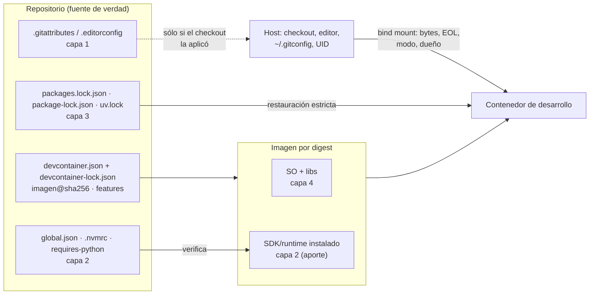

# N5 — Entornos en contenedores y convivencia con estaciones Windows

El PO pregunta si congelar SDK, compilador y paquetes «se puede hacer mediante contenedores». La respuesta corta que este núcleo sostiene con evidencia es: **un contenedor congela lo que trae la imagen (sistema operativo, bibliotecas del sistema y, si viene instalado, el toolchain), y sólo si la imagen se nombra por digest; no congela los bytes del código que se le monta, ni el grafo de dependencias si no hay lock, ni la configuración de git de quien lo usa.** Por eso N5 va después de N1–N4: el contenedor reproduce fielmente lo que el repositorio declara, y también reproduce fielmente lo que el repositorio olvidó declarar.

Todo lo afirmado se apoya en documentación oficial consultada el 2026-10-07 (tabla de evidencias, §16) o en los experimentos E5-1 a E5-7 corridos ese día en el laboratorio. Lo que es criterio del autor está marcado **[criterio propio]**. Los números de capa son los del modelo de N0 (1 bytes · 2 toolchain · 3 grafo · 4 SO e imagen · 5 proceso · 6 metadatos).

## Índice

- [1. Definiciones](#1-definiciones)
- [2. Qué fija un contenedor y qué no](#2-qué-fija-un-contenedor-y-qué-no)
- [3. Etiqueta o digest](#3-etiqueta-o-digest)
- [4. devcontainer.json: imagen, Dockerfile y features](#4-devcontainerjson-imagen-dockerfile-y-features)
- [5. Imágenes oficiales de .NET, Node.js y Python](#5-imágenes-oficiales-de-net-nodejs-y-python)
- [6. Convivencia con estaciones Windows](#6-convivencia-con-estaciones-windows)
- [7. Un repo de Windows montado en Linux](#7-un-repo-de-windows-montado-en-linux)
- [8. ¿Imagen de desarrollo = imagen de CI?](#8-imagen-de-desarrollo--imagen-de-ci)
- [9. Estrategias por ecosistema y en la integración](#9-estrategias-por-ecosistema-y-en-la-integración)
- [10. Snippets representativos](#10-snippets-representativos)
- [11. Experimentos](#11-experimentos)
- [12. Preguntas guía](#12-preguntas-guía)
- [13. Errores frecuentes](#13-errores-frecuentes)
- [14. Dependencias y tensiones con otros núcleos](#14-dependencias-y-tensiones-con-otros-núcleos)
- [15. Observaciones, supuestos y pendientes](#15-observaciones-supuestos-y-pendientes)
- [16. Evidencias](#16-evidencias)
- [17. Verificación adversarial](#17-verificación-adversarial)

## 1. Definiciones

| Término | Definición adoptada | Fuente | No confundir con |
|---|---|---|---|
| **Imagen** | Plantilla de sólo lectura que aporta el sistema de archivos del contenedor: distribución, bibliotecas del sistema y lo que se haya instalado encima (SDK, Node, Python). | docs.docker.com [EV5-05] | El contenedor: es la instancia en ejecución de una imagen, con estado propio. |
| **Etiqueta** (*tag*) | Nombre legible que apunta a una imagen. **Es mutable**: el publicador puede moverla a otra imagen. | [EV5-05] | Versión. `sdk:8.0` se movió en este laboratorio (E5-2); la «fija» `sdk:8.0.425` nombra hoy un digest distinto de la copia local que declara ese mismo SDK, y la documentación de .NET dice que las fijas se rehacen ante cambios del SO base [EV5-07]. |
| **Digest** | Hash `sha256:` del manifiesto de la imagen. Nombra el contenido: el mismo digest es siempre la misma imagen. Al usarlo, Docker no baja versiones actualizadas, «que pueden incluir actualizaciones de seguridad». | [EV5-06], [EV5-05] | Id local de la imagen (`docker images`), que es otro hash y no sirve para pedirla al registro. |
| **Bind mount** | Montaje de una carpeta del host dentro del contenedor. El contenedor ve y escribe **los mismos archivos** del host, con permiso de escritura por defecto. | [EV5-23] | Volumen con nombre: lo administra Docker y no comparte la carpeta del host. |
| **Devcontainer** | Contenedor de desarrollo definido por un `devcontainer.json` (especificación abierta en containers.dev) al que un editor o la CLI de referencia se conectan para editar, compilar y depurar. | [EV5-01], [EV5-14] | Contenedor de la aplicación: el que se despliega. Pueden compartir base, pero cumplen otro rol. |
| **Feature** | Unidad de instalación reutilizable que se aplica sobre la imagen como un paso de build secundario; se publica con versión semántica y se referencia en `devcontainer.json`. | [EV5-01], [EV5-02] | Paquete del lenguaje (NuGet, npm, PyPI). |
| **`devcontainer-lock.json`** | Archivo junto al `devcontainer.json` que registra, por cada *feature*, versión exacta, recurso resuelto (con sha256) e integridad. **No registra la imagen base.** | [EV5-03], [EV5-04]; E5-5 | Un lock del grafo de la aplicación (N4). |
| **Imagen de desarrollo / de CI / de ejecución** | Tres roles posibles: la que usa el desarrollador (SDK + herramientas), la que compila en CI (SDK, mínima) y la que corre la aplicación (runtime, sin SDK). | [criterio propio] apoyado en la separación sdk/aspnet de las imágenes oficiales [EV5-07] | «La imagen del proyecto»: hay hasta tres y conviene nombrarlas. |
| **Estación Windows nativa** | ESC-01 de BIT-15-03: Visual Studio, SDK y git instalados en Windows, sin contenedor. | BIT-15-03 | Windows con WSL 2 (ESC-03) o con Docker Desktop. |

## 2. Qué fija un contenedor y qué no

La tabla refina la de N0 §6 con lo que se midió en este núcleo. Se lee por filas: «¿esta capa la congela el contenedor?».

| Capa | ¿La fija el contenedor? | Evidencia | Matiz |
|---|---|---|---|
| 1 · Bytes del fuente | **No.** El código llega por bind mount o por clon; el contenedor lee los bytes que escribió el host. | E5-1: el mismo `.cs` en cp1252 falla con `CS1056` dentro de la imagen por digest y compila tras convertirlo a UTF-8 en el repo. | La remediación es de N2, no de N5. |
| 1 · Finales de línea y bit de ejecución | **No.** Dependen de cómo se hizo el checkout en el host. | E5-3: CRLF y modo `100644` heredados del clon «Windows» rompen el script en Linux. | Se arregla con `.gitattributes` y con el modo registrado en git (N2). |
| 2 · Toolchain | **Sí**, si viene instalado en la imagen y la imagen va por digest. | E5-1 (SDK 8.0.425 por digest); E5-6 (dos imágenes «de .NET 10» traen 10.0.400 y 10.0.100-rc.2). | Sin `global.json`, el repo no se entera de qué SDK trajo la imagen (N3). |
| 3 · Grafo | **No.** Sin lock y restauración estricta, dentro del contenedor se resuelven rangos como en cualquier máquina. | N0 E0-3a/b/c. | El lock de *features* no es un lock del grafo de la aplicación. |
| 4 · SO e imagen | **Sí, sólo por digest.** Por etiqueta, no. | E5-2: misma etiqueta, otro digest, otro OpenSSL. | El digest deja de recibir parches (§3). |
| 5 · Proceso | **Parcialmente.** Iguala ruta de trabajo y variables si todos usan la misma definición. | E5-6: misma imagen y misma ruta `/w` → mismo hash; N0 E0-5: otra ruta → otro hash. | La estación Windows nativa queda afuera de esta igualación. |
| 6 · Metadatos | **No.** El contenedor no registra nada por sí solo. | N0 §6. | Es trabajo de N6. |
| Configuración de git del usuario | **Depende de la herramienta.** Un `docker run` no ve el `~/.gitconfig` del host (E5-1); la extensión Dev Containers de VS Code lo **copia** al iniciar [EV5-17]. | E5-1, [EV5-17] | Por eso ninguna política puede vivir en `core.autocrlf`: llega o no según quién levante el contenedor. |
| Propiedad de archivos (UID) | **No la normaliza.** En host Linux, lo que escribe root en el bind mount queda de root. | E5-4 | `updateRemoteUserUID` (sólo Linux) alinea UID/GID del usuario remoto con el local [EV5-01]. |



El diagrama muestra la idea central: la imagen aporta capa 4 y parte de la 2; todo lo demás entra al contenedor **a través del host** o **a través de archivos del repo**. Si el repo no los declara, entra lo que el host tenga.

## 3. Etiqueta o digest

**Lo que dice el fabricante.** Docker documenta que las etiquetas son mutables y que fijar por digest garantiza la misma imagen en cada build, con el costo explícito de «optar por salir de las correcciones de seguridad automáticas»; propone mitigarlo con Docker Scout (política «No outdated base images») o con Dependabot, que abre PR que actualizan etiqueta y digest y dejan un registro auditable del cambio [EV5-05]. El equipo de imágenes de .NET distingue etiquetas *fijas* (`8.0.11`, garantizan que la versión de .NET no cambia) y *flotantes* (`8.0`, siguen el último parche), y aclara que **ambas** se actualizan cuando cambia la imagen base del SO; «para pedir un parche específico del sistema operativo hace falta fijar por digest» [EV5-07]. Las imágenes de .NET se reconstruyen dentro de las 12 horas de una actualización de su imagen base, con cada versión de servicio de .NET, ante CVE críticos y una vez por mes, típicamente el segundo martes [EV5-08].

**Lo que se midió (E5-2).** La etiqueta `mcr.microsoft.com/dotnet/sdk:8.0` presente en el laboratorio (construida el 2026-09-19) y la que publica hoy el registro (construida el 2026-10-06) tienen digests distintos y declaran **el mismo** SDK 8.0.425 y runtime 8.0.31. La etiqueta «fija» `8.0.425` apunta hoy al digest nuevo. Al comparar los paquetes del sistema de ambas, difieren `libssl3`/`openssl` (3.0.20 → 3.0.22), `libexpat1`, `libpcre2-8-0`, Perl y `tzdata`. Es decir:

- quien usa la etiqueta recibe, en el próximo `pull` o reconstrucción sin caché, una actualización de OpenSSL publicada 17 días después de la imagen anterior, **sin un commit que lo diga** (deriva, en el vocabulario de N0);
- quien fijó el digest viejo sigue, hasta que alguien lo actualice, con el OpenSSL anterior.

**[criterio propio] Política recomendada para la guía.**

1. **Digest en todo lo versionado** que nombra una imagen: `FROM` del Dockerfile, `image` del `devcontainer.json`, `container.image` de la CI. Se escribe `repo:etiqueta@sha256:…`: la etiqueta queda como referencia humana y manda el digest [EV5-05].
2. **Actualización como PR**, no como accidente: un bot (Dependabot soporta los ecosistemas `docker` y `devcontainers` para actualizaciones de versión [EV5-26]) o un trabajo programado que proponga el digest nuevo. El PR pasa por las mismas compuertas que cualquier otro (N7) y deja trazado qué cambió.
3. **Cadencia alineada con el publicador**: como mínimo mensual (las imágenes de .NET se rehacen el segundo martes [EV5-08]) y fuera de calendario ante un CVE que afecte a la imagen.
4. **Etiqueta flotante sólo donde se quiere deriva**: un entorno de prueba exploratoria, nunca la CI que publica artefactos.

El costo real del digest no es «quedarse sin parches» sino **asumir la responsabilidad de aplicarlos**. Un equipo que fija digests y no tiene el punto 2 está peor que uno que usa etiquetas: congeló vulnerabilidades.

## 4. devcontainer.json: imagen, Dockerfile y features

| Opción | Qué es | Cuándo conviene | Qué se congela | Evidencia |
|---|---|---|---|---|
| `"image"` | Imagen de un registro, usada tal cual. | Base oficial suficiente, o imagen de desarrollo **preconstruida** por el equipo. | La imagen, si va por digest. | [EV5-01] |
| `"build": { "dockerfile" }` | Dockerfile relativo al `devcontainer.json`; se construye en cada máquina. | Hace falta instalar algo que no existe como *feature*. | Sólo el `FROM` (si va por digest). Cada `apt-get install` o descarga del Dockerfile resuelve **en el momento de construir**, en cada máquina. | [EV5-01]; [criterio propio] |
| `"features"` | Instaladores versionados aplicados sobre la imagen. | Agregar runtimes y herramientas (Node, Python, CLI) sin escribir Dockerfile. | Con `devcontainer-lock.json`: versión y digest del **instalador**. Lo que el instalador baje depende de sus opciones: la *feature* de Node usa `"version": "lts"` por defecto e instala con nvm [EV5-30]. | [EV5-02], [EV5-03], [EV5-30]; E5-5 |
| Imagen preconstruida (*prebuild*) | Se construye `devcontainer.json` + *features* una vez en CI, se publica y el `devcontainer.json` de los demás sólo tiene `"image"`. | Equipos con más de una persona o con CI que use el mismo entorno. | Todo lo instalado, por digest de la imagen publicada. La guía de containers.dev lo presenta como forma de «fijar una versión específica de herramientas» y arrancar más rápido [EV5-29]. | [EV5-29] |

Puntos verificados del comportamiento de la CLI de referencia (`@devcontainers/cli` 0.89.0):

- `up` y `build` **generan el lock por defecto**; `--frozen-lockfile` exige que exista y no cambie, y falla si no [EV5-04]. En E5-5, cambiar `node:1` por `node:1.6` sin regenerar el lock produjo `Error: Lockfile does not match.`
- `outdated` informa versiones nuevas de las *features* sin modificar nada: en E5-5, la *feature* de Node congelada en 1.7.1 tiene disponible la 2.1.0.
- El lock **no cubre la imagen base** ni las *features* locales [EV5-03]: la imagen se fija con el digest en `"image"`.
- `--mount-workspace-git-root` vale `true` por defecto: la CLI monta **la raíz del repositorio git**, no sólo la carpeta abierta (E5-5b; observado al levantar el ejemplo dentro del repo del laboratorio). En un monorepo eso expone al contenedor todo el árbol.
- El nombre del archivo: la especificación dice `devcontainer-lock.json` en la misma carpeta que el `devcontainer.json` [EV5-03], que es lo que generó la CLI en E5-5; el README de la CLI lo menciona como `.devcontainer-lock.json` [EV5-04]. Vale lo observado.

`initializeCommand` corre **en el host**, no en el contenedor [EV5-01]: es el único gancho que puede, por ejemplo, verificar la política de texto antes de montar, pero en una estación Windows correrá en Windows. **[criterio propio]** No usarlo para lógica de build.

## 5. Imágenes oficiales de .NET, Node.js y Python

| Ecosistema | Imagen | Hechos relevantes para fijar | Evidencia |
|---|---|---|---|
| .NET | `mcr.microsoft.com/dotnet/sdk` (compilar), `…/aspnet` y `…/runtime` (ejecutar) | Etiquetas fijas y flotantes, ambas rehechas ante cambios del SO base; digest para fijar el parche del SO. Desde .NET 10 las etiquetas multiplataforma usan Ubuntu por defecto; antes, Debian. Reconstrucción ≤ 12 h tras la base, mensual el segundo martes, ante CVE críticos. | [EV5-07], [EV5-08]; N0 E0-6 (sdk:8.0 Debian 12, sdk:10.0 Ubuntu 24.04) |
| .NET (desarrollo) | `mcr.microsoft.com/devcontainers/dotnet` | Etiquetas con **versión semántica propia de la imagen** separada de la de .NET (`2-10.0-noble`, `2.3-10.0-noble`, `2.3.0-10.0-noble`); usuario `vscode`. | [EV5-12]; E5-6 (la `1-10.0` del laboratorio trae un SDK 10.0.100-rc.2) |
| Node.js | `node` (Docker Official Image) | Variantes por Debian (`bookworm`, `trixie`), `slim` y `alpine`. Alpine usa musl en lugar de glibc; los builds de Node para musl en amd64 están en nivel «Experimental» (y los de otras arquitecturas no tienen prueba previa a la publicación) y «en general las aplicaciones escritas para Debian (glibc) no corren en Alpine (musl)». Usuario `node` con uid 1000. Desde Node.js 26, la imagen no incluye Yarn v1. | [EV5-09], [EV5-10] |
| Python | `python` (Docker Official Image) | Variantes por Debian, `slim` (paquetes mínimos) y `alpine` (musl: el software «suele tener problemas según la profundidad de sus supuestos sobre libc»). Nombrar la versión de Debian explícitamente minimiza roturas cuando sale una nueva. | [EV5-11] |

**Consecuencia práctica.** La etiqueta de una imagen oficial contiene **dos** decisiones: la versión del lenguaje y la del sistema. `sdk:8.0` y `sdk:10.0` no sólo difieren en SDK: difieren en distribución (N0 E0-6). Fijar `node:22-bookworm-slim` o `python:3.12-slim-bookworm` hace explícita la segunda; el digest la congela.

## 6. Convivencia con estaciones Windows

### 6.1 Qué ofrece cada herramienta (verificado)

| Herramienta | Qué hace con contenedores | Evidencia |
|---|---|---|
| **Visual Studio (2022 y 2026)** | *Container Tools*: agrega un Dockerfile o (en proyectos .NET 7 o posteriores) la compilación de contenedores del SDK, y ejecuta y depura la aplicación dentro de un contenedor, con Docker Desktop o (en VS 2026) Podman Desktop. Tipos de proyecto: en VS 2026, ASP.NET Core y consola .NET (no .NET Framework); en VS 2022, además ASP.NET y consola .NET Framework. Es soporte para **contenerizar la aplicación**, no para **desarrollar dentro** de un devcontainer. | [EV5-13] |
| **Visual Studio y `devcontainer.json`** | El único soporte documentado es el de VS 2022 17.4 para **proyectos C++ con CMake Presets**, sólo con contenedores Linux. No se encontró documentación oficial de Visual Studio que abra una solución .NET dentro de un devcontainer. | [EV5-14], [EV5-15] — hallazgo negativo, a revalidar |
| **JetBrains Rider** | Su documentación describe abrir un proyecto con `.devcontainer/devcontainer.json` y arrancar el contenedor desde el IDE con Docker, con un *backend* del IDE dentro del contenedor al que se conecta un cliente. containers.dev lista los IDE de JetBrains entre las herramientas que soportan la especificación. **No se verificó** compilar ni depurar una solución .NET así, ni sus límites en hosts Windows. | [EV5-14], [EV5-32] — sin experimento |
| **VS Code + Dev Containers** | Implementación completa de `devcontainer.json`; en Windows requiere Docker Desktop (Home: con backend WSL 2) y sólo contenedores Linux; copia el `.gitconfig` local al contenedor; advierte que el bind mount «tiene cierto costo de rendimiento en Windows y macOS». | [EV5-16], [EV5-17], [EV5-18] |
| **WSL 2** | Un sistema de archivos Linux aparte; git se instala por separado en cada sistema y cada uno tiene su `.gitconfig`. Microsoft recomienda guardar el código en el sistema de archivos del lado donde trabajan las herramientas. | [EV5-20], [EV5-21] |
| **Docker Desktop con WSL 2** | Rendimiento «mucho mayor» si los archivos montados viven en el sistema de archivos Linux; los contenedores sólo reciben eventos `inotify` si los archivos originales están en Linux. | [EV5-22] |

### 6.2 Cómo conviven en un mismo repo

El dato que ordena la convivencia es el de la fila 2 de la tabla anterior: **quien trabaja con Visual Studio sobre una solución .NET no tiene hoy, según la documentación consultada, una forma soportada de entrar en el devcontainer** (otro IDE .NET, Rider, sí documenta abrir un devcontainer [EV5-32], pero eso no cambia la situación de quien usa Visual Studio). Por lo tanto el devcontainer no puede ser el lugar donde vive la política; tiene que ser un consumidor más de la política que vive en el repositorio. Esto confirma, con evidencia, el supuesto SUP-05 de la bitácora 00.

**[criterio propio] Reglas de convivencia.**

1. **El repo declara, las estaciones obedecen, la CI arbitra.** `.gitattributes` y `.editorconfig` (N2), `global.json` (N3) y los locks con restauración estricta (N4) son los mismos para Visual Studio en Windows, para el devcontainer y para la CI. Ninguno depende de la configuración de la máquina.
2. **El devcontainer es una comodidad que reproduce la CI, no un requisito.** Quien no puede o no quiere usarlo trabaja nativo; la compuerta de CI es la que garantiza que su commit cumple (N7).
3. **Lo que tiene que ser idéntico entre ESC-01 y ESC-04** para que la build dé lo mismo: los archivos de las capas 1–3 del repo, la versión de SDK que `global.json` admite y el comando de build. Lo que **no** va a ser idéntico y la guía debe decirlo: el SO y las bibliotecas (capa 4), las rutas (capa 5) y por tanto el hash de los binarios si no se normalizan rutas (N0 E0-5, N6).
4. **Elegir `rollForward` pensando en ambos.** El SDK de la estación Windows lo actualiza Visual Studio (N0, N3); el del contenedor lo trae la imagen. Un `rollForward: disable` estricto obliga a que ambos coincidan exactamente (E5-6 muestra el rechazo); uno permisivo deja que difieran. La decisión es de N3; N5 aporta que **la imagen también es una fuente de SDK que puede no coincidir** con lo declarado.
5. **El artefacto que se publica sale de la CI**, nunca de una estación (BIT-15-03 §4.1; N6).

## 7. Un repo de Windows montado en Linux

E5-3 simula una estación Windows clonando con `core.autocrlf=true` y `core.fileMode=false` (configuración de un solo comando, sin tocar la del usuario) y monta el clon en la imagen del SDK. E5-4 mide la propiedad de archivos. Problemas observados y su origen:

| Síntoma observado | Causa | Corrección | Evidencia |
|---|---|---|---|
| `fatal: detected dubious ownership in repository at '/w'` | Git dentro del contenedor corre como root y el repo pertenece a otro UID. `safe.directory` sólo se honra en configuración de sistema o global, no del repo. | `git config --global --add safe.directory /w` dentro del contenedor, o correr con el UID del dueño. | E5-3, [EV5-24] |
| `git status` marca `M build.sh`, `M notas.txt` sin cambios reales | El checkout «Windows» escribió CRLF; git en el contenedor no tiene `core.autocrlf` (otro `HOME`) y compara bytes contra el índice en LF. | `.gitattributes` con `eol`, que tiene precedencia sobre `core.autocrlf`. | E5-3, [EV5-25], [EV5-18], [EV5-21] |
| `./build.sh: Permission denied` | El script se commiteó sin bit de ejecución; en NTFS git pone `core.fileMode=false` al clonar y no lo registra. | `git update-index --chmod=+x build.sh` y commit: el modo `100755` queda en el repo. | E5-3, [EV5-24] |
| `set: pipefail^M: invalid option name` y `/usr/bin/env: 'bash\r': No such file or directory` | CRLF en un script de shell. | `*.sh text eol=lf` en `.gitattributes`. | E5-3 |
| Con la política (`* text=auto eol=lf`, `*.sh text eol=lf`, `+x`) el **mismo** clon «Windows» queda con LF, `git status` vacío y el script corre. | La política vive en el repo y le gana a la configuración local. | — | E5-3 B |
| Archivos de `obj/` creados por el contenedor son de `root(0)`; el usuario del host no puede borrarlos. | En host Linux el bind mount conserva UID numéricos; la imagen del SDK corre como root por defecto. | `--user $(id -u):$(id -g)`, o `remoteUser` + `updateRemoteUserUID` (sólo Linux). | E5-4, [EV5-01] |
| Restauraciones e instalaciones lentas; *watchers* que no detectan cambios. | Bind mount desde el sistema de archivos de Windows hacia la VM. | Repo en el sistema de archivos de WSL 2, volumen con nombre para `node_modules`, o «clonar en volumen de contenedor». | [EV5-16], [EV5-19], [EV5-20], [EV5-22] — no medido acá |
| Archivos que difieren sólo en mayúsculas. | Windows no distingue mayúsculas; Linux sí. | Convención de nombres; no se probó. | [EV5-20] |
| El `.cs` heredado sigue fallando dentro del contenedor. | El contenedor no toca los bytes. | Conversión a UTF-8 en el repo (N2). | E5-1 |

Lo que este cuadro enseña: **casi todos los problemas de «montar un repo de Windows en Linux» son problemas de capa 1 que la estación Windows tapaba**. El contenedor no los causa: los revela, igual que Linux reveló el cp1252 del caso disparador.

## 8. ¿Imagen de desarrollo = imagen de CI?

**Lo medido (E5-6).** El mismo proyecto `net10.0`, compilado en Release:

| Build | Imagen | SDK | Hash de la DLL |
|---|---|---|---|
| ci-1 | `dotnet/sdk:10.0@sha256:e1ffd2a9…` | 10.0.400 | `7d4068f0767ac59e…` |
| ci-2 (otro contenedor) | la misma | 10.0.400 | `7d4068f0767ac59e…` |
| dev-1 | `devcontainers/dotnet:1-10.0@sha256:f9abf00d…` | 10.0.100-rc.2 | `facbe3a469f83790…` |
| ci-3 con `global.json` (10.0.400, `latestPatch`, sin prerelease) | CI | 10.0.400 | `7d4068f0767ac59e…` |
| dev-2 con `global.json` | dev | — | **falla**: `Requested SDK version: 10.0.400` |

Dos imágenes que un equipo llamaría «la de .NET 10» dieron SDK y binarios distintos; la misma imagen por digest repitió el hash. El `global.json` del repo detectó la desalineación sin que nadie mirara versiones.

**Qué propone la industria.** La especificación de devcontainers se presenta también como ayuda para «integración continua y pruebas» [EV5-31], y el proyecto mantiene una acción de CI (`devcontainers/ci`) que construye el devcontainer y corre comandos dentro de él, con caché de imagen preconstruida [EV5-27]; la guía de preconstrucción agrega fijar versiones de herramientas [EV5-29]. GitHub Actions permite correr un job dentro de una imagen con `jobs.<id>.container.image` [EV5-28]. No se encontró una recomendación oficial que diga que **deben** ser la misma imagen.

**[criterio propio] Respuesta para la guía.** No hace falta que sean la misma imagen; hace falta que **compartan la base que aporta el toolchain** y que el repo verifique la coincidencia:

- **Opción A — misma imagen**: la CI corre dentro del devcontainer preconstruido (`devcontainers/ci` o `container.image` con su digest). Máxima equivalencia; la imagen de CI carga herramientas de edición que no usa. Conviene a equipos chicos con un único stack.
- **Opción B — misma base, capas distintas**: la imagen de desarrollo se construye `FROM` el mismo `sdk@sha256` que usa la CI y le agrega herramientas. El toolchain coincide por construcción; la CI queda mínima. Conviene cuando la imagen de desarrollo es pesada o multi-runtime (N8).
- En ambas: `global.json`, `.nvmrc`/`engines` y `requires-python` como árbitro (N3, E1-05 de N3), y la imagen de **ejecución** (`aspnet`, `node:…-slim`) es una tercera imagen, también por digest.
- **Lo que no conviene**: imágenes elegidas por separado por nombre parecido (dev-1 de E5-6). Es la versión contenerizada de «funciona en mi máquina».

## 9. Estrategias por ecosistema y en la integración

| Ecosistema | Práctica | Naturaleza | Evidencia |
|---|---|---|---|
| Transversal | Fijar imágenes por digest y actualizarlas por PR automatizado. | Fabricante (Docker) | [EV5-05], [EV5-26] |
| Transversal | Política de finales de línea en `.gitattributes` con `eol=lf` (y `crlf` para `.cmd`/`.bat`, **un patrón por extensión, sin llaves**) cuando el mismo repo se usa en Windows y en contenedores. | Fabricante (VS Code, Microsoft WSL); la forma del patrón, E5-7 | [EV5-18], [EV5-21], [EV5-25]; E5-7 |
| Transversal | Código en el sistema de archivos de WSL 2 o en volumen, no en `C:\` montado. | Fabricante (Microsoft, Docker) | [EV5-19], [EV5-20], [EV5-22] |
| Transversal | Imagen de desarrollo preconstruida y publicada. | Convención documentada en containers.dev | [EV5-29] |
| .NET | `sdk` para compilar, `aspnet`/`runtime` para ejecutar; fijar parche del SO por digest. | Fabricante (Microsoft) | [EV5-07], [EV5-08] |
| .NET | Visual Studio nativo en Windows como escenario de primera clase; el devcontainer no lo alcanza. | Hallazgo (negativo) | [EV5-13], [EV5-14] |
| Node.js | Variante Debian (`bookworm`/`trixie`, `slim`) salvo razón para Alpine; correr como `node` (uid 1000); `npm ci` en imágenes. | Fabricante (Node.js Docker WG) | [EV5-09], [EV5-10] |
| Node.js | `node_modules` en volumen con nombre en Windows/macOS. | Fabricante (VS Code) | [EV5-19] |
| Python | `slim` con la versión de Debian explícita; evitar Alpine si hay dependencias con extensiones nativas. | Fabricante (imagen oficial) + [criterio propio] en la segunda parte | [EV5-11] |
| Integración | Una base con el toolchain principal y los demás runtimes como *features* con versión explícita, congeladas por `devcontainer-lock.json` y luego preconstruidas. | [criterio propio], E5-5 | [EV5-02], [EV5-03], [EV5-30] |
| Integración | Un lock por ecosistema **además** del lock de *features*: el de *features* no congela ningún grafo de aplicación. | [criterio propio] derivado de [EV5-03] | N4 |

**Qué pasa al integrar los tres en una solución.** Aparecen tres fricciones que no existen en un repo de un solo lenguaje: (1) **una sola imagen base** decide la libc y la distribución para los tres; si es Alpine, Node y Python con extensiones nativas quedan en terreno documentado como problemático [EV5-09], [EV5-11]; (2) **las *features* resuelven en el momento de construir**: si la de Node queda en `"lts"`, cada reconstrucción puede traer otro Node aunque el lock de *features* no cambie [EV5-30] — por eso E5-5 fija `"version": "22.11.0"` y la versión efectiva se verifica contra `.nvmrc` (N3); (3) **el montaje de la raíz git** (E5-5b) expone al contenedor todos los subproyectos y sus `node_modules`/`.venv`/`obj` mezclados. El diseño de la imagen multi-runtime frente a varias imágenes es decisión de N8; N5 entrega estas tres restricciones.

## 10. Snippets representativos

```jsonc
// .devcontainer/devcontainer.json — capa 4 por digest, Node como feature con versión exacta.
{
  "name": "solucion",
  // La etiqueta es un comentario para humanos; manda el digest [EV5-05].
  "image": "mcr.microsoft.com/dotnet/sdk:8.0@sha256:78235e09001f52b6592c458ac010775ebac6725422e80cd0c1650590f67b2743",
  "features": {
    // Versión exacta: sin ella la feature instala "lts", que cambia con el tiempo [EV5-30].
    "ghcr.io/devcontainers/features/node:1": { "version": "22.11.0" }
  },
  // Evita archivos de root en el bind mount en hosts Linux (E5-4, [EV5-01]).
  // Requiere una imagen con usuario no root (p. ej. las de devcontainers traen 'vscode').
  // "remoteUser": "vscode", "updateRemoteUserUID": true,
  "postCreateCommand": "dotnet --version && node --version"
}
```

```json
// .devcontainer/devcontainer-lock.json — GENERADO por la CLI (E5-5). Se versiona.
{
  "features": {
    "ghcr.io/devcontainers/features/node:1": {
      "version": "1.7.1",
      "resolved": "ghcr.io/devcontainers/features/node@sha256:8c0de46939b61958041700ee89e3493f3b2e4131a06dc46b4d9423427d06e5f6",
      "integrity": "sha256:8c0de46939b61958041700ee89e3493f3b2e4131a06dc46b4d9423427d06e5f6"
    }
  }
}
```

```gitattributes
# .gitattributes — la parte que N5 necesita de la política de N2 (E5-3, [EV5-18], [EV5-25]).
# eol tiene precedencia sobre core.autocrlf de cada estación.
# Sin llaves: git NO expande *.{cmd,bat} y esos archivos quedarían en LF (E5-7).
* text=auto eol=lf
*.sh text eol=lf
*.[cC][mM][dD] text eol=crlf
*.[bB][aA][tT] text eol=crlf
```

```bash
# Registrar el bit de ejecución en el repo (no depende del sistema de archivos de quien clona).
git update-index --chmod=+x build.sh

# ¿A qué digest apunta HOY una etiqueta? (sin bajar la imagen; E5-2)
docker buildx imagetools inspect mcr.microsoft.com/dotnet/sdk:8.0 --format '{{.Manifest.Digest}}'

# Levantar el devcontainer exigiendo el lock versionado (falla si no coincide; E5-5)
npx -y @devcontainers/cli@0.89.0 up --workspace-folder . --frozen-lockfile
```

```yaml
# Dependabot: PR automáticos para imágenes (docker) y features de devcontainer [EV5-26].
# 'devcontainers' actualiza las features y, si existe, el devcontainer-lock.json [EV5-26].
# Compose es otro ecosistema ('docker-compose'). La tabla de GitHub marca 'devcontainers'
# como NO soportado en repositorios privados: verificarlo antes de contar con él (N7).
# (Fragmento ilustrativo; la configuración completa y su revisión son de N7.)
version: 2
updates:
  - package-ecosystem: "docker"
    directory: "/"
    schedule: { interval: "weekly" }
  - package-ecosystem: "devcontainers"
    directory: "/"
    schedule: { interval: "weekly" }
```

## 11. Experimentos

Todos en `LAB/Lab-Documentos/Guides/Metodologia-Entorno-Desarrollo/Examples/N5-entornos-en-contenedores/` (README con instrucciones). Cada script trabaja en un directorio temporal y no deja artefactos.

| ID | Comando | Salida resumida | Ruta |
|---|---|---|---|
| E5-1 | `./e1-que-fija-el-contenedor/experimento.sh` | Imagen por digest: Debian 12, glibc 2.36, SDK 8.0.425, git 2.39.5. cp1252 montado → `error CS1056: Unexpected character '�'`. `core.autocrlf=true` en el host → «(no definido)» en el contenedor. Mismo contenedor tras convertir a UTF-8 → `Build succeeded`, `Señal recibida: ñandú, acción, pingüino`. | `e1-que-fija-el-contenedor/`, `salidas/E5-1-que-fija-el-contenedor.txt` |
| E5-2 | `./e2-etiqueta-vs-digest/experimento.sh` | `sdk:8.0` local `78235e09…` (2026-09-19) ≠ registro `ec9c0a0d…` (2026-10-06) = `sdk:8.0.425` hoy. Ambas SDK 8.0.425. Paquetes distintos: `openssl` 3.0.20 → 3.0.22, `libexpat1`, `libpcre2-8-0`, `perl`, `tzdata` 2026b → 2026c. | `e2-etiqueta-vs-digest/`, `salidas/E5-2-etiqueta-vs-digest.txt` |
| E5-3 | `./e3-clon-windows-en-linux/experimento.sh` | Sin política: `dubious ownership`; `M build.sh`, `M notas.txt`; `Permission denied` (126); `pipefail^M` (2); `'bash\r'` (127). Con `.gitattributes` + `+x`: modo `100755`, archivos LF, `status: []`, `build OK en Linux`. | `e3-clon-windows-en-linux/`, `salidas/E5-3-clon-windows-en-linux.txt` |
| E5-4 | `./e4-uid-en-bind-mount/experimento.sh` | Como root: `root(0)` en `obj/`, `rm: … Permiso denegado` desde el host. Con `--user`: `dev(1000)`. | `e4-uid-en-bind-mount/`, `salidas/E5-4-uid-en-bind-mount.txt` |
| E5-5 | `./e5-devcontainer-por-digest/experimento.sh` | `up --frozen-lockfile`: `success`, SDK 8.0.425, node v22.11.0. Feature cambiada a `node:1.6` sin relockear: `Error: Lockfile does not match.` `outdated`: node 1.7.1 actual, 2.1.0 última. | `e5-devcontainer-por-digest/`, `salidas/E5-5-devcontainer-por-digest.txt` |
| E5-5b | `npx -y @devcontainers/cli@0.89.0 up --help` | `--mount-workspace-git-root … [default: true]`; `--frozen-lockfile … fail otherwise`. | `salidas/E5-5b-cli-flags.txt` |
| E5-6 | `./e6-imagen-dev-vs-ci/experimento.sh` | CI ×2: SDK 10.0.400, mismo hash `7d4068f0…`. Dev: SDK 10.0.100-rc.2, hash `facbe3a4…`. Con `global.json` 10.0.400: CI pasa; dev falla con `Requested SDK version: 10.0.400`. | `e6-imagen-dev-vs-ci/`, `salidas/E5-6-imagen-dev-vs-ci.txt` |
| E5-7 | `./e7-llaves-en-gitattributes/experimento.sh` | `*.{cmd,bat} text eol=crlf` y la receta literal de VS Code (`*.{cmd,[cC][mM][dD]}`) → `a.cmd: eol: lf`, `c.bat: eol: lf` en git 2.39.5 (imagen) y 2.47.3 (host). Un patrón por extensión → `eol: crlf`. | `e7-llaves-en-gitattributes/`, `salidas/E5-7-llaves-en-gitattributes.txt` |

## 12. Preguntas guía

**1. ¿Qué capas del modelo congela realmente un devcontainer y cuáles quedan abiertas?**
Congela la capa 4 y la parte de la capa 2 que la imagen trae instalada, **sólo** si la imagen va por digest (E5-1, E5-2); las *features*, si hay `devcontainer-lock.json` y versión explícita en sus opciones (E5-5, [EV5-30]). Quedan abiertas la capa 1 (bytes, EOL, modo: llegan del host, E5-1 y E5-3), la 3 (el grafo: necesita lock y restauración estricta, N4), la 5 en las estaciones que no usan el contenedor y la 6 entera. *Aplica cuando* alguien propone «pasemos todo a devcontainers» como solución al caso disparador: el `.cs` en cp1252 falla igual adentro.

**2. ¿Etiqueta o digest? ¿Qué cuesta en parches de seguridad?**
Digest en todo lo que construye artefactos o define el entorno compartido; etiqueta flotante sólo donde se acepta deriva. El costo medido: con el digest de septiembre, la imagen siguió con OpenSSL 3.0.20 cuando la etiqueta ya traía 3.0.22 (E5-2). El digest convierte los parches en trabajo explícito: un PR automatizado y una cadencia (§3). *Aplica cuando* hay que decidir qué escribir en `FROM`, en `"image"` o en la CI. *No aplica* a una prueba descartable en la máquina propia.

**3. Si la etiqueta `8.0.425` es «fija», ¿no alcanza con ella?**
No para el SO. La documentación de .NET dice que las fijas garantizan la versión de .NET, pero se rehacen ante cambios de la imagen base [EV5-07], y E5-2 lo confirma: `8.0.425` apunta hoy a un digest distinto del que tenía la máquina. *Aplica cuando* el objetivo es «mismo SDK» (alcanza) frente a «misma imagen» (no alcanza).

**4. ¿Cómo conviven en un repo quien usa Visual Studio en Windows sin contenedores y quien usa devcontainer?**
Con la política en el repo (N2, N3, N4), el devcontainer como comodidad que la reproduce y la CI como árbitro (§6.2). La razón es documental: Visual Studio no ofrece, en lo consultado, desarrollo .NET dentro de un devcontainer [EV5-13], [EV5-14]. *Aplica* a cualquier equipo mixto; la señal de alarma es una regla que sólo se cumple «si usás el devcontainer».

**5. ¿Qué debe ser idéntico entre la estación Windows y el devcontainer para que la build dé lo mismo?**
Lo que el repo declara: bytes normalizados, SDK admitido por `global.json`, locks, comando de build. Lo que no será idéntico: SO, rutas y, sin normalización, el hash del binario (N0 E0-5). *Aplica cuando* se espera igualdad de comportamiento (alcanza) frente a igualdad bit a bit (sólo la CI, N6).

**6. ¿Qué problemas aparecen al montar en Linux un repo clonado en Windows?**
Dueño distinto (`dubious ownership`), archivos «modificados» por CRLF, scripts sin `+x`, `bash\r`, archivos de root en el host, lentitud y eventos de archivo perdidos si el repo está en `C:\`, diferencias de mayúsculas (§7). Casi todos se resuelven en el repo (`.gitattributes`, modo registrado) y no en el contenedor. *Aplica* en ESC-03 y ESC-04 sobre Windows.

**7. ¿Dónde guardo el repo si trabajo en Windows con contenedores?**
En el sistema de archivos de WSL 2 (o en un volumen de contenedor), no en `C:\` montado: lo recomiendan Microsoft, Docker y VS Code [EV5-19], [EV5-20], [EV5-22]. *No aplica* si quien edita es Visual Studio nativo: Microsoft recomienda el sistema de archivos de Windows para herramientas de Windows [EV5-20]. Una persona que alterna ambos mundos sobre la misma carpeta paga el costo en uno de los dos.

**8. ¿El contenedor de desarrollo debe ser la misma imagen que la de CI?**
No necesariamente; debe compartir la base que trae el toolchain y el repo debe verificarlo (E5-6: dos «.NET 10» distintos, `global.json` los separa). Opción A (misma imagen) para stacks simples; opción B (misma base, capas distintas) para imágenes de desarrollo pesadas o multi-runtime (§8). *Aplica* al diseñar la CI.

**9. ¿Imagen, Dockerfile o *features*?**
`"image"` con una imagen preconstruida por el equipo es lo que más congela con menos superficie; *features* con lock y versión explícita para componer runtimes; Dockerfile cuando hace falta algo que no existe como *feature*, sabiendo que cada `apt-get` resuelve al construir (§4). *Aplica* al crear el `devcontainer.json`.

**10. ¿El lock de devcontainer reemplaza a los locks de NuGet, npm o uv?**
No. Registra versión e integridad de las *features* y nada más; ni siquiera la imagen base [EV5-03]. *Aplica* cuando alguien ve un archivo `-lock.json` y supone que el entorno está congelado.

## 13. Errores frecuentes

| Error | Por qué es un error | Evidencia |
|---|---|---|
| «Con devcontainer ya no hace falta `.gitattributes`.» | El contenedor monta los bytes del host; el CRLF y el modo `100644` del clon Windows rompen igual. | E5-3 |
| «Usamos `sdk:8.0`, así que todos tenemos lo mismo.» | La etiqueta se movió con el mismo SDK y otro OpenSSL. | E5-2 |
| Fijar por digest y no automatizar la actualización. | Se congelan las vulnerabilidades; Docker lo advierte y propone Scout o Dependabot. | [EV5-05] |
| Dejar la *feature* de Node sin `version`. | Instala `lts`, que cambia con el tiempo aunque el lock de *features* no cambie. | [EV5-30] |
| Asumir que el `devcontainer-lock.json` fija la imagen. | Sólo registra *features*. | [EV5-03] |
| Poner la política en `core.autocrlf` del devcontainer o de la estación. | Un `docker run` no ve el `.gitconfig` del host; VS Code sí lo copia: la política llega o no según la herramienta. `eol` en `.gitattributes` tiene precedencia. | E5-1, [EV5-17], [EV5-25] |
| Exigir el devcontainer a quien usa Visual Studio en una solución .NET. | No hay soporte documentado para desarrollar .NET dentro de un devcontainer desde Visual Studio. | [EV5-13], [EV5-14] |
| Correr el contenedor como root sobre un bind mount en Linux. | Deja `obj/`/`bin/` de root que el usuario no puede borrar. | E5-4 |
| Repo en `C:\` con el contenedor en WSL 2. | Peor rendimiento y sin eventos `inotify`. | [EV5-22] |
| Elegir Alpine «porque es más chica» en un stack con Node o Python nativos. | musl frente a glibc; nivel experimental para Node; problemas documentados para Python. | [EV5-09], [EV5-11] |
| Escribir `*.{cmd,bat} text eol=crlf` en `.gitattributes` (o copiar la receta de VS Code tal cual). | Git no expande llaves: los `.cmd`/`.bat` quedan en LF sin aviso. Un patrón por extensión. | E5-7 |
| Usar la CLI de devcontainers en un monorepo sin mirar el montaje. | Monta la raíz git por defecto. | E5-5b |
| Construir dev y CI con imágenes elegidas por nombre parecido. | Pueden traer SDK distintos (incluso un RC) y binarios distintos. | E5-6 |

## 14. Dependencias y tensiones con otros núcleos

| Núcleo | Relación | Dependencia o tensión |
|---|---|---|
| N1 | consume | E5-1 reutiliza el fenómeno: el contenedor no cambia cómo Roslyn lee cp1252. La arista débil N1 → N5 de BIT-15-02 se confirma: el diagnóstico de E5-3 (`^M`, `bash\r`) necesita el detalle de N1. |
| N2 | consume | N5 depende de que la política exista **en el repo**: E5-3 B es la plantilla mínima. **Tensión**: N2 elige BOM para `.cs`/`.razor`; los scripts `.sh` montados en Linux necesitan LF y sin BOM. Se resuelve por extensión (regla de BIT-15-02 §4). |
| N3 | consume | La imagen **es una fuente de SDK** que compite con `global.json` (E5-6). **Tensión**: `rollForward` estricto obliga a alinear imagen y estación Windows (que actualiza Visual Studio); permisivo permite que difieran. N5 no la resuelve; aporta el caso medido. Coincide con N3 §C: la imagen se construye a partir de los archivos de N3, no al revés. |
| N4 | consume | El lock de *features* no sustituye a los locks del grafo [EV5-03]. La restauración estricta corre igual dentro y fuera del contenedor. |
| N0 | refina | §2 refina N0 §6 con evidencia propia (E5-1, E5-3, E5-4) y agrega la fila «configuración de git: depende de la herramienta». E5-2 cierra la interpretación pendiente de N0 §13: la diferencia de digest de `sdk:8.0` **sí** se debe a paquetes del SO (OpenSSL, Perl, expat, tzdata). |
| N6 | alimenta | El digest de la imagen de CI es un dato obligatorio de la procedencia. La igualdad de hash de E5-6 vale con la misma ruta `/w`; entre rutas distintas hace falta la normalización de N6 (N0 E0-5). |
| N7 | alimenta | Actualización de digests como PR automatizado (Dependabot `docker` y `devcontainers` [EV5-26]); `--frozen-lockfile` como compuerta; cadencia mensual alineada con las imágenes de .NET [EV5-08]. **Tensión**: Dependabot no ofrece actualizaciones *de seguridad* para estos ecosistemas, sólo de versión [EV5-26]: la urgencia ante un CVE la decide una persona. Además, la tabla de GitHub marca `devcontainers` como no soportado en repositorios privados [EV5-26]. |
| N8 | alimenta | Tres restricciones para la imagen multi-runtime (§9): libc compartida, *features* que resuelven al construir, montaje de la raíz git. La decisión una imagen / varias es de N8. |

## 15. Observaciones, supuestos y pendientes

**Hechos verificados.**
- La etiqueta `sdk:8.0` y la fija `sdk:8.0.425` apuntan hoy a un digest con OpenSSL 3.0.22; el digest de septiembre trae 3.0.20 (E5-2).
- `--frozen-lockfile` rechaza un cambio de *feature* no registrado (E5-5); la CLI monta la raíz git por defecto (E5-5b).
- La imagen de devcontainer `1-10.0` del laboratorio trae un SDK RC (E5-6); hoy la serie vigente de esas imágenes es la `2-…` [EV5-12].

**Interpretaciones.**
- Que Visual Studio no soporte desarrollo .NET dentro de un devcontainer es un **hallazgo negativo**: se basa en la ausencia en la documentación oficial consultada y en que containers.dev sólo lista el soporte C++/CMake [EV5-14]. Debe revalidarse antes de publicar la guía.
- La recomendación de cadencia mensual para actualizar digests es criterio propio apoyado en la política de reconstrucción de .NET; no hay una cadencia normativa.

**Supuestos.**
- La simulación de estación Windows de E5-3 (`git -c core.autocrlf=true -c core.fileMode=false clone`) reproduce lo que hace git en Windows en esos dos aspectos; no se corrió en Windows. Que una instalación de Git for Windows tenga `core.autocrlf=true` depende de la opción elegida en el instalador: no se verificó el valor por defecto.

**Limitaciones.**
- Nada se corrió en Windows, WSL 2 ni Docker Desktop. Rendimiento de bind mount, `inotify` y mayúsculas vienen de documentación, no de E1.
- Docker Hub devolvió `429 Too Many Requests` a la consulta sin descarga: E5-2 se hizo sólo con el registro de Microsoft (igual que N0 E0-4).
- E5-4 vale para host Linux nativo.

**Pendientes.**
- N7: verificar si Dependabot `docker` actualiza el campo `image` de `devcontainer.json` (no se encontró en la documentación); el ecosistema `devcontainers` actualiza las *features* y el lock si existe [EV5-26]. Verificar qué significa en la práctica el «no soportado en repositorios privados» de `devcontainers`, decisivo para un repo privado de organización.
- Revalidar con la mesa (comisión ad hoc DevOps) el soporte de devcontainers en Visual Studio 2026. Rider documenta abrir devcontainers [EV5-32]; falta un experimento que compile y depure una solución .NET así.
- N8: medir una imagen multi-runtime (base .NET + *features* Node y Python) frente a imágenes separadas.

## 16. Evidencias

Fecha de consulta de todas las URL: 2026-10-07. Los experimentos se corrieron el mismo día.

| ID | Afirmación | Fuente | Fecha |
|---|---|---|---|
| EV5-01 | Propiedades `image`, `build.dockerfile`, `features`, `remoteUser`, `containerUser`, `updateRemoteUserUID` («On Linux… to avoid permission problems with bind mounts»), `workspaceMount`, `initializeCommand` (corre en el host), `mounts`. | https://containers.dev/implementors/json_reference/ | 2026-10-07 |
| EV5-02 | Las *features* se versionan con semver; se referencian por OCI, tarball o ruta local; `:latest` implícito; para fijar se agrega la versión. | https://containers.dev/implementors/features/ | 2026-10-07 |
| EV5-03 | `devcontainer-lock.json` en la carpeta del `devcontainer.json`; registra `version`, `resolved`, `integrity`, `dependsOn` de las *features*; no registra *features* locales; implementado. La especificación no menciona la imagen base y el lock generado en E5-5 no la contiene. | https://github.com/devcontainers/spec/blob/main/docs/specs/devcontainer-lockfile.md | 2026-10-07 |
| EV5-04 | La CLI genera lock por defecto en `build`/`up`; `--no-lockfile`, `--frozen-lockfile`; comandos `outdated` y `upgrade`. | https://github.com/devcontainers/cli (README) | 2026-10-07 |
| EV5-05 | Etiquetas mutables; fijar por digest; renuncia a correcciones de seguridad automáticas; Docker Scout y Dependabot como mitigación con registro auditable. | https://docs.docker.com/build/building/best-practices/ | 2026-10-07 |
| EV5-06 | Pull por digest: identificador inmutable; Docker no baja versiones actualizadas que pueden incluir actualizaciones de seguridad. | https://docs.docker.com/reference/cli/docker/image/pull/ | 2026-10-07 |
| EV5-07 | Etiquetas fijas y flotantes de .NET; ambas se actualizan ante cambios de la imagen base; digest necesario para fijar el parche del SO; Ubuntu por defecto desde .NET 10, Debian antes. | https://github.com/dotnet/dotnet-docker/blob/main/documentation/supported-tags.md | 2026-10-07 |
| EV5-08 | Política de actualización de imágenes .NET: ≤ 12 h tras la base, con cada versión de .NET, ante CVE críticos, mensual el segundo martes. | https://github.com/dotnet/dotnet-docker (README, «Image Update Policy») | 2026-10-07 |
| EV5-09 | Imagen `node`: variantes, Alpine con musl y nivel Experimental (musl amd64), incompatibilidad glibc/musl, Yarn v1 no incluido desde Node.js 26. | https://github.com/nodejs/docker-node (README) | 2026-10-07 |
| EV5-10 | Imagen `node`: usuario `node` uid 1000; `npm ci` en ejemplos de producción. | https://github.com/nodejs/docker-node/blob/main/docs/BestPractices.md | 2026-10-07 |
| EV5-11 | Imagen `python`: `slim`, `alpine` (musl, problemas según supuestos de libc), nombrar la versión de Debian. | https://hub.docker.com/_/python | 2026-10-07 |
| EV5-12 | Imágenes `devcontainers/dotnet`: semver propia de la imagen separada de .NET (`2-10.0-noble`, `2.3.0-10.0-noble`); usuario `vscode`. | https://github.com/devcontainers/images/tree/main/src/dotnet | 2026-10-07 |
| EV5-13 | Visual Studio Container Tools: Docker Desktop o Podman Desktop (VS 2026); VS 2026: ASP.NET Core y consola .NET, sin .NET Framework; VS 2022: además ASP.NET y consola .NET Framework; Dockerfile o compilación de contenedores del SDK (.NET 7+); contenerizar, ejecutar y depurar la app. | https://learn.microsoft.com/visualstudio/containers/overview (ms.date 2026-04-02) | 2026-10-07 |
| EV5-14 | Visual Studio agregó soporte de dev containers en 2022 17.4 para proyectos C++ con CMake Presets. | https://containers.dev/supporting | 2026-10-07 |
| EV5-15 | El soporte de VS es para C++/CMake Presets y sólo contenedores Linux. | https://devblogs.microsoft.com/cppblog/dev-containers-for-c-in-visual-studio/ | 2026-10-07 |
| EV5-16 | VS Code Dev Containers en Windows: Docker Desktop (Home con WSL 2); costo de rendimiento del bind mount en Windows/macOS; configurar finales de línea consistentes. | https://code.visualstudio.com/docs/devcontainers/containers | 2026-10-07 |
| EV5-17 | La extensión copia el `.gitconfig` local al contenedor al iniciar. | https://code.visualstudio.com/remote/advancedcontainers/sharing-git-credentials | 2026-10-07 |
| EV5-18 | Receta `.gitattributes` (`* text=auto eol=lf`, `.cmd`/`.bat` en CRLF) recomendada sobre `core.autocrlf`; sólo contenedores Linux. **Su forma literal usa llaves (`*.{cmd,[cC][mM][dD]}`), que git no expande: E5-7 muestra que no surte efecto.** | https://code.visualstudio.com/docs/devcontainers/tips-and-tricks | 2026-10-07 |
| EV5-19 | Mejorar rendimiento: código en WSL 2, volumen con nombre para `node_modules`, clonar en volumen de contenedor. | https://code.visualstudio.com/remote/advancedcontainers/improve-performance | 2026-10-07 |
| EV5-20 | WSL: guardar los archivos en el sistema de archivos del lado de las herramientas que se usan; Windows no distingue mayúsculas, Linux sí. | https://learn.microsoft.com/windows/wsl/filesystems | 2026-10-07 |
| EV5-21 | WSL: git se instala por sistema de archivos; `.gitconfig` separados; configurar finales de línea consistentes entre Windows, WSL y contenedor. | https://learn.microsoft.com/windows/wsl/tutorials/wsl-git | 2026-10-07 |
| EV5-22 | Docker Desktop + WSL 2: rendimiento mucho mayor desde el sistema de archivos Linux; `inotify` sólo si los archivos están en Linux. | https://docs.docker.com/desktop/features/wsl/best-practices/ | 2026-10-07 |
| EV5-23 | Bind mounts: escritura en el host por defecto; en Docker Desktop el daemon corre en una VM. | https://docs.docker.com/engine/storage/bind-mounts/ | 2026-10-07 |
| EV5-24 | `safe.directory` sólo en configuración de sistema o global; `core.fileMode=false` automático al clonar en NTFS/FAT. | https://git-scm.com/docs/git-config (2.56.0) | 2026-10-07 |
| EV5-25 | Atributo `eol`: precedencia sobre `core.autocrlf`/`core.eol`. | https://git-scm.com/docs/gitattributes | 2026-10-07 |
| EV5-26 | Dependabot soporta `docker`, `docker-compose` y `devcontainers` para actualizaciones de versión, no de seguridad; `devcontainers` figura como no soportado en repositorios privados y actualiza el lock si existe. | https://docs.github.com/en/code-security/dependabot/ecosystems-supported-by-dependabot/supported-ecosystems-and-repositories | 2026-10-07 |
| EV5-27 | `devcontainers/ci`: construir el devcontainer y correr comandos de CI dentro, con imagen preconstruida en caché. | https://github.com/devcontainers/ci | 2026-10-07 |
| EV5-28 | GitHub Actions: `jobs.<id>.container.image` corre los pasos del job en esa imagen. | https://docs.github.com/en/actions/how-tos/write-workflows/choose-where-workflows-run/run-jobs-in-a-container | 2026-10-07 |
| EV5-29 | Preconstruir imágenes de devcontainer: arranque más rápido, `devcontainer.json` reducido a `image`, fijar versiones de herramientas. | https://containers.dev/guide/prebuild | 2026-10-07 |
| EV5-30 | *Feature* de Node: opción `version` con default `lts`; instala con nvm. | https://github.com/devcontainers/features/tree/main/src/node | 2026-10-07 |
| EV5-31 | La especificación se presenta como ayuda para correr la aplicación, separar herramientas y «aid in continuous integration and testing». | https://containers.dev/ | 2026-10-07 |
| EV5-32 | Rider abre proyectos con `.devcontainer/devcontainer.json` y arranca el contenedor con Docker desde el IDE (backend del IDE dentro, cliente conectado). | https://www.jetbrains.com/help/rider/Start-Dev-Container-inside-IDE.html ; https://www.jetbrains.com/help/rider/Getting-Started-with-Dev-Containers.html | 2026-10-07 |
| E5-1 | Qué fija y qué no un contenedor por digest (SO, SDK sí; bytes y gitconfig del host no). | `Examples/N5-…/e1-que-fija-el-contenedor/experimento.sh`; `salidas/E5-1-que-fija-el-contenedor.txt` | 2026-10-07 |
| E5-2 | Etiqueta movida, mismo SDK, paquetes del SO distintos. | `e2-etiqueta-vs-digest/experimento.sh`; `salidas/E5-2-etiqueta-vs-digest.txt` | 2026-10-07 |
| E5-3 | Clon «Windows» en Linux: `dubious ownership`, CRLF, `+x`; corrección por `.gitattributes`. | `e3-clon-windows-en-linux/experimento.sh`; `salidas/E5-3-clon-windows-en-linux.txt` | 2026-10-07 |
| E5-4 | UID en bind mount con root y con `--user`. | `e4-uid-en-bind-mount/experimento.sh`; `salidas/E5-4-uid-en-bind-mount.txt` | 2026-10-07 |
| E5-5 | devcontainer por digest, lock de *features*, `--frozen-lockfile`, `outdated`. | `e5-devcontainer-por-digest/experimento.sh`; `salidas/E5-5-devcontainer-por-digest.txt` | 2026-10-07 |
| E5-5b | Defaults de la CLI 0.89.0 (`--mount-workspace-git-root true`). | `salidas/E5-5b-cli-flags.txt` | 2026-10-07 |
| E5-6 | Imagen dev frente a CI: SDK y hash distintos; `global.json` como árbitro. | `e6-imagen-dev-vs-ci/experimento.sh`; `salidas/E5-6-imagen-dev-vs-ci.txt` | 2026-10-07 |
| E5-7 | Git no expande llaves en `.gitattributes`; la receta de VS Code con llaves deja `.cmd`/`.bat` en LF. | `e7-llaves-en-gitattributes/experimento.sh`; `salidas/E5-7-llaves-en-gitattributes.txt` | 2026-10-07 |

## 17. Verificación adversarial

Verificación hecha el 2026-10-07 por un agente distinto del investigador, con la presunción de que cada afirmación podía ser falsa o estar vencida. Método: se re-abrieron las 30 fuentes citadas (WebFetch) y se re-ejecutaron los seis experimentos más E5-5b.

**Experimentos re-ejecutados (7).** E5-1, E5-2, E5-3, E5-4, E5-5, E5-5b y E5-6 reprodujeron sus salidas guardadas; las únicas diferencias son la ruta temporal (`$W`), el nombre del usuario del host (mismo uid 1000), el id del contenedor de E5-5 y el orden de stderr/stdout en E5-3. E5-2 volvió a dar `78235e09…` local frente a `ec9c0a0d…` en el registro, con las mismas diferencias de paquetes. La CLI 0.89.0 sigue siendo la última publicada en npm (2026-08-31). Docker Engine del host: 26.1.5.

**Corregido.**

| # | Dónde | Qué decía | Qué dice ahora | Por qué |
|---|---|---|---|---|
| C1 | §10 snippet `.gitattributes`; §9; §13; EV5-18 | `*.{cmd,bat} text eol=crlf` | Un patrón por extensión: `*.[cC][mM][dD]` y `*.[bB][aA][tT]`. | **Error de fondo.** Los patrones de `.gitattributes` siguen las reglas de `.gitignore` [EV5-25], que no expanden llaves. E5-7 (nuevo): con llaves, `a.cmd` y `c.bat` quedan `eol: lf` en git 2.39.5 y 2.47.3; la receta literal de VS Code [EV5-18] falla igual. El script de E5-3 se corrigió del mismo modo y su salida no cambió (no tenía `.cmd`/`.bat`). |
| C2 | §1, fila «Etiqueta» | «`sdk:8.0` y aun `sdk:8.0.425` se movieron» | `sdk:8.0` se movió; `sdk:8.0.425` nombra hoy un digest distinto de la copia local con ese SDK, y que las fijas se rehacen lo dice [EV5-07]. | E5-2 no observó la etiqueta `8.0.425` en dos momentos: la copia local nunca tuvo esa etiqueta. El movimiento de la fija es inferencia apoyada en la documentación, no medición. |
| C3 | §3 | «quien usa la etiqueta recibió en 17 días…» | «recibe, en el próximo `pull`…, una actualización publicada 17 días después» | Una etiqueta no actualiza nada hasta que alguien vuelve a bajar o reconstruir; los 17 días son entre fechas de construcción (2026-09-19 → 2026-10-06). |
| C4 | §5, fila Node; EV5-09 | «sus builds de Node están en nivel Experimental» | Los builds musl en amd64 son «Experimental» y los de otras arquitecturas no tienen prueba previa. | La fuente distingue por arquitectura. |
| C5 | §6.1 fila Visual Studio; EV5-13 | «proyectos ASP.NET Core y de consola .NET» | VS 2026: ASP.NET Core y consola .NET, sin .NET Framework; VS 2022: además ASP.NET y consola .NET Framework; SDK container build desde .NET 7. | La página separa las dos versiones (monikers `visualstudio` y `vs-2022`). Importa para un sistema heredado que pudiera ser .NET Framework. |
| C6 | §8 | La especificación «se presenta para integración continua» citando [EV5-27], [EV5-29] | Cita [EV5-31] (portada de containers.dev). | La guía de preconstrucción [EV5-29] no lo dice; sí lo dice la portada de containers.dev. |
| C7 | §10 snippet Dependabot; §14 N7; §15; EV5-26 | Ecosistemas `docker` y `devcontainers` sin más | Se agrega `docker-compose` como ecosistema propio, que `devcontainers` actualiza el lock si existe, y que la tabla lo marca **no soportado en repositorios privados**. | Re-lectura completa de la página de GitHub. El último punto puede invalidar la recomendación para el repo privado del caso disparador: queda como pendiente de N7. |
| C8 | EV5-03 | «No cubre la imagen base» | «La especificación no menciona la imagen base y el lock de E5-5 no la contiene» | Era una afirmación por ausencia presentada como dicha por la fuente. |
| C9 | §6.1, §6.2, §15 | «No se investigó JetBrains Rider» | Rider documenta abrir devcontainers [EV5-32]; no verificado para compilar o depurar .NET. | Búsqueda nueva; containers.dev lista los IDE de JetBrains. El hallazgo negativo sigue valiendo **para Visual Studio**. |

**Retirado.** Ninguna afirmación se retiró entera: las que no se pudieron sostener tal como estaban se reescribieron (C2, C3, C6, C8).

**Verificado sin cambios (fuentes).** EV5-01, 02, 04 (incluida la discrepancia `.devcontainer-lock.json` del README frente a `devcontainer-lock.json` de la especificación y de la CLI), 05, 06, 07 (fijas/flotantes, digest para el parche del SO, Ubuntu por defecto desde .NET 10), 08 (≤ 12 h, segundo martes), 10 (usuario `node` uid 1000, `npm ci`), 11, 12 (`2-10.0-noble`, `2.3.0-10.0-noble`; usuario `vscode`), 14, 15 (sólo contenedores Linux, C++/CMake Presets, 17.4), 16, 17, 19, 20, 21, 22, 23, 24 (git 2.56.0: `safe.directory` sólo en ámbitos protegidos; `core.fileMode` sondeado al clonar), 25, 27, 28, 29 (fijar versiones de herramientas), 30 (`version` = `lts`, nvm). La afirmación «Yarn v1 no incluido desde Node.js 26» se confirmó en EV5-09.

**Sigue como criterio propio o sin prueba (rotulado).** Las políticas de §3, §6.2 y §8; la cadencia mensual; lo de Windows, WSL 2 y Docker Desktop (rendimiento, `inotify`, mayúsculas), que viene sólo de documentación; la simulación de estación Windows de E5-3; el valor por defecto de `core.autocrlf` en Git for Windows (no verificado). E5-7 se corrió con git de Linux; no se probó Git for Windows, aunque los patrones se documentan comunes a todas las plataformas [EV5-25].

**Privacidad.** Se buscaron en el núcleo y el laboratorio nombres de la organización y del caso disparador: no hay ninguno.
