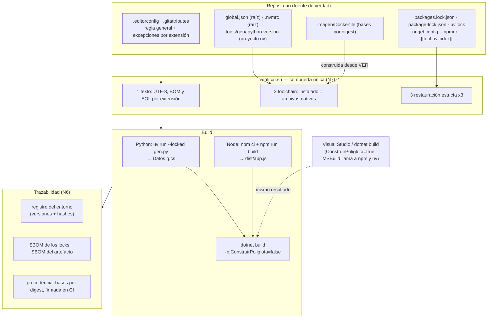

# N8 — Integración políglota en una única solución

El PO pidió analizar las tres plataformas «y en especial qué sucede cuando se integran todos estos en una única solución». Los núcleos N1 a N7 contestaron cada pregunta por ecosistema. Este núcleo junta las piezas en un repositorio que tiene, a la vez, una consola .NET, un frontend Node.js y un generador de código en Python, y mira qué se rompe en las uniones: la política de texto que sirve a uno y daña a otro, las versiones que cada herramienta busca en un lugar distinto, la build de un ecosistema que llama a otro sin saber con qué versión, la imagen que tiene que traer tres runtimes, y el SBOM y la procedencia que tienen que cubrir todo.

La regla de trabajo es la que fijó BIT-15-02 §7: cuando una tensión obliga a cambiar la recomendación de un núcleo anterior, el cambio se propone **en el núcleo de origen** y acá queda registrado. La §12 lista esas reparaciones.

Toda afirmación lleva fuente oficial con fecha de consulta (2026-10-07) o un experimento ejecutado (E1) del laboratorio `Examples/N8-integracion-poliglota/`. Lo que es criterio propio se marca **[criterio]**; lo que no se verificó, **[no verificado]**.

## Índice

- [1. Definiciones](#1-definiciones)
- [2. La solución de referencia](#2-la-solución-de-referencia)
- [3. ¿Qué se rompe primero?](#3-qué-se-rompe-primero)
- [4. Qué propone cada ecosistema para varios proyectos en un repo](#4-qué-propone-cada-ecosistema-para-varios-proyectos-en-un-repo)
- [5. Estrategias de integración](#5-estrategias-de-integración)
  - [5.1 Política de texto raíz, por extensión](#51-política-de-texto-raíz-por-extensión)
  - [5.2 Punto único de verdad de las versiones](#52-punto-único-de-verdad-de-las-versiones)
  - [5.3 Un lock y un registro por ecosistema](#53-un-lock-y-un-registro-por-ecosistema)
  - [5.4 La frontera de la build: quién llama a quién](#54-la-frontera-de-la-build-quién-llama-a-quién)
  - [5.5 Una imagen con tres runtimes o una por componente](#55-una-imagen-con-tres-runtimes-o-una-por-componente)
  - [5.6 CI: imagen única o matriz](#56-ci-imagen-única-o-matriz)
  - [5.7 SBOM y procedencia que cubran los tres](#57-sbom-y-procedencia-que-cubran-los-tres)
- [6. Modelo integrado](#6-modelo-integrado)
- [7. Tabla comparativa](#7-tabla-comparativa)
- [8. Snippets representativos](#8-snippets-representativos)
- [9. Experimentos](#9-experimentos)
- [10. Preguntas guía](#10-preguntas-guía)
- [11. Errores frecuentes](#11-errores-frecuentes)
- [12. Dependencias, tensiones y reparaciones en el núcleo de origen](#12-dependencias-tensiones-y-reparaciones-en-el-núcleo-de-origen)
- [13. Aplicación por escenario y actor](#13-aplicación-por-escenario-y-actor)
- [14. Observaciones y límites](#14-observaciones-y-límites)
- [15. Evidencias](#15-evidencias)
- [16. Verificación adversarial](#16-verificación-adversarial)

## 1. Definiciones

Los términos *fijar*, *congelar*, *deriva*, *declarar*/*hacer cumplir*, *reproducible* y *determinista* conservan el sentido de N0. Este núcleo agrega los siguientes.

| Término | Definición en esta guía |
|---|---|
| **Solución políglota** | Un repositorio cuyo artefacto final necesita, para construirse, toolchains de más de un ecosistema. En el laboratorio: la DLL .NET embebe un bundle que produce Node y compila un `.cs` que genera Python (contexto CTX-POLI de BIT-15-03). |
| **Monorepo** | Un repositorio con varios proyectos versionados juntos. No implica una herramienta: npm y uv lo llaman *workspace* [EV8-21, EV8-22] y .NET lo expresa con una solución (`.sln`/`.slnx`) y archivos `Directory.*.props`. |
| **Frontera de la build** | El punto donde la build de un ecosistema invoca a otro. Puede estar **dentro** de una herramienta (un target de MSBuild que ejecuta `npm`) o **fuera** de todas (un script que llama a cada una). |
| **Orquestador** | El programa que decide el orden de los pasos de la build y los ejecuta. Puede ser MSBuild, un script versionado (`build.sh`), un sistema de build general o la CI. |
| **Imagen multi-runtime** (imagen única) | Una imagen de contenedor que trae los toolchains de los tres ecosistemas. |
| **Imagen por componente** | Una imagen oficial por ecosistema; la build pasa las salidas de una a otra (etapas de un Dockerfile, o jobs de CI con artefactos). |
| **Archivo nativo de versión** | El archivo que **la propia herramienta del ecosistema** lee para elegir su versión: `global.json` (SDK de .NET), `.nvmrc`/`engines` (Node), `.python-version`/`requires-python` (Python). Se opone al archivo de un gestor de terceros (`mise.toml`, `.tool-versions`). |
| **Alcance de un SBOM** | Qué conjunto de componentes describe: el **artefacto que se entrega** (lo que viaja al usuario) o el **entorno que lo construyó** (lo que se usó para producirlo). En una build políglota no coinciden (E8-6). |

## 2. La solución de referencia

El laboratorio arma un caso mínimo pero completo, sintético y sin relación con ningún sistema real. Reproduce lo que tiene el caso disparador del PO (un proyecto .NET con identificadores no ASCII) y le agrega lo que una solución políglota suele sumar: un frontend que se construye con Node y un paso de generación de código en Python.

```
solucion/
├── .editorconfig  .gitattributes          política de texto raíz (§5.1)
├── global.json  .nvmrc                    versiones nativas (§5.2)
├── Directory.Packages.props  nuget.config CPM y fuentes NuGet (§5.3)
├── src/Saludo/        Saludo.csproj, Program.cs, packages.lock.json
├── web/               package.json, package-lock.json, .npmrc, build.mjs
├── tools/gen/         pyproject.toml, uv.lock, .python-version, gen.py
├── verificar.sh       compuerta única: texto + toolchain + restauración estricta
├── build.sh           orquestador: compuerta → Python → Node → .NET → registro
└── registrar-entorno.sh
```

El flujo de datos es deliberadamente cruzado: Python escribe `Datos.g.cs`, Node escribe `dist/app.js`, y el proyecto .NET compila el primero y embebe el segundo. Así ninguna pieza se construye sola y la pregunta «¿quién llama a quién?» tiene que contestarse.

## 3. ¿Qué se rompe primero?

E8-1 toma la solución y le aplica las dos políticas «globales» que un equipo suele adoptar sin pensarlo por extensión: la corrección del caso C# aplicada a todo el repo («UTF-8 con BOM para todo») y el checkout de una estación Windows con `core.autocrlf=true` y sin `.gitattributes` («CRLF para todo»). Agrega una tercera variante con el código heredado del caso (cp1252 sin BOM). Después corre quince lectores de los tres ecosistemas sobre los mismos bytes.

| Lector | A. Política por extensión | B. BOM para todo | C. CRLF para todo | D. Heredado cp1252 |
|---|---|---|---|---|
| `./tools/hola.sh` (shebang `#!/bin/sh`) | OK | OK **con error en stderr** (ver abajo) | **FALLA** `cannot execute: required file not found` | OK |
| `./tools/saluda.py` (shebang `#!/usr/bin/env python3`) | OK | **FALLA** `#!/usr/bin/env: No such file or directory` | **FALLA** `/usr/bin/env: 'python3\r'` | OK |
| `uv run python gen.py` | OK | OK | OK | OK |
| Python `json.load(open(…, encoding="utf-8"))` | OK | **FALLA** `Unexpected UTF-8 BOM (decode using utf-8-sig)` | OK | **FALLA** `UnicodeDecodeError … 0xf1` |
| Python `tomllib.load` sobre `pyproject.toml` | OK | **FALLA** `Invalid statement` | OK | OK |
| `uv sync --locked` (lee `pyproject.toml`) | OK | OK | OK | OK |
| `uv python find` (lee `.python-version`) | OK | OK | OK | OK |
| Node `JSON.parse(readFileSync(…, "utf8"))` | OK | **FALLA** `Unexpected token ''` | OK | OK **con U+FFFD** (ver abajo) |
| Node `require("…json")` | OK | OK | OK | OK |
| `npm ci` (lee `package.json`) | OK | OK | OK | OK |
| `npm run build` (`build.mjs`) | OK | OK | OK | OK |
| `dotnet --version` (lee `global.json`) | OK | OK | OK | OK |
| `dotnet restore --locked-mode` (lee el lock) | OK | OK | OK | OK |
| `dotnet build` (`Program.cs`) | OK | OK | OK | **FALLA** `CS1056: Unexpected character '�'` |
| Compuerta N3: `.nvmrc` contra `node -v` | OK | **FALLA** (los bytes `357 273 277` del BOM entran en la comparación) | OK | OK |

Fuente: E8-1, `salidas/E8-1-choque-de-convenciones.txt`.

La lectura de la tabla cambia la pregunta del PO. **Lo primero que se rompe no es la compilación de C#, sino lo que un humano no ve**: los scripts con shebang, los parsers estrictos de JSON y TOML, y las comparaciones de texto que escribe el propio equipo. Las herramientas de paquetes (`npm`, `uv`, `dotnet`) toleran el BOM; los lectores genéricos y el kernel, no.

Dos «OK» de la tabla esconden daño, y por eso E8-1 los detalla aparte:

- **Un `.sh` con BOM corre igual… si lo lanza un shell.** El kernel sólo reconoce un script si empieza con una línea `#!intérprete` [EV8-41]; con el BOM delante, `execve` devuelve `ENOEXEC`, y bash interpreta el archivo por su cuenta: la primera línea falla (`#!/bin/sh: No such file or directory`), el resto corre y el código de salida es 0. En CI, un paso así puede pasar en verde con otro intérprete del previsto. N1 registró lo mismo (E1-N1-11). El resultado **depende de quién lo lance** (verificación adversarial V-3): `sh` (dash) y el `child_process` de Node se comportan igual que bash (las funciones `execvp` de la familia `exec(3)` reintentan con `/bin/sh` ante `ENOEXEC` [EV8-42]), pero `subprocess.run` de Python, que llama a `execve` directo, falla con `OSError: [Errno 8] Exec format error`. El mismo archivo «anda» o no según el orquestador.
- **Node lee cp1252 sin quejarse.** `JSON.parse(readFileSync(f, "utf8"))` devuelve `{ 'a�o': 2026 }`: el byte inválido se reemplaza por U+FFFD y el dato queda corrompido sin excepción. Python, en cambio, falla con `UnicodeDecodeError`. Es decir: con código heredado, el ecosistema más permisivo es el que más tarde avisa.

El caso disparador (D) aparece así como un caso particular: en una solución políglota, el cp1252 rompe la compilación de C# en Linux, rompe a Python en el primer `open` estricto y **corrompe en silencio** lo que lea Node.

## 4. Qué propone cada ecosistema para varios proyectos en un repo

Ningún fabricante documenta la **build** integrada de los tres ecosistemas. Cada uno documenta cómo agrupar **sus** proyectos y, en algunos casos, cómo invocar a otro. La excepción parcial es Aspire 13, que orquesta apps .NET, JavaScript y Python para **ejecutar y publicar** (no para compilar una DLL que embeba salidas de las otras), y cuyos Dockerfiles generados detectan la versión de Node desde `.nvmrc`, `.node-version` o `package.json`, y la de Python desde `.python-version` o `pyproject.toml` [EV8-06]: otra herramienta que lee los archivos nativos (§5.2).

| Ecosistema | Agrupación que documenta el fabricante | Cómo invoca a otros ecosistemas | Evidencia |
|---|---|---|---|
| .NET | Solución (`.sln`/`.slnx`), `Directory.Packages.props` (CPM), `global.json` buscado hacia arriba por el muxer y por el resolvedor de SDK de MSBuild, que **parte de directorios distintos** | Target de MSBuild con la tarea `Exec` (corre `cmd.exe` en Windows y `sh` en el resto); el proyecto JavaScript de Visual Studio (`.esproj`, JSPS) que corre `npm install` y `npm run build`; Aspire 13 orquesta apps JavaScript y Python para ejecutar y publicar | [EV8-01], [EV8-02], [EV8-03], [EV8-04], [EV8-05], [EV8-06] |
| Node.js | *Workspaces* de npm: declarados en el `package.json` raíz; el ejemplo de la documentación muestra **un solo** `package-lock.json` en la raíz (no lo enuncia como regla); un `.npmrc` dentro de un miembro se ignora (V-2) | Scripts de `package.json` (`npm run …`) que llaman a cualquier comando | [EV8-22] |
| Python | *Workspaces* de uv: miembros por glob, **un solo** `uv.lock`, `requires-python` como intersección de los miembros; desaconsejados si los miembros tienen requisitos en conflicto | No define un mecanismo; el script que corre `uv run` es quien llama | [EV8-21] |
| Multi-runtime | mise (convención extendida): lee `mise.toml` y, **si se habilitan**, los archivos nativos (`.nvmrc`, `.python-version`, `global.json`); asdf: `.tool-versions`, archivos de otros gestores sólo con `legacy_version_file = yes` | — | [EV8-07], [EV8-08], E8-2 |
| Contenedores | *Features* oficiales de devcontainer para .NET, Node y Python; defaults flotantes (`latest`, `lts`, `os-provided`) | — | [EV8-09], [EV8-10], [EV8-11], [EV8-12] |

**[criterio]** La consecuencia práctica es que la integración es un **diseño propio** del equipo: cada fabricante garantiza su parte y ninguno garantiza la unión. Las estrategias de §5 se apoyan en piezas documentadas de cada ecosistema y se validan con experimentos, pero su combinación es criterio de esta guía.

## 5. Estrategias de integración

### 5.1 Política de texto raíz, por extensión

N1 y N2 llegaron, por separado, a la misma conclusión que E8-1 confirma en conjunto: **UTF-8 sin BOM y LF como regla general, con excepciones por extensión que exige el consumidor del archivo**. En la solución políglota la excepción no se decide por lenguaje sino por **quién lee ese archivo**:

| Extensión | Codificación | EOL | Quién lo exige | Evidencia |
|---|---|---|---|---|
| todo lo demás (`.cs`, `.js`, `.mjs`, `.py`, `.json`, `.toml`, `.csproj`…) | UTF-8 sin BOM | LF | El lector más estricto de cada tipo: `json`/`tomllib` de Python, `JSON.parse` de Node, el kernel (shebang) | E8-1, N1 §7 |
| `.sh`, scripts con shebang | UTF-8 sin BOM | LF obligatorio | El kernel: `\r` en el shebang y BOM antes de `#!` rompen la ejecución | E8-1 |
| `.cmd`, `.bat` | UTF-8 sin BOM | CRLF | `cmd.exe` (N2) | N2 |
| `.razor`, `.cshtml`, `.sln` | UTF-8 **con** BOM | LF | Las plantillas y comandos del SDK lo reponen (N2, E6) | N2 |
| `.ps1` | UTF-8 **con** BOM si el equipo usa Windows PowerShell 5.1 y hay texto no ASCII | LF | Windows PowerShell 5.1 lee un script sin BOM como ANSI; PowerShell 7 usa `utf8NoBOM` | [EV8-13] |
| Locks (`packages.lock.json`, `package-lock.json`, `uv.lock`) | UTF-8 sin BOM, **sin exigir salto final** | LF | NuGet escribe `packages.lock.json` sin salto de línea final (E8-1, observación de bytes); N7 vio que un hook genérico se lo agrega y NuGet lo vuelve a quitar | E8-1, N7 E7-02 |

Dos detalles del `.editorconfig` que sólo aparecen al juntar ecosistemas:

- **`unset`** permite que una sección posterior anule una propiedad de `[*]` (por ejemplo `insert_final_newline = unset` para los locks) [EV8-14]. Dentro de un mismo archivo, la sección que aparece después gana [EV8-14]; por eso las excepciones van al final.
- La especificación de EditorConfig **desaconseja** `utf-8-bom` [EV8-14]. Usarlo para `.razor`, `.sln` y `.ps1` es una excepción justificada por el lector, no una preferencia.

Los archivos que **genera** un ecosistema para otro también entran en la política. En el laboratorio, Python escribe un `.cs`; `gen.py` lo hace con `encoding="utf-8"` y `newline="\n"` explícitos, porque hasta que el modo UTF-8 sea el predeterminado (PEP 686, en estado *Final*, para Python 3.15, cuya versión final está prevista para el 2026-10-09) la codificación por defecto de `open()` es la que devuelve `locale.getencoding()`, que en Windows es la página de códigos ANSI [EV8-34], [EV8-35], [EV8-40]. Un generador sin codificación explícita reproduciría el caso disparador desde adentro de la build.

En `.gitattributes`, la tentación de marcar los locks con `linguist-generated` para «limpiar» el PR choca con N4 y N7: GitHub oculta esos archivos por defecto en el diff [EV8-15], y el revisor tiene que verlos (N4, pregunta 5). La plantilla del laboratorio los declara sólo como `text eol=lf`.

### 5.2 Punto único de verdad de las versiones

La pregunta del PO («congelar… versiones de compiladores, sdk») se multiplica por tres. N3 recomendó **archivos nativos como fuente de verdad, una compuerta que los haga cumplir y la imagen construida desde ellos**. E8-2 pone a prueba esa recomendación con los tres ecosistemas juntos y encuentra una condición que N3 no había visto.

**Los archivos nativos no se buscan igual.** Cada herramienta tiene su propia regla de búsqueda:

| Archivo | Quién lo busca | Desde dónde | Hasta dónde | Evidencia |
|---|---|---|---|---|
| `global.json` | Muxer `dotnet` y resolvedor de SDK de MSBuild | El muxer desde el directorio actual; el resolvedor desde el directorio de la solución o del proyecto | Ancestros | [EV8-02] |
| `.nvmrc` | nvm, fnm, mise (si se habilita), la compuerta | Según el gestor | — | N3 [EV-11], [EV-12] |
| `.python-version` | uv | El directorio actual y sus padres | **No** pasa el límite del proyecto o *workspace* | [EV8-16], E8-2 paso 4 |
| `.python-version`, `.nvmrc`, `global.json` | mise | El directorio actual hacia arriba | — | E8-2 paso 3 |

E8-2 paso 4 lo muestra con un caso concreto. Con `.python-version` (3.12.15) en la **raíz** del repo y el proyecto uv en `tools/gen/`, `uv python find` desde la raíz exige 3.12.15 y falla porque la imagen trae 3.12.14; pero `uv run` desde `tools/gen/` usa 3.12.14 **sin aviso**, porque la petición sale de `requires-python` (`DEBUG Using Python request '==3.12.*' from 'requires-python' metadata`). El archivo «único» en la raíz no gobernaba al único proyecto Python del repo.

**[criterio]** De ahí la regla que la guía debería dar: **un archivo nativo por ecosistema, ubicado donde lo busca la herramienta de ese ecosistema**. En el laboratorio: `global.json` y `.nvmrc` en la raíz; `.python-version` dentro del proyecto uv (`tools/gen/`). La alternativa equivalente es convertir la raíz del repo en raíz de un *workspace* de uv, con lo que `.python-version` vuelve a la raíz [EV8-21]; tiene el costo de un `pyproject.toml` en la raíz de una solución .NET.

**La compuerta es lo que hace «único» al punto de verdad.** `verificar.sh` lee los tres archivos y los compara con lo instalado. En E8-2 paso 2, alguien sube `.nvmrc` a 24.21.0 y no reconstruye la imagen: la compuerta falla con `node esperado 24.21.0, encontrado 22.23.2`. La herramienta nunca lo habría detectado sola: Node no lee `.nvmrc`.

**mise y asdf como lectores, no como fuente.** E8-2 paso 3 muestra tres comportamientos de mise 2026.10.3 que confirman lo que documenta [EV8-07]:

1. Por defecto **no lee** los archivos nativos: `mise ls --current` no muestra nada.
2. Con `MISE_IDIOMATIC_VERSION_FILE_ENABLE_TOOLS=node,python,dotnet` lee **los mismos** archivos que usan las herramientas (`/w/global.json 8.0.425`, `/w/.nvmrc 22.23.2`, y desde `tools/gen/` también `.python-version 3.12.15`).
3. Si además hay un `mise.toml` con `node = "24"`, **gana `mise.toml`** y resuelve 24.21.0 sin decir que contradice a `.nvmrc`.

**[criterio]** mise o asdf son una comodidad legítima para la estación Linux o WSL (ESC-02, ESC-03), configurados para leer los archivos nativos. Un `mise.toml` o `.tool-versions` con versiones propias crea una segunda verdad que Visual Studio, `npm` y `uv` ignoran.

**Las *features* de devcontainer no leen los archivos nativos.** La de .NET tiene `version` con default `latest`, la de Node `lts` (instalada con nvm) y la de Python `os-provided`, que además puede compilar Python desde el fuente [EV8-10], [EV8-11], [EV8-12]. Ninguna documenta leer `global.json`, `.nvmrc` o `.python-version`. N5 ya mostró que el lock de *features* congela el artefacto de la *feature* pero no lo que su script resuelve al construir (`lts` cambia). En una imagen con tres runtimes eso significa tres versiones flotando a la vez si no se fijan explícitamente y no se verifican con la compuerta.

### 5.3 Un lock y un registro por ecosistema

N4 estableció que no hay lock común: cada ecosistema tiene su resolvedor, su lock y su comando estricto. Lo que N4 dejó pendiente para N8 era la **configuración de registros** de npm y uv, el equivalente del `nuget.config` con `<clear />` y mapeo de fuentes.

| Ecosistema | Archivo del repo | Qué declara | Protección contra confusión de dependencias | Evidencia |
|---|---|---|---|---|
| NuGet | `nuget.config` en la raíz | `<clear />`, fuentes, `packageSourceMapping` | Mapeo por patrón de Id (con los huecos que mostró N4 E3) | N4 |
| npm | `.npmrc` junto al `package.json` | `registry=`, registros por *scope* (`@scope:registry=`) | Registros por *scope* para paquetes internos; las credenciales van atadas al host | [EV8-17] |
| uv | `pyproject.toml`, `[[tool.uv.index]]` | Índices con nombre; `explicit = true`; `[tool.uv.sources] paquete = { index = "…" }` | Estrategia por defecto `first-index`, cuyo propósito declarado es evitar la confusión de dependencias | [EV8-18] |

El `.npmrc` del proyecto tiene la prioridad más alta entre los cuatro niveles de configuración de npm, pero sólo vale para la raíz del proyecto donde se corre npm [EV8-17]. La documentación no dice qué pasa en un *workspace*; la verificación V-2 lo midió con npm 10.9.8: el `.npmrc` de un miembro se ignora con el aviso `npm warn config ignoring workspace config at /w/a/.npmrc`, y vale el de la raíz del *workspace*. En el laboratorio, que no usa *workspaces*, la raíz es `web/`.

**[criterio]** La regla políglota es la de N4 multiplicada por tres y verificada una vez: los tres archivos de registros **en el repo**, ninguno dependiente de la configuración del usuario (`~/.npmrc`, `~/.config/uv`, `NuGet.Config` del perfil), y la compuerta corriendo los tres comandos estrictos (§8, `verificar.sh`).

### 5.4 La frontera de la build: quién llama a quién

Hay dos diseños, y el laboratorio implementa los dos sobre el mismo `.csproj`.

**A. MSBuild llama a todos.** Targets del `.csproj` ejecutan `npm ci`, `npm run build` y `uv run --locked python gen.py` antes de compilar. Es lo que obtiene quien abre la solución en Visual Studio (ESC-01) o corre `dotnet build`. E8-3 mide sus consecuencias:

1. **La imagen del SDK sola no alcanza.** En `mcr.microsoft.com/dotnet/sdk:8.0` la build falla con `error MSB3073: The command "npm ci --no-audit --no-fund" exited with code 127`. La frontera implica que la imagen de .NET necesita también Node y Python.
2. **Inputs/Outputs la hacen incremental.** La segunda build sin cambios saltea `ConstruirWeb` y `GenerarDatos` («Skipping target … because all output files are up-to-date»); tocar `uv.lock` rehace sólo el paso Python. MSBuild compara marcas de tiempo de entradas y salidas y, aunque saltee el target, igual crea los ítems que el target define (*output inference*) [EV8-19].
3. **MSBuild usa el Node que esté primero en el `PATH`.** Con Node 24 antepuesto y `.nvmrc` = 22.23.2: si `web/.npmrc` tiene `engine-strict=true`, `npm ci` falla con `EBADENGINE` y la build cae con `MSB3073`; sin `engine-strict`, npm sólo advierte y el bundle sale con `// construido con node v24.21.0`. `global.json` no cubre a Node ni a Python (N3 §7); `engines` + `engine-strict` es lo único que, dentro de esta frontera, hace cumplir la versión de Node.
4. **`Exec` corre `cmd.exe` en Windows y `sh` en el resto** [EV8-03]. Los comandos del target tienen que ser válidos en ambos intérpretes; `npm ci` y `uv run …` lo son, una tubería de bash no.

**B. El orquestador llama a todos.** `build.sh` corre la compuerta, después Python, Node y .NET, cada uno una vez, y construye .NET con `-p:ConstruirPoliglota=false`, que apaga los targets de A. E8-3 paso 4 muestra la misma secuencia con las versiones registradas. Si alguien construye la parte .NET sola, sin las salidas de los otros, el target `IncluirSalidasPoliglotas` corta con un error que dice qué hacer.

**El proyecto JavaScript de Visual Studio (`.esproj`).** Microsoft documenta el JavaScript Project System como la forma de tener proyectos Angular, React o Vue dentro de una solución de Visual Studio [EV8-04]. Su referencia dice que en *Build* y *Restore* corre `npm install` (`ShouldRunNpmInstall`, `true` por defecto) y `npm run build` [EV8-05]. E8-4 lo construyó en Linux:

- Con el MSBuild del SDK 8, la versión 1.0.6887863 del SDK de JSPS **no carga** (`System.Text.Json, Version=9.0.0.0`). El SDK de JavaScript queda acoplado a la versión del SDK de .NET: otra versión que fijar. `global.json` tiene una sección `msbuild-sdks` para fijar versiones de SDK de proyecto en un solo lugar [EV8-02].
- Con SDK 10 corre `npm install`, y ante un `package.json` que ya no coincide con el lock **reescribe el lock** (`is-odd 3.0.1 → 2.0.0`) y la build termina en verde. Es exactamente el modo «regenera en silencio» que N4 prohíbe en verificación.
- Con `ShouldRunNpmInstall=false` y un target propio que corre `npm ci` antes de `RunNpmInstall`, la misma deriva falla con `EUSAGE` y, sin deriva, construye. El nombre `RunNpmInstall` se leyó en `Sdk.targets`; no es un contrato documentado. La referencia de JSPS sí documenta un punto de enganche para instalar con otro gestor: «un target que corra antes de `BeforeRestore`» [EV8-05]. La verificación V-4 lo probó con la 1.0.6887863 y SDK 10 en Linux: con `BeforeTargets="BeforeRestore"`, `dotnet build` **nunca corrió** `npm ci` (la build cae en `npm run build` sin `node_modules`), y `Sdk.targets` de esa versión no define `BeforeRestore`. Por eso el laboratorio se queda con `RunNpmInstall`, que además tiene `Inputs="package.json"`: con el default, `npm install` corre cuando `package.json` es más nuevo que su marca, no en cada build.
- En Linux, el SDK intenta `cmd.exe` para `npm audit` («Failed to run npm audit … 'cmd.exe'») y deja un directorio llamado literalmente `obj\Debug`. **[criterio]** Es un SDK pensado para Visual Studio en Windows; usarlo como build de CI en Linux requiere esas correcciones.

**Aspire** orquesta apps .NET, JavaScript y Python para ejecutar y publicar (`AddJavaScriptApp` detecta npm, yarn o pnpm y corre `npm run build` al publicar; `AddPythonApp`, `AddUvicornApp`; detecta pip, uv o venv) [EV8-06]. **[no verificado en el laboratorio]** No se probó; se registra como opción para la orquestación en tiempo de ejecución, que es otra frontera que la de la build.

**[criterio]** Criterio de elección, a someter a la mesa:

| Si… | Frontera recomendada | Por qué |
|---|---|---|
| Hay desarrolladores en Visual Studio (ESC-01) que esperan que F5 «haga todo» | A en la estación, **con** `npm ci`, `uv run --locked`, `engine-strict` e Inputs/Outputs | Comodidad sin perder el modo estricto |
| La CI publica el artefacto | B en la CI (`-p:ConstruirPoliglota=false`) | Cada ecosistema corre una vez, con su comando estricto, y la compuerta y el registro de versiones van antes y después |
| Se usa `.esproj` | Apagar `ShouldRunNpmInstall` y enganchar `npm ci` | El default reescribe el lock |
| Cada componente se publica por separado (no hay artefacto único) | B, con un job o etapa por componente | No hay una build .NET que deba llamar a nadie |

La regla que une ambos diseños es que **los dos caminos tienen que producir lo mismo**. En el laboratorio, A y B dan la misma DLL cuando la ruta de build **y la configuración** son las mismas: `build.sh` compila en `Release` y da `4dd5d90f…` en `/w` (E8-3 paso 4); `dotnet build src/Saludo -c Release` (variante A) da el mismo hash dos veces seguidas, pero el `dotnet build` sin `-c`, que es lo que hace F5, compila en `Debug` y da `56df4603…` (verificación V-1; la salida original de E8-3 sólo mostraba el hash de B). **[criterio]** La comparación A = B se hace con la configuración de publicación explícita.

### 5.5 Una imagen con tres runtimes o una por componente

E8-5 construye las dos variantes con las mismas versiones y compara.

| Imagen | Tamaño (sin comprimir) | Trae |
|---|---|---|
| `dotnet/sdk:8.0` (oficial) | 867 MB | SDK 8.0.425; sin Node, sin Python |
| `node:22-bookworm-slim` (oficial) | 227 MB | Node 22.23.2, npm 10.9.8 |
| `python:3.12-slim` (oficial, bajada hace cinco semanas) | 127 MB | Python **3.12.14**; sin uv |
| `lab-n8-poliglota:local` (única) | 1156 MB | SDK 8.0.425, Node 22.23.2, Python 3.12.15, uv 0.12.23; 11 de sus 16 capas son las del SDK |

Fuente: E8-5. La imagen única se arma partiendo del SDK por digest, copiando Node y npm desde la imagen oficial de Node por digest y `uv` desde su imagen por digest, con Python instalado por `uv` en el parche que pide `.python-version`. `COPY --from` acepta una imagen, no sólo una etapa [EV8-20]; Astral recomienda exactamente ese método para uv, fijado a una versión y, para máxima reproducibilidad, a un digest [EV8-23].

Resultados que deciden:

- **La variante por componente falla si alguna imagen oficial no coincide.** Con `python:3.12-slim` local (3.12.14) y `.python-version` = 3.12.15, la etapa Python corta con `No interpreter found for Python 3.12.15`. La etiqueta `python:3.12-slim` hoy apunta al mismo digest que `python:3.12.15-slim` (`sha256:05cda977…`, comprobado con `docker buildx imagetools inspect` en V-5): la copia local había quedado atrás, el corrimiento que N5 mostró con el SDK. Lo mismo vale para Node: la copia local de `node:22-bookworm-slim` trae 22.23.2, pero nodejs.org publicó 22.23.3 el 2026-09-23 [EV8-43]; el laboratorio no se rompe porque fija el digest y `.nvmrc`, que es justamente el punto.
- **Con las mismas versiones, las dos variantes dan el mismo binario.** Con `python:3.12.15-slim@sha256:05cd…` la variante por componente produce una `Saludo.dll` con SHA-256 `cf57904b…`, idéntico al de la imagen única y al de BuildKit en E8-6 (las tres con el repo en `/src`).
- **El tamaño no decide.** 1156 MB frente a 867 + 227 + 127 = 1221 MB sumando las tres oficiales; la diferencia es menor que la variación entre etiquetas.

**[criterio]** Criterio de elección:

| Imagen única (multi-runtime) | Imagen por componente |
|---|---|
| Conviene para el **devcontainer** y para la build donde MSBuild llama a todos (§5.4-A): ahí los tres runtimes tienen que estar en el mismo proceso. | Conviene para la **CI que publica** cuando cada etapa es independiente (§5.4-B) o cada componente se publica aparte. |
| La compuerta corre entera en un solo lugar, igual que en la estación. | Cada etapa verifica sólo su ecosistema; la compuerta completa necesita juntarlos. |
| Hay que mantener un Dockerfile propio: es una imagen que nadie más publica ni parchea. | Cada imagen la parchea su fabricante; hay que fijar **cuatro** digests (SDK, Node, Python, uv) y subirlos con control (N7). |
| Base Debian 12 compartida (SDK 8 y Node bookworm, glibc 2.36); con SDK 10 la base es Ubuntu 24.04 (glibc 2.39) y funcionó igual en E8-4. | Una libc por imagen: SDK 8 y Node en Debian 12 (glibc 2.36), `python:3.12-slim` (copia local, `sha256:78387bc3…`) en Debian 13 *trixie* (glibc 2.41) (V-5). |

Las dos se fijan del mismo modo: cada imagen base por digest, cada versión leída de los archivos nativos, y la compuerta como prueba de que la imagen corresponde al repo. N5 recomendó construir la imagen de desarrollo `FROM` la misma base que la CI (opción B de N5 §8); en la variante única eso se cumple por construcción.

### 5.6 CI: imagen única o matriz

GitHub Actions ofrece dos piezas que corresponden a las dos variantes: `jobs.<id>.container`, que corre todos los pasos del job dentro de una imagen [EV8-24], y `strategy.matrix`, que crea un job por combinación de variables, con `fail-fast` y `max-parallel` [EV8-25]. El laboratorio deja un ejemplo **no ejecutado** en `solucion/ci/github-actions.ejemplo.yml`.

**[criterio]**

- **Imagen única** cuando el artefacto es uno (la DLL que embebe las salidas de Node y Python): el job corre `./build.sh`, el mismo comando que la estación y el devcontainer, y la compuerta es la misma que define N7.
- **Matriz** cuando hay que probar contra varias versiones de un runtime (por ejemplo, Node 22 y 24) o cuando cada componente se publica por separado. La matriz no reemplaza a la compuerta: cada celda tiene que fijar su versión y el ensamblado final pasa artefactos entre jobs.
- La matriz por **sistema operativo** (Windows y Linux) es la forma barata de detectar en CI lo que E8-1 muestra en local: un `.cs` en cp1252 compila en un runner Windows y falla en uno Linux. **[no verificado en el laboratorio]**: no hubo runner Windows.
- Las dos piezas no se combinan libremente: GitHub exige un runner **Linux** (Ubuntu, si es hospedado por GitHub) para usar *job containers*, *service containers* o acciones de contenedor [EV8-38]. La celda Windows de una matriz por sistema operativo no puede correr dentro de la imagen única: tiene que instalar los toolchains en el runner y depender todavía más de la compuerta. Además, dentro de un *job container* el shell por defecto de los pasos `run` es `sh`, no `bash` [EV8-24].

### 5.7 SBOM y procedencia que cubran los tres

E8-6 prueba tres caminos.

**1. Una herramienta multi-ecosistema sobre el repositorio.** syft 1.54.1 sobre `solucion/` produce un CycloneDX 1.7 con los tres ecosistemas a la vez: `pkg:nuget/Newtonsoft.Json@13.0.3`, `pkg:npm/is-odd@3.0.1`, `pkg:npm/is-number@6.0.0`, `pkg:pypi/packaging@25.0`. Sus catalogadores leen `packages.lock.json`, `package-lock.json` y `uv.lock` [EV8-26]. Microsoft publica `sbom-tool`, que usa la biblioteca Component Detection y genera SPDX 2.2 o 3.0 [EV8-27]; **[no verificado en el laboratorio]**.

**2. El exportador nativo de cada ecosistema, unido después.** `uv export --format cyclonedx1.5` (en *preview* según Astral [EV8-28]), `npm sbom --sbom-format cyclonedx` [EV8-29] y la herramienta CycloneDX para .NET (6.2.0, paquete `CycloneDX`, de la comunidad CycloneDX, no de Microsoft) dan tres CycloneDX 1.5; `cyclonedx-cli merge --hierarchical` (0.33.1) los une en uno que contiene los mismos cuatro paquetes, y lo escribe como CycloneDX **1.7**, no 1.5 (E8-6): la unión cambia la versión del formato. N6 recomendó este camino: un formato por solución, un SBOM por pieza con la herramienta nativa y la unión en un paso explícito de la CI (N6 §8).

**3. BuildKit, sobre la build por componentes.** `docker buildx build --provenance=mode=max --sbom=true` con salida local exporta, junto al artefacto, un `provenance.json` y un `sbom.spdx.json` [EV8-30], [EV8-31]:

- La **procedencia** es un *statement* in-toto con predicado `https://slsa.dev/provenance/v1` y lista como materiales, por digest, **las cuatro imágenes que traen los toolchains de los tres ecosistemas** (SDK, Node, Python, uv) más el escáner de SBOM. Es la respuesta más directa a «con qué entorno se ensambló la pieza» cuando la build corre en contenedores. La documentación de Docker dice que el predicado por defecto es SLSA v0.2 y que v1 se pide con `version=v1` [EV8-31]; en E8-6 se obtuvo v1 sin pedirlo. La discrepancia no la explica buildx sino **BuildKit**: las notas de BuildKit v0.28.0 (2026-03-04) dicen que el formato por defecto pasó a SLSA v1.0 [EV8-39], y el builder `n8-attest` corre BuildKit v0.33.1 (V-6). La página de Docker quedó atrasada. El default depende entonces de la versión de BuildKit del builder, no del cliente; **[criterio]** pedir `version=v1` explícitamente.
- El **SBOM del artefacto** sólo contiene NuGet (`Newtonsoft.Json`, `Saludo`), porque es lo único que viaja: el bundle de Node está embebido en la DLL y Python sólo generó código. Por defecto BuildKit escanea sólo la etapa final [EV8-30].
- Con `ARG BUILDKIT_SBOM_SCAN_STAGE=true` en las etapas `py` y `web`, BuildKit agrega un SBOM por etapa: 603 entradas en la de Python (87 paquetes Debian, **512 crates de Rust del binario de uv**, 3 PyPI entre los que está `packaging`, 1 genérica) y 290 en la de Node (201 paquetes npm, incluidas las dependencias que trae el propio npm, 88 Debian, `is-odd`, `is-number`).

La lección para la guía es de **alcance**: el SBOM del **artefacto** (qué se entrega), el SBOM de las **dependencias declaradas** (los tres locks) y el SBOM del **entorno de build** (las imágenes) son tres documentos distintos, con tamaños de 2, 4 y casi 900 componentes en el mismo laboratorio. **[criterio]** Una solución políglota necesita al menos los dos primeros (el de los locks responde «qué terceros entraron a la build»; el del artefacto, «qué se le entregó al usuario») y la procedencia, que nombra el entorno por digest. El SBOM completo del entorno es útil para auditoría de la cadena de suministro y no conviene confundirlo con el del producto.

La procedencia de BuildKit no está firmada en el archivo exportado. La firma la agrega la plataforma de CI: GitHub documenta `actions/attest` con permisos `id-token: write` y `attestations: write`, y afirma que por sí solas las atestaciones dan SLSA v1.0 Build L2 y que con flujos reutilizables se llega a L3 [EV8-32], [EV8-33]. N6 desarrolla la firma y los niveles.

## 6. Modelo integrado



## 7. Tabla comparativa

| Decisión | Opción | A favor | En contra | Evidencia | Recomendación **[criterio]** |
|---|---|---|---|---|---|
| Codificación | BOM para todo | Arregla C# con cp1252 heredado | Rompe shebang de Python, `json`, `tomllib`, `JSON.parse`, comparaciones propias | E8-1 B | No |
| | Sin BOM, excepciones por extensión | Todos los lectores pasan | Hay que mantener la lista de excepciones | E8-1 A | **Sí** |
| Fuente de versiones | Archivos nativos + compuerta | Las herramientas y Visual Studio los leen | Hay que escribir la compuerta | E8-2 | **Sí** |
| | `mise.toml` / `.tool-versions` propio | Un archivo instala todo | Segunda verdad que gana en silencio; VS no lo lee | E8-2 3c | Sólo leyendo los nativos |
| | *Features* de devcontainer | Imagen sin Dockerfile | Defaults flotantes; no leen los nativos | [EV8-10–12] | Con versión explícita + compuerta |
| Frontera | MSBuild llama a todos | F5 en Visual Studio funciona | Usa el runtime del `PATH`; imagen del SDK sola no alcanza | E8-3 | En la estación, en modo estricto |
| | Orquestador externo | Cada ecosistema una vez, estricto | Quien abre la solución tiene que correr un script | E8-3 | **En CI** |
| | `.esproj` (JSPS) | Integración con Visual Studio | `npm install` reescribe el lock; acoplado al SDK; fallas en Linux | E8-4 | Con `ShouldRunNpmInstall=false` + `npm ci` |
| Imagen | Única multi-runtime | Compuerta y build idénticas a la estación | Dockerfile propio que mantener | E8-5 | **Devcontainer** y build A |
| | Por componente | Imágenes del fabricante | Cuatro digests que coordinar; compuerta repartida | E8-5 | **CI** por etapas |
| CI | Imagen única | Mismo comando que en local | — | [EV8-24] | Artefacto único |
| | Matriz | Varias versiones u OS | No es compuerta; pasa artefactos | [EV8-25] | Pruebas multi-versión, multi-OS |
| SBOM | Herramienta multi-ecosistema | Un comando, un documento | Depende de que soporte los tres locks | E8-6 1 | Opción simple |
| | Nativos + unión | Lo que cada ecosistema sabe de sí | Versiones de formato distintas; uv en *preview* | E8-6 2 | La de N6 |
| | BuildKit | Procedencia con bases por digest | SBOM del artefacto parcial salvo `SCAN_STAGE` | E8-6 3 | Para builds en contenedor |

## 8. Snippets representativos

**`.editorconfig` raíz: regla general y excepciones por consumidor.**

```ini
root = true

# Regla general para los tres ecosistemas.
[*]
charset = utf-8
end_of_line = lf
insert_final_newline = true

# Excepciones que exige quien LEE el archivo (van al final: la última sección gana).
# Los comentarios van en su propia línea: desde la especificación 0.17, un # o un ;
# después de un valor forma parte del valor [EV8-14].
[*.{cmd,bat}]
end_of_line = crlf

# Las herramientas del SDK lo reponen (N2).
[*.{razor,cshtml,sln}]
charset = utf-8-bom

# Windows PowerShell 5.1 lee un script sin BOM como ANSI.
[*.ps1]
charset = utf-8-bom

# NuGet escribe su lock sin salto final.
[{packages.lock.json,package-lock.json,uv.lock}]
insert_final_newline = unset
```

**La frontera dentro de MSBuild, en modo estricto e incremental** (extracto de `Saludo.csproj`).

```xml
<PropertyGroup>
  <!-- true en la estación (F5); la CI pasa -p:ConstruirPoliglota=false y usa build.sh -->
  <ConstruirPoliglota Condition="'$(ConstruirPoliglota)' == ''">true</ConstruirPoliglota>
</PropertyGroup>

<!-- Inputs/Outputs: si nada cambió, MSBuild saltea el target. -->
<Target Name="ConstruirWeb" Condition="'$(ConstruirPoliglota)' == 'true'"
        Inputs="@(WebEntrada)" Outputs="$(WebSalida)">
  <!-- npm ci (no npm install): instala el lock o falla. Exec usa cmd.exe en Windows y sh en Linux. -->
  <Exec Command="npm ci --no-audit --no-fund" WorkingDirectory="$(WebDir)" />
  <Exec Command="npm run build" WorkingDirectory="$(WebDir)" />
</Target>

<Target Name="GenerarDatos" Condition="'$(ConstruirPoliglota)' == 'true'"
        Inputs="@(GenEntrada)" Outputs="$(DatosSalida)">
  <Exec Command="uv run --locked python gen.py dist/Datos.g.cs" WorkingDirectory="$(GenDir)" />
</Target>
```

**El `.esproj` de Visual Studio sin reescribir el lock.**

```xml
<Project Sdk="Microsoft.VisualStudio.JavaScript.Sdk/1.0.6887863">
  <PropertyGroup>
    <ShouldRunNpmInstall>false</ShouldRunNpmInstall>  <!-- documentada: apaga el npm install -->
  </PropertyGroup>
  <!-- RunNpmInstall es un target interno (Sdk.targets 1.0.6887863): revisar al subir de versión -->
  <Target Name="NpmCiEstricto" BeforeTargets="RunNpmInstall">
    <Exec Command="npm ci --no-audit --no-fund" WorkingDirectory="$(MSBuildProjectDirectory)" />
  </Target>
</Project>
```

**Compuerta única: tres capas, tres ecosistemas** (extracto de `verificar.sh`).

```bash
echo "== 2. Toolchain: lo instalado contra los archivos NATIVOS del repo"
esperado_sdk=$(python3 -c 'import json;print(json.load(open("global.json"))["sdk"]["version"])')
esperado_node=$(tr -d '[:space:]' < .nvmrc)
esperado_py=$(tr -d '[:space:]' < tools/gen/.python-version)   # donde lo busca uv
real_py=$(cd tools/gen && uv python find --show-version 2>/dev/null)
# ... comparar; archivo presente sin herramienta = rojo (regla de N7)

echo "== 3. Restauración estricta: un lock por ecosistema"
dotnet restore src/Saludo --locked-mode
(cd web && npm ci)
(cd tools/gen && uv sync --locked)
```

**Imagen única: cada runtime desde su imagen oficial, por digest** (extracto de `imagen/Dockerfile`).

```dockerfile
ARG SDK_IMAGE=mcr.microsoft.com/dotnet/sdk:8.0@sha256:78235e09…
ARG NODE_IMAGE=node:22-bookworm-slim@sha256:d649c27d…
ARG UV_IMAGE=ghcr.io/astral-sh/uv:0.12.23@sha256:61d393e4…
FROM ${NODE_IMAGE} AS node
FROM ${UV_IMAGE} AS uv
FROM ${SDK_IMAGE}
COPY --from=node /usr/local/bin/node /usr/local/bin/node
COPY --from=node /usr/local/lib/node_modules/npm /usr/local/lib/node_modules/npm
RUN ln -s ../lib/node_modules/npm/bin/npm-cli.js /usr/local/bin/npm
COPY --from=uv /uv /uvx /usr/local/bin/
# docker build --build-arg PYTHON_VERSION=$(cat tools/gen/.python-version)
ARG PYTHON_VERSION
RUN uv python install "$PYTHON_VERSION"
# Después de construir, no se descargan intérpretes.
ENV UV_PYTHON_DOWNLOADS=never
```

En un Dockerfile, `#` sólo abre un comentario al principio de la línea: un `ENV UV_PYTHON_DOWNLOADS=never   # comentario` corta la build con `Syntax error - can't find = in "#"` (verificación V-7). El archivo completo del laboratorio, `imagen/Dockerfile`, ya tiene los comentarios en líneas propias.

**Procedencia y SBOM de la build por componentes.**

```bash
docker buildx build --builder n8-attest --target artefacto \
  --provenance=mode=max,version=v1 --sbom=true \
  -f imagen/Dockerfile.por-componente --output type=local,dest=salida solucion
# (E8-6 corrió sin version=v1 y BuildKit v0.33.1 igual emitió v1, default desde v0.28.0;
#  se pide explícito porque el default depende de la versión de BuildKit del builder, §5.7)
# salida/provenance.json : SLSA v1, materiales = SDK, Node, Python y uv por digest
# salida/sbom.spdx.json  : sólo lo que viaja (NuGet); ARG BUILDKIT_SBOM_SCAN_STAGE=true en
#                          cada etapa agrega sbom-<etapa>.spdx.json (npm, PyPI, Debian, crates)
```

## 9. Experimentos

Laboratorio: `LAB/Lab-Documentos/Guides/Metodologia-Entorno-Desarrollo/Examples/N8-integracion-poliglota/` (README con los comandos exactos). Todos corridos el 2026-10-07 en Linux (Debian 13, x86_64), Docker con buildx 0.35 (BuildKit v0.33.1 en el builder `n8-attest` de E8-6). Imágenes: `lab-n8-poliglota:local` (SDK 8.0.425, Node 22.23.2, npm 10.9.8, Python 3.12.15, uv 0.12.23) y `lab-n8-poliglota:sdk10` (SDK 10.0.400).

| ID | Comando | Resultado resumido | Salida |
|---|---|---|---|
| E8-1 | `./e1-choque-de-convenciones/experimento.sh` | Matriz de §3: política por extensión, 15/15 OK; BOM para todo, 5 fallas (shebang Python, `json`, `tomllib`, `JSON.parse`, compuerta) y un OK con error en stderr; CRLF para todo, 2 fallas (shebangs); cp1252, 2 fallas (`CS1056`, `UnicodeDecodeError`) y Node con U+FFFD sin error. | `salidas/E8-1-choque-de-convenciones.txt` |
| E8-2 | `./e2-punto-unico-de-versiones/experimento.sh` | Compuerta OK con la imagen alineada; FALLA (`node esperado 24.21.0, encontrado 22.23.2`) al subir `.nvmrc`; mise 2026.10.3: no lee nativos por defecto, los lee habilitados, `mise.toml` gana sobre `.nvmrc`; `.python-version` en la raíz ignorado por el proyecto uv (`usa python 3.12.14`, petición desde `requires-python`). | `salidas/E8-2-punto-unico-de-versiones.txt` |
| E8-3 | `./e3-frontera-de-la-build/experimento.sh` | Imagen del SDK sola: `MSB3073 … code 127`; multi-runtime: OK, incremental (`Skipping target "ConstruirWeb"`), tocar `uv.lock` rehace sólo Python; Node 24 en `PATH`: `EBADENGINE` con `engine-strict`, bundle `construido con node v24.21.0` sin él; `build.sh` (Release): DLL `4dd5d90f…`, la misma que la variante A con `-c Release` (V-1); sin salidas y `ConstruirPoliglota=false`: error explicativo. | `salidas/E8-3-frontera-de-la-build.txt` |
| E8-4 | `./e4-esproj-de-visual-studio/experimento.sh` | SDK 8: `MSB4018 … System.Text.Json, Version=9.0.0.0`; SDK 10: `npm install` + `npm run build`, intento de `cmd.exe`, directorio `obj\Debug`; deriva: lock reescrito `3.0.1 → 2.0.0` y build OK; variante estricta: `EUSAGE`, lock intacto; sin deriva: OK con `npm ci`. | `salidas/E8-4-esproj-de-visual-studio.txt` |
| E8-5 | `./e5-imagen-unica-vs-varias/experimento.sh` | Tamaños y versiones (§5.5); imagen única: DLL `cf57904b…`; por componente con Python 3.12.14: `No interpreter found for Python 3.12.15`; con `python:3.12.15-slim@sha256:05cd…`: DLL `cf57904b…` idéntica. | `salidas/E8-5-imagen-unica-vs-varias.txt` |
| E8-6 | `./e6-sbom-unificado/experimento.sh` | syft 1.54.1: CycloneDX 1.7 con nuget, npm y pypi; nativos (uv, npm, CycloneDX .NET 6.2.0): tres CycloneDX 1.5, unidos por `cyclonedx-cli 0.33.1` con los cuatro paquetes; BuildKit: procedencia SLSA v1 con SDK, Node, Python y uv por digest, SBOM del artefacto sólo NuGet, SBOM por etapa con npm/PyPI + Debian + 512 crates; DLL `cf57904b…`. | `salidas/E8-6-sbom-unificado.txt` |

## 10. Preguntas guía

**1. ¿Qué se rompe primero cuando .NET, Node y Python comparten repo?**
Lo que nadie mira: los scripts con shebang y los lectores estrictos de datos (JSON, TOML), no el compilador. E8-1 lo mide con quince lectores: con una política global de BOM, fallan cinco y ninguno de ellos es de .NET; con CRLF, fallan los dos shebangs; con código heredado en cp1252, falla C# en Linux y falla Python, mientras Node corrompe el dato sin error. Después vienen las versiones: cada herramienta busca su archivo en otro lugar, y un archivo «único» puede no gobernar al proyecto que creías (E8-2 paso 4). *Cuándo aplica*: siempre que un mismo commit lo lean herramientas de más de un ecosistema, incluidos los scripts de CI. La señal temprana es una compuerta de texto por extensión (§8) que corra antes que cualquier build.

**2. ¿Una imagen de desarrollo con los tres runtimes o una por componente, y con qué criterio?**
Depende de dónde está la frontera de la build. Si MSBuild llama a npm y uv (lo que pasa con F5 en Visual Studio), los tres runtimes tienen que estar en la misma imagen: E8-3 muestra que la imagen del SDK sola falla con `MSB3073`. Si un orquestador llama a cada ecosistema por separado, cada etapa puede usar la imagen oficial de su fabricante. En ambos casos el resultado tiene que ser el mismo, y E8-5 lo comprueba: con las mismas versiones, las dos variantes dan la misma DLL byte a byte. *Cuándo aplica*: devcontainer y estación → imagen única [criterio]; CI que publica por etapas → por componente, con cuatro digests fijados y subidos por PR. El tamaño no decide (1156 MB frente a 1221 MB).

**3. ¿Cómo se fija el toolchain de tres ecosistemas desde un único punto de verdad?**
No con un archivo, sino con **un archivo nativo por ecosistema, en el lugar donde lo busca su herramienta, más una compuerta que los lee a todos**. Los archivos nativos son los únicos que Visual Studio, `dotnet`, `npm` y `uv` leen; un `mise.toml` o un `.tool-versions` con versiones propias es una segunda verdad que gana en silencio (E8-2 paso 3c). La compuerta es la que convierte tres archivos en un punto de verdad verificable: falla si la imagen o la estación no coinciden (E8-2 paso 2). La imagen se construye **desde** esos archivos (`--build-arg PYTHON_VERSION=$(cat tools/gen/.python-version)`), nunca al revés. *Cuándo aplica*: siempre en CTX-POLI. mise o asdf, sólo como comodidad configurada para leer los nativos (ESC-02, ESC-03).

**4. ¿Cómo se generan SBOM y procedencia que cubran los tres?**
Primero hay que decidir el alcance, porque en una build políglota hay tres SBOM distintos: el de los locks (qué terceros entraron: 4 paquetes en el laboratorio), el del artefacto (qué se entrega: sólo NuGet, porque el bundle está embebido y Python sólo generó código) y el del entorno de build (casi 900 componentes, incluidos los crates de Rust de uv). Para el de los locks hay dos caminos verificados: una herramienta multi-ecosistema (syft lee los tres locks) o el exportador nativo de cada uno unido con `cyclonedx-cli` (el camino de N6). La procedencia la da la plataforma de build: BuildKit lista por digest las cuatro imágenes que trajeron los tres toolchains, y la CI la firma (`actions/attest`, SLSA Build L2) [EV8-32], [EV8-33]. *Cuándo aplica*: el SBOM de los locks y la procedencia firmada, siempre que se publique un artefacto; el SBOM del entorno, cuando la auditoría pida la cadena de suministro de la build.

**5. ¿Dónde vive la frontera entre la build .NET y las demás (quién llama a quién)?**
En dos lugares, y hay que elegir conscientemente cuál vale para cada escenario. Dentro de MSBuild (targets con `Exec`), para que la estación Windows con Visual Studio construya todo con F5; fuera de MSBuild (un script versionado), para que la CI corra cada ecosistema una vez, con su comando estricto, entre la compuerta y el registro del entorno. Los dos caminos tienen que producir lo mismo. Los riesgos de la frontera dentro de MSBuild son concretos: usa el Node y el Python del `PATH`, no los de los archivos (E8-3 paso 3); `Exec` corre `cmd.exe` en Windows y `sh` en Linux [EV8-03]; y el `.esproj` de Visual Studio trae `npm install` por defecto, que reescribe el lock (E8-4). *Cuándo aplica*: frontera dentro de MSBuild cuando hay desarrolladores en ESC-01 y siempre con `npm ci`, `uv run --locked` y `engine-strict=true`; orquestador externo en ESC-05.

**6. ¿Alcanza con que los tres locks estén commiteados?**
No. Cada lock necesita su comando estricto (N4) y, en la integración, además su configuración de registros **en el repo**: `nuget.config` con `<clear />` y mapeo, `.npmrc` del proyecto con el registro y los *scopes*, e índices de uv con `explicit = true` donde haga falta [EV8-17], [EV8-18]. Y el lock que se regenera en silencio puede venir de una herramienta inesperada: el SDK de proyectos JavaScript de Visual Studio corre `npm install` en *Build* y *Restore* [EV8-05] (de forma incremental: cuando `package.json` cambió, según su `Sdk.targets`) y ante deriva reescribe el lock (E8-4). *Cuándo aplica*: siempre; con más cuidado cuando el repo mezcla registros privados y públicos.

**7. ¿Qué cambia si el equipo trabaja sólo en Windows con Visual Studio?**
El fenómeno del caso no se ve (N1), pero la solución políglota igual lo expone: Python falla en el primer `open` estricto de un archivo cp1252, Node lo lee corrompido, y los scripts que corren en la CI Linux fallan por CRLF. Además, en ESC-01 MSBuild es el orquestador por defecto, y la frontera A de §5.4 es la que se ejecuta: el Node del `PATH` de cada máquina construye el frontend. *Cuándo aplica*: equipos Windows con CI Linux, que es la combinación del caso disparador.

## 11. Errores frecuentes

| Error | Síntoma | Corrección |
|---|---|---|
| Aplicar a todo el repo la corrección que resolvió C# («todo a UTF-8 con BOM»). | Scripts Python que no arrancan, `JSONDecodeError`/`SyntaxError` al leer JSON, `tomllib` que falla, comparaciones de versión que nunca coinciden (E8-1 B). | Regla general sin BOM; BOM sólo en las extensiones cuyo lector lo exige (§5.1). |
| Creer que un `.sh` «anda» porque el paso terminó en verde. | rc=0 con `#!/bin/sh: No such file or directory` en stderr; corre otro intérprete (E8-1 E). Lanzado desde Python (`subprocess`), el mismo archivo falla con `Exec format error` (V-3). | Compuerta de texto antes de la build; tratar la salida de error como falla en CI. |
| Poner `.python-version` en la raíz «para que sea único» con el proyecto uv en una subcarpeta. | uv usa otro parche dentro de `requires-python`, sin aviso (E8-2 paso 4). | `.python-version` en la raíz del proyecto o *workspace* de uv. |
| Mantener versiones en `mise.toml` además de los archivos nativos. | La estación con mise usa Node 24, Visual Studio y la CI usan 22 (E8-2 paso 3c). | mise configurado para leer los nativos; sin versiones propias. |
| Target de MSBuild que llama a `npm install`. | El lock se reescribe en cada build de la estación. | `npm ci` en el target (§8). |
| Usar el `.esproj` con sus defaults en CI. | Lock reescrito en silencio ante deriva (E8-4 paso 3); en Linux, intento de `cmd.exe` y un directorio `obj\Debug`. | `ShouldRunNpmInstall=false` + `npm ci`; o construir el frontend fuera de MSBuild en CI. |
| Asumir que `global.json` fija también Node y Python. | El bundle sale construido con el Node del `PATH` (E8-3 paso 3). | `engines` + `engine-strict=true` en `web/.npmrc`; compuerta de toolchain. |
| Escribir comandos de bash en un `Exec`. | Funciona en Linux, falla en Windows (`cmd.exe`) [EV8-03]. | Comandos simples, válidos en ambos shells, o un script por plataforma. |
| Imagen por componente con etiquetas en vez de digests. | La copia local de `python:3.12-slim` trae otro parche que la del registro (E8-5). | Fijar cada base por digest y subirla por PR (N5, N7). |
| Confundir el SBOM del artefacto con el de la build. | Un SBOM de la imagen final sin las dependencias npm y PyPI que sí entraron a la build (E8-6 3). | Generar el SBOM de los locks además del del artefacto; documentar el alcance. |
| Marcar los locks como `linguist-generated` para limpiar el PR. | GitHub los oculta en el diff y el revisor no ve el cambio del grafo [EV8-15]. | Declararlos sólo como `text eol=lf`. |

## 12. Dependencias, tensiones y reparaciones en el núcleo de origen

| Con | Relación | Detalle y reparación propuesta |
|---|---|---|
| N0 | depende | Usa el modelo de capas: la compuerta de §8 verifica las capas 1 (texto), 2 (toolchain) y 3 (grafo) para los tres ecosistemas; la procedencia de E8-6 cubre la capa 4 (imágenes por digest). **Reparación en N0**: agregar a la capa 6 la distinción de **alcance** del SBOM (artefacto, dependencias declaradas, entorno de build), que en una build políglota no coinciden (E8-6). |
| N1 | depende | E8-1 extiende la matriz de N1 a la solución integrada y confirma su §7: el lector más estricto define la codificación de cada extensión. Agrega un hallazgo: Node **no falla** con cp1252 y entrega U+FFFD; Python falla. **Reparación en N1**: incorporar esa fila (lectura de datos JSON en cp1252) a la matriz lector × codificación. |
| N2 | depende | La política de N2 pasa intacta los quince lectores (E8-1 A). **Reparaciones en N2**: (1) cerrar su pendiente de `.ps1`: BOM si el equipo usa Windows PowerShell 5.1 con texto no ASCII [EV8-13]; (2) agregar la sección `[{packages.lock.json,package-lock.json,uv.lock}] insert_final_newline = unset` (NuGet escribe el lock sin salto final; coincide con N7 E7-02); (3) advertir que `linguist-generated` en los locks los oculta en el PR [EV8-15]. |
| N3 | depende + **tensión** | N3 recomendó archivos nativos + compuerta + imagen desde los archivos; N8 lo confirma en conjunto (E8-2) y encuentra un límite: **las reglas de búsqueda difieren**. uv no busca `.python-version` fuera del proyecto o *workspace* [EV8-16]. **Reparación en N3**: precisar que el archivo nativo va «donde lo busca su herramienta» y citar el límite de uv. También: la versión del SDK de proyectos JavaScript (JSPS) depende de la del SDK de .NET (E8-4) y puede fijarse en `global.json` → `msbuild-sdks` [EV8-02]. |
| N4 | depende | Un lock por ecosistema, confirmado. N8 resuelve dos pendientes que N4 dejó: la configuración de registros de npm (`.npmrc` del proyecto, *scopes*) y de uv (índices, `explicit`, `first-index` contra la confusión de dependencias) [EV8-17], [EV8-18]. **Reparación en N4**: mover esas filas de [NV] a [F] en su tabla comparativa y agregar el `.esproj` como «reescribe el lock sin avisar» (E8-4). |
| N5 | depende | N5 entregó tres restricciones para la imagen multi-runtime (libc compartida, *features* que resuelven al construir, montaje de la raíz git) y pidió medir imagen única frente a varias: E8-5 lo hace. La base Debian compartida (SDK 8, Node bookworm) funcionó; con SDK 10 (Ubuntu 24.04) también. Sin tensión. |
| N6 | depende | N6 propuso un formato de SBOM por solución, un SBOM por pieza y la unión explícita en CI; E8-6 lo ejecuta (nativos + `cyclonedx-cli merge`). N6 recomendó construir siempre en una ruta fija: E8-3 y E8-5 lo confirman (misma DLL con el repo en la misma ruta; otra con `/w` frente a `/src`). **Tensión menor, resuelta en la verificación**: la documentación de Docker dice que la procedencia por defecto es SLSA v0.2 [EV8-31], pero BuildKit la pasó a v1 desde v0.28.0 [EV8-39] y el builder del laboratorio corre v0.33.1; **[criterio]** pedir `version=v1` explícitamente. |
| N7 | depende | La compuerta única de N7 se aplica tal cual: un script, tres pasos, la misma en estación, devcontainer y CI; la regla «archivo presente sin herramienta = rojo» se respeta (un runtime ausente da `encontrado ausente`). N7 decidió no resolver la elección imagen única/varias; N8 la resuelve por escenario (§5.5). Sin tensión. |

**Tensiones de BIT-15-02 §4 que este núcleo cierra:**

- *Una imagen multi-runtime frente a imágenes por componente (N5, N8)*: no hay respuesta única; criterio por frontera de la build y escenario (§5.5), con la prueba de que ambas dan el mismo binario si las versiones coinciden (E8-5).
- *BOM para C# frente a scripts y Python (N1, N2, N8)*: resuelta por extensión con evidencia E1 de cada lector (E8-1), sin regla global.

## 13. Aplicación por escenario y actor

| Escenario | Qué cambia en CTX-POLI | Recomendación **[criterio]** |
|---|---|---|
| ESC-01 Windows + Visual Studio | MSBuild es el orquestador por defecto; el Node y el Python del `PATH` construyen sus partes; `.esproj` corre `npm install`. | Frontera A en modo estricto (§8); `engine-strict=true`; correr `verificar.sh` (por WSL o Git Bash) antes del push **[no verificado en Windows]**. |
| ESC-02 Linux nativo | Gestores de versión por ecosistema o mise. | mise leyendo los archivos nativos; compuerta antes del push. |
| ESC-03 WSL 2 | Dos instalaciones de cada runtime (Windows y WSL) **[no verificado en este núcleo]**. | Tratar cada lado como una estación; la compuerta es la misma. |
| ESC-04 Devcontainer | La imagen trae los tres runtimes. | Imagen única construida desde los archivos nativos, bases por digest (E8-5). |
| ESC-05 CI | Build que se publica; procedencia. | Frontera B (`build.sh`); imagen única o etapas por componente con bases por digest; SBOM de los locks y del artefacto; atestación firmada (§5.7). |

| Actor | Decide / hace en N8 |
|---|---|
| ACT-ARQ | Dónde vive la frontera (A, B o ambas); imagen única o por componente; estructura del repo (dónde va cada archivo nativo; *workspaces* sí o no); alcance de los SBOM. |
| ACT-DEV | Corre `verificar.sh` antes del push; no agrega versiones en archivos de gestores de terceros; cambia manifiesto y lock juntos en cada ecosistema. |
| ACT-OPS | Mantiene `imagen/Dockerfile` (o las cuatro bases por digest); job de CI con `build.sh`; SBOM y procedencia. |
| ACT-REV | En un diff de entorno políglota, además de la lista de N7: secciones nuevas en `.editorconfig`; cambios en `msbuild-sdks`; targets de MSBuild que agreguen `npm install` o `pip install`; digests de las bases. |

## 14. Observaciones y límites

Hechos:

- Todos los experimentos corrieron en Linux x86_64. Lo dicho sobre Windows (Visual Studio, Windows PowerShell 5.1, `Exec` con `cmd.exe`) viene de documentación, no de un experimento.
- La solución es sintética y mínima: un proyecto por ecosistema. Con varios proyectos por ecosistema aparecen *workspaces* de npm y uv con un lock cada uno [EV8-21], [EV8-22]; no se ejercitaron.
- El aviso «An issue was encountered verifying workloads» del SDK 8 apareció en todas las corridas con `HOME=/tmp` y usuario no root; no afectó los resultados y no se investigó.
- Las DLL de E8-3 (`4dd5d90f…`) y de E8-5/E8-6 (`cf57904b…`) difieren porque el repo se montó en `/w` y en `/src`; con la misma ruta y la misma configuración (`Release`), las estrategias dieron el mismo hash. Un `dotnet build` sin `-c` compila `Debug` y da otro (`56df4603…`, V-1).
- E8-4 depende de un nombre de target interno (`RunNpmInstall`) del SDK de JSPS 1.0.6887863.

Interpretaciones y pendientes:

- **[no verificado]** `sbom-tool` de Microsoft, Aspire 13 y sistemas de build políglotas generales (Bazel, Nx, Pants) no se ejercitaron; se mencionan sólo los dos primeros, con fuente.
- **[no verificado]** La matriz de CI por sistema operativo no se corrió: no hubo runner Windows.
- La afirmación de que el `.esproj` es un SDK «pensado para Windows» es interpretación de los síntomas de E8-4 (`cmd.exe`, separador `\` en `obj\Debug`), no una declaración del fabricante.
- Que la procedencia de BuildKit cubra «el entorno de los tres ecosistemas» vale para builds que corren enteras en contenedores; la build de la estación Windows (ESC-01) no deja procedencia (coherente con BIT-15-03 §4.1).

## 15. Evidencias

Fecha de consulta de todas las URL: **2026-10-07**.

| ID | Afirmación | Fuente | Fecha |
|---|---|---|---|
| EV8-01 | Una solución .NET agrupa proyectos; CPM y `Directory.*.props` centralizan configuración (detalle y fuentes en N4) | N4 §3.1 | 2026-10-07 |
| EV8-02 | `global.json`: dos componentes lo buscan hacia los ancestros desde lugares distintos (muxer desde el directorio actual; resolvedor de MSBuild desde la solución o el proyecto); `msbuild-sdks` fija versiones de SDK de proyecto en un lugar; `rollForward: disable` con lock files | https://learn.microsoft.com/en-us/dotnet/core/tools/global-json | 2026-10-07 |
| EV8-03 | La tarea `Exec` llama a `cmd.exe` en Windows y a `sh` en el resto; falla con código distinto de cero | https://learn.microsoft.com/en-us/visualstudio/msbuild/exec-task | 2026-10-07 |
| EV8-04 | JavaScript Project System (`.esproj`) para proyectos Angular, React y Vue en Visual Studio | https://learn.microsoft.com/en-us/visualstudio/javascript/javascript-in-visual-studio | 2026-10-07 |
| EV8-05 | JSPS: `ShouldRunNpmInstall` (corre `npm install` en Build y Restore; default `true`), `ShouldRunBuildScript` (`npm run build`), `BuildCommand`, etc. | https://learn.microsoft.com/en-us/visualstudio/javascript/javascript-project-system-msbuild-reference | 2026-10-07 |
| EV8-06 | Aspire 13: `AddJavaScriptApp` (detecta npm/yarn/pnpm, `npm run build` al publicar, `npm ci` en producción, Dockerfile que detecta Node desde `.nvmrc`/`.node-version`/`package.json`), `AddPythonApp`, `AddUvicornApp`, detecta pip/uv/venv y la versión de Python desde `.python-version`/`pyproject.toml` | https://devblogs.microsoft.com/aspire/aspire13/ | 2026-10-07 |
| EV8-07 | mise: archivos idiomáticos (`.nvmrc`, `.node-version`, `.python-version`, `global.json`) deshabilitados por defecto; `idiomatic_version_file_enable_tools`; compatibilidad con `.tool-versions` | https://mise.jdx.dev/configuration.html | 2026-10-07 |
| EV8-08 | asdf: formato de `.tool-versions`; `legacy_version_file = no` por defecto | https://asdf-vm.com/manage/configuration.html | 2026-10-07 |
| EV8-09 | Lista oficial de *features*: `dotnet:2` (2.5.0), `node:2` (2.1.0), `python:1` (1.8.0) | https://containers.dev/features | 2026-10-07 |
| EV8-10 | *Feature* .NET: `version` default `latest`, `additionalVersions`, `workloads`; no menciona `global.json` | https://github.com/devcontainers/features/blob/main/src/dotnet/README.md | 2026-10-07 |
| EV8-11 | *Feature* Node: `version` default `lts`, instala con nvm, `pnpmVersion` default `latest` | https://github.com/devcontainers/features/blob/main/src/node/README.md | 2026-10-07 |
| EV8-12 | *Feature* Python: `version` default `os-provided`; puede compilar desde el fuente | https://github.com/devcontainers/features/blob/main/src/python/README.md | 2026-10-07 |
| EV8-13 | Windows PowerShell lee scripts sin BOM como ANSI; recomienda UTF-8 con BOM si hay no ASCII; PowerShell 6+ usa `utf8NoBOM`; los BOM molestan a herramientas Unix | https://learn.microsoft.com/en-us/powershell/module/microsoft.powershell.core/about/about_character_encoding | 2026-10-07 |
| EV8-14 | EditorConfig (especificación 0.17.2): valor `unset`; `charset` admite `utf-8-bom` pero está desaconsejado; la sección posterior gana; llaves `{a,b}`; `#` o `;` fuera del comienzo de línea son parte del valor (sin comentarios en línea) | https://spec.editorconfig.org/ | 2026-10-07 |
| EV8-15 | `linguist-generated` oculta los archivos por defecto en los diffs de GitHub | https://docs.github.com/en/repositories/working-with-files/managing-files/customizing-how-changed-files-appear-on-github | 2026-10-07 |
| EV8-16 | uv busca `.python-version` en el directorio actual y padres, pero no más allá del límite del proyecto o *workspace*; `requires-python` como petición por defecto | https://docs.astral.sh/uv/concepts/python-versions/ | 2026-10-07 |
| EV8-17 | npm: cuatro niveles de `.npmrc` (proyecto, usuario, global, interno) y su prioridad; el de proyecto sólo vale en la raíz donde se corre npm; registros por *scope* | https://docs.npmjs.com/cli/v11/configuring-npm/npmrc | 2026-10-07 |
| EV8-18 | uv: `[[tool.uv.index]]`, `explicit = true`, `[tool.uv.sources]`; estrategia `first-index` para evitar la confusión de dependencias | https://docs.astral.sh/uv/concepts/indexes/ | 2026-10-07 |
| EV8-19 | MSBuild: Inputs/Outputs saltean el target si las salidas están al día; *output inference* crea ítems y propiedades aunque el target se saltee | https://learn.microsoft.com/en-us/visualstudio/msbuild/incremental-builds | 2026-10-07 |
| EV8-20 | Dockerfile multi-etapa: `COPY --from` acepta otra imagen; `AS` nombra etapas; `--target` | https://docs.docker.com/build/building/multi-stage/ | 2026-10-07 |
| EV8-21 | uv *workspaces*: miembros, un solo `uv.lock`, `requires-python` como intersección, cuándo no usarlos | https://docs.astral.sh/uv/concepts/projects/workspaces/ | 2026-10-07 |
| EV8-22 | npm *workspaces*: declarados en el `package.json` raíz; el ejemplo muestra un `package-lock.json` en la raíz; enlaces simbólicos. No habla de `.npmrc` (ver V-2) | https://docs.npmjs.com/cli/v11/using-npm/workspaces | 2026-10-07 |
| EV8-23 | uv en Docker: `COPY --from=ghcr.io/astral-sh/uv:<versión>`, fijar versión y digest; `UV_LINK_MODE=copy` | https://docs.astral.sh/uv/guides/integration/docker/ | 2026-10-07 |
| EV8-24 | GitHub Actions: `jobs.<id>.container` corre los pasos del job en un contenedor; dentro del contenedor el shell por defecto de `run` es `sh` | https://docs.github.com/en/actions/how-tos/write-workflows/choose-where-workflows-run/run-jobs-in-a-container | 2026-10-07 |
| EV8-25 | GitHub Actions: `strategy.matrix`, `fail-fast`, `max-parallel` | https://docs.github.com/en/actions/how-tos/write-workflows/choose-what-workflows-do/run-job-variations | 2026-10-07 |
| EV8-26 | syft: catalogadores de `packages.lock.json`, `*.deps.json`, `package-lock.json`, `pnpm-lock.yaml`, `yarn.lock`, `uv.lock`, `poetry.lock`, `requirements*.txt` | https://oss.anchore.com/docs/capabilities/all-packages/ | 2026-10-07 |
| EV8-27 | Microsoft `sbom-tool`: usa Component Detection; SPDX 2.2 (default) y 3.0 | https://github.com/microsoft/sbom-tool | 2026-10-07 |
| EV8-28 | `uv export`: `requirements.txt`, `pylock.toml` y CycloneDX; CycloneDX «in preview» | https://docs.astral.sh/uv/concepts/projects/export/ | 2026-10-07 |
| EV8-29 | `npm sbom`: SPDX y CycloneDX; `--sbom-type`; `--package-lock-only` | https://docs.npmjs.com/cli/v11/commands/npm-sbom | 2026-10-07 |
| EV8-30 | BuildKit SBOM: escáner basado en Syft; por defecto sólo la etapa final; `BUILDKIT_SBOM_SCAN_STAGE`, `BUILDKIT_SBOM_SCAN_CONTEXT`; con exportador local, `sbom.spdx.json` | https://docs.docker.com/build/metadata/attestations/sbom/ | 2026-10-07 |
| EV8-31 | BuildKit procedencia: `--provenance`, `mode=min`/`max` (max expone build args), predicado SLSA v0.2 por defecto y v1 con `version=v1`. **Desactualizada** en el default: ver EV8-39 | https://docs.docker.com/build/metadata/attestations/slsa-provenance/ | 2026-10-07 |
| EV8-32 | GitHub: `actions/attest@v4`, permisos `id-token: write`, `attestations: write`; verificación con `gh attestation verify` | https://docs.github.com/en/actions/how-tos/secure-your-work/use-artifact-attestations/use-artifact-attestations | 2026-10-07 |
| EV8-33 | GitHub: las atestaciones dan SLSA v1.0 Build L2; con flujos reutilizables, L3; repos privados usan la instancia Sigstore de GitHub sin log de transparencia | https://docs.github.com/en/actions/concepts/security/artifact-attestations | 2026-10-07 |
| EV8-34 | PEP 686 (UTF-8 mode por defecto) es *Final* con objetivo Python 3.15; recomienda `encoding="utf-8"` explícito | https://peps.python.org/pep-0686/ | 2026-10-07 |
| EV8-35 | Python 3.15.0 final previsto para el 2026-10-09 (aún no publicado a la fecha de consulta) | https://peps.python.org/pep-0790/ | 2026-10-07 |
| EV8-36 | Versiones disponibles del SDK `Microsoft.VisualStudio.JavaScript.Sdk` (última: 1.0.6887863) | https://api.nuget.org/v3-flatcontainer/microsoft.visualstudio.javascript.sdk/index.json | 2026-10-07 |
| EV8-37 | mise v2026.10.3 publicado el 2026-10-05 (versión usada en E8-2) | https://github.com/jdx/mise/releases/tag/v2026.10.3 | 2026-10-07 |
| EV8-38 | GitHub Actions: *job containers*, *service containers* y acciones de contenedor exigen runner Linux (Ubuntu si es hospedado por GitHub) | https://github.com/github/docs/blob/main/data/reusables/actions/docker-container-os-support.md (fragmento reutilizado en docs.github.com) | 2026-10-07 |
| EV8-39 | BuildKit v0.28.0: «The default provenance format has been switched to SLSA v1.0 from the previous v0.2» (#6526); v0.23.0 lo había agregado como opcional | https://github.com/moby/buildkit/releases/tag/v0.28.0 | 2026-10-07 |
| EV8-40 | Python `open()`: sin `encoding`, usa `locale.getencoding()`; en Windows, `locale.getencoding()` devuelve la página de códigos ANSI | https://docs.python.org/3/library/functions.html#open ; https://docs.python.org/3/library/locale.html#locale.getencoding | 2026-10-07 |
| EV8-41 | `execve(2)`: el archivo tiene que ser un binario o un script que empiece con una línea `#!intérprete`; `ENOEXEC` si el formato no se reconoce | https://man7.org/linux/man-pages/man2/execve.2.html | 2026-10-07 |
| EV8-42 | `exec(3)`: `execlp`/`execvp`/`execvpe`, ante `ENOEXEC`, ejecutan `/bin/sh` con el archivo como argumento | https://man7.org/linux/man-pages/man3/exec.3.html | 2026-10-07 |
| EV8-43 | Node.js 22.23.3 publicado el 2026-09-23 (22.23.2: 2026-07-28) | https://nodejs.org/dist/index.json | 2026-10-07 |
| E8-1 | Matriz lector × política (BOM, CRLF, cp1252) en la solución integrada | `Examples/N8-integracion-poliglota/e1-choque-de-convenciones/experimento.sh` | 2026-10-07 |
| E8-2 | Archivos nativos + compuerta; mise; límite de búsqueda de uv | `Examples/N8-integracion-poliglota/e2-punto-unico-de-versiones/experimento.sh` | 2026-10-07 |
| E8-3 | Frontera de la build: MSBuild llama a npm y uv frente a `build.sh` | `Examples/N8-integracion-poliglota/e3-frontera-de-la-build/experimento.sh` | 2026-10-07 |
| E8-4 | `.esproj` de Visual Studio: `npm install` reescribe el lock; variante estricta | `Examples/N8-integracion-poliglota/e4-esproj-de-visual-studio/experimento.sh` | 2026-10-07 |
| E8-5 | Imagen única frente a imagen por componente: versiones, tamaños, mismo binario | `Examples/N8-integracion-poliglota/e5-imagen-unica-vs-varias/experimento.sh` | 2026-10-07 |
| E8-6 | SBOM multi-ecosistema, nativos unidos y BuildKit con procedencia | `Examples/N8-integracion-poliglota/e6-sbom-unificado/experimento.sh` | 2026-10-07 |

## 16. Verificación adversarial

Verificación hecha el 2026-10-07 por un verificador distinto del autor, con la presunción de que cada afirmación podía ser falsa o estar vencida. Método: reabrir cada URL de §15 y comparar con lo que se le atribuye; volver a correr los seis experimentos desde `Examples/N8-integracion-poliglota/` y comparar con `salidas/`; correr experimentos nuevos (V-1 a V-7) donde la afirmación no tenía salida que la respaldara; buscar nombres privados.

### 16.1 Resultado

- **Experimentos re-ejecutados: 6 de 6.** E8-1, E8-2, E8-3, E8-4 y E8-6 dieron una salida **idéntica byte a byte** a la registrada (`diff` vacío). E8-5 difiere sólo en el orden de dos líneas y en la marca de tiempo de BuildKit (`0.932` → `0.866`), porque las etapas corren en paralelo; los resultados (error de Python 3.12.15, DLL `cf57904b…`) son los mismos.
- **Fuentes reabiertas: 37 de 37 URL** (EV8-01 es referencia interna a N4). Confirmadas tal como se las cita: EV8-02 a EV8-21, EV8-23, EV8-25 a EV8-30 y EV8-32 a EV8-37 (versiones de *features* 2.5.0/2.1.0/1.8.0, `actions/attest@v4`, uv 0.12.23 como última versión publicada, Python 3.15.0 todavía no publicado con final el 2026-10-09, mise v2026.10.3 del 2026-10-05, SDK de JSPS 1.0.6887863 como última versión, CycloneDX .NET 6.2.0 publicado por la organización CycloneDX, cyclonedx-cli 0.33.1 y syft 1.54.1 como últimas). EV8-22 y EV8-31 se corrigieron (abajo).
- **Privacidad:** búsqueda de nombres privados en la bitácora y en todo el laboratorio sin resultados.

### 16.2 Experimentos nuevos de la verificación

| ID | Qué verifica | Comando (resumen) | Salida |
|---|---|---|---|
| V-1 | ¿A y B dan la misma DLL? (la salida de E8-3 sólo mostraba el hash de B) | `dotnet build src/Saludo` y `dotnet build src/Saludo -c Release` en `lab-n8-poliglota:local`, repo en `/w` | sin `-c`: `56df4603…` (Debug); con `-c Release`, dos corridas: `4dd5d90f…`, igual a `build.sh` |
| V-2 | `.npmrc` dentro de un miembro de *workspace* | `npm config get registry` en `node:22-bookworm-slim` (npm 10.9.8), raíz con `workspaces: ["a"]` y un `.npmrc` en raíz y en `a/` | `npm warn config ignoring workspace config at /w/a/.npmrc`; vale el de la raíz |
| V-3 | `.sh` con BOM según quién lo lance | `./hola.sh` desde bash, `sh -c`, `subprocess.run` de Python y `execFileSync` de Node | bash y dash: rc=0 con error en la primera línea; Node: igual (lo pasa a `/bin/sh`); Python: `OSError: [Errno 8] Exec format error` |
| V-4 | Punto de enganche documentado de JSPS (`BeforeRestore`) | `.esproj` con `ShouldRunNpmInstall=false` y `BeforeTargets="BeforeRestore"`, SDK 10 | `npm ci` no corre; la build cae en `npm run build`; `Sdk.targets` 1.0.6887863 no define `BeforeRestore` y sí `RunNpmInstall` con `Inputs="package.json"` |
| V-5 | Etiqueta de Python y libc de las bases | `docker buildx imagetools inspect python:3.12-slim` y `python:3.12.15-slim`; `/etc/os-release` y `ldd --version` en cada base | mismo digest `05cda977…`; SDK 8 y Node: Debian 12, glibc 2.36; `python:3.12-slim` local: Debian 13, glibc 2.41; SDK 10: Ubuntu 24.04, glibc 2.39 |
| V-6 | Versión de BuildKit del builder de E8-6 | `docker exec buildx_buildkit_n8-attest0 buildkitd --version` | `github.com/moby/buildkit v0.33.1` |
| V-7 | Comentario al final de una instrucción de Dockerfile (como en el snippet de §8) | `docker build` de un Dockerfile con `ENV UV_PYTHON_DOWNLOADS=never   # comentario` | `ERROR: failed to solve: Syntax error - can't find = in "#"` |

Además se comprobó que NuGet regenera `packages.lock.json` sin salto de línea final (último byte `}`), mientras que `package-lock.json` y `uv.lock` terminan en `\n`.

### 16.3 Corregido

| # | Dónde | Antes | Después | Por qué |
|---|---|---|---|---|
| 1 | §3, tabla | `json.load(…, encoding="utf-8")` | `json.load(open(…, encoding="utf-8"))` | `json.load` no recibe `encoding`; el script de E8-1 usa `open(…, encoding="utf-8")` |
| 2 | §3, «Un `.sh` con BOM corre igual» | Generalizaba | «… si lo lanza un shell», con el caso de Python (`Exec format error`) y fuentes del kernel y de `execvp` | V-3; EV8-41, EV8-42. La afirmación sólo vale para quien cae en `/bin/sh` |
| 3 | §4, primera oración | «Ningún fabricante documenta una solución con los tres ecosistemas» | Ninguno documenta la **build** integrada; Aspire 13 orquesta ejecutar y publicar, y lee `.nvmrc`/`.python-version` | La tabla misma citaba Aspire 13 con los tres; EV8-06 reabierta |
| 4 | §4, fila Node.js | «un solo `package-lock.json` en la raíz» como regla | Lo muestra el ejemplo; no lo enuncia | EV8-22 reabierta: sólo aparece en el árbol de ejemplo |
| 5 | §5.3, `.npmrc` en *workspaces* | Atribuido a EV8-17 | Medido en V-2 | EV8-17 no habla de *workspaces* |
| 6 | §5.1, `open()` en Windows | «página de códigos del sistema», citando PEP 686 y PEP 790 | `locale.getencoding()` → página ANSI, con EV8-40 | Las PEP citadas no dicen cuál es la codificación por defecto en Windows |
| 7 | §5.4, §9 y §14, A = B | Misma DLL «en las dos variantes» | Misma DLL con la misma ruta **y** `-c Release`; F5 (`Debug`) da otra | V-1; la salida de E8-3 no traía el hash de A |
| 8 | §5.4, `.esproj` | Sólo el target interno | Se agrega el punto documentado (`BeforeRestore`), que no funcionó en V-4, y que `RunNpmInstall` es incremental | EV8-05 reabierta; V-4 |
| 9 | §10, pregunta 6 | «corre `npm install` en cada build» | En *Build* y *Restore*, de forma incremental | EV8-05 y `Sdk.targets` (V-4) |
| 10 | §5.5, fila de libc | «las tres oficiales usadas son Debian» | Debian 12 (SDK, Node) y Debian 13 (Python), con glibc | V-5: comparten distribución, no versión ni libc |
| 11 | §5.6 | No decía que los *job containers* exigen Linux | Agregado, con el shell `sh` por defecto | EV8-38, EV8-24: afecta la combinación imagen única + matriz por sistema operativo |
| 12 | §5.7, camino 2 | La unión sin versión de formato | `cyclonedx-cli merge` escribe CycloneDX 1.7 | Salida de E8-6 (`fusion.cdx.json CycloneDX 1.7`) |
| 13 | §5.7, §8 y §12 (N6) | v1 por defecto atribuido a «buildx 0.35»; discrepancia sin explicar | Default v1 desde BuildKit v0.28.0; el builder corre v0.33.1; la página de Docker está atrasada | EV8-39, V-6 |
| 14 | §5.7, SBOM de la etapa Python | «`packaging`» | 3 entradas PyPI (entre ellas `packaging`) y 1 genérica | Salida de E8-6: `pkg:pypi: 3`, `pkg:generic: 1` |
| 15 | §8, `.editorconfig` | Comentarios al final de `charset = …` e `insert_final_newline = …` | Comentarios en líneas propias | EV8-14: desde la especificación 0.17, `#` en medio de la línea es parte del valor; el snippet daba `charset = "utf-8-bom          # …"`. El archivo del laboratorio ya estaba bien |
| 16 | §8, Dockerfile | Comentarios al final de `ARG` y `ENV`; sin el enlace de `npm` | Comentarios en líneas propias y el `ln -s` de `npm` | V-7: el snippet tal como estaba no construye; sin el enlace, `npm` no está en el `PATH` |

Agregado sin corregir nada: en §5.5, que `node:22-bookworm-slim` también quedó atrás (22.23.3 del 2026-09-23, EV8-43). El laboratorio fija versión y digest, así que no cambia ningún resultado.

### 16.4 Retirado

Nada. Ninguna afirmación quedó sin fuente ni sin experimento después de las correcciones. Lo que ya estaba rotulado **[no verificado]** (Aspire en el laboratorio, `sbom-tool`, matriz con runner Windows, ESC-03) sigue así: la verificación no tuvo con qué ejercitarlo.

### 16.5 Límites de la verificación

- El manual de bash (gnu.org) respondió 429 y 403; el comportamiento de bash ante `ENOEXEC` se respalda con E8-1 y V-3, no con su manual.
- `python:3.12.15-slim` no se pudo correr localmente (credenciales de Docker Hub rotas para `docker run`); su digest se comprobó con `imagetools`, y su contenido es el que usaron E8-5 y E8-6 por BuildKit.
- Las afirmaciones que remiten a otros núcleos (N1 a N7) no se reverificaron acá; las verifica cada núcleo.
