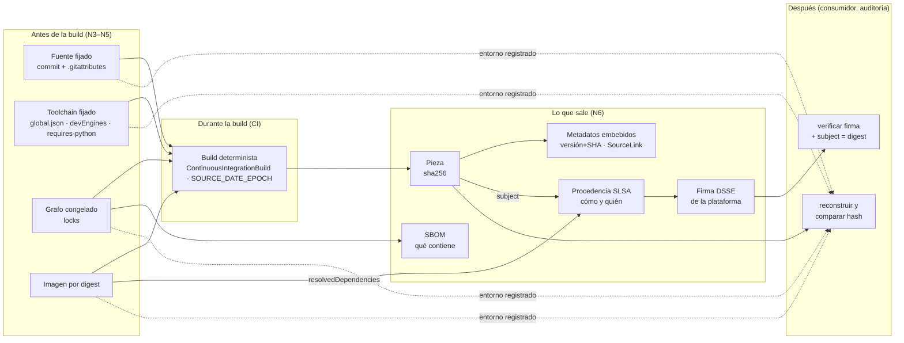

# N6 — Procedencia y trazabilidad de la pieza construida

N3, N4 y N5 contestan cómo **fijar** el entorno. Este núcleo contesta otra pregunta, la que el PO marcó como la más importante: cómo **demostrar después** con qué entorno se ensambló una pieza que ya está publicada, instalada o en producción. Fijar es una decisión que se toma antes de la build; demostrar es una evidencia que se produce durante la build y se consulta mucho después, a veces por alguien que no tiene acceso al repositorio.

La respuesta tiene tres piezas que la industria trata por separado y que conviene no mezclar: lo que el artefacto **lleva grabado** (metadatos embebidos), lo que **contiene** (el SBOM) y cómo, dónde y por quién **se construyó** (la procedencia, idealmente firmada). Una cuarta propiedad, la **reproducibilidad**, no es un documento sino una capacidad: permite que un tercero reconstruya la pieza y compare bytes, y es la única que no depende de confiar en quien construyó.

Todo lo afirmado lleva fuente oficial con fecha de consulta (2026-10-07) o un experimento ejecutado (E1) en el laboratorio. Lo que es criterio propio se marca **[criterio]**; lo que no se pudo verificar, **[no verificado]**. Los términos *registro del entorno*, *procedencia*, *determinista* y *reproducible* se usan con el sentido que fija N0 §1.

## Índice

- [1. Definiciones](#1-definiciones)
- [2. Cuatro preguntas que «trazabilidad» mezcla](#2-cuatro-preguntas-que-trazabilidad-mezcla)
- [3. .NET](#3-net)
- [4. Node.js](#4-nodejs)
- [5. Python](#5-python)
- [6. SBOM: SPDX y CycloneDX](#6-sbom-spdx-y-cyclonedx)
- [7. Procedencia SLSA y atestaciones firmadas](#7-procedencia-slsa-y-atestaciones-firmadas)
- [8. Integración en una única solución](#8-integración-en-una-única-solución)
- [9. Aplicación por escenario](#9-aplicación-por-escenario)
- [10. Tabla comparativa](#10-tabla-comparativa)
- [11. Snippets representativos](#11-snippets-representativos)
- [12. Experimentos](#12-experimentos)
- [13. Preguntas guía](#13-preguntas-guía)
- [14. Errores frecuentes](#14-errores-frecuentes)
- [15. Dependencias y tensiones con otros núcleos](#15-dependencias-y-tensiones-con-otros-núcleos)
- [16. Observaciones, supuestos y pendientes](#16-observaciones-supuestos-y-pendientes)
- [17. Evidencias](#17-evidencias)
- [18. Verificación adversarial](#18-verificación-adversarial)

## 1. Definiciones

| Término | Definición en esta guía | Fuente / naturaleza |
|---|---|---|
| **Pieza** (artefacto) | Lo que sale de la build y se distribuye: una DLL, un `.nupkg`, un tarball de npm, una rueda (*wheel*) de Python, una imagen de contenedor. Se identifica por su **digest** (sha256 de sus bytes), nunca sólo por nombre y versión. | SLSA nombra al artefacto por digest en el `subject` [EV-22]. |
| **Metadatos embebidos** | Datos de origen grabados **dentro** de la pieza: versión informativa con el SHA del commit, URL del repositorio, mapa de SourceLink en el PDB, `<repository commit=…>` en el `.nuspec`, `repository` en `package.json`, `Project-URL` en el `METADATA` de Python. | [EV-05], [EV-06], [EV-13], [EV-16]; E6-1, E6-4. |
| **SBOM** (*Software Bill of Materials*) | Inventario de los componentes de la pieza y sus relaciones de dependencia, con nombre, versión, identificador (purl), hash y licencia. Responde **qué contiene**. | CISA 2026 Minimum Elements [EV-29]; formatos SPDX [EV-26] y CycloneDX [EV-28]. |
| **Procedencia** (*provenance*) | Atestación que identifica la pieza por digest y describe **cómo se produjo**: tipo de build, parámetros externos, dependencias resueltas (incluida la imagen del builder), identidad de la plataforma de build, momento. Responde **cómo, dónde y por quién**. | SLSA Build Provenance v1 [EV-22]. |
| **Atestación** | Afirmación firmada y verificable sobre un artefacto, con forma *in-toto Statement*: un `subject` (artefacto + digest), un `predicateType` y un `predicate`. La procedencia SLSA es un tipo de predicado; un SBOM también puede viajar como predicado. | [EV-22], [EV-33], [EV-35]; E6-5. |
| **Firma DSSE** | Envoltorio de firma que usa cosign (y Sigstore en general) para las atestaciones: firma el *payload* entero, de modo que cambiar el artefacto o el predicado invalida la verificación. | [EV-35]; E6-5. |
| **Plataforma de build alojada** | Servicio de CI que ejecuta la build en infraestructura compartida y **él mismo** genera y firma la procedencia (GitHub Actions, GitLab CI). Es el requisito que separa SLSA Build L1 de L2. | [EV-21]. |
| **Build reproducible** | Mismo fuente + mismo entorno + mismas instrucciones ⇒ cualquiera obtiene copias idénticas bit a bit de los artefactos especificados. | reproducible-builds.org [EV-01]. |
| **Verificación por reconstrucción** | Reconstruir la pieza a partir del commit y del entorno registrado y comparar el digest con el publicado. Es la verificación que no depende de confiar en la firma de nadie. | [criterio], apoyado en [EV-01] y [EV-03]. |
| **`SOURCE_DATE_EPOCH`** | Variable de entorno con un *timestamp* UNIX que las herramientas **deben** usar en lugar de «ahora» para las fechas que incrustan. | Especificación de reproducible-builds.org [EV-02]. |

## 2. Cuatro preguntas que «trazabilidad» mezcla

Cuando alguien pregunta «¿con qué se construyó esto?» puede estar preguntando cuatro cosas, y cada una tiene un mecanismo distinto:

1. **¿De qué commit sale?** Lo contestan los metadatos embebidos. En .NET el SDK lo graba solo desde la versión 8 (E6-1); en npm y Python no hay un campo estándar dentro del paquete para el commit, y la respuesta se traslada a la procedencia.
2. **¿Qué tiene adentro?** Lo contesta el SBOM, que se genera del grafo congelado de N4 (el lock) o de la carpeta de salida.
3. **¿Con qué herramientas, en qué máquina, con qué parámetros y quién lo afirma?** Lo contesta la procedencia. Sin firma, es un registro del entorno (N0 E0-6): útil para diagnosticar, inútil ante un tercero, porque se edita sin rastro (E6-5 caso 4).
4. **¿Puedo comprobarlo sin creerle a nadie?** Sólo con una build reproducible: se reconstruye y se comparan hashes (E6-2, E6-5 caso 3).



## 3. .NET

### 3.1 Qué graba el SDK por su cuenta (desde .NET 8)

Desde el SDK de .NET 8, Source Link viene incluido y habilitado para GitHub, Azure Repos, GitLab 12.0+ y Bitbucket 4.7+ [EV-07], y como efecto colateral el SHA del commit se agrega a `InformationalVersion` en **todas** las builds, incluso de proyectos que apuntan a frameworks anteriores [EV-06]. El mecanismo es la propiedad `SourceRevisionId`, que el SDK completa con el hash del commit cuando Source Link está presente y que se anexa a `InformationalVersion` mientras `IncludeSourceRevisionInInformationalVersion` siga en su valor por defecto, `true` [EV-05].

El experimento E6-1 muestra el conjunto completo con un solo `dotnet pack` en la imagen `sdk:8.0` (SDK 8.0.425):

| Metadato | Dónde queda | Observado (E6-1) |
|---|---|---|
| Versión + SHA | Atributo `AssemblyInformationalVersion` de la DLL | `1.4.0+9e618f99ed4ff43a5ecbd42299f9c38ec93fd445` |
| URL del repositorio | Atributo `AssemblyMetadata("RepositoryUrl")` | `https://github.com/ejemplo-lab/pieza.git` |
| Mapa de fuentes | Bloque SourceLink del PDB | `{"documents":{"/_/*":"https://raw.githubusercontent.com/ejemplo-lab/pieza/<SHA>/*"}}` |
| Repositorio y commit del paquete | `.nuspec` del `.nupkg` y del `.snupkg` (con `PublishRepositoryUrl=true`) | `<repository type="git" url="…" commit="<SHA>" />` |

### 3.2 Qué **no** graba, y hay que agregar

El SDK no registra con qué SDK, imagen ni máquina se compiló. Son datos que importan (N3 E1-02: el mismo `net8.0` sale con otro compilador según el SDK) y se pueden agregar como `AssemblyMetadata` desde el proyecto: `$(NETCoreSdkVersion)` la define el SDK al evaluar el proyecto y el digest de la imagen lo pasa la CI como propiedad (E6-1: `SdkVersion = 8.0.425`, `ImagenDigest = sha256:78235e09…`). **[criterio]** Es útil para diagnóstico rápido desde el binario, pero no reemplaza a la procedencia: lo escribe el mismo proceso que se quiere auditar, y la procedencia firmada por la plataforma (§7) sí lo cubre.

### 3.3 Cuándo el metadato miente

`SourceRevisionId` es el SHA de `HEAD`, no del árbol de trabajo. En E6-1 caso 4 se modificó `Program.cs` sin commitear: la DLL cambió de hash (`ebfe369e…` → `c121e6aa…`) y la versión informativa siguió diciendo el mismo SHA. **[criterio]** Por eso la regla de N5 y N7 («el artefacto que se publica sale de la CI, desde un clon limpio») es también una regla de trazabilidad: en una estación de desarrollo el SHA embebido es una pista, no una prueba.

### 3.4 Build determinista: qué lo logra

El compilador de C# es determinista por defecto (`Deterministic=true`): reemplaza la marca de tiempo y el MVID por valores derivados de un hash de todas las entradas [EV-03]. Pero esas entradas incluyen **la ruta del directorio actual**, la versión exacta del compilador, la página de códigos por defecto, la cultura y los **datos de Source Link extraídos del repositorio** (SHA, URL) [EV-03]. Un compilador determinista, por lo tanto, da otra DLL si cambia la ruta o el SDK.

La normalización de rutas la activa `ContinuousIntegrationBuild=true`: Microsoft indica que, con esa propiedad, «las rutas de archivo guardadas se normalizan para las builds oficiales» y advierte que en una máquina de desarrollo el depurador deja de encontrar los fuentes locales, por lo que se condiciona a la variable de la CI [EV-05]. La documentación del repositorio de Source Link precisa el mecanismo: `ContinuousIntegrationBuild` habilita `DeterministicSourcePaths`, que mapea las rutas a valores que no dependen de dónde está el código ni del sistema operativo, y la build totalmente determinista se activa cuando `Deterministic` y `ContinuousIntegrationBuild` son ambos `true` [EV-07]. Las raíces que se mapean son los ítems `SourceRoot`, que en un repo git llevan `RevisionId` y `RepositoryUrl` [EV-07]. Esto cierra el pendiente de N0 (§13): el mecanismo que E0-5b probó por E1 ahora tiene fuente del fabricante.

E6-2 lo confirma con dos clones del mismo commit, en `/w/a` y `/home/x/otra`, en contenedores distintos de la misma imagen:

| Caso | DLL | PDB | `.nupkg` |
|---|---|---|---|
| (1) `ContinuousIntegrationBuild=true` | iguales `f31631a0f0ed` | iguales `845000f56f1c` | **distintos** |
| (2) build de desarrollador (sin CI) | distintas | distintos | distintos |
| (3) `Deterministic=false` (misma ruta) | distintas | iguales | distintos |
| (4) `PathMap` a mano, sin CI | distintas | distintos | distintos |
| (5) SDK 8.0.425 frente a 10.0.400 | distintas | distintos | distintos |

El caso (4) merece atención porque contradice una intuición: la opción `PathMap` del compilador mapea rutas físicas a rutas de salida [EV-04], y la ruta del PDB grabada en la DLL quedó normalizada, pero el **mapa de SourceLink** dentro del PDB siguió con la ruta absoluta (`"/w/a/*"` frente a `"/home/x/otra/*"`), y como los datos de Source Link son entrada del determinismo [EV-03], la DLL también cambió. **[criterio]** En proyectos SDK modernos no se configura `PathMap` a mano: se usa `ContinuousIntegrationBuild`, que normaliza las dos cosas a la vez. N0 E0-5b había visto normalizar `PathMap` sin git; la diferencia es que acá el repo **sí** es git, Source Link está activo y su mapa no pasa por `PathMap`.

### 3.5 El paquete `.nupkg` no es la DLL

Con DLL y PDB idénticos, el `.nupkg` salió distinto (E6-2 caso 1). La comparación entrada por entrada muestra por qué: el `.nuspec`, `[Content_Types].xml`, la DLL y el `runtimeconfig.json` son iguales; difieren `_rels/.rels` y el archivo `package/services/metadata/core-properties/<GUID>.psmdcp`, cuyo **nombre** es aleatorio en cada empaquetado, y las fechas de las entradas del zip, que son las del disco. Es el origen de la observación de N4 (E3: `contentHash` distinto para el mismo código empaquetado dos veces).

La documentación de NuGet dice que **desde .NET 11** los paquetes son deterministas por defecto, con una salvedad conocida: las fechas de modificación de los archivos, que se fijan con la propiedad `DeterministicTimestamp` o con `SOURCE_DATE_EPOCH` [EV-10]. E6-2 lo confirma en el estado actual: con SDK 8 y `SOURCE_DATE_EPOCH` el `.nupkg` sigue siendo distinto (caso 6, la variable no tiene efecto); con el SDK 11.0.100-preview.7 sin la variable, también distinto (caso 7, las fechas son las del disco); con SDK 11 preview **y** `SOURCE_DATE_EPOCH`, idéntico, con el `.psmdcp` renombrado a `nuget.psmdcp` y todas las fechas en 2026-01-01 (caso 8). La verificación adversarial repitió los casos 7 y 8 con el SDK 11.0.100-rc.1.26425.128, el más reciente publicado al 2026-10-07 [EV-39]: mismo resultado (sin la variable, distinto; con ella, idéntico `5f9de6281c21` en dos corridas) (E6-2b).

**[criterio]** Mientras el equipo esté en SDK 8 o 10, el `.nupkg` no es reproducible bit a bit y la comparación se hace **por contenido** (DLL, PDB, `.nuspec`), no por el hash del zip. Cuando se pase al SDK 11, conviene exportar `SOURCE_DATE_EPOCH` con la fecha del commit en la CI y comparar el paquete entero. Para un feed interno, la regla práctica que se desprende de N4 es no re-empaquetar nunca «la misma versión».

### 3.6 Símbolos

Los símbolos (`.pdb`) son parte de la trazabilidad: sin ellos, el SourceLink no tiene dónde vivir. La guía de bibliotecas de Microsoft aconseja **considerar** (✔️ CONSIDER, no ✔️ DO) Source Link, la publicación de símbolos y las builds deterministas [EV-08]. Hay dos formas: un paquete de símbolos `.snupkg` (`IncludeSymbols` + `SymbolPackageFormat=snupkg`), el único formato que acepta el servidor de símbolos de nuget.org y sólo con PDB portables, o el PDB incrustado en la DLL (`DebugType=embedded`) [EV-09]. E6-1 generó el `.snupkg` con el mismo `<repository commit=…>` que el `.nupkg`.

## 4. Node.js

### 4.1 Metadatos en el paquete

`package.json` tiene el campo `repository`, con `type`, `url` y `directory` para monorepos [EV-13]. No hay un campo estándar para el SHA del commit dentro del tarball **[no verificado como ausencia formal; no figura en la especificación consultada]**: la relación paquete → commit la establece la procedencia de npm (§4.3). `package-lock.json` figura entre los archivos que npm ignora siempre al publicar; si se quiere publicar el grafo, la vía documentada es `npm-shrinkwrap.json` [EV-13]. Con el lock común, entonces, el grafo exacto con que se construyó la pieza no viaja con ella: viaja en el SBOM o en la procedencia.

### 4.2 `npm pack` es reproducible por diseño

E6-3 empaquetó el mismo fuente en dos rutas, con fechas de archivo distintas, y obtuvo el mismo `shasum` y la misma `integrity` (sha512). La razón está en el tarball: todas las entradas tienen `mtime=499162500`, es decir 1985-10-26T08:15:00Z, sin importar la fecha real de los archivos. La documentación de `npm pack` no menciona esta normalización [EV-12b]: es un comportamiento observado (E1) en npm 11.19.0, no una garantía documentada. **[criterio]** Se puede apoyar una verificación por reconstrucción en él, pero conviene que la compuerta lo **compruebe** (empaquetar dos veces y comparar) en lugar de suponerlo.

### 4.3 Procedencia de npm

npm publica con procedencia mediante `npm publish --provenance` (o `NPM_CONFIG_PROVENANCE=true`, `publishConfig.provenance`, `.npmrc`), desde npm 9.5.0, y **sólo** desde GitHub Actions o GitLab CI/CD con runners alojados en la nube; el `repository` del `package.json` debe coincidir con el repositorio público desde el que se publica [EV-11]. La firma la hace Sigstore y queda en un log público de transparencia; el consumidor verifica con `npm audit signatures`; y con *trusted publishing* la procedencia se genera automáticamente, sin la opción [EV-11].

**[criterio]** Para un paquete npm **privado** de una organización (el caso que dispara esta guía) la procedencia de npm no aplica tal cual: exige un `repository` público [EV-11], y los ejemplos oficiales publican con `--access public`; la documentación no aborda paquetes privados. La alternativa es la atestación genérica de la plataforma de CI (§7.3) sobre el `.tgz`.

### 4.4 SBOM

`npm sbom` genera SPDX (2.3 en el ejemplo oficial) o CycloneDX (1.5) a partir del lock o de `node_modules`, con `--package-lock-only` para no depender de una instalación [EV-12]. E6-3 lo corrió desde el lock: el SPDX listó la pieza y `ms@2.1.3` con su purl y SHA-512. Dos hallazgos prácticos:

- Dos SBOM del mismo lock, generados con segundos de diferencia, difieren en `serialNumber` y `timestamp`. Un SBOM no es reproducible por defecto; se compara por contenido.
- En CycloneDX el `name` del componente raíz salió del **nombre del directorio** (`a` en E6-3; `otro-nombre` en una corrida manual de la verificación adversarial con el mismo lock montado en `/w/otro-nombre`), no del `package.json` ni del lock, que dicen `@ejemplo-lab/pieza-node`; el `purl` sí fue correcto. **[criterio]** Generar el SBOM siempre desde un directorio de nombre estable (el de la CI) o identificar la pieza por purl, nunca por `name`.

## 5. Python

### 5.1 Metadatos en la distribución

Los metadatos núcleo (*core metadata*) van por la versión 2.6 (mayo de 2026) y no tienen un campo para el commit; lo más cercano es `Project-URL` [EV-16]. Grabar el SHA en la versión como versión local PEP 440 (`1.4.0+g9e618f9`) tiene una restricción explícita: las versiones locales **no deberían** usarse al publicar en un índice público y PyPI **no debe** aceptarlas, aunque sí se admiten para builds privadas [EV-17]. El archivo `direct_url.json` registra un `commit_id` obligatorio cuando el paquete se instaló desde un VCS [EV-18], pero describe la **instalación**, no la construcción. **[criterio]** En Python el commit se registra en la procedencia (§5.3); en un índice privado, la versión local es una opción legítima si el equipo la necesita en el binario.

### 5.2 Reproducibilidad de la rueda y `SOURCE_DATE_EPOCH`

La especificación de `SOURCE_DATE_EPOCH` exige que los procesos de build usen esa fecha en lugar de la actual y que no incrusten una fecha posterior; recomienda (SHOULD) fijarla en la última modificación del fuente y menciona la fecha del último commit como forma de obtenerla [EV-02]. E6-4 lo prueba con dos *backends* y dos copias del fuente con fechas de archivo distintas:

| Backend | Sin `SOURCE_DATE_EPOCH` | Con `SOURCE_DATE_EPOCH` = fecha del commit |
|---|---|---|
| setuptools 84.0.0 | **distintas** (fechas del disco en el zip) | **idénticas** (fechas = 2026-01-01) |
| hatchling 1.32.4 | idénticas (fecha fija 2020-02-02) | idénticas |

hatchling construye en modo reproducible por defecto: usa `SOURCE_DATE_EPOCH` si está y, si no, un valor fijo [EV-15]. setuptools depende de la variable. **[criterio]** Exportar `SOURCE_DATE_EPOCH=$(git log -1 --pretty=%ct)` en la CI cuesta una línea y cubre a cualquier backend; no exportarlo deja la reproducibilidad a merced de la elección del backend.

### 5.3 SBOM dentro de la rueda (PEP 770) y su trampa

PEP 770 (*Final*, abril de 2025) reserva el directorio `.dist-info/sboms/` para documentos SBOM dentro de las distribuciones; no impone formato, recomienda CycloneDX o SPDX en JSON UTF-8 [EV-14]. hatchling lo soporta con la opción `sbom-files` [EV-15b]. E6-4 lo usó y la rueda quedó con `pieza_lab-1.4.0.dist-info/sboms/sbom.cdx.json` y `Metadata-Version: 2.5`.

La trampa: el SBOM generado en la build lleva `serialNumber` y `timestamp`, y al meterlo en la rueda la vuelve **no reproducible** aunque el backend lo sea (E6-4 caso 3). Con `cyclonedx-py --output-reproducible`, que omite esos valores, la rueda volvió a ser idéntica (caso 4). **[criterio]** Todo lo que se incrusta en la pieza tiene que ser reproducible; un SBOM con fecha puede viajar **al lado** de la pieza, no adentro.

### 5.4 Procedencia en PyPI

PyPI acepta atestaciones digitales (PEP 740) en formato in-toto, con predicados SLSA Provenance y PyPI Publish, como máximo una por tipo de predicado y por archivo; deben estar firmadas por un proveedor de *Trusted Publishing* (GitHub Actions, GitLab CI/CD, Google Cloud, ActiveState) [EV-19]. Con la acción oficial `pypa/gh-action-pypi-publish` se generan y suben automáticamente por defecto [EV-19b]. Como en npm, el mecanismo está atado al índice público y a una plataforma alojada.

## 6. SBOM: SPDX y CycloneDX

### 6.1 Qué es y qué debe tener

CISA, junto con agencias coautoras, publicó el 2026-07-29 los «2026 Minimum Elements for a Software Bill of Materials» (versión 2.1 del documento, tras la consulta pública del borrador del 2025-08-22), que actualizan y reemplazan los elementos mínimos de 2021 [EV-29]. Los campos de datos se dividen en dos grupos [EV-29]: **metadatos del SBOM** (autor, firma del autor, nombre y versión del formato, **contexto de generación**, *timestamp*, nombre y versión de la herramienta, versión del SBOM) y **datos del componente** (productor, relación de dependencia, **valor y algoritmo del hash**, identificadores, licencia, nombre y versión). El contexto de generación es nuevo y dice en qué fase del ciclo se generó el SBOM («before build», «build», «after build» u otro identificador más específico), porque el contenido cambia según la fase [EV-29].

**[criterio]** Ese último campo resuelve una confusión frecuente: un SBOM generado del lock (antes de la build) dice lo que se **declaró**; uno generado de la carpeta de salida (después) dice lo que se **entregó**. E6-6 muestra las dos vistas sobre la misma pieza .NET: `dotnet-CycloneDX` lista `Newtonsoft.Json@13.0.3` desde el grafo NuGet; `sbom-tool` de Microsoft lista además los **archivos** de la salida (`Pieza.dll`, `Newtonsoft.Json.dll`, `Pieza.deps.json`…) con SHA256 y SHA1.

### 6.2 Formatos vigentes

| Formato | Versión vigente | Estatus | Observado en el laboratorio |
|---|---|---|---|
| SPDX | 3.0.1, con perfiles Core, Software, Security, Licensing, Build, AI, Dataset, Lite y Extension [EV-26] | Estándar internacional ISO/IEC 5962:2021 [EV-27] (la versión de SPDX que corresponde a la norma ISO no se verificó en la fuente primaria) | `npm sbom` emite SPDX 2.3; `sbom-tool` 4.1.13 emite 2.2 por defecto y 3.0 con `-mi SPDX:3.0` [EV-36]; BuildKit emite SPDX (E6-3, E6-5, E6-6). |
| CycloneDX | 1.7 (2025-10-21) [EV-28] | Estándar ECMA-424, publicado el 2025-12-10 [EV-28] | `npm sbom` emite 1.5; `cyclonedx-py` 7.5.0 emite 1.6; `dotnet-CycloneDX` 6.2.0 emite 1.7 (E6-3, E6-4, E6-6). |

> **Corrección mesa ciclo 1 (2026-10-09, C1-34).** (L217, L516, L566) ISO/IEC 5962:2021 = SPDX 2.2.1 (IEC Webstore, 2026-10-09); deja de estar sin verificar.

**[criterio]** No hay razón técnica para preferir uno en abstracto: el formato lo elige el consumidor (un cliente, un organismo, una herramienta de análisis de vulnerabilidades). Lo que sí conviene es **uno solo** por solución, aunque cada ecosistema lo genere con su herramienta, para que el inventario se pueda unir (§8).

### 6.3 SBOM frente a procedencia

| | SBOM | Procedencia |
|---|---|---|
| Pregunta | ¿Qué contiene la pieza? | ¿Cómo, dónde y por quién se construyó? |
| Unidad | Componentes y relaciones | Una ejecución de build |
| Fuente | Lock (N4), carpeta de salida, imagen | La plataforma de build |
| Formato | SPDX, CycloneDX | in-toto Statement + predicado SLSA Provenance v1 |
| Quién la genera | Cualquier herramienta, en cualquier fase | Idealmente la plataforma, no los pasos del usuario (SLSA L2+) |
| Firma | Opcional; puede viajar como predicado de una atestación (cosign acepta `spdx`, `spdxjson`, `cyclonedx`) | Requisito desde SLSA Build L2 |
| Uso típico | Vulnerabilidades, licencias, inventario | Verificar origen, detectar manipulación, auditoría |

Los dos se complementan y se unen en la práctica: GitHub permite generar atestaciones que incluyen un SBOM asociado [EV-30], y BuildKit emite ambos en la misma build (E6-5).

## 7. Procedencia SLSA y atestaciones firmadas

### 7.1 La especificación vigente

La versión aprobada de SLSA es la **v1.2**; existen la v1.1 anterior y un borrador de trabajo [EV-20]. La v1.2 agrega el *Source Track* (seguridad del proceso de desarrollo del código), actualiza el modelo de amenazas y reorganiza la especificación para varios *tracks*; su lista de cambios respecto de la v1.1 no enumera cambios al *Build Track* [EV-25]. Los niveles del Build Track [EV-21]:

| Nivel | Exige | Protege contra | Pensado para |
|---|---|---|---|
| Build L0 | Nada | — | Builds de prueba en la misma máquina |
| Build L1 | Proceso de build consistente; la plataforma **genera automáticamente** la procedencia y se distribuye a los consumidores. Puede ser incompleta o **sin firma**. | Errores en el proceso de release (con verificación); habilita depuración e inventario | Obtener beneficios rápido, sin protección contra manipulación |
| Build L2 | L1 + build en una **plataforma alojada** que **genera y firma** la procedencia; el consumidor valida la autenticidad | Manipulación **después** de la build | Beneficio moderado al pasarse a una plataforma alojada |
| Build L3 | L2 + aislamiento fuerte entre ejecuciones y secreto de firma inaccesible a los pasos definidos por el usuario | Manipulación **durante** la build; credenciales comprometidas | «La mayoría de los releases de software» |

Ningún nivel exige builds reproducibles [EV-21]. El formato de la procedencia es el predicado `https://slsa.dev/provenance/v1`, con `buildDefinition` (`buildType`, `externalParameters`, `internalParameters`, `resolvedDependencies`) y `runDetails` (`builder.id`, `metadata` con `invocationId`, `startedOn`, `finishedOn`, y `byproducts`); el `builder.id` es «el único determinante» del nivel SLSA [EV-22].

### 7.2 Cómo se ve una procedencia real (E6-5)

BuildKit genera procedencia SLSA en formato in-toto y la adjunta a la imagen; con los exportadores `local` o `tar` la escribe como archivos JSON en la raíz de la exportación; por defecto agrega una procedencia mínima (`mode=min`) y con `--provenance=mode=max` el detalle completo [EV-33]. El driver `docker` las rechaza cuando el daemon usa el almacén de imágenes clásico; hace falta un builder `docker-container` (o `kubernetes`, `remote`) o el almacén de containerd [EV-33] (re-verificado con Docker Engine 26.1.5: «Attestation is not supported for the docker driver»). El almacén de containerd es el predeterminado en instalaciones **nuevas** de Docker Engine 29.0 o posterior [EV-38], así que el rechazo depende de la versión y la historia de la instalación, no del driver solo. E6-5 compiló la pieza .NET dentro de un Dockerfile con `FROM` por digest y obtuvo:

- `_type=https://in-toto.io/Statement/v1`, `predicateType=https://slsa.dev/provenance/v1`.
- `subject`: `Pieza.dll` y `Pieza.pdb` con sha256 que **coinciden** con los archivos exportados.
- `resolvedDependencies`: la imagen `mcr.microsoft.com/dotnet/sdk@8.0?digest=sha256:78235e09…` (el digest fijado en N5 llega a la procedencia sin hacer nada más) y el escáner de SBOM de BuildKit.
- El SHA del commit, en `externalParameters…vcs:revision` y en `metadata.buildkit_metadata.vcs.revision`, porque buildx lee el `.git` del contexto; se desactiva con `BUILDX_GIT_INFO=false` [EV-34].
- `builder.id` **vacío**: una build local no tiene identidad de plataforma. Por [EV-22], esto no alcanza ningún nivel con garantías; a lo sumo describe.

La DLL de BuildKit (`f31631a0f0eda05b`) es **idéntica** a la de una build independiente con `docker run` en otra ruta (E6-5 caso 3) y a la de E6-2 caso 1. Es la verificación por reconstrucción funcionando entre dos sistemas de build distintos.

### 7.3 La firma: qué agrega y qué no

Sin firma, la procedencia es un JSON: E6-5 caso 4 cambió `builder.id` por `https://ci.ejemplo.invalid/runner-oficial` y el archivo siguió siendo válido, sin rastro. Firmada con cosign (envoltorio DSSE en un *bundle* de Sigstore) [EV-35]:

| Verificación | Resultado (E6-5) |
|---|---|
| Artefacto original | `Verified OK` |
| Artefacto con un byte agregado | `provided artifact digests do not match digests in statement` |
| Procedencia editada dentro del bundle | `accepted signatures do not match threshold, Found: 0, Expected 1` |

Lo que la firma **no** agrega por sí sola: confianza en **quién** firmó. En E6-5 la clave es local y la firma se hizo sin log de transparencia (`--tlog-upload=false`), lo que el propio cosign marca como práctica insegura al verificar. **[criterio]** Una clave guardada como secreto de la CI y usada por un paso del pipeline no cumple SLSA Build L2 ni L3: L2 pide que la **plataforma** genere y firme, y L3 que el secreto sea inaccesible a los pasos del usuario [EV-21]. Es mejor que nada (protege el artefacto después de la build), pero hay que llamarlo por su nombre.

### 7.4 Plataformas alojadas: qué ofrecen hoy

| Plataforma | Mecanismo | Nivel declarado | Restricción relevante |
|---|---|---|---|
| GitHub Actions | `actions/attest@v4` con permisos `id-token: write`, `attestations: write`; verificación con `gh attestation verify` [EV-31b] | Build L2 por sí sola; L3 con *reusable workflows* que aíslan la build [EV-30] | En planes Free, Pro y Team sólo para repositorios **públicos**; en privados o internos exige GitHub Enterprise Cloud [EV-31]. Los públicos usan Sigstore público con log de transparencia; los privados, la instancia de Sigstore de GitHub, sin log público [EV-30]. |
| GitLab CI/CD | Variable `RUNNER_GENERATE_ARTIFACTS_METADATA=true`: el runner escribe `{ARTIFACT_NAME}-metadata.json` con un in-toto Statement v0.1 y predicado SLSA 1.0 [EV-32b] | Procedencia compatible con L2, firma mediante un componente CI/CD de SLSA; L3 con aislamiento reforzado del runner [EV-32] | La página de configuración del runner no dice si ese archivo se firma; la firma es un paso adicional [EV-32], [EV-32b]. |
| npm (registro) | `npm publish --provenance` / *trusted publishing* [EV-11] | Firma Sigstore + log público | Sólo GitHub Actions y GitLab con runners en la nube; repositorio público. |
| PyPI (índice) | Atestaciones PEP 740 vía *Trusted Publishing* [EV-19] | in-toto + SLSA Provenance | Proveedores admitidos por PyPI. |

**[criterio]** Para el caso que motiva la guía (repositorio **privado** de una organización, equipo chico): si el plan de GitHub no es Enterprise Cloud, las atestaciones nativas no están disponibles para ese repositorio, y la procedencia de npm y PyPI no aplica porque los paquetes no son públicos. Quedan dos caminos honestos: GitLab con metadatos del runner más firma, o BuildKit/cosign en la CI con la clave fuera del alcance de los pasos de build en la medida en que la plataforma lo permita, declarando el nivel alcanzado sin inflarlo.

### 7.5 Dónde se guarda y quién la consulta

SLSA pide publicar las atestaciones en al menos un lugar y recomienda más de uno: junto al release del repositorio de código, junto al artefacto en el registro de paquetes como archivo acompañante (*sidecar*) y, para el hash de la atestación, en un log de transparencia de terceros; a largo plazo, los registros deberían distribuir la procedencia junto al artefacto [EV-23]. La verificación la hace el **consumidor** (o el ecosistema en su nombre, al subir el paquete): valida la firma, que el `subject` coincida con el digest del artefacto, y que `buildType` y `externalParameters` coincidan con lo esperado; las expectativas se atan al **nombre del paquete**, mientras la procedencia se ata al **artefacto** [EV-24].

**[criterio]** Para un equipo chico la respuesta práctica es: la procedencia y el SBOM se guardan **junto al artefacto**, con el mismo nombre base (`Pieza.1.4.0.nupkg` + `.intoto.jsonl` o `.sigstore.json` + `.cdx.json`), en el mismo lugar donde se publica (release, feed, registro de imágenes como manifiesto adjunto). Quien la consulta: el que despliega (antes de instalar), el que audita (cuando hay un incidente) y el que diagnostica «funciona en una versión y no en otra». El actor *consumidor del artefacto* que BIT-15-03 descartó como separado aparece acá como destinatario; no toma decisiones sobre el entorno, pero define qué tiene que verificarse.

## 8. Integración en una única solución

En una solución con .NET, Node y Python, cada ecosistema produce sus propios metadatos y su propio SBOM con su propia herramienta (§3–§5), con formatos y versiones de especificación distintos (CycloneDX 1.5, 1.6 y 1.7 en el mismo laboratorio). La integración no está en ninguna herramienta: es una decisión de diseño.

| Problema al integrar | Observado | **[criterio]** propuesto |
|---|---|---|
| Tres formatos o tres versiones de SBOM | E6-3, E6-4, E6-6 | Elegir un formato por solución; generar un SBOM por pieza con la herramienta nativa y, si el consumidor pide uno solo, unirlos en la CI en un paso explícito. |
| Tres mecanismos de fecha | `SOURCE_DATE_EPOCH` (Python, NuGet ≥ .NET 11), mtime fijo (npm), ninguna fecha (compilador C#) | Exportar `SOURCE_DATE_EPOCH` con la fecha del commit **una vez**, al principio del job de la CI: lo que lo lee lo usa y lo que no, no se rompe. |
| Tres lugares para el commit | `InformationalVersion` (.NET), procedencia (npm, Python) | El commit vive en la procedencia de **cada** pieza; el SHA embebido en .NET es redundante y útil para diagnóstico. |
| Una procedencia por pieza o por solución | — | Una atestación por artefacto publicado (el `subject` admite varios digests, E6-5 tuvo dos); todas generadas por el mismo job y con el mismo `invocationId`. |
| Rutas y nombres de directorio | .NET (ruta en DLL), npm sbom (nombre del directorio) | Construir siempre en una ruta fija dentro de la imagen de CI (N5) además de normalizar. |

## 9. Aplicación por escenario

| Escenario | Qué aplica de N6 | Qué no |
|---|---|---|
| ESC-01 Windows + Visual Studio | Metadatos embebidos (SHA en `InformationalVersion`, Source Link) para diagnosticar; SBOM local si se quiere inspeccionar. | Nada de lo que se construye acá es trazable: `ContinuousIntegrationBuild` debe quedar apagado para que el depurador encuentre los fuentes [EV-05], y el SHA no ve los cambios sin commitear (E6-1). |
| ESC-02 Linux nativo | Igual que ESC-01. Útil para **reconstruir** una pieza publicada y comparar hashes con la imagen de CI. | — |
| ESC-03 WSL | Igual que ESC-02. | — |
| ESC-04 Devcontainer | Con la misma imagen por digest que la CI, es el lugar natural para la verificación por reconstrucción (E6-5 caso 3). | No genera procedencia válida: no es una plataforma alojada. |
| ESC-05 CI | **Todo**: build con `ContinuousIntegrationBuild` y `SOURCE_DATE_EPOCH`, SBOM, procedencia, firma, publicación junto al artefacto. | — |

## 10. Tabla comparativa

| Aspecto | .NET | Node.js | Python | Contenedor / transversal |
|---|---|---|---|---|
| Commit en la pieza | `InformationalVersion` `+<SHA>` (SDK ≥ 8, por defecto) [EV-06]; `.nuspec` `<repository commit>` | No estándar; `repository` en `package.json` [EV-13] | No hay campo; versión local PEP 440 sólo fuera de PyPI [EV-17] | Etiquetas OCI con buildx [EV-34] |
| Determinismo del binario | `Deterministic` (default) + `ContinuousIntegrationBuild` en CI [EV-03], [EV-05] | N/A (no compila) | N/A | — |
| Determinismo del paquete | `.nupkg`: no en SDK 8/10; sí en SDK 11 con `SOURCE_DATE_EPOCH`/`DeterministicTimestamp` [EV-10], E6-2 | `npm pack`: sí, mtime fijo (E6-3, comportamiento observado) | setuptools con `SOURCE_DATE_EPOCH`; hatchling por defecto [EV-15], E6-4 | `SOURCE_DATE_EPOCH` [EV-02] |
| Símbolos | `.snupkg` o PDB incrustado [EV-09] | Source maps (fuera de alcance) | — | — |
| SBOM nativo | No incluido en el SDK; `CycloneDX` (dotnet tool) o `sbom-tool` (SPDX) [EV-36] | `npm sbom` (SPDX/CycloneDX) [EV-12] | `cyclonedx-py`; PEP 770 para incluirlo en la rueda [EV-14] | BuildKit `--sbom=true` [EV-33] |
| Procedencia en el registro | nuget.org tiene *Trusted Publishing* (credencial OIDC efímera desde GitHub Actions o GitLab) [EV-37], pero su documentación no describe atestaciones de procedencia **[no verificado como ausencia]** | `npm publish --provenance` [EV-11] | PEP 740 [EV-19] | Manifiesto de atestación en la imagen [EV-33] |
| Procedencia genérica de CI | `actions/attest`, metadatos del runner de GitLab, cosign | ídem | ídem | ídem |

## 11. Snippets representativos

```xml
<!-- Directory.Build.props — trazabilidad .NET en un solo lugar.
     ContinuousIntegrationBuild sólo en CI: normaliza rutas (/_/) y activa la build totalmente
     determinista junto con Deterministic (default true) [EV-05], [EV-07]. En una estación queda
     apagado para que el depurador encuentre los fuentes locales. -->
<Project>
  <PropertyGroup Condition="'$(CI)' == 'true' Or '$(TF_BUILD)' == 'true'">
    <ContinuousIntegrationBuild>true</ContinuousIntegrationBuild>
  </PropertyGroup>
  <PropertyGroup>
    <!-- URL del repo y commit en el .nuspec del paquete (Source Link ya viene en el SDK >= 8). -->
    <PublishRepositoryUrl>true</PublishRepositoryUrl>
    <!-- Símbolos en paquete aparte, formato que acepta nuget.org [EV-09]. -->
    <IncludeSymbols>true</IncludeSymbols>
    <SymbolPackageFormat>snupkg</SymbolPackageFormat>
    <!-- NO configurar PathMap a mano: no normaliza el mapa de SourceLink (E6-2 caso 4). -->
  </PropertyGroup>
  <ItemGroup>
    <!-- Lo que el SDK no graba: versión del SDK y digest de la imagen (lo pasa la CI). -->
    <AssemblyMetadata Include="SdkVersion" Value="$(NETCoreSdkVersion)" />
    <AssemblyMetadata Include="ImagenDigest" Value="$(ImagenDigest)" Condition="'$(ImagenDigest)' != ''" />
  </ItemGroup>
</Project>
```

```sh
# Paso común al principio del job de CI (los tres ecosistemas).
# La fecha del commit, no la de la build: dos builds del mismo commit incrustan la misma fecha [EV-02].
export SOURCE_DATE_EPOCH=$(git log -1 --pretty=%ct)
# Python (setuptools) y NuGet en SDK >= 11 la leen; npm pack ya fija sus fechas; el compilador C# no las usa.
```

```sh
# SBOM por ecosistema, en el formato elegido por la solución (acá CycloneDX).
npm sbom --sbom-format cyclonedx --sbom-type application --package-lock-only > web.cdx.json   # [EV-12]
cyclonedx-py requirements --output-reproducible --of JSON -o worker.cdx.json requirements.txt  # sin fecha ni serial
dotnet-CycloneDX Api.csproj -o sbom -fn api.cdx.json -F Json                                    # E6-6
```

```yaml
# GitHub Actions (repo público o plan Enterprise Cloud) — procedencia firmada por la plataforma [EV-30], [EV-31b].
permissions:
  id-token: write      # identidad OIDC del workflow para la firma sin clave
  contents: read
  attestations: write  # guardar la atestación en GitHub
steps:
  - run: dotnet pack -c Release -o out    # CI=true lo define Actions: activa ContinuousIntegrationBuild
  - uses: actions/attest@v4
    with:
      subject-path: 'out/*.nupkg'         # el subject es el digest del paquete
# Verificación del lado del consumidor:  gh attestation verify Pieza.1.4.0.nupkg -R <org>/<repo>
```

```sh
# Sin plataforma que firme (laboratorio E6-5): firmar la procedencia de BuildKit con cosign.
# Clave local y sin log de transparencia: protege el artefacto después de la build, NO es SLSA L2.
cosign attest-blob --predicate predicado.json --type slsaprovenance1 --key cosign.key \
  --bundle Pieza.dll.sigstore.json --use-signing-config=false --tlog-upload=false -y Pieza.dll
cosign verify-blob-attestation --key cosign.pub --bundle Pieza.dll.sigstore.json \
  --type slsaprovenance1 --insecure-ignore-tlog Pieza.dll      # falla si cambia 1 byte o el predicado
```

```toml
# pyproject.toml (hatchling) — SBOM dentro de la rueda (PEP 770) [EV-14], [EV-15b].
# Sólo si el SBOM se generó reproducible: si no, la rueda deja de serlo (E6-4 caso 3).
[tool.hatch.build.targets.wheel]
sbom-files = ["sbom.cdx.json"]
```

## 12. Experimentos

Todos en `LAB/Lab-Documentos/Guides/Metodologia-Entorno-Desarrollo/Examples/N6-procedencia-y-trazabilidad/`, ejecutados el 2026-10-07. El `README.md` de esa carpeta tiene los requisitos, las versiones observadas y los comandos; la salida completa está en `salidas/`.

| ID | Ruta | Comando | Resultado |
|---|---|---|---|
| E6-1 | `e1-metadatos-dotnet/` | `./e1-metadatos-dotnet/experimento.sh` (`sdk:8.0` por digest `78235e09…`, SDK 8.0.425) | `InformationalVersion = 1.4.0+9e618f99…` (SHA completo), `RepositoryUrl`, `SdkVersion = 8.0.425` e `ImagenDigest` agregados; SourceLink `"/_/*" → raw.githubusercontent.com/…/<SHA>/*` en el PDB; `<repository … commit="<SHA>"/>` en `.nupkg` y `.snupkg`. Con un cambio sin commitear: DLL `ebfe369e…` → `c121e6aa…`, misma versión informativa. |
| E6-2 | `e2-determinismo-dotnet/` | `./e2-determinismo-dotnet/experimento.sh` (15 builds; `sdk:8.0`, `10.0`, `11.0-preview`) | (1) CI, rutas distintas: DLL `f31631a0f0ed` y PDB `845000f56f1c` iguales, `.nupkg` distinto. (2) sin CI, (3) `Deterministic=false`, (4) `PathMap` a mano, (5) SDK 8 vs 10: distintos. (6) SDK 8 + `SOURCE_DATE_EPOCH`: `.nupkg` distinto. (7) SDK 11 preview.7: distinto. (8) SDK 11 + `SOURCE_DATE_EPOCH`: `.nupkg` idéntico `9f7b9596c45d`. Diferencias del zip: `_rels/.rels`, `<GUID>.psmdcp` y fechas. |
| E6-2b | `e2-determinismo-dotnet/verificar-sdk11-rc1.sh` | `./e2-determinismo-dotnet/verificar-sdk11-rc1.sh` (`sdk:11.0.100-rc.1`, digest `78559d13…`) | Casos 7 y 8 con el SDK 11 RC1: sin `SOURCE_DATE_EPOCH`, `.nupkg` distinto; con él, idéntico `5f9de6281c21`, entradas con fecha 2026-01-01 y `nuget.psmdcp`. |
| E6-3 | `e3-node-pack-y-sbom/` | `./e3-node-pack-y-sbom/experimento.sh` (`node:24-alpine`, npm 11.19.0) | `npm pack` en dos rutas: mismo `shasum` `6a7d8078…` e `integrity`; mtime de todas las entradas = 499162500. `npm sbom`: SPDX-2.3 y CycloneDX 1.5 desde el lock; dos generaciones difieren en `serialNumber` y `timestamp`; `name` del componente raíz = nombre del directorio. |
| E6-4 | `e4-python-wheel-y-sbom/` | `./e4-python-wheel-y-sbom/experimento.sh` (`python:3.12-slim`) | setuptools 84.0.0: distinta sin `SOURCE_DATE_EPOCH`, idéntica `071c0cab03b2` con él. hatchling 1.32.4 + SBOM con fecha: distinta; + SBOM `--output-reproducible`: idéntica `080ac19a4ebd`. Rueda con `.dist-info/sboms/sbom.cdx.json`, `Metadata-Version: 2.5`, sin campo de commit. |
| E6-5 | `e5-procedencia-slsa-firmada/` | `./e5-procedencia-slsa-firmada/experimento.sh` (buildx v0.35.0, `docker-container`; cosign v3.1.3) | in-toto Statement v1 + `https://slsa.dev/provenance/v1`; `subject` = sha256 real de DLL y PDB; `resolvedDependencies` con la imagen del SDK por digest; commit en `vcs:revision`; `builder.id` vacío. DLL idéntica a una build con `docker run` en otra ruta. Procedencia sin firma: editable sin rastro. Firmada: `Verified OK`; falla con un byte más en el artefacto o con el predicado editado. |
| E6-6 | `e6-sbom-dotnet/` | `./e6-sbom-dotnet/experimento.sh` (`sdk:8.0`; `CycloneDX` 6.2.0, `Microsoft.Sbom.DotNetTool` 4.1.13) | CycloneDX 1.7 con `Newtonsoft.Json@13.0.3` (purl, SHA-512). SPDX 2.2 con los seis archivos de la salida (SHA256, SHA1), dos paquetes y relaciones `DESCRIBES`/`DEPENDS_ON`. |

Fragmento literal de E6-2 (salida completa en `salidas/e2-determinismo-dotnet.txt`):

```text
(1) mismo commit, rutas y contenedores distintos, ContinuousIntegrationBuild=true
   dll f31631a0f0ed | f31631a0f0ed   pdb 845000f56f1c | 845000f56f1c   nupkg 1244a78c9155 | d85f524589c2   => DISTINTOS
(8) como (7) + SOURCE_DATE_EPOCH
   dll ab2e246cc61b | ab2e246cc61b   pdb a2b7293dce42 | a2b7293dce42   nupkg 9f7b9596c45d | 9f7b9596c45d   => IGUALES
--- mapa de SourceLink en el PDB de (4): PathMap a mano no lo normaliza
   pm_a   {"documents":{"/w/a/*":"https://raw.githubusercontent.com/ejemplo-lab/pieza/9e618f99…/*"}}
   pm_b   {"documents":{"/home/x/otra/*":"https://raw.githubusercontent.com/ejemplo-lab/pieza/9e618f99…/*"}}
```

Los hashes del `.nupkg` cambian en cada corrida salvo en el caso 8 (dependen de la hora); los de DLL y PDB son estables entre corridas **salvo en el caso 3** (`Deterministic=false`), donde la DLL cambia también entre corridas, como corresponde a una marca de tiempo y un MVID aleatorios [EV-03] (verificación adversarial: segunda corrida del 2026-10-07).

## 13. Preguntas guía

**¿Qué metadatos mínimos deben viajar con un artefacto?** **[criterio]** Seis datos, repartidos entre la pieza y lo que viaja a su lado: (1) el **digest** de la pieza; (2) el **commit** exacto del que sale y si el árbol estaba limpio; (3) el **toolchain** efectivo (versión de SDK, Node/npm, Python/backend); (4) el **digest de la imagen** de build; (5) el **grafo de dependencias** resuelto, como SBOM o como referencia al lock del commit; (6) **quién** construyó (identidad de la plataforma e invocación) y **cuándo**. Los datos 1, 4, 6 y casi siempre 2 los da una procedencia SLSA generada por la plataforma (E6-5); el 5, el SBOM; el 3 hay que agregarlo si la procedencia no lo trae (en BuildKit va implícito en el digest de la imagen; en un job de CI sin contenedor, como `AssemblyMetadata` o en el registro de la compuerta de N7). *Aplica* a todo artefacto que salga de la CI hacia otro equipo, un cliente o producción; no a builds locales.

> **Corrección mesa ciclo 1 (2026-10-09, C1-16).** La procedencia firmada por la plataforma da 1, 2 y 6, y deja el entorno como opcional [B202]. La de BuildKit (E6-5) da además el 4, sin firma y con `builder.id` vacío. El SBOM da el 5. El 3, y el 4 si nadie lo trae, los agrega el registro del entorno. Guía §9.6 P1 (P-12, punto 14).

**¿Qué diferencia hay entre un SBOM y una atestación de procedencia?** El SBOM dice **qué contiene** la pieza; la procedencia dice **cómo, dónde y quién** la construyó. El SBOM puede generarlo cualquiera en cualquier fase (por eso CISA exige declarar el contexto de generación [EV-29]); la procedencia vale en la medida en que la genera y firma la plataforma de build [EV-21]. *Aplica* así: ante una vulnerabilidad publicada en una biblioteca, se consulta el SBOM («¿la usamos?»); ante una sospecha de manipulación o una auditoría, la procedencia («¿esto salió de nuestra CI y de qué commit?»).

**¿Cómo verifico que dos builds del mismo commit dan el mismo binario y qué rompe el determinismo?** Se clona el commit dos veces en rutas distintas, se construye con el mismo toolchain e imagen y se comparan los sha256 de cada artefacto (E6-2). En .NET la DLL y el PDB son reproducibles con `ContinuousIntegrationBuild` en un repo git; lo rompen la ruta (sin CI), `Deterministic=false`, otro SDK, `PathMap` a mano y los cambios sin commitear. El `.nupkg` además depende de las fechas del zip hasta .NET 11. En npm el tarball ya es estable; en Python lo rompen las fechas (sin `SOURCE_DATE_EPOCH` en setuptools) y cualquier archivo incrustado que tenga fecha o identificador aleatorio (un SBOM). *Aplica* cuando hay que demostrar ante un tercero que un binario sale de un commit, o cuando dos entornos «iguales» producen comportamientos distintos y hay que encontrar la capa que difiere (N0 §5).

**¿Qué nivel SLSA es razonable para un equipo chico?** La versión vigente es la v1.2 [EV-20]. **[criterio]** Build **L1** de inmediato: es casi gratis (BuildKit o el runner de GitLab ya generan la procedencia) y da depuración e inventario. Build **L2** como objetivo, en cuanto la plataforma lo ofrezca para el repositorio: en GitHub Actions es una acción y dos permisos [EV-31b], pero en repositorios privados exige Enterprise Cloud [EV-31]; en GitLab es una variable más la firma [EV-32b]. **L3** sólo si hay un requisito externo o un riesgo real de credenciales comprometidas; GitHub lo alcanza con *reusable workflows* compartidos [EV-30]. *Aplica* con una salvedad: no declarar L2 por firmar con una clave guardada como secreto de la CI (§7.3).

> **Corrección mesa ciclo 1 (2026-10-09, C1-17).** «L1 de inmediato» no se sostiene: L1 exige `builder.id` y E6-5 lo trae vacío.

**¿Dónde se guarda la procedencia y quién la consulta?** Junto al artefacto, en el mismo lugar donde se publica, y si se puede también en un log de transparencia [EV-23]. La consulta el consumidor (quien despliega o instala), el auditor y quien diagnostica una regresión; la verificación consiste en validar la firma, que el `subject` coincida con el digest y que los parámetros sean los esperados para ese paquete [EV-24]. *Aplica*: si la pieza se despliega desde un feed o registro interno, la verificación va en el paso de despliegue (la guía hermana de Despliegue es el lugar natural para el procedimiento; acá sólo el criterio).

**¿El SHA en `InformationalVersion` alcanza como trazabilidad?** No. Lo escribe el mismo proceso que se quiere auditar, no ve los cambios sin commitear (E6-1) y se puede editar. *Aplica* como pista de diagnóstico rápida (por ejemplo, la pieza escribe su versión informativa en el log de arranque), no como evidencia.

**¿Conviene meter el SBOM dentro del paquete?** Sólo si es reproducible: un SBOM con `timestamp` o `serialNumber` vuelve no reproducible la pieza que lo contiene (E6-4). *Aplica* en Python, donde PEP 770 lo estandariza [EV-14]; en .NET y npm, el SBOM viaja al lado.

## 14. Errores frecuentes

- Activar `ContinuousIntegrationBuild` en `Directory.Build.props` sin condición: rompe la depuración local [EV-05].
- Configurar `PathMap` a mano creyendo que equivale a `ContinuousIntegrationBuild`: el mapa de SourceLink queda con la ruta absoluta y la DLL cambia (E6-2 caso 4).
- Comparar el hash del `.nupkg` para verificar una build en SDK 8 o 10: siempre da distinto aunque el código sea el mismo (E6-2); comparar por contenido.
- Re-empaquetar «la misma versión» en un feed interno: cambia el `contentHash` y rompe los locks de los consumidores (N4 E3).
- Tomar el SHA embebido como prueba de origen de una build hecha en una estación (E6-1 caso 4).
- Confundir SBOM con procedencia y creer que generar un SBOM «cumple SLSA».
- Llamar «procedencia» a un JSON sin firma: se edita sin rastro (E6-5 caso 4).
- Declarar SLSA L2 por firmar con una clave propia en un paso de la CI [EV-21].
- Dar por hecho que las atestaciones de GitHub están disponibles en un repositorio privado de un plan Team [EV-31].
- Usar `npm publish --provenance` en un paquete privado: exige repositorio público y CI alojada [EV-11].
- Grabar la versión local PEP 440 con el SHA y publicar en PyPI [EV-17].
- Generar el SBOM de npm en un directorio de nombre arbitrario y confiar en el `name` del componente raíz (E6-3).
- Construir con el driver `docker` sobre el almacén de imágenes clásico y esperar atestaciones: el CLI las rechaza (E6-5, [EV-33]); con el almacén de containerd (predeterminado en instalaciones nuevas de Engine ≥ 29 [EV-38]) sí funcionan.

## 15. Dependencias y tensiones con otros núcleos

| Núcleo | Relación | Contenido |
|---|---|---|
| N0 | consume | Vocabulario (registro del entorno ≠ procedencia; determinista ≠ reproducible). N6 cierra dos pendientes de N0: la fuente oficial del mecanismo `SourceRoot` / `DeterministicSourcePaths` [EV-07] y la reproducibilidad en Node y Python (E6-3, E6-4). Matiza E0-5b: `PathMap` normaliza la ruta del PDB pero **no** el mapa de SourceLink cuando el repo es git (E6-2 caso 4). |
| N3 | depende | Sólo se registra lo que se fijó: el SDK distinto cambia la DLL (E6-2 caso 5). **Tensión**: `rollForward` permisivo hace que la CI no sepa de antemano qué SDK usará; N6 necesita que lo **registre** (`SdkVersion` como `AssemblyMetadata`, o la imagen por digest que lo determina). Regla de BIT-15-02 §4 aplicada: la CI usa SDK exacto o imagen por digest. |
| N4 | depende + responde | El lock es la fuente del SBOM «antes de la build». N4 preguntó si `dotnet pack` es reproducible: **no** en SDK 8/10; **sí** en SDK 11 con `SOURCE_DATE_EPOCH` o `DeterministicTimestamp` [EV-10], E6-2. N4 definió `ContinuousIntegrationBuild` como condición: queda fundamentado en [EV-05], [EV-07]. |
| N5 | depende | El digest de la imagen de CI llega solo a `resolvedDependencies` si la build corre en BuildKit (E6-5); si no, hay que registrarlo. La igualdad de hashes entre rutas distintas exige la normalización de este núcleo (E6-2). La ruta fija dentro de la imagen evita además el problema del `name` en `npm sbom`. |
| N7 | alimenta | La compuerta en la publicación es el lugar donde se generan SBOM y procedencia y donde se verifica la reproducibilidad (construir dos veces y comparar). La salida de la compuerta (E7-05) es un registro del entorno sin firma: N6 lo trata como dato de diagnóstico, no como procedencia. **Tensión**: N7 registra que en plan free no hay protección de rama; acá se suma que tampoco hay atestaciones nativas en repos privados sin Enterprise Cloud [EV-31]. Las dos limitaciones empujan a compensar en la publicación. |
| N8 | alimenta | Un formato de SBOM por solución, `SOURCE_DATE_EPOCH` una vez por job, una atestación por artefacto (§8). |
| Guía hermana de Despliegue | frontera | La verificación de procedencia antes de instalar es un paso del despliegue; N6 da el criterio y el formato, no el procedimiento. |

## 16. Observaciones, supuestos y pendientes

- **Supuesto**: el equipo del caso usa GitHub o GitLab en un repositorio privado y un plan sin Enterprise Cloud. Si no fuera así, §7.4 cambia: las atestaciones nativas de GitHub resolverían L2 con dos líneas.
- **Observado, no documentado**: el `mtime` fijo de `npm pack` (499162500) y el `name` del componente raíz tomado del directorio en `npm sbom` CycloneDX. Son comportamientos de npm 11.19.0; pueden cambiar sin aviso.
- **Versión preliminar**: el resultado del SDK 11 es de `11.0.100-preview.7.26381.103` y se re-verificó con `11.0.100-rc.1.26425.128` (E6-2b), que es la última publicada al 2026-10-07 (fase *go-live*) [EV-39]; la documentación de NuGet ya lo describe como el comportamiento por defecto «a partir de .NET 11» [EV-10]. Revisar con la versión final (GA).
- **Soporte de .NET 8**: los metadatos oficiales fijan el fin de soporte de .NET 8 el 2026-11-10 [EV-39]. Los experimentos usan SDK 8 porque es el caso disparador; la recomendación de §3.5 para «SDK 8 o 10» vale igual para el 10.
- **No verificado como ausencia**: nuget.org ofrece *Trusted Publishing* por OIDC [EV-37], que elimina la clave de API de larga duración pero no produce, según su documentación, una atestación de procedencia equivalente a la de npm o PyPI. Tampoco se verificó en la fuente primaria qué versión de SPDX corresponde a ISO/IEC 5962:2021.
- **No ejecutado**: `actions/attest`, la procedencia de npm, las atestaciones de PyPI y los metadatos del runner de GitLab; todos requieren una plataforma alojada con OIDC. Están respaldados sólo por documentación.
- **Interpretación**: en E6-2 caso 3 (`Deterministic=false`) los PDB salieron iguales y las DLL distintas. Es coherente con [EV-03] (la marca de tiempo y el MVID aleatorios van en la DLL), pero no se investigó el contenido del PDB.
- **Observación de entorno del laboratorio**: las credenciales guardadas de Docker Hub en el host estaban vencidas y bloqueaban incluso las descargas anónimas; E6-5 usa un `DOCKER_CONFIG` temporal vacío. No afecta las conclusiones.
- **Pendiente para la mesa**: decidir si la guía recomienda CycloneDX o SPDX como formato único por defecto, o deja la elección explícitamente al consumidor (§6.2).

## 17. Evidencias

Fecha de consulta de todas las URL: 2026-10-07. Fecha de ejecución de todos los experimentos: 2026-10-07.

| ID | Afirmación | Fuente / experimento |
|---|---|---|
| EV-01 | Definición de build reproducible: mismo fuente, entorno e instrucciones ⇒ copias idénticas bit a bit. | https://reproducible-builds.org/docs/definition/ |
| EV-02 | `SOURCE_DATE_EPOCH`: formato, uso obligatorio en lugar de la fecha actual, recomendación (SHOULD) de fijarlo en la última modificación del fuente; la fecha del último commit como forma de obtenerla. | https://reproducible-builds.org/specs/source-date-epoch/ |
| EV-03 | `Deterministic` por defecto `true`; entradas que afectan el determinismo (ruta actual, versión del compilador, datos de Source Link, página de códigos, cultura). | https://learn.microsoft.com/en-us/dotnet/csharp/language-reference/compiler-options/code-generation |
| EV-04 | `PathMap`: mapea rutas físicas a rutas de salida; rompe puntos de interrupción locales; dónde escribe rutas el compilador. | https://learn.microsoft.com/en-us/dotnet/csharp/language-reference/compiler-options/advanced |
| EV-05 | `ContinuousIntegrationBuild` normaliza rutas en builds oficiales, condicionado a la CI; `SourceRevisionId` y `IncludeSourceRevisionInInformationalVersion`. | https://learn.microsoft.com/en-us/dotnet/core/project-sdk/msbuild-props |
| EV-06 | Source Link incluido en el SDK de .NET 8; el commit se agrega a `InformationalVersion` en todos los casos. | https://learn.microsoft.com/en-us/dotnet/core/compatibility/sdk/8.0/source-link |
| EV-07 | Proveedores incluidos en el SDK ≥ 8; `ContinuousIntegrationBuild` → `DeterministicSourcePaths`; build totalmente determinista con ambas propiedades; ítems `SourceRoot`. | https://github.com/dotnet/sourcelink/blob/main/README.md · https://github.com/dotnet/sourcelink/blob/main/docs/README.md |
| EV-08 | Guía de bibliotecas de Microsoft: ✔️ CONSIDER Source Link, publicar símbolos y builds deterministas. | https://learn.microsoft.com/en-us/dotnet/standard/library-guidance/sourcelink |
| EV-09 | `.snupkg`: creación, servidor de símbolos de nuget.org, sólo PDB portables; alternativa `DebugType=embedded`. | https://learn.microsoft.com/en-us/nuget/create-packages/symbol-packages-snupkg |
| EV-10 | Paquetes NuGet deterministas por defecto desde .NET 11; salvedad de fechas; `DeterministicTimestamp` y `SOURCE_DATE_EPOCH`. | https://learn.microsoft.com/en-us/nuget/create-packages/deterministic-packages |
| EV-11 | Procedencia de npm: npm ≥ 9.5.0, sólo GitHub Actions/GitLab con runners en la nube, `repository` público coincidente, Sigstore + log público, `npm audit signatures`, *trusted publishing*. | https://docs.npmjs.com/generating-provenance-statements |
| EV-12 | `npm sbom`: SPDX/CycloneDX, `--sbom-type`, `--omit`, `--package-lock-only`. | https://docs.npmjs.com/cli/v11/commands/npm-sbom |
| EV-12b | `npm pack` no documenta el tratamiento de fechas del tarball. | https://docs.npmjs.com/cli/v11/commands/npm-pack |
| EV-13 | `repository` (con `directory`) en `package.json`; `package-lock.json` se ignora siempre al publicar (usar `npm-shrinkwrap.json` para publicarlo). | https://docs.npmjs.com/cli/v11/configuring-npm/package-json |
| EV-14 | PEP 770 (*Final*, 2025-04-11): `.dist-info/sboms/`, formato opaco, se recomienda CycloneDX o SPDX en JSON. | https://peps.python.org/pep-0770/ |
| EV-15 | hatchling: builds reproducibles por defecto, usa `SOURCE_DATE_EPOCH` o un valor fijo. | https://hatch.pypa.io/latest/config/build/ |
| EV-15b | hatchling: opción `sbom-files` → `.dist-info/sboms/`. | https://hatch.pypa.io/latest/plugins/builder/wheel/ |
| EV-16 | Core metadata 2.6 (mayo 2026); sin campo para el commit; `Project-URL`. | https://packaging.python.org/en/latest/specifications/core-metadata/ |
| EV-17 | Versiones locales PEP 440: no deberían publicarse en índices públicos; PyPI no debe aceptarlas. | https://packaging.python.org/en/latest/specifications/version-specifiers/ |
| EV-18 | `direct_url.json`: `commit_id` obligatorio en instalaciones desde VCS. | https://packaging.python.org/en/latest/specifications/direct-url-data-structure/ |
| EV-19 | Atestaciones de PyPI (PEP 740): in-toto, SLSA Provenance y PyPI Publish, *Trusted Publishers* admitidos. | https://docs.pypi.org/attestations/ |
| EV-19b | `pypa/gh-action-pypi-publish` genera y sube atestaciones por defecto. | https://docs.pypi.org/attestations/producing-attestations/ |
| EV-20 | SLSA v1.2 es la versión aprobada; existen v1.1 y borrador. | https://slsa.dev/spec/ |
| EV-21 | Niveles Build L0–L3: requisitos, beneficios; L1 admite procedencia sin firma; L2 plataforma alojada que firma; L3 aislamiento y secreto inaccesible. | https://slsa.dev/spec/v1.2/build-track-basics |
| EV-22 | Formato de procedencia v1: `predicateType`, `buildDefinition`, `runDetails`, `builder.id` como determinante del nivel. | https://slsa.dev/spec/v1.2/build-provenance |
| EV-23 | Distribución: al menos un lugar, release, registro (*sidecar*), log de transparencia. | https://slsa.dev/spec/v1.2/distributing-provenance |
| EV-24 | Verificación por el consumidor: firma, `subject`, `buildType`, `externalParameters`; expectativas atadas al nombre del paquete. | https://slsa.dev/spec/v1.2/verifying-artifacts |
| EV-25 | Novedades de v1.2: *Source Track*; Build Track sin cambios de fondo. | https://slsa.dev/spec/v1.2/whats-new |
| EV-26 | SPDX 3.0.1 y sus perfiles (incluido Build). | https://spdx.github.io/spdx-spec/v3.0.1/ |
| EV-27 | SPDX es estándar ISO/IEC 5962:2021; última versión 3.0. | https://spdx.dev/use/specifications/ |
| EV-28 | CycloneDX 1.7 (2025-10-21); ECMA-424 publicado el 2025-12-10. | https://cyclonedx.org/specification/overview/ |
| EV-29 | CISA y coautores, «2026 Minimum Elements for a SBOM», versión 2.1 publicada el 2026-07-29: metadatos del SBOM y datos del componente, incluidos valor y algoritmo del hash y contexto de generación. | https://www.cisa.gov/sites/default/files/2026-07/2026_cisa_sbom_minimum_elements_508c.pdf |
| EV-30 | Atestaciones de GitHub: contenido, SLSA v1.0 Build L2 por sí solas, L3 con *reusable workflows*, Sigstore público frente a instancia de GitHub. | https://docs.github.com/en/actions/concepts/security/artifact-attestations |
| EV-31 | Disponibilidad: en Free/Pro/Team sólo repos públicos; privados o internos requieren GitHub Enterprise Cloud. | https://raw.githubusercontent.com/github/docs/main/data/reusables/gated-features/attestations.md (texto que se inserta en https://docs.github.com/en/actions/how-tos/secure-your-work/use-artifact-attestations/use-artifact-attestations) |
| EV-31b | `actions/attest@v4`, permisos `id-token`/`attestations`, `gh attestation verify`. | https://docs.github.com/en/actions/how-tos/secure-your-work/use-artifact-attestations/use-artifact-attestations |
| EV-32 | GitLab: niveles SLSA soportados, L2 firmada por la plataforma, L3 con aislamiento. | https://docs.gitlab.com/ci/pipeline_security/slsa/ |
| EV-32b | GitLab: `RUNNER_GENERATE_ARTIFACTS_METADATA`, `{ARTIFACT_NAME}-metadata.json`, in-toto v0.1 + SLSA 1.0. | https://docs.gitlab.com/ci/runners/configure_runners/ |
| EV-33 | Atestaciones de BuildKit: SBOM y procedencia, `mode=min` por defecto, `mode=max`, archivos JSON con exportadores `local`/`tar`, formato in-toto. | https://docs.docker.com/build/metadata/attestations/ |
| EV-34 | `BUILDX_GIT_INFO` y `BUILDX_GIT_LABELS`: información de git en la procedencia y etiquetas OCI. | https://docs.docker.com/build/building/variables/ |
| EV-35 | cosign: atestaciones in-toto, firma DSSE. | https://docs.sigstore.dev/cosign/verifying/attestation/ |
| EV-36 | `sbom-tool` de Microsoft: SPDX 2.2 por defecto y 3.0; instalación como dotnet tool. | https://github.com/microsoft/sbom-tool |
| EV-37 | *Trusted Publishing* de nuget.org: credencial OIDC de GitHub Actions o GitLab canjeada por una clave de API de una hora; no menciona atestaciones. | https://learn.microsoft.com/en-us/nuget/nuget-org/trusted-publishing |
| EV-38 | El almacén de imágenes de containerd es el predeterminado en instalaciones nuevas de Docker Engine 29.0 o posterior. | https://docs.docker.com/engine/storage/containerd/ |
| EV-39 | Metadatos de versiones de .NET: 11.0 en `11.0.100-rc.1.26425.128` (*go-live*); 10.0 en SDK 10.0.401; 8.0 en SDK 8.0.425, fin de soporte 2026-11-10. | https://builds.dotnet.microsoft.com/dotnet/release-metadata/11.0/releases.json · …/10.0/releases.json · …/8.0/releases.json |
| E6-1 | Metadatos que graba el SDK de .NET y cuándo mienten. | `Examples/N6-procedencia-y-trazabilidad/e1-metadatos-dotnet/` · `salidas/e1-metadatos-dotnet.txt` |
| E6-2 | Determinismo de DLL, PDB y `.nupkg`; qué lo rompe; SDK 11 + `SOURCE_DATE_EPOCH`. | `…/e2-determinismo-dotnet/` · `salidas/e2-determinismo-dotnet.txt` |
| E6-2b | Casos 7 y 8 de E6-2 repetidos con el SDK 11 RC1 (verificación adversarial). | `…/e2-determinismo-dotnet/verificar-sdk11-rc1.sh` · `salidas/e2b-nupkg-sdk11-rc1.txt` |
| E6-3 | `npm pack` reproducible; `npm sbom` SPDX/CycloneDX y sus particularidades. | `…/e3-node-pack-y-sbom/` · `salidas/e3-node-pack-y-sbom.txt` |
| E6-4 | Rueda Python: setuptools/hatchling, `SOURCE_DATE_EPOCH`, SBOM PEP 770. | `…/e4-python-wheel-y-sbom/` · `salidas/e4-python-wheel-y-sbom.txt` |
| E6-5 | Procedencia SLSA de BuildKit, reconstrucción independiente, firma y verificación con cosign. | `…/e5-procedencia-slsa-firmada/` · `salidas/e5-procedencia-slsa-firmada.txt` |
| E6-6 | SBOM .NET con CycloneDX y `sbom-tool`. | `…/e6-sbom-dotnet/` · `salidas/e6-sbom-dotnet.txt` |

## 18. Verificación adversarial

Hecha el 2026-10-07 por un verificador distinto del investigador, con la presunción de que cada afirmación podía ser falsa o estar vencida. Se re-abrieron todas las fuentes EV-01 a EV-36 (WebFetch, y `curl` sobre el Markdown fuente cuando la página publicada no mostraba el texto completo) y se re-ejecutaron los seis experimentos con sus scripts sin cambios; las salidas nuevas quedaron fuera del repositorio y se compararon con `salidas/` con `diff`.

**Experimentos.** Los seis terminaron con código 0 y reprodujeron todas las conclusiones. E6-1 salió idéntico byte a byte (incluidos los hashes `ebfe369e…` y `c121e6aa…`). E6-2: DLL y PDB con los mismos hashes en los casos 1, 2, 4, 5, 6, 7 y 8; el `.nupkg` del caso 8 otra vez `9f7b9596c45d`; los demás `.nupkg` y la DLL del caso 3 cambiaron, como se espera. E6-3, E6-4 y E6-6 difieren sólo en *timestamps*, `serialNumber`, el orden de los archivos que lista `sbom-tool` y su `tag_id` aleatorio; los hashes reproducibles (`071c0cab03b2`, `080ac19a4ebd`, `6a7d8078…`) se repitieron. E6-5 difiere sólo en `invocationId` y `startedOn`.

**Corregido**

| # | Dónde | Antes | Ahora | Por qué |
|---|---|---|---|---|
| C1 | §6.1, EV-29 | CISA publicó la versión final el 2026-07-28, con once campos mínimos | 2026-07-29, versión 2.1 tras el borrador del 2025-08-22; campos en dos grupos (metadatos del SBOM y datos del componente), con firma del autor, formato, versiones y algoritmo de hash | El PDF dice «Publication: July 29, 2026» y su lista de elementos tiene más de once campos (`pdftotext` del PDF). |
| C2 | §7.1 | La v1.2 «mantiene el Build Track de la v1.1» | Su lista de cambios no enumera cambios al Build Track | La página *What's new* no lo afirma; sólo lista Source Track, modelo de amenazas y reestructuración. |
| C3 | §5.2, EV-02 | `SOURCE_DATE_EPOCH`: se recomienda tomarlo del último commit | SHOULD = última modificación del fuente; el último commit aparece como forma de obtenerla | Texto de la especificación. |
| C4 | §4.1, EV-13 | `package-lock.json` «nunca se publica» | Se ignora siempre; `npm-shrinkwrap.json` es la vía documentada para publicar el grafo | La documentación de `package.json` lo dice entre paréntesis en la misma línea. |
| C5 | §4.3 [criterio] | La procedencia de npm exige «repositorio público y registro público» | Exige `repository` público; los ejemplos usan `--access public`; no se abordan paquetes privados | «Registro público» no figura en la fuente. |
| C6 | §3.6, EV-08 | «Microsoft recomienda» | «aconseja considerar» (✔️ CONSIDER) | En las guías de Microsoft, CONSIDER es un grado más débil que DO. |
| C7 | §7.2, §14 | El driver `docker` rechaza las atestaciones, sin más | Las rechaza con el almacén de imágenes clásico; con containerd (predeterminado en instalaciones nuevas de Engine ≥ 29) funcionan | [EV-33], [EV-38]; el host del laboratorio tiene Engine 26.1.5 y reprodujo el mensaje. Así no se generaliza a partir de una sola instalación. |
| C8 | §12 | Los hashes de DLL y PDB son estables entre corridas | Lo son, salvo la DLL del caso 3 (`Deterministic=false`) | Segunda corrida: `88f6132453fc` cambió a `4bbfab7433e4`. |
| C9 | §3.5, §16 | El SDK 11 se probó sólo con preview.7 | Re-verificado con 11.0.100-rc.1 (E6-2b, nuevo script y salida en el laboratorio) | Al 2026-10-07 la última versión publicada es la RC1 [EV-39]; el resultado se mantiene. |
| C10 | §10, §16 | NuGet: «no hay mecanismo propio relevado [no verificado]» | nuget.org tiene *Trusted Publishing* por OIDC [EV-37]; su documentación no describe atestaciones | Existe un mecanismo relacionado que la bitácora no mencionaba; la ausencia de atestaciones queda rotulada como no verificada. |
| C11 | §4.4 | `name` = directorio (`a`, `otro-nombre`), sin evidencia de `otro-nombre` | Se dice de dónde sale cada valor | E6-3 sólo mostraba `a`; el verificador corrió `npm sbom` con el mismo lock en `/w/otro-nombre` y obtuvo `otro-nombre` (`node:24-alpine`, npm 11.19.0). |
| C12 | §16 | — | Se agrega que el soporte de .NET 8 termina el 2026-11-10 | [EV-39]; afecta el horizonte de la recomendación para «SDK 8 o 10». |

**Retirado**: nada se retiró por completo. Las dos afirmaciones que no tenían respaldo («registro público» en C5 y «once campos» en C1) se reemplazaron por lo que dicen las fuentes.

**Verificado sin cambios (muestra de lo que más podía estar vencido)**: Source Link incluido desde el SDK 8 y el SHA en `InformationalVersion` aunque el proyecto apunte a frameworks anteriores (EV-06); proveedores GitHub, Azure Repos, GitLab 12.0+ y Bitbucket 4.7+ (EV-07); `ContinuousIntegrationBuild` habilita ajustes oficiales como `DeterministicSourcePaths`, y la build totalmente determinista requiere ambas propiedades (EV-07, Markdown fuente); las entradas del determinismo, entre ellas la ruta actual y los datos de Source Link (EV-03); NuGet determinista por defecto desde .NET 11 con la salvedad de las fechas (EV-10, página del 2026-05-06); npm ≥ 9.5.0 y sólo runners alojados (EV-11); `npm sbom` SPDX 2.3 y CycloneDX 1.5 (EV-12); core metadata 2.6 de mayo de 2026 (EV-16); versiones locales en PEP 440 (EV-17); `commit_id` MUST (EV-18); PEP 770 *Final* del 2025-04-11, sin cambio de `Metadata-Version` (EV-14); SLSA v1.2 aprobada y los niveles L0 a L3 (EV-20 a EV-24); `builder.id` «sole determiner» (EV-22); CycloneDX 1.7 y ECMA-424 (EV-28); SPDX 3.0.1 vigente: `spdx-spec/latest` redirige a v3.0.1 y la 3.1 está en `-dev` (EV-26); GitHub: L2 por sí sola, L3 con *reusable workflows*, `actions/attest@v4`, y en Free/Pro/Team sólo repositorios públicos (EV-30, EV-31, EV-31b; el texto de disponibilidad se leyó en el *reusable* del repositorio `github/docs`); GitLab: metadatos in-toto v0.1 sin firma por defecto (EV-32, EV-32b); BuildKit con `mode=min` por defecto (EV-33); `BUILDX_GIT_INFO` (EV-34). Por E1: el aviso de cosign «Skipping tlog verification is an insecure practice» (el script lo filtra con `grep -v WARNING`; se observó corriéndolo sin el filtro), los tipos de predicado que acepta `cosign attest-blob --type` (incluidos `spdx`, `spdxjson` y `cyclonedx`), `CI=true` como variable predeterminada de GitHub Actions y la fecha 499162500 = 1985-10-26T08:15:00Z.

**Sigue sin verificar**: qué versión de SPDX corresponde a ISO/IEC 5962:2021 (iso.org devolvió 403 y las especificaciones de SPDX 2.2.2 y 2.3 no lo dicen); la ausencia de atestaciones en nuget.org (C10).

**Privacidad**: búsqueda de nombres de organizaciones, proyectos y personas del caso disparador en la bitácora y en el laboratorio, sin resultados.
