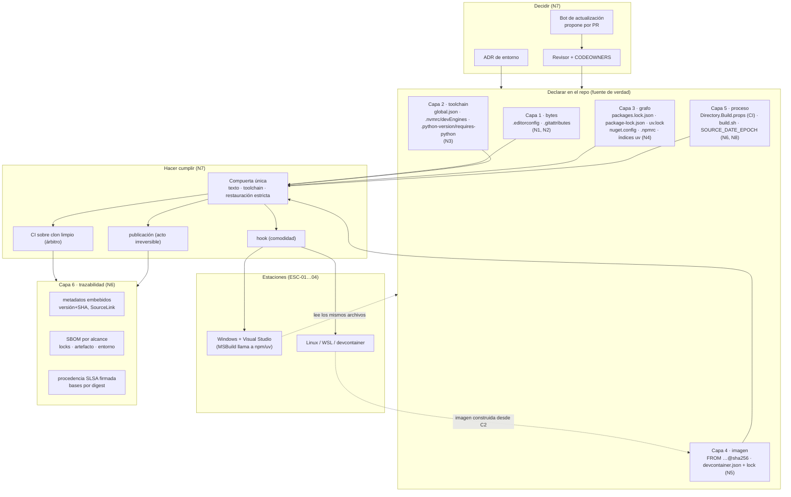

# Bitácora 04 — Integración

Este cuaderno registra cómo los nueve núcleos investigados y verificados adversarialmente (N0–N8) se convirtieron en una sola guía. Fija cinco cosas: qué entra de cada núcleo y dónde; qué dependencias quedaron resueltas por un núcleo posterior; qué contradicciones aparecieron al ponerlos lado a lado y con qué regla se resolvieron; el modelo completo reconstruido; y la trazabilidad desde cada pedido o regla del PO hasta la sección de la guía que lo atiende.

> Nota de numeración: el prompt reeditado (`OUTPUTs/Metodlogia-Entorno-Desarrollo.md` §11) prevé el cuaderno de integración como `19-Integracion.md`. La orquestación de esta corrida lo pidió como `04-Integracion.md`; se respeta el nombre pedido y se deja constancia para la relectura integral.

## Índice

- [1. Estado de entrada](#1-estado-de-entrada)
- [2. Cómo se consolidan los núcleos](#2-cómo-se-consolidan-los-núcleos)
- [3. Dependencias resueltas](#3-dependencias-resueltas)
- [4. Contradicciones entre núcleos y su resolución](#4-contradicciones-entre-núcleos-y-su-resolución)
- [5. Reparaciones en el núcleo de origen](#5-reparaciones-en-el-núcleo-de-origen)
- [6. Trabajo nuevo de la integración](#6-trabajo-nuevo-de-la-integración)
- [7. Modelo completo reconstruido](#7-modelo-completo-reconstruido)
- [8. Unificación de identificadores](#8-unificación-de-identificadores)
- [9. Trazabilidad pedido del PO → sección de la guía](#9-trazabilidad-pedido-del-po--sección-de-la-guía)
- [10. Lo que pasa a la relectura integral](#10-lo-que-pasa-a-la-relectura-integral)

## 1. Estado de entrada

| Núcleo | Estado | Experimentos | Verificación adversarial | Observación para integrar |
|---|---|---|---|---|
| N0 Modelo de capas | verificado | E0-1 … E0-6, E0-2b, E0-5b | §15: 9 correcciones, 0 retiros | Vocabulario canónico y tabla «qué fija / qué deja libre». |
| N1 Codificación y EOL | verificado | 13 (E1-N1-01 … 13) | §15: 15 correcciones, 1 retiro | Mecanismo del caso (Roslyn + ACP); matriz lector × bytes. |
| N2 Política de texto | verificado | E2-1 … E2-6 | §17: 17 correcciones, 1 retiro | Tabla por extensión; migración en tres commits; compuerta que lee `.editorconfig`. |
| N3 Toolchain | verificado | E1-01 … E1-07 (numeración interna) | §17: 9 correcciones | Archivos nativos + chequeo común; SDK cambia el lock. |
| N4 Dependencias | verificado | E1-E1 … E1-E5 (numeración interna) | §14: 7 correcciones | Lock + restauración estricta en los tres ecosistemas; registros. |
| N5 Contenedores | verificado | E5-1 … E5-7, E5-5b | §17: 9 correcciones (una de fondo: llaves en `.gitattributes`) | Qué fija un contenedor; digest; convivencia con Visual Studio. |
| N6 Procedencia | verificado | E6-1 … E6-6, E6-2b | §18: 12 correcciones | Metadatos, SBOM, procedencia, firma; `.nupkg` determinista desde SDK 11. |
| N7 Compuertas | verificado | E7-01 … E7-07, V7-01 | §21: 11 correcciones, 3 retiros | Compuerta única; límites sin protección de rama; descongelamiento. |
| N8 Políglota | verificado | E8-1 … E8-6 (+ V-1 … V-7 del verificador) | §16: 16 correcciones | Choque de convenciones; frontera de la build; imagen única vs. por componente; SBOM por alcance. |

Ningún núcleo dejó una afirmación técnica sin fuente o sin rótulo. Todos declaran el mismo límite: **nada se ejecutó en Windows**; lo que la guía dice de Visual Studio y de una estación Windows se apoya en documentación y se rotula.

## 2. Cómo se consolidan los núcleos

La guía sigue la estructura prevista en BIT-15-02 §6, con dos ajustes de integración (un capítulo de cierre y un anexo de límites):

| Sección de la guía | Núcleo(s) de origen | Qué se toma | Qué se deja en la bitácora |
|---|---|---|---|
| §0 Cómo usar la guía | BIT-15-00, prompt reeditado | Alcance, marcas de procedencia, lectura por recorrido o por consulta | Contrato de mesa, severidades |
| §1 El caso | N1 §2, N0 E0-1, N2 E2-2, N8 E8-1 | Narrativa del caso ofuscado, reproducción sintética, por qué Windows lo tapa, qué resolvió y qué no el fix | Detalle de versiones de Roslyn |
| §2 Marco de referencia | BIT-15-03 | ESC-01…05, CTX-NET/NODE/PY/POLI, ACT-DEV/ARQ/OPS/REV, matrices | Criterios de delimitación largos |
| §3 Pila de capas | N0 | Definiciones, seis capas, tabla mecanismo → capa, reproducible/determinista/hermética, «¿lo resuelve un contenedor?», mapa «estoy acá → qué aplico» (nuevo) | Tabla de experimentos completa |
| §4 Codificación y EOL | N1 | Mecanismo de Roslyn, matriz de lectores, EOL que cambia el binario, quién reescribe los bytes, diagnóstico | Fragmentos de código de Roslyn más allá del esencial |
| §5 Política de texto | N2 (+ N7 E7-02, N8 §5.1, N5 E5-7) | Decidir/declarar/verificar/migrar; tabla por extensión consolidada; `working-tree-encoding` | Detalle de convenciones de cada repositorio de referencia |
| §6 Toolchain | N3 (+ N8 §5.2) | Tres preguntas que «la versión» mezcla; `global.json`; `engines`/`devEngines`/Corepack; `requires-python`/`.python-version`; gestores | Matriz completa de `rollForward` |
| §7 Dependencias | N4 (+ N8 §5.3, N6 sobre `.nupkg`) | Lock + estricto por ecosistema; CPM vs. lock; RID; mapeo de fuentes; hashes; registros npm/uv | Iteraciones del laboratorio |
| §8 Contenedores | N5 | Qué fija un contenedor; etiqueta vs. digest; devcontainer; convivencia con Visual Studio; repo de Windows en Linux; imagen dev vs. CI | Tablas de paquetes del SO |
| §9 Procedencia | N6 | Cuatro preguntas de trazabilidad; determinismo .NET; npm y Python; SBOM; SLSA; firma; plataformas | Hashes de cada corrida |
| §10 Compuertas | N7 | Declarar/hacer cumplir/decidir; compuerta única; hooks; CI como árbitro; revisor; roles; descongelamiento; límites sin protección | Detalle de la herramienta del revisor |
| §11 Solución políglota | N8 (integra N1–N7) | Capítulo central: qué se rompe primero, política raíz, punto único de versiones, frontera de la build, imagen única vs. varias, CI, SBOM por alcance | Experimentos V-1…V-7 (se citan por su efecto) |
| §12 Hoja de ruta | todos (nuevo) | Secuencia de adopción para un equipo como el del caso | — |
| Anexo A Plantillas | N2–N8 + EA-1 (nuevo) | Plantillas consolidadas y verificadas juntas | — |
| Anexo B Listas por actor | N2 §13, N4 §10, N7 §7–§8, N8 §13 | Listas de verificación por ACT-* | — |
| Anexo C Glosario | N0 §1 + definiciones de N1–N8 | Un término, una definición | — |
| Anexo D Bibliografía | §Evidencias de N0–N8 + 3 fuentes nuevas | Fuentes deduplicadas como B01…B193, fecha de consulta 2026-10-07 | IDs internos de cada núcleo |
| Anexo E Laboratorio | `Examples/` | Índice de experimentos con ID unificado | — |
| Anexo F Límites | §Observaciones de N0–N8 | Lo no verificado, unificado | — |

**Criterio de compresión aplicado.** Cada núcleo trae su propia tabla de errores frecuentes, sus snippets y sus experimentos. La guía no los copia en paralelo: los errores frecuentes pasan a la subsección «Criterios de calidad» de cada capítulo (como señales de una versión pobre), los snippets se reducen a uno o dos representativos por capítulo y el resto vive en el Anexo A, y los experimentos se citan por ID con su ruta relativa (`Examples/...`) y su salida versionada. La guía no remite a la bitácora (R-PO-2, autocontención).

## 3. Dependencias resueltas

El grafo de BIT-15-02 §1 se cumplió sin ciclos. Además, varios pendientes que un núcleo dejó abiertos los cerró un núcleo posterior; la guía usa la versión cerrada.

| Pendiente | Lo abrió | Lo cerró | Resolución usada en la guía |
|---|---|---|---|
| Fuente oficial del mecanismo `SourceRoot` de `ContinuousIntegrationBuild` | N0 §13 | N6 §3.4 (dotnet/sourcelink: `DeterministicSourcePaths`) | §9.2.1: la normalización mapea los `SourceRoot`; requiere repo git. |
| Reproducibilidad en Node y Python | N0 §13 | N6 E6-3, E6-4 | §9.2.2: `npm pack` estable (observado, no documentado); setuptools con `SOURCE_DATE_EPOCH`, hatchling por defecto. |
| ¿`dotnet pack` es reproducible? | N4 §11 | N6 E6-2/E6-2b | §7.5 y §9.2.1: no en SDK 8/10; sí en SDK 11 con `SOURCE_DATE_EPOCH`. Regla: no re-empaquetar «la misma versión». |
| Bytes de los lock files | N2 §15 | N8 §16.2 | §5.2.3 y §11.2.2: NuGet escribe `packages.lock.json` sin salto final; `package-lock.json` y `uv.lock` con salto. Sección `insert_final_newline = unset`. |
| `.ps1` y Windows PowerShell 5.1 | N2 §15 | N8 §5.1 [EV8-13] | §5.2.3 tabla por extensión: `utf-8-bom` si el equipo usa 5.1 con texto no ASCII. |
| Registros de npm y uv | N4 §11 | N8 §5.3 | §7.3 y §11.2.4: `.npmrc` del proyecto (raíz del *workspace*), `[[tool.uv.index]]` con `explicit`. |
| Imagen multi-runtime vs. varias | N5 §15 | N8 E8-5 | §11.2.6: ambas dan la misma DLL con las mismas versiones; criterio por frontera de la build. |
| ¿Dónde va `.python-version`? | N3 §7 | N8 E8-2 | §6.2.5 y §11.2.3: un archivo nativo por ecosistema, donde lo busca su herramienta. |
| Interpretación de la diferencia de digest de `sdk:8.0` | N0 §13 | N5 E5-2 | §8.2.2: son paquetes del SO (OpenSSL 3.0.20 → 3.0.22, expat, pcre2, perl, tzdata). |
| Procedencia por defecto de BuildKit (v0.2 o v1) | N8 E8-6 | N8 V-6 + BuildKit v0.28.0 | §9.2.4 y §11.2.8: pedir `version=v1` explícitamente. |

## 4. Contradicciones entre núcleos y su resolución

Regla general (BIT-15-02 §4 y §7): gana la evidencia E1 o la fuente primaria; si la contradicción viene de una recomendación, se resuelve por escenario y contexto, nunca con una regla global; si obliga a cambiar un núcleo, se repara en el origen (§5).

| ID | Contradicción | Núcleos | Resolución | Dónde queda en la guía |
|---|---|---|---|---|
| CI-01 | **Condición de «estoy en CI»** en `Directory.Build.props`: N0 usa `GITHUB_ACTIONS`/`TF_BUILD`; N4 condiciona `RestoreLockedMode` a `$(ContinuousIntegrationBuild)` (depende del orden de evaluación y de quién la defina); N6 usa `CI`/`TF_BUILD`. | N0, N4, N6 | Una sola condición `'$(CI)' == 'true' Or '$(TF_BUILD)' == 'true' Or '$(GITHUB_ACTIONS)' == 'true'` que activa a la vez `ContinuousIntegrationBuild` y `RestoreLockedMode`. Evidencia nueva: GitHub Actions define `CI=true` y `GITHUB_ACTIONS=true` [B190]; GitLab, `CI=true` [B191]; las comparaciones de MSBuild no distinguen mayúsculas, así que `TF_BUILD=True` de Azure Pipelines coincide [B189]. Verificado con **EA-1** paso 2: sin variable, ambas vacías; con `CI=true` o `TF_BUILD=True`, ambas `true`. | §7.4, §9.5, Anexo A.4 |
| CI-02 | **BOM para C#**: el fix del caso usó UTF-8 **con** BOM; N2 recomienda **sin** BOM en repos nuevos; EditorConfig desaconseja `utf-8-bom`; las plantillas del SDK lo ponen. | N1, N2, N8 | Por estado del repositorio: nuevo → `utf-8` para `*.cs`; heredado ya convertido con BOM (el caso) → variante B `utf-8-bom` para `*.cs`. Lo inaceptable es no declarar. `.razor`/`.cshtml`/`.sln` con BOM siempre; `.sh`, `.json`, `.toml`, `.py` sin BOM siempre. | §5.2.3, §11.2.2, Anexo A.1 |
| CI-03 | **Llaves en patrones**: N2 y N8 usan `[*.{cmd,bat}]` en `.editorconfig`; N5 demostró (E5-7) que `.gitattributes` **no** expande llaves y que la receta oficial de VS Code con llaves no surte efecto. | N2, N5, N8 | No hay contradicción de fondo: EditorConfig sí admite llaves [B43]; git no [B36]. La guía lo enseña como regla explícita: llaves en `.editorconfig`, un patrón por extensión en `.gitattributes`. EA-1 paso 1 confirma ambos. | §5.2.4, Anexo A.1–A.2 |
| CI-04 | **`insert_final_newline = true`** del `.editorconfig` de N2 alcanza a `packages.lock.json`, que NuGet escribe sin salto final; un hook genérico lo agrega y el restore lo quita (E7-02). | N2, N7, N8 | Sección final `[{packages.lock.json,package-lock.json,uv.lock}] insert_final_newline = unset` (N8). EA-1 la verifica. | §5.2.3, §10.2.3, Anexo A.1 |
| CI-05 | **`rollForward`**: N3 recomienda `disable` con lock files; Microsoft también recomienda usar el SDK que trae Visual Studio, que se reemplaza al actualizar el IDE; N5 muestra que la imagen es otra fuente de SDK. | N3, N4, N5 | Con lock files de NuGet: `disable` + SDK exacto en la imagen + instalador independiente documentado para Windows; modo estricto sólo en CI (CI-01), de modo que una estación desalineada no rompe localmente pero la CI sí. Sin lock files: `latestPatch` como compromiso. La guía presenta la elección, no la esconde. | §6.2.2, §6.4 |
| CI-06 | **Dependabot y digests**: N5 recomienda Dependabot `docker` para actualizar digests; N7 retiró esa afirmación por falta de fuente oficial; además `devcontainers` figura como no soportado en repos privados. | N5, N7 | La guía dice lo verificado: Dependabot soporta `docker` y `devcontainers` para actualizaciones de versión [B107]; que actualice un `FROM …@sha256` fijado por digest **no está verificado**; Renovate `pinDigests` sí está documentado [B108]. Para un repo privado, `devcontainers` no está disponible según la tabla oficial. | §8.3, §10.2.6, Anexo A.13, Anexo F |
| CI-07 | **`PathMap`**: N0 E0-5b lo mostró normalizando sin git; N6 E6-2 caso 4 lo mostró **fallando** con git (no normaliza el mapa de SourceLink). | N0, N6 | No es contradicción: son dos configuraciones distintas. Regla única: en proyectos SDK modernos, `ContinuousIntegrationBuild` y no `PathMap` a mano. | §9.2.1 |
| CI-08 | **Acciones de CI por etiqueta**: el YAML ilustrativo de N2 usa `actions/checkout@v7`; N7 exige SHA completo. | N2, N7 | La guía usa siempre SHA + comentario con la etiqueta (`3d3c42e5… # v7.0.1`). | §10.2.4, Anexo A.12 |
| CI-09 | **Script `.sh` con BOM**: N1 dice «corre con otro intérprete y exit 0»; N2 «dash: not found y sigue»; N8 matiza «depende de quién lo lance» (Python `subprocess` → `Exec format error`). | N1, N2, N8 | Se adopta la formulación de N8, que contiene a las otras dos. | §4.2.4, §11.2.1 |
| CI-10 | **Versión de referencia de Node**: N0/N2 usan Node 22; N3/N7 Node 24; N8 22.23.2 con 22.23.3 publicado. | N0, N3, N7, N8 | No afecta conclusiones; la guía dice qué versión corrió cada experimento y que Node 24 es la LTS activa al 2026-10-07 [B68]. Las plantillas usan 24.21.0 (EA-1). | §6.2.3, Anexo A.7 |
| CI-11 | **Hooks genéricos de BOM**: N2 cita `fix-byte-order-marker` como herramienta; N7 muestra que contradice la política. | N2, N7 | Se adopta N7: un framework de hooks orquesta; la política la hace cumplir un chequeo que lee `.editorconfig`. | §5.2.5, §10.2.3 |
| CI-12 | **Nombre del lock de devcontainer**: especificación y CLI `devcontainer-lock.json`; README de la CLI `.devcontainer-lock.json`. | N0, N5 | Vale lo observado y especificado: `devcontainer-lock.json`. | §8.2.3 |

> **Corrección mesa ciclo 1 (2026-10-09, C1-01, C1-03).** Reabierta por E1 (exit 145): con `disable`, toda estación necesita el SDK exacto; el modo estricto sólo-CI es del lock, no del SDK. Política por defecto: con lock y `disable`, costo declarado; alternativa completa sin lock (`latestPatch` + `NU1603` como error + registro). Guía §6.4.

> **Corrección mesa ciclo 1 (2026-10-09, C1-10).** Extendida: en la familia .NET el BOM es convención (ningún lector decide); tercera rama «heredado todavía en cp1252 → decidir antes de migrar»; `dotnet new console` crea `Program.cs` y `.csproj` con BOM (E2-6). Guía §5.2.3.

> **Corrección mesa ciclo 1 (2026-10-09, C1-20, C1-21).** Aplicada: digest + bot en lo que construye lo publicado; devcontainer con etiqueta fija o la receta de la CI; `docker` en A.13. Docker documenta la actualización de digests [B113]; GitHub no.

Tensiones de BIT-15-02 §4 y cómo quedaron:

| Tensión prevista | Estado |
|---|---|
| BOM útil para .NET, dañino en otros archivos | Resuelta por extensión con E1 de cada lector (CI-02, E8-1). |
| `core.autocrlf` local vs. `.gitattributes` | Resuelta: el atributo `eol` gana; E2-1, E5-3. |
| Digest vs. parches de seguridad | Resuelta: digest + actualización por PR con cadencia; el costo real es asumir la responsabilidad de aplicar parches (N5 §3, N7 §9). |
| `rollForward` permisivo vs. exactitud | Resuelta por escenario (CI-05). |
| CPM vs. lock file | No son alternativas: entrada vs. salida (N4 E4-2). |
| Devcontainer para todos vs. quien no puede usarlo | Resuelta con evidencia documental: Visual Studio no ofrece desarrollo .NET dentro de un devcontainer; el devcontainer reproduce la CI, no la reemplaza (N5 §6). |
| Imagen única vs. por componente | Resuelta por frontera de la build (N8 §5.5). |
| Profundidad técnica vs. guía de un solo archivo | Resuelta por el criterio de compresión de §2: texto que forma criterio + Anexo A + `Examples/`. |

## 5. Reparaciones en el núcleo de origen

N8 §12 propuso reparaciones en N0–N4. Se aplicaron como **nota de integración** al final de cada núcleo afectado (no se reescribe su texto verificado, para no invalidar su verificación adversarial), y la guía usa la versión reparada:

| Núcleo | Reparación | Estado |
|---|---|---|
| N0 | Capa 6: distinguir el **alcance** del SBOM (artefacto, dependencias declaradas, entorno de build). | Nota agregada en N0; guía §3.2 y §11.2.8. |
| N1 | Matriz lector × bytes: agregar «JSON en cp1252 leído por Node → U+FFFD sin error; Python → `UnicodeDecodeError`». | Nota agregada; guía §4.2.4. |
| N2 | `.ps1` con BOM si Windows PowerShell 5.1; `insert_final_newline = unset` para locks; no marcar locks como `linguist-generated`. | Nota agregada; guía §5.2.3 y §11.2.2. |
| N3 | El archivo nativo va «donde lo busca su herramienta» (límite de uv); versión del SDK de JSPS fijable en `msbuild-sdks`. | Nota agregada; guía §11.2.3 y §11.2.5. |
| N4 | Registros de npm y uv pasan de [NV] a [F]; `.esproj` como «reescribe el lock sin avisar»; condición de CI unificada (CI-01). | Nota agregada; guía §7.2–§7.4 y §11.2.4. |

## 6. Trabajo nuevo de la integración

1. **Experimento EA-1** (`Examples/A-plantillas/verificar.sh`, salida `salidas/EA-1-plantillas.txt`, 2026-10-07). Un repositorio mínimo con **todas** las plantillas del Anexo A en sus rutas reales, verificado en cinco pasos: resolución de `.editorconfig` y `.gitattributes` para nueve rutas y compuerta de texto de N2 sobre las propias plantillas (21 archivos, 0 violaciones); condición de CI de `Directory.Build.props` en tres casos (sin variable / `CI=true` / `TF_BUILD=True`), lock sin salto final, `NU1004` en CI ante deriva y programa con identificador `señal` corriendo; `devEngines` pasa en Node 24.21.0 y falla con `EBADDEVENGINES` en Node 22.23.2; uv con `required-version` y `python-downloads = never` usa 3.12.15; JSONC del devcontainer, YAML del workflow y esquema comunitario de `dependabot.yml` válidos.
2. **Salidas de N4 en el laboratorio.** Las salidas de N4 vivían en la bitácora (`Nucleos/N4-salidas/`); la guía no puede citar la bitácora, así que se copiaron a `Examples/N4-congelamiento-de-dependencias/salidas/` y se agregó la nota en su `README.md`.
3. **Índice del laboratorio** (`Examples/README.md`) con la correspondencia de IDs.
4. **Tres fuentes nuevas**, consultadas el 2026-10-07: variables predeterminadas de GitHub Actions [B190], variables predefinidas de GitLab [B191] y condiciones de MSBuild (comparación sin distinción de mayúsculas) [B189].
5. **Capítulo §12 (hoja de ruta)** y **Anexo F (límites)**: no estaban en la estructura prevista; el primero ordena la adopción para el lector que llega con el problema del caso, el segundo cumple Rule-Evidences (observaciones separando hechos de interpretaciones).

## 7. Modelo completo reconstruido

El modelo integra las seis capas de N0, los tres momentos (declarar, hacer cumplir, decidir) de N7 y la trazabilidad de N6, en una solución de los tres ecosistemas (N8).

Lectura: **la política vive en el repo** (capas 1–5 declaradas), **las herramientas la hacen cumplir en un solo lugar** (la compuerta, invocada como hook, en la CI y en la publicación), **las versiones cambian sólo por decisión** (bot o ADR, por PR), y **lo que se publica sale de la CI con su registro** (metadatos, SBOM y procedencia). Las estaciones —incluida la de Visual Studio, que no entra al devcontainer— leen los mismos archivos; el contenedor reproduce la CI, no la reemplaza.

## 8. Unificación de identificadores

**Experimentos.** La guía usa `E<n>-<m>` con `<n>` = número de núcleo. Correspondencias que cambian respecto de la numeración interna de los núcleos:

| Núcleo | ID interno | ID en la guía |
|---|---|---|
| N1 | E1-N1-01 … E1-N1-13 | E1-01 … E1-13 |
| N3 | E1-01 … E1-07 | E3-1 … E3-7 |
| N4 | E1-E1 … E1-E5 | E4-1 … E4-5 |
| N7 | E7-01 … E7-07; V7-01 | E7-1 … E7-7; E7-5b |
| N8 | V-1 … V-7 (verificador) | se citan como «verificación de E8-n» sin ID propio (no tienen script en el laboratorio) |
| Integración | — | EA-1 |

N0, N2, N5 y N6 conservan sus IDs.

**Bibliografía.** Las evidencias `EV-nn`/`EV1-nn`/`EV5-nn`/`EV8-nn` de cada núcleo se deduplicaron por URL en el Anexo D de la guía como `B01`…`B193`, con fecha de consulta 2026-10-07. Tres son nuevas de la integración (B189–B191).

## 9. Trazabilidad pedido del PO → sección de la guía

| ID | Pedido o regla del PO (parafraseado, sin datos privados) | Núcleo(s) | Sección de la guía |
|---|---|---|---|
| P-01 | Código en cp1252 que en Linux se lee como UTF-8, falla al compilar y corrompe acentos; en Windows funciona. | N1 | §1, §4.2.1–§4.2.2 |
| P-02 | Se desarrolla con Visual Studio en Windows y a la vez en Linux o devcontainers. | N5; marco | §2.1, §8.2.4 |
| P-03 | Criterio unificado de codificación, sin commits de cambios de BOM. | N2, N7 | §5 (completo), §10.2.5, Anexo A.1–A.2 |
| P-04 | Congelar paquetes NuGet. | N4 | §7 |
| P-05 | Congelar versiones de compiladores y SDK. | N3 | §6 |
| P-06 | ¿Se puede lograr con contenedores? | N0, N5 | §3.5, §8 |
| P-07 | Cómo integrarlo con herramientas en Windows y en Linux. | N5, N7 | §8.2.4, §10, §12 |
| P-08 | Saber con qué entorno se ensambló cada pieza. | N0, N6 | §3.2 (capa 6), §9 |
| P-09 | Estrategias actuales de la industria para .NET, Node.js y Python. | N1–N7 | subsección «Qué propone la industria» de §4–§10 |
| P-10 | Qué pasa al integrarlos en una única solución. | N8 | §11 (capítulo central) |
| P-11 | Reeditar el prompt sobre el marco de mesa con el panel pedido. | proceso | fuera de la guía (`OUTPUTs/Metodlogia-Entorno-Desarrollo.md`) |
| P-12 | La mesa relee el documento final y corrige edición, compresión y coherencia. | proceso | pendiente: ciclo de relectura integral (§10 de este cuaderno) |
| R-01 | Secciones jerárquicas con índice; definiciones, explicaciones, ejemplos, mermaid. | todos | índice inicial; n.1 Definición y diagramas en §1, §3, §4, §5, §7, §9, §10, §11 |
| R-02 | Autocontenido, no delta. | todos | toda la guía; glosario Anexo C; sin referencias a la bitácora |
| R-03 | Snippets representativos; preguntas guía con respuestas que forman criterio. | todos | n.5 Ejemplos y n.6 Preguntas guía de §3–§11; Anexo A |
| R-04 | Descomposición, cohesión, integración. | N0–N8 | bitácora 01–04; §11 como integración |
| R-05 | Registros retomables en la bitácora. | — | `OUTPUTs/Bitcora/` |
| R-06/07 | No inventar; toda afirmación con evidencia verificable. | todos | citas [Bnn] y experimentos `E…` en línea; Anexo D; Anexo E; Anexo F |
| R-PROF | Marco de referencia, mapa conceptual, documentos por tema con estructura común, anexos. | marco; N0 | §2, §3.6, §4–§11 (estructura n.1–n.8), Anexos A–C |
| R-PRIV | Sin identificadores del caso privado. | todos | §1 describe el caso genéricamente; ejemplo sintético `Çaudal`/`señal`; grep de nombres privados en guía y laboratorio en cero (§10) |

Chequeo mecánico: todo pedido P-01…P-10 tiene sección; toda sección temática §4–§11 tiene al menos un pedido (§4 ← P-01; §5 ← P-03; §6 ← P-05; §7 ← P-04; §8 ← P-02/P-06/P-07; §9 ← P-08; §10 ← P-03/P-07; §11 ← P-10).

## 10. Lo que pasa a la relectura integral

- **Revalidar en Windows** (sin cambio posible en este entorno): la rama Windows del mecanismo de Roslyn (ACP 1252 y ACP UTF-8), qué escribe Visual Studio al guardar con la política, si Visual Studio respeta `core.hooksPath` y hooks `sh`, si lee `.nvmrc`/`.python-version`. Están rotulados en la guía y listados en el Anexo F.
- **Hallazgo negativo a revalidar**: Visual Studio no ofrece desarrollo .NET dentro de un devcontainer (sólo C++/CMake documentado). Es la base de la regla «el devcontainer reproduce la CI, no la reemplaza».
- **Datos volátiles**: versiones (SDK 10.0.401 vigente, Node 24 LTS, Python 3.15.0 prevista para el 2026-10-09, uv 0.12.23, npm 12, pnpm 12), fin de soporte de .NET 8 el 2026-11-10, soporte de Dependabot por versión de gestor.
- **Chequeos mecánicos hechos sobre la guía v1.0.0-borrador** al cerrar la integración (2026-10-07): 172 encabezados sin saltos de nivel ni slugs duplicados; las 19 entradas del índice coinciden en orden con los 19 encabezados `##`; 0 anclas internas rotas; 33 rutas `Examples/...` citadas, todas existentes; 193 fuentes definidas en el Anexo D y las 193 citadas en el texto, ninguna citada sin definir; los 11 diagramas mermaid de la guía y el de este cuaderno renderizan con `minlag/mermaid-cli`; búsqueda de identificadores privados del caso en la guía, el laboratorio y este cuaderno: cero coincidencias.
- **Pendiente de la mesa**: elegir formato único de SBOM por defecto (CycloneDX o SPDX) o dejarlo al consumidor; la guía hoy lo deja al consumidor con criterio.

> **Corrección mesa ciclo 1 (2026-10-09, C1-43).** Resuelto: CycloneDX por defecto si el consumidor no pide otro (guía §9.2.3).

> **Corrección mesa ciclo 1 (2026-10-09, C1-35).** Lo que queda por revalidar en Windows es la rama ACP 1252. ACP UTF-8 deja de ser una rama a revalidar: es una pregunta abierta con la prueba de #83320 en contra (R2-01).
