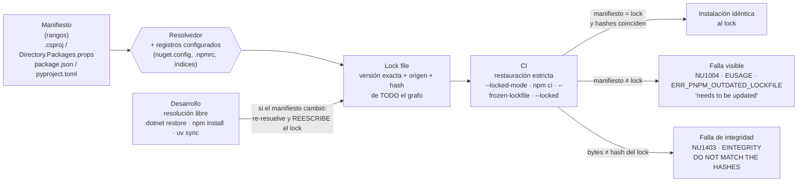
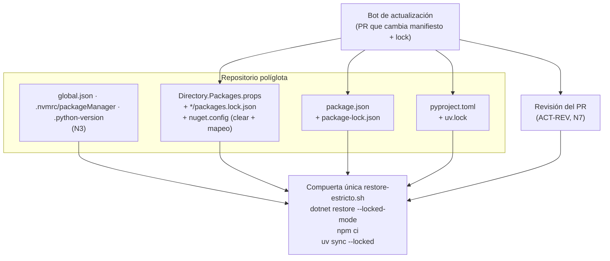

# N4 — Congelamiento de dependencias

Este núcleo responde a la parte del pedido del PO que dice «congelar nugets» (P-04 en BIT-15-02) y la extiende a Node.js y Python. Su tesis, que los experimentos confirman en los tres ecosistemas: **declarar una versión no congela nada; lo que congela es un lock file con el grafo completo y hashes, más un comando de restauración que falle cuando el lock no coincide.** Sin ese comando, el lock es una sugerencia que la herramienta reescribe en silencio.

Convenciones de este documento:

- **[F]** práctica recomendada por el fabricante o el estándar, con URL en la tabla de evidencias (§13).
- **[EXT]** convención extendida en la industria, sin que el fabricante la exija.
- **[CP]** criterio propio del investigador, a someter a la mesa.
- **[E1-x]** resultado de un experimento del laboratorio, ejecutado el 2026-10-07 (§7).
- **[NV]** no verificado: se dice qué falta para verificarlo.

## Índice

- [1. Definiciones](#1-definiciones)
- [2. El mecanismo en un diagrama](#2-el-mecanismo-en-un-diagrama)
- [3. Estrategias por ecosistema](#3-estrategias-por-ecosistema)
  - [3.1 .NET / NuGet](#31-net--nuget)
  - [3.2 Node.js: npm, pnpm, Yarn](#32-nodejs-npm-pnpm-yarn)
  - [3.3 Python: uv, Poetry, pip-tools, pip y PEP 751](#33-python-uv-poetry-pip-tools-pip-y-pep-751)
- [4. Integración en una única solución](#4-integración-en-una-única-solución)
- [5. Tabla comparativa](#5-tabla-comparativa)
- [6. Snippets representativos](#6-snippets-representativos)
- [7. Experimentos](#7-experimentos)
- [8. Preguntas guía](#8-preguntas-guía)
- [9. Errores frecuentes](#9-errores-frecuentes)
- [10. Aplicación por escenario y actor](#10-aplicación-por-escenario-y-actor)
- [11. Dependencias y tensiones con otros núcleos](#11-dependencias-y-tensiones-con-otros-núcleos)
- [12. Observaciones y limitaciones](#12-observaciones-y-limitaciones)
- [13. Evidencias](#13-evidencias)
- [14. Verificación adversarial](#14-verificación-adversarial)

## 1. Definiciones

Los términos *fijar*, *congelar* y *deriva* se usan con el sentido que fija N0; acá se especializan para la capa «grafo de dependencias».

| Término | Definición en esta guía | Ejemplo |
|---|---|---|
| **Rango declarado** | Lo que el desarrollador escribe en el manifiesto: un conjunto de versiones aceptables. | `Version="8.0.0"` en NuGet significa `>= 8.0.0` [F]; `"^3.0.0"` en npm; `"tqdm>=4.66"` en `pyproject.toml`. |
| **Versión directa fijada** | Una versión elegida para una dependencia **directa** (o, con *transitive pinning*, para una transitiva), declarada en un único lugar. | `PackageVersion` en `Directory.Packages.props` (CPM). |
| **Grafo resuelto** | El cierre completo de dependencias (directas + transitivas) con una versión concreta para cada una, que produce el resolvedor en un momento dado. | `Microsoft.Extensions.Logging 8.0.0` → `Options 8.0.0` → `Primitives 8.0.0`. |
| **Lock file** | Archivo generado por la herramienta que **persiste** el grafo resuelto, con la procedencia (`resolved`, `index`, `source`) y un **hash del contenido** de cada paquete. | `packages.lock.json`, `package-lock.json`, `pnpm-lock.yaml`, `yarn.lock`, `uv.lock`, `poetry.lock`, `pylock.toml`. |
| **Restauración estricta** (modo bloqueado) | Instalación que usa **sólo** el lock y **falla** si el lock no coincide con el manifiesto, en lugar de actualizarlo. | `dotnet restore --locked-mode`, `npm ci`, `pnpm install --frozen-lockfile`, `yarn install --immutable`, `uv sync --locked`. |
| **Resolución libre** | Instalación que, si el manifiesto cambió, vuelve a resolver y **reescribe** el lock. Es el comportamiento por defecto en desarrollo. | `dotnet restore`, `npm install`, `uv sync`, `uv run`. |
| **Deriva del grafo** | Diferencia entre el grafo que se usó ayer y el que se resuelve hoy con el mismo manifiesto, o entre el manifiesto y el lock commiteado. | Se publica un parche de una transitiva; alguien edita el `.csproj` y no regenera el lock. |
| **Integridad** | Verificación de que los bytes descargados son los que el lock registró, comparando un hash criptográfico. | `contentHash` (NuGet), `integrity` SHA-512 (npm), `hashes.sha256` (`uv.lock`, `pylock.toml`, `--hash` de pip). |
| **Mapeo de fuentes** | Regla declarada que dice de **qué registro** puede venir cada paquete. | `packageSourceMapping` en `nuget.config`. |
| **Lock universal** | Lock que contiene el grafo para **todas** las plataformas soportadas, con marcadores de entorno; lo opuesto es un lock **por plataforma**, válido sólo donde se generó. | `uv.lock` es universal [F]; `pip-compile` y `pip lock` son por plataforma [F]. |

**Idea central.** Fijar versiones directas y congelar el grafo son operaciones sobre capas distintas de la misma cosa: la primera controla la **entrada** del resolvedor; la segunda guarda la **salida**. Un hash agrega una tercera garantía: que el contenido de esa salida no cambió aunque el nombre y la versión sean los mismos.

## 2. El mecanismo en un diagrama



El mismo par aparece en los tres ecosistemas: **declarar** (manifiesto y lock) frente a **hacer cumplir** (restauración estricta), el par terminológico que BIT-15-02 §3 pide usar igual en N2, N3, N4 y N7.

## 3. Estrategias por ecosistema

### 3.1 .NET / NuGet

**Por qué hace falta un lock en NuGet.** La documentación de NuGet admite que el mismo `PackageReference` puede resolver distinto en dos días: con versiones flotantes (`4.*`), cuando se publica una versión que coincide mejor con el mínimo pedido, o cuando un feed (no nuget.org, que no permite borrar) elimina una versión [F]. El experimento E2 agregó un cuarto caso: si la versión pedida no existe, NuGet resuelve la siguiente disponible **sin advertencia** (`Primitives` pedida `8.0.2`, resuelta `9.0.0`, 0 advertencias) [E1-E2 paso 5].

> **Corrección mesa ciclo 1 (2026-10-09, C1-02, C1-03).** (L95, L398, L440) El «sin advertencia» lo produce el lock: sin lock aparece `NU1603` (SDK 8.0.425 y 10.0.400).

> **Corrección mesa ciclo 1 (2026-10-09, C1-03, C1-58).** Con la política por defecto (con lock), el `NU1603` desaparece (E4-2; `evidencia-auditor/nu1603-sdk10/`, SDK 8.0.425 y 10.0.400). **Ninguna compuerta del laboratorio compara `requested` con `resolved`**: `compuerta.sh` (N7) sólo filtra la salida de `dotnet restore` (L74), y `verificar.sh` (N8) no lo hace. Mientras eso siga así, la defensa es revisar el diff del lock (guía §7.6, pregunta situada). P-10 se aplicó sin revisión 2: la guía deja esa comparación como **[criterio]**, no como algo implementado.

> **Corrección mesa ciclo 2 (2026-10-09, C2-01, C2-03).** Se adoptan las dos defensas: `NU1603` como error en las dos políticas (A.4; con lock no se dispara, sin lock corta: `Mesa/Ciclo-2/evidencia-abogado-del-diablo/01-lock-por-defecto/`) y la comparación de `requested` con `resolved` en `compuerta.sh` (N7), sólo si `--locked-mode` pasó; con `Primitives 8.0.2` da `pide [8.0.2, ) y resolvió 9.0.0` y ROJO (`Mesa/Ciclo-2/evidencia-auditor/x7-ea1-propuesto/`, paso 8). **[criterio]** También marca una subida legítima, que se resuelve subiendo la `PackageVersion`. Cierra D-2. Guía §6.4, §7.2.1, A.4, A.11 (Ciclo-2, P-08, P-09, P-15).

**`packages.lock.json`** [F]

- Se activa con `RestorePackagesWithLockFile=true` (o con la sola presencia del archivo). El lock lista directas (`Direct`), transitivas (`Transitive`) y, con CPM, transitivas fijadas centralmente (`CentralTransitive`), cada una con `resolved` y `contentHash` [F][E1-E1 paso 1, E1-E2 paso 1].
- Sin modo bloqueado, si el proyecto cambió, restore **re-evalúa y actualiza el lock**. Con `--locked-mode` (o `RestoreLockedMode=true`) **falla** con `NU1004` [F][E1-E1 pasos 3 y 4]. En E1, el `restore` común cambió cinco entradas del lock (la directa `Logging` y la transitiva `DependencyInjection` a `8.0.1`; `DependencyInjection.Abstractions`, `Logging.Abstractions` y `Options` a `8.0.2`) con `exit=0` y sin mensaje [VA-1].
- Si el contenido del paquete en la carpeta global difiere del `contentHash` del lock, restore falla con `NU1403`; la documentación enumera como causas un paquete cambiado en la fuente, varias fuentes con el mismo Id y versión, o manipulación [F][E1-E1 paso 5, E1-E3 paso 3].
- **Aplicaciones sí, bibliotecas no**: el fabricante recomienda commitear el lock en aplicaciones y ejecutables, y **no** hacerlo en bibliotecas que no se publican o proyectos comunes, porque el lock de un proyecto referenciado no gobierna la resolución del proyecto que lo consume [F].
- **Paquetes implícitos del SDK**: algunos tipos de proyecto reciben `PackageReference` implícitas del SDK; cambiar de SDK cambia esas versiones y rompe el modo bloqueado. La mitigación que propone el fabricante es fijar el SDK con `global.json` y `rollForward: disable` [F]. Es la dependencia N3 → N4 que BIT-15-01 anticipaba.
- **Poda de paquetes** (`PrunePackageReference`, por defecto para `net10.0+` con el SDK 10): cambia el grafo y por lo tanto el lock la próxima vez que se regenera; el chequeo del modo bloqueado tiene en cuenta la poda [F]. En una prueba lateral, un lock generado con la poda desactivada pasó `--locked-mode` con el SDK 10.0.400 (no se versionó como experimento).
- **Plataforma (RID)**: el conjunto de *runtime identifiers* forma parte del contrato del lock. Un lock generado sin RID falla en modo bloqueado si se restaura con `-r linux-x64`; declarando `<RuntimeIdentifiers>win-x64;linux-x64</RuntimeIdentifiers>` el lock gana una sección por RID y el restore bloqueado pasa, pero vuelve a fallar si se fuerza un único RID con `-r` [E1-E1 pasos 6 y 7]. Hay antecedentes del mismo tipo: NuGet/Home#10901 (lock roto con TFM con plataforma, `net5.0-windows`; **cerrado** el 2021-07-01) y dotnet/sdk#3383 (`publish --no-restore --runtime X` falla con varios `RuntimeIdentifiers`; **abierto** al 2026-10-07) [EXT: no reproducidos] [VA-2].

**Central Package Management (CPM)** [F]

- `Directory.Packages.props` con `ManagePackageVersionsCentrally=true` y `PackageVersion`; los `.csproj` referencian sin `Version`. Poner `Version` en el `.csproj` es error `NU1008` [F][E1-E2 paso 4].
- *Transitive pinning* (`CentralPackageTransitivePinningEnabled=true`) hace que un `PackageVersion` gobierne también a la dependencia cuando llega de forma transitiva; no permite bajar versiones (`NU1109`) [F][E1-E2 pasos 1 a 3]. Sin pinning, el lock registra la entrada como `CentralTransitive` con `requested [8.0.2, )`, pero la resuelve igual en `8.0.0`: la versión central **no gobierna** la transitiva [E1-E2 paso 2].
- El pinning tiene efecto en el empaquetado: las transitivas fijadas pasan a ser dependencias explícitas del `.nuspec`, por lo que el fabricante pide evaluarlo con cuidado en bibliotecas [F].
- Con CPM y más de una fuente, NuGet emite `NU1507` y recomienda mapeo de fuentes o una sola fuente [F].

**CPM y lock no son alternativas.** CPM decide **qué se pide** (entrada) en un solo lugar para toda la solución; el lock registra **qué se obtuvo** (salida) con hash, por proyecto. CPM solo no evita las cuatro causas de deriva listadas arriba (E2 paso 5 lo muestra: CPM pidió `8.0.2` y obtuvo `9.0.0`). El lock solo, sin CPM, congela pero deja las versiones dispersas en N `.csproj`. [CP] Para una aplicación con varios proyectos: CPM + lock por proyecto ejecutable + modo bloqueado en CI.

**`nuget.config` y mapeo de fuentes** [F]

- Un `nuget.config` en la raíz del repo, con `<clear />` en `packageSources`, se considera buena práctica: evita que la configuración de usuario o de máquina agregue fuentes [F]. Es el equivalente, para la capa de fuentes, de no depender de `core.autocrlf` en N2.
- El mapeo (`packageSourceMapping`) existe desde NuGet 6.0 / SDK 6.0.100; una vez definido, **todo** paquete, incluidas las transitivas, tiene que coincidir con un patrón; gana el patrón más específico [F]. Un paquete sin patrón hace fallar el restore con `NU1100` [E1-E3 paso 5]. Herramientas más viejas **ignoran** el mapeo [F].
- **Límites documentados**: si el paquete ya está en la carpeta global, no se consulta ninguna fuente y el mapeo se ignora (el fabricante sugiere una carpeta global por repo); y el mapeo sólo aplica a descargas, no a consultas de metadatos (`dotnet package add`, `dotnet list package --outdated`), que envían los Id a todas las fuentes [F]. E3 reproduce el primero: con la caché caliente, el mapeo `Contoso.* → interno` no impidió compilar contra el impostor (`Contoso.Util viene de: IMPOSTOR`) [E1-E3 paso 2]. El `contentHash` del lock, en cambio, lo detectó (`NU1403`) [E1-E3 paso 3].

### 3.2 Node.js: npm, pnpm, Yarn

**npm** [F]

- `package-lock.json` está pensado para commitearse; npm 9+ escribe `lockfileVersion: 3`; cada entrada tiene `resolved` (de dónde vino) e `integrity` (hash SHA-512 o SHA-1) y, si el paquete declara restricciones, `os` y `cpu` [F][E1-E4 paso 1].
- `npm install`: si las versiones del lock satisfacen los rangos de `package.json`, gana el lock; si no, gana `package.json` y **el lock se actualiza** [F][E1-E4 paso 5: `is-odd 3.0.1 → 2.0.0`, `exit=0`].
- `npm ci`: exige lock, **falla** si no coincide con `package.json` (`EUSAGE`), borra `node_modules` antes de instalar y **nunca escribe** `package.json` ni el lock [F][E1-E4 paso 4]. Si el lock se generó con flags que cambian la estructura (`--legacy-peer-deps`, `--install-links`), `npm ci` necesita los mismos flags [F]. Mismo comportamiento verificado con npm 12.2.0 (versión vigente de la documentación) [E1-E4 corrida adicional].
- Un `integrity` alterado hace fallar `npm ci` con `EINTEGRITY` cuando el paquete se descarga [E1-E4 paso 6].
- **Multiplataforma**: un lock generado en Linux registró las 25 variantes de `@esbuild/*` con su `os`/`cpu` y `optional: true`, e instaló sólo `linux-x64` [E1-E4 paso 2]. Es decir, el lock es multiplataforma y la selección ocurre al instalar. [NV] No se verificó la instalación del mismo lock en Windows.
- `npm-shrinkwrap.json`: hasta npm 11 era la variante publicable del lock y tenía precedencia si coexistía con `package-lock.json`; **desde npm 12 npm ya no lo lee ni lo escribe** (la documentación pide renombrarlo a `package-lock.json`, con formato idéntico, e ignora el que venga dentro de una dependencia) [F, doc v12] [VA-3]. La guía no lo recomienda.

**pnpm** [F]: `--frozen-lockfile` hace fallar la instalación si el lock no está sincronizado o falta; su valor por defecto es `true` **en CI si hay un lock presente** y `false` fuera de CI [F][E1-E4 paso 7: `ERR_PNPM_OUTDATED_LOCKFILE` con `CI=true`, pnpm 10.18.0; mismo resultado con pnpm 12.9.1, versión vigente, y sin `CI` el install pasa y reescribe el lock] [VA-4].

**Yarn (Berry)** [F]: `--immutable` (por defecto en CI) aborta si el lock tuviera que modificarse; `--immutable-cache` y `--check-cache` validan la caché y los checksums contra el lock, recomendado en CI con Zero-Installs y PRs de terceros [F]. [NV] Yarn no se ejercitó en el laboratorio.

**Detección de CI.** pnpm y Yarn cambian su comportamiento según detecten CI; npm no: el modo estricto es otro comando. [CP] En la compuerta conviene **pedir el modo estricto explícitamente** (`--frozen-lockfile`, `--immutable`) y no depender de la detección, para que el mismo comando se comporte igual en la estación del desarrollador que lo corre antes del push (N7).

### 3.3 Python: uv, Poetry, pip-tools, pip y PEP 751

**uv** [F]

- `uv.lock` es TOML legible, lo administra uv (no se edita a mano), se commitea, y es **universal**: cubre todos los marcadores (SO, arquitectura, versión de Python) [F]. En E5 el lock incluyó `colorama` con `marker = "sys_platform == 'win32'"`, una dependencia de `tqdm` que sólo existe en Windows [E1-E5 paso 1].
- Lock y sync son **automáticos**: `uv run` y `uv sync` bloquean y sincronizan antes de ejecutar [F]. Por eso, en desarrollo, un cambio en `pyproject.toml` reescribe el lock sin pedirlo [E1-E5 paso 4: `tqdm 4.70.1 → 4.66.6`].
- `--locked` falla si el lock no está al día; `uv lock --check` es el equivalente para el comando `lock`; `--frozen` usa el lock **sin verificar** que esté al día [F][E1-E5 paso 3]. [CP] En CI, `--locked`; `--frozen` sólo cuando otro paso ya verificó.
- uv **no** considera desactualizado el lock porque salgan versiones nuevas: actualizar es un acto explícito (`uv lock --upgrade` o `--upgrade-package`) [F].
- `tool.uv.environments` acota las plataformas de la resolución universal; `tool.uv.required-environments` exige wheels para plataformas declaradas [F].

**Poetry** [F]: si hay `poetry.lock`, `install` usa sus versiones exactas; `poetry lock` no actualiza lo ya bloqueado salvo `--regenerate`; `sync` además desinstala lo que no está en el lock; `check --lock` verifica que el lock corresponde al `pyproject.toml` [F]. Con Poetry 2.5.1, `install` con un lock desactualizado **falla** con «pyproject.toml changed significantly since poetry.lock was last generated» [E1-E5 paso 9]. El `poetry.lock` también registró `colorama` con su marcador [E1-E5 paso 9].

**pip-tools y `uv pip compile`** [F]: `pip-compile --generate-hashes` produce un `requirements.txt` con hashes para el modo hash de pip. El README de pip-tools aclara que hay que compilar **en cada entorno** de destino. uv documenta lo mismo para su interfaz pip: `uv pip compile` es por plataforma, salvo `--universal` [F]. En E5, el archivo compilado en Linux **omitió** `colorama`; con `--universal` lo incluyó con su marcador [E1-E5 paso 5]. Ése es el modo de falla «funciona en Linux, en Windows falta un paquete».

**Modo hash de pip** [F]: un solo `--hash` activa el modo para **todos** los requisitos, que además deben estar fijados con `==`; pip 26.2 agrega `--no-require-hashes` para desactivar la exigencia global [F]. Un hash alterado hace fallar la instalación («THESE PACKAGES DO NOT MATCH THE HASHES») [E1-E5 paso 6]. Detalle práctico verificado: cada paquete lista varios hashes (wheel y sdist) y pip acepta cualquiera; alterar uno solo **no** produjo falla en la primera versión del experimento, hubo que alterar todos los de `tqdm` [E1-E5, iteración documentada en §12].

**PEP 751 / `pylock.toml`** — estado verificado al 2026-10-07:

- PEP 751 está **Final**, resuelta el 31-03-2025; la especificación vigente vive en packaging.python.org, con una aclaración de marzo de 2026 [F].
- Nombre `pylock.toml` o `pylock.<nombre>.toml`; `lock-version = "1.0"`; `created-by` obligatorio; clave opcional `environments` con marcadores; los hashes de cada archivo son obligatorios (al menos uno, se recomienda sha256); los instaladores deben validarlos [F].
- **Adopción**: uv exporta (`uv export --format pylock.toml`) y conserva `uv.lock` como formato propio porque tiene información que el estándar no expresa [F]. pip 26.2.1 instala desde `pylock.toml` con `-r` como función **experimental** (lo avisa con un WARNING) [F][E1-E5 paso 7] y tiene `pip lock`, también **experimental**, cuyo lock sólo vale para la versión de Python y la plataforma actuales [F]: en E5 no incluyó `colorama`, el exportado por uv sí [E1-E5 paso 8].
- [CP] Hoy `pylock.toml` sirve como **formato de intercambio** (por ejemplo, para que un instalador o un escáner lean el grafo sin depender de uv o Poetry), no como reemplazo del lock nativo de la herramienta del proyecto.

## 4. Integración en una única solución

En una solución con .NET, Node.js y Python no hay un lock común: **cada ecosistema tiene su resolvedor, su lock y su comando estricto** [CP, consecuencia directa de §3]. Lo que sí se puede unificar es el **procedimiento**:

1. **Un lock por ecosistema, junto a su manifiesto**, todos commiteados: `packages.lock.json` por proyecto ejecutable .NET (con CPM en la raíz), `package-lock.json`/`pnpm-lock.yaml` por paquete o workspace Node, `uv.lock` por proyecto o workspace Python.
2. **Una sola compuerta de restauración estricta** que llama a los tres comandos estrictos (§6.5). La misma compuerta corre en local y en CI (N7). Si cualquiera falla, falla todo.
3. **Una sola configuración de registros por ecosistema, en el repo**: `nuget.config` con `<clear />` y mapeo; `.npmrc` del proyecto para el registro de npm; índices de uv en `pyproject.toml` [F para NuGet; EXT para npm y uv: no se verificó en este núcleo la configuración de registros de npm y uv, queda para N8].
4. **Toolchain fijado antes que el lock** (N3): el SDK de .NET cambia paquetes implícitos [F]; la versión de npm decide el `lockfileVersion` [F]; la versión de uv o Poetry decide el formato de su lock. Un lock sin su herramienta fijada es una fuente de diffs espurios.
5. **Un solo bot de actualización** que entienda los tres locks. Dependabot soporta NuGet (la tabla dice `<=6.12.0`, pero la sección de NuGet aclara que soporta «la mayoría de las funcionalidades hasta 6.8.0»), npm (v7–v11), pnpm (v7–v10), Yarn (v1–v4), pip/pip-compile, Poetry v2 y uv (v0.11) [F]; **ojo con las versiones**: al 2026-10-07 npm 12, pnpm 11/12 y uv 0.12 (los vigentes) no figuran en la tabla [VA-5]. Renovate tiene `lockFileMaintenance`, **deshabilitado por defecto** (`enabled: false`); al habilitarlo corre con cadencia semanal («before 4am on monday»), con soporte declarado para `packages.lock.json`, `package-lock.json`, `pnpm-lock.yaml`, `yarn.lock`, `uv.lock`, `poetry.lock` y `requirements.txt` de pip-compile [F]. [NV] No se verificó si Dependabot regenera `packages.lock.json` con CPM ni `uv.lock` correctamente en todos los casos.
6. **Plataformas**: el lock de npm y el de uv son multiplataforma por diseño [F][E1]; el de NuGet depende de declarar el conjunto de RID [E1]; un `requirements.txt` compilado sin `--universal` no lo es [F][E1]. En un equipo que mezcla Windows (ESC-01) y Linux/devcontainer (ESC-02/04), [CP] la regla es: **generar el lock de una forma que no dependa de la máquina** (`uv lock`, `--universal`, `RuntimeIdentifiers` declarados) y **verificarlo en CI** en la plataforma de producción.

> **Corrección mesa ciclo 1 (2026-10-09, C1-30).** (L171, L203, L354) `--universal` es de `uv pip compile`; `pip-compile` no tiene esa opción (7.6.2, exit 2). pnpm y Yarn: multiplataforma, verificado.



## 5. Tabla comparativa

| Aspecto | NuGet | npm | pnpm | Yarn (Berry) | uv | Poetry | pip-tools / pip |
|---|---|---|---|---|---|---|---|
| Lock | `packages.lock.json` (opt-in) | `package-lock.json` | `pnpm-lock.yaml` | `yarn.lock` | `uv.lock` | `poetry.lock` | `requirements.txt` compilado / `pylock.toml` |
| Hash en el lock | `contentHash` (64 bytes en base64, longitud de SHA-512 [E1]; algoritmo no confirmado en fuente) | `integrity` (SHA-512/SHA-1) | sí [NV detalle] | checksum | `sha256` | sí [NV detalle] | `--hash=sha256` (opcional, `--generate-hashes`) |
| Restauración estricta | `dotnet restore --locked-mode` / `RestoreLockedMode` | `npm ci` | `install --frozen-lockfile` (default en CI) | `install --immutable` (default en CI) | `uv sync --locked`, `uv lock --check` | `poetry check --lock`; `install` falla si el lock es viejo | `pip install --require-hashes -r` (no compara con el manifiesto) |
| Reescribe el lock sin avisar | `dotnet restore`, restore de Visual Studio | `npm install` | `pnpm install` fuera de CI | `yarn install` fuera de CI | `uv sync`, `uv run` | `poetry lock` (a pedido) | `pip-compile` (a pedido) |
| Error típico de deriva | `NU1004` | `EUSAGE` | `ERR_PNPM_OUTDATED_LOCKFILE` | [NV] | «needs to be updated, but `--locked` was provided» | «pyproject.toml changed significantly…» | — |
| Error típico de integridad | `NU1403` | `EINTEGRITY` | [NV] | [NV] | [NV] | [NV] | «DO NOT MATCH THE HASHES» |
| Multiplataforma | sólo los RID declarados | sí (`os`/`cpu`, opcionales) | [NV] | [NV] | sí (universal) | sí (marcadores) | no, salvo `uv pip compile --universal` |
| Fijación central de directas | CPM | — (cada `package.json`) | catálogos [NV] | — | workspace [NV] | — | `-c constraints.txt` [NV] |
| Mapeo de fuentes | `packageSourceMapping` | [NV, ver N8] | [NV] | [NV] | índices por paquete [NV] | fuentes por paquete [NV] | `--index-url` |
| Evidencia en el lab | E1, E2, E3 | E4 | E4 | — | E5 | E5 | E5 |

Las celdas [NV] no se afirman en la guía hasta tener fuente; quedan como pendientes de N8 o de la relectura.

## 6. Snippets representativos

### 6.1 .NET: CPM + lock + modo bloqueado sólo en CI

```xml
<!-- Directory.Packages.props (raíz del repo) -->
<Project>
  <PropertyGroup>
    <!-- Versiones en un solo lugar: los .csproj no llevan Version (NU1008 si lo llevan). -->
    <ManagePackageVersionsCentrally>true</ManagePackageVersionsCentrally>
    <!-- Una PackageVersion también gobierna a la dependencia cuando llega transitiva. -->
    <CentralPackageTransitivePinningEnabled>true</CentralPackageTransitivePinningEnabled>
  </PropertyGroup>
  <ItemGroup>
    <PackageVersion Include="Microsoft.Extensions.Logging" Version="8.0.0" />
    <!-- Transitiva subida a propósito (p. ej., parche de seguridad). No se puede bajar: NU1109. -->
    <PackageVersion Include="Microsoft.Extensions.Options" Version="8.0.2" />
  </ItemGroup>
</Project>
```

```xml
<!-- Directory.Build.props (raíz): lock en todos los proyectos; modo bloqueado sólo en CI. -->
<Project>
  <PropertyGroup>
    <RestorePackagesWithLockFile>true</RestorePackagesWithLockFile>
    <!-- [CP] La condición es una convención: ContinuousIntegrationBuild la fija la CI (ver N6).
         En la estación del desarrollador el restore puede actualizar el lock; en CI, nunca. -->
    <RestoreLockedMode Condition="'$(ContinuousIntegrationBuild)' == 'true'">true</RestoreLockedMode>
  </PropertyGroup>
</Project>
```

> **Corrección mesa ciclo 1 (2026-10-09, C1-26).** El lock va **sólo en los ejecutables** y en `Directory.Build.targets`, no en `.props`. En `.props`, una condición sobre `OutputType` no surte efecto, porque al evaluarse el valor todavía está vacío (`evidencia-auditor/lock-solo-ejecutables/`, SDK 8.0.425). **Ajuste en la misma pasada (aplicación del ciclo 1):** no hubo revisión 2 de P-16, así que la guía (A.4b) quedó con la condición aprobada, `'$(OutputType)' == 'Exe'`. Con esa condición, un proyecto WinForms/WPF (`WinExe`) restaura con rc=0, sin `packages.lock.json` y sin aviso; con `'$(OutputType)' == 'Exe' Or '$(OutputType)' == 'WinExe'`, WinExe y Web generan su lock (J-I1, `evidencia-aprobacion-impacto/winexe-lock/`). Incorporar `WinExe` a A.4b queda como pendiente para el ciclo 2 (`Mesa/Ciclo-1/05-Aplicacion.md`).

> **Corrección mesa ciclo 2 (2026-10-09, C2-02).** A.4b pasa a `'$(OutputType)' == 'Exe' Or '$(OutputType)' == 'WinExe'` y cierra D-1 (el SDK cambia `Exe` por `WinExe` en WinForms y WPF, [B215]); un WinForms con `EnableWindowsTargeting` recibe su lock (EA-1 paso 2c). Un proyecto de prueba no lo recibe por esta regla: su `OutputType=Exe` llega de `Microsoft.NET.Test.Sdk`, que el restore no evalúa (`Mesa/Ciclo-2/evidencia-senior-dotnet/lock-outputtype.txt`). Guía §7.2.1, A.4b (Ciclo-2, P-09, P-15).

```xml
<!-- Proyecto ejecutable que se publica para Windows y Linux: el conjunto de RID es parte del lock. -->
<PropertyGroup>
  <RuntimeIdentifiers>win-x64;linux-x64</RuntimeIdentifiers>
</PropertyGroup>
```

### 6.2 .NET: `nuget.config` del repositorio

```xml
<?xml version="1.0" encoding="utf-8"?>
<configuration>
  <packageSources>
    <clear />                                  <!-- nada heredado del usuario o la máquina -->
    <add key="nuget.org" value="https://api.nuget.org/v3/index.json" />
    <add key="interno" value="https://paquetes.example.org/v3/index.json" />
  </packageSources>
  <packageSourceMapping>
    <packageSource key="interno">
      <package pattern="MiOrg.*" />            <!-- prefijo propio: sólo del feed interno -->
    </packageSource>
    <packageSource key="nuget.org">
      <package pattern="*" />                  <!-- el resto, de nuget.org -->
    </packageSource>
  </packageSourceMapping>
  <config>
    <!-- Carpeta global por repo: el mapeo no se saltea por una caché compartida (límite documentado). -->
    <add key="globalPackagesFolder" value=".nuget/packages" />
  </config>
</configuration>
```

[F] La referencia de `nuget.config` admite `globalPackagesFolder` con ruta relativa en un `nuget.config` de proyecto, y aclara que la variable de entorno `NUGET_PACKAGES` **tiene precedencia** sobre esa clave: si la CI o la imagen del devcontainer la definen, la carpeta por repo no se usa [VA-6]. [NV] Su interacción con `.gitignore` (la carpeta `.nuget/` debe excluirse) se verifica en N8.

### 6.3 Node.js

```bash
# Desarrollo: agregar o cambiar dependencias (reescribe package-lock.json; commitear ambos archivos).
npm install is-odd@^3
# CI y compuerta local: instala EXACTAMENTE el lock o falla; nunca lo escribe.
npm ci
# pnpm / Yarn: pedir el modo estricto explícitamente, sin depender de la detección de CI.
pnpm install --frozen-lockfile
yarn install --immutable
```

### 6.4 Python

```bash
# Desarrollo (uv): lock universal; uv run / uv sync lo mantienen al día automáticamente.
uv add "tqdm>=4.66"
uv lock --upgrade-package tqdm   # actualizar es un acto explícito
# CI y compuerta local:
uv lock --check                  # ¿el lock corresponde a pyproject.toml?
uv sync --locked                 # instala el lock o falla; no lo reescribe
# Intercambio con herramientas que leen el estándar (PEP 751):
uv export --format pylock.toml -o pylock.toml
# Sin uv (pip-tools): compilar UNIVERSAL o por plataforma, con hashes.
uv pip compile pyproject.toml --universal --generate-hashes -o requirements.txt
pip install --require-hashes -r requirements.txt
```

### 6.5 Compuerta única de restauración estricta (solución políglota)

```bash
#!/usr/bin/env bash
# restore-estricto.sh — misma compuerta en local y en CI (N7). [CP]
set -euo pipefail
dotnet restore --locked-mode        # NU1004 / NU1403 si el lock no coincide
( cd web && npm ci )                # EUSAGE / EINTEGRITY
( cd tools/py && uv sync --locked ) # "needs to be updated, but --locked was provided"
```

## 7. Experimentos

Laboratorio: `LAB/Lab-Documentos/Guides/Metodologia-Entorno-Desarrollo/Examples/N4-congelamiento-de-dependencias/` (README con los comandos). Salidas completas: `OUTPUTs/Bitcora/Nucleos/N4-salidas/`. Todos corridos el 2026-10-07 en Linux (Debian 13, x86_64) con Docker.

| ID | Comando | Herramientas | Resultado resumido | Salida |
|---|---|---|---|---|
| E1-E1 | `docker run --rm -v "$PWD/e1-nuget-lock:/src:ro" mcr.microsoft.com/dotnet/sdk:8.0 bash /src/run.sh` | SDK 8.0.425 | Lock con `Direct`/`Transitive` + `contentHash`; `--locked-mode` OK; tras cambiar `8.0.0→8.0.1` en el `.csproj`: `NU1004`, `exit=1`; `dotnet restore` común: `exit=0` y lock reescrito (directa a 8.0.1, tres transitivas a 8.0.2); `contentHash` alterado: `NU1403`; lock sin RID + `-r linux-x64`: `NU1004 … runtime identifiers have changed`; con `RuntimeIdentifiers` declarados: secciones `net8.0/linux-x64` y `net8.0/win-x64`, restore bloqueado OK, pero `-r linux-x64` vuelve a dar `NU1004`. | `N4-salidas/e1-nuget-lock.txt` |
| E1-E2 | `docker run --rm -v "$PWD/e2-nuget-cpm-pinning:/src:ro" mcr.microsoft.com/dotnet/sdk:8.0 bash /src/run.sh` | SDK 8.0.425 | Con pinning: `Options` `CentralTransitive` `[8.0.2, )` → `8.0.2`; sin pinning: misma entrada, resuelta `8.0.0`; pin a `7.0.0`: `NU1109`; `Version` en el `.csproj`: `NU1008`; pin a `Primitives 8.0.2` (inexistente): resuelta `9.0.0`, **0 advertencias**. | `N4-salidas/e2-nuget-cpm-pinning.txt` |
| E1-E3 | `docker run --rm -v "$PWD/e3-nuget-source-mapping:/src:ro" mcr.microsoft.com/dotnet/sdk:8.0 bash /src/run.sh` | SDK 8.0.425, feeds locales | `Contoso.Util 1.0.0` en dos feeds con SHA-256 distintos; con mapeo: fuente `interno`; caché caliente con el impostor + mapeo: el mapeo no se consulta y el programa imprime `IMPOSTOR`; lock legítimo + feed impostor + `--locked-mode`: `NU1403`; sin mapeo: fuente elegida sin declaración (`interno` en esta corrida); mapeo incompleto: `NU1100 … PackageSourceMapping is enabled`. | `N4-salidas/e3-nuget-source-mapping.txt` |
| E1-E4 | `docker run --rm -v "$PWD/e4-npm-lock:/src:ro" node:22-bookworm-slim bash /src/run.sh` | Node 22.23.2, npm 10.9.8, pnpm 10.18.0 (y npm 12.2.0 en corrida adicional) | `lockfileVersion 3` con `resolved` e `integrity`; 25 entradas `@esbuild/*` con `os`/`cpu`, instalada sólo `linux-x64`; `npm ci` OK; deriva `^3 → ^2`: `EUSAGE`, `exit=1` (igual con npm 12.2.0); `npm install`: `exit=0`, lock reescrito (`is-odd 3.0.1 → 2.0.0`); `integrity` alterado: `EINTEGRITY`; pnpm con `CI=true`: `ERR_PNPM_OUTDATED_LOCKFILE`. | `N4-salidas/e4-npm-lock.txt` |
| E1-E5 | `docker run --rm -v "$PWD/e5-python-lock:/src:ro" python:3.12-slim bash /src/run.sh` | Python 3.12.14, pip 26.2.1, uv 0.12.23, Poetry 2.5.1 | `uv.lock` con `colorama` marcado `sys_platform == 'win32'`; `uv lock --check` / `uv sync --locked` OK y luego, tras restringir `tqdm<4.67`, fallan con «needs to be updated»; `uv sync` reescribe (`4.70.1 → 4.66.6`); `uv pip compile` sin `--universal` omite `colorama`, con `--universal` lo incluye; hash alterado: «DO NOT MATCH THE HASHES»; `uv export` → `pylock.toml` (`lock-version 1.0`, `created-by uv`, marcador y hashes) e instalación con `pip install -r pylock.toml` (WARNING experimental); `pip lock` sin `colorama`; Poetry: `check --lock` y `install` fallan con lock viejo. | `N4-salidas/e5-python-lock.txt` |

## 8. Preguntas guía

**1. ¿Qué diferencia hay entre fijar versiones directas (CPM) y congelar el grafo transitivo (lock)? ¿Necesito las dos?**
CPM controla la **entrada** del resolvedor y la centraliza: evita que dos proyectos de la misma solución pidan versiones distintas y, con *transitive pinning*, permite subir una transitiva (no bajarla). El lock controla la **salida**: registra cada paquete efectivamente resuelto, con hash, y permite exigir que la próxima restauración sea idéntica. CPM sin lock no impide la deriva: E2 pidió `8.0.2` y NuGet entregó `9.0.0` sin advertir. Lock sin CPM congela, pero cada actualización hay que hacerla proyecto por proyecto. *Cuándo aplica*: en una solución con más de un proyecto que se despliega, las dos [CP]; en una biblioteca que se publica, CPM sí y lock no (el fabricante desaconseja commitearlo) [F]; en un único proyecto ejecutable, el lock es lo imprescindible y CPM es comodidad.

> **Corrección mesa ciclo 1 (2026-10-09, C1-26).** Se cita mal a [B83]. La fuente habla de proyectos de biblioteca que **no se distribuyen** y de proyectos de código común, y aclara que conservar el lock «no hace daño». El lock de un proyecto común no gobierna a quien lo referencia: por eso va en los ejecutables (R2-11). Es la misma corrección que la nota de N0 L160 de la revisión 1. Guía §7.6 (P-10).

**2. ¿Qué comando falla si el lock no coincide y cuál lo regenera en silencio, por ecosistema?**
Falla: `dotnet restore --locked-mode` (`NU1004`), `npm ci` (`EUSAGE`), `pnpm install --frozen-lockfile` (`ERR_PNPM_OUTDATED_LOCKFILE`), `yarn install --immutable`, `uv sync --locked` / `uv lock --check`, `poetry check --lock` y `poetry install`. Regenera sin avisar: `dotnet restore` (y, por ser el mismo restore, el implícito de `dotnet build` y el de Visual Studio [NV: ninguno de los dos se ejercitó en el laboratorio]), `npm install`, `pnpm install` y `yarn install` fuera de CI, `uv sync` y `uv run`. *Cuándo aplica*: el comando que regenera es el correcto **cuando se quiere** cambiar el grafo (agregar o actualizar una dependencia); el que falla es el correcto **en toda verificación** (CI, compuerta local, build de release). El error frecuente es usar en CI el comando de desarrollo.

**3. ¿Qué pasa con el lock al restaurar en Windows y en Linux?**
Depende de si el lock es universal. npm registra los binarios opcionales de todas las plataformas y elige al instalar (E4); `uv.lock` y `poetry.lock` guardan las dependencias condicionales con marcadores (E5). NuGet incluye en el lock sólo los RID que el proyecto declara: si la estación Windows restaura sin RID y la CI con `-r linux-x64`, el modo bloqueado falla (E1). `pip-compile`, `uv pip compile` sin `--universal` y `pip lock` producen locks válidos sólo para la plataforma donde se generaron: un archivo compilado en Linux no trae `colorama`, que `tqdm` necesita en Windows (E5). *Cuándo aplica*: siempre que ESC-01 (Windows + VS) conviva con ESC-02/04/05 (Linux). La regla es generar el lock de forma independiente de la máquina y verificarlo en CI. [NV] Los finales de línea del lock escritos en Windows (CRLF frente a LF) no se verificaron: los cubre la política de N2 si el lock está incluido en `.gitattributes`.

**4. ¿Protege el lock contra paquetes republicados o registros comprometidos? ¿Qué agregan los hashes y el mapeo de fuentes?**
El lock con hash protege contra **cambios de contenido** de una versión ya bloqueada: si el registro sirve otros bytes con el mismo Id y versión (republicación, feed comprometido, impostor en otro feed), la restauración falla (`NU1403`, `EINTEGRITY`, «DO NOT MATCH THE HASHES»), siempre que la verificación ocurra (E3, E4, E5). **No protege** contra un paquete que ya era malicioso cuando se bloqueó, ni contra la versión nueva y maliciosa que entra cuando alguien actualiza el lock: eso es trabajo de la revisión del PR (pregunta 5) y de la auditoría de vulnerabilidades. El mapeo de fuentes ataca otro vector, la **confusión de dependencias**: decide de qué registro puede venir cada Id, pero tiene dos huecos documentados (la caché global y las consultas de metadatos), y E3 muestra el primero. *Cuándo aplica*: el hash, siempre; el mapeo, cuando el repo mezcla un feed privado con uno público. Las dos defensas son complementarias, no alternativas.

**5. ¿Quién actualiza el lock, cuándo y cómo se revisa en un PR?**
[CP sobre base F] Lo actualiza el **desarrollador** (ACT-DEV) cuando agrega o cambia una dependencia, en el mismo commit que el manifiesto, y un **bot** (Dependabot o Renovate) en cadencia fija para parches y transitivas. El cambio de lock **nunca** entra mezclado con cambios funcionales grandes. El revisor (ACT-REV) mira: (a) que el manifiesto y el lock cambien juntos y la compuerta estricta pase; (b) qué paquetes **nuevos** aparecen en el grafo, no sólo los que subieron de versión; (c) cambios de `resolved`/`source`/índice (otro registro para el mismo paquete); (d) un hash que cambia **sin** cambio de versión, que es exactamente la señal de republicación y debe rechazarse hasta explicarse. Los locks son archivos generados: no se editan a mano (uv lo dice explícitamente) [F], ni se resuelven conflictos de merge a mano; se regeneran con la herramienta. Las herramientas de revisión de dependencias en PR se tratan en N7.

**6. ¿Un contenedor reemplaza al lock?** (pregunta transversal de N0/N5)
No. La imagen fija SO y toolchain, pero si la restauración dentro del contenedor usa `npm install` o `dotnet restore` sin modo bloqueado, el grafo se resuelve de nuevo contra el registro en cada build. El contenedor congela el entorno donde corre el resolvedor, no el resultado del resolvedor. [CP derivado de §3 y de los experimentos, que corrieron todos en contenedores y mostraron deriva igual.]

## 9. Errores frecuentes

| Error | Síntoma | Corrección |
|---|---|---|
| Lock commiteado pero la CI usa `dotnet restore`, `npm install` o `uv sync` sin `--locked`. | La CI «pasa» con un grafo distinto del commiteado; el lock del repo queda desactualizado sin que nadie lo note. | Restauración estricta en CI y en la compuerta local (§6.5). |
| Creer que `Version="X"` en NuGet es exacto. | Se resuelve otra versión si `X` no existe o se publica algo más cercano (E2 paso 5, 0 advertencias). | Lock + modo bloqueado; rango exacto `[X]` sólo cuando se lo quiere deliberadamente [F: en la tabla de rangos, `1.0` es `x ≥ 1.0` y `[1.0]` es «Exact version match»; evidencia #32] [VA-7]. |
| `requirements.txt` compilado en la máquina del desarrollador Linux y usado en Windows. | Falta un paquete condicional (`colorama`) en Windows. | `uv lock` o `uv pip compile --universal`; o compilar por plataforma y commitear un archivo por plataforma [F pip-tools]. |
| Lock de NuGet generado sin RID y CI que restaura con `-r`. | `NU1004 … runtime identifiers have changed`. | Declarar `RuntimeIdentifiers` en el proyecto y restaurar sin `-r`, o con el mismo conjunto. |
| Subir el SDK de .NET sin regenerar el lock. | `NU1004` por paquetes implícitos del SDK. | Fijar el SDK con `global.json` (N3) y subirlo en un PR que también regenere los locks [F]. |
| Lock commiteado en una biblioteca .NET. | El consumidor resuelve otras versiones; el lock da una falsa sensación de control. | Lock sólo en proyectos de punta (ejecutables) [F]. |
| Confiar en el mapeo de fuentes con la caché global compartida. | Se compila contra un paquete que vino de otra fuente (E3 paso 2). | Carpeta global por repo y CI efímera; lock con hash como segunda barrera [F][E1]. |
| Alterar o «arreglar» a mano un lock en un conflicto de merge. | Lock inconsistente; hashes que no corresponden. | Resolver el manifiesto y regenerar el lock con la herramienta. |
| Usar `uv sync --frozen` en CI creyendo que verifica. | Instala un lock desactualizado sin error. | `--locked` [F]. |
| Tomar `pip lock` o `pip install -r pylock.toml` como mecanismo estable. | Comportamiento que puede cambiar sin aviso (pip lo declara experimental). | Usarlos para explorar; el lock del proyecto, el de la herramienta (uv/Poetry) [CP]. |

## 10. Aplicación por escenario y actor

| Escenario (BIT-15-03) | Qué cambia para N4 |
|---|---|
| ESC-01 Windows + Visual Studio | Todo restore sin modo bloqueado actualiza el lock al cambiar el proyecto [F]; que Visual Studio dispare ese restore automáticamente al editar el proyecto no se verificó en este núcleo [NV]. Si el RID o el SDK difieren del de CI, aparece `NU1004` recién en CI. Recomendación: lock en modo libre en la estación y compuerta local antes del push [CP]. |
| ESC-02 Linux nativo | Mismo flujo; riesgo de compilar `requirements.txt` por plataforma. |
| ESC-03 WSL | [NV] Mismo análisis que ESC-02 para el lock; la ubicación del clon afecta finales de línea (N2/N5), no el grafo. |
| ESC-04 Devcontainer | El contenedor no reemplaza la restauración estricta (pregunta 6). La carpeta global de NuGet o la caché de npm/uv montadas como volumen reintroducen el hueco de la caché caliente (E3) [CP]. |
| ESC-05 CI | Único lugar donde la restauración estricta es obligatoria; agentes efímeros y carpetas de caché limpias [F: buenas prácticas de NuGet para agentes]. |

| Actor | Decide / hace en N4 |
|---|---|
| ACT-ARQ | CPM sí/no, transitive pinning, qué proyectos llevan lock, herramienta Python (uv/Poetry), registros y mapeo. |
| ACT-DEV | Cambia manifiesto + lock juntos; corre la compuerta antes del push. |
| ACT-OPS | Restauración estricta y cachés limpias en CI; bot de actualización. |
| ACT-REV | Lista de verificación de la pregunta 5. |

## 11. Dependencias y tensiones con otros núcleos

| Con | Tipo | Detalle |
|---|---|---|
| N0 | depende | Usa «fijar», «congelar», «deriva», «declarar/hacer cumplir». Propuesta a N0: distinguir explícitamente **fijar la entrada** (CPM, rangos exactos) de **congelar la salida** (lock); E2 muestra que no son lo mismo. |
| N3 | depende | El SDK de .NET aporta `PackageReference` implícitas que rompen el modo bloqueado al cambiar de SDK; el fabricante recomienda `global.json` con `rollForward: disable` para controlar ese momento [F]. **Tensión** con la opción de `rollForward` permisivo que N3 pueda ofrecer a ESC-01 (BIT-15-02 §4): si N3 deja flotar el SDK en las estaciones, N4 tiene que aceptar `NU1004` esporádicos o no usar modo bloqueado localmente. Resolución propuesta [CP]: modo bloqueado sólo en CI (snippet §6.1), donde el SDK es exacto. La versión de npm decide el `lockfileVersion` y la de uv/Poetry el formato de su lock: N3 debe fijarlas. |
| N2 | vínculo | Los locks son texto generado: tienen que estar cubiertos por la política de `.gitattributes`/EOL; [NV] si NuGet escribe el lock con CRLF en Windows. |
| N5 | entrega | La imagen no sustituye la restauración estricta; los volúmenes de caché compartidos anulan parte del mapeo de fuentes (E3). |
| N6 | entrega + tensión | El lock es la fuente del SBOM del grafo. Observación de E3: el `.nupkg` de un mismo código empaquetado dos veces tuvo `contentHash` distinto; si un feed interno re-empaqueta «la misma versión», los locks de los consumidores fallan con `NU1403`. N6 debe decir si `dotnet pack` es reproducible y cómo. `ContinuousIntegrationBuild`, usado en §6.1 como condición, también lo define N6. |
| N7 | entrega | Compuerta única (§6.5), lista de verificación del revisor (pregunta 5), cadencia del bot. Dependabot y Renovate soportan los locks de los tres ecosistemas, con salvedades [F/NV]. |
| N8 | entrega | Un lock por ecosistema; la configuración de registros de npm (`.npmrc`) y uv (índices) y sus equivalentes al mapeo de fuentes quedan para N8 [NV]. |

## 12. Observaciones y limitaciones

Hechos:

- Todos los experimentos corrieron en Linux x86_64. Nada de lo dicho sobre Windows se verificó en Windows; proviene de documentación o de la lógica del lock (por ejemplo, que el lock de npm contiene `win32-x64`).
- Las versiones resueltas dependen del día (los manifiestos del laboratorio declaran rangos y no traen lock a propósito).
- Iteraciones del laboratorio que quedaron registradas porque enseñan algo: (1) la primera versión de E2 pinneó `Microsoft.Extensions.Primitives 8.0.2`, que no existe, y obtuvo `9.0.0` sin advertencia; se conservó como paso 5. (2) La primera versión de E5 alteró sólo el primer hash de `tqdm` y pip instaló igual, porque aceptó el hash del otro archivo listado. (3) `click` 8.5.0 ya no depende de `colorama`, por eso el ejemplo de dependencia condicional usa `tqdm` (que declara `colorama; platform_system == "Windows"`). (4) El `pip` de un `venv` recién creado no es el del intérprete base: hubo que fijar `pip==26.2.1` dentro de cada venv para poder leer `pylock.toml`.
- El `.nupkg` empaquetado dos veces desde la misma fuente cambió de hash entre corridas; la causa no se investigó.

Interpretaciones y pendientes:

- Que `pylock.toml` sea hoy sobre todo un formato de intercambio es criterio propio, fundado en que uv lo exporta pero conserva `uv.lock` y en que pip lo marca experimental.
- No se ejercitó Yarn ni los hashes de `pnpm-lock.yaml`/`poetry.lock`.
- La sintaxis de rangos exactos de NuGet (`[X]`) y la de `globalPackagesFolder` relativa quedaron verificadas en la fuente durante la verificación adversarial (evidencias #32 y #33); no se ejercitaron en el laboratorio.

## 13. Evidencias

Fecha de consulta de todas las URL: **2026-10-07**.

| # | Afirmación | Evidencia |
|---|---|---|
| 1 | `Version="3.6.0"` significa `>= 3.6.0`; causas de que el mismo PackageReference resuelva distinto (flotantes, versión nueva más cercana, borrado en feeds). | https://learn.microsoft.com/en-us/nuget/consume-packages/package-references-in-project-files#locking-dependencies (ms.date 2026-02-12) |
| 2 | `RestorePackagesWithLockFile`, `packages.lock.json`, restore actualiza el lock si el proyecto cambió; `--locked-mode`/`RestoreLockedMode` falla; `--force-evaluate`; `NuGetLockFilePath`. | ídem #1 |
| 3 | Commitear el lock en aplicaciones; no en bibliotecas o proyectos comunes. | ídem #1 |
| 4 | Paquetes implícitos del SDK rompen el modo bloqueado; mitigación con `global.json` y `rollForward: disable`. | ídem #1 (nota en «Locking dependencies») |
| 5 | `PrunePackageReference`: afecta el lock al regenerarlo; chequeo del modo bloqueado consciente de la poda; por defecto para `net10.0+` en SDK 10. | ídem #1 (secciones «Lock files and PrunePackageReference» y «PrunePackageReference») |
| 6 | CPM: `Directory.Packages.props`, `ManagePackageVersionsCentrally`, transitive pinning, `NU1109` al bajar, efecto en pack, `VersionOverride`, `NU1507` con varias fuentes. | https://learn.microsoft.com/en-us/nuget/consume-packages/central-package-management (ms.date 2025-08-22) |
| 7 | Mapeo de fuentes: desde NuGet 6.0/SDK 6.0.100; todo paquete (incl. transitivas) debe coincidir; precedencia por especificidad; herramientas viejas lo ignoran; caché global lo saltea; no aplica a consultas de metadatos. | https://learn.microsoft.com/en-us/nuget/consume-packages/package-source-mapping (ms.date 2026-07-16) |
| 8 | `nuget.config` en la raíz con `<clear />`; lock files guardan el hash del contenido; dependency confusion; agentes de CI efímeros y cachés limpias. | https://learn.microsoft.com/en-us/nuget/concepts/security-best-practices (ms.date 2026-07-16) |
| 9 | `NU1403`: contenido distinto del lock; causas (cambio en la fuente, varias fuentes con el mismo Id y versión, manipulación). | https://learn.microsoft.com/en-us/nuget/reference/errors-and-warnings/nu1403 |
| 10 | Antecedentes de NU1004 con TFM con plataforma (cerrado 2021-07-01) y de `publish --no-restore` con varios RID (abierto). | https://github.com/NuGet/Home/issues/10901 ; https://github.com/dotnet/sdk/issues/3383 (estado consultado por la API de GitHub; no reproducidos) |
| 11 | `npm ci`: lock obligatorio, error si no coincide, borra `node_modules`, nunca escribe `package.json` ni el lock; mismos flags que al generar el lock. | https://docs.npmjs.com/cli/v12/commands/npm-ci (npm 12.2.0) ; https://docs.npmjs.com/cli/v11/commands/npm-ci (11.21.0) |
| 12 | `npm install`: gana el lock si satisface los rangos; si no, gana `package.json` y el lock se actualiza; recomienda `npm ci` para sincronía estricta. | https://docs.npmjs.com/cli/v11/commands/npm-install |
| 13 | `package-lock.json`: commitear; `lockfileVersion` 3 desde npm 9; `resolved`, `integrity`; `os`/`cpu`; `npm-shrinkwrap.json` publicable y con precedencia hasta npm 11; **ignorado desde npm 12**. | https://docs.npmjs.com/cli/v11/configuring-npm/package-lock-json ; https://docs.npmjs.com/cli/v12/configuring-npm/package-lock-json |
| 14 | pnpm `--frozen-lockfile`: falla si el lock no está sincronizado o falta; `true` por defecto en CI «si hay un lock presente». | https://pnpm.io/cli/install (documentación de pnpm 12.x) |
| 15 | Yarn `--immutable` (default en CI), `--immutable-cache`, `--check-cache`. | https://yarnpkg.com/cli/install |
| 16 | uv: lock/sync automáticos con `uv run`; `--locked`, `--frozen`, `uv lock --check`; no considera viejo el lock por versiones nuevas. | https://docs.astral.sh/uv/concepts/projects/sync/ |
| 17 | `uv.lock` universal; `tool.uv.environments`, `required-environments`; `uv pip compile` por plataforma salvo `--universal`. | https://docs.astral.sh/uv/concepts/resolution/ |
| 18 | `uv.lock` se commitea, no se edita a mano, es universal; uv conserva su formato y exporta/instala `pylock.toml`. | https://docs.astral.sh/uv/concepts/projects/layout/ ; https://docs.astral.sh/uv/concepts/projects/export/ |
| 19 | PEP 751 Final, resuelta 31-03-2025; nombre de archivo; `environments`; hashes. | https://peps.python.org/pep-0751/ |
| 20 | Especificación vigente de `pylock.toml`: `lock-version 1.0`, `created-by`, `environments`, hashes obligatorios, validación por el instalador; aclaración de marzo de 2026. | https://packaging.python.org/en/latest/specifications/pylock-toml/ |
| 21 | Modo hash de pip: todo o nada, requiere `==`, `--no-require-hashes` (26.2+). | https://pip.pypa.io/en/stable/topics/secure-installs/ (pip 26.2.1) |
| 22 | `pip lock` experimental, válido sólo para la versión de Python y plataforma actuales; `pip install -r` acepta `pylock.toml` (experimental). | https://pip.pypa.io/en/stable/cli/pip_lock/ (pip 26.2.1) |
| 23 | pip-tools: `--generate-hashes`; compilar en cada entorno; `pip-sync`. | https://github.com/jazzband/pip-tools |
| 24 | Poetry: `install` usa el lock; `lock` no actualiza salvo `--regenerate`; `sync`; `check --lock`. | https://python-poetry.org/docs/cli/ |
| 25 | Dependabot: NuGet (tabla `<=6.12.0`; texto «most features up until version 6.8.0»), npm v7–v11, pnpm v7–v10, Yarn v1–v4, pip 26.1.1 / pip-compile 7.5.3, Poetry v2, uv v0.11. | https://docs.github.com/en/code-security/dependabot/ecosystems-supported-by-dependabot/supported-ecosystems-and-repositories |
| 26 | Renovate `lockFileMaintenance`: deshabilitado por defecto; cadencia semanal («before 4am on monday») al habilitarlo; managers y archivos soportados (`nuget` → `packages.lock.json`, `npm` → `package-lock.json`/`pnpm-lock.yaml`/`yarn.lock`, `pep621` → `uv.lock`, `poetry`, `pip-compile`). | https://docs.renovatebot.com/configuration-options/ |
| 27 | Restore común reescribe el lock en silencio; `--locked-mode` → `NU1004`; `contentHash` alterado → `NU1403`; RID en el contrato del lock. | E1-E1, `N4-salidas/e1-nuget-lock.txt` |
| 28 | Transitive pinning efectivo sólo habilitado; `NU1109`; `NU1008`; versión inexistente → siguiente, sin advertencia. | E1-E2, `N4-salidas/e2-nuget-cpm-pinning.txt` |
| 29 | Mapeo determina la fuente; caché caliente lo saltea; lock con hash detecta impostor; `NU1100` con mapeo incompleto. | E1-E3, `N4-salidas/e3-nuget-source-mapping.txt` |
| 30 | `npm ci` `EUSAGE`/`EINTEGRITY`; `npm install` reescribe; lock con binarios de todas las plataformas; pnpm frozen en CI. | E1-E4, `N4-salidas/e4-npm-lock.txt` |
| 31 | `uv.lock` universal con marcador; `--locked`/`--check` fallan; `uv sync` reescribe; `uv pip compile` sin `--universal` omite dependencias de Windows; hash alterado falla; `pylock.toml` exportado e instalado; `pip lock` por plataforma; Poetry rechaza lock viejo. | E1-E5, `N4-salidas/e5-python-lock.txt` |
| 32 | Rangos de versión de NuGet: `1.0` es mínimo inclusivo; `[1.0]` es coincidencia exacta; en `PackageReference`, `Version="[6.1.0]"` acepta sólo 6.1.0. | https://learn.microsoft.com/en-us/nuget/concepts/package-versioning#version-ranges |
| 33 | `globalPackagesFolder`: admite ruta relativa en un `nuget.config` de proyecto; `NUGET_PACKAGES` tiene precedencia. | https://learn.microsoft.com/en-us/nuget/reference/nuget-config-file#config-section |
| 34 | Corridas adicionales de la verificación adversarial: `npm ci` con npm 12.2.0 (`EUSAGE`, `exit=1`); pnpm 12.9.1 con `CI=true` (`ERR_PNPM_OUTDATED_LOCKFILE`) y sin `CI` (pasa); un solo hash alterado de `tqdm` en modo hash (pip instala, `exit=0`); entradas del lock antes y después del cambio a `8.0.1` en E1; metadatos de `click 8.5.0` sin `Requires-Dist` y de `tqdm 4.70.1` con `colorama; platform_system == "Windows"`. | Verificación adversarial, 2026-10-07 (comandos en §14) |

## 14. Verificación adversarial

Realizada el 2026-10-07 por un verificador distinto del investigador, partiendo de la presunción de que cada afirmación podía ser falsa o estar vencida. Método: se reabrieron las 26 URL de §13 (WebFetch, y `curl` contra el HTML o la API cuando el resumen automático resultaba dudoso) y se re-ejecutaron los cinco experimentos con los comandos de §7, comparando la salida con `N4-salidas/`.

**Re-ejecución de experimentos.** E1 a E5 reprodujeron todas las salidas registradas; las únicas diferencias son tiempos de restore y, en E3, los SHA-256 y el `contentHash` de los `.nupkg` (que vuelven a cambiar entre corridas, como ya advertía §12). Corridas auxiliares (evidencia #34):

```bash
# npm 12 (vigente) dentro de node:22-bookworm-slim, sobre e4-npm-lock
npm i -g npm@12 && npm install --ignore-scripts && sed -i 's/"is-odd": "\^3.0.0"/"is-odd": "^2.0.0"/' package.json && npm ci --ignore-scripts
#   npm error code EUSAGE ... `npm ci` can only install packages when your package.json and package-lock.json are in sync.   exit=1
# pnpm 12 (vigente)
CI=true npx -y pnpm@12 install --ignore-scripts      # Error: ERR_PNPM_OUTDATED_LOCKFILE   exit=1   (pnpm v12.9.1)
npx -y pnpm@12 install --ignore-scripts              # Done ... exit=0  (fuera de CI reescribe el lock)
# pip, un solo hash de tqdm alterado (2 hashes listados: wheel y sdist)
pip install --require-hashes -r r1.txt               # exit=0, tqdm==4.70.1 instalado
```

**Corregido** (marcas [VA-n] en el texto):

| # | Dónde | Antes | Ahora | Por qué |
|---|---|---|---|---|
| VA-1 | §3.1, lock de NuGet | «la directa a `8.0.1` y tres transitivas a `8.0.2`» (cuatro de las cinco entradas). | Se nombran las cinco: `Logging` y `DependencyInjection` a `8.0.1`; tres `*.Abstractions`/`Options` a `8.0.2`. | Re-ejecución de E1 listando las entradas antes y después. |
| VA-2 | §3.1, RID | «Hay issues abiertos» para NuGet/Home#10901 y dotnet/sdk#3383. | #10901 **cerrado** (2021-07-01); #3383 abierto. | API de GitHub consultada el 2026-10-07. |
| VA-3 | §3.2, shrinkwrap | `npm-shrinkwrap.json` publicable y con precedencia [F, doc v11]. | Válido hasta npm 11; **desde npm 12 no se lee ni se escribe**. | La doc v12 de `package-lock.json` lo dice textualmente; npm 12.2.0 es la versión vigente. La afirmación anterior estaba vencida. |
| VA-4 | §3.2, pnpm | Default `true` en CI. | Default `true` en CI **si hay lock**; verificado también con pnpm 12.9.1. | Texto literal de pnpm.io y corrida con la versión vigente (el lab fija 10.18.0). |
| VA-5 | §4 punto 5 y §13 #25–26 | Dependabot «soporta» npm/pnpm/uv sin versiones; Renovate «semanal por defecto». | Rangos de versión de Dependabot (npm ≤ v11, pnpm ≤ v10, uv v0.11; NuGet con la contradicción tabla/texto) y Renovate `lockFileMaintenance` **deshabilitado por defecto**. | Las versiones vigentes (npm 12, pnpm 12, uv 0.12) no figuran en la tabla de Dependabot; el default de Renovate es `enabled: false` (doc y `lib/config/options/index.ts`). |
| VA-6 | §6.2 | [NV] sintaxis de `globalPackagesFolder` relativa. | [F] admitida en `nuget.config` de proyecto; `NUGET_PACKAGES` la pisa. | Referencia de `nuget.config`. La precedencia de `NUGET_PACKAGES` es relevante: los propios `run.sh` de E1–E3 la definen. |
| VA-7 | §9 | [NV] rango exacto `[X]`. | [F] con evidencia #32. | Tabla de rangos de la doc de versionado. |
| — | §8 pregunta 2 | El restore implícito de `dotnet build` y de Visual Studio, afirmado sin rótulo. | Rotulado [NV]. | No se ejercitó en el laboratorio. |
| — | §12 | Pendiente «no se verificó `[X]` ni `globalPackagesFolder`». | Actualizado. | Consecuencia de VA-6 y VA-7. |

**Confirmado sin cambios** (fuente reabierta y coincidente): #1–#9 (incluye ms.date 2026-02-12, 2025-08-22 y 2026-07-16; texto de causas de deriva, nuget.org sin borrado, nota de SDK implícito y `global.json`, poda por defecto para `net10.0+` con SDK 10, CPM/`NU1109`/pack/`NU1507`, mapeo desde NuGet 6.0 y SDK 6.0.100, caché global, consultas de metadatos, `<clear />`, agentes de CI), #11 (npm 12.2.0), #12, #15 (Yarn; además `--frozen-lockfile` es alias de `--immutable`), #16–#24 (uv, PEP 751 Final 2025-03-31 con banner a la especificación canónica, historial con aclaración de marzo de 2026, pip 26.2.1 con `--no-require-hashes` desde 26.2, `pip lock` experimental y por plataforma, pip-tools «compilar en cada entorno», Poetry). Las iteraciones (2) y (3) de §12 se re-verificaron: un solo hash alterado no hace fallar a pip, y `click 8.5.0` no declara dependencias.

**Retirado:** nada. Ninguna afirmación resultó contradicha por su fuente al punto de no poder corregirse; las que no tienen fuente siguen rotuladas [NV] o [CP].

**Privacidad:** se buscaron en el núcleo, el laboratorio y `N4-salidas/` identificadores de repositorios, proyectos u organizaciones privadas; no hay ninguno. Los nombres usados (`Contoso`, `MiOrg`, `paquetes.example.org`) son genéricos o reservados.

**Límite de esta verificación:** sigue sin ejecutarse nada en Windows; todas las afirmaciones sobre Windows mantienen su origen documental o lógico, como declara §12.

## Nota de integración (2026-10-07)

Registrada por la fase de integración (BIT-15-04 §5). No reescribe el texto verificado de este núcleo; la guía usa la versión reparada.

- **Registros de npm y uv** pasan de [NV] a [F] con las fuentes de N8 §5.3 (`.npmrc` del proyecto y por *scope*; `[[tool.uv.index]]`, `explicit`, `first-index`).
- **`.esproj` de Visual Studio** se agrega a «reescribe el lock sin avisar» (N8 E8-4).
- **Condición de CI** (BIT-15-04 CI-01): el snippet de §6.1 que condiciona `RestoreLockedMode` a `$(ContinuousIntegrationBuild)` queda reemplazado en la guía por la condición unificada sobre `CI`/`TF_BUILD`/`GITHUB_ACTIONS`, verificada en EA-1.
- **Salidas**: copiadas a `Examples/N4-congelamiento-de-dependencias/salidas/` para que la guía las cite sin remitir a la bitácora. IDs E1-E1…E1-E5 pasan a E4-1…E4-5.
