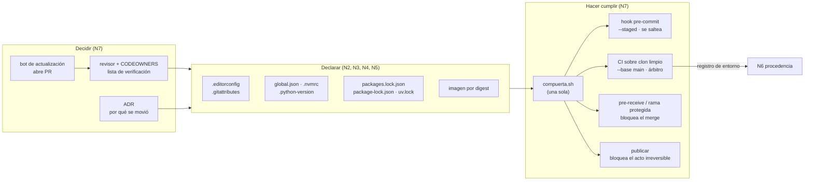

# N7 — Compuertas, gobierno y actualización controlada

El PO no pidió sólo una configuración correcta: pidió «una mecánica» que mantenga el criterio. N2, N3 y N4 dejan el entorno **declarado** en archivos del repositorio; este núcleo se ocupa de que esa declaración **se haga cumplir** todos los días y de que cambie sólo cuando alguien lo decide. No agrega mecanismos de fijación nuevos. Responde cuatro preguntas: dónde se verifica cada cosa (local, CI, revisión humana), cómo se descongela algo sin perder trazabilidad, quién decide, y qué tiene que mirar con lupa el revisor de un PR.

La investigación confirma la hipótesis de la descomposición y le agrega tres hallazgos que no estaban previstos:

1. **El hook local no es una compuerta, es una comodidad.** Git no lo activa al clonar y `--no-verify` lo saltea; la única compuerta que no depende de la voluntad del desarrollador es la que corre fuera de su máquina (E7-01).
2. **Los hooks genéricos pueden contradecir la política del repositorio.** El hook de pre-commit más usado para el BOM lo **quita** siempre, y otro agrega un salto final a un lock que NuGet vuelve a escribir sin él (E7-02). Una compuerta tiene que leer la política declarada, no traer la suya.
3. **Sin protección de rama, la CI avisa pero no impide** (E7-05). Lo que sí se puede impedir sin pagar un plan es el acto irreversible (publicar, etiquetar) o, en un servidor propio, el push mismo.

Todo lo afirmado lleva fuente oficial con fecha de consulta (2026-10-07) o un experimento ejecutado (E1) en el laboratorio. Lo que es criterio propio se marca **[criterio]**; lo que no se pudo verificar, **[no verificado]**. El caso disparador se describe de forma genérica (un sistema .NET heredado de una organización, unos cien archivos `.cs`/`.razor` en cp1252) y se reproduce con un ejemplo sintético propio.

## Índice

- [1. Definiciones](#1-definiciones)
- [2. El modelo: declarar, hacer cumplir, decidir](#2-el-modelo-declarar-hacer-cumplir-decidir)
- [3. Dónde se verifica cada cosa](#3-dónde-se-verifica-cada-cosa)
- [4. La compuerta única](#4-la-compuerta-única)
- [5. Hooks locales y frameworks de hooks](#5-hooks-locales-y-frameworks-de-hooks)
- [6. La CI como árbitro](#6-la-ci-como-árbitro)
- [7. Revisión humana: qué mirar en un cambio de entorno](#7-revisión-humana-qué-mirar-en-un-cambio-de-entorno)
- [8. Roles y quién puede cambiar la política](#8-roles-y-quién-puede-cambiar-la-política)
- [9. Descongelamiento controlado](#9-descongelamiento-controlado)
- [10. Límites: compuertas sin protección de rama](#10-límites-compuertas-sin-protección-de-rama)
- [11. Por ecosistema y en la integración](#11-por-ecosistema-y-en-la-integración)
- [12. Aplicación por escenario](#12-aplicación-por-escenario)
- [13. Tabla comparativa](#13-tabla-comparativa)
- [14. Snippets representativos](#14-snippets-representativos)
- [15. Experimentos](#15-experimentos)
- [16. Preguntas guía](#16-preguntas-guía)
- [17. Errores frecuentes](#17-errores-frecuentes)
- [18. Dependencias y tensiones con otros núcleos](#18-dependencias-y-tensiones-con-otros-núcleos)
- [19. Observaciones y límites](#19-observaciones-y-límites)
- [20. Evidencias](#20-evidencias)
- [21. Verificación adversarial](#21-verificación-adversarial)

## 1. Definiciones

Los términos *fijar*, *congelar* y *deriva* se usan con el sentido de N0; *declarar* y *hacer cumplir*, con el de N3 (BIT-15-02 §3). Este núcleo agrega los siguientes.

| Término | Definición en esta guía |
|---|---|
| **Compuerta** (*gate*) | Chequeo automático que devuelve verde o rojo sobre un estado del repositorio y que **puede bloquear** un paso del flujo (commit, merge, publicación). Si nada se bloquea cuando da rojo, no es una compuerta: es un aviso. |
| **Compuerta única** | Un solo programa versionado en el repositorio que hace cumplir lo declarado y que se invoca igual en todos los lugares (hook, CI, servidor, publicación). Sólo cambia el **alcance** (lo que está en stage, lo cambiado en el PR, todo). |
| **Hook** | Programa que git ejecuta en un punto del flujo. Del lado cliente (`pre-commit`) corre en la máquina del desarrollador y se puede saltear con `--no-verify`; del lado servidor (`pre-receive`) corre en el repositorio que recibe el push y, si sale distinto de cero, ninguna referencia se actualiza [EV-01]. |
| **Árbitro** | El lugar cuyo veredicto vale cuando local y CI no coinciden. En esta guía, la CI sobre un clon limpio [criterio]. |
| **Protección de rama** | Regla de la plataforma que impide escribir en una rama si no se cumplen condiciones: chequeos de estado requeridos, revisiones aprobadas, aprobación de los dueños del código [EV-03]. Es lo que convierte el rojo de la CI en un bloqueo. |
| **Dueño del código** (*code owner*) | Persona o equipo que la plataforma pide como revisor automáticamente cuando un PR toca ciertas rutas (archivo `CODEOWNERS`). Su aprobación es **obligatoria** sólo si la protección de rama lo exige [EV-04]. |
| **Cambio de entorno** | Cambio en cualquier archivo que fija una capa del modelo N0: política de texto, toolchain, manifiesto, lock file, fuentes de paquetes, imagen, o la propia compuerta. |
| **Cambio invisible** | Diff cuyo texto, normalizado (sin BOM, con LF, decodificado), es idéntico al anterior. Es el síntoma que el PO quiere evitar: «commits con cambios de BOM». |
| **Descongelar** | Mover deliberadamente una versión congelada (paquete, SDK, imagen) en un cambio revisable que mueve juntos todo lo que depende de ella y deja registro de por qué. |
| **Enfriamiento** (*cooldown*, *minimum release age*) | Plazo que un bot de actualización espera desde que sale una versión antes de proponerla [EV-11, EV-13]. |
| **ADR** | *Architecture Decision Record*: registro de solo agregado con contexto, opciones, decisión, estado y consecuencias de una decisión significativa [EV-15]. |
| **Acto irreversible** | Paso del flujo que no se puede deshacer sin costo: publicar un paquete, etiquetar una versión, desplegar. Es donde una compuerta todavía sirve cuando la rama no está protegida [criterio]. |

## 2. El modelo: declarar, hacer cumplir, decidir

Cada núcleo anterior separa lo que se **declara** (un archivo en el repo) de lo que se **hace cumplir** (una herramienta que falla si no coincide). N7 agrega una tercera capa: quién **decide** que la declaración cambie, y cómo queda registrado.



La lectura del diagrama es la tesis del núcleo: **la declaración no cambia por accidente** (la compuerta lo detecta) y **cuando cambia, cambia por decisión** (un PR revisado, idealmente con su ADR). Todo lo demás es implementación.

## 3. Dónde se verifica cada cosa

La pregunta «¿qué se verifica en local, qué en CI y qué sólo en revisión humana?» tiene una respuesta mecánica: se verifica en cada lugar lo que ese lugar **puede** ver y **puede** hacer cumplir.

| Qué | Local (hook) | CI (árbitro) | Servidor / publicación | Revisión humana |
|---|---|---|---|---|
| Bytes del texto: UTF-8 válido, BOM según política, LF en el índice (N2) | ● rápido, sólo lo que está en stage | ● lo cambiado en el PR y, en `main`, todo | ● si hay `pre-receive` o rama protegida | ○ los cambios invisibles los detecta mejor una herramienta (E7-03) |
| Toolchain igual a lo declarado (N3) | ○ informa: la estación puede no tener la versión | ● en la imagen de CI, exacto | ● antes de publicar | ● **por qué** se subió la versión |
| Grafo congelado: restauración estricta (N4) | ○ lento y con red; opcional | ● siempre | ● antes de publicar | ● qué paquetes cambian y desde qué fuente |
| Coherencia manifiesto ↔ lock | — | ● (la restauración estricta falla) | ● | ● ¿regenerado por la herramienta o a mano? |
| Imagen y devcontainer por digest (N5) | — | ○ la imagen de CI es la declarada | — | ● ¿sigue el digest? ¿coincide con `global.json`? |
| La compuerta misma, CODEOWNERS, workflows | — | — | — | ● sólo humano, y del rol dueño de la política |
| Decisión de descongelar | — | — | — | ● ADR / descripción del PR |

`●` lugar natural del chequeo; `○` aplica con límites; `—` no corresponde.

El criterio que ordena la tabla: **lo que una máquina puede decidir lo decide la compuerta; la revisión humana se reserva para el porqué** [criterio]. Un revisor que se pone a contar bytes de BOM es un revisor que no está mirando si la subida de SDK era necesaria.

## 4. La compuerta única

### 4.1 Por qué una sola

Si el hook ejecuta una cosa y la CI otra, los dos van a divergir, y el desarrollador va a ver verde en su máquina y rojo en el PR sin poder reproducirlo. La documentación oficial de las herramientas ya empuja en esta dirección: pre-commit indica correr la misma configuración en la CI con `pre-commit run --all-files` [EV-06], y las acciones de *setup* de GitHub leen la versión de los **mismos** archivos que el repo declara (`global-json-file`, `node-version-file`, `required-version` de uv) en lugar de repetirla en el workflow [EV-08, EV-09, EV-10]. La compuerta única lleva eso al extremo: el workflow, el hook y el servidor llaman al mismo archivo versionado [criterio].

### 4.2 Qué hace la del laboratorio

[`compuerta/compuerta.sh`](/LAB/Lab-Documentos/Guides/Metodologia-Entorno-Desarrollo/Examples/N7-compuertas-y-gobierno/compuerta/compuerta.sh) tiene tres pasos, cada uno heredado de un núcleo:

| Paso | Hace cumplir | Herramienta | Falla con (observado) |
|---|---|---|---|
| texto | `.editorconfig` + `.gitattributes` (N2) | `check_text_policy.py` del laboratorio N2, sobre el índice de git | `no es UTF-8 válido (byte 0xf1 …; ¿cp1252?)`, `tiene BOM y .editorconfig declara charset=utf-8`, `falta el BOM que .editorconfig declara` |
| toolchain | `global.json`, `.nvmrc`, `.python-version` (N3) | `dotnet --version`, `node --version`, `uv run python` | `global.json pide 10.0.400; el entorno resuelve 'ninguno'` |
| grafo | `packages.lock.json`, `package-lock.json`, `uv.lock` (N4) | `dotnet restore --locked-mode`, `npm ci`, `uv lock --check` | `NU1004`, `NU1403`, `npm error code EUSAGE`, `The lockfile at uv.lock needs to be updated` |

Dos decisiones de diseño, ambas **[criterio]**:

- **Un paso con archivo pero sin herramienta falla.** Si el repo tiene `uv.lock` y la imagen no tiene `uv`, la compuerta da rojo. Una compuerta que se saltea en silencio es la forma más común de que un control exista en el papel y no en la práctica.
- **La salida es una línea por paso**, con el commit y el alcance. Esa salida es, a la vez, el registro de entorno que N6 puede adjuntar al artefacto (E7-05, paso 3).

### 4.3 Alcances

| Invocación | Dónde | Revisa texto de… | Toolchain y grafo |
|---|---|---|---|
| `compuerta.sh --staged` | hook pre-commit | lo que está en stage | completos |
| `compuerta.sh --base origin/main` | CI de un PR | lo cambiado en el PR | completos |
| `compuerta.sh` | CI en `main`, `pre-receive`, publicación | todo lo versionado | completos |

El texto se limita por alcance porque un repositorio heredado puede tener archivos que todavía no se migraron (N2); el toolchain y el grafo no, porque son propiedades del repositorio entero.

> **Corrección mesa ciclo 1 (2026-10-09, C1-05).** (§4.2–§4.3, L129–L152) **Alcance**: la compuerta busca los archivos nativos sólo en la raíz (`[ -f .python-version ]`, `[ -f uv.lock ]`, etc., en el directorio actual; `compuerta.sh` L60 y L85). Con proyectos en subcarpetas, como la solución de N8, da `n/a` para archivos que existen (E1 del arquitecto, C1-05). Sirve para un proyecto por ecosistema en la raíz. Para otra disposición, un inventario explícito de proyectos, como en `verificar.sh` de N8. «Falta la herramienta» y «violación» se informan distinto (P-22, L13). Guía §10.2.2 (P-13).

## 5. Hooks locales y frameworks de hooks

### 5.1 Lo que git garantiza y lo que no

- El hook `pre-commit` corre antes de crear el commit y, si sale distinto de cero, lo aborta; **se saltea con `--no-verify`** [EV-01].
- Los hooks viven por defecto en `$GIT_DIR/hooks`, que **no se versiona**; `git init` (y `git clone --template`) puede copiar hooks desde una plantilla **local**, pero los hooks del repositorio remoto no viajan con el clon [EV-01; comprobado en E7-01].
- `core.hooksPath` apunta git a otro directorio, absoluto o relativo; la documentación lo presenta justamente para configurar hooks de forma centralizada [EV-02]. Es la forma de versionar los hooks en el repo (`.githooks/`), pero cada clon tiene que ejecutar **una vez** `git config core.hooksPath .githooks`.

E7-01 lo muestra en orden: tras clonar, `core.hooksPath` no está configurado y un archivo en cp1252 entra sin aviso; con el hook activado el mismo commit se rechaza (`byte 0xf1`); con `--no-verify` vuelve a entrar.

**Consecuencia**: el hook es para el desarrollador (feedback en segundos, antes de que el error llegue al PR), no para el equipo. Nunca es el único lugar donde se verifica algo [criterio].

### 5.2 Frameworks de hooks: pre-commit y similares

pre-commit (pre-commit.com) es un framework multi-lenguaje de hooks: `pre-commit install` escribe `.git/hooks/pre-commit`, `pre-commit run --all-files` es el modo para CI, `rev` debe apuntar a una referencia inmutable y `autoupdate --freeze` guarda el SHA en lugar de la etiqueta [EV-06]. La versión vigente es la 4.6.2 (PyPI, 2026-08-10) y el lenguaje para hooks locales que usan un ejecutable del sistema pasó a llamarse `unsupported` (antes `system`) [EV-06]; E7-02 lo usa con éxito.

El repositorio `pre-commit-hooks` (v6.0.0) trae hooks genéricos de texto: `fix-byte-order-marker` «removes UTF-8 byte order marker», `check-byte-order-marker` está deprecado a favor del anterior, `mixed-line-ending --fix={auto,crlf,lf,no}` y `end-of-file-fixer` [EV-07].

**El hallazgo de E7-02.** Copiar esos hooks «de manual» en un repo .NET con la política del N2 produce dos conflictos reales:

1. `fix-byte-order-marker` quitó el BOM de `Pages/Index.razor`, que la política declara `charset = utf-8-bom` (porque las plantillas del SDK lo crean así, ver N2). La compuerta del repo lo reclamó: `falta el BOM que .editorconfig declara`.
2. `end-of-file-fixer` agregó un salto de línea final a `packages.lock.json`. NuGet lo escribe **sin** salto final; un `dotnet restore` sin cambios de dependencias no lo toca, pero el siguiente que regenera el lock (`--force-evaluate`, como al descongelar) lo vuelve a quitar. Es una ida y vuelta permanente de diffs sin contenido.

Alineando los `exclude` del framework con lo que dice `.editorconfig` (los tipos con BOM fuera de `fix-byte-order-marker`, los `.cmd/.bat` fuera de `mixed-line-ending`, los lock files fuera de `end-of-file-fixer`) todo pasa, y un `.razor` nuevo sin BOM lo ataja la compuerta del repo, no el hook genérico.

**Criterio que se desprende**: un framework de hooks es un buen **orquestador** (instala, fija versiones, corre en paralelo) pero sus hooks de texto traen una política propia y fija. La política de texto la hace cumplir un chequeo que **lee** `.editorconfig` [criterio, apoyado en E7-02]. Si se usa pre-commit, se lo usa para invocar la compuerta (`repo: local`) y los hooks genéricos se recortan a lo que no contradice la política.

## 6. La CI como árbitro

### 6.1 Qué hace que la CI sea árbitro

Tres condiciones, todas observables:

- **Clon limpio**: sin hooks, sin configuración local de git, sin cachés del desarrollador. E7-01 paso 4: el clon de la CI no tiene `core.hooksPath` y la compuerta da el mismo diagnóstico que el hook.
- **Misma imagen o mismos archivos de versión**: la CI corre en la imagen declarada (por digest, N5) o instala el toolchain leyendo los archivos del repo (`global-json-file`, `node-version-file`, `required-version`) [EV-08, EV-09, EV-10].
- **Restauración estricta**: `dotnet restore --locked-mode` (NuGet lo recomienda «for CI/CD … where you would not want to change the package dependencies on the fly») [EV-05], `npm ci` (exige el lock, falla si no coincide y nunca lo escribe) [EV-16], `uv lock --check` o `--locked` [EV-17].

### 6.2 Las acciones de la CI también se fijan

Una compuerta que usa `actions/checkout@v7` depende de algo que puede cambiar sin que el repo cambie. GitHub indica que fijar una acción a un SHA completo es la única forma de usarla como versión inmutable [EV-12]. El costo, según la misma página, es que Dependabot no genera **alertas** de vulnerabilidad para acciones fijadas por SHA, aunque sí puede actualizarlas si la referencia es un SHA (y actualiza el comentario con la etiqueta si está en la misma línea) [EV-12]. La misma página documenta políticas de repositorio y de organización para **exigir** que las acciones estén fijadas por SHA completo [EV-12]. El ejemplo del laboratorio (`ci-compuerta.yml`) usa SHA + comentario con la etiqueta; los SHA se resolvieron con `git ls-remote` el 2026-10-07 (por ejemplo `actions/checkout` v7.0.1 → `3d3c42e5…`).

Lo mismo vale para la compuerta de pre-commit (`rev` con SHA, `--freeze`) y para la imagen de la CI (digest, N5): **todo lo que ejecuta la compuerta es parte del entorno y se congela con el mismo criterio** [criterio].

## 7. Revisión humana: qué mirar en un cambio de entorno

### 7.1 Lista de verificación del revisor

Lo que sigue es lo que el revisor (ACT-REV) debe mirar con lupa. Cada ítem dice **qué** y **por qué**; el porqué viene de los otros núcleos.

| Archivo tocado | Qué preguntar | Por qué (núcleo) |
|---|---|---|
| `.editorconfig`, `.gitattributes` | ¿Cambia la política para todo el repo? ¿Viene el commit de renormalización **aparte**, sin cambios funcionales, y registrado en `.git-blame-ignore-revs`? | N2: la política sin migración deja archivos en falta; la migración mezclada con cambios funcionales ensucia `blame`. |
| `global.json`, `.nvmrc`, `.python-version` | ¿Se subió a propósito? ¿Se movió la imagen de CI/devcontainer **en el mismo PR**? ¿Se regeneraron los lock? ¿Hay ADR? | N3: con lock files de NuGet, otro SDK cambia el grafo implícito (E1-06 del N3); E7-04: global.json sin imagen = CI roja. |
| `packages.lock.json`, `package-lock.json`, `uv.lock` | ¿Lo regeneró la herramienta? ¿Viene con su manifiesto? ¿Cambian sólo los paquetes esperados? ¿Aparecen fuentes o hashes nuevos? | N4: un lock editado a mano lo detecta la restauración estricta (`NU1403` en E7-03); un lock que cambia sin manifiesto suele ser otro SDK u otra versión del gestor. |
| `*.csproj`, `Directory.Packages.props`, `package.json`, `pyproject.toml` | ¿Qué dependencia cambió y por qué? ¿Hay rangos flotantes nuevos? | N4. |
| `nuget.config`, `.npmrc`, `uv.toml` | ¿Aparece un registro nuevo o desaparece el mapeo de fuentes? | N4 (cadena de suministro). |
| `Dockerfile`, `devcontainer.json`, `devcontainer-lock.json` | ¿Sigue fijado por digest? ¿El SDK de la imagen coincide con `global.json`? | N5. |
| `CODEOWNERS`, workflows, `.githooks/`, `.pre-commit-config.yaml`, `compuerta.sh`, configuración de bots | ¿Cambia la compuerta o quién revisa? ¿Lo aprueba el rol dueño de la política, no sólo el autor? | N7: quien puede cambiar la compuerta puede apagarla. |
| Cualquier archivo con diff «de una línea entera» | ¿Es un cambio invisible (BOM, EOL, codificación)? | N1/N2: el síntoma del caso disparador. |

### 7.2 Los cambios invisibles necesitan una herramienta

E7-03, PR A: un IDE guardó `Program.cs` con BOM. El diff que ve el revisor en la web muestra la línea entera cambiada, con el texto idéntico (el BOM no se ve). La herramienta del laboratorio ([`cambios-de-entorno.py`](/LAB/Lab-Documentos/Guides/Metodologia-Entorno-Desarrollo/Examples/N7-compuertas-y-gobierno/03-revisor-cambios-de-entorno/cambios-de-entorno.py)) normaliza BOM, CRLF y codificación y reporta `Program.cs: mismo texto; cambia sólo ['BOM']`. La compuerta, además, lo rechaza porque la política dice `.cs` sin BOM. **El revisor no tiene que encontrarlo a ojo; tiene que decidir si es la normalización acordada** [criterio].

### 7.3 CODEOWNERS: pedir la revisión correcta

`CODEOWNERS` (en `.github/`, raíz o `docs/`) asigna revisores por patrón de ruta; gana el último patrón que coincide; los dueños se piden automáticamente cuando un PR toca sus archivos [EV-04]. El laboratorio trae un [`CODEOWNERS`](/LAB/Lab-Documentos/Guides/Metodologia-Entorno-Desarrollo/Examples/N7-compuertas-y-gobierno/03-revisor-cambios-de-entorno/CODEOWNERS) que asigna los archivos de entorno a arquitectura y plataforma. Dos límites documentados: la aprobación del dueño es **obligatoria** sólo si la protección de rama exige «require review from code owners» [EV-03, EV-04]; y en GitLab la aprobación de dueños requiere el nivel Premium o Ultimate [EV-19].

## 8. Roles y quién puede cambiar la política

El marco de referencia (BIT-15-03 §3) define cuatro actores. N7 les asigna responsabilidades sobre la mecánica:

| Actor | Decide | Puede cambiar | Aprueba cambios en |
|---|---|---|---|
| ACT-ARQ (líder técnico / arquitecto) | La política de texto, las versiones de toolchain, la estrategia de dependencias; cuándo se descongela una versión mayor | `.editorconfig`, `.gitattributes`, `global.json`, `Directory.Packages.props`; escribe los ADR | Todo PR que toque esos archivos |
| ACT-OPS (DevOps / plataforma) | La imagen de CI y del devcontainer, la compuerta, la configuración de los bots, la protección de rama | `compuerta.sh`, workflows, `Dockerfile`, `devcontainer.json`, `dependabot.yml`/`renovate.json`, `CODEOWNERS` | PR que toquen la compuerta o la imagen |
| ACT-REV (revisor de PR) | Aprobar o rechazar el PR concreto | — (aplica la política, no la define) | — |
| ACT-DEV (desarrollador) | Activar el hook en su clon; regenerar el lock al agregar una dependencia | Manifiestos y lock **juntos**, en su PR | — |

**[criterio]** Dos reglas de gobierno que se desprenden de la evidencia:

- **Quien puede cambiar la compuerta no debería poder aprobarse a sí mismo ese cambio.** Es la única forma de que la compuerta no se apague «por un rato». Con protección de rama, eso se implementa con CODEOWNERS sobre la compuerta y revisión obligatoria; sin ella, es una regla escrita y se audita (ver §10).
- **Las excepciones también son cambios.** GitHub permite que los administradores salteen la protección de rama salvo que se configure lo contrario [EV-03]; Azure DevOps tiene permisos explícitos de *bypass* y advierte usarlos con cuidado [EV-20]. La política tiene que decir quién tiene ese permiso y cómo queda registrado su uso.

## 9. Descongelamiento controlado

### 9.1 La regla

**Todo lo que depende de la versión que se mueve, se mueve en el mismo PR** [criterio, apoyado en E7-04 y en la nota de NuGet sobre `rollForward: disable` con lock files, EV-05]. Concretamente:

| Se descongela | Se mueve junto | Registro |
|---|---|---|
| Un paquete (parche/menor) | manifiesto + lock regenerado por la herramienta | mensaje del PR (o el PR del bot) |
| Un paquete mayor o una fuente nueva | manifiesto + lock + `nuget.config` si cambia la fuente | ADR corto |
| El SDK / runtime / intérprete | `global.json` (o `.nvmrc`, `.python-version`) + imagen de CI y devcontainer + lock files regenerados con la versión nueva | ADR |
| La imagen base | digest en `Dockerfile`/`devcontainer.json` | PR del bot o ADR si cambia de distribución |
| La política de texto | `.editorconfig`/`.gitattributes` + commit de renormalización aparte + `.git-blame-ignore-revs` | ADR |

### 9.2 Lo que mostró E7-04

- **Paquete.** Cambiar `Newtonsoft.Json` 13.0.3 → 13.0.4 en el `.csproj` sin regenerar el lock: el hook falla con `NU1004: The package reference Newtonsoft.Json version has changed from [13.0.3, ) to [13.0.4, )…` y sugiere `--force-evaluate`. Tras `dotnet restore` (que, con un cambio detectado, reevalúa y reescribe el lock, EV-05), el commit lleva `App.csproj` + `packages.lock.json` y la compuerta da verde. El asistente del revisor lo marca coherente.
- **SDK.** Con `global.json` en 10.0.400 y `rollForward: disable`, la compuerta en la imagen vieja (SDK 8.0.425) da rojo dos veces (toolchain y restauración); en la imagen nueva da verde. El commit final lleva `global.json`, la receta de la imagen (`ci/Dockerfile` con la base nueva por digest) y `docs/adr/0002-sdk-10.md`, con el hook corriendo en la imagen nueva.

### 9.3 Bots de actualización: descongelar sin olvidarse

Un congelamiento sin actualización se convierte en deuda: las versiones envejecen hasta quedar sin soporte. Hoy esto es concreto: .NET 8 (LTS) y .NET 9 (STS) terminan su soporte el **10 de noviembre de 2026**, .NET 10 (LTS) sigue hasta el 14 de noviembre de 2028; las actualizaciones salen el «Patch Tuesday» de cada mes y, para mantener soporte, hay que estar en el último parche [EV-21]. Node publica mayores cada seis meses y anuncia que desde Node 27 el ciclo pasa a ser anual, con producción sólo en LTS [EV-22]; Python publica una versión de características por año, en octubre, con cinco años de soporte [EV-23]. La cadencia de descongelamiento se deriva de esas fechas, no de la comodidad [criterio].

Las dos herramientas más extendidas automatizan la **propuesta**, no la decisión:

- **Dependabot** soporta los ecosistemas que esta guía usa, con valores `dotnet-sdk` (para `global.json`), `nuget`, `npm`, `uv`, `pip`, `docker`, `devcontainers` (actualiza las *features* y su lock), `github-actions` y `pre-commit` (actualiza `rev`, y respeta el comentario `# frozen:`) [EV-11, EV-14]. Ofrece `groups` para juntar actualizaciones en menos PR y `cooldown` para esperar días antes de proponer una versión, con soporte para Dotnet SDK, NuGet, npm, pip y uv, entre otros; aun sin configurarlo, aplica por defecto un enfriamiento de **3 días** a las actualizaciones de versión (no a las de seguridad), y por defecto no abre más de cinco PR de versión a la vez [EV-11]. Dos límites de soporte que la guía tiene que mirar: la tabla de ecosistemas declara NuGet «<=6.12.0» y uv «v0.11» [EV-14], mientras que el laboratorio usa SDK 10.0.400 y uv 0.12.23; **[no verificado]** cómo se comporta Dependabot con versiones más nuevas que las declaradas. Microsoft sugiere expresamente una herramienta como Dependabot para mantener actualizado el SDK fijado en `global.json`, y `CheckSdkVulnerabilities=true` para que la build avise si el SDK resuelto tiene vulnerabilidades conocidas, está fuera de soporte o en una banda sin versiones nuevas [EV-18].
- **Renovate** ofrece `minimumReleaseAge` (espera por cada versión), `lockFileMaintenance` (regenera lock files periódicamente), `pinDigests` (fija imágenes y acciones por SHA256) y un panel de dependencias [EV-13].

E7-06 valida que las configuraciones del laboratorio (`dependabot.yml`, `renovate.json`) son correctas según sus esquemas publicados (el de Renovate es del proyecto; el de Dependabot es el comunitario de SchemaStore, no uno de GitHub), con un control negativo que demuestra que el validador sí rechaza un ecosistema inexistente. **No** demuestra el comportamiento del bot, que sólo corre en la plataforma.

**[criterio]** Lo que se gana con un bot no es la actualización en sí, sino que **cada descongelamiento llega como PR**: pasa por la misma compuerta, por el mismo revisor y deja la misma traza que un cambio humano. El enfriamiento (`cooldown`, `minimumReleaseAge`) es un control de cadena de suministro: deja que otros descubran una versión rota o maliciosa antes de adoptarla.

### 9.4 El ADR de entorno

Microsoft describe el ADR como un registro de solo agregado: no se editan los aceptados; si la decisión cambia, se escribe uno nuevo que reemplaza al anterior y se los vincula. Cada registro tiene contexto, opciones, decisión con sus compromisos, nivel de confianza y estado (propuesto, aceptado, reemplazado) [EV-15]. El laboratorio trae una [plantilla de ADR de entorno](/LAB/Lab-Documentos/Guides/Metodologia-Entorno-Desarrollo/Examples/N7-compuertas-y-gobierno/04-descongelamiento-controlado/ADR-plantilla-entorno.md) con una sección adicional, **superficie del cambio**, que lista los archivos que se mueven juntos.

**[criterio]** Cuándo hace falta ADR y cuándo alcanza con el PR:

| Cambio | ADR |
|---|---|
| Parche de paquete o de imagen propuesto por un bot | No: el PR del bot es el registro. |
| Nueva versión mayor de un paquete, nueva fuente de paquetes | Sí, corto. |
| Subir o bajar SDK, runtime, intérprete; cambiar `rollForward` | Sí. |
| Cambiar la política de texto, la compuerta o quién revisa | Sí. |
| Excepción temporal (saltear la compuerta, excluir un archivo) | Sí, con fecha de vencimiento. |

## 10. Límites: compuertas sin protección de rama

### 10.1 El hecho

En GitHub, las ramas protegidas, los dueños de código y los revisores requeridos aparecen, para repositorios **privados**, en los planes Pro (cuentas personales) y Team (organizaciones); el plan Free da repositorios privados ilimitados «con un conjunto limitado de funciones» que no incluye esas tres [EV-02b]. La página de ramas protegidas lo precisa: están disponibles en repositorios **públicos** con GitHub Free y en públicos y privados con Pro, Team, Enterprise Cloud y Enterprise Server; y las describe como la forma de exigir chequeos de estado y revisiones antes de escribir en la rama [EV-03]. Los *rulesets* tienen la misma frontera: repositorios públicos con Free, públicos y privados con Pro, Team y Enterprise Cloud [EV-28]; no son una salida para un repositorio privado en el plan Free. En GitLab, las ramas protegidas están en el nivel Free, pero la aprobación obligatoria de dueños de código es Premium/Ultimate [EV-19]. En Azure DevOps, la validación de build como política **obligatoria** de rama evalúa el resultado de la build para decidir si el PR se puede completar, con permisos de *bypass* explícitos (para quien los tiene, el estado de la política es sólo informativo) [EV-20].

> **Corrección mesa ciclo 1 (2026-10-09, C1-19).** Para una organización privada el mínimo es Team (Pro es de cuentas personales). Lo que la rama protegida no impide: PR que edita la compuerta, job `skipped`, administradores por defecto. GitLab Free: «Pipelines must succeed».

### 10.2 Lo que pasa sin protección (E7-05)

Con un remoto que no tiene control del lado servidor, un commit con un archivo en cp1252, hecho con `--no-verify`, se empuja directo a `main` y se acepta. La CI corre **después** y da rojo, pero `main` ya quedó roto. Es lo que significa «la CI avisa pero no impide».

### 10.3 Dónde todavía se puede impedir

| Control | Cómo | Qué impide | Evidencia |
|---|---|---|---|
| Rama protegida con chequeo requerido | Configuración de la plataforma (si el plan la ofrece) | El merge o el push a la rama | EV-03, EV-20 |
| `pre-receive` en un servidor propio | Hook del servidor que corre la compuerta (o, en GitHub Enterprise Server, sólo sus pasos rápidos y sin red) sobre el commit empujado | El push completo («none of the refs will be updated») | EV-01, EV-24; E7-05 paso 4; V7-01 |
| Compuerta en el acto irreversible | El script de publicación verifica que el commit esté en `main`, corre la compuerta sobre **ese** commit en un clon limpio y se niega a reescribir una versión publicada | Publicar o etiquetar desde un estado que no cumple | E7-05 pasos 2 y 3 |
| Proceso y auditoría | Regla escrita + revisión periódica de que `main` esté en verde | Nada en el momento; detecta | criterio |

En E7-05: el script de publicación se negó a publicar sobre `main` en rojo, publicó `v1.0.0` tras la corrección (dejando la salida de la compuerta como registro de entorno) y se negó a reescribir `v1.0.0`. Con el `pre-receive` instalado, el mismo push roto se rechazó (`pre-receive hook declined`) y `main` quedó intacto; un push que cumple se aceptó (control positivo). En GitHub, los `pre-receive` propios están documentados para GitHub Enterprise Server, y ahí el límite es concreto: todos los `pre-receive` de un repositorio comparten un presupuesto acumulado de **5 segundos**, y la documentación desaconseja llamar servicios externos desde ellos [EV-24]. La compuerta del laboratorio restaura paquetes desde nuget.org: en el repositorio de juguete tardó entre 1,5 y 2,3 s (V7-01), pero en un repositorio real con decenas de proyectos y paquetes ese margen no está garantizado. **[criterio]** En GitHub Enterprise Server, el `pre-receive` corre sólo el paso de texto (rápido y sin red); toolchain y grafo quedan en la CI con chequeo requerido. En un servidor git propio sin ese presupuesto, la compuerta completa es viable, pero conviene medirla con el repositorio real.

Un efecto lateral que hay que declarar: Renovate advierte que, con su `platformAutomerge` por defecto, la plataforma puede fusionar PR del bot aunque las pruebas no hayan empezado o hayan fallado si no está activo «Require status checks before merging» [EV-13]. Sin protección de rama, **no se habilita la fusión automática de ningún bot** [criterio, apoyado en EV-13].

**[criterio]** Cuando la plataforma no permite bloquear, la recomendación honesta es: no reescribir la documentación para que diga que «la CI bloquea» (eso esconde el riesgo), declarar el límite y compensarlo en el acto irreversible. El costo de un `main` rojo durante unas horas es bajo; el de una versión publicada desde un estado no verificado, no.

## 11. Por ecosistema y en la integración

| Ecosistema | Recomendado por el fabricante | Convención extendida | Criterio propio |
|---|---|---|---|
| .NET | `dotnet restore --locked-mode` en CI [EV-05]; `rollForward: disable` cuando se usan lock files para controlar cuándo cambian los paquetes implícitos [EV-05]; mantener el SDK al día con `dotnet sdk check` o Dependabot y `CheckSdkVulnerabilities` [EV-18]; `actions/setup-dotnet` con `global-json-file` [EV-08] | Dependabot `nuget` + `dotnet-sdk`; ADR para subir de banda | Compuerta que compara `dotnet --version` con `global.json` exacto (E7-01) |
| Node.js | `npm ci` en CI [EV-16]; `setup-node` admite `node-version-file` (`.nvmrc`, `.node-version`, `.tool-versions`, `mise.toml`, `package.json`) y su ejemplo básico corre `npm ci` [EV-09] | Dependabot/Renovate `npm` con enfriamiento; husky/lint-staged como hooks **[no verificado en este núcleo]** | La misma compuerta lee `.nvmrc` y corre `npm ci --ignore-scripts` (E7-07) |
| Python | `uv lock --check` o `--locked` en CI [EV-17]; `setup-uv` lee `required-version` [EV-10] | pre-commit (nacido en el ecosistema Python) [EV-06]; Dependabot `uv` [EV-14] | La misma compuerta lee `.python-version` y corre `uv lock --check` (E7-07) |
| Transversal | Pinning de acciones por SHA [EV-12]; ramas protegidas / políticas de rama [EV-03, EV-20]; ADR [EV-15] | `CODEOWNERS` sobre archivos de entorno [EV-04]; pre-commit como orquestador | Compuerta única; compuerta en el acto irreversible; ADR obligatorio para toolchain y política |

**Al integrarlos en una única solución** (el detalle es de N8), N7 aporta tres reglas que valen igual con uno o tres lenguajes [criterio]:

1. **Una compuerta, varios pasos**: la misma `compuerta.sh` sirvió sin cambios para un repo .NET (E7-01), uno Node y uno Python (E7-07). En un repo políglota los tres pasos aplican a la vez; lo que cambia es la imagen, que tiene que traer las tres herramientas (decisión de N5/N8).
2. **Un paso con archivo y sin herramienta falla**: en un repo políglota es fácil que la imagen de CI sea la de .NET y el `uv.lock` quede sin verificar en silencio.
3. **Un bot, un ecosistema por entrada, un PR por grupo**: Dependabot o Renovate con una entrada por ecosistema y directorio; un PR que mezcla un parche de NuGet con un mayor de npm es difícil de revisar y de revertir.

## 12. Aplicación por escenario

| Escenario | Qué hace cumplir N7 | Qué cambia |
|---|---|---|
| ESC-01 Windows + Visual Studio | El hook (si el desarrollador lo activa) y, sobre todo, la CI | Visual Studio no corre hooks de forma distinta a git (el hook es de git); **[no verificado]** el comportamiento de la integración de git de Visual Studio con `core.hooksPath` y con scripts `bash`: en Windows el hook necesita un intérprete (Git for Windows trae uno). Es el escenario donde el problema del caso no se ve: la CI en Linux es la que lo revela. |
| ESC-02 Linux nativo | Hook + CI | Ninguno especial. |
| ESC-03 WSL | Hook + CI | Que el clon tenga `core.hooksPath` en la configuración de **ese** git (WSL y Windows tienen configuraciones separadas). |
| ESC-04 Devcontainer | Hook dentro del contenedor + CI | Si el devcontainer usa la misma imagen que la CI, el hook da exactamente el veredicto de la CI. `postCreateCommand` puede ejecutar `git config core.hooksPath .githooks` **[criterio]**. |
| ESC-05 CI | Árbitro: compuerta completa sobre clon limpio; registro de entorno para N6 | Sin protección de rama, sólo avisa: compensar en la publicación. |

> **Corrección mesa ciclo 2 (2026-10-09, C2-05…C2-09, C2-25).** (a) `--staged` acota sólo el paso de texto: toolchain y grafo miran el disco, y un lock sin marcar pasa el hook y la CI lo rechaza (`Mesa/Ciclo-2/evidencia-lector-sin-contexto/salida-hook-lock-sin-stage.txt`); (b) `compuerta.sh` busca `.python-version` y los locks con `git ls-files`, nombra el paquete EditorConfig si falta y compara `requested` con `resolved`; E7-01, E7-03 y E7-07 sin cambios de veredicto (`Mesa/Ciclo-2/evidencia-auditor/x3-regresion-n7/`); (c) creados desde Windows, hook y compuerta necesitan `git update-index --chmod=+x`; (d) el `.pre-commit-config.yaml` lleva `minimum_pre_commit_version: "4.4.0"`. C2-05 se resolvió por síntesis (`Mesa/Ciclo-2/03-Parches.md` §1.1). Guía §10.2.2, §10.4, §10.5, A.11 (Ciclo-2, P-12, P-15).

## 13. Tabla comparativa

| Mecanismo | Corre en | Se puede saltear | Detecta | Bloquea | Costo de adopción |
|---|---|---|---|---|---|
| Hook `pre-commit` en `.git/hooks` | Máquina del dev | Sí (`--no-verify`, o no instalarlo) | Antes del commit | El commit local | Bajo; no viaja con el clon |
| Hook versionado + `core.hooksPath` | Máquina del dev | Sí | Antes del commit | El commit local | Bajo; un comando por clon |
| Framework pre-commit | Máquina del dev / CI | En local sí; en CI no | Antes del commit / en el PR | Commit local; en CI, como chequeo | Medio; trae política propia en sus hooks (E7-02) |
| CI sin protección de rama | Servidor de CI | No se saltea, pero se ignora | Después del push | Nada | Medio |
| CI + rama protegida (chequeo requerido) | Servidor + plataforma | Sólo con permiso de *bypass* | Antes del merge | El merge | Depende del plan [EV-02b, EV-19] |
| `pre-receive` propio | Servidor git | No (sin acceso al servidor) | En el push | El push | Alto; sólo en servidor propio; en GitHub Enterprise Server, 5 s acumulados y sin servicios externos [EV-24] |
| Compuerta en la publicación | Pipeline de release | No, si es el único camino de publicación | Antes de publicar | La publicación | Bajo |
| Revisión humana + CODEOWNERS | Persona | Sí, si no es obligatoria | En el PR | El merge, si es obligatoria | Bajo; obligatoria según plan |
| Bot de actualización | Plataforma | — | Versiones nuevas | — (propone) | Bajo |

## 14. Snippets representativos

**Hook versionado que sólo delega** (`.githooks/pre-commit`):

```sh
#!/bin/sh
# El hook no tiene lógica propia: si la tuviera, local y CI dirían cosas distintas.
exec "$(git rev-parse --show-toplevel)/tools/compuerta.sh" --staged
```

```sh
# Una vez por clon (en ESC-04 puede ir en postCreateCommand del devcontainer):
git config core.hooksPath .githooks
```

**Paso de grafo de la compuerta** (extracto de `compuerta.sh`):

```bash
# Restauración ESTRICTA: nunca regenera; si lo declarado y el lock no coinciden, falla.
for lock in $(git ls-files '*packages.lock.json'); do
  dotnet restore "$(dirname "$lock")" --locked-mode || mal "grafo NuGet: $lock"
done
[ -f package-lock.json ] && { npm ci --ignore-scripts --no-audit --no-fund || mal "grafo npm"; }
[ -f uv.lock ]           && { uv lock --check || mal "grafo uv"; }
# Un archivo presente sin su herramienta también es rojo (no se saltea en silencio).
```

**pre-commit alineado con `.editorconfig`** (`.pre-commit-config.yaml`):

```yaml
minimum_pre_commit_version: "4.4.0"
repos:
  - repo: https://github.com/pre-commit/pre-commit-hooks
    rev: 3e8a8703264a2f4a69428a0aa4dcb512790b2c8c  # frozen: v6.0.0
    hooks:
      - id: fix-byte-order-marker
        exclude: '\.(razor|cshtml|sln)$'   # .editorconfig: charset = utf-8-bom
      - id: end-of-file-fixer
        exclude: 'packages\.lock\.json$'   # NuGet lo regenera sin salto final
  - repo: local
    hooks:
      - id: compuerta-entorno
        name: compuerta del entorno
        entry: tools/compuerta.sh --staged
        language: unsupported            # antes "system"
        pass_filenames: false
        always_run: true
```

**CI con la misma compuerta y acciones por SHA** (extracto de `ci-compuerta.yml`):

```yaml
jobs:
  compuerta:
    runs-on: ubuntu-24.04
    container: ghcr.io/org/imagen-ci@sha256:<digest>      # misma receta que el devcontainer (N5)
    steps:
      - uses: actions/checkout@3d3c42e5aac5ba805825da76410c181273ba90b1 # v7.0.1
        with: { fetch-depth: 0 }                           # --base necesita la historia
      - run: tools/compuerta.sh --base "origin/${{ github.base_ref }}"
        if: github.event_name == 'pull_request'
      - run: tools/compuerta.sh
        if: github.event_name == 'push'
```

**Compuerta en el acto irreversible** (extracto de `publicar.sh`):

```bash
git merge-base --is-ancestor "$commit" origin/main || exit 1        # sólo desde main
git rev-parse -q --verify "refs/tags/v$version" && exit 1           # no reescribir lo publicado
git checkout -q "$commit" && tools/compuerta.sh > compuerta.txt || exit 1
git tag -a "v$version" -m "v$version" && git push origin "v$version"
# compuerta.txt viaja con el artefacto como registro de entorno (N6)
```

**Descongelamiento automático pero revisable** (extracto de `dependabot.yml`):

```yaml
version: 2
updates:
  - package-ecosystem: "dotnet-sdk"     # sdk.version de global.json
    directory: "/"
    schedule: { interval: "monthly" }   # los parches salen el Patch Tuesday
  - package-ecosystem: "nuget"
    directory: "/"
    schedule: { interval: "weekly" }
    cooldown: { default-days: 7 }       # no adoptar versiones de menos de 7 días
    groups:
      parches-nuget: { update-types: ["patch"] }
  - package-ecosystem: "docker"         # FROM …@sha256 de la imagen de CI
    directory: "/ci"
    schedule: { interval: "weekly" }
```

**CODEOWNERS para los archivos de entorno**:

```text
*                         @org/desarrollo
/.editorconfig            @org/arquitectura
/.gitattributes           @org/arquitectura
/global.json              @org/arquitectura @org/plataforma
**/packages.lock.json     @org/arquitectura
/.github/                 @org/plataforma
/tools/compuerta.sh       @org/plataforma
```

## 15. Experimentos

Todos en `LAB/Lab-Documentos/Guides/Metodologia-Entorno-Desarrollo/Examples/N7-compuertas-y-gobierno/`, ejecutados el 2026-10-07 con `bash correr-todo.sh`. Salida completa en `salidas/`.

| ID | Ruta | Comando | Resultado |
|---|---|---|---|
| E7-01 | `01-misma-compuerta-local-y-ci/` | `docker run … lab-n2-texto:local bash 01-…/run.sh` | Tras clonar, `core.hooksPath` sin configurar: commit cp1252 aceptado. Hook activo: `POLITICA-TEXTO: Senal.cs: no es UTF-8 válido (byte 0xf1 …)`, rc 1. `--no-verify` y push: rc 0. CI sobre clon limpio: misma línea, `resultado=ROJO`. Tras convertir a UTF-8: VERDE en hook y CI. |
| E7-02 | `02-pre-commit-y-politica/` | ídem, `bash 02-…/run.sh` (pre-commit 4.6.2, pre-commit-hooks v6.0.0) | `fix-byte-order-marker`: `Pages/Index.razor: removed byte-order marker`; compuerta: `falta el BOM que .editorconfig declara`. `end-of-file-fixer`: `Fixing packages.lock.json`; HEAD sin salto final → hook lo agrega → `restore --force-evaluate` lo quita. Configuración alineada: todo `Passed`; `.razor` nuevo sin BOM: falla sólo la compuerta. `language: unsupported` funciona en 4.6.2. |
| E7-03 | `03-revisor-cambios-de-entorno/` | ídem, `bash 03-…/run.sh` | PR A: secciones `politica-texto`, `lock`, `manifiesto`; `Program.cs: mismo texto; cambia sólo ['BOM']`; compuerta: `tiene BOM y .editorconfig declara charset=utf-8`. PR B (lock a mano): `packages.lock.json cambió sin su manifiesto`; compuerta: `error NU1403: Package content hash validation failed for Newtonsoft.Json.13.0.4`. PR C (SDK sin imagen): `A compatible .NET SDK was not found. Requested SDK version: 8.0.426`. |
| E7-04 | `04-descongelamiento-controlado/` | `bash 04-…/correr.sh` (host; imágenes SDK 8 y SDK 10) | A1: `error NU1004: The package reference Newtonsoft.Json version has changed from [13.0.3, ) to [13.0.4, )` → ROJO. A2: VERDE; commit `App.csproj` + `packages.lock.json`. B1 (imagen SDK 8.0.425, `global.json` 10.0.400): ROJO en toolchain y grafo. B2 (imagen SDK 10.0.400): VERDE. B3: commit `ci/Dockerfile` + `docs/adr/0002-sdk-10.md` + `global.json`, hook VERDE. |
| E7-05 | `05-sin-proteccion-de-rama/` | `docker run … lab-n2-texto:local bash 05-…/run.sh` | Sin control servidor: push roto rc 0; CI posterior ROJO; `main` queda roto. `publicar.sh` sobre main rojo: `NO se publica`. Tras corregir: `v1.0.0 etiquetada` con registro de entorno; segundo intento: `v1.0.0 ya existe -> NO se publica`. Con `pre-receive`: `! [remote rejected] main -> main (pre-receive hook declined)`, main intacto; push que cumple: `compuerta VERDE … push aceptado`. |
| E7-06 | `06-actualizacion-automatica/` | `docker run … python:3.12-slim bash 06-…/run.sh` | `dependabot.yml` y `renovate.json`: `VÁLIDO` contra los esquemas de SchemaStore (comunitario) y de Renovate; control negativo: 2 errores detectados. |
| V7-01 | `05-sin-proteccion-de-rama/medir-tiempo.sh` | `docker run … lab-n2-texto:local bash 05-…/medir-tiempo.sh` (agregado en la verificación adversarial) | Compuerta completa: 1,89 / 1,52 / 1,58 s con caché NuGet tibia; 2,31 s con caché vacía (baja de nuget.org). Repo de juguete con un paquete. |
| E7-07 | `07-misma-compuerta-otros-ecosistemas/` | `docker run … lab-n7-node:local bash 07-…/run.sh node` y `… lab-n7-python:local … python` | Node 24.21.0: VERDE; dependencia cambiada sin lock: `npm error code EUSAGE … can only install packages when your package.json and package-lock.json … are in sync` → ROJO. Python 3.12.14 + uv 0.12.23: VERDE; `error: The lockfile at uv.lock needs to be updated, but --check was provided` → ROJO. |

## 16. Preguntas guía

**¿Qué se verifica en local, qué en CI y qué sólo en revisión humana?** En local, lo rápido y lo que el desarrollador puede corregir antes del commit (texto, versión de toolchain). En la CI, todo, sobre un clon limpio, incluida la restauración estricta: es el árbitro. En revisión humana, el **porqué** de los cambios que mueven la declaración (subir SDK, cambiar política, tocar la compuerta) y los que una herramienta marca pero no puede juzgar (un cambio invisible que puede ser la normalización acordada). *Aplica* cada vez que alguien propone «agregar un chequeo»: primero se decide si lo puede decidir una máquina; si puede, va a la compuerta, no a la lista del revisor.

**¿Alcanza con un hook pre-commit?** No. El hook no viaja con el clon, se activa a mano y se saltea con `--no-verify` (E7-01). Sirve para que el error aparezca a los diez segundos y no a los diez minutos en el PR. *Aplica* como comodidad del desarrollador en cualquier escenario, nunca como única defensa.

**¿Uso pre-commit (el framework) o un script propio?** Depende de qué se quiera de él. Como orquestador (instala versiones fijas de linters, corre en paralelo, se actualiza con `autoupdate --freeze`) es útil y es una convención extendida. Como guardián de la política de texto, sus hooks genéricos traen una política propia que puede contradecir la del repo (E7-02). *Aplica*: si se adopta, la política de texto la sigue haciendo cumplir un chequeo que lee `.editorconfig`, y los hooks genéricos se recortan con `exclude` alineados a esa política.

**¿Cómo se descongela algo deliberadamente sin perder trazabilidad?** Con un PR que mueve juntos todo lo que depende de la versión (manifiesto y lock; `global.json`, imagen y lock), que pasa por la compuerta en la imagen **nueva** y que deja registro: el PR del bot para un parche, un ADR para un SDK o una política (E7-04). *Aplica* también a lo que mueve un bot: el bot propone, la compuerta verifica, el revisor decide.

**¿Con qué frecuencia se descongela?** Con la de las fuentes, no con la del equipo. .NET publica parches mensuales y exige estar en el último para tener soporte; .NET 8 termina su soporte el 10 de noviembre de 2026 [EV-21]. *Aplica*: parches de SDK e imagen, mensuales (con bot); versiones mayores, por ADR antes del fin de soporte; paquetes, semanales con enfriamiento [criterio].

**¿Quién decide y quién puede cambiar la política de entorno?** Decide el rol dueño de la política (ACT-ARQ para texto, toolchain y dependencias; ACT-OPS para imagen, compuerta y bots). Puede proponer cualquiera; aprueba el dueño. *Aplica* sobre todo a la compuerta: quien la cambia no se lo aprueba a sí mismo.

**¿Qué cambios de entorno mira con lupa el revisor de un PR?** Los de §7.1: política de texto, archivos de toolchain, lock files (sobre todo sin su manifiesto), fuentes de paquetes, imagen y devcontainer, la compuerta y `CODEOWNERS`, y cualquier diff de «línea entera» sin cambio de texto. *Aplica*: con un asistente como `cambios-de-entorno.py` en la CI, la lista se genera sola y el revisor sólo responde las preguntas.

**¿Por qué un lock que cambia sin su manifiesto es sospechoso?** Porque la herramienta sólo lo reescribe cuando cambia lo declarado. Si cambió solo, o se regeneró con otra versión de la herramienta o del SDK (N3, E1-06), o se editó a mano. La restauración estricta lo detecta en el segundo caso con `NU1403` (E7-03); en el primero, el revisor tiene que preguntar qué SDK se usó.

**¿Qué hago si la plataforma no ofrece protección de rama?** Declararlo, no esconderlo, y compensar: compuerta en el acto irreversible (publicar sólo desde `main` en verde, sin reescribir versiones), `pre-receive` si el servidor es propio, y una revisión periódica de que `main` está en verde (E7-05). *Aplica* a repos privados en planes gratuitos de GitHub [EV-02b] y a cualquier servidor git sin políticas.

**¿Hay que fijar también las herramientas de la compuerta?** Sí. Las acciones de la CI por SHA [EV-12], el `rev` de pre-commit por SHA [EV-06], la imagen de CI por digest (N5), las versiones de `EditorConfig`, `uv`, `pre-commit` en las recetas del laboratorio. Una compuerta que cambia sola produce rojos y verdes que nadie puede reproducir.

## 17. Errores frecuentes

- Creer que el hook protege al equipo: no viaja con el clon y se saltea con `--no-verify` (E7-01).
- Tener lógica distinta en el hook y en la CI: los veredictos divergen y nadie puede reproducir el rojo.
- Copiar `fix-byte-order-marker` o `end-of-file-fixer` sin cruzarlos con `.editorconfig`: el hook pelea con la política y con la herramienta que genera el lock (E7-02).
- Una compuerta que «saltea» un paso cuando falta la herramienta: el `uv.lock` queda sin verificar en una imagen de .NET.
- Correr `dotnet restore` o `npm install` en la CI: regeneran el lock en lugar de verificarlo (usar `--locked-mode`, `npm ci`, `uv lock --check`).
- Subir `global.json` sin mover la imagen de CI y del devcontainer en el mismo PR (E7-03 PR C, E7-04 B1).
- Aprobar un lock que cambió sin su manifiesto sin preguntar con qué SDK o versión de gestor se generó.
- Dar por bueno un diff de «línea entera» sin mirar si cambió el texto o sólo el BOM (E7-03 PR A).
- Documentar que «la CI bloquea el merge» en una plataforma sin protección de rama: es falso por construcción (E7-05, EV-02b).
- Dejar las acciones de CI por etiqueta móvil (`@v7`) mientras se exige digest en la imagen.
- Configurar un bot sin agrupación y sin decidir el enfriamiento: decenas de PR, revisión superficial, adopción de versiones recién publicadas. (Dependabot ya trae 3 días por defecto [EV-11]; Renovate no espera salvo que se configure `minimumReleaseAge` [EV-13]. **[criterio]** el plazo se elige a propósito, no se hereda.)
- No tener ADR para el SDK: dentro de un año nadie sabe por qué `rollForward` es `disable` ni quién lo decidió.

## 18. Dependencias y tensiones con otros núcleos

| Con | Relación | Detalle |
|---|---|---|
| N2 | depende | La compuerta **reutiliza** `check_text_policy.py` del laboratorio N2 sin copiarlo; la política la decide N2. E7-02 encontró que `insert_final_newline = true` del `.editorconfig` del N2 alcanza a `packages.lock.json`, que NuGet genera sin salto final: **tensión a resolver en N2** (eximir los lock files generados en `.editorconfig`, por ejemplo `[packages.lock.json] insert_final_newline = unset`, o aceptar el ruido). El verificador actual del N2 no chequea el salto final, por eso la compuerta no lo detecta; un editor que respete `.editorconfig` sí lo agregaría. |
| N3 | depende | El paso de toolchain compara con `global.json` exacto; E7-04 confirma que con `rollForward: disable` la CI en otra imagen falla dos veces (toolchain y grafo), coherente con E1-06 del N3. La tensión «comodidad en Windows vs exactitud» (BIT-15-02 §4) se gobierna acá: la exactitud la exige la CI; la estación puede ser más laxa si el desarrollador acepta que su verde local no es el árbitro. |
| N4 | depende | El paso de grafo es la restauración estricta de N4 en los tres ecosistemas. E7-03 suma `NU1403` (hash de contenido) como falla de un lock editado a mano, no listada antes. |
| N5 | consume / alimenta | La imagen de CI tiene que ser la misma receta que el devcontainer (por digest). E7-04 muestra que descongelar el SDK es mover `global.json` y la línea `FROM` juntos. Dependabot `devcontainers` (actualiza las *features* y su lock, EV-14) y Renovate `pinDigests` (EV-13) son la actualización controlada de N5; que Dependabot `docker` actualice una línea `FROM …@sha256` fijada por digest **no está confirmado** en la documentación oficial consultada (sólo fuentes de terceros) [no verificado]. |
| N6 | depende / alimenta | La salida de la compuerta en la publicación es un registro de entorno mínimo (commit, SDK, estado de cada paso) que N6 puede adjuntar al artefacto (E7-05). SLSA ubica la procedencia firmada en una plataforma de build alojada (Build L2) y su aislamiento en L3 [EV-25]: es la misma conclusión que §10 por otro camino, **lo que vale es lo que se construye fuera de la máquina del desarrollador**. |
| N8 | alimenta | La compuerta única con pasos condicionales (E7-07) es la pieza de N7 para el repo políglota; la decisión de una imagen con tres runtimes o tres imágenes con la misma compuerta es de N8. Regla que N8 debe respetar: archivo presente sin herramienta = rojo. |

**Tensión registrada: digest vs parches de seguridad** (BIT-15-02 §4, N5 ↔ N7). Se resuelve acá como lo anticipaba la cohesión: digest en CI y devcontainer, y el descongelamiento llega como PR de un bot (`docker` en Dependabot, `pinDigests` en Renovate) que pasa por la compuerta. **[criterio]** cadencia semanal para la imagen, mensual para el SDK.

**Tensión nueva: hooks genéricos vs política declarada** (N2 ↔ N7). Ver §5.2. Regla propuesta: la política de texto la hace cumplir sólo un chequeo que lee `.editorconfig`; los hooks genéricos se recortan.

**Tensión nueva: control obligatorio vs plan de la plataforma** (N7 ↔ marco de referencia). La guía no puede recomendar «exigir la aprobación de los dueños» sin decir que en algunos planes no se puede [EV-02b, EV-19]. Se propone a la mesa presentar los controles en dos columnas: con protección de rama y sin ella.

## 19. Observaciones y límites

- **Hecho**: Docker Hub rechazó el pull de `node:24` por credenciales vencidas del host; se resolvió con un `DOCKER_CONFIG` vacío (pull anónimo). No afecta los resultados.
- **Hecho**: la primera versión del `pre-receive` del laboratorio «rechazaba» el push por un motivo equivocado (`ref updates forbidden inside quarantine environment`): durante `pre-receive` los objetos están en cuarentena y el repo no admite escrituras. Se corrigió exportando el árbol con `git archive` y se agregó un control positivo (4b) para demostrar que el hook acepta lo que cumple. Queda como advertencia: **una compuerta que se probó sólo fallando no está probada**.
- **Hecho**: `pre-commit run --all-files` ejecutó la compuerta local con `--staged` y la dio por buena, porque los hooks que modificaron archivos los dejaron sin stage; el rojo aparece al `git add`. Es comportamiento esperable del framework, pero conviene que la compuerta en CI no dependa del stage.
- **No verificado**: comportamiento de Visual Studio con `core.hooksPath` y hooks en `bash`; husky/lint-staged para Node; el comportamiento real de Dependabot y Renovate (sólo se validó la sintaxis, E7-06). La página de ecosistemas de Dependabot se leyó por partes (es larga); los valores `dotnet-sdk`, `uv`, `devcontainers`, `pre-commit` y el soporte de `cooldown` se confirmaron en la referencia de opciones [EV-11] y en la de ecosistemas [EV-14]; el detalle de qué campos de `global.json` actualiza `dotnet-sdk` no se pudo leer con precisión; tampoco se encontró en la documentación oficial que Dependabot `nuget` regenere `packages.lock.json` ni que `docker` actualice referencias por digest.
- **Interpretación**: la fecha de soporte de Node que devolvió la página de versiones («LTS until Sep 07, 2026» para v24) parece corresponder al fin de la fase *Active LTS* y no al fin de soporte; no se usa en este núcleo (ver N3, EV-15 de N3).
- **Límite del asistente del revisor**: clasifica por nombre de archivo; cuenta `global.json` como explicación válida de un lock regenerado y avisa «manifiesto sin lock» ante cualquier cambio de `.csproj`, aunque no toque dependencias.

## 20. Evidencias

Fecha de consulta de todas las URL: 2026-10-07.

| ID | Afirmación | Fuente | Fecha |
|---|---|---|---|
| EV-01 | `pre-commit` aborta el commit si sale ≠ 0 y se saltea con `--no-verify`; hooks en `$GIT_DIR/hooks` salvo `core.hooksPath`; `git init` puede copiar hooks (el clon no los activa); `pre-receive`: si sale ≠ 0, ninguna referencia se actualiza | https://git-scm.com/docs/githooks | 2026-10-07 |
| EV-02 | `core.hooksPath`: ruta absoluta o relativa; útil para configurar hooks de forma centralizada | `git help config` (git 2.47.3, ejecutado en el host) y https://git-scm.com/docs/git-config | 2026-10-07 |
| EV-02b | GitHub Free (personal y organizaciones): privados ilimitados con funciones limitadas; ramas protegidas, code owners y revisores requeridos aparecen en Pro / Team | https://docs.github.com/en/get-started/learning-about-github/githubs-plans | 2026-10-07 |
| EV-03 | Ramas protegidas: disponibles en repos públicos con Free y en públicos y privados con Pro, Team, Enterprise Cloud y Enterprise Server; chequeos de estado requeridos (estrictos o no), revisiones requeridas, revisión de code owners; por defecto no aplican a administradores salvo que se configure «Do not allow bypassing the above settings» | https://docs.github.com/en/repositories/configuring-branches-and-merges-in-your-repository/managing-protected-branches/about-protected-branches | 2026-10-07 |
| EV-04 | `CODEOWNERS`: ubicación (`.github/`, raíz, `docs/`), revisores pedidos automáticamente, último patrón gana, obligatoriedad vía protección de rama | https://docs.github.com/en/repositories/managing-your-repositorys-settings-and-features/customizing-your-repository/about-code-owners | 2026-10-07 |
| EV-05 | Lock de NuGet: `RestorePackagesWithLockFile`; restore reevalúa si cambian las dependencias; `--locked-mode`/`RestoreLockedMode` para CI/CD; `--force-evaluate`; nota: paquetes implícitos del SDK y `rollForward: disable` | https://learn.microsoft.com/en-us/nuget/consume-packages/package-references-in-project-files | 2026-10-07 |
| EV-06 | pre-commit: framework multi-lenguaje; `install`, `run --all-files` para CI; `rev` inmutable; `autoupdate --freeze`; `repo: local` con `language: unsupported` (antes `system`); `minimum_pre_commit_version`. Versión 4.6.2 (PyPI, 2026-08-10) | https://pre-commit.com/ ; https://pypi.org/pypi/pre-commit/json | 2026-10-07 |
| EV-07 | pre-commit-hooks v6.0.0: `fix-byte-order-marker` (quita BOM), `check-byte-order-marker` deprecado, `mixed-line-ending --fix`, `end-of-file-fixer` | https://github.com/pre-commit/pre-commit-hooks | 2026-10-07 |
| EV-08 | `actions/setup-dotnet` v6: `global-json-file`; caché por `packages.lock.json` | https://github.com/actions/setup-dotnet | 2026-10-07 |
| EV-09 | `actions/setup-node`: `node-version-file` (`.nvmrc`, `.node-version`, `.tool-versions`, `mise.toml`, `package.json`); el ejemplo básico usa `node-version: 24` y corre `npm ci` | https://github.com/actions/setup-node | 2026-10-07 |
| EV-10 | `astral-sh/setup-uv`: `version`, `version-file`; sin versión busca `required-version` en `pyproject.toml`/`uv.toml` | https://github.com/astral-sh/setup-uv | 2026-10-07 |
| EV-11 | Dependabot, referencia de opciones: valores `dotnet-sdk`, `nuget`, `npm`, `uv`, `docker`, `devcontainers`, `pre-commit`; `schedule.interval`; `groups`; `cooldown` (ecosistemas soportados incl. Dotnet SDK, NuGet, npm, pip, uv; enfriamiento por defecto de 3 días para actualizaciones de versión, aun sin configurarlo); límite de 5 PR de versión abiertos por defecto | https://docs.github.com/en/code-security/dependabot/working-with-dependabot/dependabot-options-reference | 2026-10-07 |
| EV-12 | Fijar acciones por SHA completo es la única forma de usarlas inmutables; políticas de repo/organización que exigen SHA; Dependabot no alerta vulnerabilidades de acciones fijadas por SHA; actualiza referencias `@v6` o `@<commit>` y el comentario de la misma línea | https://docs.github.com/en/actions/reference/security/secure-use | 2026-10-07 |
| EV-13 | Renovate: `minimumReleaseAge` (espera por versión), `lockFileMaintenance`, `pinDigests` (Docker y Actions por SHA256), `dependencyDashboard`; nota de `platformAutomerge`: sin «Require status checks before merging» la plataforma puede fusionar PR con pruebas fallidas | https://docs.renovatebot.com/configuration-options/ | 2026-10-07 |
| EV-14 | Dependabot, ecosistemas: `.NET SDK` (`dotnet-sdk`, ≥ .NET Core 3.1, sólo actualizaciones de versión), NuGet (≤ 6.12.0), npm (v7–v11), uv (v0.11), Docker (SemVer en tags), devcontainers (actualiza *features* y su lock), pre-commit (`rev`, `# frozen:`; sin `# frozen:` un SHA se mueve al HEAD de la rama por defecto) | https://docs.github.com/en/code-security/dependabot/ecosystems-supported-by-dependabot/supported-ecosystems-and-repositories | 2026-10-07 |
| EV-15 | ADR: registro de solo agregado; no editar aceptados, uno nuevo reemplaza al anterior; contexto, opciones, decisión, compromisos, confianza, estado | https://learn.microsoft.com/en-us/azure/well-architected/architect-role/architecture-decision-record | 2026-10-07 |
| EV-16 | `npm ci`: exige lock, falla si no coincide con `package.json`, nunca escribe `package.json` ni el lock, borra `node_modules` | https://docs.npmjs.com/cli/v11/commands/npm-ci | 2026-10-07 |
| EV-17 | uv: `--locked` falla si el lock no está al día; `--frozen` no lo verifica; `uv lock --check` equivale a `--locked` | https://docs.astral.sh/uv/concepts/projects/sync/ | 2026-10-07 |
| EV-18 | Actualizar el SDK con regularidad; `dotnet sdk check`; Dependabot para el SDK fijado en `global.json`; `CheckSdkVulnerabilities` → NETSDK1238/1239/1240 | https://learn.microsoft.com/en-us/dotnet/core/versions/selection | 2026-10-07 |
| EV-19 | GitLab: ramas protegidas en Free/Premium/Ultimate; «Require Code Owner approval» sólo Premium/Ultimate | https://docs.gitlab.com/user/project/repository/branches/protected/ | 2026-10-07 |
| EV-20 | Azure DevOps: política de validación de build (evalúa la build para decidir si el PR se completa; obligatoria u opcional), revisores automáticos por ruta, permisos de *bypass* al completar PR y al hacer push; usar con cuidado | https://learn.microsoft.com/en-us/azure/devops/repos/git/branch-policies | 2026-10-07 |
| EV-21 | .NET: parches el Patch Tuesday; LTS 3 años, STS 2 años; hay que estar en el último parche; .NET 8 y 9 fin de soporte 2026-11-10; .NET 10 hasta 2028-11-14 | https://dotnet.microsoft.com/en-us/platform/support/policy/dotnet-core | 2026-10-07 |
| EV-22 | Node: mayores cada seis meses (abril/octubre); desde Node 27 ciclo anual con todas las mayores a LTS; producción sólo en Active o Maintenance LTS | https://nodejs.org/en/about/previous-releases | 2026-10-07 |
| EV-23 | Python: una versión de características por año, en octubre; 24 meses de correcciones + 36 de seguridad (PEP 602, Active) | https://peps.python.org/pep-0602/ | 2026-10-07 |
| EV-24 | `pre-receive` en GitHub Enterprise Server 3.22: corre antes de aceptar el push y rechaza con mensaje (`pre-receive hook declined`); presupuesto acumulado de 5 s para todos los hooks del repo; desaconseja llamadas a servicios externos y operaciones git largas | https://docs.github.com/en/enterprise-server@3.22/pull-requests/collaborating-with-pull-requests/collaborating-on-repositories-with-code-quality-features/working-with-pre-receive-hooks ; https://docs.github.com/en/enterprise-server@3.22/admin/enforcing-policies/enforcing-policy-with-pre-receive-hooks/about-pre-receive-hooks | 2026-10-07 |
| EV-25 | SLSA v1.2 (vigente; v1.1 figura como retirada) Build L1: procedencia; L2: plataforma de build alojada que genera y firma la procedencia; L3: aislamiento entre ejecuciones y secretos de firma inaccesibles a los pasos del usuario | https://slsa.dev/spec/v1.2/build-track-basics | 2026-10-07 |
| EV-26 | `devcontainer-lock.json`: versión, `resolved`, `integrity` (SHA256) y `dependsOn` por *feature*; reproducibilidad y detección de artefactos cambiados | https://github.com/devcontainers/spec/blob/main/docs/specs/devcontainer-lockfile.md | 2026-10-07 |
| EV-27 | SHA de etiquetas de acciones y de pre-commit-hooks (`checkout` v7.0.1 → `3d3c42e5…`, `setup-dotnet` v6.0.0 → `a98b5685…`, `setup-node` v7.0.0 → `82076278…`, `setup-uv` v10.2.0 → `c18668ad…`, pre-commit-hooks v6.0.0 → `3e8a8703…`) | `git ls-remote https://github.com/<repo> 'refs/tags/v*'` ejecutado en el host | 2026-10-07 |
| EV-28 | *Rulesets*: disponibles en repos públicos con GitHub Free y Free para organizaciones, y en públicos y privados con Pro, Team y Enterprise Cloud | https://docs.github.com/en/repositories/configuring-branches-and-merges-in-your-repository/managing-rulesets/about-rulesets | 2026-10-07 |
| E7-01 | Misma compuerta en hook y CI; hook no activo tras clonar; `--no-verify` | `Examples/N7-compuertas-y-gobierno/01-misma-compuerta-local-y-ci/run.sh` → `salidas/E7-01-…txt` | 2026-10-07 |
| E7-02 | Hooks genéricos vs política (BOM en `.razor`, salto final del lock) | `Examples/N7-compuertas-y-gobierno/02-pre-commit-y-politica/run.sh` → `salidas/E7-02-…txt` | 2026-10-07 |
| E7-03 | Lista del revisor; cambio invisible de BOM; `NU1403`; SDK sin imagen | `Examples/N7-compuertas-y-gobierno/03-revisor-cambios-de-entorno/run.sh` → `salidas/E7-03-…txt` | 2026-10-07 |
| E7-04 | Descongelar paquete (`NU1004`) y SDK (global.json + imagen + ADR) | `Examples/N7-compuertas-y-gobierno/04-descongelamiento-controlado/correr.sh` → `salidas/E7-04-…txt` | 2026-10-07 |
| E7-05 | Sin protección: CI avisa; `publicar.sh` y `pre-receive` impiden | `Examples/N7-compuertas-y-gobierno/05-sin-proteccion-de-rama/run.sh` → `salidas/E7-05-…txt` | 2026-10-07 |
| E7-06 | `dependabot.yml` y `renovate.json` válidos por esquema; control negativo | `Examples/N7-compuertas-y-gobierno/06-actualizacion-automatica/run.sh` → `salidas/E7-06-…txt` | 2026-10-07 |
| E7-07 | Misma compuerta en repo Node (`npm ci`) y Python (`uv lock --check`) | `Examples/N7-compuertas-y-gobierno/07-misma-compuerta-otros-ecosistemas/run.sh` → `salidas/E7-07-…txt` | 2026-10-07 |
| V7-01 | Tiempo de la compuerta completa en el repo de juguete: 1,52–1,89 s con caché NuGet tibia, 2,31 s con caché vacía | `Examples/N7-compuertas-y-gobierno/05-sin-proteccion-de-rama/medir-tiempo.sh` → `salidas/V7-01-tiempo-de-la-compuerta.txt` | 2026-10-07 |

## 21. Verificación adversarial

Hecha el 2026-10-07 por un verificador distinto del investigador, con la presunción de que cada afirmación podía ser falsa o estar vencida. Se reabrieron todas las URL de §20 (por WebFetch o por la API de artículos de docs.github.com), se repitieron los `git ls-remote` de EV-27 y se re-ejecutó el laboratorio completo con `bash correr-todo.sh`.

**Re-ejecución.** Los ocho archivos de `salidas/` salieron idénticos a los anteriores salvo hashes de commit y tiempos (comparados con `diff` tras normalizar SHA y duraciones). Versiones confirmadas dentro de las imágenes: SDK 8.0.425 y 10.0.400, Node v24.21.0, Python 3.12.14, uv 0.12.23. Los SHA de EV-27 coinciden con las etiquetas actuales (`checkout` v7.0.1, `setup-dotnet` v6.0.0, `setup-node` v7.0.0, `setup-uv` v10.2.0, `pre-commit-hooks` v6.0.0). pre-commit 4.6.2 sigue siendo la última en PyPI (subida 2026-08-10) y `unsupported` es «new in 4.4.0: previously `language: system`».

**Verificadas sin cambios**: EV-01 (`pre-commit`, `--no-verify`, `pre-receive` «none of the refs will be updated»), EV-02, EV-02b, EV-04, EV-05 (texto de `--locked-mode` y la nota de `rollForward: disable`), EV-06, EV-07, EV-08, EV-10, EV-15, EV-16 (página v11.21.0), EV-17, EV-18 (NETSDK1238/1239/1240), EV-19, EV-21 (.NET 8 y 9 hasta 2026-11-10, .NET 10 hasta 2028-11-14, STS de 2 años), EV-22, EV-23 (PEP 602 sigue *Active*), EV-26, EV-27 y los siete experimentos.

**Corregido**:

| # | Dónde | Qué decía | Qué dice ahora | Por qué |
|---|---|---|---|---|
| C1 | §10.1, §19, EV-03, EV-28 nueva | *Rulesets* en privados del plan Free: **[no verificado]**; Free «no incluye» ramas protegidas | Las ramas protegidas y los *rulesets* están en repos **públicos** con Free y en privados sólo con Pro/Team/Enterprise | La página de *rulesets* y la de ramas protegidas lo dicen en su bloque «Who can use this feature?». Se cierra un no verificado. |
| C2 | §10.3, §13, EV-24 | `pre-receive` de GHES «debe ser rápido»; URL de GHES 3.17 | Presupuesto **acumulado de 5 s** y sin servicios externos; URL de GHES 3.22; en GHES el `pre-receive` corre sólo el paso de texto **[criterio]**; medición V7-01 | La URL citada de 3.17 está archivada (la API responde «archived»). La página de administración de 3.22 fija el límite de 5 s. La compuerta del laboratorio restaura desde nuget.org, lo que la documentación desaconseja. |
| C3 | EV-25 | SLSA v1.1 | SLSA v1.2 | La página v1.1 se declara «Retired» y remite a v1.2. Los requisitos L1–L3 citados no cambian. |
| C4 | §11, EV-09 | «`setup-node` con `node-version-file` y `npm ci` en su ejemplo básico» | `node-version-file` admite cinco formatos; el ejemplo básico usa `node-version: 24` | El ejemplo básico del README no usa `node-version-file`. |
| C5 | EV-14, §18, §19, `dependabot.yml` del laboratorio | «NuGet con `packages.lock.json`, npm con lock, Docker con referencias por digest» | Se retira lo del lock y lo del digest; se agregan las versiones declaradas (NuGet ≤ 6.12.0, uv v0.11) y el comportamiento de `rev` sin `# frozen:` | La página de ecosistemas no menciona `packages.lock.json` ni los digest. Lo del digest sólo aparece en fuentes de terceros. En `dependabot.yml` se cambió el comentario `# actualiza también packages.lock.json` y E7-06 se volvió a correr (sigue VÁLIDO). |
| C6 | §9.3, §17, EV-11 | «Configurar un bot sin enfriamiento» como error | Dependabot aplica **3 días por defecto** a las actualizaciones de versión aun sin `cooldown`; Renovate no espera salvo que se configure | La referencia de opciones lo dice. El error frecuente pasa a ser «no decidir el plazo». |
| C7 | §5.1 | «`git init` puede copiarlos desde una plantilla, pero el clon no los activa» | Las plantillas son **locales** (`init` y `clone --template`); los hooks del remoto no viajan | `githooks` sólo habla de `init`; `git clone` también acepta `--template`. La conclusión no cambia y E7-01 la muestra. |
| C8 | §6.2, EV-12 | — | Se agregan las políticas que **exigen** fijar las acciones por SHA y la actualización del comentario | La misma página lo documenta, y refuerza §6.2. |
| C9 | §10.3, EV-13 | — | Advertencia de `platformAutomerge` de Renovate: sin chequeos requeridos, puede fusionar PR con pruebas fallidas | Es un riesgo directo del escenario «sin protección de rama». |
| C10 | §10.1, EV-20 | Azure DevOps: «impide completar el PR si la build falla» | Sólo si la política es **obligatoria**; para quien tiene *bypass*, el estado es informativo | Precisión de la página de políticas de rama. |
| C11 | §15 | E7-06: «según sus esquemas publicados» | El de Dependabot es el **comunitario** de SchemaStore | GitHub no publica un esquema JSON oficial en las fuentes consultadas. |

**Retirado** (afirmaciones que no se pudieron sostener con la fuente citada, ni reemplazar por otra oficial):

1. Que Dependabot `nuget` actualice `packages.lock.json` (EV-14 y el comentario de `dependabot.yml`).
2. Que Dependabot `docker` actualice referencias `FROM …@sha256` (EV-14 y §18). Queda rotulado **[no verificado]**.
3. «npm con lock» como rasgo documentado en EV-14: la página sólo lista las versiones de npm soportadas.

**Experimento agregado**: V7-01 (`05-sin-proteccion-de-rama/medir-tiempo.sh`, también registrado en `correr-todo.sh`). Mide la compuerta completa para contrastarla con el límite de GHES. El resultado (1,5 a 2,3 s) vale para el repositorio de juguete y **no** se generaliza a un repositorio real.

**Sigue sin verificar** (rotulado en el texto): el comportamiento de Visual Studio con `core.hooksPath` y hooks en `bash` (ESC-01); husky y lint-staged; el comportamiento real de los bots, porque sólo se validó la sintaxis; y cómo se comporta Dependabot con NuGet 7.x (SDK 10) y uv 0.12, que están por encima de las versiones que declara.

**Privacidad**: se buscaron nombres de organizaciones, proyectos y rutas privadas en la bitácora y en el laboratorio. No hubo coincidencias.

**Generalizaciones de plataforma**: todo se ejecutó en Linux (contenedores). Las afirmaciones sobre Windows (ESC-01 y ESC-03) siguen siendo criterio o están rotuladas como no verificadas; ningún experimento las respalda.

