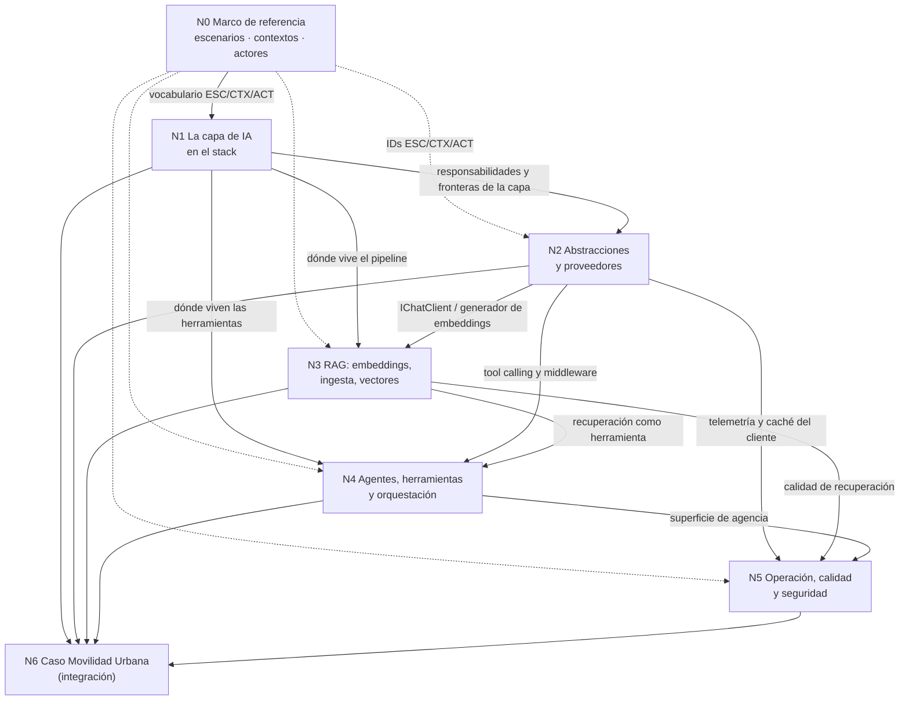

# Bitácora 01 — Descomposición conceptual

La segmentación se hizo sobre la **totalidad del pedido**: el prompt del PO, la imagen de entrada y el caso base que el prompt manda leer. El prompt tiene un único párrafo de solicitudes que enumera, en la misma oración, estrategias de integración, agentes, definiciones, ejemplos, snippets, preguntas, una demo y LangGraph; cortar por oración o por párrafo habría dado un solo bloque inmanejable o fragmentos sin sentido propio. El criterio fue otro: dos ideas van al mismo núcleo cuando comparten **abstracción o mecanismo** (la misma interfaz de .NET, el mismo flujo de datos) y **modo de falla** (el mismo síntoma cuando faltan o se usan mal); van a núcleos distintos cuando se pueden construir, probar y romper por separado.

Las afirmaciones técnicas de este documento sin fuente todavía se marcan **[C: a verificar]**. Son hipótesis de trabajo para orientar la investigación de cada núcleo, no contenido de la guía. Las que ya tienen evidencia de partida remiten a BIT-16-00 §6.

## Índice

- [1. Mapa de núcleos](#1-mapa-de-núcleos)
- [2. Dependencias entre núcleos](#2-dependencias-entre-núcleos)
- [3. Núcleos](#3-núcleos)
  - [N0 — Marco de referencia didáctico](#n0--marco-de-referencia-didáctico)
  - [N1 — La capa de IA en el stack de una aplicación](#n1--la-capa-de-ia-en-el-stack-de-una-aplicación)
  - [N2 — Abstracciones y proveedores de IA en .NET](#n2--abstracciones-y-proveedores-de-ia-en-net)
  - [N3 — RAG en .NET: embeddings, ingesta y bases vectoriales](#n3--rag-en-net-embeddings-ingesta-y-bases-vectoriales)
  - [N4 — Agentes, herramientas y orquestación en .NET](#n4--agentes-herramientas-y-orquestación-en-net)
  - [N5 — Operación, calidad y seguridad de la capa de IA](#n5--operación-calidad-y-seguridad-de-la-capa-de-ia)
  - [N6 — El caso práctico: Movilidad Urbana con capa de IA](#n6--el-caso-práctico-movilidad-urbana-con-capa-de-ia)
- [4. Ideas del pedido y su núcleo](#4-ideas-del-pedido-y-su-núcleo)
- [5. Decisiones de segmentación](#5-decisiones-de-segmentación)
- [6. Plan de validación por núcleo](#6-plan-de-validación-por-núcleo)

## 1. Mapa de núcleos

| ID | Slug | Título | Elementos de la imagen | Depende de |
|---|---|---|---|---|
| N0 | `marco-de-referencia` | Marco de referencia didáctico: escenarios, contextos y actores | — (transversal) | — |
| N1 | `capa-de-ia-en-el-stack` | La capa de IA en el stack de una aplicación | las cinco capas; Business Logic ↔ AI Layer | N0 |
| N2 | `abstracciones-y-proveedores` | Abstracciones y proveedores de IA en .NET | LLM / Generative Models | N0, N1 |
| N3 | `rag-embeddings-vectores` | RAG en .NET: embeddings, ingesta y bases vectoriales | RAG Pipeline; Retrieval · Embeddings · Vector DB; Vector DB | N1, N2 |
| N4 | `agentes-y-orquestacion` | Agentes, herramientas y orquestación en .NET (incluye LangGraph) | AI Services & Agents; Third-Party Integrations | N1, N2, N3 |
| N5 | `operacion-calidad-seguridad` | Operación, calidad y seguridad de la capa de IA | Docker · Kubernetes · Cloud · Monitoring & Logging; Cache (Redis) | N2, N3, N4 |
| N6 | `caso-movilidad-urbana` | El caso práctico: Movilidad Urbana con capa de IA (integración) | el stack completo instanciado | N1–N5 |

## 2. Dependencias entre núcleos

Una flecha `A --> B` significa «B necesita el resultado de A para poder afirmarse». La etiqueta dice qué viaja. El detalle de cada entrega está en BIT-16-02 §2.

El grafo no tiene ciclos. Las aristas punteadas desde N0 son de vocabulario: ningún núcleo puede validarse por coherencia sin los IDs del marco, pero no dependen de su contenido técnico. N4 depende de N3 de forma débil: un agente sin recuperación es válido, pero el caso «agente que consulta los datos propios» necesita el RAG.

## 3. Núcleos

### N0 — Marco de referencia didáctico

**Alcance.** El vocabulario común que exige el Profile y que reaparece en todos los documentos: escenarios en los que se aplica una capa de IA, contextos que cambian las respuestas dentro de un escenario y actores con sus decisiones. Definido en BIT-16-03 y trasladado a la §2 de la guía.

**Ideas agrupadas.** Las «estrategias y casos de integración» del pedido (los casos son los escenarios); el lector implícito («guías de estudio») y quién decide qué (los actores); las variantes que el propio pedido introduce sin nombrarlas: modelo local frente a nube (API en la red), prueba de concepto frente a producción (demo frente a guía), datos públicos frente a sensibles (caso base con datos personales, repos públicos).

**Preguntas que responde.**
- ¿En qué situaciones concretas conviene una capa de IA y en cuáles no?
- ¿Qué cambia si el modelo es local o de un proveedor en la nube, si es un prototipo o producción, si los datos son públicos o sensibles?
- ¿Qué le toca decidir a cada rol (desarrollador, arquitecto, operación, responsable de datos y seguridad, usuario)?

**Por qué es un núcleo.** Sin un marco fijado una vez, cada núcleo redefine «caso de uso» a su manera y la guía no permite el «estoy acá → qué aplico» que pide el Profile. Es el único sin dependencias.

### N1 — La capa de IA en el stack de una aplicación

**Alcance.** La respuesta a S-01 y el mapa conceptual de la guía. Qué es una capa de IA, qué responsabilidades tiene (generar, recuperar contexto propio, actuar) y cuáles no (reglas de negocio, autorización, persistencia de la verdad del dominio). Análisis crítico de la imagen: qué se sostiene con fuentes y qué es simplificación (p. ej., si RAG es un «paso» entre el LLM y los agentes o un patrón que los agentes usan). Ubicación de la capa en una arquitectura por capas `Domain → Application → Infrastructure` como la del caso base: qué va a Infrastructure (clientes de proveedores, almacén vectorial), qué a Application (orquestación de casos de uso con IA) y qué nunca al Domain. Las estrategias de integración como espectro: llamada directa a un modelo → modelo con salida estructurada → RAG → herramientas → agente → multiagente / workflow, cada una con su costo y su riesgo.

**Preguntas que responde.**
- ¿Qué es exactamente una «capa de IA» y en qué se distingue de «llamar a una API de IA»?
- ¿Dónde se ubica en una arquitectura limpia o por capas, y qué dependencias son legítimas?
- ¿Qué estrategia de integración conviene para cada escenario del marco, y cuál es la más simple que resuelve el problema?
- ¿Qué de la imagen es preciso y qué es una simplificación de diapositiva? **[C: contrastar con la guía de arquitectura de aplicaciones de IA de Microsoft (learn.microsoft.com) y con una fuente de patrones de agentes]**

**Por qué es un núcleo.** Es el marco conceptual del que cuelgan N2–N5 y la tesis que el PO trae en la imagen. Se valida por evidencia documental (E4) y por coherencia con N6 (la demo tiene que poder dibujarse con este mapa), no por experimentos propios.

### N2 — Abstracciones y proveedores de IA en .NET

**Alcance.** Cómo habla una aplicación .NET con un modelo sin atarse a un proveedor. `Microsoft.Extensions.AI` (`IChatClient`, el generador de embeddings, `ChatOptions`, streaming, salida estructurada, *middleware* por composición: función de herramientas, caché, telemetría, registro), sus implementaciones (OpenAI y compatibles, Azure, Ollama vía `OllamaSharp`), y la relación con Semantic Kernel y con Microsoft Agent Framework. Registro en el contenedor de dependencias de ASP.NET Core y configuración por variable de entorno (`OLLAMA_ENDPOINT`). Conceptos de modelo que el desarrollador necesita para usar bien la abstracción: tokens, ventana de contexto, temperatura, rol de sistema, salida estructurada, *tool calling*.

**Preguntas que responde.**
- ¿Qué paquete y qué interfaz uso hoy para hablar con un modelo en .NET, y cuáles quedaron obsoletos? (`Microsoft.Extensions.AI.Ollama` está deprecado en favor de `OllamaSharp`, BIT-16-00 §6.)
- ¿Cómo cambio de Ollama local a un proveedor en la nube sin tocar el código de negocio?
- ¿Qué agregan los *middleware* (caché, telemetría, invocación automática de funciones) y en qué orden se componen? **[C: verificar el orden y semántica del pipeline en learn.microsoft.com]**
- ¿Cómo obtengo una respuesta tipada (JSON contra un esquema) y qué hago cuando el modelo no la respeta?
- ¿Qué relación hay entre Microsoft.Extensions.AI, Semantic Kernel y Microsoft Agent Framework hoy? **[C: verificar posicionamiento oficial vigente]**

**Por qué es un núcleo.** Todas las demás piezas de la capa (RAG, agentes, telemetría) se construyen sobre esta abstracción; si se elige mal, N3–N5 heredan el acoplamiento. Tiene una validación E1 propia y barata: un cliente contra Qwen en Ollama, con y sin streaming, con salida estructurada.

### N3 — RAG en .NET: embeddings, ingesta y bases vectoriales

**Alcance.** El bloque central de la imagen. Qué es un embedding y qué mide la similitud; *chunking* y metadatos; ingesta (`Microsoft.Extensions.DataIngestion`, en preview, BIT-16-00 §6); abstracción de almacenes vectoriales (`Microsoft.Extensions.VectorData`) y conectores (en memoria, SQLite, Postgres/pgvector, Qdrant, Redis, Azure AI Search) **[C: verificar conectores vigentes y su estado GA/preview]**; recuperación (top-k, umbral, filtros por metadatos, búsqueda híbrida); armado del contexto y citas. Cuándo **no** hace falta RAG (datos estructurados que se consultan mejor con una herramienta que llama a un caso de uso o a SQL).

**Preguntas que responde.**
- ¿Qué problema resuelve RAG y cuándo es la herramienta equivocada?
- ¿Cómo se generan embeddings con un modelo local y qué condiciona elegirlo (dimensión, idioma)?
- ¿Dónde guardo los vectores en una app que ya usa SQLite, y cuándo hace falta una base vectorial dedicada?
- ¿Cómo se mide si la recuperación trae lo correcto? (enlaza con N5)
- ¿Qué riesgos introduce meter en el contexto texto que no controla el desarrollador? (enlaza con N5, AH-01)

**Por qué es un núcleo.** Comparte un mecanismo único (vectorizar → almacenar → recuperar → componer contexto) y un modo de falla propio (recuperación irrelevante o envenenada) que no depende de si después hay un agente. Depende de N2 porque el generador de embeddings y el cliente de chat son las abstracciones de N2.

### N4 — Agentes, herramientas y orquestación en .NET

**Alcance.** «AI Services & Agents» y la «creación de agentes». Distinción entre llamada con herramientas (*function calling*), agente (bucle modelo ↔ herramientas con objetivo y estado), workflow (grafo de pasos con control explícito) y multiagente. Herramientas como funciones .NET (`AIFunction`), herramientas que envuelven casos de uso existentes, confirmación humana. Marcos: Microsoft Agent Framework (`Microsoft.Agents.AI`, `Microsoft.Agents.AI.Workflows`), Semantic Kernel, y la pregunta del PO por **LangGraph**: qué es en su ecosistema de origen (Python/JS, grafos con estado), si existe un port oficial para .NET (BIT-16-00 §6: la búsqueda en NuGet sólo devuelve paquetes de terceros), qué equivalente conceptual hay en .NET y qué vías de integración existen (servicio LangGraph expuesto por HTTP, MCP) **[C: verificar en la documentación oficial de LangChain/LangGraph y de Agent Framework]**. Model Context Protocol (`ModelContextProtocol` 2.x) como forma de exponer y consumir herramientas («Third-Party Integrations» de la imagen).

**Preguntas que responde.**
- ¿Cuándo alcanza con una llamada con herramientas y cuándo hace falta un agente o un workflow?
- ¿Cómo se convierte un caso de uso existente (`LocalidadService`) en una herramienta sin saltear sus reglas?
- ¿Qué marco uso hoy en .NET para agentes y workflows y en qué estado está?
- ¿Qué es LangGraph, hay LangGraph para .NET y qué hago si mi equipo lo usa en Python?
- ¿Qué es MCP y cuándo conviene exponer la aplicación como servidor MCP?

**Por qué es un núcleo.** Agrega un mecanismo distinto de N2 y N3 —el modelo **decide** qué ejecutar— y un modo de falla propio: agencia excesiva, bucles, herramientas mal descritas. Depende de N2 (el *tool calling* es una capacidad del cliente) y débilmente de N3.

### N5 — Operación, calidad y seguridad de la capa de IA

**Alcance.** Lo que la imagen pone en INFRASTRUCTURE y lo que la diapositiva no dibuja. Operación: modelo local en contenedor frente a servicio gestionado, configuración y secretos, observabilidad con OpenTelemetry (convenciones semánticas de GenAI) **[C: verificar estado de las convenciones en opentelemetry.io]**, costo y latencia (tokens, caché de respuestas, Redis), resiliencia (timeouts, reintentos). Calidad: pruebas sobre salidas no deterministas (R-LLM), evaluación con `Microsoft.Extensions.AI.Evaluation` y sus límites, evaluación de recuperación. Seguridad: riesgos catalogados por OWASP para aplicaciones con LLM (inyección de prompts directa e indirecta, divulgación de información sensible, manejo inseguro de la salida, agencia excesiva) **[C: verificar edición vigente del OWASP Top 10 for LLM Applications]**, datos personales, secretos en repos públicos.

**Preguntas que responde.**
- ¿Cómo pruebo algo que no responde siempre igual, y qué puede y qué no puede afirmar una prueba?
- ¿Qué se observa de una capa de IA en producción y con qué herramientas de .NET?
- ¿Qué riesgos agrega una capa de IA a la aplicación y cuál es la mitigación mínima de cada uno?
- ¿Qué cambia entre un prototipo con modelo local y producción?

**Por qué es un núcleo.** Sus temas comparten el actor (operación, seguridad) y el momento (cuando la capa ya existe), y atraviesan N2–N4 sin introducir mecanismos de construcción nuevos. Separarlo evita que cada núcleo trate seguridad y pruebas a medias; a la vez obliga a que N2–N4 le entreguen sus superficies (BIT-16-02 §2).

### N6 — El caso práctico: Movilidad Urbana con capa de IA

**Alcance.** La fase de integración y la demo (S-09). Una solución .NET 10 propia en `Demos/` que replica la temática de MovilidadUrbana.Web y MovilidadUrbana.ApiWeb (localidades y encuesta de transporte, `Domain/Application/Infrastructure`, EF Core SQLite) y le agrega una capa de IA que recorre los escenarios del marco donde aplican: preguntas en lenguaje natural sobre los datos propios, alta de una localidad desde texto libre validada por las reglas del dominio, un asistente con herramientas que envuelven los casos de uso, y la exposición de capacidades por MCP. Todo probado contra Qwen. Los escenarios concretos que entran se deciden en la fase de plan con la mesa (BIT-16-02).

**Preguntas que responde.**
- ¿Dónde entra la capa de IA en una solución `Domain → Application → Infrastructure` existente sin romperla?
- ¿Cómo se respetan las reglas del dominio (`LocalidadRules`, `EncuestaRules`) cuando la entrada viene de un modelo?
- ¿Qué muestra la demo funcionando, con qué modelo y con qué tasa de éxito?
- ¿Qué tensiones entre N2–N5 aparecen al juntar todo y cómo se resuelven?

**Por qué es un núcleo.** Es la fase de integración que exige R-PO-4: consume N1–N5, resuelve sus contradicciones y reconstruye el modelo completo sobre un caso real. Por construcción es el último.

## 4. Ideas del pedido y su núcleo

| Idea del pedido (con ubicación) | Núcleo |
|---|---|
| Analizar y describir la imagen como concepto teórico (§Contexto párr. 1) | N1 |
| Marco teórico y práctico vigente en .NET (§Contexto párr. 1) | N1, N2 |
| Estrategias y casos de integración en el stack .NET (§Solicitudes párr. 1) | N0 (casos = escenarios), N1 (estrategias) |
| Creación de agentes (§Solicitudes párr. 1) | N4 |
| Definiciones (§Solicitudes párr. 1) | todos; glosario en N0 |
| Ejemplos y snippets (§Solicitudes párr. 1) | N2–N5 (Examples/), N6 (Demos/) |
| Preguntas y respuestas explicativas (§Solicitudes párr. 1; §Reglas) | todos |
| Demo basada en Lab-E2E.WebBlazor (§Contexto párr. 2; §Solicitudes párr. 1) | N6 |
| LangGraph en el ecosistema .NET (§Solicitudes párr. 1) | N4 |
| Probar todo contra la API local con Qwen (§Solicitudes párr. 2) | N2 (cliente), N5 (cómo se prueba), N6 (demo) |
| LLM / Generative Models (imagen) | N2 |
| RAG Pipeline; Retrieval · Embeddings · Vector DB; Vector DB (imagen) | N3 |
| AI Services & Agents; Third-Party Integrations (imagen) | N4 |
| Docker · Kubernetes · Cloud · Monitoring & Logging; Cache (Redis) (imagen) | N5 |
| SQL DB, NoSQL DB, Object Storage, API Gateway, Auth Service (imagen) | N1 (contexto de la capa; no se desarrollan) |

## 5. Decisiones de segmentación

| Decisión | Alternativa descartada | Motivo |
|---|---|---|
| **N0** separado como marco de referencia. | Definir escenarios dentro de N1. | El Profile exige definir los ejes una vez y referenciarlos; N1 es contenido técnico y N0 es vocabulario. |
| N1 conceptual, **sin** experimentos propios. | Fundir N1 con N2. | N1 se valida por fuentes y por coherencia con la demo; N2 por E1. Mezclarlos ata la tesis de arquitectura a un paquete. |
| RAG (N3) **separado** de agentes (N4). | Un núcleo «servicios de IA». | Mecanismos distintos (recuperar frente a decidir y actuar) y fallas distintas (contexto irrelevante frente a acción indebida). La imagen también los dibuja aparte. |
| LangGraph **dentro** de N4. | Núcleo propio de LangGraph. | La pregunta del PO es de ubicación en el ecosistema; se responde comparando marcos de agentes y workflows, que es el tema de N4. Un núcleo aparte sobredimensionaría una pregunta que puede tener respuesta corta. |
| MCP **dentro** de N4. | Núcleo de interoperabilidad. | MCP expone y consume herramientas: es la frontera externa del mismo mecanismo de N4. |
| Operación, calidad y seguridad **juntas** en N5. | Tres núcleos. | Comparten momento (la capa ya existe) y actores (operación, seguridad); por separado serían núcleos delgados con dependencias cruzadas en ambos sentidos. La seguridad tiene además un experto propio en la mesa (AH-01). |
| Demo como **núcleo de integración** (N6). | Repartir la demo entre núcleos. | Cumple la fase de integración de R-PO-4 y concentra las tensiones en un lugar. Los ejemplos aislados de cada núcleo viven en Examples/; la demo los reúne. |
| SQL/NoSQL/Object Storage/API Gateway/Auth **no** son núcleos. | Cubrir todo el stack de la imagen. | No son capa de IA; la guía los nombra como contexto en N1. |

## 6. Plan de validación por núcleo

| Núcleo | Validación mínima esperada | Evidencia |
|---|---|---|
| N0 | Matrices núcleo × escenario y actor × núcleo sin filas ni columnas vacías; cada escenario aparece en al menos un núcleo y en la demo. | E2 |
| N1 | Cada afirmación sobre la capa cita fuente; el diagrama de capas de la guía dibuja la demo de N6 sin excepciones. | E4 + E2 |
| N2 | Ejemplo de consola: `IChatClient` contra Qwen en Ollama con respuesta simple, streaming y salida estructurada validada contra un tipo C#; cambio de proveedor sólo por configuración. Versiones de paquetes verificadas en NuGet. | E1 + E4 |
| N3 | Ejemplo: ingesta de textos del dominio, embeddings con modelo local, almacén vectorial, consulta con top-k; prueba de que la recuperación trae el documento esperado en N corridas. | E1 |
| N4 | Ejemplo: herramienta que envuelve un caso de uso, invocada por el modelo con argumentos válidos; agente o workflow con Microsoft Agent Framework; servidor MCP mínimo listado por un cliente. Caracterización de LangGraph con fuente oficial. | E1 + E4 |
| N5 | Prueba con aserciones de forma sobre salida no determinista; traza OpenTelemetry de una llamada; escenario E3 de inyección indirecta y su mitigación demostrada. | E1 + E3 + E4 |
| N6 | `dotnet build` y `dotnet test` de la demo en contenedor; corrida de cada escenario contra Qwen con registro R-LLM; reglas del dominio rechazan una entrada inválida propuesta por el modelo. | E1 |
