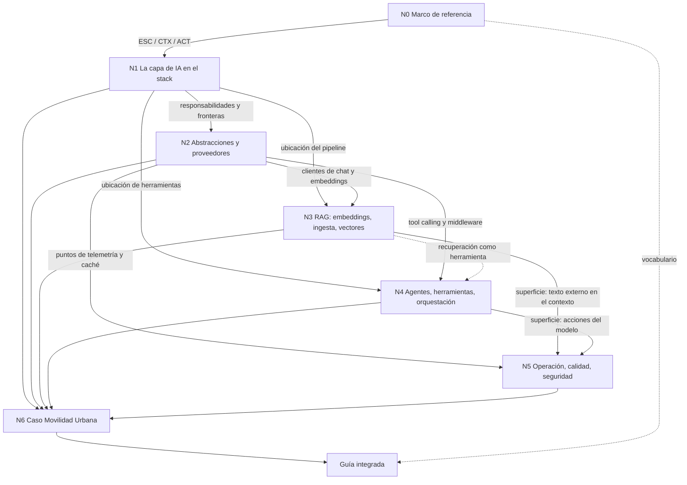

> **Insumo vinculante del PO (2026-10-26)**: [Mesa/I-01-Insumos-Del-PO-Agentes-LangGraph-Anotaciones.md](Mesa/I-01-Insumos-Del-PO-Agentes-LangGraph-Anotaciones.md) — LangGraph en .NET, la confusión con Microsoft Graph y las cuatro familias de anotaciones para agentes. El plan de integración y los especialistas de contenido lo leen antes de fijar el índice de la guía y estructurar el marco conceptual de N4 (y su reflejo en el mapa de N1).

> **Insumo del PO (2026-10-26)**: [Mesa/I-02-Insumo-Del-PO-Recorrido-AI-Engineer.md](Mesa/I-02-Insumo-Del-PO-Recorrido-AI-Engineer.md) — recorrido del índice de un curso en línea de terceros como fuente de forma y cobertura (no citable): propuestas PR-1 a PR-7 (actor AI Engineer, «por qué ahora», ejemplos y demo en tres niveles, «¿un agente o varios?», escalera de complejidad, autoevaluación). El plan de integración las considera al fijar el índice y la especificación de Examples/ y Demos/.

> **Insumo del PO (2026-10-26)**: [Mesa/I-03-Insumo-Del-PO-Temario-AI-Engineering.md](Mesa/I-03-Insumo-Del-PO-Temario-AI-Engineering.md) — temario de un curso en línea de terceros (forma y cobertura): **CAG (Cache-Augmented Generation) no está cubierto por ningún núcleo** (PR-8, requiere dossier complementario), mirada de producto (PR-9), datos para la IA (PR-10), despliegue como sección visible (PR-11), columna vertebral fundamentos → estrategias de conocimiento → agentes → producción (PR-12).

> **Insumo del PO (2026-10-26)**: [Mesa/I-04-Insumo-Del-PO-Encuesta-Bloqueos.md](Mesa/I-04-Insumo-Del-PO-Encuesta-Bloqueos.md) — encuesta de audiencia (no citable): la arquitectura del sistema domina como bloqueo; propuestas PR-13 (decisiones de arquitectura como sección), PR-14 (objetivos de aprendizaje por actor) y PR-15 (lista de control de cobertura para la relectura integral).

> **Insumo del PO (2026-10-26)**: [Mesa/I-05-Insumo-Del-PO-Desarrollo-De-Agentes-En-NET.md](Mesa/I-05-Insumo-Del-PO-Desarrollo-De-Agentes-En-NET.md) — borrador técnico (no citable, no transcripto: sus ejemplos son de otro proyecto privado ajeno a la guía). Ideas generales reencuadradas **sólo sobre Movilidad Urbana**: principio rector «el modelo propone, la app ejecuta y autoriza» (PR-16), sumar IA a una app existente = MovilidadUrbana.ApiWeb (PR-17), «¿framework de agentes o propio?» (PR-18), comparativo M.E.AI/MAF/SK/OpenAI SDK (PR-19), primer ejercicio de sólo lectura con pruebas negativas (PR-20), lista de seguridad (PR-21), ejemplo pareado SK vs M.E.AI (PR-22).

> **Directiva del PO (2026-10-26, vinculante)**: [Mesa/I-06-Directiva-Del-PO-Caso-Unico-Y-Medios.md](Mesa/I-06-Directiva-Del-PO-Caso-Unico-Y-Medios.md) — Movilidad Urbana es el único caso práctico; nada de otros proyectos; medios móviles disponibles para la demo.

# Bitácora 02 — Cohesión global

Este documento permite trabajar cada núcleo por separado sin perder el modelo completo. Fija el grafo de dependencias y lo que cada núcleo le entrega al siguiente, los vínculos que atraviesan varios núcleos, las tensiones previsibles con su regla de resolución, la matriz núcleo × núcleo y la trazabilidad desde cada solicitud del PO hasta la sección de la guía donde va a quedar.

**Estado: abierto.** Las secciones marcadas «a completar en la fase de plan» las completa la mesa cuando cada núcleo tenga su investigación hecha; las marcadas «a completar al integrar», el cuaderno de integración (`04-Integracion.md`). Cada completado se registra al pie con fecha.

> **Estado de fases al 2026-10-26 (cierre del ciclo 1 de la mesa).**
>
> | Fase | Estado |
> |---|---|
> | Fundación (BIT-16-00…03, REED-16) | hecha |
> | Investigación por núcleo (`Nucleos/`, `Sondeo-Entorno.md`) | hecha |
> | Plan de integración (`04-Plan-De-Integracion.md`, que reemplaza al «cuaderno de integración» `04-Integracion.md` previsto) | **v1 = estructura aprobada**, ciclo 1 |
> | Ciclo 1 de la mesa (`Mesa/Ciclo-1/`) | **cerrado**: 24 parches aplicados, 0 revertidos; §5 (tensión «demo simple frente a controles») y §6 (matriz única vigente) actualizadas por PAR-21 |
> | Ciclo 2 (relectura de la v1) | pendiente |
> | Redacción de la guía, `Examples/` y `Demos/` | pendiente |
>
> Siguen abiertos en este documento, como capas a revalidar en el ciclo 2: §7 (estructura prevista, superada por BIT-16-04 v1 §C), §9 (referencias cruzadas con la numeración vieja) y §10 (pendientes; la convocatoria quedó en `Mesa/Ciclo-1/01-Convocatoria.md` y los modelos en BIT-16-04 v1 §E.1).

## Índice

- [1. Grafo de dependencias](#1-grafo-de-dependencias)
- [2. Qué entrega cada núcleo a los demás](#2-qué-entrega-cada-núcleo-a-los-demás)
- [3. Matriz núcleo × núcleo](#3-matriz-núcleo--núcleo)
- [4. Vínculos transversales](#4-vínculos-transversales)
- [5. Tensiones previsibles y regla de resolución](#5-tensiones-previsibles-y-regla-de-resolución)
- [6. Trazabilidad solicitud → núcleo → sección de la guía](#6-trazabilidad-solicitud--núcleo--sección-de-la-guía)
- [7. Estructura prevista de la guía](#7-estructura-prevista-de-la-guía)
- [8. Orden de trabajo e integración](#8-orden-de-trabajo-e-integración)
- [9. Referencias cruzadas previstas](#9-referencias-cruzadas-previstas)
- [10. Pendientes de la fase de plan](#10-pendientes-de-la-fase-de-plan)

## 1. Grafo de dependencias

Una flecha `A --> B` significa «B necesita el resultado de A para poder afirmarse». Las punteadas son dependencias de vocabulario o débiles.

Sin ciclos. N5 es el único núcleo que recibe de tres núcleos técnicos y les devuelve exigencias: esa vuelta no es una arista del grafo sino una **revalidación** (M§1.2): si N5 concluye que una práctica de N3 o N4 es insegura, la corrección se hace en N3 o N4 y N5 se revalida.

## 2. Qué entrega cada núcleo a los demás

| Núcleo | Entrega (contrato de salida) | Consumidores |
|---|---|---|
| N0 | Escenarios ESC-01…05, contextos CTX-LOCAL/NUBE, CTX-PROTO/PROD, CTX-PUB/SENS, actores ACT-DEV/ARQ/OPS/SEC/USR; glosario base. | todos |
| N1 | Definición de capa de IA y sus responsabilidades; diagrama de capas aplicado a `Domain/Application/Infrastructure`; espectro de estrategias de integración con criterio de elección por escenario; análisis crítico de la imagen. | N2, N3, N4, N6 |
| N2 | Paquetes y versiones vigentes; patrón de registro del cliente en DI con `OLLAMA_ENDPOINT`; snippets de chat, streaming y salida estructurada verificados contra Qwen; pipeline de *middleware*; relación entre Microsoft.Extensions.AI, Semantic Kernel y Agent Framework. | N3, N4, N5, N6 |
| N3 | Pipeline RAG verificado (ingesta, chunking, embeddings, almacén, recuperación); elección de almacén por contexto; criterio «cuándo no RAG». | N4, N5, N6 |
| N4 | Distinción herramienta / agente / workflow / multiagente; patrón «caso de uso como herramienta»; ejemplo con Agent Framework; servidor MCP mínimo; respuesta documentada sobre LangGraph en .NET. | N5, N6 |
| N5 | Patrón de pruebas para salidas no deterministas (R-LLM); evaluación; traza OpenTelemetry; mapa de riesgos con mitigación mínima por escenario; diferencias prototipo/producción. | N6; revalidación de N2–N4 |
| N6 | Demo en `Demos/` con los escenarios elegidos; resolución de tensiones; modelo completo reconstruido. | guía completa |

## 3. Matriz núcleo × núcleo

Fila = núcleo que **consume**; columna = núcleo que **provee**. `D` dependencia fuerte; `d` débil o de vocabulario; `R` revalidación (el de la fila puede obligar a corregir el de la columna); `—` sin relación.

| consume \ provee | N0 | N1 | N2 | N3 | N4 | N5 | N6 |
|---|---|---|---|---|---|---|---|
| **N0** | · | — | — | — | — | — | — |
| **N1** | D | · | — | — | — | — | R |
| **N2** | d | D | · | — | — | — | R |
| **N3** | d | D | D | · | — | — | R |
| **N4** | d | D | D | d | · | — | R |
| **N5** | d | d | D | D | D | · | R |
| **N6** | d | D | D | D | D | D | · |

Lectura: la columna N6 llena de `R` expresa la regla de integración: si al armar la demo aparece una contradicción, se repara en el núcleo de origen (N1…N5), no en la demo. La fila N5 con tres `D` confirma que N5 se trabaja después de N2–N4.

> A completar en la fase de plan: registrar en esta matriz las dependencias reales que aparezcan al investigar (p. ej., si N3 termina usando un almacén vectorial que N2 no previó) y cualquier `R` ejercida.

## 4. Vínculos transversales

Hilos que atraviesan varios núcleos y que la guía tiene que mantener con un solo sentido:

- **El caso Movilidad Urbana** se anuncia en la introducción, da los ejemplos de N0 (escenarios candidatos), aparece como ejemplo corto en N2–N5 y se cierra en N6 como demo. Es el hilo narrativo de la guía (Rule-Dual-Audience: narrar de punta a punta con un caso concreto).
- **La imagen de entrada** se analiza en N1 y se vuelve a dibujar en N6 con los componentes reales de la demo: el lector ve la diapositiva convertida en una solución.
- **«La aplicación decide, el modelo propone»**: en N2 (salida estructurada validada), N3 (el contexto lo arma la aplicación), N4 (las herramientas pasan por los casos de uso y sus reglas), N5 (agencia mínima) y N6 (`LocalidadRules` rechaza lo que el modelo propone mal). Es el criterio de diseño que une la guía; se declara como criterio propio y se sostiene con las fuentes de seguridad de N5.
- **Abstracción frente a proveedor**: N2 la define, N3 la extiende a embeddings y vectores, N4 la usa para herramientas, N5 la aprovecha para telemetría y caché, N6 la demuestra cambiando sólo configuración.
- **No determinismo**: se presenta en N2 (temperatura), condiciona las pruebas de N3 y N4, se trata en N5 (R-LLM, evaluación) y define cómo se reportan los resultados de la demo en N6.
- **Seguridad** (AH-01): cada núcleo con superficie (N3 texto externo, N4 acciones, N6 datos personales) incluye su advertencia en el lugar donde se enseña la práctica, y N5 la consolida; no se relega todo a un capítulo final.
- **Laboratorio**: cada núcleo con validación E1 deja una carpeta en `Examples/`; N6 reutiliza patrones, no copia código.

## 5. Tensiones previsibles y regla de resolución

| Tensión | Núcleos | Regla de resolución |
|---|---|---|
| La imagen pone RAG como paso **entre** el LLM y los agentes; en la práctica un agente puede usar recuperación como herramienta, y una app puede tener RAG sin agentes. | N1, N3, N4 | N1 presenta la imagen como modelo didáctico y corrige con fuente la relación; la guía usa un solo diagrama propio a partir de N1. |
| Una abstracción mínima (`IChatClient`) frente a un marco completo (Agent Framework, Semantic Kernel). | N2, N4 | Se enseña de abajo hacia arriba: abstracción primero; el marco entra cuando el escenario lo justifica (ESC-04). Criterio propio declarado, a someter a la mesa. |
| RAG frente a herramienta que consulta datos estructurados para ESC-01. | N3, N4, N6 | Datos tabulares del dominio (conteos, filtros) → herramienta sobre el caso de uso; texto no estructurado → RAG. A confirmar con E1 en N6. |
| Qwen local puede no soportar bien *tool calling* o salida estructurada en todas sus variantes. | N2, N4, N6 | Se mide con E1 (tasa de éxito en N corridas) y se reporta; si no alcanza, se documenta el límite como hallazgo y se prueba otra variante disponible, sin tocar el servidor (SUP-06). |
| LangGraph «en .NET»: no hay evidencia de port oficial (BIT-16-00 §6) frente a la expectativa del PO. | N4 | Se responde lo que la evidencia muestre: qué es, qué no existe, equivalentes y vías de integración. No se escala salvo que el PO haya querido decir adoptar LangGraph (disparador 1, sólo si la evidencia no desempata). |
| Demo didáctica simple frente a controles de producción (seguridad, evaluación, observabilidad). | N5, N6 | La demo es CTX-PROTO y lo dice; implementa los controles mínimos que N5 marque como obligatorios incluso en prototipo: **aprobación antes de toda escritura** (alta y baja) y **ninguna herramienta de escritura cuando el contexto trae texto recuperado**. Ratificado en el ciclo 1 de la mesa (H-012): prevalece sobre el criterio propio de N6 P6 (alta sin aprobación). Los controles de CTX-PROD se enumeran sin implementarlos. |
| Arquitectura del caso base (tres copias de capas, sin referencias) frente a reutilización en la demo. | N1, N6 | La demo es una solución propia; puede copiar el dominio con procedencia. No «corrige» decisiones del caso base (ia-db, restricciones para IA). |
| Paquetes en preview (`Microsoft.Extensions.DataIngestion`, conector SQLite de vectores) frente a una guía que pretende formar criterio estable. | N3, N5 | Se usan si son la vía vigente, marcados como preview con versión y fecha; la guía separa concepto (estable) de paquete (volátil). |

## 6. Trazabilidad solicitud → núcleo → sección de la guía

> **Nota del 2026-10-26 (ciclo 1 de la mesa, PAR-21; H-033, PR-15).** La tabla original de esta sección usaba la numeración prevista en §7, que el plan v1 reemplazó, y no incluía los pedidos de los insumos del PO. Queda sustituida por la **matriz única vigente**, con las secciones de la guía según BIT-16-04 v1 (`04-Plan-De-Integracion.md`). El plan remite a esta matriz y no tiene matriz propia. Es también la lista de control de la relectura (PR-15).

| ID | Solicitud o pedido (resumido) | Sección de la guía (v1) | Ejemplo / paso / artefacto | Criterio verificable |
|---|---|---|---|---|
| S-01 | Analizar y describir la imagen | §1, §3.1 | demo §14.2 | §3.1 tiene la tabla capas ↔ .NET y §1 la describe sin reproducirla |
| S-02 | Marco teórico y práctico vigente en .NET | §3, §4, §9, Anexos D y F | — | toda versión de la guía está en el Anexo F con fecha |
| S-03 | Guías, ejemplos y demo | guía, `Examples/`, `Demos/` | 01–17, PD-1…PD-6 | AC-1, AC-2, AC-3b |
| S-04 | Estrategias y casos de integración | §2, §3, §4, §6, §13 | ADR-01…ADR-12 | §3.3 cubre ESC-01…05 |
| S-05 | Creación de agentes | §8.7, §8.8, §9 | 11, 12 (la demo no crea agentes: PD-6 es un `IChatClient` con historial del circuito; la cobertura es del conjunto, respuesta 1 de la presidencia) | AC-3b para 11 |
| S-06 | Definiciones | §3.0, «Definición» de cada sección, Anexo C | — | cada término del glosario remite a la sección que lo define |
| S-07 | Ejemplos y snippets | «Ejemplos» de cada sección, Anexo E | 01–17 | AC-9 |
| S-08 | Preguntas y respuestas explicativas | «Preguntas guía» de cada sección, §15 | — | ≤ 5 por sección, cada una con OA; §15 con un ítem por OA (25 o 26, según RV-05) |
| S-09 | Demo basada en Lab-E2E.WebBlazor | §14 | `Demos/MovilidadUrbana.Asistente/` | AC-10 (delta contra 8fb4c3a) |
| S-10 | LangGraph en .NET | §9.4, §9.5 | snippet «adaptación no ejecutada» | Q-PO-1 respondida en §9 |
| S-11 | Reedición sobre el marco de mesa | — (proceso) | `OUTPUTs/Crear-IA-Layer-Guide-Reedicion.md` | existe |
| S-12 | Composición de la mesa | — (proceso) | REED-16 §8; `Mesa/Ciclo-1/01-Convocatoria.md` | existe |
| S-13 | Experto adicional | — (proceso) | REED-16 §8.3 | AH-01 y AH-02 en `02-Informes/` |
| S-14 | Relectura integral | — (proceso) | último ciclo de `Mesa/` | corre AC-7, AC-8, AC-9 y el presupuesto de extensión |
| S-15 | Apuntes, borradores, debates | — (proceso) | `Nucleos/`, `Mesa/` | — |
| S-16 | Rutas de salida | — | REED-16 §11 | rutas de §C y §E.1 |
| S-17 | Probar todo contra Qwen | §10, Anexo E | registros R-LLM | AC-3b |
| Q1 | ¿Qué es una capa de IA y qué responsabilidades tiene frente al negocio y los datos? ¿Qué del diagrama se sostiene y qué es simplificación? | §1, §3.1, §4.3–§4.4 | demo §14.2 | §3.1 lleva la pregunta del diagrama (OA-0.2) y §4.4 la de capa frente a API (OA-A5) |
| Q2 | ¿Qué abstracciones ofrece .NET para hablar con un modelo sin atarse al proveedor; cuáles son GA, preview o deprecadas? | §5, §9.1, Anexo F | 01, 02 | el Anexo F tiene estado y fecha por paquete |
| Q3 | ¿Cómo se arma un pipeline RAG en .NET y cuándo no hace falta RAG? | §6, §7 | 05, 06, 07; PD-2 | «RAG sí o no» con casa única en §6 |
| Q4 | ¿Qué es un agente, en qué se diferencia de una llamada con herramientas y con qué marco se construye? ¿Qué es LangGraph y qué hay en .NET? | §8.1, §8.7, §9.4–§9.5 | 11, 12; snippet «adaptación no ejecutada» | Q-PO-1 respondida en §9; frontera 1/3 operativa en §8.1 |
| Q5 | ¿Cómo se prueba, se observa y se asegura una capa de IA? | §10, §11, §12 | 15, 16, 17 | AC-3b, AC-4 |
| Q6 | ¿Cómo queda integrado en Movilidad Urbana sin romper Domain → Application → Infrastructure, y qué muestra la demo contra Qwen? | §14 | `Demos/MovilidadUrbana.Asistente/`: tres pasos con humo válido contra Qwen (PD-2, PD-3, PD-6) | AC-10, AC-3b, AC-11 |
| Q-PO-1…3 | Preguntas del PO de I-01 | §9 | — | respondidas en §9 |
| I-01 §5 | Cuadro de anotaciones con criterio | §9.3 | 14 | columna «cuándo conviene» con fuente |
| I-03 §6.1 | CAG y temario | §6 | 05 | §6.3 con el término canónico |
| I-04 §5.2 | ¿La señal de evaluación alcanza para convocar a AH-02? | — (proceso) | AH-02 en `Mesa/Ciclo-1/02-Informes/` y `Mesa/Ciclo-2/02-Informes/` | resuelta: sí, AH-02 integra el panel desde el ciclo 1 (`Ciclo-1/01-Convocatoria.md`, fila 12) |
| I-04 (preocupaciones de audiencia) | Lista de control de la relectura | relectura (PR-15) | — | lista de control interna |
| I-05 §5.1, §5.3 | PR-16…PR-22; «¿integrar o construir un marco?» como pregunta guía | §A.4, §8, §9, Anexo B | 08, 09, 14 | filas de BIT-16-04 §D |
| I-05 §5.2 | ¿PR-17 abre un escenario nuevo en N0 o es una variante de ESC-04, y cómo entra a la demo sin ampliar su alcance? | §2.1, §14 | demo | **Resuelta en el ciclo 3** (P3-10, opción A): par de contextos de uso CTX-EXISTENTE / CTX-NUEVA en BIT-16-03 §2 y §4.2, sin ESC nuevo; la demo es CTX-EXISTENTE y CTX-NUEVA se explica sin ejecución |
| I-02 §5 | PR-1…PR-7; si PR-3 cabe en la demo o el nivel avanzado se cubre con ejemplos separados; combinación con I-01 | §D, §B.3 | §E, §F | filas PR-1…PR-7 de BIT-16-04 §D; desvío (b) de PR-3 declarado |
| RD-PO-1…3 | Caso único; nada de otros proyectos; dominios inventados reemplazados | toda la guía | todo | AC-8 |
| RD-PO-4 | Barrido mecánico | relectura | `Compuertas/rd-po-4.excepciones` | AC-8 en cero |

Chequeo mecánico: toda fila de contenido tiene sección y criterio; la lista de control de la relectura (PR-15) es esta matriz más las cuatro preocupaciones de I-04.

## 7. Estructura prevista de la guía

Un solo archivo (DC-01). Cada sección temática §3–§7 sigue el Profile: Definición → Aplicación por escenario (y qué cambia por contexto) → Ejemplos (snippet + carpeta de `Examples/`) → Preguntas guía con respuesta → Criterios de calidad → Plantilla o anexo.

| § | Título tentativo | Núcleo | Pieza del Profile |
|---|---|---|---|
| 0 | Índice y ruta de lectura | — | README |
| 1 | «IA ya es parte del stack»: de la diapositiva a una solución | N1 (presentación) | resumen ejecutivo |
| 2 | Marco de referencia: escenarios, contextos y actores | N0 | marco de referencia |
| 3 | La capa de IA en el stack y las estrategias de integración | N1 | mapa conceptual + documento temático |
| 4 | Hablar con un modelo desde .NET: abstracciones y proveedores | N2 | documento temático |
| 5 | RAG: embeddings, ingesta y bases vectoriales | N3 | documento temático |
| 6 | Agentes, herramientas y orquestación (y LangGraph) | N4 | documento temático + métodos y marcos |
| 7 | Operar, evaluar y asegurar la capa de IA | N5 | documento temático |
| 8 | Movilidad Urbana con capa de IA: la demo | N6 | integración |
| A | Plantillas comentadas | N2–N6 | anexo |
| B | Listas de verificación por actor | N5, N0 | anexo |
| C | Glosario | N0 y todos | anexo |
| D | Referencias con versión y fecha de consulta | todos | anexo (Rule-Evidences) |
| E | Laboratorio y demo: cómo reproducir cada ejemplo | todos | anexo |

> A completar en la fase de plan: títulos definitivos, subsecciones de cada §, y la lista de carpetas de `Examples/` por núcleo.

## 8. Orden de trabajo e integración

1. **N0** (hecho en BIT-16-03, se ajusta si la investigación lo pide).
2. **N1**: tesis y mapa; habilita el resto.
3. **N2**: primer contacto con Qwen; releva modelo, capacidades (*tool calling*, salida estructurada) y embeddings disponibles. Su resultado condiciona N3 y N4.
4. **N3 y N4 en paralelo**, cada uno con su laboratorio.
5. **N5**, sobre las superficies de N2–N4; puede devolver correcciones a ellos (§1).
6. **N6 como integración**: demo, resolución de §5 y modelo reconstruido; reparaciones en origen.
7. **Ciclos de mesa** sobre la guía integrada y relectura integral (REED-16 §9–§10).

## 9. Referencias cruzadas previstas

Enlaces internos que la guía debe tener (control C4 de REED-16 §9.1):

| Desde | Hacia | Motivo |
|---|---|---|
| §3 (estrategias) | §4, §5, §6 | cada estrategia remite al capítulo que la construye |
| §4 (salida estructurada) | §8 (alta desde texto libre) | el ejemplo integrado |
| §5 (riesgo de texto externo) | §7 (inyección indirecta) | advertencia en el lugar + tratamiento completo |
| §6 (herramientas de escritura) | §7 (agencia excesiva) | ídem |
| §6 (MCP) | §7 (exposición) | ídem |
| §7 (pruebas R-LLM) | Anexo E | cómo se corrieron |
| §8 | §2 | cada parte de la demo nombra su escenario y contexto |
| todas | Anexo C, Anexo D | glosario y referencias |

## 10. Pendientes de la fase de plan

- Elegir los escenarios que cubre la demo (fila N6 de BIT-16-03 §4.1) y su orden de construcción.
- Fijar el modelo de chat y el de embeddings tras el relevamiento de N2 (SUP-01, SUP-06).
- Completar la matriz §3 con dependencias reales y la estructura §7 con subsecciones.
- Registrar la decisión de la mesa de convocatoria sobre AH-01, AH-02, Operación y entrega, y el rol formal.

### Nota del ciclo 2 (2026-10-26)

- §6 actualizada por PAR2-23 (H2-049): seis filas Q1–Q6 en lugar del marcador, I-04 §5.2 con su pedido literal (convocar a AH-02, resuelto), I-05 §5.2 con su pedido literal (**pendiente de la presidencia**: PR-17, escenario nuevo o variante de ESC-04), fila I-02 nueva y S-08 con «25 o 26 ítems, según RV-05».
- Pendientes de esta sección resueltos en los ciclos 1 y 2: escenarios de la demo (plan v2 §F.1, un host: ADR-13), modelos de chat y de embeddings (§E.1; EMB-B por defecto), convocatoria de AH-01, AH-02 y Operación y entrega (`Mesa/Ciclo-2/01-Convocatoria.md`). Queda el rol Formal/matemático, postergado por cupo.
- §7 y §9 siguen con la numeración prevista antes del plan: se revalidan contra la v2 (§4.1 vocabulario y §4.2 «por qué ahora»; §11.8; §13.14 ADR-13 y §13.15) en el ciclo 3.

### Nota del ciclo 3 (2026-10-26, cierre de la mesa)

- §6 actualizada por PAR3-18: S-03 con PD-1…PD-6 (PD-7 salió de la demo); S-05 sin atribuirle un agente a PD-6; Q6 con tres pasos con humo válido contra Qwen (PD-2, PD-3, PD-6) y AC-11; I-05 §5.2 **resuelta** con el par de contextos de uso CTX-EXISTENTE / CTX-NUEVA (P3-10 A; BIT-16-03 §2 y §4.2).
- La pregunta de la presidencia sobre la cobertura de la demo quedó respondida: la cobertura de ESC-01…05 es del conjunto guía + ejemplos + demo (tabla de cobertura del plan v3 §C §3.3).
- Lo que queda: §7 (estructura prevista) y §9 (remisiones) siguen con la numeración anterior al plan. No se revalidaron en la mesa y se revalidan contra el plan v3 al redactar la guía (deuda declarada en `Mesa/Ciclo-3/08-Cierre.md`).

### Nota de la construcción (2026-10-27)

Estado de los criterios de la §6 al cerrar la construcción ([`06-Construccion.md`](06-Construccion.md)). La tabla no se reescribe; esta nota sólo se agrega.

- **S-03** (guías, ejemplos y demo): `Examples/` 01–17 y `Demos/MovilidadUrbana.Asistente` construidos. AC-1 y AC-2 se cumplen: 433 pruebas en Examples y 70 en la demo, todas en verde, sin servidor. AC-3b se cumple en parte: faltan DEP-03, DEP-09 y DEP-13, las extensiones 03, 04 y 08, y 08 está rechazada por un S2 en su oráculo.
- **S-05** (agentes): 11 tiene un registro válido (1/1, borrado = mostrado). En 12, el camino «dos-agentes» no se observó contra el modelo.
- **S-07** (ejemplos y snippets) y **AC-9**: pendientes de redacción. La guía tiene 0 bytes.
- **S-09** (demo sobre el caso base): AC-10 se cumple (`diff-base.sh`, rc 0) y el Domain es idéntico al de `_Comun`.
- **S-17** y **Q5/Q6** (probar contra Qwen; probar, observar y asegurar): hay registros válidos con modelo de 01–09, 11–13, 15–17 y PD-2, PD-3 y PD-6, todos recalculables (47/47 archivos). AC-4 se cumple: 0 escrituras sin aprobación en 11, PD-6 y 16.
- **RD-PO-1…4**: AC-8 se cumple en la guía y en la bitácora. Hay una deuda en AC-7: 5 falsos positivos del patrón de IP en la bitácora (números de versión y la base de un rango), sin un mecanismo de excepción.
- **Q2 / Anexo F**: AC-6 falla en Examples (OpenTelemetry 1.18.0 y 1.20.1; `Azure.AI.OpenAI` beta transitivo de SK). Hay que resolverlo antes de que el Anexo F afirme el invariante por familia.
- §7 y §9 siguen como estaban: se revalidan contra el plan v3 al redactar.
