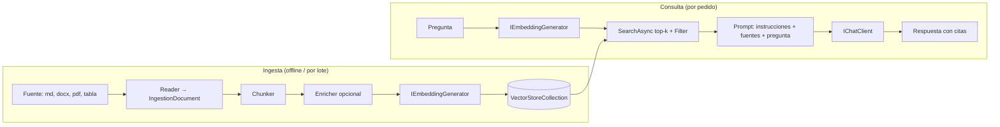

# N3 — RAG en .NET: embeddings, ingesta y bases vectoriales (dossier de investigación)

> **Naturaleza**: material de trabajo para la mesa evaluadora. No es la guía final.
> **Fecha de relevamiento**: 2026-10-25. Las versiones salen de la API de nuget.org (`v3-flatcontainer` y `registration5-gz-semver2`) consultada ese día; las afirmaciones conceptuales, de las páginas de la [tabla de fuentes](#7-tabla-de-fuentes).
> **Convención**: `[Fx]` remite a la tabla de fuentes. `[E1]`…`[E5]` son evidencias ejecutadas, con fuentes y salidas en [`N3-Evidencia/`](N3-Evidencia/salidas.md). Lo que es criterio del investigador va marcado **(criterio propio)** y lo que no se pudo comprobar, **(no verificado)**.
> **Regla de publicación**: el servidor de IA de la red se nombra «el servidor Ollama de la LAN del laboratorio». En código, `http://localhost:11434` es el valor por defecto y se sobreescribe con `OLLAMA_ENDPOINT`.

## Índice

- [0. Hallazgos que cambian el plan](#0-hallazgos-que-cambian-el-plan)
- [1. Ideas agrupadas y dependencias con otros núcleos](#1-ideas-agrupadas-y-dependencias-con-otros-núcleos)
- [2. Definiciones](#2-definiciones)
- [3. Estado actual verificado (2026-10-25)](#3-estado-actual-verificado-2026-10-25)
- [4. Snippets representativos](#4-snippets-representativos)
- [5. Preguntas guía con respuestas](#5-preguntas-guía-con-respuestas)
- [6. Criterios de calidad y antipatrones](#6-criterios-de-calidad-y-antipatrones)
- [7. Tabla de fuentes](#7-tabla-de-fuentes)
- [8. Abierto / no verificado](#8-abierto--no-verificado)

---

## 0. Hallazgos que cambian el plan

1. **Los conectores vectoriales ya no son de Semantic Kernel.** En los paquetes `Microsoft.SemanticKernel.Connectors.{InMemory, SqliteVec, PgVector, Qdrant, Redis, SqlServer, AzureAISearch}`, la **última versión** (1.74.0-preview, 2026-03-20; en Redis y SqlServer, 1.74.1-preview, 2026-04-29) está **marcada como deprecada en nuget.org con motivo `Legacy`** y apunta como alternativa a un `CommunityToolkit.VectorData.*` [F15]. Las versiones anteriores no llevan la marca (verificación V2). Los conectores se extrajeron del repo de Semantic Kernel y se donaron al .NET AI Community Toolkit (MIT) [F13]. Las páginas de Microsoft Learn sobre vector stores ya usan `CommunityToolkit.VectorData.InMemory` y `CommunityToolkit.VectorData.Redis` [F2][F6]. **Microsoft Learn no está alineado del todo**: la página de *data ingestion* todavía enlaza los paquetes `Microsoft.SemanticKernel.Connectors.*` [F7], y la tabla de conectores de Semantic Kernel (`ms.date` 2024-07-08) no menciona el traslado [F11].
2. **Las abstracciones son GA; los conectores, en parte.** `Microsoft.Extensions.VectorData.Abstractions` 10.11.0 es estable (2026-10-14) [F1]. InMemory, PgVector, Qdrant, Redis, SqlServer y AzureAISearch tienen versión 1.0.x estable; **SqliteVec sigue en preview** (1.0.3-preview, 2026-10-09) y depende de `sqlite-vec` 0.1.7-alpha.2.1 [F1], un proyecto que se declara «pre-v1» [F31].
3. **`Microsoft.Extensions.DataIngestion` existe y está en preview** (10.11.0-preview.1.26513.7, 2026-10-14) [F1][F7][F8]. Sus tipos se confirmaron por reflexión [E1].
4. **El servidor Ollama de la LAN del laboratorio no hace embeddings.** No tiene ningún modelo de embeddings instalado y sus modelos de chat responden `This server does not support embeddings` a `/api/embed` [E2]. La demo necesita un modelo de embeddings: instalarlo en ese servidor, que lo decide el PO, o correrlo en otro Ollama, por ejemplo en contenedor [E3]. El `all-minilm` que N2 usa en sus snippets **no está instalado** en ese servidor [E2].
5. **El sentido del `Score` depende de la función de distancia.** Con `CosineDistance`, menor es mejor; con `CosineSimilarity`, mayor es mejor [E1][E3]. Es fácil equivocarse al poner un umbral.
6. **Citar no es estar fundamentado.** Con el contexto correcto, Qwen 2.5 7B citó una regla y en la misma oración la contradijo [E5]. Esto alimenta N5 (*groundedness*) y el principio de la cohesión: «la aplicación decide, el modelo propone».

---

## 1. Ideas agrupadas y dependencias con otros núcleos

### 1.1 Grupos de ideas

| Grupo | Ideas | Por qué van juntas |
| --- | --- | --- |
| **G1 Representación** | embedding, dimensión, distancia (coseno, euclidiana, producto punto), normalización, modelo de embeddings ≠ modelo de chat | Es la materia prima de la recuperación. Si se elige mal, falla todo lo que viene después [F18][F19]. |
| **G2 Ingesta** | lectura (MarkItDown, Markdig), documento canónico Markdown, chunking (por encabezado, por sección, semántico, por tokens), enriquecimiento, escritura con embeddings | Es la tubería ETL que prepara el corpus, y se diseña y se prueba aparte de la consulta [F7][F8][F26]. |
| **G3 Almacén** | `VectorStore`, `VectorStoreCollection<TKey,TRecord>`, atributos `VectorStore*`, conectores, filtros, índice (HNSW, plano), búsqueda vectorial e híbrida, EF Core como alternativa | Es el contrato de persistencia y búsqueda; el conector se cambia sin tocar la lógica [F2][F4][F5][F16]. |
| **G4 Consulta y generación** | embedding de la pregunta, top-k, filtro por permisos, armado del contexto con fuentes, prompt con citas, «no sé» | Es lo que el usuario ve. Depende de G1–G3 y entrega a N2 (`IChatClient`) [F9][F5]. |
| **G5 Calidad** | recall@k, MRR, conjunto de preguntas de oro, `RetrievalEvaluator`, `GroundednessEvaluator`, «lost in the middle» | Sin medir, cambiar el chunking o el modelo es a ciegas [F25][F29][E3]. |
| **G6 Riesgo** | envenenamiento del corpus, fuga entre contextos o inquilinos, inversión de embeddings, inyección indirecta | El texto recuperado es entrada no confiable [F27]. |

### 1.2 Dependencias

| Núcleo | N3 recibe | N3 entrega |
| --- | --- | --- |
| **N1** Capa IA en el stack | Dónde vive el pipeline: el almacén vectorial y el generador en `Infrastructure`, la orquestación en `Application`, nada en `Domain`. Lectura crítica de la imagen: en ella el «Vector DB» aparece dos veces, en AI Layer y en Database. | Confirmación con fuente de que el vector store puede ser un motor dedicado o una capacidad del motor relacional existente [F2][F16]. Las dos posiciones de la imagen son legítimas. |
| **N2** Abstracciones | `IEmbeddingGenerator<string, Embedding<float>>`, su pipeline (caché, telemetría) y `IChatClient` para redactar [F10]. | El hallazgo de que el servidor de la LAN no hace embeddings [E2]. Los modelos de embeddings verificados y sus dimensiones [E3]. El timeout de 100 s del `HttpClient` por defecto de `OllamaApiClient` [E3]. |
| **N4** Agentes | — | La recuperación expuesta como herramienta (`AIFunction`) que un agente invoca cuando la necesita. Es un RAG «a pedido» y no un paso fijo **(criterio propio)**. |
| **N5** Operación, calidad, seguridad | Evaluadores (`RetrievalEvaluator`, `GroundednessEvaluator`) [F25]; caché de embeddings [F10]. | La superficie de riesgo: el texto externo entra al prompt [F27]. La evidencia de una respuesta citada pero falsa [E5]. Las métricas de recuperación [E3]. |
| **N6** Caso Movilidad Urbana | Corpus: los `*Policy` y las reglas del dominio. El criterio de N6 de que RAG entra como ejercicio didáctico (C4). | El conector recomendado para el lab (InMemory, o SqliteVec en preview) y la coexistencia probada de SqliteVec con EF Core SQLite en el mismo archivo [E4]. El modelo de embeddings y la dimensión: 1024 con `qwen3-embedding:0.6b`, 768 con `nomic-embed-text` [E3]. Esto cierra el «no verificado» 2 de N6. |



---

## 2. Definiciones

### 2.1 RAG (Retrieval-Augmented Generation)

- **Qué es**: un patrón que suma a la memoria «paramétrica» del modelo (lo que aprendió en el entrenamiento) una memoria «no paramétrica»: un índice de documentos que se consulta en el momento de responder [F28]. En la formulación de Microsoft, deja que los LLM usen tus datos «sin tener que entrenarlos» con ellos [F9].
- **Qué problema resuelve**: el modelo no conoce los datos propios ni los recientes. RAG los recupera y los pone en el prompt, y además permite citar la fuente si se guardó la metadata que vincula cada fragmento con su origen [F9].
- **Qué no es**: no es *fine-tuning* (no cambia pesos) [F9][F28]. No es una consulta exacta: recupera lo **parecido**, no lo que cumple una condición. No garantiza la verdad de la respuesta [E5].
- **Pasos básicos según Microsoft**: dividir los datos en fragmentos; convertirlos a un formato buscable (embeddings); guardarlos con su metadata; pasarlos al modelo en el prompt [F9].

### 2.2 Embedding y modelo de embeddings

- **Qué es**: una representación numérica que preserva significado. Textos, imágenes o audio se pueden vectorizar, y los vectores cercanos son semánticamente parecidos [F2].
- **Qué problema resuelve**: permite buscar por significado y no por coincidencia exacta de palabras [F2][F5].
- **Qué no es**: no es intercambiable entre modelos. Hay que usar **el mismo modelo** para indexar y para consultar [F18]. La dimensión la fija el modelo: 768 en `nomic-embed-text`, 1024 en `qwen3-embedding:0.6b` [E3]. `qwen3-embedding` admite dimensiones de salida configurables: entre 32 y 4096 en la variante 8b [F21], y entre 32 y 1024 en la 0.6b [F33].
- **En Ollama**: `/api/embed` devuelve vectores normalizados L2 (largo unitario) y la documentación recomienda similitud coseno [F18]. El endpoint acepta `input` como texto o como lista de textos, `truncate` (por defecto `true`) y `dimensions` [F19].

### 2.3 Base vectorial (vector store)

- **Qué es**: un almacén que guarda embeddings y busca por cercanía entre el vector de la consulta y los vectores guardados [F2].
- **Qué no es**: no es necesariamente un producto aparte. Según Microsoft, «la mayoría de los productos de base de datos modernos» ya soportan búsqueda vectorial junto a las consultas tradicionales (Azure SQL/SQL Server, Cosmos DB, PostgreSQL). Las bases vectoriales dedicadas son una alternativa optimizada que se instala junto a la base tradicional [F2].

### 2.4 Microsoft.Extensions.VectorData (MEVD)

- **Qué es**: el paquete `Microsoft.Extensions.VectorData.Abstractions`, una capa unificada de abstracciones para vector stores. Ofrece mapeo de tipos .NET (estilo ORM), modelo de datos por atributos, CRUD, búsqueda vectorial e híbrida, generación automática de embeddings y gestión de colecciones [F3].
- **Tipos centrales**: las clases abstractas `VectorStore` y `VectorStoreCollection<TKey,TRecord>`. Todos los proveedores las implementan, y por eso se cambia de proveedor «sin cambiar la lógica de la aplicación» [F2].
- **Atributos vigentes**: `[VectorStoreKey]` (`IsAutoGenerated`, `StorageName`), `[VectorStoreData]` (`IsIndexed`, `IsFullTextIndexed`, `StorageName`) y `[VectorStoreVector(dimensions)]` (`IndexKind`, `DistanceFunction`, `StorageName`). Equivalentes sin atributos: `VectorStoreCollectionDefinition` con `VectorStoreKeyProperty`, `VectorStoreDataProperty` y `VectorStoreVectorProperty` [F4]. Los nombres se verificaron compilando contra 10.11.0 [E1][E3].
- **Qué no es**: no reemplaza a EF Core. Si la app ya usa EF Core y el proveedor soporta vectores, LINQ alcanza y MEVD «no es necesariamente necesario» [F3].

### 2.5 Microsoft.Extensions.DataIngestion (MEDI)

- **Qué es**: bloques de construcción para leer, procesar y preparar documentos para RAG: `IngestionDocument` (centrado en Markdown), `IngestionDocumentReader`, procesadores de documento, chunkers, procesadores de fragmento (enriquecedores), `IngestionChunkWriter<T>` y su implementación `VectorStoreWriter<T>`, todo encadenado con `IngestionPipeline<T>` [F7][F8].
- **Lectores publicados**: MarkItDown y Markdig; LlamaParse y Azure Document Intelligence figuran como «futuros» [F7].
- **Chunkers presentes en 10.11.0-preview**: `HeaderChunker`, `SectionChunker`, `SemanticSimilarityChunker` y `DocumentTokenChunker` [E1]. Ojo con el namespace: `HeaderChunker` está en `Microsoft.Extensions.DataIngestion`, y los otros tres en `Microsoft.Extensions.DataIngestion.Chunkers` (V1). Se apoyan en `Microsoft.ML.Tokenizers` [F7][F8].
- **Enriquecedores**: `SummaryEnricher`, `SentimentEnricher`, `KeywordEnricher` y `ClassificationEnricher` son procesadores **de fragmento**. `ImageAlternativeTextEnricher` es un procesador **de documento** [F7]. Todos usan un LLM a través de las abstracciones de `Microsoft.Extensions.AI` [F7][E1].
- **Éxito parcial**: `ProcessAsync` devuelve `IAsyncEnumerable<IngestionResult>`, de modo que un documento que falla no tira abajo el lote [F7].
- **Qué no es**: no es GA. No hay lector para tablas de una base de datos: los `ProcessAsync` documentados reciben `DirectoryInfo` y archivos [F7]. Ingerir filas de EF Core exige un lector propio o saltear MEDI **(criterio propio)**.

### 2.6 Chunking

- **Qué es**: partir un documento en fragmentos para no pasarse del límite de entrada de los modelos y porque un único vector representa mal un texto con muchos subtemas [F26].
- **Técnicas**: tamaño fijo con solapamiento; tamaño variable por estructura (oraciones, encabezados Markdown); semántico; combinaciones, como repetir el título del documento en cada fragmento [F26].
- **Punto de partida que publica Microsoft para Azure AI Search**: 512 tokens con 25 % de solapamiento (128 tokens). Si se cuenta en caracteres, 2000 con 500 de solapamiento [F26]. Es un punto de partida y no una ley: la misma página baja el tamaño cuando las páginas del documento son cortas [F26].

### 2.7 Búsqueda híbrida y RRF

- **Qué es**: combina búsqueda vectorial con búsqueda por palabras clave (texto completo), las ejecuta en paralelo y fusiona los dos rankings [F5].
- **RRF (Reciprocal Rank Fusion)**: cada resultado suma `1/(rank + k)` por cada lista en la que aparece, con un `k` chico como 60 [F32]. EF Core muestra una fusión **parecida** hecha a mano en LINQ, pero no idéntica: del lado de texto usa el `Rank` de `FreeTextTable`, del lado vectorial suma `1/(k + Distance)` (la distancia, no la posición) y usa `k = 20` [F16].
- **En MEVD**: sólo los proveedores cuya base lo soporta implementan `IKeywordHybridSearchable<TRecord>`, con `HybridSearchAsync(texto, palabrasClave, top)` y un campo `IsFullTextIndexed = true` [F5]. Verificado por reflexión: **sí** en Qdrant, PgVector, SqlServer y AzureAISearch; **no** en InMemory, SqliteVec ni Redis (HashSet/JSON) [E1].

### 2.8 Métricas de recuperación

- **recall@k**: proporción de preguntas cuyo fragmento relevante aparece entre los primeros k. Ojo: en sentido estricto, el recall es la fracción de **los** relevantes recuperados en el top-k de cada consulta; lo de arriba (a veces llamado *hit rate@k*) coincide con el promedio del recall@k sólo cuando cada pregunta tiene un único fragmento relevante, como en [E3] **(criterio propio; fuente primaria no consultada; ver §8)**.
- **MRR**: promedio de `1/rango` del primer resultado relevante. El «rango recíproco» es «la inversa del rango del primer documento relevante» [F32].
- **Evaluadores de .NET**: `RetrievalEvaluator` mide qué tan bien se recuperó el contexto adicional, y `GroundednessEvaluator` qué tan alineada está la respuesta con el contexto dado. Ambos están en `Microsoft.Extensions.AI.Evaluation.Quality` y usan un LLM como juez [F25].

---

## 3. Estado actual verificado (2026-10-25)

### 3.1 Abstracciones, ingesta y embeddings

| Paquete | Última estable | Última preview | Fecha de la última | Estado | Doc |
| --- | --- | --- | --- | --- | --- |
| `Microsoft.Extensions.VectorData.Abstractions` | **10.11.0** | — | 2026-10-14 | GA (primera estable 9.5.0) | [F3][F4][F5] |
| `Microsoft.Extensions.DataIngestion` | — | **10.11.0-preview.1.26513.7** | 2026-10-14 | Preview | [F7][F8] |
| `Microsoft.Extensions.DataIngestion.Abstractions` | — | 10.11.0-preview.1.26513.7 | 2026-10-14 | Preview | [F7] |
| `Microsoft.Extensions.DataIngestion.Markdig` | — | 10.11.0-preview.1.26513.7 | 2026-10-14 | Preview | [F7] |
| `Microsoft.Extensions.DataIngestion.MarkItDown` | — | 10.11.0-preview.1.26513.7 | 2026-10-14 | Preview | [F7] |
| `Microsoft.Extensions.AI` / `.Abstractions` | 10.11.0 | — | — | GA (ver N2) | [F10] |
| `Microsoft.Extensions.AI.Evaluation.Quality` | 10.11.0 | — | — | GA | [F25] |
| `Microsoft.ML.Tokenizers` | 2.0.1 | 3.0.0-preview.26513.4 | — | GA / preview | [F7] |
| `OllamaSharp` | 5.5.0 | — | — | GA; implementa `IEmbeddingGenerator` e `IChatClient` [E1][F24] | [F24] |
| `Microsoft.Extensions.AI.Ollama` | — | 9.7.0-preview.1.25356.2 | 2025-07-08 | **Deprecado** (motivo `Other`, no `Legacy`), alternativa `OllamaSharp` | [F15] |

### 3.2 Conectores (proveedores de MEVD)

| Base | Paquete vigente | Versión | Fecha | Estado | Híbrida [E1] | Paquete anterior (deprecado `Legacy`) [F15] |
| --- | --- | --- | --- | --- | --- | --- |
| En memoria | `CommunityToolkit.VectorData.InMemory` | 1.0.1 | 2026-08-10 | GA | No | `Microsoft.SemanticKernel.Connectors.InMemory` 1.74.0-preview |
| SQLite (sqlite-vec) | `CommunityToolkit.VectorData.SqliteVec` | **1.0.3-preview** | 2026-10-09 | **Preview**; depende de `sqlite-vec` 0.1.7-alpha.2.1 y `SQLitePCLRaw.bundle_e_sqlite3` ≥ 3.0.3 | No | `…Connectors.SqliteVec` 1.74.0-preview |
| PostgreSQL + pgvector | `CommunityToolkit.VectorData.PgVector` | 1.0.1 | 2026-08-31 | GA (Npgsql ≥ 10.0.3, Pgvector ≥ 0.3.2) | Sí | `…Connectors.PgVector` 1.74.0-preview |
| Qdrant | `CommunityToolkit.VectorData.Qdrant` | 1.0.1 | 2026-10-12 | GA (Qdrant.Client ≥ 1.18.1) | Sí | `…Connectors.Qdrant` 1.74.0-preview |
| Redis | `CommunityToolkit.VectorData.Redis` | 1.0.0 | 2026-07-22 | GA (NRedisStack ≥ 1.6.0) | No | `…Connectors.Redis` 1.74.1-preview |
| SQL Server / Azure SQL | `CommunityToolkit.VectorData.SqlServer` | 1.0.1 | 2026-10-14 | GA (Microsoft.Data.SqlClient ≥ 6.1.6) | Sí | `…Connectors.SqlServer` 1.74.1-preview |
| Azure AI Search | `CommunityToolkit.VectorData.AzureAISearch` | 1.0.1 | 2026-10-12 | GA | Sí | `…Connectors.AzureAISearch` 1.74.0-preview |
| Otros del toolkit | `…AzureCosmosDB` 1.0.1, `…AzureDocumentDB` 1.0.2, `…Weaviate` 1.0.1, `…Chroma` 1.0.1-preview. `…CosmosNoSql` 1.0.0 y `…CosmosMongoDB` 1.0.0 están **deprecados `Legacy`** y apuntan a `…AzureCosmosDB` y `…AzureDocumentDB` | — | — | Registro de nuget.org (V2) | no verificado | — |
| MongoDB / Pinecone | `Microsoft.SemanticKernel.Connectors.MongoDB` y `.Pinecone` siguen en 1.74.0-preview **sin** marca de deprecación. `CommunityToolkit.VectorData.Pinecone` 1.0.0-preview.3 está **deslistado y deprecado `Legacy`, sin alternativa**. No existe `CommunityToolkit.VectorData.MongoDB` (404 en la API) | — | — | Ambiguo (§8) | — | — |

Todos los `CommunityToolkit.VectorData.*` relevados tienen un grupo de dependencias para `net10.0` (no es el único: todos traen también `net8.0`, y todos salvo SqliteVec traen además `.NETStandard 2.0` —2.1 en AzureDocumentDB— y `.NETFramework 4.6.2` —4.7.2 en AzureDocumentDB y CosmosMongoDB—; SqliteVec es sólo `net10.0` y `net8.0`) (V3) y dependen de `Microsoft.Extensions.VectorData.Abstractions` ≥ 10.8.2 (Redis, CosmosNoSql y CosmosMongoDB, ≥ 10.7.0) [F1]. La migración desde Semantic Kernel cambia el paquete y el namespace (por ejemplo, `CommunityToolkit.VectorData.InMemory`), y las extensiones de DI quedan en `Microsoft.Extensions.DependencyInjection` [F14].

### 3.3 Vectores en el motor relacional con EF Core

| Motor | Soporte | Estado |
| --- | --- | --- |
| SQL Server 2025 / Azure SQL | `SqlVector<float>` y `EF.Functions.VectorDistance()` desde **EF Core 10**. `VectorSearch()` + `WithApproximate()` + `HasVectorIndex()` (ANN) y texto completo `FreeTextTable()` / `ContainsTable()` para híbrida en **EF Core 11** | EF Core 10.0.14 GA; EF Core 11 en 11.0.0-rc.3 [F1]. EF 11 **requiere .NET 11** (SDK y runtime) [F17]: en el caso base (.NET 10) sólo vale lo de EF Core 10. `VECTOR_SEARCH()` y los índices vectoriales son **experimentales** en SQL Server [F16][F17] |
| SQLite | **Sin** soporte de vectores en EF Core: el *What's new* de EF 11 no lo menciona [F17] | Alternativa: SqliteVec (MEVD) sobre el mismo archivo [E4] |

### 3.4 Modelos de embeddings en Ollama (catálogo, 2026-10-25)

| Modelo | Tamaños | Dimensión | Notas | Fuente |
| --- | --- | --- | --- | --- |
| `nomic-embed-text` | 137M (274 MB) | 768 (Matryoshka 512/256/128/64) | Pide prefijos de tarea `search_document:` / `search_query:`. 8192 tokens según Hugging Face, 2K según la etiqueta de Ollama (§8). Apache-2.0 | [F22][F23][E3] |
| `qwen3-embedding` | 0.6b (639 MB), 4b, 8b | 8b: hasta 4096, configurable entre 32 y 4096 [F21]; 0.6b: hasta 1024, configurable entre 32 y 1024 [F33]; **1024** medido en 0.6b | Más de 100 idiomas; acepta instrucciones de tarea | [F21][F33][E3] |
| `mxbai-embed-large` | 335m | no verificado | — | [F20] |
| `bge-m3` | 567m | no verificado | Multilingüe (no verificado en la página) | [F20] |
| `embeddinggemma` / `embeddinggemma-2` | 300m / 270m–740m | no verificado | Es el modelo que usa la página de embeddings de Ollama | [F18][F20] |
| `all-minilm`, `snowflake-arctic-embed(2)`, `granite-embedding`, `paraphrase-multilingual`, `nomic-embed-text-v2-moe` | varios | no verificado | — | [F20] |

---

## 4. Snippets representativos

> Los snippets 4.1 a 4.8, tal como están acá, **compilan** contra los paquetes de §3 (SDK 10.0.400 en V1; recompilados con SDK 10.0.403 en V3), con las variables externas como parámetros (V1). Excepción: el marcador `/* … */` de 4.4 no compila literal; V1 lo reemplazó por `new OllamaApiClient(endpoint, "x")` y acortó el texto del prompt. E1, E3 y E4 ejecutaron variantes, no estos textos literales. V1 ejecutó 4.1 a 4.4 contra InMemory y SqliteVec con un generador determinista. 4.6 y 4.7 compilan pero **no se ejecutaron**. Donde se adaptaron, se indica el origen.

### 4.1 Modelo de datos del fragmento

Adaptado de [F4] y [F5]. Compilado en [E1] y [E3].

```csharp
using Microsoft.Extensions.VectorData;

public sealed class FragmentoDeAyuda
{
    [VectorStoreKey]
    public required string Id { get; set; }

    [VectorStoreData(IsIndexed = true)]        // para filtrar (p. ej., por aplicación o permiso)
    public required string Fuente { get; set; }

    [VectorStoreData]                           // el texto original: el vector no permite recuperarlo
    public required string Texto { get; set; }

    // Con un IEmbeddingGenerator configurado en el store, la propiedad es string
    // y MEVD genera el vector al hacer upsert y al buscar [F4].
    [VectorStoreVector(1024, DistanceFunction = DistanceFunction.CosineSimilarity)]
    public required string Embedding { get; set; }
}
```

La dimensión (1024) tiene que coincidir con el modelo: `qwen3-embedding:0.6b` da 1024 y `nomic-embed-text`, 768 [E3]. [F4] advierte que, con generación automática, el vector y el texto de origen no se pueden leer de vuelta. Por eso el texto va aparte, en `Texto`. En V1, SqliteVec devolvió `Embedding` vacío, como dice [F4]. InMemory, en cambio, devolvió el texto de origen, porque guarda el objeto en memoria. No hay que contar con eso.

### 4.2 Registro: generador de Ollama y store

Adaptado de [F2], [F10] y [F12].

```csharp
using CommunityToolkit.VectorData.InMemory;
using Microsoft.Extensions.AI;
using Microsoft.Extensions.VectorData;
using OllamaSharp;

var endpoint = new Uri(Environment.GetEnvironmentVariable("OLLAMA_ENDPOINT") ?? "http://localhost:11434");
var modeloEmbeddings = Environment.GetEnvironmentVariable("OLLAMA_EMBEDDING_MODEL") ?? "qwen3-embedding:0.6b";

IEmbeddingGenerator<string, Embedding<float>> embeddings = new OllamaApiClient(endpoint, modeloEmbeddings);

VectorStore store = new InMemoryVectorStore(new() { EmbeddingGenerator = embeddings });
VectorStoreCollection<string, FragmentoDeAyuda> fragmentos =
    store.GetCollection<string, FragmentoDeAyuda>("ayuda");
await fragmentos.EnsureCollectionExistsAsync();
```

Para pasar a SQLite **no alcanza con cambiar una línea**. El store es `new SqliteVectorStore("Data Source=ayuda.db;Pooling=false", new() { EmbeddingGenerator = embeddings })` (`using CommunityToolkit.VectorData.SqliteVec;`) [F7][F12][E1]. Además, SqliteVec **no soporta `DistanceFunction.CosineSimilarity`**: sólo acepta `CosineDistance`, `ManhattanDistance` y `EuclideanDistance` [F12]. Con el modelo de 4.1, `EnsureCollectionExistsAsync` lanza `NotSupportedException: Distance function 'CosineSimilarity' ... is not supported by the SQLite connector` (V1). Hay que pasar el atributo a `CosineDistance`, y entonces el `Score` se invierte: menor pasa a ser mejor (§0.5). En DI: `builder.Services.AddSqliteVectorStore(_ => "Data Source=...")` [F12]; compila y resuelve un `SqliteVectorStore` (V1).

### 4.3 Ingesta manual de fragmentos

Adaptado de [F6]. Las fuentes del caso son los `*Policy` de N6.

```csharp
await fragmentos.UpsertAsync(
[
    new FragmentoDeAyuda { Id = "loc-cp", Fuente = "LocalidadPolicy.RequisitoDelCodigoPostal",
        Texto = "El código postal tiene 4 dígitos.", Embedding = "Código postal: 4 dígitos." },
    new FragmentoDeAyuda { Id = "enc-edad", Fuente = "EncuestaPolicy.RequisitoDeLaEdad",
        Texto = "Entre 16 y 110 años.", Embedding = "Edad de quien responde: entre 16 y 110 años." },
]);
```

### 4.4 Consulta con filtro y armado del contexto con citas

Adaptado de [F5]. Ejecutado en [E3].

```csharp
var pregunta = "¿Cuántos números lleva el CP?";
var contexto = new List<string>();

await foreach (VectorSearchResult<FragmentoDeAyuda> r in fragmentos.SearchAsync(pregunta, top: 3,
                   new() { Filter = f => f.Fuente != "interno" }))   // el filtro corre ANTES de comparar vectores [F5]
{
    contexto.Add($"[{r.Record.Fuente}] {r.Record.Texto}");
}

IChatClient chat = /* N2: IChatClient de OllamaSharp con HttpClient de timeout largo (ver §6, A7) */;
ChatResponse respuesta = await chat.GetResponseAsync(
[
    new(ChatRole.System,
        "Respondé en español, en una a tres oraciones, usando SÓLO las FUENTES. " +
        "Al final de cada oración poné entre corchetes la fuente que la respalda. " +
        "Si las fuentes no alcanzan, respondé exactamente: No lo sé con las fuentes disponibles."),
    new(ChatRole.User, "FUENTES:\n" + string.Join("\n", contexto) + "\n\nPREGUNTA: " + pregunta),
], new ChatOptions { Temperature = 0 });
```

### 4.5 Búsqueda híbrida (sólo en proveedores que la implementan)

Tomado de [F5].

```csharp
if (fragmentos is IKeywordHybridSearchable<FragmentoDeAyuda> hibrida)   // InMemory y SqliteVec: no [E1]
{
    await foreach (var r in hibrida.HybridSearchAsync(pregunta, ["código", "postal"], top: 3))
        Console.WriteLine($"{r.Record.Id} {r.Score}");
}
```

Para que esto funcione, una propiedad `string` del modelo tiene que llevar `[VectorStoreData(IsFullTextIndexed = true)]` [F5].

### 4.6 Ingesta con Microsoft.Extensions.DataIngestion (preview)

Tomado de [F7]. Los tipos están confirmados en 10.11.0-preview [E1]. El snippet compila, con `reader` (por ejemplo, `MarkdownReader` de `Microsoft.Extensions.DataIngestion.Markdig`), `embeddingGenerator` y `loggerFactory` como parámetros, y `TiktokenTokenizer.CreateForModel("gpt-5")` necesita además el paquete de datos del vocabulario (`Microsoft.ML.Tokenizers.Data.O200kBase` 2.0.1: sin ese paquete, `CreateForModel("gpt-5")` lanza `InvalidOperationException: The tokenizer data file Microsoft.ML.Tokenizers.Data.O200kBase.dll could not be loaded. Please reference the package Microsoft.ML.Tokenizers.Data.O200kBase in your project.`, V3). El pipeline completo **no se ejecutó** (ver §8).

```csharp
Tokenizer tokenizer = TiktokenTokenizer.CreateForModel("gpt-5");   // [F7]; para Qwen el conteo es aproximado (§8)
IngestionChunkerOptions options = new(tokenizer) { MaxTokensPerChunk = 2000, OverlapTokens = 0 };
IngestionChunker<string> chunker = new HeaderChunker(options);

using SqliteVectorStore vectorStore = new("Data Source=vectors.db;Pooling=false",
    new() { EmbeddingGenerator = embeddingGenerator });
using VectorStoreWriter<string> writer = new(vectorStore, dimensionCount: 1024);   // [F7] usa 1536 para text-embedding-3-small

using IngestionPipeline<string> pipeline = new(reader, chunker, writer, loggerFactory: loggerFactory);
await foreach (var result in pipeline.ProcessAsync(new DirectoryInfo("."), searchPattern: "*.md"))
    Console.WriteLine($"'{result.DocumentId}' ok={result.Succeeded}");
```

### 4.7 Alternativa sin vector store: SQL Server con EF Core 10/11

Tomado de [F16]. Necesita `Microsoft.EntityFrameworkCore.SqlServer` 10.x y `using Microsoft.Data.SqlTypes;` para `SqlVector<float>`. Compila con 10.0.14 (V1); no se ejecutó contra un SQL Server 2025.

```csharp
public class Articulo { public int Id { get; set; }
    [Column(TypeName = "vector(1024)")] public SqlVector<float> Embedding { get; set; } }

var q = new SqlVector<float>(await embeddingGenerator.GenerateVectorAsync("consulta"));
var top = await context.Articulos
    .OrderBy(a => EF.Functions.VectorDistance("cosine", a.Embedding, q))   // exacto (kNN): recorre todas las filas
    .Take(3).ToListAsync();
```

### 4.8 Embeddings con caché (para no recalcular en cada ingesta)

Tomado de [F10]. Necesita el paquete `Microsoft.Extensions.Caching.Memory`, con la misma versión que traiga EF Core si conviven: en V1, 10.0.3 junto a EF Core 10.0.14 dio el error NU1605 (downgrade) y hubo que subir a 10.0.14.

```csharp
IEmbeddingGenerator<string, Embedding<float>> generator =
    new EmbeddingGeneratorBuilder<string, Embedding<float>>(new OllamaApiClient(endpoint, modeloEmbeddings))
        .UseDistributedCache(new MemoryDistributedCache(Options.Create(new MemoryDistributedCacheOptions())))
        .Build();
```

---

## 5. Preguntas guía con respuestas

**P1. ¿Cuándo conviene RAG y cuándo no?**
Conviene cuando la respuesta está en **texto propio** que el modelo no conoce: manuales, requisitos, normativa interna, FAQ. Ese es el problema que RAG resuelve sin reentrenar [F9][F28]. No conviene cuando la pregunta tiene una respuesta exacta que una consulta calcula («¿cuántas localidades hay en Chaco?»): RAG trae lo **parecido**, no lo que cumple la condición. Ahí va una herramienta sobre el caso de uso (N4). Tampoco conviene cuando el corpus entero cabe holgado en el contexto, como los 12 enunciados del caso, que N6 ya señala; en ese caso pegar todo es más simple y no tiene error de recuperación **(criterio propio)**.

**P2. ¿Necesito una base vectorial dedicada o me alcanza la que ya tengo?**
Si la base de la app ya soporta vectores y EF Core los traduce, LINQ alcanza: SQL Server 2025 con EF Core 10 tiene `VectorDistance` [F16], y Microsoft dice que en ese caso MEVD «no es necesariamente necesario» [F3]. Un motor dedicado se justifica por volumen, por ANN maduro o por búsqueda híbrida nativa [F2]. **Esto explica la imagen**: «Vector DB» aparece tanto en la AI Layer como en la Database porque las dos ubicaciones existen. En el caso base (SQLite) EF Core no tiene vectores [F17]; las opciones son SqliteVec sobre el mismo archivo, que funciona pero está en preview [E4], o InMemory reconstruido al arrancar.

**P3. ¿Puedo usar el modelo de chat (Qwen) para generar embeddings?**
En el servidor de la LAN del laboratorio, no: rechaza `/api/embed` [E2]. En general, Ollama separa los modelos «sólo embeddings», como nomic-embed-text, que «sólo puede generar embeddings» [F22], y su documentación pide usar el mismo modelo para indexar y para consultar [F18]. Un modelo de embeddings dedicado chico cuesta poco: `qwen3-embedding:0.6b` pesa 639 MB [F21]. Que un modelo de chat genere vectores útiles para recuperación **no está verificado** y no se recomienda. Ojo: hasta el ejemplo de Microsoft usa `phi3:mini` como generador de embeddings sólo para ilustrar la API [F10].

**P4. ¿Qué modelo de embeddings elijo para un corpus en castellano?**
Se mide, no se adivina. En [E3], con 8 preguntas coloquiales sobre 12 reglas del dominio, `qwen3-embedding:0.6b` acertó 8/8 en el primer lugar (MRR 1.000). `nomic-embed-text` acertó 7/8 (MRR 0.917), y con los prefijos de tarea que pide su ficha (`search_query:` / `search_document:`) subió a 0.938 [F23][E3]. La muestra es chica: sirve para enseñar el método, no para un veredicto general. Los criterios a pesar son idioma (qwen3-embedding declara más de 100 [F21]), dimensión (costo de almacenamiento), contexto máximo y latencia: en esa corrida, qwen3 tardó unas 3 veces más que nomic [E3].

**P5. ¿Cómo sé si la recuperación anda bien antes de culpar al LLM?**
Se arma un conjunto de preguntas de oro (pregunta → fragmento esperado) y se mide recall@k y MRR sobre la recuperación sola, sin generar [E3]. Si el fragmento correcto no está en el top-k, ningún prompt lo arregla. Después se evalúa la respuesta con `GroundednessEvaluator` (¿está alineada con el contexto?) y `RetrievalEvaluator` [F25]. [E5] muestra por qué hacen falta las dos capas: el contexto era perfecto y la respuesta igual contradijo la fuente que citaba.

**P6. ¿Qué tamaño de fragmento uso?**
Microsoft publica como punto de partida 512 tokens con 25 % de solapamiento, y recomienda bajar si los documentos son cortos [F26]. Con documentos estructurados (Markdown, requisitos), cortar por encabezado o sección (`HeaderChunker`, `SectionChunker`) respeta las unidades de sentido [F7][F26]. Las reglas del caso base ya son atómicas: un `*Policy` es un fragmento, y partirlas más no suma nada **(criterio propio)**. Otro motivo para fragmentar es la calidad del vector, no sólo el límite de tokens: un texto con muchos subtemas «se representa mal con un solo vector» [F26].

**P7. ¿Cuándo uso búsqueda híbrida?**
Cuando hay términos exactos que el vector puede perder: códigos, siglas, nombres propios, números de artículo [F5]. Requiere un proveedor que implemente `IKeywordHybridSearchable` (Qdrant, PgVector, SqlServer, AzureAISearch) [E1] y un campo con `IsFullTextIndexed` [F5]. InMemory y SqliteVec no la tienen [E1]: en el lab se puede emular con un filtro previo o con RRF hecho a mano [F16][F32] **(criterio propio)**.

**P8. ¿Cuántos fragmentos paso al prompt (top-k)?**
Los menos que alcancen. Según [F5], pedir de más (*overfetching*) «puede reducir el rendimiento de la aplicación»: habla de rendimiento, no de calidad de la respuesta. En cuanto a la calidad, los modelos usan peor la información que queda en el medio de un contexto largo [F29]. En la práctica se arranca con k = 3–5, se mide recall@k y se sube k sólo si el recall lo pide **(criterio propio)**.

**P9. ¿Quién puede ver qué fragmento?**
El vector store es otra superficie de datos. Sin control de acceso, un usuario puede recuperar texto de otro: OWASP lo llama «Cross-Context Information Leaks» [F27]. El permiso va como **filtro** de la búsqueda, que se aplica antes de comparar vectores [F5], o como colección por inquilino. El caso base aísla por `SessionId` en el dominio (N6), y el corpus de ayuda es público, así que no hay riesgo ahí; sí lo habría si se indexaran respuestas de encuesta **(criterio propio)**.

---

## 6. Criterios de calidad y antipatrones

### 6.1 Criterios de calidad

| # | Criterio | Fuente |
| --- | --- | --- |
| C1 | El mismo modelo de embeddings (y la misma versión) para ingesta y consulta, guardado como metadata de la colección o en configuración | [F18] |
| C2 | `dimensions` del atributo = dimensión real del modelo. Se verifica con un `GenerateVectorAsync` al arrancar | [F4][E3] |
| C3 | Se guarda el texto original y la fuente en propiedades `VectorStoreData`, aparte del vector | [F4][F9] |
| C4 | El umbral de score se interpreta según la `DistanceFunction` (distancia: menor es mejor; similitud: mayor es mejor) | [E1][E3] |
| C5 | Los permisos y el inquilino se aplican como `Filter` y no después | [F5][F27] |
| C6 | Hay un conjunto de oro y una métrica de recuperación (recall@k, MRR) en las pruebas, separados de la evaluación de la respuesta | [E3][F25] |
| C7 | El prompt pide citar y prevé el «no sé»; el formato de cita se especifica con un ejemplo | [E3][E5] |
| C8 | La ingesta es idempotente (clave estable por fragmento, `UpsertAsync`) y tolera fallas parciales | [F7][F6] |
| C9 | Los paquetes en preview (SqliteVec, DataIngestion) se marcan con versión y fecha en la guía; el concepto se separa del paquete | [F1]; cohesión §contradicciones |

### 6.2 Antipatrones

| # | Antipatrón | Por qué falla | Fuente |
| --- | --- | --- | --- |
| A1 | Instalar `Microsoft.SemanticKernel.Connectors.*` en 2026 «porque así dice el tutorial» | Deprecados con motivo `Legacy`; el reemplazo es `CommunityToolkit.VectorData.*` | [F15][F14] |
| A2 | Usar RAG para preguntas exactas sobre datos tabulares | Devuelve lo parecido, no lo correcto, y no cuenta | [F9]; N6 |
| A3 | Usar un modelo de chat como generador de embeddings | En el servidor del lab directamente falla; en general no está pensado para eso | [E2][F22] |
| A4 | Cambiar el modelo de embeddings sin reindexar | Los vectores de modelos distintos no son comparables | [F18] |
| A5 | InMemory en pruebas «de integración» | Microsoft desaconseja usarlo para probar: difiere de la base de producción. Recomienda Testcontainers | [F2] |
| A6 | Confiar en la cita como prueba de verdad | La respuesta citó una fuente y la contradijo | [E5] |
| A7 | Dejar el `HttpClient` por defecto contra un Ollama lento | Timeout a los 100 s en la primera generación | [E3] |
| A8 | Tratar el texto recuperado como confiable | Envenenamiento del corpus e instrucciones ocultas. [F27] no usa el término «inyección indirecta»: llamarlo así es **(criterio propio)** | [F27] |
| A9 | Meter más fragmentos «por las dudas» | Más costo y peor uso del medio del contexto | [F5][F29] |
| A10 | Que el modelo «aplique» las reglas del dominio a partir del texto recuperado | El modelo se equivoca (E5); la regla vive en `Domain/Rules` y la aplica el código | [E5]; cohesión «la aplicación decide» |

---

## 7. Tabla de fuentes

| Id | URL | Qué respalda | Consulta |
| --- | --- | --- | --- |
| F1 | https://api.nuget.org/v3-flatcontainer/{id}/index.json y https://api.nuget.org/v3/registration5-gz-semver2/{id}/index.json (ids de §3) | Versiones, fechas de publicación, dependencias y deprecaciones | 2026-10-25 |
| F2 | https://learn.microsoft.com/en-us/dotnet/ai/vector-stores/overview (ms.date 2026-02-28, act. 2026-07-23) | Definición de base vectorial, motores con vectores, `VectorStore`/`VectorStoreCollection`, `CommunityToolkit.VectorData.*`, InMemory sólo para prototipos, Testcontainers | 2026-10-25 |
| F3 | https://learn.microsoft.com/en-us/dotnet/ai/conceptual/mevd-library (ms.date 2026-04-15) | Capacidades de MEVD; relación con EF Core | 2026-10-25 |
| F4 | https://learn.microsoft.com/en-us/dotnet/ai/vector-stores/define-your-data-model (ms.date 2026-03-24) | Atributos y parámetros, record definition, generación automática, colección dinámica | 2026-10-25 |
| F5 | https://learn.microsoft.com/en-us/dotnet/ai/vector-stores/vector-search (ms.date 2026-02-28) | `SearchAsync`, top/Skip/Filter/IncludeVectors/VectorProperty, híbrida e `IKeywordHybridSearchable` | 2026-10-25 |
| F6 | https://learn.microsoft.com/en-us/dotnet/ai/vector-stores/how-to/vector-store-data-ingestion (ms.date 2026-02-28) | Ingesta manual con `CommunityToolkit.VectorData.Redis`, `AddRedisVectorStore` | 2026-10-25 |
| F7 | https://learn.microsoft.com/en-us/dotnet/ai/conceptual/data-ingestion (ms.date 2025-12-02, act. 2026-07-21) | Componentes de MEDI, snippets de chunker, writer y pipeline; todavía enlaza paquetes SK | 2026-10-25 |
| F8 | https://learn.microsoft.com/en-us/dotnet/ai/conceptual/medi-library (ms.date 2026-04-15) | Propósito de MEDI y sus bases (Tokenizers, MEAI, MEVD) | 2026-10-25 |
| F9 | https://learn.microsoft.com/en-us/dotnet/ai/conceptual/rag (ms.date 2026-09-14) | Definición y pasos de RAG; metadata para citas | 2026-10-25 |
| F10 | https://learn.microsoft.com/en-us/dotnet/ai/iembeddinggenerator (ms.date 2025-12-11) | `GenerateAsync`, `GenerateVectorAsync`, `EmbeddingGeneratorBuilder` con caché y telemetría, OllamaSharp | 2026-10-25 |
| F11 | https://learn.microsoft.com/en-us/semantic-kernel/concepts/vector-store-connectors/out-of-the-box-connectors/ (ms.date 2024-07-08, act. 2026-10-07) | Tabla de conectores de SK, que no refleja el traslado | 2026-10-25 |
| F12 | https://learn.microsoft.com/en-us/semantic-kernel/concepts/vector-store-connectors/out-of-the-box-connectors/sqlite-connector (act. 2026-07-27) | SqliteVec: paquete `CommunityToolkit.VectorData.SqliteVec --prerelease`, tipos, sólo filtro EqualTo, sin híbrida, tabla virtual `vec_` | 2026-10-25 |
| F13 | https://github.com/CommunityToolkit/AI | Origen de los conectores (extraídos de SK y donados), lista de 11 paquetes, licencia MIT | 2026-10-25 |
| F14 | https://github.com/microsoft/semantic-kernel/pull/14170 | «Migrate VectorStoreRAG and Concepts samples to CommunityToolkit.VectorData packages», fusionado el 2026-07-24. Migra los samples de SK: 8 ids pasan a `CommunityToolkit.VectorData.*` 1.0.0, cambian los namespaces, y las extensiones de DI quedan en `Microsoft.Extensions.DependencyInjection`. La página del PR se leyó en la verificación; el diff, no | 2026-10-25 |
| F15 | Registro de nuget.org (como F1) para `microsoft.semantickernel.connectors.*` y `microsoft.extensions.ai.ollama` | Deprecación `Legacy` con paquete alternativo; `Microsoft.Extensions.AI.Ollama` → OllamaSharp | 2026-10-25 |
| F16 | https://learn.microsoft.com/en-us/ef/core/providers/sql-server/vector-search (ms.date 2026-06-09) | `SqlVector<float>`, `VectorDistance`, `VectorSearch`/`WithApproximate`, índice vectorial, híbrida con RRF | 2026-10-25 |
| F17 | https://learn.microsoft.com/en-us/ef/core/what-is-new/ef-core-11.0/whatsnew (ms.date 2026-08-03) | Novedades de vectores y texto completo en EF 11 (SQL Server); nada de vectores en SQLite | 2026-10-25 |
| F18 | https://docs.ollama.com/capabilities/embeddings | `/api/embed`, vectores L2-normalizados, coseno, mismo modelo en ingesta y consulta | 2026-10-25 |
| F19 | https://docs.ollama.com/api/embed | Parámetros `input`, `truncate`, `dimensions`, `keep_alive` y respuesta | 2026-10-25 |
| F20 | https://ollama.com/search?c=embedding | Catálogo de modelos de embeddings y tamaños | 2026-10-25 |
| F21 | https://ollama.com/library/qwen3-embedding | Tamaños, dimensiones de 32 a 4096, más de 100 idiomas, instrucciones | 2026-10-25 |
| F22 | https://ollama.com/library/nomic-embed-text | 274 MB, modelo sólo de embeddings, uso con `/api/embed` | 2026-10-25 |
| F23 | https://huggingface.co/nomic-ai/nomic-embed-text-v1.5 | 768 dims, Matryoshka, 8192 tokens, prefijos de tarea, Apache-2.0 | 2026-10-25 |
| F24 | https://github.com/awaescher/OllamaSharp | `OllamaApiClient` implementa `IChatClient` e `IEmbeddingGenerator`; constructores | 2026-10-25 |
| F25 | https://learn.microsoft.com/en-us/dotnet/ai/evaluation/libraries (ms.date 2026-04-09) | `RetrievalEvaluator`, `GroundednessEvaluator` y demás evaluadores | 2026-10-25 |
| F26 | https://learn.microsoft.com/en-us/azure/search/vector-search-how-to-chunk-documents (ms.date 2026-06-08) | Técnicas de chunking; 512 tokens / 25 % de solapamiento | 2026-10-25 |
| F27 | https://genai.owasp.org/llmrisk/llm082025-vector-and-embedding-weaknesses/ | Riesgos de vectores y embeddings y su prevención | 2026-10-25 |
| F28 | https://arxiv.org/abs/2005.11401 (Lewis et al., 2020) | Origen y definición de RAG (memoria paramétrica y no paramétrica) | 2026-10-25 |
| F29 | https://arxiv.org/abs/2307.03172 (Liu et al., 2023, «Lost in the Middle») | Peor uso de la información en el medio de contextos largos | 2026-10-25 |
| F30 | https://plg.uwaterloo.ca/~gvcormac/cormacksigir09-rrf.pdf (Cormack, Clarke, Büttcher, SIGIR 2009), que redirige a http://cormack.uwaterloo.ca/cormack/cormacksigir09-rrf.pdf | Paper original de RRF: `RRFscore(d) = Σ 1/(k + r(d))`, «k = 60 was fixed during a pilot investigation». Leído en la segunda verificación siguiendo la redirección | 2026-10-26 |
| F31 | https://github.com/asg017/sqlite-vec | sqlite-vec es «pre-v1», con columnas de metadata y partición; Apache-2.0/MIT | 2026-10-25 |
| F32 | https://learn.microsoft.com/en-us/azure/search/hybrid-search-ranking (ms.date 2026-06-08) | Fórmula de RRF `1/(rank+k)`, k = 60; definición de rango recíproco | 2026-10-25 |
| F33 | https://huggingface.co/Qwen/Qwen3-Embedding-0.6B | 0.6B: dimensión de hasta 1024, salida configurable entre 32 y 1024, 32K de contexto, Apache-2.0 (agregada en la verificación adversarial) | 2026-10-25 |
| E1–E5 | [`N3-Evidencia/salidas.md`](N3-Evidencia/salidas.md) | Reflexión sobre conectores e ingesta, el servidor de la LAN, el RAG medido, EF + SqliteVec, la cita contradictoria | 2026-10-25 |

---

## 8. Abierto / no verificado

1. **Modelo de embeddings para la demo**: ¿se instala uno en el servidor Ollama de la LAN del laboratorio (decisión del PO) o la demo levanta su propio Ollama en contenedor? Propuesta: `qwen3-embedding:0.6b` por su resultado en [E3] y su tamaño, con `nomic-embed-text` como alternativa liviana **(criterio propio)**. Se dejaron los volúmenes Docker `<ollama-n3>` y `<volumen-nuget-n3>` por si se reutilizan.
2. **Pipeline completo de `Microsoft.Extensions.DataIngestion`**: se verificaron los tipos [E1] y, por reflexión, los constructores (V1): `HeaderChunker(IngestionChunkerOptions)`, `VectorStoreWriter<T>(VectorStore, int dimensionCount, VectorStoreWriterOptions? options)` e `IngestionPipeline<T>(reader, chunker, writer, IngestionPipelineOptions? options, ILoggerFactory? loggerFactory)`. El snippet 4.6 compila. Falta ejecutarlo y decidir qué tokenizer usar con Qwen (el ejemplo oficial usa `TiktokenTokenizer.CreateForModel("gpt-5")` [F7], que requiere el vocabulario `O200kBase`, V3). **No verificado**.
3. **SqliteVec en Android/MAUI**: [E4] probó la coexistencia con EF Core SQLite sólo en linux-x64. La salida al bajar SQLitePCLRaw de 2.1.12 a 3.0.3 en `net10.0-android` y la disponibilidad nativa de sqlite-vec en Android están **sin verificar**.
4. **SqliteVec, alcance de filtros**: [F12] lista sólo `EqualTo` y dice que `IsIndexed` no está soportado. Tiene fecha vieja (ms.date 2024-10-24). En V1, con la 1.0.3-preview, el filtro `f.Fuente != "interno"` funcionó y `[VectorStoreData(IsIndexed = true)]` no lanzó excepción. La página está desactualizada en eso. Otros operadores (`&&`, `||`, `Contains`) **no se probaron**.
5. **MongoDB y Pinecone**: los paquetes SK siguen sin deprecar. `CommunityToolkit.VectorData.MongoDB` **no existe** en nuget.org (404), y `CommunityToolkit.VectorData.Pinecone` está deslistado y deprecado (V2). No se verificó si hay un conector del propio fabricante.
6. **Contexto de `nomic-embed-text`**: 8192 tokens en Hugging Face [F23] frente a «2K context window» en la etiqueta de Ollama [F22]. No se verificó cuál aplica en Ollama.
7. **Definición formal de recall@k**: la fuente académica (Manning et al., *Introduction to IR*) no respondió (conexión rechazada). Se sostiene como definición estándar, sin cita leída hoy.
8. **[F14] (PR #14170)**: la página del PR se leyó en la verificación adversarial y respalda lo citado. El diff no se leyó.
9. **Latencias**: los tiempos de [E3] y [E5] (embeddings en contenedor con CPU; chat en el servidor de la LAN, de 93 a 264 s) no son representativos y no deben pasar a la guía como cifras.
10. **Validez de [E3]**: con 8 preguntas y 12 fragmentos, la diferencia entre modelos es de una sola pregunta. Para la guía se presenta como un ejercicio de método.

---

## Verificación adversarial

> **Fecha**: 2026-10-25. **Mandato**: intentar refutar cada afirmación verificable contra la fuente primaria. **Método**:
> - **V1**: compilación y ejecución en contenedor `mcr.microsoft.com/dotnet/sdk:10.0` (SDK 10.0.400), con caché NuGet en volumen Docker. Fuentes: [`N3-Evidencia/V1-Snip.csproj`](N3-Evidencia/V1-Snip.csproj), [`V1-snippets-compilados.cs`](N3-Evidencia/V1-snippets-compilados.cs) (los snippets 4.1 a 4.8 literales) y [`V1-ejecucion-Program.cs`](N3-Evidencia/V1-ejecucion-Program.cs) (4.1 a 4.4 contra InMemory y SqliteVec, con un generador determinista de 1024 dimensiones). Hubo además una sonda de reflexión sobre constructores, atributos y namespaces, cuyo código no se conservó; sus salidas se citan abajo.
> - **V2**: registro de nuget.org (`registration5-gz-semver2`) con [`V1-nuget-registro.py`](N3-Evidencia/V1-nuget-registro.py), más `v3-flatcontainer` con curl.
> - **Web**: lectura directa de cada URL de la tabla de fuentes.
>
> Lo que depende del servidor Ollama de la LAN del laboratorio (E2, E5) y las corridas con modelos reales (E3) **no se re-ejecutaron**: se revisó su código, pero no se reprodujeron.

| Afirmación | Veredicto | Evidencia |
| --- | --- | --- |
| Los `Microsoft.SemanticKernel.Connectors.*` (InMemory, SqliteVec, PgVector, Qdrant, Redis, SqlServer, AzureAISearch) están deprecados `Legacy` con alternativa `CommunityToolkit.VectorData.*` | **corregida** | V2: la marca está **sólo en la última versión** (InMemory: 1 de 58 versiones; Redis: 1 de 98; SqlServer: 1 de 77). Fechas 2026-03-20 y 2026-04-29 confirmadas |
| `Microsoft.Extensions.AI.Ollama` deprecado → OllamaSharp | **corregida** (matiz) | V2: el motivo es `Other`, no `Legacy`. Alternativa `OllamaSharp` confirmada |
| MEVD.Abstractions 10.11.0 GA (2026-10-14); primera estable 9.5.0 | confirmada | V2 y flatcontainer |
| DataIngestion (+ Abstractions, Markdig, MarkItDown) 10.11.0-preview.1.26513.7, 2026-10-14 | confirmada | V2. Depende de `Microsoft.ML.Tokenizers` ≥ 1.0.1 y de MEVD.Abstractions ≥ 9.7.0 |
| ME.AI 10.11.0, Evaluation.Quality 10.11.0, ML.Tokenizers 2.0.1 / 3.0.0-preview.26513.4, OllamaSharp 5.5.0 | confirmada | flatcontainer. Fechas: 2026-10-14, 2026-10-14, 2026-10-16 (preview) y 2026-09-30 |
| Versiones y fechas de los conectores (InMemory 1.0.1 2026-08-10; SqliteVec 1.0.3-preview 2026-10-09; PgVector 1.0.1 2026-08-31; Qdrant 1.0.1 2026-10-12; Redis 1.0.0 2026-07-22; SqlServer 1.0.1 2026-10-14; AzureAISearch 1.0.1 2026-10-12) y sus dependencias mínimas | confirmada | V2 (Npgsql ≥ 10.0.3, Pgvector ≥ 0.3.2, Qdrant.Client ≥ 1.18.1, NRedisStack ≥ 1.6.0, SqlClient ≥ 6.1.6, sqlite-vec ≥ 0.1.7-alpha.2.1, SQLitePCLRaw.bundle_e_sqlite3 ≥ 3.0.3) |
| «Todos apuntan a `net10.0`» | **corregida** | V2: son multi-target (`net10.0`, `net8.0` y, la mayoría, `.NETFramework 4.6.2`). CosmosMongoDB también depende de MEVD ≥ 10.7.0 |
| Otros del toolkit (AzureCosmosDB, CosmosNoSql, AzureDocumentDB, CosmosMongoDB, Weaviate, Chroma) | **corregida** | V2: CosmosNoSql y CosmosMongoDB están deprecados `Legacy`, con alternativas AzureCosmosDB y AzureDocumentDB. El README de [F13] lista 11 paquetes vigentes, y esos dos no están |
| «Existe `CommunityToolkit.VectorData.Pinecone` 1.0.0-preview.3» | **corregida** | V2: existe pero está **deslistado** (`listed: false`) y deprecado `Legacy` sin alternativa. `CommunityToolkit.VectorData.MongoDB` da 404 |
| SK MongoDB y Pinecone 1.74.0-preview sin deprecar | confirmada | V2 |
| `sqlite-vec` 0.1.7-alpha.2.1; proyecto «pre-v1»; Apache-2.0/MIT | confirmada | flatcontainer; [F31]: «sqlite-vec is a pre-v1, so expect breaking changes!» |
| EF Core 10.0.14 GA; 11.0.0-rc.3 | confirmada | flatcontainer `microsoft.entityframeworkcore.sqlserver` |
| Vectores en EF Core 10 (`SqlVector<float>`, `VectorDistance`); `VectorSearch`/`WithApproximate`/`HasVectorIndex` y `FreeTextTable`/`ContainsTable` en EF 11; experimentales en SQL Server | confirmada, **con agregado** | [F16] y [F17]. Falta un dato: EF 11 requiere el SDK y el runtime de .NET 11 [F17]. Se agregó a §3.3 |
| SQLite sin vectores en EF Core 11 | confirmada | [F17]: la sección SQLite sólo trae `group_concat` ordenado y `UInt128` |
| EF Core hace «la misma fusión» RRF | **corregida** | [F16]: la fórmula vectorial usa `1/(k + Distance)` y `k = 20`. Es una variante, no RRF canónico |
| RRF `1/(rank+k)`, k = 60; «rango recíproco» = inversa del rango del primer relevante | confirmada | [F32], ms.date 2026-06-08 |
| Atributos `[VectorStoreKey]` (`IsAutoGenerated`, `StorageName`), `[VectorStoreData]` (`IsIndexed`, `IsFullTextIndexed`, `StorageName`), `[VectorStoreVector]` (`Dimensions`, `IndexKind`, `DistanceFunction`, `StorageName`); `VectorStoreCollectionDefinition` y las clases `*Property` | confirmada | V1 (reflexión sobre MEVD 10.11.0) y [F4] |
| Con generación automática, ni el vector ni el texto de origen se leen de vuelta | confirmada, con matiz | [F4] («don't support retrieving the generated vector or the original text»). V1: SqliteVec devuelve vacío; InMemory devuelve el string porque guarda el objeto |
| `IKeywordHybridSearchable<TRecord>.HybridSearchAsync(searchValue, keywords, top, options, ct)` + `IsFullTextIndexed` | confirmada | V1 (reflexión) y [F5] |
| Híbrida: no en InMemory ni SqliteVec; sí en Qdrant, PgVector, SqlServer y AzureAISearch; no en Redis | confirmada parcialmente | V1 re-ejecutó InMemory y SqliteVec (`False`). El resto se apoya en el código de E1, revisado pero no re-ejecutado. [F12] dice «HybridSearch supported? No» para SQLite |
| El filtro corre antes de comparar vectores | confirmada | [F5]: «filter the records … before applying the vector search» |
| «Pedir de más puede reducir el rendimiento» | **corregida** (matiz) | [F5]: «overfetching can reduce application performance». Es rendimiento de la app, no calidad |
| 4.2: «Para pasar a SQLite se cambia una línea» | **corregida** | V1: `NotSupportedException: Distance function 'CosineSimilarity' … is not supported by the SQLite connector`. [F12] lista sólo CosineDistance, ManhattanDistance y EuclideanDistance. Con `CosineDistance`, V1 funciona en los dos stores |
| `AddSqliteVectorStore(_ => "Data Source=...")` en `Microsoft.Extensions.DependencyInjection` | confirmada | V1: compila y resuelve `SqliteVectorStore`. Reflexión: `SqliteServiceCollectionExtensions` en ese namespace. [F12] y [F14] |
| `SqliteVectorStore(string, SqliteVectorStoreOptions)`, `IDisposable`, namespace `CommunityToolkit.VectorData.SqliteVec` | confirmada | V1 (reflexión) |
| SqliteVec: sólo `EqualTo`, `IsIndexed` no soportado [F12] | **no verificada** como límite actual | V1: `!=` funciona y `IsIndexed = true` no lanza en 1.0.3-preview. La página está desactualizada; otros operadores no se probaron (§8.4) |
| §4 «Todos compilan… E1, E3 y E4 los ejecutaron» | **corregida** | Los snippets literales no estaban en E1/E3/E4. V1 compila 4.1 a 4.8 sin errores, con dos requisitos: `Microsoft.ML.Tokenizers.Data.O200kBase` para 4.6 y `Microsoft.Extensions.Caching.Memory` alineado con EF (NU1605 con 10.0.3). V1 ejecuta 4.1 a 4.4 |
| MEDI: chunkers `HeaderChunker`, `SectionChunker`, `SemanticSimilarityChunker`, `DocumentTokenChunker` | confirmada, **con agregado** | V1: los tres últimos están en el namespace `Microsoft.Extensions.DataIngestion.Chunkers` |
| MEDI: los cinco enriquecedores usan un LLM | **corregida** (matiz) | [F7]: `ImageAlternativeTextEnricher` es procesador de documento; los otros cuatro, de fragmento |
| MEDI: lectores MarkItDown y Markdig; LlamaParse y Azure DI «en el futuro»; `ProcessAsync` → `IAsyncEnumerable<IngestionResult>` con éxito parcial; snippet `gpt-5` / `MaxTokensPerChunk = 2000` / `dimensionCount: 1536` | confirmada | [F7] (ms.date 2025-12-02, act. 2026-07-21). V1: `ProcessAsync(DirectoryInfo, searchPattern, …)` y `ProcessAsync(IEnumerable<FileInfo>, …)`; lector `MarkdownReader` |
| [F7] todavía enlaza paquetes SK | confirmada | [F7] enlaza `Microsoft.SemanticKernel.Connectors.{Qdrant, SqlServer, CosmosNoSQL, MongoDB}` y `Elastic.SemanticKernel.Connectors.Elasticsearch` |
| [F11] (ms.date 2024-07-08) no menciona el traslado | confirmada | [F11], act. 2026-10-07 |
| Conectores extraídos de SK y donados al toolkit (MIT), 11 paquetes | confirmada | [F13] |
| [F2]: InMemory sólo para prototipos, Testcontainers para probar, «most modern database products», `VectorStore`/`VectorStoreCollection` «without changing your application logic» | confirmada | [F2] (ms.date 2026-02-28, act. 2026-07-23) |
| [F3]: con EF Core, MEVD «isn't necessarily needed» | confirmada | [F3] (ms.date 2026-04-15) |
| [F9]: RAG «without training»; pasos; metadata para citas | confirmada | [F9] (ms.date 2026-09-14) |
| [F10]: `phi3:mini` en el ejemplo; `GenerateVectorAsync`; `UseDistributedCache(new MemoryDistributedCache(...))` | confirmada | [F10] (ms.date 2025-12-11) |
| `OllamaApiClient` implementa `IChatClient` e `IEmbeddingGenerator<string, Embedding<float>>`; constructores `(Uri, string)` y `(HttpClient, string, …)` | confirmada | [F24] y V1 (reflexión) |
| `HttpClient` por defecto de `OllamaApiClient`: 100 s | confirmada | V1: `Timeout = 00:01:40` leído por reflexión |
| Chunking: 512 tokens / 25 % (128); 2000/500 caracteres; bajar con páginas cortas; un vector representa mal muchos subtemas | confirmada | [F26] (ms.date 2026-06-08) |
| Evaluadores `RetrievalEvaluator` y `GroundednessEvaluator` en `.Quality`, con un LLM como juez | confirmada | [F25] (ms.date 2026-04-09) |
| OWASP «cross-context leakage» | **corregida** | [F27]: el término es «Cross-Context Information Leaks» |
| OWASP respalda «inyección indirecta» | **corregida** → criterio propio | [F27] trae el ejemplo de instrucciones ocultas en un CV, pero no usa ese término |
| Ollama `/api/embed`: vectores L2-normalizados, coseno, mismo modelo; `input`, `truncate` (true), `dimensions`, `keep_alive` | confirmada | [F18] y [F19] |
| `qwen3-embedding`: tamaños 0.6b (639 MB)/4b/8b, más de 100 idiomas, instrucciones; dimensión configurable 32–4096 | **corregida** | [F21]: el rango 32–4096 es de la 8b. [F33]: la 0.6b llega a 1024, configurable entre 32 y 1024 |
| `nomic-embed-text`: 274 MB, 137M, sólo embeddings, 2K en Ollama; 768 dims, Matryoshka 512/256/128/64, 8192 tokens, prefijos, Apache-2.0 en HF | confirmada | [F22] y [F23]. La discrepancia de contexto sigue abierta (§8.6) |
| Catálogo de Ollama (embeddinggemma 300m, embeddinggemma-2 270m–740m, mxbai 335m, bge-m3 567m, etc.) | confirmada | [F20] |
| [F28] Lewis et al. 2020, memoria paramétrica y no paramétrica; [F29] Liu et al. 2023, «Lost in the Middle» | confirmada | Abstracts en arXiv |
| [F14] PR #14170: migración de ids y namespaces | confirmada (antes «según el buscador») | Página del PR: fusionado el 2026-07-24; 8 ids pasan a 1.0.0; extensiones de DI en `Microsoft.Extensions.DependencyInjection` |
| E2: el servidor Ollama de la LAN no hace embeddings | **no verificada** de forma independiente | No se accedió al servidor; queda como evidencia del investigador |
| E3: MRR y recall de los tres modelos; dimensiones 768/1024; qwen3 ~3× más lento | **no verificada** de forma independiente (no re-ejecutada) | Se revisó el código de E3: es coherente con lo informado. Las dimensiones coinciden con [F23] y [F33] |
| E4: EF Core SQLite + SqliteVec en el mismo archivo (SQLitePCLRaw 3.0.3) | **no verificada** de forma independiente (no re-ejecutada) | Se revisó el código de E4. V2 confirma que SqliteVec pide `SQLitePCLRaw.bundle_e_sqlite3` ≥ 3.0.3 |
| E5: la respuesta citó y contradijo la fuente | **no verificada** de forma independiente | Depende del servidor de la LAN; no se re-ejecutó |
| [F30] Cormack et al. 2009 | no verificada | Sigue sin leerse, como declara la tabla de fuentes |

### Segunda pasada (2026-10-26)

> **Mandato**: refutar de nuevo, sin apoyarse en la primera pasada. **Método**:
> - **V3**: recompilación de [`V1-snippets-compilados.cs`](N3-Evidencia/V1-snippets-compilados.cs) con [`V1-Snip.csproj`](N3-Evidencia/V1-Snip.csproj) (como biblioteca) en `mcr.microsoft.com/dotnet/sdk:10.0`, que hoy trae el SDK 10.0.403: 0 errores. Re-ejecución de [`V1-ejecucion-Program.cs`](N3-Evidencia/V1-ejecucion-Program.cs) más una sonda nueva (CosineSimilarity en SqliteVec y en InMemory, tipos base de MEDI, constructores, `ProcessAsync`, timeout de `OllamaApiClient`): [`V3-segunda-pasada-Program.cs`](N3-Evidencia/V3-segunda-pasada-Program.cs). Tokenizer de `gpt-5` sin el paquete de vocabulario: [`V3-tokenizer-gpt5-Program.cs`](N3-Evidencia/V3-tokenizer-gpt5-Program.cs) y [`V3-tokenizer-gpt5.csproj`](N3-Evidencia/V3-tokenizer-gpt5.csproj).
> - **V2 repetida**: `v3-flatcontainer` con curl para los 36 ids de §3, y `registration5-gz-semver2` con [`V1-nuget-registro.py`](N3-Evidencia/V1-nuget-registro.py) para deprecaciones, fechas, TFMs y dependencias.
> - **Web**: se volvieron a leer F2–F13, F16–F27, F31–F33 y los abstracts de F28 y F29 en arXiv. Se leyó F30 por primera vez.
>
> E2, E3 y E5 siguen sin re-ejecutarse, porque dependen del servidor Ollama de la LAN del laboratorio o de modelos reales.

| Afirmación | Veredicto | Evidencia |
| --- | --- | --- |
| Versiones de §3.1 y §3.2 (MEVD 10.11.0; MEDI y satélites 10.11.0-preview.1.26513.7; ME.AI y Evaluation.Quality 10.11.0; ML.Tokenizers 2.0.1 / 3.0.0-preview.26513.4; OllamaSharp 5.5.0; conectores del toolkit; SK 1.74.0/1.74.1-preview; sqlite-vec 0.1.7-alpha.2.1; EF Core 10.0.14 / 11.0.0-rc.3) | confirmada | flatcontainer, 2026-10-26: sin versiones nuevas desde el relevamiento. `CommunityToolkit.VectorData.MongoDB` sigue en 404 |
| Deprecación `Legacy` de los siete `Microsoft.SemanticKernel.Connectors.*` (sólo en la última versión) con alternativa `CommunityToolkit.VectorData.*`; fechas 2026-03-20 y 2026-04-29 | confirmada | registro de nuget.org: InMemory, SqliteVec, PgVector, Qdrant y AzureAISearch 1.74.0-preview del 2026-03-20; Redis y SqlServer 1.74.1-preview del 2026-04-29 |
| `Microsoft.Extensions.AI.Ollama` 9.7.0-preview.1.25356.2 (2025-07-08), deprecado `Other` → OllamaSharp | confirmada | registro de nuget.org |
| Pinecone del toolkit deslistado y `Legacy` sin alternativa; CosmosNoSql y CosmosMongoDB `Legacy` → AzureCosmosDB y AzureDocumentDB | confirmada | registro de nuget.org (`listed: False` en Pinecone) |
| «También traen `net8.0` y, la mayoría, `.NETFramework 4.6.2`» | **corregida** | Registro: todos traen `net10.0` y `net8.0`. Todos salvo SqliteVec traen además `.NETStandard 2.0` (2.1 en AzureDocumentDB) y .NET Framework (4.6.2; 4.7.2 en AzureDocumentDB y CosmosMongoDB). SqliteVec es sólo `net10.0` y `net8.0`. Se corrigió §3.2 |
| Dependencias mínimas de los conectores (MEVD ≥ 10.8.2, o ≥ 10.7.0 en Redis, CosmosNoSql y CosmosMongoDB; Npgsql ≥ 10.0.3; Qdrant.Client ≥ 1.18.1; SqlClient ≥ 6.1.6; `SQLitePCLRaw.bundle_e_sqlite3` ≥ 3.0.3) | confirmada, con matiz | Registro. Npgsql ≥ 10.0.3 vale para el grupo `net10.0`; los grupos más viejos piden ≥ 8.0.7 |
| §4: los snippets compilan «tal como están» | **corregida** (matiz) | V3: 0 errores con SDK 10.0.403. El marcador `/* … */` de 4.4 no compila literal; V1 lo había reemplazado. Se aclaró en el encabezado de §4 |
| `SqliteVec` rechaza `CosineSimilarity` con `NotSupportedException` | confirmada | V3: `Distance function 'CosineSimilarity' for VectorStoreVectorProperty 'E' is not supported by the SQLite connector.` [F12]: sólo CosineDistance, ManhattanDistance y EuclideanDistance |
| Con `CosineSimilarity`, mayor es mejor; con `CosineDistance`, menor es mejor | confirmada | V3: InMemory con CosineSimilarity da 1.000 al texto idéntico y 0.000 al ajeno; con CosineDistance, 0.811 y 1.000 (el más parecido, menor) |
| Filtro `!=` en SqliteVec; `IsIndexed = true` no lanza; SqliteVec devuelve `Embedding` vacío e InMemory el string de origen; ninguno de los dos es híbrido; `AddSqliteVectorStore(_ => …)` resuelve `SqliteVectorStore` | confirmada | V3 (re-ejecución de V1, misma salida) |
| Chunkers: `HeaderChunker` en `Microsoft.Extensions.DataIngestion`; `SectionChunker`, `SemanticSimilarityChunker` y `DocumentTokenChunker` en `…DataIngestion.Chunkers` | confirmada | V3 (reflexión: todos heredan de `IngestionChunker<T>`) |
| `ImageAlternativeTextEnricher` es procesador de documento y los otros cuatro, de fragmento; `VectorStoreWriter<T>` implementa `IngestionChunkWriter<T>` | confirmada | V3: `IngestionDocumentProcessor` y `IngestionChunkProcessor<T>` como tipos base. [F7] |
| Constructores `VectorStoreWriter<T>(VectorStore, int dimensionCount, VectorStoreWriterOptions)` e `IngestionPipeline<T>(reader, chunker, writer, options, loggerFactory)`; `ProcessAsync(DirectoryInfo, searchPattern, SearchOption, ct)` y `ProcessAsync(IEnumerable<FileInfo>, ct)`, que devuelven `IAsyncEnumerable` | confirmada | V3 (reflexión) |
| `MarkdownReader` en `Microsoft.Extensions.DataIngestion` (paquete Markdig) | confirmada | V3 |
| Que `O200kBase` sea el vocabulario de `gpt-5` («no verificado» en 4.6) | **corregida** → confirmada | V3: sin el paquete, `CreateForModel("gpt-5")` pide explícitamente `Microsoft.ML.Tokenizers.Data.O200kBase`. Se corrigió 4.6 y §8.2 |
| `HttpClient` por defecto de `OllamaApiClient`: 100 s | confirmada | V3: `00:01:40` |
| [F2]: «most modern database products» (Azure SQL/SQL Server, Cosmos DB, PostgreSQL); InMemory para prototipos; Testcontainers; «without changing your application logic»; ms.date 2026-02-28, act. 2026-07-23 | confirmada | [F2] |
| [F3]: capacidades de MEVD; con EF Core, MEVD «isn't necessarily needed» | confirmada | [F3] (ms.date 2026-04-15) |
| [F4]: atributos y parámetros; propiedad vector `string` con generador; «don't support retrieving the generated vector or the original text» | confirmada | [F4] (ms.date 2026-03-24) |
| [F5]: filtro antes de la búsqueda vectorial; «overfetching can reduce application performance»; `IKeywordHybridSearchable` sólo en bases que lo soportan; `IsFullTextIndexed` | confirmada | [F5] (ms.date 2026-02-28, act. 2026-04-08) |
| [F6]: `CommunityToolkit.VectorData.Redis` y `AddRedisVectorStore` | confirmada | [F6] |
| [F7]: lectores, chunkers, enriquecedores, snippet `gpt-5`/2000/0/1536, éxito parcial y enlaces a paquetes SK (Qdrant, SqlServer, CosmosNoSQL, MongoDB, Elastic) | confirmada | [F7] (ms.date 2025-12-02, act. 2026-07-21). La página lista tres estrategias de chunking (encabezado, sección, semántica); `DocumentTokenChunker` sale de la reflexión, y [F8] menciona chunking «token-based» |
| [F8]: bases de MEDI (Tokenizers, MEAI, MEVD) | confirmada | [F8] (ms.date 2026-04-15) |
| [F9]: «without training»; cuatro pasos; metadata para citas | confirmada | [F9] (ms.date 2026-09-14) |
| [F10]: `phi3:mini`, `GenerateVectorAsync`, `UseDistributedCache(new MemoryDistributedCache(Options.Create(…)))` | confirmada | [F10] (ms.date 2025-12-11) |
| [F11] (ms.date 2024-07-08, act. 2026-10-07) no menciona el traslado | confirmada | [F11]: la tabla .NET no nombra `CommunityToolkit.VectorData` |
| [F12]: paquete `--prerelease`, sólo `EqualTo`, `IsIndexed` no soportado, sin híbrida, tabla `vec_`, ms.date 2024-10-24 | confirmada (como texto de la página) | [F12], act. 2026-07-27. Que la página esté desactualizada en filtros lo muestra V3 |
| [F13]: conectores extraídos de SK y donados; 11 paquetes; MIT | confirmada | [F13] |
| [F14]: PR #14170 fusionado el 2026-07-24; 8 ids a 1.0.0; DI en `Microsoft.Extensions.DependencyInjection` | confirmada | [F14] |
| [F16]: EF Core 10 (`SqlVector<float>`, `VectorDistance`), SQL Server 2025; `VectorSearch`/`WithApproximate`/`HasVectorIndex`; experimental; híbrida con `k = 20`, `1/(k + Rank)` y `1/(k + Distance)` | confirmada | [F16] (ms.date 2026-06-09). El ejemplo híbrido usa `FullJoin`, que es un operador de .NET 11 [F17]; es coherente con ubicar la híbrida en EF 11 |
| [F17]: EF 11 requiere SDK y runtime de .NET 11; la sección SQLite trae sólo `group_concat` ordenado y `UInt128` | confirmada | [F17] (ms.date 2026-08-03) |
| [F18] y [F19]: vectores L2-normalizados, coseno, mismo modelo; `input`, `truncate` (true), `dimensions`, `keep_alive`; la página usa `embeddinggemma` | confirmada | [F18], [F19] |
| [F20]: catálogo (embeddinggemma-2 270m–740m, mxbai 335m, bge-m3 567m, embeddinggemma 300m…) | confirmada | [F20]: embeddinggemma-2 aparece con 270m, 440m, 570m y 740m. bge-m3 se describe por su «Multi-Linguality» |
| [F21]: qwen3-embedding 0.6b 639 MB, 4b, 8b; hasta 4096 y 32–4096 en la 8b; más de 100 idiomas; instrucciones | confirmada | [F21] |
| [F22] y [F23]: nomic-embed-text 274 MB, 137M, sólo embeddings, 2K en Ollama; 768, Matryoshka, 8192, prefijos, Apache-2.0 en HF | confirmada | [F22] (la página de tags muestra `137m`); [F23] muestra «0.1B params» redondeado, y la API de HF da 136.731.648 parámetros |
| [F24]: `OllamaApiClient` implementa `IChatClient` e `IEmbeddingGenerator` | confirmada | [F24] y V3 |
| [F25]: `RetrievalEvaluator` y `GroundednessEvaluator` en `.Quality`, con un LLM | confirmada | [F25] (ms.date 2026-04-09) |
| [F26]: 512 tokens (unos 2000 caracteres) y 25 % (128); 2000/500 en caracteres; bajar con páginas cortas; un vector representa mal muchos subtemas; título repetido | confirmada, con matiz | [F26] (ms.date 2026-06-08). La página propone agregar el título a los fragmentos «del medio del documento», no a todos |
| [F27]: «Cross-Context Information Leaks»; ejemplo de instrucciones ocultas en un CV; no usa «inyección indirecta» | confirmada | [F27] |
| [F28], [F29]: Lewis et al. 2020 (memoria paramétrica y no paramétrica); Liu et al. 2023, «middle of long contexts» | confirmada | Abstracts en export.arxiv.org |
| [F30] Cormack et al. 2009 «no leído» | **corregida** → confirmada | La URL redirige (302) a cormack.uwaterloo.ca. El PDF dice `RRFscore(d) = Σ 1/(k + r(d))` y «k = 60 was fixed during a pilot investigation». Se actualizó la tabla de fuentes |
| [F31]: «pre-v1», Apache-2.0/MIT, metadata y partición | confirmada | [F31] |
| [F32]: `1/(rank + k)`, k = 60; rango recíproco | confirmada | [F32] (ms.date 2026-06-08) |
| [F33]: Qwen3-Embedding-0.6B hasta 1024, 32–1024, 32K, Apache-2.0 | confirmada | [F33] |
| Definición de recall@k (§2.8) | **corregida** (matiz) y **no verificada** | Lo definido es *hit rate@k*. Coincide con el promedio del recall@k sólo si hay un único relevante por pregunta, que es el caso de [E3]. La fuente académica sigue sin responder (conexión rechazada en HTTPS, vacía en HTTP). Se aclaró en §2.8 |
| E2, E3, E5 | **no verificada** de forma independiente | No se re-ejecutaron (servidor de la LAN y modelos reales) |
| E4 | **no verificada** de forma independiente | No se re-ejecutó; V2 sigue confirmando la dependencia `SQLitePCLRaw.bundle_e_sqlite3` ≥ 3.0.3 |
