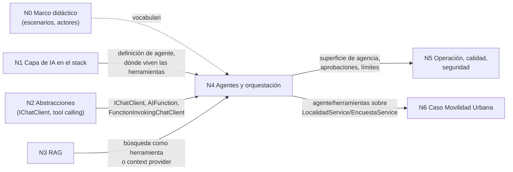

# N4 — Agentes, herramientas y orquestación en .NET (dossier de investigación)

> **Naturaleza**: material de trabajo para la mesa evaluadora. No es la guía final.
> **Fecha de relevamiento**: 2026-10-25. Las versiones salen de la API de nuget.org (`v3-flatcontainer` y `registration5-gz-semver2`) consultada ese día; las afirmaciones conceptuales, de las páginas de la [tabla de fuentes](#7-tabla-de-fuentes).
> **Convención**: `[Fxx]` remite a la tabla de fuentes. `[Exx]` son evidencias ejecutadas (comando + salida), en la [sección 3.0](#30-evidencia-ejecutada). Lo que es criterio del investigador va marcado **(criterio propio)**. Lo que no se pudo comprobar va marcado **(no verificado)**.
> **Partición de núcleos**: la de `Bitacoras/01-Descomposicion-Conceptual.md` (N0 marco didáctico, N1 capa en el stack, N2 abstracciones y proveedores, N3 RAG, N4 este, N5 operación/calidad/seguridad, N6 caso Movilidad Urbana).

> **Rótulo R-06** (dominio ilustrativo del dossier; la guía usa Movilidad Urbana): los snippets de §4 (estado de una línea, reportar un incidente) reflejan el proyecto compilado en `N4-Evidencia/compilecheck/`; se dejan así para no separarlos de la evidencia.

## Índice

- [1. Ideas agrupadas y dependencias con otros núcleos](#1-ideas-agrupadas-y-dependencias-con-otros-núcleos)
- [2. Definiciones](#2-definiciones)
- [3. Estado actual verificado (2026-10-25)](#3-estado-actual-verificado-2026-10-25)
- [4. Snippets representativos](#4-snippets-representativos)
- [5. Preguntas guía con respuestas](#5-preguntas-guía-con-respuestas)
- [6. Criterios de calidad y antipatrones](#6-criterios-de-calidad-y-antipatrones)
- [7. Tabla de fuentes](#7-tabla-de-fuentes)
- [8. Abierto / no verificado](#8-abierto--no-verificado)

---

## 1. Ideas agrupadas y dependencias con otros núcleos

### 1.1 Ideas del núcleo

| Grupo | Ideas | Por qué van juntas |
|---|---|---|
| **G1. El modelo pide, la app ejecuta** | Tool/function calling; `AIFunction`, `AIFunctionFactory.Create`, `FunctionInvokingChatClient` / `UseFunctionInvocation`; límites de iteración; aprobación humana (`ApprovalRequiredAIFunction`, `ToolApprovalRequestContent`). | Es el mecanismo mínimo de «agencia»: sin él no hay agente. Vive en MEAI (N2) y Agent Framework lo reutiliza [F04][F05][E02]. |
| **G2. Agente** | `AIAgent`, `ChatClientAgent`, `AsAIAgent`, `AgentSession` (ex-`AgentThread`), `AgentResponse` (ex-`AgentRunResponse`), instrucciones, herramientas, middleware, context providers, agente como herramienta (`AsAIFunction`). | Un agente es «LLM + instrucciones + herramientas + estado de conversación» detrás de una interfaz común [F01][F06]. |
| **G3. Workflow (grafo)** | `WorkflowBuilder`, `Executor`, aristas (condicionales, fan-out/fan-in), supersteps (modelo Pregel/BSP), eventos, checkpoints (`CheckpointManager`), human-in-the-loop (`RequestPort`, `RequestInfoEvent`), orquestaciones prearmadas (secuencial, concurrente, handoff, group chat, Magentic). | Es el control explícito del camino de ejecución, el equivalente .NET a lo que LangGraph resuelve en Python/JS [F07][F08][F09][F10]. |
| **G4. Linaje y estado de los marcos Microsoft** | Semantic Kernel (en soporte, sucesor MAF), AutoGen (archivado), Microsoft Agent Framework 1.x (GA desde 2026-04). | La pregunta «¿qué marco uso hoy?» se responde con el estado, no con la historia [F02][F03][F11][F12]. |
| **G5. LangGraph** | Qué es (LangChain Inc., grafo de estado, checkpointer, durable execution), lenguajes oficiales (Python, JS/TS), qué hay en .NET (nada oficial; terceros; LangChain .NET de tryAGI sin LangGraph), cómo se consume desde .NET (Agent Server por HTTP). | Responde la duda del PO con evidencia [F13]–[F18][E05][E06]. |
| **G6. MCP** | Protocolo para exponer/consumir herramientas, recursos y prompts entre procesos; SDK C# oficial `ModelContextProtocol` 2.x (cliente, servidor stdio, servidor HTTP con ASP.NET Core). | Es la «Third-Party Integration» de la imagen en forma de estándar; los `McpClientTool` son `AIFunction` y entran directo en G1/G2 [F19][F20][E03]. |
| **G7. Patrones y criterio** | «Building effective agents» (Anthropic): augmented LLM, prompt chaining, routing, parallelization, orchestrator-workers, evaluator-optimizer, agentes autónomos; «si podés escribir una función, no uses un agente». | Forma el criterio de **cuándo no** usar agentes, que es lo que el Profile pide [F21][F01]. |

### 1.2 Dependencias con los otros núcleos



| Núcleo | Qué le da N4 | Qué toma N4 |
|---|---|---|
| **N0** | Actores que deciden aprobar acciones (HITL), escenarios donde un agente no conviene. | Vocabulario ESC/CTX/ACT. |
| **N1** | Ubicación: el agente es un adaptador en `Infrastructure`, las herramientas envuelven casos de uso de `Application` **(criterio propio)**. | Definición operativa de agente y la regla «workflow antes que agente». |
| **N2** | Confirma que MAF 1.26.0 depende de `Microsoft.Extensions.AI` 10.10.0 / `.Abstractions` 10.10.1 [E01]; que `ToolApprovalRequestContent` reemplazó a `FunctionApprovalRequestContent` en MEAI [E04]. | `IChatClient`, `ChatClientBuilder`, `UseFunctionInvocation`, proveedor Ollama (OllamaSharp). |
| **N3** | Dos vías para enchufar RAG a un agente: como herramienta (`AIFunction` que busca) o como `AIContextProvider` [E01 tipos]. | El componente de búsqueda (`Microsoft.Extensions.VectorData`). |
| **N5** | Superficie de riesgo: agencia excesiva, bucles, aprobación ligada a sesión, checkpoints como frontera de confianza [F06][F09]. | OpenTelemetry, evaluación (`Microsoft.Extensions.AI.Evaluation`, del que MAF depende [E01]). |
| **N6** | Diseño de herramientas sobre `LocalidadService` (`GetAllAsync`, `SaveAsync`, `DeleteAsync`) y `EncuestaService` (`CountAsync`, `RegistrarAsync`) [E07]; snippet compilado [E02]. | El caso de uso concreto que recibe IA. |

---

## 2. Definiciones

Cada definición: **qué es / qué problema resuelve / qué no es**.

### 2.1 Tool calling (function calling)
- **Qué es**: el modelo no ejecuta nada; devuelve una *petición* de llamar a una función descrita por nombre, descripción y esquema JSON de parámetros. La aplicación ejecuta la función y le devuelve el resultado al modelo. En MEAI, la descripción es un `AIFunction` (normalmente creado con `AIFunctionFactory.Create(delegate)`) y el bucle «pedir → ejecutar → reenviar» lo hace `FunctionInvokingChatClient`, que se agrega con `ChatClientBuilder.UseFunctionInvocation()` [F04][E02].
- **Qué resuelve**: darle al modelo datos y acciones que no tiene (consultar una base, registrar algo) sin que el modelo invente la respuesta.
- **Qué no es**: no es un agente por sí mismo, ni le da al modelo acceso directo al sistema. El código .NET sigue decidiendo qué se ejecuta. `FunctionInvokingChatClient` expone `MaximumIterationsPerRequest`, `MaximumConsecutiveErrorsPerRequest`, `AllowConcurrentInvocation`, `TerminateOnUnknownCalls` e `IncludeDetailedErrors` [E01: XML de `Microsoft.Extensions.AI` 10.11.0].

### 2.2 Agente (en Microsoft Agent Framework)
- **Qué es**: un componente que «usa LLMs para procesar entradas, llamar herramientas y servidores MCP y generar respuestas» [F01]. En .NET la abstracción es `AIAgent` (`RunAsync`, `RunStreamingAsync`, `CreateSessionAsync`, `SerializeSessionAsync`/`DeserializeSessionAsync`) y la implementación general es `ChatClientAgent`, que funciona sobre **cualquier** `IChatClient` [F06][E01]. Se crea con el método de extensión `IChatClient.AsAIAgent(instructions, name, description, tools, …)` [E01][F22].
- **Qué resuelve**: tareas abiertas o conversacionales donde el modelo decide qué herramienta usar y en qué orden [F01 tabla «agents vs workflows»].
- **Qué no es**: no es un workflow; no garantiza el orden de los pasos. Anthropic lo define como sistema en el que «el LLM dirige dinámicamente su propio proceso y uso de herramientas» [F21].

### 2.3 Sesión de agente (`AgentSession`)
- **Qué es**: el estado de una conversación con un agente; la crea el propio agente con `CreateSessionAsync()` y se pasa a cada `RunAsync` [F22][F06]. Puede vivir en memoria (`InMemoryChatHistoryProvider`) o en el servicio, según el proveedor [F23][E01].
- **Qué resuelve**: multi-turno y continuidad (incluida la aprobación de herramientas, que se liga a la sesión) [F06].
- **Qué no es**: no es el `AgentThread` de Semantic Kernel ni el de las previews de MAF: en MAF 1.x el tipo se llama `AgentSession` [E04].

### 2.4 Aprobación humana de herramientas (tool approval)
- **Qué es**: envolver un `AIFunction` en `ApprovalRequiredAIFunction`. Cuando el modelo pide esa herramienta, la corrida termina con un `ToolApprovalRequestContent` en vez de ejecutar; el llamador muestra la petición, crea la respuesta con `CreateResponse(true|false)` y la reenvía en la misma sesión [F06].
- **Qué resuelve**: acciones con efectos (borrar, registrar, pagar) que no deben ejecutarse sin una persona.
- **Qué no es**: no es una validación de negocio; las reglas siguen en el caso de uso. En Python la doc explica que una respuesta de aprobación sólo vale si coincide con una petición pendiente de la misma sesión (*approval response binding*) [F06]; en .NET existen el tipo `ApprovalResponseBindingChatClient` y la opción `DisableApprovalResponseBinding`, que está tanto en `ChatClientAgentOptions` como en `HarnessAgentOptions` [E01][F06] *(corregido en la verificación adversarial: no es sólo del Harness)*.

### 2.5 Workflow (Agent Framework)
- **Qué es**: un grafo dirigido de **executors** unidos por **aristas**, construido con `WorkflowBuilder`, que «define caminos de ejecución explícitos e inspeccionables para coordinar código, agentes, estado, eventos y entrada humana» [F07]. En .NET la API es sólo la de grafo (Python además tiene una API funcional experimental) [F07].
- **Modelo de ejecución**: «Pregel modificado», *Bulk Synchronous Parallel* por **supersteps**: en cada superstep se entregan los mensajes pendientes, los executors destino corren en paralelo, hay una barrera de sincronización y los mensajes nuevos quedan para el superstep siguiente. Da ejecución determinista y checkpoints en los bordes de superstep [F08].
- **Qué resuelve**: procesos con pasos conocidos, orden explícito, varios agentes o funciones coordinados, ejecución larga con pausa y reanudación [F01][F09].
- **Qué no es**: no es un motor BPM ni de colas; el ejecutor documentado es en proceso (`InProcessExecution`) [F08]. Ejecución distribuida/durable fuera de proceso: **(no verificado)** en este relevamiento.

### 2.6 Executor
- **Qué es**: la unidad de trabajo de un workflow; recibe mensajes tipados, hace algo y envía mensajes (`SendMessageAsync`) o produce salida (`YieldOutputAsync`). La forma recomendada en C# es una clase `partial` derivada de `Executor` con métodos `[MessageHandler]` (generación de código en compilación, compatible con Native AOT) [F10]. También hay executors desde funciones (`Func<TIn,TOut>.BindAsExecutor(id)`) [E02].
- **Qué no es**: no es necesariamente un agente; un agente puede ser executor, pero un executor puede ser código puro [F10].
- **Hallazgo**: `[MessageHandler]` exige referenciar el paquete **`Microsoft.Agents.AI.Workflows.Generators`**; sin él la compilación falla con `CS0534 … does not implement inherited abstract member 'Executor.ConfigureProtocol(ProtocolBuilder)'` [E02]. La página de executors menciona «el source generator» pero no nombra el paquete [F10].

### 2.7 Checkpoint
- **Qué es**: una foto del workflow al final de un superstep: estado de executors, mensajes pendientes, peticiones/respuestas pendientes y estado compartido. Se habilita pasando un `CheckpointManager` (p. ej. `CheckpointManager.CreateInMemory()`) a `InProcessExecution.RunStreamingAsync`; se reanuda con `run.RestoreCheckpointAsync(cp)` o se rehidrata en otra instancia con `InProcessExecution.ResumeStreamingAsync(workflow, cp, manager)` [F09][E02].
- **Qué resuelve**: tolerancia a fallas y pausas largas (incluida la espera de una persona).
- **Qué no es**: no es un backup de la base de negocio. La doc advierte que el almacén de checkpoints es una frontera de confianza y que el workflow rehidratado debe conservar topología e identidades de executors (agentes con `ChatClientAgentOptions.Id` estable) [F09]. En .NET existen `InMemoryCheckpointManager`, `JsonCheckpointStore` y `FileSystemJsonCheckpointStore` [E01].

### 2.8 Human-in-the-loop en workflows (`RequestPort`)
- **Qué es**: un canal tipado `RequestPort.Create<TRequest,TResponse>(id)`; cuando un executor le manda un mensaje, el workflow emite `RequestInfoEvent`; el exterior responde con `run.SendResponseAsync(evt.Request.CreateResponse(valor))` y el framework enruta la respuesta [F11]. Las peticiones pendientes se guardan en el checkpoint y se re-emiten al restaurar [F11].
- **Qué no es**: no es la aprobación de herramientas de 2.4, aunque en orquestaciones de agentes la aprobación llega por el mismo mecanismo (`RequestInfoEvent` con `ToolApprovalRequestContent`) [F11].

### 2.9 Orquestaciones multiagente prearmadas
- **Qué son**: patrones listos en `AgentWorkflowBuilder`: `BuildSequential`, `BuildConcurrent`, `CreateHandoffBuilderWith`, `CreateGroupChatBuilderWith`, `CreateMagenticBuilderWith` [E01]; documentadas como secuencial, concurrente, handoff, group chat y Magentic [F12][F02].
- **Qué no son**: no reemplazan el diseño; son grafos ya armados. Un workflow puede exponerse como agente con `AsAIAgent()` [F07][E02].

### 2.10 Semantic Kernel (SK)
- **Qué es**: SDK de Microsoft para orquestar IA (Kernel, plugins con `[KernelFunction]`, `ChatCompletionAgent`, `AgentThread`) [F24][F25].
- **Estado**: su README dice «Semantic Kernel is now Microsoft Agent Framework!… MAF is the enterprise-ready successor to Semantic Kernel» [F03]. El blog de producto (2025-10-07) compromete arreglos de bugs críticos y seguridad por «al menos un año después de que Microsoft Agent Framework salga de Preview y sea GA» y que «la mayoría de las funcionalidades nuevas» irán a MAF; para un proyecto nuevo recomienda MAF si se puede esperar a la GA antes de salir a producción, y considera «perfectamente bien» usar SK en proyectos existentes o si hay que entregar rápido [F26] *(matiz corregido en la verificación adversarial)*. Sigue publicando: `Microsoft.SemanticKernel` 1.81.0 (2026-10-06) [E01].
- **Inferencia** **(criterio propio)**: MAF salió de preview con 1.0.0 el 2026-04-02 en nuget.org [E01] → el compromiso mínimo de SK llega a ~abril de 2027. No hay fecha oficial de fin de soporte publicada **(no verificado)**.
- **Qué no es**: no está deprecado en nuget.org (ningún aviso de deprecación en el registro) [E01].

### 2.11 AutoGen
- **Qué es**: marco multiagente de Microsoft Research (Python principalmente; tenía paquetes .NET).
- **Estado**: el README actual dice «**Project archived and no longer maintained** … Microsoft is not providing bug fixes, security fixes, new features, or support for this project» y deriva a MAF [F27]; ese texto entró el 2026-10-16 (commit «docs: clarify AutoGen is archived and no longer maintained (#8366)») [E05]. El flag `archived` del repositorio en la API de GitHub todavía da `false` el 2026-10-25 [E05]. En .NET: `Microsoft.AutoGen.Core` nunca salió de `0.4.0-dev.3` (2025-03-19) y `AutoGen.Core` (línea 0.2) quedó en 0.2.3 (2025-04-09) [E01].
- **Qué no es**: no es AG2 (`ag2ai/ag2`, «AG2 (formerly AutoGen)»), un fork comunitario independiente [E05].

### 2.12 Microsoft Agent Framework (MAF)
- **Qué es**: «sucesor directo» de SK y AutoGen, «creado por los mismos equipos»; combina las abstracciones simples de AutoGen con las capacidades empresariales de SK (sesiones, tipado, middleware, telemetría) y agrega workflows en grafo [F01]. Cuatro áreas: Agents, Harness Agent, Workflows, Integrations [F01]. .NET, Python y Go (Go en public preview) [F01].
- **Estado**: 1.0 GA para .NET y Python anunciado el 2026-04-03 («stable APIs, and a commitment to long-term support») [F02]; en nuget.org 1.0.0 está fechado 2026-04-02 y la última estable es **1.26.0 (2026-10-23)** [E01]. Cadencia observada: una estable por semana aprox. (1.21.0 2026-09-11 … 1.26.0 2026-10-23) [E01].
- **Qué no es**: no es Azure-only; el proveedor es cualquier `IChatClient` (incluido Ollama vía OllamaSharp) [F22][F23].

### 2.13 LangGraph
- **Qué es**: «framework de orquestación de bajo nivel y runtime para construir, gestionar y desplegar agentes con estado de larga duración», de LangChain Inc.; inspirado en **Pregel** y **Apache Beam**, con interfaz pública inspirada en NetworkX; capacidades centrales: *durable execution*, human-in-the-loop, memoria corta y larga [F13]. Se puede usar sin LangChain [F13].
- **Checkpointer**: persiste el estado del grafo de un *thread* como checkpoints; se activa con `builder.compile(checkpointer=...)` y un `thread_id` en la config; implementaciones `InMemorySaver`, `SqliteSaver`, `PostgresSaver` [F14].
- **Lenguajes oficiales**: Python (`langgraph` 1.2.17, 2026-10-24; 1.0.0 fue 2025-10-17) y JavaScript/TypeScript (`@langchain/langgraph` 1.5.2, 2026-10-21) [E06]. No hay SDK oficial para .NET: la organización `langchain-ai` en GitHub no tiene ningún SDK ni port de LangGraph/LangChain para .NET; el único repo con lenguaje C# es `LangChain-Commercial-Marketplace-Meters-Accelerator` (archivado, facturación de Azure Marketplace, no es un SDK) [E06]; en nuget.org la búsqueda «langgraph» devuelve 6 paquetes, todos de autores individuales o terceros (`LangGraph.Agent.Templates`, `SemanticKernel.Graph`, `Flowgine`, `Nexttag.Ai.Graph`, `RunAgent`, `HexaEight.Activate`) [E06].
- **Servidor**: «LangGraph Platform» pasó a llamarse **LangSmith Deployment** (octubre 2025), sin cambios de API según el changelog [F15][F16]. Su API REST (Agent Server API) expone *assistants*, *threads*, *runs* (con estado y sin estado), *crons* y *store*, más A2A y MCP; en LangSmith se autentica con `X-Api-Key` [F17]. Rutas reales tomadas del SDK oficial de Python: `POST /threads`, `POST /threads/{thread_id}/runs/wait`, `POST /threads/{thread_id}/runs/stream`, `POST /runs/wait`, `GET /threads/{thread_id}/state`, con cuerpo que incluye `assistant_id`, `input`, `command` [E06][F18]. `langgraph dev` levanta el servidor local en el puerto por defecto 2024 [E06].
- **Qué no es**: no es parte de .NET ni de LangChain .NET (tryAGI): ese proyecto es un port comunitario de LangChain (no oficial, «C# implementation of LangChain») y su árbol de código no contiene ningún componente de grafo/LangGraph [F28][E06].

### 2.14 Model Context Protocol (MCP)
- **Qué es**: «protocolo abierto que estandariza cómo las aplicaciones proveen contexto a los LLM» (herramientas, recursos, prompts) entre un cliente y un servidor [F19]. SDK C# oficial «mantenido en colaboración con Microsoft» [E05]: `ModelContextProtocol.Core` (cliente y servidor de bajo nivel), `ModelContextProtocol` (hosting + DI + descubrimiento por atributos, servidor stdio) y `ModelContextProtocol.AspNetCore` (servidor HTTP) [F19][F20].
- **Integración con G1/G2**: «`McpClientTool` hereda de `AIFunction`», así que lo que devuelve `ListToolsAsync` se pasa directo a un `IChatClient` o a un agente [F20][E02].
- **Versión de protocolo**: la DLL de `ModelContextProtocol.Core` 2.3.0 contiene las cadenas de versión `2024-11-05`, `2025-03-26`, `2025-06-18`, `2025-11-25` y `2026-07-28`; `modelcontextprotocol.io/specification/latest` redirige a `2026-07-28` [E03]. Que el SDK negocie todas esas versiones es una inferencia de las cadenas **(no verificado en la doc)**.
- **Qué no es**: no es un framework de agentes ni un reemplazo de tool calling; es el **transporte estándar** de herramientas entre procesos. Para una herramienta que sólo usa tu propia app, un `AIFunction` local alcanza **(criterio propio)**.

### 2.15 Patrones de sistemas agénticos (Anthropic, 2024-12-19)
- **Workflows vs agentes**: workflows = LLMs y herramientas orquestados por caminos de código predefinidos; agentes = el LLM dirige su propio proceso [F21].
- **Augmented LLM**: LLM + recuperación + herramientas + memoria; el bloque base [F21].
- **Prompt chaining**: secuencia fija de pasos LLM con verificaciones intermedias; cuando la tarea se descompone limpiamente [F21].
- **Routing**: clasificar la entrada y derivarla a un tratamiento especializado [F21].
- **Parallelization**: *sectioning* (subtareas en paralelo) o *voting* (la misma tarea varias veces) [F21].
- **Orchestrator-workers**: un LLM central divide dinámicamente, delega y sintetiza; cuando las subtareas no se pueden prever [F21].
- **Evaluator-optimizer**: un LLM genera, otro evalúa y da feedback en bucle; cuando hay criterios claros [F21].
- **Agentes autónomos**: bucle con feedback del entorno para problemas abiertos; más costo y errores compuestos; exigen sandbox, guardas y condiciones de corte (p. ej., máximo de iteraciones) [F21].
- **Principios**: simplicidad, transparencia (mostrar la planificación), diseñar bien la interfaz agente-computadora (ACI: documentación y prueba de herramientas); empezar con la API directa y entender el código de cualquier framework [F21].

**Mapeo a MAF (criterio propio, verificado contra la API [E01])**: chaining → `AddEdge` en cadena o `BuildSequential`; routing → aristas condicionales `AddEdge<T>(from, to, condition)` / `AddSwitch`; parallelization → `AddFanOutEdge` + `AddFanInBarrierEdge` o `BuildConcurrent`; orchestrator-workers → `CreateMagenticBuilderWith` o agente con otros agentes como herramientas (`AsAIFunction`); evaluator-optimizer → ciclo entre dos executors con arista condicional; agente autónomo → `ChatClientAgent` con herramientas y `MaximumIterationsPerRequest`.

---

## 3. Estado actual verificado (2026-10-25)

### 3.0 Evidencia ejecutada

- **[E01] Versiones, fechas, dependencias y superficie de API de NuGet.** Comandos: `curl https://api.nuget.org/v3-flatcontainer/<id>/index.json`, `curl --compressed https://api.nuget.org/v3/registration5-gz-semver2/<id>/index.json` (fecha `published` y `deprecation`), descarga de `.nupkg` y `grep` sobre `.nuspec` y XML de documentación (`lib/net10.0/*.xml`). Salida relevante:
  ```text
  microsoft.agents.ai | first stable: 1.0.0 2026-04-02 | last: 1.26.0 2026-10-23 | depr: None
  microsoft.agents.ai earliest: 1.0.0-preview.251001.1 2025-10-01
  microsoft.semantickernel | last: 1.81.0 2026-10-06 | depr: None
  modelcontextprotocol | first stable: 1.0.0 2026-02-25 | last: 2.3.0 2026-10-20
  microsoft.extensions.ai.ollama | last: 9.7.0-preview.1.25356.2 2025-07-08 | depr: ['Other'] "This package is deprecated and the OllamaSharp package is recommended."
  microsoft.autogen.core | last: 0.4.0-dev.3 2025-03-19 | stable: None
  autogen.core | last: 0.2.3 2025-04-09
  == microsoft.agents.ai (1.26.0) dependencias
  Microsoft.Agents.AI.Abstractions 1.26.0 · Microsoft.Extensions.AI 10.10.0 · Microsoft.Extensions.AI.Abstractions 10.10.1
  Microsoft.Extensions.AI.Evaluation 10.10.0 · Microsoft.Extensions.VectorData.Abstractions 10.10.0
  == tipos (Microsoft.Agents.AI.Abstractions 1.26.0)
  AIAgent, AgentSession, AgentResponse, AgentRunOptions, AIContextProvider, ChatHistoryProvider, InMemoryChatHistoryProvider, DelegatingAIAgent …
  == métodos
  AIAgent.RunAsync / RunStreamingAsync / CreateSessionAsync / SerializeSessionAsync / DeserializeSessionAsync
  Microsoft.Extensions.AI.ChatClientExtensions.AsAIAgent(IChatClient, string instructions, string name, string description, IList<AITool> tools, ILoggerFactory, IServiceProvider)
  AIAgentExtensions.AsAIFunction(AIAgent, AIFunctionFactoryOptions, AgentSession)
  AgentWorkflowBuilder.BuildSequential / BuildConcurrent / CreateHandoffBuilderWith / CreateGroupChatBuilderWith / CreateMagenticBuilderWith
  InProcessExecution.RunAsync / RunStreamingAsync / OpenStreamingAsync / ResumeAsync / ResumeStreamingAsync
  WorkflowBuilder.AddEdge / AddFanOutEdge / AddFanInBarrierEdge / AddSwitch / AddChain / AddExternalCall / WithOutputFrom
  ```
- **[E02] Compilación y ejecución de los snippets contra las versiones relevadas.** Proyecto en `OUTPUTs/Bitacoras/Nucleos/N4-Evidencia/compilecheck/` (`CompileCheck.csproj` + `Program.cs`) con `Microsoft.Agents.AI` 1.26.0, `Microsoft.Agents.AI.Workflows` 1.26.0, `Microsoft.Agents.AI.Workflows.Generators` 1.26.0, `Microsoft.Extensions.AI` 10.11.0, `OllamaSharp` 5.5.0, `ModelContextProtocol` 2.3.0. Comando: `docker run --rm -v <proyecto>:/src -v <cache-nuget>:/root/.nuget/packages -w /src <imagen-sdk-10.0.400> sh -c 'dotnet build && dotnet run --no-build'`.
  - Primer intento sin `…Workflows.Generators`: `error CS0534: 'UppercaseExecutor' does not implement inherited abstract member 'Executor.ConfigureProtocol(ProtocolBuilder)'`.
  - Segundo intento con el snippet oficial `uppercaseFunc.BindExecutor("…")` [F10]: `error CS0411: The type arguments for method 'ExecutorBindingExtensions.BindExecutor<TExecutor>(Func<string, string, ValueTask<TExecutor>>, string)' cannot be inferred`. El método para funciones en 1.26.0 es `BindAsExecutor` [E01].
  - Tercer intento: `Build succeeded. 0 Warning(s) 0 Error(s)`; ejecución del workflow (sin LLM): `checkpoint: True` / `output: ALOH` / `checkpoint: True`.
  - **Límite**: las partes que llaman al modelo (agente, aprobación, tool calling) **compilan pero no se ejecutaron**: no había Ollama en `localhost:11434` en el entorno del investigador (`curl /api/tags` vacío). Queda para N6 contra el servidor Ollama de la LAN del laboratorio.
- **[E03] Versión de protocolo MCP en el SDK.** Búsqueda de cadenas UTF-16 `YYYY-MM-DD` en `ModelContextProtocol.Core.dll` 2.3.0 (`lib/net10.0`): `['2024-11-05', '2025-03-26', '2025-06-18', '2025-11-25', '2026-07-28']`. `curl -w '%{redirect_url}' https://modelcontextprotocol.io/specification/latest` → `https://modelcontextprotocol.io/specification/2026-07-28`. Tipos verificados en el XML: `McpClient.CreateAsync`, `ListToolsAsync`, `CallToolAsync`, `StdioClientTransport`, `HttpClientTransport`, `McpServerToolAttribute`, `AddMcpServer`, `WithStdioServerTransport`, `WithToolsFromAssembly`, `WithHttpTransport`, `MapMcp`, `HttpServerSessionMode`.
- **[E04] Renombres verificados comparando paquetes.**
  ```text
  Microsoft.Agents.AI.Abstractions 1.0.0-preview.251001.2 : AgentRunResponse, AgentThread  (AIAgent.GetNewThread)
  Microsoft.Agents.AI.Abstractions 1.0.0 / 1.26.0          : AgentResponse, AgentSession  (AIAgent.CreateSessionAsync)
  Microsoft.Extensions.AI.Abstractions 10.0.0              : FunctionApprovalRequestContent, FunctionApprovalResponseContent
  Microsoft.Extensions.AI.Abstractions 10.5.0 / 10.8.0     : ToolApprovalRequestContent, ToolApprovalResponseContent
  ```
- **[E05] Estado de repositorios (API de GitHub, `GET /repos/{owner}/{repo}`) y README.**
  ```text
  microsoft/autogen           archived=False pushed=2026-10-16  README: "Project archived and no longer maintained"
     commit README 2026-10-16 "docs: clarify AutoGen is archived and no longer maintained- #1 (#8366)"
     commit README 2026-04-06 "Update maintenance mode banner in readme (#7521)"
  microsoft/semantic-kernel   archived=False pushed=2026-10-23  README: "Semantic Kernel is now Microsoft Agent Framework!"
  microsoft/agent-framework   archived=False pushed=2026-10-25
  modelcontextprotocol/csharp-sdk archived=False "The official C# SDK for Model Context Protocol servers and clients. Maintained in collaboration with Microsoft."
  tryAGI/LangChain            archived=False pushed=2026-10-20 "C# implementation of LangChain…"
  ag2ai/ag2                   "AG2 (formerly AutoGen): The Open-Source AgentOS."
  ```
- **[E06] LangGraph: registros y código.**
  ```text
  pypi langgraph 1.2.17 (2026-10-24) · 1.0.0 (2025-10-17) · langgraph-sdk 0.4.9 · langgraph-cli 0.4.38
  npm @langchain/langgraph 1.5.2 (2026-10-21) · @langchain/langgraph-sdk 1.12.7 (2026-10-22)
  nuget search "langgraph": totalHits 6 → LangGraph.Agent.Templates 1.0.0 (Prasanna Ruwangana), SemanticKernel.Graph 25.10.301 (Kallebe Lins),
     Flowgine 0.2.1 (Flowgine.Net), Nexttag.Ai.Graph 0.3.0 (Jonathan Schenker), RunAgent 0.1.48, HexaEight.Activate 1.0.80
  GitHub org langchain-ai, repos con dotnet/csharp en el nombre: ninguno (sí langsmith-java, langchain-google, langchain-mongodb; `net-mocks` es TypeScript)
  [verificación adversarial] único repo con language=C#: LangChain-Commercial-Marketplace-Meters-Accelerator (archived=True, «A metered billing scheduler that works with Azure Managed Applications»)
  tryAGI/LangChain árbol main: rutas con "raph": [] ; src/: Cli, Core, DocumentLoaders, Extensions, Meta, Serve, Splitters, Utilities
  langgraph_sdk/_async/runs.py: "/threads/{thread_id}/runs", ".../runs/wait", ".../runs/stream", "/runs/wait", "/runs/stream"; payload "assistant_id", "input", "command"
  langgraph_sdk/_async/threads.py: "/threads", "/threads/{thread_id}/state", "/threads/{thread_id}/history"
  libs/cli/README.md: "langgraph dev … --port INTEGER Port to bind to (default: 2024)"
  GitHub search "langgraph language:C#": 30 repos; el más cercano "Kauakfm/SharpGraph — LangGraph for .NET", 3 estrellas
  ```
- **[E07] Caso base (sólo lectura).** `src/MovilidadUrbana.Web/Application/Localidades/LocalidadService.cs`: `GetAllAsync`, `SaveAsync(LocalidadModel)`, `DeleteAsync(int)` devolviendo `Result(IsSuccess, Message, Errors)`; `Encuestas/EncuestaService.cs`: `CountAsync`, `ValidarPaso`, `RegistrarAsync`. Entidad `Localidad`: `Id`, `SessionId`, `Nombre`, `Provincia`, `CodigoPostal`, `Habitantes`.

### 3.1 Tabla de estado

| Tecnología | Paquete NuGet | Última estable | Última preview | Fecha | Estado | Doc oficial |
|---|---|---|---|---|---|---|
| Tool calling (MEAI) | `Microsoft.Extensions.AI` | **10.11.0** | — | 2026-10-14 | GA | [F04] |
| MAF núcleo | `Microsoft.Agents.AI` | **1.26.0** | — | 2026-10-23 | GA (1.0.0 el 2026-04-02) | [F01][F02] |
| MAF abstracciones | `Microsoft.Agents.AI.Abstractions` | **1.26.0** | — | 2026-10-23 | GA | [F01] |
| MAF workflows | `Microsoft.Agents.AI.Workflows` | **1.26.0** | — | 2026-10-23 | GA | [F07] |
| MAF generador de executors | `Microsoft.Agents.AI.Workflows.Generators` | **1.26.0** | — | 2026-10-23 | GA | [F10] (sin nombrar el paquete) |
| MAF workflows declarativos (YAML) | `Microsoft.Agents.AI.Workflows.Declarative` | **1.26.0** | — | 2026-10-23 | GA desde 1.9.0 (2026-06-03); al salir MAF 1.0 estaba en `1.0.0-rc6` aunque el blog 1.0 lo presentaba entre las novedades | [F02][E01] |
| MAF Harness | `Microsoft.Agents.AI.Harness` | **1.26.0** | — | 2026-10-23 | GA en NuGet desde 1.14.0 (2026-07-21) (el blog 1.0 lo listaba como preview) | [F01][F06] |
| MAF OpenAI | `Microsoft.Agents.AI.OpenAI` | **1.26.0** | — | 2026-10-23 | GA | [F23] |
| MAF Anthropic | `Microsoft.Agents.AI.Anthropic` | **1.26.0** | — | 2026-10-23 | GA desde 1.24.0 (2026-10-07) | [F23] |
| MAF Foundry | `Microsoft.Agents.AI.Foundry` | 1.5.0 | 1.26.0-preview.261023.1 | 2026-05-08 / 2026-10-23 | estable viejo + preview actual | [F01] |
| MAF Hosting | `Microsoft.Agents.AI.Hosting` | — | 1.26.0-preview.261023.1 | 2026-10-23 | preview | — |
| MAF A2A | `Microsoft.Agents.AI.A2A` | — | 1.26.0-preview.261023.1 | 2026-10-23 | preview | [F02] |
| MAF DevUI | `Microsoft.Agents.AI.DevUI` | — | 1.26.0-preview.261023.1 | 2026-10-23 | preview | [F02] |
| MAF MCP (paquete propio) | `Microsoft.Agents.AI.Mcp` | — | 1.26.0-alpha.261023.1 | 2026-10-23 | alpha (las MCP tools locales andan con el SDK MCP, ver 4.6) | — |
| Ollama para MAF/MEAI | `OllamaSharp` | **5.5.0** | — | 2026-09-30 | GA (recomendado) | [F23] |
| Ollama MEAI viejo | `Microsoft.Extensions.AI.Ollama` | — | 9.7.0-preview.1.25356.2 | 2025-07-08 | **deprecado** → OllamaSharp | [E01] |
| Semantic Kernel | `Microsoft.SemanticKernel` | **1.81.0** | — | 2026-10-06 | GA, en soporte; sucesor MAF | [F03][F26] |
| SK agentes | `Microsoft.SemanticKernel.Agents.Core` | **1.81.0** | — | 2026-10-06 | GA (la doc todavía dice `--prerelease`) | [F25] |
| SK orquestación | `Microsoft.SemanticKernel.Agents.Orchestration` | — | 1.81.0-preview | 2026-10-06 | preview | — |
| AutoGen .NET (0.4) | `Microsoft.AutoGen.Core` | — | 0.4.0-dev.3 | 2025-03-19 | nunca estable; proyecto archivado | [F27] |
| AutoGen .NET (0.2) | `AutoGen.Core` | 0.2.3 | — | 2025-04-09 | sin actividad; proyecto archivado | [F27] |
| MCP C# | `ModelContextProtocol` / `.Core` / `.AspNetCore` | **2.3.0** | — | 2026-10-20 | GA (1.0.0 el 2026-02-25; 2.0.0 el 2026-07-28) | [F19][F20] |
| LangChain .NET (tryAGI) | `LangChain` | 0.17.1 | 0.17.2-dev.20 | 2026-04-30 / 2026-10-20 | comunitario, sin LangGraph | [F28] |
| LangGraph | — (no hay paquete oficial .NET) | — | — | — | Python 1.2.17 / JS 1.5.2 | [F13][E06] |

---

## 4. Snippets representativos

> Los de 4.1–4.5 **compilan** contra las versiones de la tabla: la mayoría dentro del proyecto de [E02]; el cast `(FunctionCallContent)…ToolCall` de 4.3, el bucle completo de 4.5, los servidores de 4.6 y 4.8–4.9 se compilaron recién en la verificación adversarial (ver [V01] al final), porque no estaban en el `Program.cs` de [E02]. La endpoint se toma de `OLLAMA_ENDPOINT` con `http://localhost:11434` por defecto. El nombre de modelo por defecto es un ejemplo; el que corre en el servidor Ollama de la LAN del laboratorio lo fija N6.

### 4.1 Tool calling con MEAI (sin agente)
Adaptado de [F04] (cambia el proveedor por OllamaSharp, como en [F23]).
```csharp
using System.ComponentModel;
using Microsoft.Extensions.AI;
using OllamaSharp;

var endpoint = Environment.GetEnvironmentVariable("OLLAMA_ENDPOINT") ?? "http://localhost:11434";
var model = Environment.GetEnvironmentVariable("OLLAMA_MODEL") ?? "qwen3:4b";

IChatClient client = new ChatClientBuilder(new OllamaApiClient(new Uri(endpoint), model))
    .UseFunctionInvocation(configure: f => f.MaximumIterationsPerRequest = 5) // corte explícito del bucle
    .Build();

var options = new ChatOptions { Tools = [AIFunctionFactory.Create(Tools.GetEstadoLinea)] };
ChatResponse r = await client.GetResponseAsync("¿Cómo está la línea 1?", options);

static class Tools
{
    [Description("Devuelve el estado operativo de una línea.")]
    public static string GetEstadoLinea([Description("Código de línea")] string linea) => $"Línea {linea}: normal";
}
```

### 4.2 Agente con Agent Framework sobre Ollama
Adaptado de [F23] (página Ollama de MAF) y [F22].
```csharp
using Microsoft.Agents.AI;
using Microsoft.Extensions.AI;
using OllamaSharp;

AIAgent agent = new OllamaApiClient(new Uri(endpoint), model)
    .AsAIAgent(
        instructions: "Respondé sobre movilidad urbana. Si no sabés, decilo.",
        name: "Movilidad",
        tools: [AIFunctionFactory.Create(Tools.GetEstadoLinea)]);

AgentSession session = await agent.CreateSessionAsync();
Console.WriteLine(await agent.RunAsync("¿Cómo está la línea 1?", session));
Console.WriteLine(await agent.RunAsync("¿Y la 2?", session)); // mismo hilo de conversación
```
Nota: la página Ollama de MAF instala `Microsoft.Agents.AI --prerelease` [F23], pero hay estable 1.26.0 [E01]; para la guía alcanza la estable.

### 4.3 Herramienta con aprobación humana
Tomado de [F06], cambiando el proveedor.
```csharp
AIFunction reportar = new ApprovalRequiredAIFunction(AIFunctionFactory.Create(Tools.ReportarIncidente));
AIAgent agent = baseClient.AsAIAgent(instructions: "…", tools: [reportar]);

AgentSession session = await agent.CreateSessionAsync();
AgentResponse response = await agent.RunAsync("Reportá un corte en la línea 1", session);

var pedidos = response.Messages.SelectMany(m => m.Contents).OfType<ToolApprovalRequestContent>().ToList();
if (pedidos.Count > 0)
{
    var llamada = (FunctionCallContent)pedidos[0].ToolCall;          // nombre + argumentos para mostrar al usuario
    bool aprobado = /* decisión de la persona */ true;
    var aprobacion = new ChatMessage(ChatRole.User, [pedidos[0].CreateResponse(aprobado)]);
    Console.WriteLine(await agent.RunAsync(aprobacion, session));     // misma sesión
}
```

### 4.4 Workflow con executors, checkpoints y salida
Tomado de [F10], [F08] y [F09], con las correcciones de [E02] (`BindAsExecutor`; paquete `…Workflows.Generators`).
```csharp
using Microsoft.Agents.AI.Workflows;
// <PackageReference Include="Microsoft.Agents.AI.Workflows.Generators" Version="1.26.0" />  ← necesario para [MessageHandler]

var upper = new UppercaseExecutor();
Func<string, string> invertir = s => new string(s.Reverse().ToArray());
var reverse = invertir.BindAsExecutor("Reverse");                 // la doc dice BindExecutor: no compila en 1.26.0

Workflow wf = new WorkflowBuilder(upper).AddEdge(upper, reverse).WithOutputFrom(reverse).Build();

CheckpointManager cm = CheckpointManager.CreateInMemory();
await using StreamingRun run = await InProcessExecution.RunStreamingAsync(wf, "hola", cm);
await foreach (WorkflowEvent evt in run.WatchStreamAsync())
{
    if (evt is SuperStepCompletedEvent s) Console.WriteLine($"checkpoint: {s.CompletionInfo?.Checkpoint is not null}");
    if (evt is WorkflowOutputEvent o) Console.WriteLine($"output: {o.Data}");
}

internal sealed partial class UppercaseExecutor() : Executor("UppercaseExecutor")
{
    [MessageHandler]
    private ValueTask<string> HandleAsync(string message, IWorkflowContext context)
        => ValueTask.FromResult(message.ToUpperInvariant());
}
```
Salida real: `checkpoint: True` · `output: ALOH` · `checkpoint: True` [E02].

### 4.5 Human-in-the-loop en un workflow
Tomado de [F11]. El bucle completo se **compiló y ejecutó** en la verificación adversarial con un `JudgeExecutor` propio (objetivo 42; salida `request -> 40`, `-> 41`, `-> 42`, `hitl output: 42 found`) [V01]. Ojo: un executor que llama `SendMessageAsync`/`YieldOutputAsync` tiene que declarar los tipos (`[MessageHandler(Send = [typeof(NumberSignal)], Yield = [typeof(string)])]` o `[SendsMessage]`/`[YieldsOutput]`); si no, falla en ejecución con `InvalidOperationException: Executor 'Judge' cannot send messages of type 'NumberSignal'` [V01][F10].
```csharp
var numberRequestPort = RequestPort.Create<NumberSignal, int>("GuessNumber");
var workflow = new WorkflowBuilder(numberRequestPort)
    .AddEdge(numberRequestPort, judgeExecutor)
    .AddEdge(judgeExecutor, numberRequestPort)
    .WithOutputFrom(judgeExecutor)
    .Build();

await using StreamingRun handle = await InProcessExecution.RunStreamingAsync(workflow, NumberSignal.Init);
await foreach (WorkflowEvent evt in handle.WatchStreamAsync())
{
    switch (evt)
    {
        case RequestInfoEvent req:
            int guess = /* respuesta de la persona o sistema externo */ 0;
            await handle.SendResponseAsync(req.Request.CreateResponse(guess));
            break;
        case WorkflowOutputEvent outputEvt:
            Console.WriteLine(outputEvt.Data);
            return;
    }
}
```

### 4.6 MCP: servidor stdio, servidor HTTP y cliente que entrega tools a un agente
Servidor y cliente tomados de [F20]; la última línea (pasar las tools a un agente) es adaptación compilada en [E02].
```csharp
// Servidor stdio (paquetes: ModelContextProtocol, Microsoft.Extensions.Hosting)
var builder = Host.CreateApplicationBuilder(args);
builder.Logging.AddConsole(o => o.LogToStandardErrorThreshold = LogLevel.Trace); // stdout es el canal del protocolo
builder.Services.AddMcpServer().WithStdioServerTransport().WithToolsFromAssembly();
await builder.Build().RunAsync();

[McpServerToolType]
public static class EchoTool
{
    [McpServerTool, Description("Echoes the message back to the client.")]
    public static string Echo(string message) => $"hello {message}";
}
```
```csharp
// Servidor HTTP (paquete: ModelContextProtocol.AspNetCore)
builder.Services.AddMcpServer()
    .WithHttpTransport(o => o.SessionMode = HttpServerSessionMode.Stateless)
    .WithToolsFromAssembly();
var app = builder.Build();
app.MapMcp();
```
```csharp
// Cliente
var transport = new StdioClientTransport(new StdioClientTransportOptions
{
    Name = "Everything", Command = "npx", Arguments = ["-y", "@modelcontextprotocol/server-everything"],
});
McpClient mcp = await McpClient.CreateAsync(transport);
IList<McpClientTool> tools = await mcp.ListToolsAsync();
AIAgent agente = chatClient.AsAIAgent(instructions: "…", tools: [.. tools]); // McpClientTool : AIFunction
```
La doc del SDK pide, para servidores HTTP locales, limitar `AllowedHosts` a loopback (DNS rebinding) y no habilitar CORS salvo necesidad [F20].

### 4.7 Orquestación prearmada y workflow como agente
Compilado en [E02]; firmas en [E01].
```csharp
Workflow secuencial = AgentWorkflowBuilder.BuildSequential(redactor, revisor);
AIAgent comoAgente = secuencial.AsAIAgent();     // un workflow expuesto con la interfaz de agente [F07]
```

### 4.8 Consumir un grafo LangGraph desde .NET por HTTP
**Adaptación propia, no ejecutada**: rutas y campos tomados del SDK oficial de Python [E06]; puerto 2024 = `langgraph dev` [E06]. No hay cliente .NET oficial.
```csharp
using System.Net.Http.Json;

var baseUrl = Environment.GetEnvironmentVariable("LANGGRAPH_URL") ?? "http://localhost:2024";
using var http = new HttpClient { BaseAddress = new Uri(baseUrl) };
// En LangSmith Deployment: http.DefaultRequestHeaders.Add("X-Api-Key", Environment.GetEnvironmentVariable("LANGSMITH_API_KEY"));

var thread = await (await http.PostAsJsonAsync("/threads", new { })).Content.ReadFromJsonAsync<Dictionary<string, object>>();
var threadId = thread!["thread_id"].ToString();

var resp = await http.PostAsJsonAsync($"/threads/{threadId}/runs/wait", new
{
    assistant_id = "agent",                                        // nombre del grafo en langgraph.json
    input = new { messages = new[] { new { role = "user", content = "Hola" } } },
});
Console.WriteLine(await resp.Content.ReadAsStringAsync());          // estado final del grafo
```
Campo `thread_id` en la respuesta de `POST /threads`: confirmado en el esquema del SDK oficial (`langgraph_sdk/schema.py`, `class Thread(TypedDict): thread_id: str`, que es lo que devuelve `threads.create`) [V02]; contra la página de la doc REST sigue **(no verificado)**.

### 4.9 Semantic Kernel (referencia para quien migra)
Tomado de [F25] y [F29] (antes → después).
```csharp
// SK
KernelFunction function = KernelFunctionFactory.CreateFromMethod(GetWeather);
KernelPlugin plugin = KernelPluginFactory.CreateFromFunctions("KernelPluginName", [function]);
kernel.Plugins.Add(plugin);
ChatCompletionAgent agent = new() { Kernel = kernel, Instructions = "…" };
await foreach (var r in agent.InvokeAsync(userInput, thread)) { … }

// MAF
AIAgent agent = chatClient.AsAIAgent(tools: [AIFunctionFactory.Create(GetWeather)]);
AgentResponse r = await agent.RunAsync(userInput, session);
```

---

## 5. Preguntas guía con respuestas

**P1. ¿Cuándo alcanza con tool calling y cuándo necesito un agente?**
Si la interacción es una pregunta → una o pocas llamadas a funciones → una respuesta, `IChatClient` con `UseFunctionInvocation` alcanza (4.1). Un agente de MAF (4.2) se justifica cuando querés una entidad reutilizable con instrucciones, sesión multi-turno, middleware, context providers o aprobación integrada, o componerlo en workflows. La tabla oficial lo pone así: agente cuando «la tarea es abierta o conversacional» o «una sola llamada al LLM (quizás con herramientas) alcanza» [F01]. **(criterio propio)**: en código, `ChatClientAgent` es un envoltorio sobre el mismo `IChatClient`; pasar de 4.1 a 4.2 cuesta poco, así que se empieza por 4.1.

**P2. ¿Cuándo NO uso un agente?**
Cuando podés escribir la función: «If you can write a function to handle the task, do that instead of using an AI agent» [F01]. Anthropic: buscar la solución más simple; muchas veces una sola llamada optimizada con recuperación y ejemplos alcanza; los sistemas agénticos cambian latencia y costo por desempeño [F21]. En Movilidad Urbana, validar un código postal o contar encuestas es código determinista (`ValidarPaso`, `CountAsync`) [E07]; no lleva LLM **(criterio propio)**.

**P3. ¿Agente o workflow?**
Workflow cuando el proceso tiene pasos definidos, necesitás orden explícito o coordinar varios agentes/funciones; agente cuando hace falta uso autónomo de herramientas y planificación [F01]. Si vas a necesitar pausar días esperando una aprobación y reanudar tras un reinicio, eso es workflow con checkpoints y `RequestPort` [F09][F11]. **(criterio propio)**: un buen diseño suele ser un workflow determinista con uno o dos executors que son agentes, no un agente que «decide todo».

**P4. Se escuchó hablar de LangGraph en .NET. ¿Existe?**
No hay LangGraph oficial para .NET. LangGraph es de LangChain Inc. y se publica para Python (`langgraph` 1.2.17) y JS/TS (`@langchain/langgraph` 1.5.2) [E06][F13]; la organización `langchain-ai` no tiene ningún SDK ni port .NET (su único repo en C# es un acelerador de facturación archivado) [E06][V02]. En NuGet sólo aparecen paquetes de terceros que usan el nombre o la idea (`LangGraph.Agent.Templates`, `SemanticKernel.Graph`, `Nexttag.Ai.Graph`, `Flowgine`…), ninguno de LangChain [E06]. LangChain .NET (tryAGI) es un port comunitario de LangChain sin componente de grafo [F28][E06]. Lo que probablemente se escuchó **(criterio propio)**: (a) comparaciones «LangGraph vs Semantic Kernel/Agent Framework» o (b) que los workflows de MAF ocupan en .NET el lugar que LangGraph ocupa en Python: ambos son grafos con estado, inspirados en Pregel, con checkpoints y human-in-the-loop [F08][F13].

**P5. Mi equipo de datos tiene un grafo LangGraph en Python. ¿Lo reescribo en C#?**
No necesariamente. Opciones: (1) desplegarlo como servidor (LangSmith Deployment / `langgraph dev` / `langgraph up`) y consumirlo por HTTP desde .NET (4.8) [F17][E06]; (2) exponerlo como servidor MCP o A2A y consumirlo como herramienta o agente remoto: el Agent Server lista MCP y A2A entre sus recursos [F17] y MAF soporta ambos [F02] (detalle de configuración **no verificado**); (3) reescribirlo como workflow de MAF si querés un solo runtime .NET. **(criterio propio)**: la opción 1 conserva un segundo stack (Python, licencia/operación de LangSmith) que alguien tiene que operar; la 3 cuesta reescritura pero simplifica N5.

**P6. ¿Uso Semantic Kernel o Agent Framework en un proyecto nuevo?**
Agent Framework: el propio README de SK lo presenta como sucesor, y el blog de producto recomienda MAF para proyectos nuevos una vez GA, que ocurrió el 2026-04-03 [F03][F26][F02]. SK sigue recibiendo releases (1.81.0, 2026-10-06) y es razonable mantener lo que ya está en producción [F26][E01]. Hay guía de migración con mapeos uno a uno (Kernel → `IChatClient`, `[KernelFunction]` → método con `[Description]`, `AgentThread` → `AgentSession`, `InvokeAsync` → `RunAsync`) [F29].

**P7. ¿Y AutoGen?**
No para trabajo nuevo: el README del repo lo declara archivado y sin fixes de seguridad (texto vigente desde el commit del 2026-10-16; antes, desde 2026-04-06, tenía un aviso de modo mantenimiento) y deriva a MAF [F27][E05]. En .NET nunca tuvo la versión 0.4 estable [E01].

**P8. ¿Qué es MCP y cuándo expongo mi aplicación como servidor MCP?**
MCP estandariza cómo un cliente de IA descubre y llama herramientas/recursos de otro proceso [F19]. Conviene exponer la app como servidor MCP cuando querés que **otros** clientes de IA (IDEs, asistentes, agentes de otros equipos) usen sus casos de uso sin acoplarse a tu código. Para herramientas que usa sólo tu propio agente, un `AIFunction` en proceso es más simple **(criterio propio)**. Si exponés por HTTP, aplicá las recomendaciones del SDK (`AllowedHosts`, CORS restrictivo) [F20], y la autorización la trata N5.

**P9. ¿Cómo convierto un caso de uso existente en herramienta sin saltear sus reglas?**
**(criterio propio, apoyado en [F21] ACI y [E07])**: la herramienta llama al servicio de aplicación (`LocalidadService.SaveAsync`), nunca al repositorio ni al `DbContext`; devuelve el `Result` (mensaje y errores por campo) para que el modelo pueda corregir; las acciones con efecto (`SaveAsync`, `DeleteAsync`) van envueltas en `ApprovalRequiredAIFunction` [F06]; las de lectura (`GetAllAsync`) no. El `SessionId` que aísla datos por visitante lo pone el código, no el modelo [E07].

**P10. ¿Qué patrón de Anthropic corresponde a qué en MAF?**
Ver el mapeo de 2.15. Regla práctica: si podés dibujar el diagrama de antemano, es un workflow (chaining, routing, parallelization, evaluator-optimizer); si el número y tipo de pasos depende del problema, orchestrator-workers o agente autónomo [F21].

**P11. ¿Necesito checkpoints?**
Sí cuando el workflow puede tardar más que la vida del proceso o del request (aprobaciones humanas, tareas largas), o cuando querés reanudar ante fallas [F09]. No en un pipeline corto dentro de un request HTTP **(criterio propio)**. Si los usás: ids estables de executors y agentes, y almacenamiento tratado como frontera de confianza [F09].

---

## 6. Criterios de calidad y antipatrones

### 6.1 Criterios
1. **Empezar por lo más simple**: llamada única → tool calling → workflow → agente; subir de nivel sólo con evidencia de que mejora [F21][F01].
2. **Herramientas bien descritas (ACI)**: nombre y `[Description]` claros en función y parámetros; probar cómo las usa el modelo [F21][F06].
3. **Corte explícito del bucle**: `MaximumIterationsPerRequest` y `MaximumConsecutiveErrorsPerRequest` en `FunctionInvokingChatClient` [E01]; condiciones de parada en agentes autónomos [F21].
4. **Aprobación humana para efectos**: `ApprovalRequiredAIFunction` y respuesta en la misma `AgentSession` [F06].
5. **Herramientas sobre casos de uso, no sobre datos** **(criterio propio)** [E07].
6. **Ids estables** en agentes de workflows con checkpoints (`ChatClientAgentOptions.Id`, `Name`) [F09].
7. **Versiones fijadas** y revisadas: MAF publica una estable por semana [E01]; renombres recientes [E04].
8. **Transparencia**: emitir y observar eventos de workflow (`ExecutorCompletedEvent`, `SuperStepCompletedEvent`) [F08]; telemetría en N5.

### 6.2 Antipatrones
| Antipatrón | Por qué falla | Fuente |
|---|---|---|
| Agente para lo que es una función | Más costo, latencia y errores compuestos sin beneficio | [F01][F21] |
| Herramienta que escribe directo a la base | Saltea validaciones y reglas del caso de uso; el modelo puede violar invariantes | (criterio propio) [E07] |
| Acciones destructivas sin aprobación | Agencia excesiva | [F06] |
| Bucle sin límite de iteraciones | Costo y loops infinitos | [F21][E01] |
| Usar snippets de las previews de 2025 (`AgentThread`, `GetNewThread`, `AgentRunResponse`, `FunctionApprovalRequestContent`) | No compilan en MAF 1.x / MEAI 10.5+ | [E04] |
| Copiar `BindExecutor` de la doc de executors | No compila en 1.26.0; usar `BindAsExecutor` | [E02] |
| Olvidar `Microsoft.Agents.AI.Workflows.Generators` | `CS0534` en executors con `[MessageHandler]` | [E02] |
| Elegir `Microsoft.Extensions.AI.Ollama` | Deprecado; usar OllamaSharp | [E01] |
| Arrancar con AutoGen | Archivado, sin fixes de seguridad | [F27] |
| Buscar «LangGraph para .NET» en paquetes de terceros como si fueran oficiales | No los publica LangChain; mantenimiento incierto | [E06] |
| Cargar checkpoints de origen no confiable | El almacén es frontera de confianza | [F09] |
| Exponer un servidor MCP HTTP con `AllowedHosts="*"` o CORS abierto | DNS rebinding / acceso cruzado | [F20] |
| Framework antes que entender la API | Las abstracciones ocultan prompts y respuestas y dificultan depurar | [F21] |

---

## 7. Tabla de fuentes

Fecha de consulta de todas: **2026-10-25**.

| Id | URL | Qué respalda |
|---|---|---|
| F01 | https://learn.microsoft.com/en-us/agent-framework/overview/ (ms.date 2026-07-29) | Definición de MAF, áreas, agentes vs workflows, «if you can write a function…», sucesor de SK y AutoGen, Go en preview |
| F02 | https://devblogs.microsoft.com/agent-framework/microsoft-agent-framework-version-1-0/ (2026-04-03, Shawn Henry) | 1.0 GA .NET/Python; qué es estable y qué preview; MCP, A2A, orquestaciones |
| F03 | https://github.com/microsoft/semantic-kernel (README) | «Semantic Kernel is now Microsoft Agent Framework!»; MAF sucesor |
| F04 | https://learn.microsoft.com/en-us/dotnet/ai/quickstarts/use-function-calling (ms.date 2026-03-04) | `UseFunctionInvocation`, `AIFunctionFactory.Create`, `ChatOptions.Tools` |
| F05 | https://www.nuget.org/packages/Microsoft.Extensions.AI | Paquete MEAI (versión vía API [E01]) |
| F06 | https://learn.microsoft.com/en-us/agent-framework/agents/tools/tool-approval (ms.date 2026-10-15) | `ApprovalRequiredAIFunction`, `ToolApprovalRequestContent`, `CreateResponse`, Harness, binding |
| F07 | https://learn.microsoft.com/en-us/agent-framework/concepts/workflows/ (ms.date 2026-07-30) | Definición de workflow; .NET sólo grafo; `AsAIAgent()` |
| F08 | https://learn.microsoft.com/en-us/agent-framework/concepts/workflows/builder-and-execution (ms.date 2026-10-15) | `WorkflowBuilder`, `InProcessExecution`, supersteps Pregel/BSP |
| F09 | https://learn.microsoft.com/en-us/agent-framework/workflows/checkpoints (ms.date 2026-09-16) | `CheckpointManager`, restaurar, rehidratar, ids estables, seguridad |
| F10 | https://learn.microsoft.com/en-us/agent-framework/concepts/workflows/executors (ms.date 2026-08-11) | `Executor`, `[MessageHandler]`, `IWorkflowContext`, `BindExecutor` (desactualizado) |
| F11 | https://learn.microsoft.com/en-us/agent-framework/workflows/human-in-the-loop (ms.date 2026-07-16) | `RequestPort`, `RequestInfoEvent`, `SendResponseAsync`; HITL en orquestaciones |
| F12 | https://learn.microsoft.com/en-us/agent-framework/workflows/ (ms.date 2026-07-29) | Capacidades: HITL, checkpoints, orquestaciones, declarativo |
| F13 | https://docs.langchain.com/oss/python/langgraph/overview | Definición de LangGraph; Pregel/Beam/NetworkX; durable execution, HITL, memoria |
| F14 | https://docs.langchain.com/oss/python/langgraph/persistence | Checkpointer, `thread_id`, `InMemorySaver`/`SqliteSaver`/`PostgresSaver` |
| F15 | https://changelog.langchain.com/announcements/ann_NXVDQVGqbwBqW (redirige con 301 a https://docs.langchain.com/langsmith/changelog; entrada de la semana «October 13-17, 2025») | Renombre LangGraph Platform → LangSmith Deployment: «Existing deployments, APIs, workflows, pricing, and contracts are unchanged» |
| F16 | https://www.langchain.com/langsmith/deployment | LangGraph = framework OSS; LangSmith Deployment = servicio gestionado |
| F17 | https://docs.langchain.com/langsmith/server-api-ref | Agent Server API: assistants, threads, runs, crons, store, A2A, MCP; `X-Api-Key` |
| F18 | https://github.com/langchain-ai/langgraph/tree/main/libs/sdk-py/langgraph_sdk/_async | Rutas REST y payload desde el SDK oficial ([E06]) |
| F19 | https://github.com/modelcontextprotocol/csharp-sdk (README) | SDK C# oficial; paquetes; definición de MCP |
| F20 | https://github.com/modelcontextprotocol/csharp-sdk/blob/main/docs/concepts/getting-started.md | Snippets servidor stdio/HTTP y cliente; `McpClientTool : AIFunction`; `AllowedHosts`/CORS |
| F21 | https://www.anthropic.com/engineering/building-effective-agents (2024-12-19; la página firma «Erik S. and Barry Zhang») | Workflows vs agentes; cinco patrones; agentes autónomos; principios; frameworks |
| F22 | https://learn.microsoft.com/en-us/agent-framework/agents/tools/ (ms.date 2026-09-29) | Tipos de herramientas, matriz por proveedor, `AsAIFunction` |
| F23 | https://learn.microsoft.com/en-us/agent-framework/integrations/by-component/model-providers/ollama (ms.date 2026-10-15) y …/model-providers/ (ms.date 2026-09-29) | Ollama con OllamaSharp + `AsAIAgent`; «cualquier `IChatClient` puede respaldar un `ChatClientAgent`»; historial |
| F24 | https://learn.microsoft.com/en-us/semantic-kernel/ | Semantic Kernel (concepto) |
| F25 | https://learn.microsoft.com/en-us/semantic-kernel/frameworks/agent/agent-types/chat-completion-agent | `ChatCompletionAgent`, `Kernel`, `ChatHistoryAgentThread`, `--prerelease` |
| F26 | https://devblogs.microsoft.com/agent-framework/semantic-kernel-and-microsoft-agent-framework/ (2025-10-07) | Compromiso de soporte de SK; recomendación para proyectos nuevos |
| F27 | https://github.com/microsoft/autogen (README) | «Project archived and no longer maintained»; migrar a MAF |
| F28 | https://github.com/tryAGI/LangChain (README) | LangChain .NET comunitario |
| F29 | https://learn.microsoft.com/en-us/agent-framework/migration-guide/from-semantic-kernel/ (ms.date 2026-04-01) | Mapeos SK → MAF con código antes/después |
| F30 | https://api.nuget.org/v3-flatcontainer/{id}/index.json y https://api.nuget.org/v3/registration5-gz-semver2/{id}/index.json | Versiones, fechas, deprecaciones ([E01]) |
| F31 | https://api.github.com/repos/{owner}/{repo} | Estado de repos ([E05]) |
| F32 | https://pypi.org/pypi/langgraph/json · https://registry.npmjs.org/@langchain/langgraph · https://azuresearch-usnc.nuget.org/query?q=langgraph | Versiones LangGraph y búsqueda NuGet ([E06]) |

Fuentes secundarias vistas y **no usadas como respaldo** (sólo orientaron búsquedas): Visual Studio Magazine 2026-04-06, InfoQ 2026-02 (RC), atlan.com, blckalpaca.at, mintlify mirror de la guía de migración.

---

## 8. Abierto / no verificado

1. **Ejecución contra un modelo real**: tool calling, agente, aprobación y orquestación secuencial **compilan** [E02] pero no se ejecutaron contra Qwen en el servidor Ollama de la LAN del laboratorio. N6 debe correrlos y registrar modelo, parámetros y salida. Pendiente saber si el modelo Qwen disponible soporta tool calling (la doc de MAF advierte que «no todos los modelos soportan function calling» y sugiere `qwen3:4b` o `llama3.2`) [F23].
2. **Doc vs paquete**: `BindExecutor` de [F10] no compila en 1.26.0 [E02]; conviene que la mesa decida si la guía lo señala explícitamente.
3. **Fin de soporte de Semantic Kernel**: sólo hay compromiso mínimo («al menos un año después de que MAF salga de preview») [F26]; la fecha ~abril 2027 es inferencia.
4. **AutoGen**: el README dice archivado, pero el repo no tiene el flag `archived` de GitHub al 2026-10-25 [E05].
5. **LangSmith Deployment / Agent Server autohospedado**: licencia y requisitos (clave de LangSmith) para `langgraph up` en producción **no verificados**. El campo `thread_id` está en el esquema `Thread` del SDK [V02], pero no se contrastó con la doc REST; la configuración concreta de MCP/A2A del Agent Server **no verificada**.
6. **Negociación de versiones MCP**: las cadenas de versión de [E03] sugieren soporte hasta `2026-07-28`; no se encontró en la doc del SDK la tabla oficial de versiones soportadas.
7. **Ejecución distribuida/durable de workflows de MAF** (fuera de `InProcessExecution`, p. ej. hosting en Foundry o Durable): no relevado; `Microsoft.Agents.AI.Hosting` sigue en preview [E01].
8. **`Microsoft.Agents.AI.Mcp`** está en alpha [E01]: no se relevó qué agrega sobre el SDK MCP directo.
9. **Harness Agent**: paquete estable desde 1.14.0 (2026-07-21) [V03], el blog 1.0 lo listaba como preview [F02]; la página actual del Harness (https://learn.microsoft.com/en-us/agent-framework/concepts/harness, ms.date 2026-09-19) no lo marca como preview para .NET y en Python dice que `create_harness_agent` «is released», con agentes en segundo plano, acceso a archivos y looping todavía experimentales [V03].
10. **Terceros «LangGraph para .NET»** (`SharpGraph`, `Nexttag.Ai.Graph`, `SemanticKernel.Graph`): no se evaluó calidad ni mantenimiento; sólo se constató que no son oficiales [E06].

---

## Verificación adversarial

> **Fecha**: 2026-10-25. **Mandato**: refutar cada afirmación verificable contra la fuente primaria, de forma independiente de las evidencias [E01]–[E07] del investigador. Las correcciones ya están aplicadas en el cuerpo (marcadas *corregido en la verificación adversarial* donde cambia el sentido).
> **Evidencias propias**:
> - **[V01] Compilación y ejecución independientes.** Proyecto nuevo, fuera del repo, con `Microsoft.Agents.AI` 1.26.0, `…Workflows` 1.26.0, `…Workflows.Generators` 1.26.0, `Microsoft.Extensions.AI` 10.11.0, `OllamaSharp` 5.5.0, `ModelContextProtocol` 2.3.0, `Microsoft.Extensions.Hosting` 10.0.0, `Microsoft.SemanticKernel` 1.81.0 y `…Agents.Core` 1.81.0, más un segundo proyecto `Microsoft.NET.Sdk.Web` con `ModelContextProtocol.AspNetCore` 2.3.0. Contiene los snippets 4.1–4.9 literales (salvo nombres de variables). Comando: `docker run --rm -v <proyecto>:/w -v <cache-nuget>:/root/.nuget/packages mcr.microsoft.com/dotnet/sdk:10.0 sh -c 'dotnet build && dotnet run --no-build'` (SDK 10.0.403). Salida: `Build succeeded.` (ambos proyectos); ejecución sin LLM: `checkpoint: True` · `output: ALOH` · `checkpoint: True` · `resume ok` (rehidratación con `InProcessExecution.ResumeStreamingAsync`) · `request -> 40` · `request -> 41` · `request -> 42` · `hitl output: 42 found`. Reproducciones negativas: sin `…Workflows.Generators` → `error CS0534: 'UppercaseExecutor' does not implement inherited abstract member 'Executor.ConfigureProtocol(ProtocolBuilder)'`; con `uppercaseFunc.BindExecutor("UppercaseExecutor")` de [F10] → `error CS0411: The type arguments for method 'ExecutorBindingExtensions.BindExecutor<TExecutor>(Func<string, string, ValueTask<TExecutor>>, string)' cannot be inferred`; executor sin declarar `Send` → `InvalidOperationException: Executor 'Judge' cannot send messages of type 'NumberSignal'`. Al combinar SK y MEAI en un mismo archivo, `FunctionCallContent` es ambiguo (`Microsoft.Extensions.AI` vs `Microsoft.SemanticKernel`): en 4.3 conviene calificarlo si el proyecto también referencia SK.
> - **[V02] Registros y repos.** `api.nuget.org` (`v3-flatcontainer`, `registration5-gz-semver2`), `azuresearch-usnc.nuget.org/query?q=langgraph&prerelease=true`, `pypi.org/pypi/<p>/json`, `registry.npmjs.org/<p>`, `api.github.com/repos/<r>`, `api.github.com/orgs/langchain-ai/repos` (267 repos), `api.github.com/repos/tryAGI/LangChain/git/trees/main?recursive=1` (542 rutas, ninguna con «raph»), y `raw.githubusercontent.com` de `langgraph/libs/sdk-py/langgraph_sdk/{_async/runs.py,_async/threads.py,schema.py}` y `libs/cli/README.md`.
> - **[V03] Páginas oficiales descargadas con `curl`** y convertidas a texto para buscar las citas literales; `ms.date` leído del `<meta>` de cada página de learn.microsoft.com.

| Afirmación | Veredicto | Evidencia |
|---|---|---|
| `Microsoft.Agents.AI` 1.0.0 publicada 2026-04-02; última estable 1.26.0 del 2026-10-23; primera preview 1.0.0-preview.251001.1 del 2025-10-01; sin deprecación | confirmada | [V02] registration5: `1.0.0 2026-04-02`, `1.26.0 2026-10-23`, `1.0.0-preview.251001.1 2025-10-01`, `depr: None` |
| Cadencia ~semanal 1.21.0 (2026-09-11) … 1.26.0 (2026-10-23) | confirmada | [V02] 1.21 09-11, 1.22 09-18, 1.23 09-29, 1.24 10-07, 1.25 10-14, 1.26 10-23 |
| Dependencias de MAF 1.26.0: MEAI 10.10.0, MEAI.Abstractions 10.10.1, MEAI.Evaluation 10.10.0, VectorData.Abstractions 10.10.0 | confirmada | [V02] `.nuspec` de `microsoft.agents.ai.1.26.0` |
| `Microsoft.Extensions.AI` 10.11.0 del 2026-10-14; `OllamaSharp` 5.5.0 del 2026-09-30 | confirmada | [V02] |
| `Microsoft.Extensions.AI.Ollama` deprecado → OllamaSharp | confirmada | [V02] `reasons: ['Other']`, `alternatePackage: OllamaSharp`, «No further updates, features, or fixes are planned» |
| `Microsoft.SemanticKernel` y `…Agents.Core` 1.81.0 del 2026-10-06, sin deprecación; `…Agents.Orchestration` 1.81.0-preview | confirmada | [V02] |
| `Microsoft.AutoGen.Core` 0.4.0-dev.3 (2025-03-19, nunca estable); `AutoGen.Core` 0.2.3 (2025-04-09) | confirmada | [V02] |
| `ModelContextProtocol` 1.0.0 (2026-02-25), 2.0.0 (2026-07-28), 2.3.0 (2026-10-20); `.Core` y `.AspNetCore` 2.3.0 del 2026-10-20 | confirmada | [V02] |
| LangChain .NET (tryAGI) 0.17.1 (2026-04-30) y 0.17.2-dev.20 (2026-10-20) | confirmada | [V02] |
| Estado preview/alpha de Hosting, A2A, DevUI, Mcp; Foundry 1.5.0 estable + 1.26.0-preview | confirmada (se completaron las fechas vacías de la tabla 3.1) | [V02] |
| Workflows.Declarative «GA» con respaldo de [F02] | corregida: GA recién desde 1.9.0 (2026-06-03); al lanzarse MAF 1.0 estaba en 1.0.0-rc6 (2026-04-02) | [V02] |
| Harness GA en NuGet | confirmada, con precisión: estable desde 1.14.0 (2026-07-21) | [V02] |
| Anthropic GA | confirmada, con precisión: estable desde 1.24.0 (2026-10-07) | [V02] |
| Renombres `AgentThread`→`AgentSession`, `AgentRunResponse`→`AgentResponse`, `GetNewThread`→`CreateSessionAsync`, `FunctionApproval*Content`→`ToolApproval*Content` | confirmada; además, los nombres viejos no aparecen ni en las DLL de MEAI.Abstractions 10.5.0/10.11.0 ni en Agents.AI.Abstractions 1.26.0 | [V02] XML/DLL de los `.nupkg` |
| Superficie de API citada (`AIAgent.RunAsync/RunStreamingAsync/CreateSessionAsync/SerializeSessionAsync/DeserializeSessionAsync`, `AsAIAgent(IChatClient, instructions, name, description, tools, ILoggerFactory, IServiceProvider)`, `AsAIFunction(AIAgent, AIFunctionFactoryOptions, AgentSession)`, `AgentWorkflowBuilder.*`, `InProcessExecution.*`, `WorkflowBuilder.AddEdge/AddFanOutEdge/AddFanInBarrierEdge/AddSwitch/AddChain/AddExternalCall/WithOutputFrom`, `CheckpointManager.CreateInMemory`, `InMemoryCheckpointManager`, `JsonCheckpointStore`, `FileSystemJsonCheckpointStore`, `RequestPort.Create<,>`, `ExternalRequest.CreateResponse`, `SuperStepCompletionInfo.Checkpoint`, `ChatClientAgentOptions.Id`) | confirmada | [V02] XML de documentación `lib/net10.0` |
| Propiedades de `FunctionInvokingChatClient` (`MaximumIterationsPerRequest`, `MaximumConsecutiveErrorsPerRequest`, `AllowConcurrentInvocation`, `TerminateOnUnknownCalls`, `IncludeDetailedErrors`) | confirmada | [V02] XML de MEAI 10.11.0 |
| `DisableApprovalResponseBinding` «del Harness» | corregida: existe en `ChatClientAgentOptions` y en `HarnessAgentOptions` | [V02] XML de `Microsoft.Agents.AI` y `…Harness` 1.26.0 |
| `ToolApprovalRequestContent.ToolCall` + `CreateResponse(bool)` + respuesta en la misma sesión; cast a `FunctionCallContent` | confirmada (el cast es literal de [F06]; `ToolCall` es `ToolCallContent`) | [V03] F06; [V01] compila |
| `[MessageHandler]` exige `Microsoft.Agents.AI.Workflows.Generators` (CS0534) y la doc no nombra el paquete | confirmada; la doc dice sólo «When the workflows source generator is referenced…» | [V01]; [V03] F10 |
| `BindExecutor` de [F10] no compila en 1.26.0; usar `BindAsExecutor` | confirmada (CS0411 reproducido) | [V01] |
| Snippets 4.1–4.9 compilan | confirmada; corregida la frase que decía que todos estaban en [E02] | [V01] |
| Bucle HITL de 4.5 «no ejecutado» | corregida: ejecutado de punta a punta; el executor juez necesita declarar `Send`/`Yield` | [V01] |
| Checkpoints: restaurar con `RestoreCheckpointAsync`, rehidratar con `ResumeStreamingAsync`, almacén = frontera de confianza, ids estables con `ChatClientAgentOptions.Id`/`Name`, contenido del checkpoint | confirmada | [V03] F09 (literal «Checkpoint storage is a trust boundary»); [V01] `resume ok` |
| Modelo «modified Pregel» / BSP por supersteps, ejecución determinista | confirmada | [V03] F08 |
| .NET sólo API de grafo; Python además API funcional experimental; workflow expuesto con `AsAIAgent()` | confirmada | [V03] F07 |
| HITL: `RequestInfoEvent`, `SendResponseAsync`, peticiones pendientes guardadas y re-emitidas desde el checkpoint; en orquestaciones llega `ToolApprovalRequestContent` | confirmada | [V03] F11 |
| Overview de MAF: «direct successor, created by the same teams», cuatro áreas, tabla agentes vs workflows, «If you can write a function…», Go en public preview, pivotes C#/Python/Go | confirmada | [V03] F01 (ms.date 2026-07-29) |
| Ollama en MAF: `OllamaApiClient(...).AsAIAgent(...)`, `--prerelease`, «Not all models support function calling… try llama3.2 or qwen3:4b»; «Any … IChatClient implementation can back a ChatClientAgent» | confirmada | [V03] F23 (ambas ms.date coinciden) |
| `ms.date` de F01, F04, F06–F12, F22, F23, F29 | confirmada (todas coinciden) | [V03] |
| Blog MAF 1.0: 2026-04-03, Shawn Henry, .NET y Python, «stable APIs, and a commitment to long-term support», DevUI y Agent Harness en la lista de preview | confirmada | [V03] F02 |
| Blog SK (2025-10-07): soporte «at least one year after MAF leaves Preview and is GA»; mayoría de features nuevas a MAF | confirmada | [V03] F26 |
| Blog SK: «para proyectos nuevos recomienda MAF» | corregida (matiz): recomienda MAF si se puede esperar a la GA; SK es «perfectly fine» para proyectos existentes o para entregar rápido | [V03] F26 |
| Fin de soporte de SK ~abril 2027 | no verificado (sigue siendo inferencia; no hay fecha oficial) | [V03] F26 |
| README de SK «Semantic Kernel is now Microsoft Agent Framework!… enterprise-ready successor» | confirmada | [V02] README |
| README de AutoGen «Project archived and no longer maintained… not providing bug fixes, security fixes…»; commit #8366 del 2026-10-16 y #7521 del 2026-04-06; flag `archived=false` | confirmada | [V02] API de GitHub y README |
| AG2 «AG2 (formerly AutoGen)»; csharp-sdk «Maintained in collaboration with Microsoft»; tryAGI «C# implementation of LangChain» | confirmada | [V02] |
| SDK MCP C#: tres paquetes y sus roles; `McpClientTool` hereda de `AIFunction`; snippets stdio/HTTP/cliente; `AllowedHosts` en loopback y CORS sólo si hace falta | confirmada (el README lista además paquetes `ModelContextProtocol.Extensions.*`, que el dossier no menciona) | [V02] README y `docs/concepts/getting-started.md` |
| Cadenas de versión MCP en `ModelContextProtocol.Core.dll` 2.3.0 y redirección de `/specification/latest` a `2026-07-28` | confirmada (`307` → `2026-07-28`) | [V02] |
| Negociación de todas esas versiones por el SDK | no verificado | sólo cadenas en la DLL |
| LangGraph: definición, inspiración Pregel/Apache Beam/NetworkX, LangChain Inc., usable sin LangChain, durable execution/HITL/memoria corta y larga | confirmada | [V03] F13 |
| Checkpointer: `compile(checkpointer=…)`, `thread_id`, `InMemorySaver`/`SqliteSaver`/`PostgresSaver` | confirmada (`SqliteSaver` figura con más detalle en …/langgraph/checkpointers) | [V03] F14 |
| PyPI `langgraph` 1.2.17 (2026-10-24), 1.0.0 (2025-10-17), `langgraph-sdk` 0.4.9, `langgraph-cli` 0.4.38; npm `@langchain/langgraph` 1.5.2 (2026-10-21), `…-sdk` 1.12.7 (2026-10-22) | confirmada | [V02] |
| NuGet «langgraph»: 6 resultados, todos de terceros | confirmada | [V02] |
| «`langchain-ai` no tiene repos .NET/C#» | corregida: no hay SDK ni port .NET, pero existe un repo C# archivado (`LangChain-Commercial-Marketplace-Meters-Accelerator`) | [V02] |
| tryAGI sin componente de grafo; `SharpGraph` 3 estrellas | confirmada | [V02] |
| Renombre LangGraph Platform → LangSmith Deployment (octubre 2025), sin cambios de API | confirmada; la URL de F15 redirige al changelog de docs (semana 13–17 de octubre de 2025) y lo dice literal; F16 lo repite en su FAQ | [V03] F15, F16 |
| Agent Server API: assistants, threads, thread runs, stateless runs, crons, store, A2A, MCP; `X-Api-Key` en LangSmith | confirmada | [V03] F17 |
| Rutas `POST /threads`, `/threads/{id}/runs/wait`, `/runs/stream`, `/runs/wait`, `GET /threads/{id}/state`; payload `assistant_id`, `input`, `command` | confirmada | [V02] `runs.py`, `threads.py` |
| `langgraph dev` en el puerto 2024 por defecto | confirmada (`langgraph up` usa 8123) | [V02] `libs/cli/README.md` |
| `thread_id` en la respuesta de `POST /threads` | confirmada en el esquema del SDK; no verificada contra la doc REST | [V02] `schema.py` |
| Anthropic «Building effective agents» (2024-12-19): workflows vs agentes, cinco patrones, sectioning/voting, condiciones de corte (máximo de iteraciones), tres principios con ACI | confirmada | [V03] F21 |
| Autores «Erik Schluntz y Barry Zhang» | corregida: la página firma «Erik S. and Barry Zhang»; el apellido completo no figura en la fuente citada | [V03] F21 |
| Guía de migración SK→MAF: `KernelFunctionFactory`/`KernelPluginFactory` → `AIFunctionFactory`, `[KernelFunction]` → `[Description]` opcional, `InvokeAsync` → `RunAsync`, `AgentSession` creada por el agente | confirmada | [V03] F29 |
| Doc SK de `ChatCompletionAgent` con `--prerelease` y `ChatHistoryAgentThread` | confirmada (aunque `…Agents.Core` ya es estable) | [V03] F25; [V02] |
| Caso base: `LocalidadService` (`GetAllAsync`, `SaveAsync`, `DeleteAsync` → `Result(IsSuccess, Message, Errors)`), `EncuestaService` (`CountAsync`, `ValidarPaso`, `RegistrarAsync`), propiedades de `Localidad` | confirmada (`RegistrarAsync` devuelve `RespuestaDeEncuesta`, no `Result`) | lectura del código fuente del caso base |
| Ejecución distribuida/durable de workflows fuera de proceso | no verificado (el blog 1.0 lista en preview «run … as Azure Durable Functions», sin relevar) | [V03] F02 |
| Comportamiento contra un modelo real (tool calling, agente, aprobación) | no verificado (sin Ollama en el entorno de verificación; queda para N6) | — |
| Harness en la doc actual | confirmada parcialmente: la página del Harness (ms.date 2026-09-19) no lo marca como preview en .NET; en Python partes siguen experimentales | [V03] |
