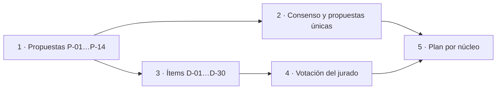

# 02 · Consolidado de propuestas — prompt 02 (guía 16)

Relatoría de las catorce propuestas `Propuestas/P-01…P-14`, ordenada por núcleo. Es un documento de planificación: no modifica la guía, los Examples, la demo ni el Conocimiento.

## Índice

- [0. Cómo leer este consolidado](#0-cómo-leer-este-consolidado)
- [1. N-01 · Coherencia texto ↔ ejemplos y demo](#1-n-01--coherencia-texto--ejemplos-y-demo)
- [2. N-02 · Libro unificado y arquitectura editorial](#2-n-02--libro-unificado-y-arquitectura-editorial)
- [3. N-03 · Fundamentos del framework](#3-n-03--fundamentos-del-framework)
- [4. N-04 · Ronda de revisión tipo libro](#4-n-04--ronda-de-revisión-tipo-libro)
- [5. N-05 · Conocimiento de especificación](#5-n-05--conocimiento-de-especificación)
- [6. N-06 · Caso de uso Geometría](#6-n-06--caso-de-uso-geometría)
- [7. N-07 · Caso de uso privado](#7-n-07--caso-de-uso-privado)
- [8. N-08 · Referencias y casos de industria](#8-n-08--referencias-y-casos-de-industria)
- [9. N-09 · Infraestructura de pruebas](#9-n-09--infraestructura-de-pruebas)
- [10. N-10 · Gobernanza y dudas para el PO](#10-n-10--gobernanza-y-dudas-para-el-po)
- [11. Lista de ítems a votar](#11-lista-de-ítems-a-votar)

## 0. Cómo leer este consolidado

- **Consenso (C):** todos los que opinaron coinciden. Entra directo y no se vota.
- **Propuesta única (U):** la planteó un solo especialista y nadie se opuso. Entra directo salvo objeción del jurado.
- **Ítem D-nn:** hay alternativas o desacuerdo. Las opciones son excluyentes y nombran quién propuso cada una. Los especialistas se identifican por su propuesta: P-01 Requisitos, P-02 Arq. móvil MAUI, P-03 Arq. MEAI, P-04 Arquitecto arc42/C4/ADR, P-05 Analista de decisiones, P-06 Doc. técnica, P-07 Editorial A, P-08 Editorial B, P-09 Revisión bibliográfica, P-10 Seguridad IA, P-11 Investigador de pruebas, P-12 Dominio Geometría, P-13 Forma de conocimientos, P-14 Lector sin contexto.

## 1. N-01 · Coherencia texto ↔ ejemplos y demo

**Consenso**

- C-1.1 La matriz afirmación ↔ artefacto vive en la bitácora; el libro sólo recibe el Anexo E.1 actualizado (P-01, P-03, P-05, P-11).
- C-1.2 I-2 (README pasa a nombrar `comparar-ac9.py`) e I-3 (vocabulario «servidor de chat / segundo servidor») son correcciones mecánicas (P-01, P-03, P-05, P-11).
- C-1.3 I-7: la excepción de §3.1 se anuncia en §3.1, con remisión a §13.2/§14.2 (P-04, P-05, P-11, P-14).
- C-1.4 I-5: **no se mueve el código** de los ejemplos (P-01, P-03, P-04, P-05, P-11, P-14). Lo que se vota es cómo se declara la excepción (D-02).
- C-1.5 El modelo de referencia para herramientas es `qwen3.5:4b` **sólo si se mide antes**, con turno del gestor (P-01, P-03, P-05, P-11, P-12). Umbral y plan B en D-04.

**Propuestas únicas**

- U-1.1 Compuerta nueva `compuerta-referencias.sh`: falla si la guía o un README citan un archivo inexistente (P-11).
- U-1.2 Ensayo E-2: medir también herramientas, almacén y workflow bajo `Application/`, no sólo `IChatClient` (P-04 midió 5 de 17 ejemplos: 01, 05, 07, 12, 17).

**Ítems**

- **D-01 · I-1 (cifras de §0.5).**
  - a) Quitar la cifra del texto y remitir a `contar.sh` con fecha; la cifra medida vive en el anexo de laboratorio (P-01, P-11, P-07 D-A5).
  - b) Mantener la cifra, recalculada con `contar.sh` el día del PR único (P-05; P-03 la corrige «con la cifra de `contar.sh`»).
  - c) Mantener la cifra y agregar `contar.sh --verificar` como compuerta (alternativa que P-11 evaluó y no recomienda).
- **D-02 · Cómo se declara la excepción de I-5.**
  - a) Sólo texto: una línea en §4.6 y un rótulo en cada «En este laboratorio» afectado, con remisión a ADR-01 (b); la demo es la referencia normativa (P-01, P-03, P-05, P-14).
  - b) Enmendar ADR-01 o agregar ADR-01b («un ejemplo de un solo mecanismo es prototipo») + rótulo en el README de los ejemplos afectados + declaración en §4.6 (P-04).
  - c) Opción a) más una prueba de arquitectura que fije la excepción (sólo `Examples/*/Application/` puede referir `Microsoft.Extensions.AI`; la demo no) y un ADR consecuente (P-11).
- **D-03 · I-4 (`SalidaEstructurada.csproj`).**
  - a) Renombrar a `03-Salida-Estructurada.csproj` y volver a correr `verificar.sh build` (P-03, P-11).
  - b) Renombrar sólo si un grep confirma que ni la solución ni `verificar.sh` lo nombran de forma rígida; si no, declarar la divergencia (P-05).
- **D-04 · Umbral y plan B del modelo con herramientas.**
  - a) ≥ 18 de 20 llamadas válidas; si no llega, `--fake` pasa a ser el camino principal de 08, 09, 11, 12, 13, 16 (P-03).
  - b) Tasa ≥ 0,8 en 20 corridas con límite inferior del IC 95 % ≥ 0,6; si no llega, limitación rotulada y `--fake` + nota (P-11).
  - c) ≥ 4 de 5 corridas con `tool_calls`; si no llega, NO VERIFICADO y la decisión vuelve a la mesa (P-05).
  - d) Sin umbral numérico: si falla o no entra en 5 GiB/4096 tokens, el texto declara NO EJECUTADO (P-01).
- **D-05 · Papel de `qwen2.5:0.5b` en el texto.**
  - a) Sale del texto conceptual (P-03).
  - b) Queda para chat simple y humo; cada una de sus 22 menciones se clasifica por capacidad y las de herramientas pasan al 4b (P-05, P-11).
- **D-06 · Versión de MCP en el texto.**
  - a) Pasar a 2026-07-28 recién después de un ensayo nuevo (T-3) sobre el ejemplo 13 (P-03).
  - b) Tomar como evidencia la corrida del 2026-10-29 registrada en el Anexo F (el SDK 2.3.0 negocia 2026-07-28) y actualizar sólo [REF-196] y [REF-199] (P-09).

## 2. N-02 · Libro unificado y arquitectura editorial

**Consenso**

- C-2.1 Un solo archivo; «unificar» es reubicar y recortar (P-02, P-06, P-07, P-14).
- C-2.2 Los 62 bloques «Historia» salen del cuerpo; el cuerpo no nombra mesas, planes ni folios (P-02, P-06, P-07, P-08, P-14). El destino en el libro se vota en D-10.
- C-2.3 Cada término se define una sola vez; §3.0, §4.1 y Anexo C se fusionan (P-02, P-06, P-07, P-08, P-14).
- C-2.4 Las Prácticas largas pasan al README de cada ejemplo (P-02, P-06, P-07, P-08, P-14). El umbral se vota en D-11.
- C-2.5 La Parte II deja de llamarse «Fundamentos» (I-6) (todos los que lo tratan). El nombre nuevo, en D-08.
- C-2.6 Convenciones del libro MAUI: front matter, «Tabla n.m»/«Figura n.m», marcas NO VERIFICADO/NO EJECUTADO, mermaid «1 · Texto» sin URL, glosario único y referencias con fecha de consulta (P-02, P-07, P-08).
- C-2.7 Un solo mapa de ejemplos (P-06, P-07).

**Propuestas únicas**

- U-2.1 Las anclas `sN-k` se conservan como alias y se publica en la bitácora una tabla vieja→nueva (P-06).
- U-2.2 Cada «En este laboratorio» declara en una línea si el ejemplo respeta ADR-01 (P-14; converge con D-02).
- U-2.3 El libro enlaza el Conocimiento desde el capítulo 0 y al final de la Parte VI (P-14).
- U-2.4 Orden de trabajo: N-01 edita `Examples/` primero y N-02 mueve las Prácticas después, con un único dueño por README (P-06).

**Ítems**

- **D-07 · Estructura del libro.**
  - a) Mantener las 7 partes, insertar Fundamentos como Parte I y renombrar la II (P-02, P-14).
  - b) Capítulos numerados con Prólogo, Partes I–VII y Anexos A–G, siguiendo el índice del libro MAUI (P-06).
  - c) Reorden A2: Prólogo → I Fundamentos → II Marco (escenarios, contextos, actores) → III Arquitectura y contratos → IV Conocimiento → V Agencia → VI Producción → VII Integración aplicada (ADR, demo, caso Geometría) → Anexos (P-07).
- **D-08 · Nombre de la actual Parte II.**
  - a) «Arquitectura y SDK» (P-02, P-14).
  - b) «Arquitectura» (P-06).
  - c) «Arquitectura y contratos» (P-07).
  - d) «La capa en .NET» (P-03).
- **D-09 · Patrón de cada tema.**
  - a) Patrón del perfil Study-Guide más un paso «Decisión» (ADR): Definición · Aplicación por escenario · Ejemplo · Decisión · Preguntas guía · Criterios de calidad (P-02, P-06, P-07).
  - b) Mapear el patrón actual («En este laboratorio / Práctica / Qué decisión toca») a las seis subsecciones del perfil, sin agregar un paso (P-13).
- **D-10 · Procedencia en el libro.**
  - a) Anexo «Procedencia» corto de una tabla (versión, fecha, enlace a bitácora) con lo que sostiene afirmaciones vigentes; el resto a la bitácora (P-02, P-06, P-07, P-08).
  - b) Sólo un anexo de versiones vigentes; toda la procedencia va a la bitácora (P-14).
- **D-11 · Umbral y resto de las Prácticas.**
  - a) Más de ~150 líneas; queda definición, criterio y extracto con `[ruta:líneas]` (P-02).
  - b) Más de ~100 líneas (P-08).
  - c) Las de §5, §7 y §8 (~990 líneas); queda un resumen de 15 líneas como máximo (P-06, P-07).
  - d) Las de §5, §7 y §8; queda objetivo, comando, salida esperada y enlace (P-14).
- **D-12 · Tope de extensión.**
  - a) No superar la extensión actual (57.753 palabras); lo nuevo se compensa con lo que sale (P-02).
  - b) No superar el 100 % del tope de `contar.sh` (44.330) con fundamentos y caso adentro; sólo la mesa lo eleva, registrado (P-06).
  - c) Sin tope previo: medir cada recorte sobre una copia (E-A1) y que el jurado vote el tope, declarado en el front matter (P-07).

## 3. N-03 · Fundamentos del framework

**Consenso**

- C-3.1 Capítulo nuevo con principios P-n tomados **sólo** de la 0.11.0; ninguno inventado (P-02, P-03, P-06, P-07, P-09, P-14).
- C-3.2 Una sola lista P-n con los mismos Id para libro y Conocimiento (todos).
- C-3.3 Frontera: si el enunciado nombra un tipo .NET, es arquitectura, no fundamento (P-03, P-06, P-07, P-14).
- C-3.4 Cada P-n con ancla interna (§/ADR) y fuente externa cuando exista; si no, «criterio de la guía» (P-07, P-09, P-06).
- C-3.5 El capítulo absorbe los enunciados y §3, §4 y §13 los citan por Id; se descartan el capítulo que repite (F1) y el prólogo extendido (F3) (P-07, P-09).

**Propuestas únicas**

- U-3.1 P-8 «transparencia (EU AI Act art. 50)» entra sólo después de leer el texto en EUR-Lex (P-09).
- U-3.2 Un mermaid de relación principios ↔ capas ↔ capítulos (P-07, P-09).

**Ítems**

- **D-13 · Lugar del capítulo.**
  - a) En la Parte I entre §1 y §2 (P-09).
  - b) Después del vocabulario de §3.0 y antes de §4 (P-03).
  - c) Como Parte I propia, antes de escenarios/contextos/actores (P-02, P-07, P-14).
- **D-14 · Lista inicial de principios.**
  - a) Siete: contrato, la salida es propuesta, mínima agencia, herramientas sobre casos de uso, conocimiento por el camino más barato, pipeline único, evidencia (P-03).
  - b) Ocho: capa con contrato, salida como propuesta, el dato exacto se consulta, dos escaleras, diseñar para el error, evidencia del tipo correcto, mínimo privilegio con aprobación, observabilidad diseñada (P-06; P-09 en el mismo rango 6–8).
  - c) Diez, sacados de ADR-01…ADR-10 y §3.1 (P-02).
  - d) Seis: contrato, salida como propuesta, dos escaleras, invariante de dependencias, aprobación humana, evidencia (P-07).
  - La lista final la cierra el ensayo de trazabilidad (T-3 de P-06) sobre la opción elegida.
- **D-15 · Regla de Agent Framework («si alcanza una función, no un agente»).**
  - a) Criterio dentro del principio de mínima agencia o de las escaleras (P-02, P-03, P-07, P-09).
  - b) Principio propio (P-14).
- **D-16 · Tope del capítulo.**
  - a) ~1.200 palabras (P-03). b) 1.500 (P-06, P-14). c) 2.000 (P-07). d) 2.500 (P-02).
- **D-17 · Cómo usa el Conocimiento la lista P-n.**
  - a) La cita por Id, sin reescribirla (P-14).
  - b) La reproduce condensada (regla · razón/criterio · fuente) y remite (P-02, P-03, P-07, P-13).

## 4. N-04 · Ronda de revisión tipo libro

**Consenso**

- C-4.1 Orden: Comisión A hace contenido (fase 1) y académica (fase 2); se congela el contenido; Comisión B hace estilo, ortotipografía, diseño y pruebas (fases 3–6), cada una con su informe P0–P3 (P-07, P-08).
- C-4.2 Umbral: 0 P0 y 0 P1 abiertos al cerrar la fase 6; P2 con decisión registrada (P-07, P-08).
- C-4.3 B no cambia contenido ni estructura; un hallazgo de contenido vuelve a A o a N-02 (P-08, P-06).
- C-4.4 Hoja de estilo (HE-01…HE-11) cerrada antes de corregir, cada regla con su comprobación mecánica (P-07, P-08).

**Propuestas únicas**

- U-4.1 Estilo repartido por partes en paralelo; fases 4–6 sobre el libro entero (P-08).
- U-4.2 Pruebas sobre el render de GitHub con capturas de `web.sh` en escritorio y móvil; PDF descartado (P-08).
- U-4.3 Pies «Figura n.m» numerados por capítulo; mermaid de ~15 nodos como máximo (P-08).
- U-4.4 Muestreo académico de 30 afirmaciones con semilla declarada, 30/30 anclas resolubles (P-07).

Sin ítems a votar.

## 5. N-05 · Conocimiento de especificación

**Consenso**

- C-5.1 El Conocimiento no repite la guía: destila (§13, Anexos A y B) y remite a `[Guía §x]` (P-01, P-02, P-03, P-04, P-05, P-10, P-13).
- C-5.2 Abre con un árbol mermaid «¿necesita capa de IA?» cuya rama «no» es un resultado válido (P-03, P-04, P-05, P-13, P-14).
- C-5.3 C4 sólo de contexto y contenedores, en mermaid `flowchart`, sin `C4Context` y validado con `mermaid.sh` (P-01, P-02, P-03, P-04).
- C-5.4 ADR con el formato de §13 de la guía (P-01, P-04).
- C-5.5 v0 en la bitácora; v1 en `Conocimientos/` después de N-06 y N-07; el cambio caso → regla se traza en la bitácora y el archivo final no es delta (P-02, P-04, P-05, P-13).
- C-5.6 Efectividad medida con una prueba de autocontención: un agente sin la guía especifica un caso sólo con el Conocimiento (P-01, P-05, P-10, P-13, P-14). El criterio de aprobación se vota en D-23.
- C-5.7 El caso privado aparece sólo como «un servicio privado de notificaciones» (P-13, P-01, P-10).

**Propuestas únicas**

- U-5.1 Contrato de puerto mínimo `Task<Resultado<T>> XAsync(entrada, CancellationToken)` con resultados *ok*, *degradado* y *rechazado* (P-03).
- U-5.2 MCP como opción, sólo cuando la consumen clientes externos; Agent Framework sólo desde el escalón «workflow con estado» (P-03).
- U-5.3 Sección «Clientes y fronteras» que cita el libro MAUI (puente JSON-RPC, OTA, outbox) sin redefinirlo (P-02).
- U-5.4 Campo «ASR que lo origina» en cada ADR (P-04).
- U-5.5 Columna obligatorio / recomendado / opcional según el tamaño del proyecto (P-05); converge con los niveles BCP 14 de P-13.
- U-5.6 Script en la bitácora que falla si queda un requisito sin criterio o sin prueba (P-01).
- U-5.7 Nombres OWASP Agentic (ASI) sólo tras leer el PDF primario; si no, limitarse a ASI02, ASI03 y ASI09. El *spotlighting* no cuenta como control (P-10).

**Ítems**

- **D-18 · Forma del Conocimiento.**
  - a) Forma del Conocimiento MAUI (§0–§13) con la divergencia frente a Rule-Forma declarada en §0 (P-01, P-02, P-03, P-04, P-05).
  - b) La misma forma MAUI con la cabecera de once campos de Rule-Forma (P-14).
  - c) Híbrida: cabecera de once campos + cuerpo temático §0–§16 + secciones finales de criterios de aceptación con nivel BCP 14 y modo, conformidad y trazabilidad (P-13).
- **D-19 · Ficha de excepción a Rule-Forma.**
  - a) No hace falta: Rule-Forma rige sólo en `IA.Knowledge.Base`; se abre si la pieza se promueve allí (P-13; P-05 la puntuó como la peor opción).
  - b) Se registra si N-10 dictamina que Rule-Forma rige en Lab-Documentos (P-02, P-04).
- **D-20 · Subconjunto de arc42 en la plantilla.**
  - a) 3, 5, 8, 10, 11 (P-02).
  - b) 3, 5, 8, 9, 10, 11 (P-05).
  - c) 1, 3, 5, 8, 9, 10, 11 (P-03, P-13; P-01 también pide siete).
  - d) 3, 5, 6, 8, 9, 10–11 (P-04).
- **D-21 · ADR que el Conocimiento exige.**
  - a) Todas las de la guía (ADR-01…13 o 01…12) como catálogo o preguntas obligatorias (P-02, P-03).
  - b) Mínimos obligatorios ADR-01, ADR-02, ADR-11 y uno por capacidad agéntica; el resto «considerar» (P-04).
- **D-22 · Formato del Id de requisito.**
  - a) Prefijo por documento: AF, RQ-K, RQ-IA/EQ-IA, RQ-GEO, RQ-PRV (P-01).
  - b) `REQ-IA-nn` con criterio de aceptación y prueba nombrada (P-04; P-05 con `REQ-n`; P-02 agrega columna de riesgo OWASP).
- **D-23 · Criterio de «especificación completa».**
  - a) Rúbrica de 10 campos aplicada a ciegas, aprueba con ≥ 9/10 (P-01).
  - b) Responde las 12 preguntas de la plantilla, ≥ 1 requisito con prueba por caso de uso y cubre LLM01, LLM02, LLM05 y LLM06; juzga el jurado (P-03).
  - c) Checklist binario, 100 % de obligatorios con fuente o NO APLICA con motivo, aplicado por un agente sin la guía más un humano (P-04, P-05).
  - d) Completitud 100 % (T-3) más autocontención con ≤ 3 salidas a la guía, todas por remisión explícita (T-2) (P-13).
- **D-24 · Capítulo de seguridad.**
  - a) Nivel de agencia (A0–A3) + fichas sólo de los riesgos que ese nivel activa, con una prueba por ficha (P-10).
  - b) Matriz mapeada a OWASP LLM Top 10 y Agentic 2026 (P-05).
- **D-25 · Tope del Conocimiento.**
  - a) 600 líneas con mapa de carga obligatorio (P-13).
  - b) ≤ 15 % de la guía (P-05).

## 6. N-06 · Caso de uso Geometría

**Consenso**

- C-6.1 Piloto V1 (explicar observaciones con pistas), nivel A0, sin herramientas (P-01, P-03, P-10, P-11, P-12).
- C-6.2 Esta pasada es sólo especificación (expediente 0002, ADR nueva, requisitos con prueba); nada en `src/` (P-01, P-03, P-12).
- C-6.3 El validador determinista decide; al modelo viajan sólo las `Observation` y el tipo de figura, nunca el JSON del alumno (P-10, P-12).
- C-6.4 Filtro determinista posterior al modelo que rechaza JSON de figura o el valor derivado (P-03, P-10, P-12).
- C-6.5 Puerto nuevo, asíncrono, con endpoint propio bajo `/v1/` separado de A-18 y respaldo de plantilla si el modelo no responde (P-10, P-11, P-12).
- C-6.6 El intake no se edita: se eleva al PO (P-03, P-12; P-01 lo condiciona a C6).
- C-6.7 Términos nuevos primero en la Norma de Nomenclatura §6 del repo (P-01, P-12).

**Propuestas únicas**

- U-6.1 Pistas en tres niveles; nunca el valor (P-12).
- U-6.2 Métrica principal: 0 respuestas que entreguen la solución en un banco de 30–50 casos; utilidad puntuada por el docente ≥ 4/5; juez automático ≥ 80 % de acuerdo con el docente antes de usarse solo (P-12).
- U-6.3 Sin persistir pistas en la primera versión (P-12).

**Ítems**

- **D-26 · Orden después del piloto.**
  - a) V2 → V4 → V3 (P-12).
  - b) V2 → V3 (con comisión fijada por la sesión y celda mínima); V4 sin ubicar (P-10).
  - c) Sólo V2 como segundo; V3 y V4 fuera de esta pasada (P-03).
- **D-27 · Cómo entra el caso en la guía.**
  - a) Capítulo de caso + Example 18 opcional con dominio simplificado (P-03).
  - b) Capítulo de caso; Example 18 sólo si el caso se implementa (P-01).
  - c) Capítulo que enlaza a Lab-Geometria, sin Example 18; como mínimo, una variante del Example 10 como contraejemplo (P-12).

## 7. N-07 · Caso de uso privado

**Consenso**

- C-7.1 Piloto: consulta en lenguaje natural con herramientas tipadas de sólo lectura; el inquilino lo pone la identidad, no el modelo; nada de consulta libre (P-01, P-05, P-10).
- C-7.2 La segmentación con envío masivo queda para después y nunca sin aprobación humana (P-05, P-10).
- C-7.3 Al repo público vuelven sólo reglas abstractas (filas K-nn / RQ-PRV-a…d), nunca ejemplos (P-01, P-10).

**Propuestas únicas**

- U-7.1 Filtro de fuga: grep con una lista negra guardada sólo en `<privado>`, sobre LD/LDD antes de cualquier PR (P-01).
- U-7.2 Prioridad de las demás capacidades: clasificación de fallos de entrega (2), redacción asistida (3), RAG (4), segmentación (5, sólo diseño) (P-05).

Sin ítems a votar.

## 8. N-08 · Referencias y casos de industria

Sólo P-09 trató el núcleo; todo entra como propuesta única salvo la versión de MCP (D-06).

- U-8.1 El Anexo D sigue siendo la única lista; se suma D.13 de casos de industria; la tabla de cambios va a la bitácora.
- U-8.2 Como máximo cinco casos: LinkedIn, Shopify Sidekick, el sistema multiagente de Anthropic, GitHub Copilot (histórico) y eShopSupport. Uber queda fuera (404).
- U-8.3 El capítulo MCP no se reescribe; se actualizan citas y se suma la página de versionado de la especificación.
- U-8.4 Una fecha de consulta por ronda para las referencias tocadas; numeración nueva desde el primer libre (≥ REF-200), sin renumerar.
- U-8.5 Lo no verificado no entra al cuerpo, o entra con «no verificado» literal.

## 9. N-09 · Infraestructura de pruebas

**Consenso**

- C-9.1 Toda corrida con modelo por `[gestor-de-turnos]`, sin pedidos concurrentes, con la memoria medida contra el tope de 5 GiB (P-01, P-11, P-12).

**Propuestas únicas**

- U-9.1 `OLLAMA_URL` obligatoria; los valores por omisión que apuntan a la pasarela vieja son un defecto a corregir (P-11).
- U-9.2 `num_ctx` fijado por pedido sólo donde un ejemplo lo necesite (P-11).

**Ítems**

- **D-28 · Proveedor que promete la guía.**
  - a) Un solo proveedor, el Ollama local por la API compatible con OpenAI; el papel «modelo compartido» sale del texto (P-11, recomendada).
  - b) Mantener los dos papeles y mapear ambos al mismo Ollama (`TURNO_MAPA`) (alternativa evaluada por P-11; deja afirmaciones no verificables).

## 10. N-10 · Gobernanza y dudas para el PO

- **D-29 · Versión resultante del libro.**
  - a) `1.0.0-rc`, por el cambio de estructura (P-06).
  - b) Seguir en 0.x hasta cerrar la ronda N-04 (opción implícita en P-07 y P-08, que no fijan versión; la decide N-10).
- **D-30 · Nombre del archivo del Conocimiento** (duda para el PO; P-13).
  - a) Respetar `knowledge-AI-Layer-Integration-Designing-Specification.md`, como lo fijó el PO.
  - b) Renombrar a `Knowledge-…` para cumplir F-1 y alinearse con FRAMEWORK MAUI.
- U-10.1 La vigencia de Rule-Forma fuera de `IA.Knowledge.Base` (H-1 de P-13) la dictamina N-10; de eso depende D-19.

## 11. Lista de ítems a votar

| Id | Núcleo | Tema | Opciones |
|---|---|---|---|
| D-01 | N-01 | Cifras de §0.5 (I-1) | a quitar / b recalcular al PR / c compuerta |
| D-02 | N-01 | Declaración de la excepción I-5 | a texto / b ADR-01b / c texto + prueba de arquitectura |
| D-03 | N-01 | Renombre del `.csproj` (I-4) | a directo / b condicionado a grep |
| D-04 | N-01 | Umbral del 4b y plan B | a 18/20 / b 0,8 + IC / c 4/5 / d sin umbral |
| D-05 | N-01 | `qwen2.5:0.5b` | a sale / b chat y humo |
| D-06 | N-01/N-08 | Versión MCP | a ensayo nuevo / b evidencia del Anexo F |
| D-07 | N-02 | Estructura | a 7 partes / b capítulos A–G / c reorden A2 |
| D-08 | N-02 | Nombre Parte II | a Arq. y SDK / b Arquitectura / c Arq. y contratos / d La capa en .NET |
| D-09 | N-02 | Patrón por tema | a perfil + Decisión / b mapear el actual |
| D-10 | N-02 | Procedencia | a anexo corto / b sólo versiones |
| D-11 | N-02 | Prácticas | a >150 / b >100 / c §5-7-8 + 15 líneas / d §5-7-8 + comando |
| D-12 | N-02 | Tope | a 57.753 / b 44.330 / c medir y votar |
| D-13 | N-03 | Lugar | a entre §1 y §2 / b tras §3.0 / c Parte I propia |
| D-14 | N-03 | Lista inicial | a 7 / b 8 / c 10 / d 6 |
| D-15 | N-03 | Regla de Agent Framework | a criterio / b principio |
| D-16 | N-03 | Tope | a 1.200 / b 1.500 / c 2.000 / d 2.500 |
| D-17 | N-03/N-05 | Uso de P-n en el Conocimiento | a por Id / b condensada |
| D-18 | N-05 | Forma | a MAUI / b MAUI + cabecera / c híbrida |
| D-19 | N-05/N-10 | Ficha de excepción | a no / b si N-10 lo dictamina |
| D-20 | N-05 | arc42 | a 5 secc. / b 6 / c 7 / d 3,5,6,8,9,10-11 |
| D-21 | N-05 | ADR exigidas | a todas / b mínimas |
| D-22 | N-05 | Id de requisito | a prefijo por documento / b REQ-IA-nn |
| D-23 | N-05 | Completitud | a rúbrica 9/10 / b 12 preguntas + OWASP / c checklist 100 % / d T-2 + T-3 |
| D-24 | N-05 | Seguridad | a agencia + fichas / b matriz OWASP |
| D-25 | N-05 | Tope | a 600 líneas / b 15 % de la guía |
| D-26 | N-06 | Orden posterior | a V2→V4→V3 / b V2→V3 / c sólo V2 |
| D-27 | N-06 | Entrada a la guía | a + Ex 18 opcional / b Ex 18 si se implementa / c sin Ex 18 |
| D-28 | N-09 | Proveedor | a Ollama único / b dos papeles mapeados |
| D-29 | N-10 | Versión | a 1.0.0-rc / b 0.x |
| D-30 | N-10 | Nombre del archivo | a `knowledge-` / b `Knowledge-` (PO) |
