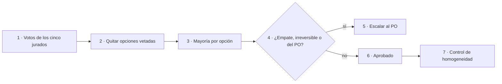

# 04 · Aprobación del marco — prompt 02 (guía 16)

**Etapa:** planificación · **Fecha:** 2026-11-01 · **Autor:** presidencia de la mesa · **Entradas:** `02-Consolidado.md` (ítems D-01…D-30, consenso C-x y propuestas únicas U-x) y los cinco votos `03-Voto-evidencia.md`, `03-Voto-impacto.md`, `03-Voto-costo-beneficio.md`, `03-Voto-coherencia-historica.md`, `03-Voto-riesgo.md`.

## Índice

- [1. Reglas de aprobación aplicadas](#1-reglas-de-aprobación-aplicadas)
- [2. Escrutinio por ítem](#2-escrutinio-por-ítem)
- [3. Vetos del jurado de riesgo](#3-vetos-del-jurado-de-riesgo)
- [4. Control de homogeneidad](#4-control-de-homogeneidad)
- [5. Consenso y propuestas únicas que entran directo](#5-consenso-y-propuestas-únicas-que-entran-directo)
- [6. Escalados al PO](#6-escalados-al-po)
- [7. Resumen de lo aprobado](#7-resumen-de-lo-aprobado)

## 1. Reglas de aprobación aplicadas

Definiciones del marco (Knowledge-Mesa-De-Expertos-A-Pedido, resumido en `Relevamiento/R5-Marco.md`):

- **Mayoría por opción:** gana la opción con más votos entre los cinco jurados.
- **Veto fundado del jurado de riesgo:** excluye la opción vetada antes de contar. El fundamento tiene que caer en su alcance: privacidad (R-PRIV), afirmación no verificable, ruptura de compuertas o interferencia con otra sesión.
- **Escalar al PO:** empate, decisión irreversible o decisión que le pertenece al PO.
- **Homogeneidad:** si más del 80 % de los ítems se resuelve en la primera opción, la presidencia revisa a mano cinco ítems.

Abreviaturas de los jurados: **Ev** evidencia, **Im** impacto, **CB** costo-beneficio, **CH** coherencia histórica, **Ri** riesgo.

## 2. Escrutinio por ítem

| Id | Ev | Im | CB | CH | Ri | Vetada | Recuento | Resultado |
|---|---|---|---|---|---|---|---|---|
| D-01 | a | a | a | a | a | — | a 5 | **a** quitar la cifra y remitir a `contar.sh` |
| D-02 | c | a | a | a | a | — | a 4 · c 1 | **a** sólo texto (§4.6 y «En este laboratorio») |
| D-03 | b | b | b | b | b | — | b 5 | **b** renombrar sólo si el grep lo permite |
| D-04 | b | c | c | c | c | — | c 4 · b 1 | **c** ≥ 4 de 5 corridas; si no, NO VERIFICADO y vuelve a la mesa |
| D-05 | b | b | b | b | b | — | b 5 | **b** 0.5b para chat simple y humo, menciones clasificadas |
| D-06 | b | b | b | b | a | b | a 1 (b excluida) | **a** ensayo T-3 antes de cambiar la versión (ver §3) |
| D-07 | a | a | a | a | a | — | a 5 | **a** 7 partes + Fundamentos como Parte I |
| D-08 | a | a | a | a | a | — | a 5 | **a** «Arquitectura y SDK» |
| D-09 | a | a | a | a | a | — | a 5 | **a** patrón del perfil + paso «Decisión» |
| D-10 | a | a | a | a | a | — | a 5 | **a** anexo «Procedencia» de una tabla |
| D-11 | d | d | d | d | d | — | d 5 | **d** Prácticas de §5, §7, §8 al README; queda objetivo, comando, salida esperada y enlace |
| D-12 | c | c | a | a | b | a | c 2 · b 1 (a excluida) | **c** medir los recortes y que el jurado vote el tope (ver §3) |
| D-13 | c | c | c | c | c | — | c 5 | **c** Fundamentos como Parte I propia |
| D-14 | c | b | d | c | c | — | c 3 · b 1 · d 1 | **c** diez principios desde ADR-01…10 y §3.1, cerrados por el ensayo T-3 de trazabilidad |
| D-15 | a | a | a | a | a | — | a 5 | **a** criterio dentro de mínima agencia / escaleras |
| D-16 | b | b | b | b | b | — | b 5 | **b** 1.500 palabras |
| D-17 | b | b | b | b | b | — | b 5 | **b** el Conocimiento reproduce P-n condensada (regla · razón · fuente) y remite |
| D-18 | a | a | a | a | a | — | a 5 | **a** forma del Conocimiento MAUI, divergencia declarada en §0 |
| D-19 | b | b | b | b | b | — | b 5 | **b** ficha sólo si N-10 dictamina que Rule-Forma rige en Lab-Documentos |
| D-20 | c | c | b | c | c | — | c 4 · b 1 | **c** arc42 secciones 1, 3, 5, 8, 9, 10, 11 |
| D-21 | b | b | b | a | b | — | b 4 · a 1 | **b** ADR mínimas: ADR-01, 02, 11 + una por capacidad agéntica |
| D-22 | b | a | b | b | b | — | b 4 · a 1 | **b** `REQ-IA-nn` |
| D-23 | c | c | c | c | c | — | c 5 | **c** checklist binario 100 %, agente sin la guía + humano |
| D-24 | b | a | a | b | b | — | b 3 · a 2 | **b** matriz mapeada a OWASP LLM Top 10 y Agentic |
| D-25 | a | a | a | a | a | — | a 5 | **a** 600 líneas con mapa de carga |
| D-26 | c | c | c | c | c | — | c 5 | **c** sólo V2 tras el piloto V1; V3 y V4 fuera de esta pasada |
| D-27 | b | b | b | c | c | — | b 3 · c 2 | **b** capítulo de caso; Example 18 sólo si el caso se implementa |
| D-28 | a | a | a | a | a | — | a 5 | **a** un solo proveedor: Ollama local por API compatible con OpenAI |
| D-29 | b | b | b | b | b | — | b 5 | **b** seguir en 0.x hasta cerrar N-04 (el paso a «publicada» es del PO) |
| D-30 | a | a | a | a | a | b | a 5 | **a** respetar el nombre fijado por el PO; la divergencia con F-1 va como duda al PO |

No hubo empates.

## 3. Vetos del jurado de riesgo

| Opción vetada | Fundamento (alcance) | Dictamen de la presidencia |
|---|---|---|
| D-06 b | Afirmación no verificable: la corrida del Anexo F no está archivada con rótulo completo en esta pasada. | **Fundado.** Excluye b; gana a. El veto prevé su levantamiento: si en la etapa 1 aparece la corrida archivada con rótulo completo (fecha, SDK 2.3.0, cabecera `MCP-Protocol-Version` capturada), T-3 se reduce a cotejarla y no a repetirla. El resultado (actualizar [REF-196]/[REF-199] a 2026-07-28) es el mismo. |
| D-12 a | Ruptura de compuertas: 57.753 palabras quedan por encima del tope que mide `contar.sh` (44.330). | **Fundado en parte.** El cierre del 2026-10-28 dejó `contar.sh` como informativo (130 %), así que no rompe una compuerta bloqueante; pero fijar un tope por encima del medido sin votación sí queda fuera de lo registrado. Se excluye a. Gana c, que además obliga a declarar el tope votado en el front matter y en la configuración de `contar.sh`. |
| D-30 b | Contradice la ruta fijada por el PO; renombrar puede chocar con otra sesión. | **Fundado.** Es decisión del PO. Gana a, y la duda va al lote del PO (§6). |

## 4. Control de homogeneidad

- Ítems resueltos en la primera opción (a): D-01, D-02, D-06, D-07, D-08, D-09, D-10, D-15, D-18, D-25, D-28, D-30 → 12 de 30 = **40 %**. No supera el 80 %: la revisión manual obligatoria **no se dispara**.
- Ítems con voto unánime (incluido D-30 tras el veto): 20 de 30 = 67 %.
- Revisión de oficio (no obligatoria) de los tres ítems con mayoría más estrecha:
  - **D-24 (3-2):** la opción b (matriz OWASP) se aprueba, pero se incorpora de a) el filtro por nivel de agencia como columna de la matriz: una fila sólo exige ficha y prueba si el nivel de agencia (A0–A3) del caso la activa. No contradice b y responde al argumento de volumen de Im y CB.
  - **D-27 (3-2):** gana b. De c se conserva lo que no exige código: el capítulo enlaza a Lab-Geometria; la variante del Example 10 como contraejemplo queda **fuera** de esta pasada (agrega código a Examples, que Ri y CH quisieron evitar).
  - **D-14 (3-1-1):** diez es el punto de partida, no el cierre: el ensayo T-3 de trazabilidad (P-06) puede bajar la lista si un principio no tiene ancla en la 0.11.0. Con D-16 b, 1.500 palabras es el tope; si diez no entran, se condensa, no se amplía el tope.

## 5. Consenso y propuestas únicas que entran directo

Ningún jurado objetó un C-x ni un U-x. Entran todos tal como figuran en `02-Consolidado.md` (C-1.1…C-9.1 y U-1.1…U-10.1), con estas precisiones de compatibilidad:

- U-2.4 (N-01 edita `Examples/` primero; N-02 mueve las Prácticas después, un dueño por README) fija el orden de las etapas 1 y 3.
- U-5.5 (obligatorio / recomendado / opcional) se expresa con niveles BCP 14, que es lo que también pedía la opción c de D-18; no cambia la forma aprobada en D-18 a.
- U-8.1/U-8.4 (Anexo D único, REF ≥ 200 sin renumerar) rigen también para la referencia nueva de versionado MCP de D-06.
- U-3.1 (P-8 «transparencia, EU AI Act art. 50») queda condicionada a la lectura en EUR-Lex; si no se lee, no entra a la lista de D-14.

## 6. Escalados al PO

Sólo lo que es del PO o irreversible. Van en un único lote al cierre de la planificación, cada uno con propuesta de la mesa:

| Id | Tema | Propuesta de la mesa | Por qué es del PO |
|---|---|---|---|
| E-01 | Nombre del archivo del Conocimiento (D-30) | Mantener `knowledge-AI-Layer-Integration-Designing-Specification.md` y declarar la divergencia con F-1 en §0. | El PO fijó la ruta. |
| E-02 | Versión y estado de la guía (D-29) | Sigue en 0.x («en revisión») hasta cerrar N-04; el paso a «publicada» o a 1.0.0 lo decide el PO. | Publicar es del PO. |
| E-03 | Intake de Geometría (C-6.6) | No editarlo; el piloto V1 se especifica en el expediente 0002 y, si exige cambiar el intake, se le presenta el cambio. | El intake es texto del PO. |
| E-04 | Fusión en repos con norma propia | Geometría y el servicio privado siguen su ciclo de PR propio; donde la norma reserve la fusión a main al PO, se le pide. | Lo exige la norma de cada repo. |
| E-05 | Vigencia de Rule-Forma fuera de IA.Knowledge.Base (U-10.1, de ella depende D-19) | Dictamen de N-10: no rige en Lab-Documentos; el Conocimiento declara su forma en §0. Se informa, no se frena. | Alcance de una norma del PO. |

## 7. Resumen de lo aprobado

- **Coherencia (N-01):** sin cifras fijas (D-01 a); excepción I-5 sólo en texto (D-02 a); renombre del `.csproj` condicionado a grep (D-03 b); `qwen3.5:4b` con umbral 4/5 (D-04 c); 0.5b para chat y humo (D-05 b); MCP 2026-07-28 tras T-3 (D-06 a).
- **Libro (N-02, N-03):** 7 partes + Fundamentos como Parte I (D-07 a, D-13 c); Parte II «Arquitectura y SDK» (D-08 a); patrón del perfil + «Decisión» (D-09 a); anexo de procedencia (D-10 a); Prácticas de §5, §7, §8 al README (D-11 d); tope medido y votado (D-12 c); diez principios, 1.500 palabras, Agent Framework como criterio (D-14 c, D-16 b, D-15 a).
- **Conocimiento (N-05):** forma MAUI (D-18 a), P-n condensada (D-17 b), arc42 1/3/5/8/9/10/11 (D-20 c), ADR mínimas (D-21 b), `REQ-IA-nn` (D-22 b), checklist binario 100 % con agente sin guía + humano (D-23 c), matriz OWASP filtrada por nivel de agencia (D-24 b), 600 líneas (D-25 a).
- **Casos (N-06, N-07):** piloto V1 y luego sólo V2 (D-26 c); Example 18 sólo si se implementa (D-27 b).
- **Infra y gobernanza (N-09, N-10):** un solo Ollama (D-28 a); 0.x (D-29 b); nombre del archivo intacto (D-30 a).
