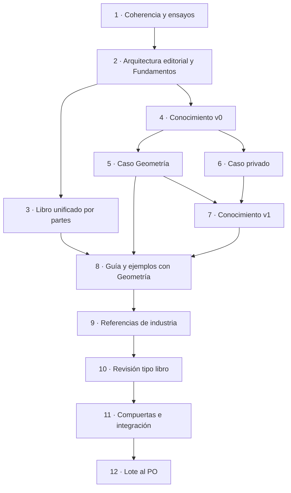

# 05 · Plan integrado de ejecución — prompt 02 (guía 16)

**Etapa:** planificación (cierra la fase de integración de núcleos) · **Fecha:** 2026-11-01 · **Autor:** presidencia de la mesa · **Entradas:** `Nucleos/00-Cohesion.md`, `Nucleos/N-01…N-10`, `02-Consolidado.md`, `04-Aprobacion.md`, `00-Coordinacion-Entre-Sesiones.md`.

## Índice

- [1. Propósito y alcance](#1-propósito-y-alcance)
- [2. Definiciones](#2-definiciones)
- [3. Integración de núcleos: dependencias y contradicciones resueltas](#3-integración-de-núcleos-dependencias-y-contradicciones-resueltas)
- [4. Flujo de etapas](#4-flujo-de-etapas)
- [5. Etapas](#5-etapas)
  - [E1 · Coherencia y ensayos](#e1--coherencia-y-ensayos)
  - [E2 · Arquitectura editorial y Fundamentos](#e2--arquitectura-editorial-y-fundamentos)
  - [E3 · Reescritura del libro unificado por partes](#e3--reescritura-del-libro-unificado-por-partes)
  - [E4 · Conocimiento de especificación v0](#e4--conocimiento-de-especificación-v0)
  - [E5 · Caso de uso Geometría](#e5--caso-de-uso-geometría)
  - [E6 · Caso de uso privado](#e6--caso-de-uso-privado)
  - [E7 · Conocimiento v1 con lo aprendido](#e7--conocimiento-v1-con-lo-aprendido)
  - [E8 · Enriquecimiento de guía y ejemplos con Geometría](#e8--enriquecimiento-de-guía-y-ejemplos-con-geometría)
  - [E9 · Referencias y casos de industria](#e9--referencias-y-casos-de-industria)
  - [E10 · Ronda de revisión tipo libro](#e10--ronda-de-revisión-tipo-libro)
  - [E11 · Compuertas finales e integración](#e11--compuertas-finales-e-integración)
- [6. Compuertas y pruebas con modelo](#6-compuertas-y-pruebas-con-modelo)
- [7. Coordinación con DocsAsCode y FRAMEWORK MAUI](#7-coordinación-con-docsascode-y-framework-maui)
- [8. Escalados al PO](#8-escalados-al-po)
- [9. Trazabilidad núcleo → etapa → decisión](#9-trazabilidad-núcleo--etapa--decisión)

## 1. Propósito y alcance

Este plan reconstruye el modelo completo a partir de los diez núcleos y lo ordena en etapas ejecutables. Cubre las cuatro solicitudes del prompt 02: coherencia (1), libro unificado con fundamentos y revisión tipo libro (2), conocimiento de especificación aplicado a dos casos de uso (3) y referencias de industria (4).

Fuera de alcance de esta pasada: código en `src/` de Geometría (C-6.2), variantes V3 y V4 de Geometría (D-26 c), Example 18 si el caso no se implementa (D-27 b), cambio de versión mayor de la guía (D-29 b).

## 2. Definiciones

- **LD:** repo público `Lab-Documentos`; la guía vive en `Guides/IA/Dot-Net-Integration-AI-Layer-Guide/` (en adelante `{guía}`).
- **LDD:** repo público `Lab-Documentos.Documentacion`; la bitácora es `PROMPTs/Guides/16-IA-Layer/OUTPUTs/Bitacoras/Prompt-02/` (en adelante `{bitácora}`).
- **Geometría:** repos públicos de Lab-Geometria. **Servicio privado:** «un servicio privado de notificaciones»; sus rutas se escriben `<privado>`.
- **Comisión A / B:** comisiones editoriales de la ronda N-04 (A: contenido y académica; B: estilo, ortotipografía, diseño, pruebas).
- **Turno:** ejecución bajo el gestor de recursos con `[gestor-de-turnos]`.
- **Estación 1:** el Ollama de la guía (sólo CPU, red privada), único proveedor que promete el texto (D-28 a).
- **P0–P3:** severidad de hallazgos del marco de la mesa (P0 bloquea).
- **R-PRIV:** compuerta `tools/compuerta-rpriv.sh` más el filtro de fuga U-7.1.

## 3. Integración de núcleos: dependencias y contradicciones resueltas

| # | Tensión o dependencia | Núcleos | Resolución |
|---|---|---|---|
| I-01 | N-02 mueve Prácticas a los README mientras N-01 corrige esos mismos `Examples/` | N-01, N-02 | Secuencia U-2.4: E1 edita `Examples/` y cierra; E3 mueve Prácticas. Un solo dueño por README a la vez. |
| I-02 | D-12 c pide votar un tope, pero E2 agrega Fundamentos (≤ 1.500 palabras, D-16 b) y E8 un capítulo de caso | N-02, N-03, N-06 | En E2 se mide sobre una copia en el scratchpad (E-A1) el efecto de D-10 a + D-11 d + C-2.2 + C-2.3 y se suma el presupuesto de Fundamentos y del capítulo de caso; el jurado vota el tope con esos números. El tope queda en front matter y en `contar.sh`. |
| I-03 | El Conocimiento cita P-n (D-17 b) que todavía no existen | N-03, N-05 | E4 empieza recién cuando E2 congela la lista P-n con el ensayo T-3 de trazabilidad. |
| I-04 | Riesgo con prefijos privados en repo público (D-22) | N-05, N-07 | `REQ-IA-nn` único; los requisitos del caso privado no se numeran en público: vuelven sólo como reglas abstractas K-nn (C-7.3). |
| I-05 | D-24 b (matriz OWASP) frente al volumen que temían Im y CB | N-05 | Matriz OWASP con columna «nivel de agencia que la activa»; ficha y prueba sólo para filas activas (`04-Aprobacion.md` §4). |
| I-06 | MCP: el texto no se toca hasta T-3 (D-06 a) y N-08 actualiza referencias | N-01, N-08 | T-3 corre en E1; E9 aplica el resultado a [REF-196]/[REF-199] y suma la referencia de versionado con Id ≥ REF-200. |
| I-07 | Modelo de herramientas `qwen3.5:4b` sin medir | N-01, N-09, N-06 | E1 mide con turno (D-04 c); el resultado condiciona el texto de E3 y la prueba de E5. Si no llega a 4/5: NO VERIFICADO y vuelve a la mesa antes de E3. |
| I-08 | Rule-Forma y la forma del Conocimiento | N-05, N-10 | Dictamen N-10 (E-05 de `04-Aprobacion.md`): no rige en Lab-Documentos; D-19 b → no se registra ficha. Si el PO dictamina lo contrario, se abre la ficha en E7. |
| I-09 | El libro es un único archivo y varias comisiones lo editan | N-02, N-04, N-08 | Edición secuencial: una sola etapa con el archivo abierto a la vez (E3 → E8 → E9 → E10). E5–E7 trabajan en otros archivos y pueden correr en paralelo a E3. |
| I-10 | Casos de uso en repos donde también ensaya DocsAsCode | N-06, N-07, N-10 | Carpeta `ai-layer/` propia; DAC usa `docs-as-code/`; ninguna edita la otra (reparto a). |

## 4. Flujo de etapas

Ruta crítica: E1 → E2 → E3 → E8 → E9 → E10 → E11. E4–E7 corren en paralelo a E3 porque no tocan el archivo del libro.

## 5. Etapas

Convenciones de cada ficha: **Responsables** (roles de la mesa, ver Id en `02-Consolidado.md` §0), **Entradas**, **Salidas** con ruta, **Aceptación** (criterio medible), **Compuertas**, **Prueba con modelo**.

### E1 · Coherencia y ensayos

- **Responsables:** P-11 Investigador de pruebas (dueño), P-03 Arq. MEAI, P-04 Arquitecto, P-01 Requisitos; verifica P-05.
- **Entradas:** guía 0.11.0, `Examples/01…17`, demo, `Nucleos/N-01`, `Nucleos/N-09`, D-01…D-06, D-28.
- **Trabajo:**
  1. Matriz afirmación ↔ artefacto (C-1.1) en la bitácora.
  2. Correcciones mecánicas I-2 e I-3 (C-1.2), I-7 en §3.1 (C-1.3) — se anotan como cambios a aplicar; las de `Examples/*/README.md` se aplican en esta etapa (U-2.4).
  3. Grep de `SalidaEstructurada` en la solución, `verificar.sh` y la guía; renombre sólo si no hay referencia rígida (D-03 b).
  4. U-9.1: `OLLAMA_URL` obligatoria; quitar valores por omisión que apunten a la pasarela retirada.
  5. Ensayos con turno: T-qwen (D-04 c: 5 corridas por ejemplo de herramientas 08, 09, 11, 12, 13, 16), E-2 (U-1.2: herramientas, almacén y workflow bajo `Application/`), T-3 MCP (D-06 a, ejemplo 13, captura de `MCP-Protocol-Version`).
  6. Clasificación de las 22 menciones de `qwen2.5:0.5b` por capacidad (D-05 b).
  7. Compuerta nueva `tools/compuerta-referencias.sh` (U-1.1), en `{guía}/tools/`.
- **Salidas:** `{bitácora}/E1/Matriz-Afirmacion-Artefacto.md`, `{bitácora}/E1/Ensayos.md` (rótulo completo: fecha, modelo, `num_ctx`, memoria, salida), `{bitácora}/E1/Cambios-Al-Libro.md` (lista para E3), README de ejemplos corregidos, `compuerta-referencias.sh`.
- **Aceptación:** 100 % de las afirmaciones del libro sobre ejemplos con artefacto o marca NO VERIFICADO/NO EJECUTADO; T-qwen ≥ 4/5 por ejemplo o decisión de la mesa registrada; T-3 con la versión negociada capturada; `verificar.sh build` igual que en 0.11.0 (561/561).
- **Compuertas:** `verificar.sh`, `compuerta-ac7.sh`, `compuerta-ac8.sh`, `comparar-ac9.py`, `compuerta-referencias.sh` (nueva), `compuerta-rpriv.sh`.
- **Prueba con modelo:** sí, en la estación 1, siempre con `RECURSOS_DIR=[ruta-trabajo]/recursos …/[gestor-de-turnos] <recurso> <etiqueta> "<motivo>" <min> -- <cmd>`, sin pedidos concurrentes, memoria medida contra 5 GiB (C-9.1). Nunca emuladores ni KVM en la máquina virtual de trabajo.

### E2 · Arquitectura editorial y Fundamentos

- **Responsables:** P-07 Editorial A (dueño), P-06 Doc. técnica, P-02 Arq. MAUI, P-09 Revisión bibliográfica; lector P-14.
- **Entradas:** salidas de E1, D-07…D-17, C-2.x, C-3.x, U-2.1, U-3.1, U-3.2, libro MAUI (sólo lectura, como referencia de convenciones).
- **Trabajo:**
  1. Índice nuevo: Prólogo, Parte I «Fundamentos», Partes II («Arquitectura y SDK»)…VII, Anexos (D-07 a, D-08 a, D-13 c).
  2. Patrón por tema: Definición · Aplicación por escenario · Ejemplo · Decisión · Preguntas guía · Criterios de calidad (D-09 a).
  3. Lista P-n: diez candidatos desde ADR-01…10 y §3.1 (D-14 c), Agent Framework como criterio (D-15 a); ensayo T-3 de trazabilidad (P-06): cada P-n con ancla §/ADR y fuente externa o «criterio de la guía» (C-3.4). Borrador del capítulo ≤ 1.500 palabras (D-16 b) con el mermaid principios ↔ capas ↔ capítulos (U-3.2).
  4. Medición E-A1 sobre copia en scratchpad: palabras que salen por C-2.2 (Historia), C-2.3 (definiciones duplicadas), D-10 a (procedencia) y D-11 d (Prácticas de §5, §7, §8); suma de lo que entra. Votación del tope por el jurado (D-12 c).
  5. Tabla de anclas vieja → nueva con alias `sN-k` (U-2.1); hoja de estilo HE-01…HE-11 cerrada (C-4.4).
- **Salidas:** `{bitácora}/E2/Indice-Del-Libro.md`, `{bitácora}/E2/Principios-P-n.md` (lista congelada con trazas), `{bitácora}/E2/Medicion-Y-Tope.md` (con el voto del jurado), `{bitácora}/E2/Anclas-Viejo-Nuevo.md`, `{bitácora}/E2/Hoja-De-Estilo.md`.
- **Aceptación:** 10/10 (o los que queden) P-n con ancla resoluble; 0 P-n inventados; tope votado y registrado; 283 anclas actuales con destino en la tabla.
- **Compuertas:** `mermaid.sh` sobre los diagramas nuevos; `compuerta-cabeceras.sh` sobre el índice de prueba.
- **Prueba con modelo:** no.

### E3 · Reescritura del libro unificado por partes

- **Responsables:** Comisión A (P-07 dueño, P-06, P-08), arquitectos por parte (P-03 Partes II–III, P-02 interfaz con MAUI, P-10 seguridad), lector P-14. **Un solo editor con el archivo abierto a la vez.**
- **Entradas:** `Cambios-Al-Libro.md` (E1), índice, P-n, tope, anclas y hoja de estilo (E2).
- **Trabajo, secuencial sobre `{guía}/Dot-Net-Integration-AI-Layer-Guide.md`:** Prólogo + Parte I → II → III → IV → V → VI → VII → Anexos. Por parte: aplicar el patrón D-09 a; sacar los bloques Historia (C-2.2); definir cada término una vez y fusionar §3.0/§4.1/Anexo C en el glosario (C-2.3); mover las Prácticas de §5, §7 y §8 a los README con objetivo, comando, salida esperada y enlace (D-11 d); declarar la excepción I-5 en §4.6 y en cada «En este laboratorio», con una línea ADR-01 sí/no (D-02 a, U-2.2); quitar la cifra de §0.5 y remitir a `contar.sh` (D-01 a); anexo «Procedencia» de una tabla (D-10 a); convenciones del libro MAUI (C-2.6); un único mapa de ejemplos (C-2.7); enlaces al Conocimiento en el capítulo 0 y al final de la Parte VI (U-2.3); versión 0.12.0 «en revisión» (D-29 b).
- **Salidas:** el libro reescrito; README de ejemplos con las Prácticas; `{bitácora}/E3/Registro-Por-Parte.md` (palabras antes/después y compuertas por parte).
- **Aceptación:** 0 bloques «Historia» en el cuerpo (grep); 0 términos con dos definiciones; extensión ≤ tope votado (`contar.sh`); todas las anclas viejas resuelven por alias; todas las compuertas en verde al cerrar cada parte.
- **Compuertas por parte:** `verificar-markdown.py`, `compuerta-cabeceras.sh`, `compuerta-intervalos.py`, `compuerta-referencias.sh`, `compuerta-rpriv.sh`, `mermaid.sh`; al final de E3, `verificar.sh` completo.
- **Prueba con modelo:** no (usa las de E1).

### E4 · Conocimiento de especificación v0

- **Responsables:** P-13 Forma de conocimiento (dueño), P-04 Arquitecto, P-01 Requisitos, P-03 Arq. MEAI, P-10 Seguridad, P-05 Analista de decisiones.
- **Entradas:** P-n congelada (E2), §13 y Anexos A y B de la guía (C-5.1), D-17…D-25, C-5.x, U-5.x, Conocimiento MAUI como precedente de forma.
- **Contenido:** forma MAUI con divergencia declarada en §0 (D-18 a); árbol mermaid «¿necesita capa de IA?» con rama «no» válida (C-5.2); P-n condensada regla · razón · fuente (D-17 b); plantilla arc42 secciones 1, 3, 5, 8, 9, 10, 11 (D-20 c); C4 contexto y contenedores en `flowchart` (C-5.3); ADR con formato §13 y campo «ASR que lo origina», mínimas ADR-01, 02, 11 + una por capacidad agéntica (D-21 b, U-5.4); requisitos `REQ-IA-nn` con criterio y prueba nombrada (D-22 b); niveles BCP 14 obligatorio/recomendado/opcional (U-5.5); contrato de puerto mínimo y posición de MCP y Agent Framework (U-5.1, U-5.2); «Clientes y fronteras» citando el libro MAUI (U-5.3); matriz OWASP LLM + Agentic con columna de nivel de agencia (D-24 b, U-5.7); checklist binario de completitud (D-23 c); mapa de carga; script de requisitos sin criterio/prueba (U-5.6).
- **Salidas:** `{bitácora}/E4/Conocimiento-v0.md`, `{bitácora}/E4/Checklist-Completitud.md`, `{bitácora}/E4/verificar-requisitos.*` (U-5.6). **No** se escribe todavía en `{guía}/Conocimientos/` (C-5.5).
- **Aceptación:** ≤ 600 líneas (`wc -l`, D-25 a); 0 contenido copiado de la guía sin remisión `[Guía §x]`; todos los mermaid validados; 0 menciones del servicio privado fuera de la fórmula abstracta (C-5.7).
- **Compuertas:** `mermaid.sh`, `compuerta-rpriv.sh`, `verificar-markdown.py`.
- **Prueba con modelo:** prueba de autocontención en seco opcional en la estación 1 con turno; la que cuenta es la de E7.

### E5 · Caso de uso Geometría

- **Responsables:** P-12 Dominio Geometría (dueño), P-01 Requisitos, P-10 Seguridad, P-11 Investigador de pruebas, P-04 Arquitecto.
- **Entradas:** Conocimiento v0, `Relevamiento/R2-Geometria.md`, C-6.x, U-6.x, D-26 c.
- **Lugar:** worktree `[ruta-trabajo]/g16-<repo-geometria>`, rama `g16/ai-layer-v1`, carpeta `ai-layer/`; expediente `SDD/Expedientes/0002-…` con aviso previo a DAC y FC (DAC ya cedió el 0002). Términos nuevos primero en la Norma de Nomenclatura §6 (C-6.7).
- **Trabajo:** especificar, sólo con el Conocimiento v0, el piloto V1 (explicar observaciones con pistas en tres niveles, nivel A0, sin herramientas): ADR nueva, requisitos `REQ-IA-nn` con prueba, puerto asíncrono con endpoint propio bajo `/v1/` y respaldo de plantilla (C-6.5), validador determinista que decide y filtro posterior que rechaza JSON de figura o el valor derivado (C-6.3, C-6.4), métricas U-6.2. Luego V2 con el mismo procedimiento (D-26 c). Nada en `src/` (C-6.2). Intake sin editar (C-6.6).
- **Salidas:** expediente 0002 y `ai-layer/` en el worktree; `{bitácora}/E5/Hallazgos-Del-Conocimiento.md` (qué faltó, qué sobró, qué se interpretó mal).
- **Aceptación:** checklist binario de D-23 al 100 % (obligatorios con fuente o NO APLICA con motivo), aplicado por un agente sin la guía y revisado por un humano de la mesa; cada hallazgo clasificado P0–P3.
- **Compuertas:** las propias del repo (puertas c/f/g y CI «Verificar»), `mermaid.sh`, `compuerta-rpriv.sh` adaptada al worktree.
- **Prueba con modelo:** prueba de concepto opcional del prompt de pistas sobre 30–50 casos del banco, en la estación 1 con turno; sin código en `src/`.

### E6 · Caso de uso privado

- **Responsables:** P-05 Analista de decisiones (dueño), P-01 Requisitos, P-10 Seguridad.
- **Entradas:** Conocimiento v0, `Relevamiento/R3-Caso-Privado.md`, C-7.x, U-7.x.
- **Lugar (decisión de la mesa):** worktree `[ruta-trabajo]/g16-<privado>`, rama `g16/ai-layer-v1`, carpeta `ai-layer/` dentro del repo privado, bajo su norma (`Prompts/`) con expediente correlativo; antes de crearlo se mira el último en main y se avisa. Nada del caso sale a LD/LDD.
- **Trabajo:** especificar el piloto de consulta en lenguaje natural con herramientas tipadas de sólo lectura, inquilino por identidad (C-7.1); segmentación sólo como diseño con aprobación humana (C-7.2); prioridades U-7.2.
- **Salidas:** especificación y expediente en `<privado>`; a la bitácora pública sólo `{bitácora}/E6/Reglas-Abstractas.md` con filas K-nn (C-7.3).
- **Aceptación:** checklist D-23 al 100 %; filtro de fuga U-7.1 con 0 coincidencias sobre LD y LDD.
- **Compuertas:** las del repo privado; `compuerta-rpriv.sh` + lista negra privada sobre todo lo público tocado.
- **Prueba con modelo:** opcional, en la estación 1 con turno, sin datos reales del servicio.

### E7 · Conocimiento v1 con lo aprendido

- **Responsables:** P-13 (dueño), P-04, P-05; verificador independiente: agente sin la guía + P-14.
- **Entradas:** v0 y los hallazgos de E5 y E6.
- **Trabajo:** convertir cada hallazgo en regla general (caso → regla trazado en la bitácora, C-5.5); reescribir v1 no delta; prueba de autocontención (C-5.6) con un tercer caso ficticio público.
- **Salidas:** `{guía}/Conocimientos/knowledge-AI-Layer-Integration-Designing-Specification.md` (nombre intacto, D-30 a); `{bitácora}/E7/Caso-A-Regla.md`; `{bitácora}/E7/Prueba-De-Autocontencion.md`.
- **Aceptación:** ≤ 600 líneas; checklist D-23 al 100 % en la prueba de autocontención; 0 hallazgos P0/P1 de E5–E6 sin regla o sin decisión registrada.
- **Compuertas:** `mermaid.sh`, `compuerta-rpriv.sh`, filtro U-7.1, `verificar-markdown.py`.
- **Prueba con modelo:** la prueba de autocontención con un agente sin la guía; si el agente usa la estación 1, con turno.

### E8 · Enriquecimiento de guía y ejemplos con Geometría

- **Responsables:** P-12 (dueño), P-07, P-06.
- **Entradas:** libro de E3, expediente 0002 (E5), Conocimiento v1.
- **Trabajo:** capítulo de caso en la Parte VII que enlaza a Lab-Geometria (público); Example 18 **sólo** si el piloto se implementa (D-27 b); vínculo explícito Conocimiento → caso → capítulo.
- **Salidas:** capítulo nuevo en el libro; `{bitácora}/E8/Registro.md`.
- **Aceptación:** extensión dentro del tope votado; todo enlace a Lab-Geometria resoluble; 0 menciones del caso privado más allá de la fórmula abstracta.
- **Compuertas:** las de E3 completas.
- **Prueba con modelo:** no.

### E9 · Referencias y casos de industria

- **Responsables:** P-09 Revisión bibliográfica (dueño), P-10 para OWASP.
- **Entradas:** Anexo D, `Relevamiento/R6-Industria.md`, U-8.x, resultado de T-3.
- **Trabajo:** Anexo D.13 con a lo sumo cinco casos (U-8.2); actualizar [REF-196]/[REF-199] según T-3 y sumar la página de versionado MCP (U-8.3); Id nuevos ≥ REF-200 sin renumerar y una fecha de consulta por ronda (U-8.4); lo no verificado no entra o entra rotulado (U-8.5). Tabla de cambios a la bitácora.
- **Salidas:** Anexo D actualizado; `{bitácora}/E9/Cambios-De-Referencias.md`.
- **Aceptación:** 100 % de las referencias tocadas con fecha de consulta y URL que responde; 0 Id renumerados.
- **Compuertas:** `compuerta-referencias.sh`, `verificar-markdown.py`.
- **Prueba con modelo:** no.

### E10 · Ronda de revisión tipo libro

- **Responsables:** Comisión A (fases 1–2) y Comisión B (fases 3–6), según C-4.1.
- **Seis intervenciones, en orden:**

| Fase | Intervención | Qué modifica | Responsable | Salida |
|---|---|---|---|---|
| 1 | Edición de contenido | ideas, estructura, argumentos | Comisión A (P-07) | `{bitácora}/E10/F1-Contenido.md` |
| 2 | Edición académica | rigor, fuentes, consistencia; muestreo de 30 afirmaciones con semilla (U-4.4) | Comisión A (P-09) | `{bitácora}/E10/F2-Academica.md` |
| — | Congelamiento de contenido | — | presidencia | constancia en `F2` |
| 3 | Corrección de estilo | lenguaje y expresión, por partes en paralelo (U-4.1) | Comisión B (P-08) | `{bitácora}/E10/F3-Estilo.md` |
| 4 | Corrección ortotipográfica | ortografía y convenciones (HE-01…11) | Comisión B | `{bitácora}/E10/F4-Ortotipografia.md` |
| 5 | Diseño editorial | presentación y diagramación; «Tabla/Figura n.m», mermaid ≤ 15 nodos (U-4.3) | Comisión B | `{bitácora}/E10/F5-Diseno.md` |
| 6 | Corrección de pruebas | errores del render de GitHub, capturas con `web.sh` en escritorio y móvil (U-4.2) | Comisión B | `{bitácora}/E10/F6-Pruebas.md` |

- **Aceptación:** 0 P0 y 0 P1 abiertos al cerrar la fase 6; P2 con decisión registrada (C-4.2); 30/30 anclas del muestreo resolubles; la Comisión B no cambia contenido (C-4.3): un hallazgo de contenido vuelve a la fase 1.
- **Compuertas:** todas las de E3 tras cada fase; `mermaid.sh` en la fase 5.
- **Prueba con modelo:** no.

### E11 · Compuertas finales e integración

- **Responsables:** presidencia, P-11, P-05.
- **Trabajo:** correr todas las compuertas; filtro de fuga U-7.1; `recalcular-oraculos.sh` si cambió algo medido; preparar un único PR en LD (guía + Conocimiento) y uno en LDD (bitácora), **después** de que FC y DAC fusionen lo suyo (reparto e). Ciclo de PR con conformación automática (guarda clean + CI, merge atado al SHA, borrar la rama sólo con merged=true). Reindexado de ia-db sólo si la guía 16 es la última en cerrar, anunciado.
- **Salidas:** `{bitácora}/E11/Informe-De-Compuertas.md`, `{bitácora}/06-Cierre.md`, lote al PO.
- **Aceptación:** todas las compuertas en verde o con excepción registrada en `verificar-markdown.excepciones`; 0 coincidencias del filtro de fuga; CI de los PR en verde.

## 6. Compuertas y pruebas con modelo

| Compuerta | Qué mide | Etapas |
|---|---|---|
| `tools/verificar.sh` | build y verificación de ejemplos y demo | E1, E3, E11 |
| `tools/verificar-markdown.py` (+ `.excepciones`) | forma del Markdown | E3–E11 |
| `tools/compuerta-cabeceras.sh` | cabeceras y anclas | E2, E3, E8, E10 |
| `tools/compuerta-intervalos.py` | citas `[ruta:líneas]` | E3, E8, E10 |
| `tools/compuerta-ac7.sh`, `compuerta-ac8.sh`, `comparar-ac9.py` | criterios de aceptación de los ejemplos | E1, E11 |
| `tools/compuerta-rpriv.sh` + filtro U-7.1 | fuga de lo privado | todas las que escriben en público |
| `tools/compuerta-referencias.sh` (nueva, U-1.1) | archivos citados existentes | E1 en adelante |
| `tools/contar.sh` | extensión contra el tope votado | E2, E3, E8, E11 |
| `/home/…/tools/medios/mermaid.sh` | render de cada mermaid | toda etapa con diagramas |

Pruebas con modelo: sólo en la **estación 1** (Ollama local, D-28 a), con turno del gestor (`RECURSOS_DIR=[ruta-trabajo]/recursos [gestor-de-turnos] …`), sin concurrencia y con la memoria medida contra 5 GiB. Nada en la pasarela retirada, ni emuladores ni KVM en la máquina virtual de trabajo. Si la estación 1 no está disponible, la prueba queda NO EJECUTADO y se reprograma; no se cambia de proveedor sin mesa.

## 7. Coordinación con DocsAsCode y FRAMEWORK MAUI

| Momento | Acción de la guía 16 | Con quién |
|---|---|---|
| Antes de E5 | Aviso «la guía 16 toma el expediente 0002 de Geometría» en `00-Coordinacion-Entre-Sesiones.md` | DAC, FC |
| Antes de E6 | Mirar el último expediente en main del repo privado y avisar el número | DAC |
| E5/E6 | Carpeta `ai-layer/`; nunca editar `docs-as-code/`; worktrees `[ruta-trabajo]/g16-*`; no tocar las ramas ajenas listadas en la coordinación | DAC |
| E3–E10 | No tocar `Concepts/**`, `Guides/Documentacion-Tecnica/**`, `PROMPTs/Concepts/**`, expediente 0003, `PROMPTs/Guides/14-*`, ni archivos comunes | FC, DAC |
| Cualquier cambio a archivos comunes (CHANGELOG, README raíz, `Guides/README.md`, `.github`, ia-db, docs-guard) | Sólo dentro del PR común único y anunciado de cada repo | FC, DAC |
| Abrir PR | No requiere turno; se anuncia | FC, DAC |
| Antes de cada merge | Línea «fusiono <repo> #N» | FC, DAC |
| E11 | Integración en LD/LDD última, en un solo PR por repo | FC, DAC |
| Cierre | Reindexado de ia-db de Geometría/servicio privado/LD/LDD por el último que cierre, anunciado | FC, DAC |

Puntos de contacto de contenido con FC: el puente JSON-RPC 1.2.0, el contenido OTA firmado y el outbox offline-first se citan al libro MAUI, no se redefinen (U-5.3).

## 8. Escalados al PO

Un único lote al cierre (detalle y propuesta en `04-Aprobacion.md` §6):

- E-01 Nombre del archivo del Conocimiento (se mantiene; divergencia con F-1 declarada).
- E-02 Paso de la guía a «publicada» o a 1.0.0 (sigue en 0.x).
- E-03 Cambios al intake de Geometría, si el piloto los requiere.
- E-04 Fusión a main en Geometría y en el repo privado cuando la norma del repo la reserve al PO.
- E-05 Vigencia de Rule-Forma fuera de IA.Knowledge.Base (se informa el dictamen).

Todo lo demás (PR y merge en LD/LDD con ciclo automático, decisiones de la mesa, ensayos) avanza sin detenerse.

## 9. Trazabilidad núcleo → etapa → decisión

| Núcleo | Etapas | Decisiones y acuerdos |
|---|---|---|
| N-01 Coherencia | E1, E3 | D-01…D-05, C-1.x, U-1.x |
| N-02 Libro | E2, E3 | D-07…D-12, C-2.x, U-2.x |
| N-03 Fundamentos | E2, E3 | D-13…D-17, C-3.x, U-3.x |
| N-04 Revisión | E10 | C-4.x, U-4.x |
| N-05 Conocimiento | E4, E7 | D-17…D-25, C-5.x, U-5.x |
| N-06 Geometría | E5, E8 | D-26, D-27, C-6.x, U-6.x |
| N-07 Caso privado | E6, E7 | C-7.x, U-7.x |
| N-08 Referencias | E1 (T-3), E9 | D-06, U-8.x |
| N-09 Infraestructura | E1, E5–E7 | D-28, C-9.1, U-9.x |
| N-10 Gobernanza | E11, §7, §8 | D-29, D-30, U-10.1 |

## Fe de erratas (2026-11-01)

Agregada tras la verificación de la etapa 2 (pendiente 5 de `Ejecucion/Verificacion-Etapa-2.md`; decisión en `Ejecucion/Pendientes-Etapa-2.md`). El texto de arriba no se modificó; estas rutas lo corrigen:

| Ruta del plan (no existe) | Dónde está el contenido |
|---|---|
| `{bitácora}/E4/Conocimiento-v0.md` | `Ejecucion/E4-Conocimiento-v0.md` |
| `{bitácora}/E4/Checklist-Completitud.md` | `Ejecucion/E4-Checklist-Completitud.md` |
| `{bitácora}/E4/verificar-requisitos.*` | `Ejecucion/E4-verificar-requisitos.py` |
| `{bitácora}/E5/Hallazgos-Del-Conocimiento.md` | `Ejecucion/E5.md` §7 (14 hallazgos K-nn) |
| `{bitácora}/E6/Reglas-Abstractas.md` | `Ejecucion/E6.md` §2 (K-01…K-10) |
