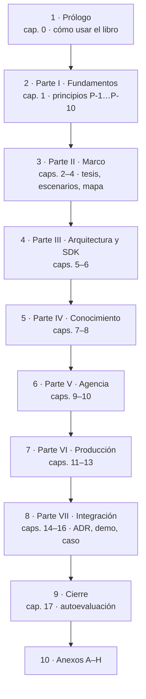

# E2 · Índice del libro (congelado)

**Etapa:** E2 del plan integrado (`../05-Plan-Integrado.md` §5) · **Fecha:** 2026-11-01 · **Dueño:** P-07 Editorial A, con P-06, P-02 y P-09; lector P-14 · **Estado:** congelado para E3.

## Índice

1. [Definiciones](#1-definiciones)
2. [Decisiones que aplica](#2-decisiones-que-aplica)
3. [Estructura del libro](#3-estructura-del-libro)
4. [Patrón de cada capítulo temático](#4-patrón-de-cada-capítulo-temático)
5. [Numeración y anclas](#5-numeración-y-anclas)
6. [Correspondencia con la 0.11.0](#6-correspondencia-con-la-0110)
7. [Inconsistencia del plan resuelta](#7-inconsistencia-del-plan-resuelta)
8. [Qué no fija este índice](#8-qué-no-fija-este-índice)

## 1. Definiciones

- **Parte:** agrupación de capítulos con un encabezado `# Parte N · Título`. Las partes se numeran I–VII en romanos.
- **Capítulo:** unidad temática con número arábigo (0 a 17), encabezado `## Capítulo N · Título` y ancla `cN`. Sus secciones son `N.k` con ancla `cN-k`.
- **Alias:** ancla de la 0.11.0 (`sN-k`, `parte-…`) que se conserva en el libro nuevo y apunta al destino que fija `Anclas-Viejo-Nuevo.md` (U-2.1).
- **Patrón del tema:** las seis subsecciones de D-09 a (§4 de este documento).

## 2. Decisiones que aplica

| Decisión | Qué fija en el índice |
|---|---|
| D-07 a | Se mantienen las siete partes de la 0.11.0 y Fundamentos entra como Parte I |
| D-13 c | Fundamentos es una Parte propia, antes de escenarios, contextos y actores |
| D-08 a | La actual Parte II («Fundamentos») pasa a llamarse «Arquitectura y SDK» |
| D-09 a | Patrón por tema: Definición · Aplicación por escenario · Ejemplo · Decisión · Preguntas guía · Criterios de calidad |
| D-10 a | Anexo H «Procedencia», de una tabla |
| D-11 d | Las Prácticas de los capítulos 6, 8 y 9 (ex §5, §7, §8) pasan al README de cada ejemplo |
| D-27 b | Capítulo 16, caso aplicado (Geometría); el Example 18 sólo si el caso se implementa |
| C-2.3 | §3.0 y §4.1 se fusionan en el glosario (Anexo C) |
| C-2.7 | Un solo mapa de ejemplos: Anexo E.1 |
| U-2.3 | Enlace al Conocimiento en el capítulo 0 y al cerrar la parte de Integración |

## 3. Estructura del libro

Figura 1. Orden de lectura del libro. Todo capítulo cita los principios de la Parte I por su Id.

| Bloque | Capítulo | Título | Viene de (0.11.0) |
|---|---|---|---|
| Prólogo | 0 | Cómo usar este libro (objetivos por actor, rutas, requisitos, forma de cada capítulo y de la evidencia, enlace al Conocimiento) | Parte 0, §0 |
| Parte I · Fundamentos | 1 | Fundamentos del framework: principios P-1…P-10 | nuevo; absorbe los enunciados de §3.1, §3.2, §4.2 y ADR-01…ADR-10 (C-3.5) |
| Parte II · Marco | 2 | «IA ya es parte del stack»: de la diapositiva a una solución | §1 |
| | 3 | Escenarios, contextos y actores | §2 |
| | 4 | Mapa conceptual: capas, escaleras y tablas de entrada | §3 sin §3.0 |
| Parte III · Arquitectura y SDK | 5 | La capa de IA en la arquitectura de la aplicación | §4 sin §4.1 |
| | 6 | Hablar con un modelo desde .NET | §5 (Prácticas al README) |
| Parte IV · Conocimiento | 7 | Estrategias de conocimiento | §6 |
| | 8 | RAG en .NET | §7 (Prácticas al README) |
| Parte V · Agencia | 9 | Herramientas, agentes y orquestación | §8 (Prácticas al README) |
| | 10 | Métodos y marcos comparados | §9 |
| Parte VI · Producción | 11 | Probar y evaluar | §10 |
| | 12 | Asegurar la capa de IA | §11 |
| | 13 | Operar y desplegar | §12 |
| Parte VII · Integración | 14 | Decisiones de arquitectura (ADR-01…ADR-13) | §13 |
| | 15 | La demo de Movilidad Urbana | §14 |
| | 16 | Caso aplicado: Geometría | nuevo (E8, D-27 b); al final, enlace al Conocimiento (U-2.3) |
| Cierre | 17 | Autoevaluación | §15 |
| Anexos | A–G | Plantillas, listas por actor, glosario único, referencias, laboratorio (mapa único de ejemplos), versiones, lecturas | Anexos A–G |
| | H | Procedencia (una tabla: versión, fecha, enlace a la bitácora) | nuevo (D-10 a); recibe lo que sostiene afirmaciones vigentes de los 62 bloques «Historia» |

Tabla 1. Índice congelado y origen de cada capítulo.

## 4. Patrón de cada capítulo temático

Rige en los capítulos 5–9 y 11–13 (los temáticos de la 0.11.0, §4–§8 y §10–§12) y en el 16. Los capítulos 2–4, 10, 14 y 15 conservan su forma y cierran con Preguntas guía.

| Paso | Contenido | Ancla |
|---|---|---|
| Definición | Cada sección `N.k` abre con qué es, qué resuelve y qué no es; cita los P-n que aplica | `cN-k` |
| Aplicación por escenario | Tabla escenario × contexto | `cN-escenarios` |
| Ejemplo | Ficha por ejemplo: objetivo, comando, salida esperada y enlace al README (D-11 d); la línea «respeta ADR-01: sí/no» (U-2.2) | `cN-ejemplos` |
| Decisión | ADR que toca el capítulo, en una línea por ADR y enlace al capítulo 14 | `cN-decision` |
| Preguntas guía | Preguntas con respuesta | `cN-preguntas` |
| Criterios de calidad | Criterios y antipatrones | `cN-calidad` |

Tabla 2. Patrón D-09 a.

## 5. Numeración y anclas

- Los capítulos llevan números nuevos (0–17) y anclas `cN`, `cN-k`. Las anclas de la 0.11.0 se conservan como alias: no hay choque, porque ninguna ancla vieja empieza con `c` salvo `cierre`, que se conserva con su sentido.
- Las partes nuevas usan `parte-1` … `parte-7` y `prologo`; los alias `parte-0`, `parte-i` … `parte-vi` apuntan a ellas (tabla completa en `Anclas-Viejo-Nuevo.md`).
- Se conservan sin cambio las anclas `oa-*`, `anexo-*`, `cierre` y los ítems de la autoevaluación pasan a `c17-iNN`.
- Tablas y figuras: «Tabla N.m» y «Figura N.m» por capítulo (C-2.6, U-4.3).

## 6. Correspondencia con la 0.11.0

Las 283 anclas de la 0.11.0 (sha256 de la guía `c8defd8324497c4279a3dfd57ce5d2757326ad966813a9f9797d0196d9b7ce3d`) tienen destino. Las 238 líneas de la 0.11.0 que empiezan con `#` incluyen líneas dentro de bloques de código (p. ej. `## §N Título` en §0.4 y comentarios de shell), que no son encabezados del libro; por eso la tabla se arma por anclas. Detalle en `Anclas-Viejo-Nuevo.md`.

## 7. Inconsistencia del plan resuelta

El plan (§5, E2, paso 1) escribe «Partes II («Arquitectura y SDK»)…VII». D-08 nombra la **actual** Parte II (la 0.11.0 la titula «Fundamentos») y D-07 a conserva las siete partes con Fundamentos como Parte I. Si «Arquitectura y SDK» fuera la Parte II nueva, el Marco (§1–§3) quedaría sin parte o habría ocho. Resolución: la actual Parte II, renombrada, es la Parte III del libro nuevo; la Parte II es Marco. Lo mismo para U-2.3: «al final de la Parte VI» es la Parte VI de la 0.11.0 (Integración), que en el libro nuevo es la Parte VII. No cambia ninguna decisión votada.

## 8. Qué no fija este índice

- El texto de cada capítulo (E3) y el del caso (E8).
- Los topes por parte de `contar.sh`: los fija E3 con el total votado en `Medicion-Y-Tope.md`.
- El nombre del archivo del Conocimiento (E-01, del PO).
