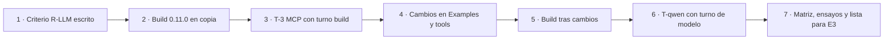

# Ejecución · E1 · Coherencia y ensayos

Registro de la etapa E1 del plan integrado (`../05-Plan-Integrado.md` §5). Sólo por agregado.

## Índice

1. [Alcance y salidas](#1-alcance-y-salidas)
2. [Cronología con evidencia](#2-cronología-con-evidencia)
3. [Archivos tocados fuera de la bitácora](#3-archivos-tocados-fuera-de-la-bitácora)
4. [Aceptación y compuertas](#4-aceptación-y-compuertas)
5. [Avisos y pendientes](#5-avisos-y-pendientes)

## 1. Alcance y salidas

| Salida del plan | Archivo | Estado |
|---|---|---|
| Matriz afirmación ↔ artefacto | `../E1/Matriz-Afirmacion-Artefacto.md` | hecha, 100 % con artefacto o marca |
| Ensayos con rótulo completo | `../E1/Ensayos.md` (+ `../E1/Criterio-R-LLM.md`, `../E1/Evidencia/`) | hechos: T-qwen, E-2, T-3 |
| Cambios al libro (lista para E3) | `../E1/Cambios-Al-Libro.md` | hecha; la guía `.md` no se tocó |
| README de ejemplos corregidos | `Examples/README.md` y 6 README de ejemplos | aplicados |
| `compuerta-referencias.sh` | `{guía}/tools/compuerta-referencias.sh` + `.excepciones` | creada, rc 0 |

## 2. Cronología con evidencia

Todas las horas son del 2026-11-01, -03. `{dir-de-trabajo}` es la carpeta de trabajo de la etapa fuera de los repos.

| Hora | Paso | Comando (resumido) | rc | sha256 |
|---|---|---|---|---|
| 16:41 | Criterio previo | escrito antes de toda llamada | — | `c1d4979e1abfd3944a4a06fa7985ff3b0d1b0d98f87c7024aa273e81d7fede78` |
| 16:39–16:47 | Primer build (copia 0.11.0) | `verificar.sh build` con turno; la restauración de NuGet quedó colgada en un volumen nuevo; se cortó y el turno se liberó (16:47) | — | — |
| 16:47:49–16:51:26 | Build 0.11.0 (copia) | ídem con la caché de NuGet existente | 1 (561/561; R-PRIV 1 por la compuerta nueva) | `Evidencia/build-base-0.11.0.log` |
| — | Corrección de la compuerta | se quita una ruta de contenedor que R-PRIV clasifica como «home» | — | — |
| 16:51:52–16:52:11 | T-3 | `verificar.sh correr 13-… ` (copia instrumentada, turno build) | 0 | captura `42bc96efe610e1dda2be15b2e62dd82ee271177ef13b1db75a55db53dcc61301`, consola `84a5a598bf5db115c30f2df340be724c491d685e23e5e01df8289fa620c85eb8` |
| 16:52:25–16:56:04 | Build tras cambios E1 (copia nueva) | `verificar.sh build` con turno | **0** (561/561, R-PRIV 0) | consola `3f06218639d3d809fe1d3cc2ab6c325d0d6671d3ad1f70825403259b7a14ecda` |
| 16:56 | AC-7, AC-8, AC-9, referencias, R-PRIV sobre `{guía}` | ver `../E1/Ensayos.md` §2 | 0, 0, 0, 0, 0 | — |
| 16:56–18:21 | T-qwen (30 corridas, 30 turnos) | `tqwen.sh`: `verificar.sh correr <ej> --con-modelo` ×5, turno de modelo por corrida | 0 en las 30 | evaluación `ca1901773f19dbb4627a156f72acb483de0292ec7c116ea50aa7c1abf9cc831f`; registros sin redactar `e218896c1e7cff18fafc3f566c7b4f039d117f4d6150d45220b676c79809a802` (SHA256SUMS en `{dir-de-trabajo}`); memoria `2ceac6eec58081600fb8a465f12d5614e385aa9f0e2cbcfd4741e0fc9499aacd` |
| 18:21 | Fin | `/api/ps` vacío; turno liberado | — | — |
| 18:2x | Evidencia redactada en la bitácora | quitar líneas del gestor y nombres de recurso; R-PRIV con listas privadas | 0 hallazgos | `Evidencia/SHA256SUMS` = `c1c57fe11a0625289c77cda19fe713fa6f841785017a35acebddaea16d7f0078` |

Horas de los turnos tomadas del registro del gestor (34 concesiones de esta etapa). T-qwen empezó después del último build; ningún build corrió durante las mediciones con modelo.

## 3. Archivos tocados fuera de la bitácora

En LD, `Guides/IA/Dot-Net-Integration-AI-Layer-Guide/` (excluida de git hasta el cierre; sin commit):

| Archivo | Cambio | sha256 antes | sha256 después |
|---|---|---|---|
| `Examples/README.md` | I-2, I-3, default de `OLLAMA_PROPIO_MODEL` | `4793f5c8d442c93c0db33e3cedc0277c7b3df7496fb28a41f8f1fc30042fb034` | `3da04ed3f2433c6a5df751380bdfe11e6737f08a9a83cbad63cd2b76ebf3ad5b` |
| `Examples/02-Cambio-De-Adaptador/README.md` | I-3 | `206c82be17f56499…` | `a1136b063fe4d445…` |
| `Examples/05-Contexto-Completo-Con-Prefijo/README.md` | I-3 | `be838ea9ee8ea3b6…` | `4f0c7777833a0140…` |
| `Examples/06-Embeddings-Y-Busqueda-Semantica/README.md` | I-3 | `b05027361088212f…` | `99e1c17d72a03a00…` |
| `Examples/07-RAG-Con-Citas/README.md` | I-3 | `27aba511dffe39da…` | `98a2961867fde20c…` |
| `Examples/12-Uno-O-Varios-Agentes/README.md` | I-3 | `1bbc1dbf4d6ceab0…` | `480a7c9cdb56e63e…` |
| `Examples/15-Pruebas-Y-Evaluacion/README.md` | I-3 | `6b5f53d67db94940…` | `5b977a90af609990…` |
| `Examples/03-Salida-Estructurada/SalidaEstructurada.csproj` → `03-Salida-Estructurada.csproj` | D-03 b (grep sin referencias rígidas en solución, `verificar.sh`, `tools/`, guía), `AssemblyName` conservado | `cb859fb82effa8bdd39ebbc12b7aa5829a523709fdecc1b71685c3f31cf89763` | `02a8d5b46caea7d66dd71eacb78582132cf12021e8c8d6928e24576aeab960f1` |
| `tools/compuerta-referencias.sh` | nuevo (U-1.1) | — | `2d329b603ca4975d687559b5a7523f86a416b1aa17e7d39abf8f19d73eb7cb38` |
| `tools/compuerta-referencias.excepciones` | nuevo, cada entrada con motivo | — | `270caf569fa1f4e77713b90f216fa0a73384d276a418f6eec4a79db4ab39a2bc` |
| `Dot-Net-Integration-AI-Layer-Guide.md` | **sin cambios** | `c8defd8324497c4279a3dfd57ce5d2757326ad966813a9f9797d0196d9b7ce3d` | ídem |

Copias previas de los README: `{dir-de-trabajo}/salidas/`. No se tocaron `Concepts/**`, `Guides/Documentacion-Tecnica/**`, archivos comunes, Geometría ni el repo privado.

## 4. Aceptación y compuertas

| Criterio del plan | Resultado |
|---|---|
| 100 % de las afirmaciones del libro sobre ejemplos con artefacto o marca | 56/56 de los bloques y 18/18 filas de E.1 |
| T-qwen ≥ 4/5 por ejemplo o decisión de la mesa | 5/5 en 08, 09, 11, 13, 16; 12 no aplica (no ofrece herramientas) → informado a la mesa |
| T-3 con la versión negociada capturada | `2026-07-28`, SDK 2.3.0, cabecera en 6/6 pedidos |
| `verificar.sh build` igual que en 0.11.0 (561/561) | 561/561, rc 0, tras los cambios |
| Compuertas: `verificar.sh`, `compuerta-ac7.sh`, `compuerta-ac8.sh`, `comparar-ac9.py`, `compuerta-referencias.sh`, `compuerta-rpriv.sh` | todas rc 0 |
| Mermaid | 1 diagrama (§1), `tools/medios/mermaid.sh`: ok |

## 5. Avisos y pendientes

- **Para la mesa:** sacar 12 de la lista de D-04 c; tomar `qwen3.5:4b` como referencia de herramientas (contesta la pregunta 2 de N-01).
- **Para la coordinación:** [el gestor de recursos compartido] (gestor compartido, fuera del territorio) conserva `OLLAMA_URL` con defecto a la dirección de la pasarela retirada (U-9.1). No se editó; las corridas de E1 pasaron el endpoint por variable.
- **Mensajes ajenos durante la etapa:** ninguno.

> **Nota de redacción** 2026-11-01: los nombres del gestor de turnos, de su envoltorio y del recurso de modelo se reemplazaron por marcadores entre corchetes (R-PRIV, clases «turnos» e «identificadores»; pendiente 4 de `Ejecucion/Verificacion-Etapa-2.md`, decidido en `Ejecucion/Pendientes-Etapa-2.md`). No se cambió nada más.
