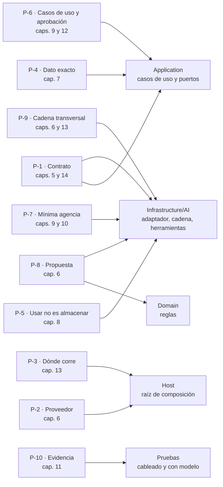

# Borrador · Parte I · Fundamentos (capítulo 1)

> **Borrador de E2 para E3.** No es texto de la guía todavía: E3 lo inserta en el libro según `../E2/Indice-Del-Libro.md`. Los enlaces usan anclas de la 0.11.0, que el libro nuevo conserva como alias (`../E2/Anclas-Viejo-Nuevo.md`). Lista de principios congelada en `../E2/Principios-P-n.md`. Tope: 1.500 palabras (D-16 b); el recuento está en `E2.md` §4.

---

# Parte I · Fundamentos

## Capítulo 1 · Fundamentos del framework

Este capítulo enuncia, una sola vez, los diez principios sobre los que se apoya todo el libro. Cada uno tiene un Id (P-1 … P-10) que los capítulos siguientes citan en lugar de repetirlo. Ninguno es nuevo: todos están ya aplicados en las decisiones de arquitectura del capítulo 14 y en el mapa de capas del capítulo 4. Acá se juntan y se dice de dónde sale cada uno.

### 1.1 Qué es un fundamento y qué no

**Definición.** Un *fundamento* es una regla de diseño que vale para cualquier capa de IA, sea cual sea el SDK que la implemente. Si para enunciarla hace falta nombrar un tipo de .NET, ya no es un fundamento: es arquitectura, y vive en las Partes III a VII.

Cada principio tiene tres partes: la **regla**, la **razón** (por qué el libro la sostiene) y la **fuente**. La fuente es una referencia del [Anexo D](#anexo-d) o, cuando la regla es propia, «criterio de la guía». Los principios son la base del *Conocimiento de especificación*, que los reproduce condensados y remite a este capítulo.

### 1.2 Los diez principios

**P-1 · Contrato antes que modelo.** La capa de IA es un componente con contrato: el núcleo depende de interfaces que define él mismo, y el modelo queda detrás de un adaptador. Ninguna dependencia va del modelo al dominio ni a los datos. *Razón:* así se prueba el núcleo sin modelo y se cambia el modelo sin tocar el núcleo. *Fuente:* [REF-182], [REF-183]; [ADR-01](#s13-2) y el invariante de [capas](#s3-1).

**P-2 · Proveedor reemplazable.** El proveedor se elige en un solo lugar, la raíz de composición, detrás de un contrato común. Lo que sólo ofrece un proveedor se pide de forma explícita. *Razón:* las capas que usan el modelo no dependen de quién lo sirve. Un límite: cambiar de adaptador no prueba que otro proveedor se comporte igual. *Fuente:* [REF-44], [REF-45]; [ADR-02](#s13-3).

**P-3 · Dónde corre el modelo se decide por los datos.** Local, un servidor compartido por varias aplicaciones o la nube se eligen por qué datos salen, cuánta concurrencia hay, el costo y la capacidad. El modelo elegido es provisional mientras no se lo compare con otro. *Razón:* la ubicación cambia poco el código y mucho el análisis de datos. *Fuente:* criterio de la guía; para la concurrencia por defecto de un servidor local, [REF-55]; [ADR-03](#s13-4).

**P-4 · El dato exacto se consulta.** Una respuesta que calcula una consulta («¿cuántas localidades hay en Corrientes?») va por un caso de uso, nunca por una recuperación por parecido. Para el resto del conocimiento, se usa el escalón más bajo de la escalera de conocimiento que alcance. *Razón:* recuperar por parecido trae lo parecido, no lo exacto. *Fuente:* [REF-86], [REF-87]; la escalera es criterio de la guía; [ADR-04](#s13-5) y el [carril aparte](#s6-1).

**P-5 · Usar no es almacenar.** El uso del conocimiento recuperado es de la capa de IA. Su almacenamiento es de la capa de datos. El índice depende del modelo de embeddings con que se armó: si cambia el modelo, hay que reindexar. *Razón:* separar las dos cosas permite cambiar el almacén sin tocar la capa de IA. *Fuente:* [REF-89], [REF-102]; [ADR-05](#s13-6).

**P-6 · Actuar por casos de uso, con aprobación.** El modelo actúa sólo a través de casos de uso que aplican las reglas, y con el mínimo privilegio. Desde el escalón 1 de agencia, toda escritura pide aprobación a la persona, sobre argumentos que arma el código y no la prosa del modelo. Si el texto de entrada no lo escribió la aplicación, no se ofrecen herramientas de escritura. *Razón:* una herramienta sobre el repositorio saltearía las reglas, y la inyección indirecta llega justamente por ese texto. *Fuente:* [REF-122], [REF-160], [REF-162]; [ADR-06](#s13-7).

**P-7 · Mínima agencia.** Se sube un escalón de agencia (función sin modelo, llamada única, llamada con herramientas, workflow, agente) sólo cuando el de abajo no alcanza. Criterio: si una función resuelve la tarea, se escribe la función. *Razón:* cada escalón suma llamadas, latencia, puntos de falla y pruebas. *Fuente:* [REF-115], [REF-117]; [ADR-07](#s13-8) y el [criterio de salto](#s8-1).

**P-8 · La salida del modelo es una propuesta.** Que la salida tenga la forma pedida no garantiza que sea válida. Las reglas viven en el código, no en el prompt, y una salida inválida es un camino normal que se diseña, no una excepción. *Razón:* el modelo se equivoca, y el sistema tiene que seguir siendo correcto cuando eso pasa. *Fuente:* [REF-01], [REF-160]; [ADR-08](#s13-9) y [diseñar para respuestas que pueden estar mal](#s2-5).

**P-9 · Una sola cadena transversal.** Las mismas opciones valen para toda llamada al modelo y se aplican en un solo lugar, en un orden declarado. La telemetría se diseña, y el contenido sensible se registra sólo en los ambientes que lo permiten. *Razón:* el orden de la cadena cambia lo que ve cada capa, y una traza con datos personales es una fuga. *Fuente:* [REF-173], [REF-192]; [ADR-09](#s13-10).

**P-10 · Evidencia del tipo correcto.** Una *garantía del código* se prueba en cada build y sin modelo. Una *conducta del modelo* se informa como k de M, con el rótulo de la corrida (modelo, servidor, fecha), y como tendencia, no como compuerta. *Razón:* reintentar no corrige la variación del modelo, y una tasa sobre pocas entradas no promete nada sobre la siguiente. *Fuente:* [REF-75], [REF-152]; [ADR-10](#s13-11) y [qué puede afirmar una prueba](#s10-1).

### 1.3 Cómo se relacionan con las capas y los capítulos

Cada principio cae sobre una o más capas de la solución ([capítulo 4](#s3-1)) y se desarrolla en un capítulo.

Figura 1.1. Principios, capas y capítulos. Mirá que Application recibe P-1, P-4 y P-6: los casos de uso son la frontera por la que el modelo toca el negocio.

### 1.4 Preguntas guía

**¿Qué principio rompe una herramienta que borra filas directamente en el repositorio?** P-6: el modelo actúa sólo por casos de uso, que aplican las reglas; además, P-1, porque abre una dependencia del modelo hacia los datos.

**Un pedido se resuelve con un filtro y un conteo. ¿Hace falta un agente?** No. Es un dato exacto (P-4) y alcanza una función (P-7).

**Una prueba pasó 5 de 5 veces contra el modelo. ¿Es una garantía?** No: es una conducta del modelo, con su rótulo, y se informa como k de M (P-10).

### 1.5 Criterios de calidad

- Cada capítulo que aplica un principio lo cita por su Id y no lo vuelve a enunciar.
- Una decisión nueva que contradice un principio se registra como ADR, con el principio que contradice y el motivo.
- Ningún principio nombra un tipo de .NET.
