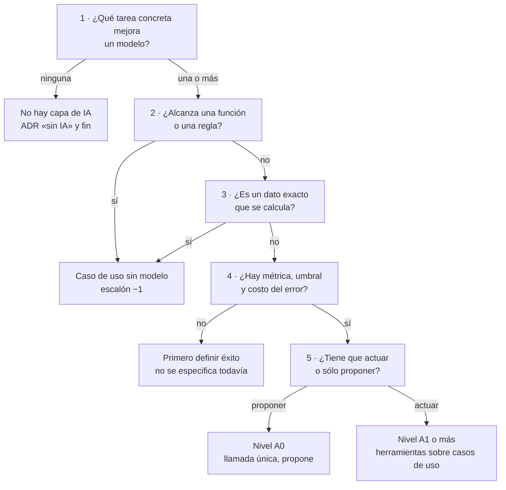
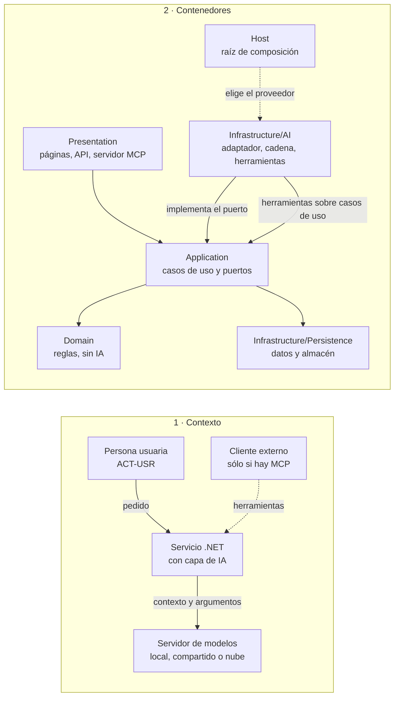

# Capa de IA integrada en .NET: cómo se especifica su diseño en un proyecto nuevo o existente

**Alias:** AI-Layer-Integration-Designing-Specification
**Naturaleza:** propio
**Tema:** Cómo decidir si un servicio .NET necesita una capa de IA y, si la necesita, cómo especificarla con arc42 reducido, C4 en mermaid, ADR, requisitos `REQ-IA-nn` con prueba y una matriz de riesgos OWASP filtrada por nivel de agencia; destilado de la guía de la capa de IA y de su demo
**Consumidor:** un agente IA o una persona que especifica la capa de IA de un servicio .NET, nuevo o existente; quien preside una mesa de diseño sobre ella
**Condicion-de-carga:** al decidir si un servicio necesita capa de IA; al escribir o revisar su especificación; al armar el checklist de completitud; se carga por secciones según el «Mapa de carga» de §0
**Hereda-de:** —
**Sustituye:** —
**Compatible-con:** `Dot-Net-Integration-AI-Layer-Guide.md` (libro de la carpeta `Guides/IA/Dot-Net-Integration-AI-Layer-Guide/`, edición 0.11.0; el libro unificado 0.12.0 está en revisión)
**Versión:** 0.1 (v0, borrador de bitácora)
**Estado:** Borrador — no vigente hasta la v1 (E7)
**Fecha:** 2026-11-01

---

## Índice

- [0. Propósito y alcance](#0-propósito-y-alcance)
- [1. Cuándo usarlo y cuándo no](#1-cuándo-usarlo-y-cuándo-no)
- [2. Principios y decisiones con criterio](#2-principios-y-decisiones-con-criterio)
- [3. Arquitectura de referencia](#3-arquitectura-de-referencia)
- [4. Contrato del puerto](#4-contrato-del-puerto)
- [5. Clientes y fronteras](#5-clientes-y-fronteras)
- [6. Plantilla de especificación (arc42 reducido)](#6-plantilla-de-especificación-arc42-reducido)
- [7. Decisiones (ADR)](#7-decisiones-adr)
- [8. Requisitos `REQ-IA-nn`](#8-requisitos-req-ia-nn)
- [9. Seguridad: matriz OWASP por nivel de agencia](#9-seguridad-matriz-owasp-por-nivel-de-agencia)
- [10. Procedimiento de aplicación](#10-procedimiento-de-aplicación)
- [11. Checklist binario de completitud](#11-checklist-binario-de-completitud)
- [12. Casos de uso y referencias de la industria](#12-casos-de-uso-y-referencias-de-la-industria)
- [13. Límites de este conocimiento](#13-límites-de-este-conocimiento)
- [Glosario](#glosario)

## 0. Propósito y alcance

Este conocimiento dice **qué decidir, en qué orden y con qué criterio** para especificar la capa de IA de un
servicio .NET. Sirve para un proyecto nuevo (CTX-NUEVA) y para uno existente (CTX-EXISTENTE) [Guía §2.2]. Su
producto es una **especificación**: un documento que otra persona o un agente puede construir y probar sin
preguntar. No enseña a programar la capa: eso lo hace la guía, y este conocimiento remite a ella.

**No repite la guía: la destila.** Condensa en reglas, plantillas y listas lo que la guía desarrolla en §2, §3,
§4, §8, §11, §13 y en los Anexos A y B, y remite al lugar donde está la evidencia. Lo que se copia de la guía
lleva siempre su remisión `[Guía §x]`.

**Divergencia de forma declarada.** La forma es la del Conocimiento del libro MAUI (cabecera de once campos,
cuerpo §0–§13 propio, «Límites» al final), no la de las secciones §0–§10 de la regla de forma de conocimientos
del framework de prompts. Motivo: coherencia entre los dos libros del laboratorio, que se citan entre sí (§5).
Esa regla no rige en Lab-Documentos según el dictamen del núcleo de gobernanza; la decisión es la D-18 a de la
mesa del prompt 02 de la guía 16.

**Regla de evidencia.** Cada afirmación lleva su fuente:

| Marca | Qué es | Dónde se resuelve |
|---|---|---|
| `[Guía §x]`, `[Guía A.n]`, `[Guía B.n]` | sección o anexo de la guía | `LAB/Lab-Documentos/Lab-Documentos/Guides/IA/Dot-Net-Integration-AI-Layer-Guide/Dot-Net-Integration-AI-Layer-Guide.md` (desde la raíz del espacio de trabajo) |
| `[REF-n]` | referencia del Anexo D de la guía | Anexo D de la guía |
| `[P-n]` | principio de los Fundamentos (capítulo 1 del libro unificado) | ADR de origen en la guía §13; lista congelada en la bitácora de E2 |
| `[MAUI cap. n]` | capítulo del libro MAUI | `LAB/Lab-Documentos/Lab-Documentos/Concepts/Framework-Concept/MAUI-Framework-Developer-Guide.md` |
| `[Ind-n]` | estándar de la industria con URL en §12 | §12 de este documento |
| **propuesta** | regla de este conocimiento sin ensayo todavía | se valida en los casos de uso (E5, E6) |

Las cifras de la demo (topes, tamaños, versiones) son **parámetros de la demo, no norma** [Guía §13.1].

**Niveles de exigencia (BCP 14).** «DEBE» es obligatorio, «DEBERÍA» es recomendado (se puede omitir con motivo
escrito) y «PUEDE» es opcional [Ind-4]. Las columnas PROTO y PROD de §8 y §11 aplican esos niveles según el
contexto CTX-PROTO o CTX-PROD del proyecto [Guía §2.2]. La asignación por columna es **propuesta**.

**Mapa de carga.**

| Si vas a… | Cargá |
|---|---|
| decidir si el servicio necesita capa de IA | §1 |
| fijar los principios que no se negocian | §2 |
| dibujar la arquitectura | §3, §4, §5 |
| escribir la especificación | §6, §7, §8 |
| analizar la seguridad | §9 |
| aplicar el conocimiento de punta a punta | §10 |
| decidir si la especificación está completa | §11 |
| comparar con casos y estándares | §12 |
| saber qué no cubre | §13 |

## 1. Cuándo usarlo y cuándo no

**Definición.** La *capa de IA* es la parte de la solución que habla con un modelo de lenguaje: adaptador del
proveedor, cadena de opciones, herramientas, agentes y almacén de vectores [Guía §3.1]. Vive en
Infrastructure/AI; Application la ve sólo a través de puertos.

Antes de especificar nada se responden las cuatro preguntas de la guía, sobre Google, Microsoft Agent Framework
y NIST [Guía §2.4], [REF-03], [REF-117], [REF-05]:

1. ¿Qué hace hoy la persona y por qué un modelo lo mejoraría?
2. ¿Alcanza una regla?
3. ¿Qué cuesta un error, falso positivo o negativo, y quién lo absorbe?
4. ¿Con qué métrica y qué umbral se decide seguir?

El árbol ordena esas preguntas. **La rama «no» es un resultado válido**: termina la especificación con una ADR
que registra por qué no hay capa de IA.



Figura 1.1. Árbol «¿necesita capa de IA?». Cada salida a la izquierda es un resultado válido de la
especificación. Fuentes: preguntas [Guía §2.4]; dato exacto [Guía §6.1], [P-4]; escalón −1 y criterio de salto
[Guía §8.1], [P-7].

**Conviene especificar una capa de IA** cuando se cumplen a la vez:

1. Una tarea recibe texto libre o pide una respuesta fundada que una regla no resuelve [Guía §2.1], [Guía §2.4].
2. Hay una métrica, un umbral y un error caro identificado, y lo fija ACT-ARQ [Guía §2.4], [Guía §2.3].
3. El código puede validar lo que el modelo propone antes de que tenga efecto [P-8], [Guía §2.5].

**No conviene** cuando:

- la tarea es un dato exacto (un conteo, un filtro): va por un caso de uso, nunca por recuperación por parecido
  [P-4], [Guía §6.1];
- una función la resuelve: «If you can write a function to handle the task, do that instead of using an AI
  agent» [REF-117], [Guía §8.1];
- nadie puede decir qué cuenta como éxito: primero se define el éxito [REF-04], [Guía §2.4].

## 2. Principios y decisiones con criterio

Los diez principios del capítulo 1 del libro, condensados. Cada fila es **regla · razón · fuente**; el
desarrollo está en el capítulo y en el ADR citado. Ningún principio nombra un tipo de .NET.

| Id | Regla | Razón | Fuente |
|---|---|---|---|
| P-1 | El núcleo depende de contratos que define; el modelo queda detrás de un adaptador; ninguna dependencia va del modelo al dominio ni a los datos | se prueba el núcleo sin modelo y se cambia el modelo sin tocarlo | [REF-182], [REF-183]; ADR-01 [Guía §13.2]; [Guía §3.1] |
| P-2 | El proveedor se elige en un solo lugar, la raíz de composición, detrás de un contrato común | las capas no dependen de quién sirve el modelo; cambiar de adaptador no prueba igual conducta | [REF-44], [REF-45]; ADR-02 [Guía §13.3] |
| P-3 | Dónde corre el modelo (local, servidor compartido, nube) se decide por los datos que salen, la concurrencia, el costo y la capacidad | la ubicación cambia poco el código y mucho el análisis de datos | criterio de la guía; [REF-55]; ADR-03 [Guía §13.4] |
| P-4 | El dato exacto se consulta por un caso de uso; para el resto, el escalón más bajo de la escalera de conocimiento que alcance | recuperar por parecido trae lo parecido, no lo exacto | [REF-86], [REF-87]; ADR-04 [Guía §13.5]; [Guía §6.1] |
| P-5 | Usar el conocimiento es de la capa de IA; almacenarlo, de la capa de datos; cambiar el modelo de embeddings obliga a reindexar | se cambia el almacén sin tocar la capa de IA | [REF-89], [REF-102]; ADR-05 [Guía §13.6] |
| P-6 | El modelo actúa sólo por casos de uso, con mínimo privilegio; desde el escalón 1 toda escritura pide aprobación sobre argumentos que arma el código; con texto que no escribió la aplicación no se ofrecen escrituras | una herramienta sobre el repositorio saltea las reglas; la inyección indirecta llega por ese texto | [REF-122], [REF-160], [REF-162]; ADR-06 [Guía §13.7] |
| P-7 | Se sube un escalón de agencia sólo cuando el de abajo no alcanza | cada escalón suma llamadas, latencia, puntos de falla y pruebas | [REF-115], [REF-117]; ADR-07 [Guía §13.8]; [Guía §8.1] |
| P-8 | La salida del modelo es una propuesta; las reglas viven en el código; una salida inválida es un camino normal | el sistema sigue correcto cuando el modelo se equivoca | [REF-01], [REF-160]; ADR-08 [Guía §13.9]; [Guía §2.5] |
| P-9 | Las mismas opciones valen para toda llamada y se aplican en un solo lugar, en orden declarado; el contenido sensible se registra sólo por ambiente | el orden cambia lo que ve cada capa; una traza con datos personales es una fuga | [REF-173], [REF-192]; ADR-09 [Guía §13.10] |
| P-10 | Una garantía del código se prueba en cada build, sin modelo; una conducta del modelo se informa como k de M con rótulo, como tendencia y no como compuerta | reintentar no corrige la variación; una tasa sobre pocas entradas no promete la siguiente | [REF-75], [REF-152]; ADR-10 [Guía §13.11]; [Guía §10.1] |

**Prioridad cuando chocan (propuesta).** P-6 y P-8 prevalecen sobre cualquier otra: si una especificación
necesita romper una de ellas, lo registra en una ADR nueva con el principio que contradice y el motivo, como
pide el capítulo 1 del libro para toda decisión que contradiga un principio.

## 3. Arquitectura de referencia

**Definición.** La arquitectura de referencia ubica la capa de IA entre las capas de la solución: Presentation,
Application, Domain, Infrastructure (Persistence y AI) y Host [Guía §3.1]. Invariante: ninguna flecha va del
modelo al repositorio ni al dominio; lo que sale del modelo pasa por un adaptador hasta un caso de uso
[Guía §3.1], [P-1].

La especificación dibuja dos niveles de C4 [Ind-2], sólo **contexto** y **contenedores**, en mermaid
`flowchart` (no `C4Context`) y validados con la herramienta de mermaid del laboratorio. Los niveles componente y
código no se especifican: los fija la implementación.



Figura 3.1. C4 de contexto y de contenedores de una capa de IA. La flecha de Infrastructure/AI hacia
Application es la implementación del puerto y la llamada a casos de uso; no hay flecha hacia Domain ni hacia
Persistence. Fuente: [Guía §3.1], [Guía §4.3], [Guía §11.1]; ADR-01 y ADR-11 [Guía §13.2], [Guía §13.12].

**Reglas de ubicación.** Domain no referencia el SDK de IA; Application no referencia Infrastructure ni el SDK;
el SDK del proveedor sólo aparece en Infrastructure/AI y en la raíz de composición. Si las capas son carpetas de
un ensamblado, una prueba de arquitectura lo comprueba, porque el compilador no lo impide (ADR-11)
[Guía §13.12], [Guía §4.3]. Si son proyectos, el compilador lo impone.

**Excepción declarada en la guía.** En la mayoría de los ejemplos didácticos de la guía, piezas de IA viven bajo
`Application/` (excepción I-5 que el libro declara en §4.6). Una especificación **no** toma esa ubicación de los
ejemplos: toma la de la demo y de ADR-01 [Guía §13.2].

## 4. Contrato del puerto

**Definición.** El *puerto propio* es una interfaz de Application con la firma de la capacidad en palabras del
dominio; prompt, modelo y proveedor quedan en el adaptador. `IChatClient` es el *puerto técnico*: aísla del
proveedor, no de la decisión de usar un modelo [Guía §4.4], [REF-44].

**Cuál se especifica.** Puerto propio cuando el prompt es detalle de la capacidad; sesión de chat sobre el
`IChatClient` cuando la capacidad es la conversación y toda escritura pasa por herramientas sobre casos de uso
(ADR-01) [Guía §13.2].

**Contrato mínimo (propuesta).** La guía usa `Task<T?> XAsync(entrada, CancellationToken)`, donde `null` lleva al
camino sin IA [Guía §4.4], [Guía A.4]. Este conocimiento propone hacer explícitos los tres resultados:

```csharp
// Propuesta: forma, no implementación. Los nombres los fija cada proyecto.
public interface IExtractorDeX
{
    Task<Resultado<XPropuesta>> ExtraerAsync(string texto, CancellationToken cancellationToken = default);
}
// Resultado<T>: Ok(T) | Degradado(motivo) | Rechazado(motivo)
```

| Resultado | Cuándo | Qué hace el caso de uso |
|---|---|---|
| *ok* | hubo propuesta y pasó las reglas del dominio | sigue, todavía como propuesta si escribe [P-8] |
| *degradado* | sin modelo, sin respuesta o fuera de tiempo | toma el camino sin IA (formulario, plantilla) [Guía §2.5] |
| *rechazado* | hubo propuesta y violó una regla | informa la regla violada; no guarda [Guía §5.3] |

La especificación de cada capacidad llena la ficha del Anexo A.4 de la guía (capacidad, contrato, firma,
adaptador, caso de uso, registro, regla de ubicación, doble) [Guía A.4].

**MCP y Agent Framework: dónde entran.**

- **MCP** es una opción de transporte, no un escalón ni un marco de agentes [Guía §8.1], [Guía §8.9]. Se
  especifica sólo si un **cliente externo** consume herramientas del servicio (ESC-05) o si el servicio consume
  herramientas de otro proceso [Guía §2.1]. Fuera de esos casos, no hay MCP (**propuesta**, U-5.2).
- **Microsoft Agent Framework** entra desde el escalón «workflow con estado»: lo que suma es estado serializable
  y composición, no decisión [Guía §8.6], [Guía §8.7]. El artefacto no fija el escalón [Guía §8.7]. El criterio
  de elección de marco es: M.E.AI primero, MAF por lo que el bucle no trae [Guía B.2].

## 5. Clientes y fronteras

**Definición.** Un *cliente* es una aplicación que consume el servicio con capa de IA; la *frontera* es lo que
cruza entre ellos. Este conocimiento no redefine los mecanismos de cliente: los cita del libro MAUI.

| Si el cliente es… | Lo que fija el libro MAUI | Qué decide la especificación de la capa de IA |
|---|---|---|
| una app híbrida con contenido web | el contrato del puente entre cascarón y contenido [MAUI cap. 4] | qué capacidades de IA expone el servicio; ninguna llamada al modelo desde el cliente (**propuesta**) |
| contenido actualizable sin tienda | el canal OTA firmado con rollback [MAUI cap. 3] | que un cambio de prompt del servicio no exige versión nueva del cliente (**propuesta**) |
| una app que trabaja sin red | base local y outbox [MAUI cap. 5] | qué devuelve el puerto en *degradado* cuando el pedido llega diferido (**propuesta**) |

La regla de fondo es P-1: el modelo vive detrás del servicio; el cliente ve casos de uso, no un modelo.

## 6. Plantilla de especificación (arc42 reducido)

**Definición.** arc42 es una plantilla de documentación de arquitectura de doce secciones [Ind-1]. Este
conocimiento usa siete: 1, 3, 5, 8, 9, 10 y 11 (decisión D-20 c de la mesa). Las omitidas (2 Restricciones,
4 Estrategia, 6 Vista de ejecución, 7 Despliegue, 12 Glosario) se cubren con la guía o con el proyecto anfitrión.

| § arc42 | Qué escribe la especificación de la capa de IA | Insumo |
|---|---|---|
| 1 Introducción y metas | escenarios ESC- habilitados, contexto de uso CTX-, actores ACT-, las cuatro preguntas respondidas y el resultado del árbol de §1 | [Guía §2.1]–[Guía §2.4] |
| 3 Contexto y alcance | C4 de contexto; qué datos salen hacia el modelo; si hay MCP | §3, [Guía §11.4] |
| 5 Vista de bloques | C4 de contenedores; un puerto por capacidad (ficha A.4); escalones de conocimiento y agencia de cada capacidad | §3, §4, [Guía §3.2] |
| 8 Conceptos transversales | cadena de opciones (P-9), telemetría por ambiente, aprobación (P-6), política de origen, secretos | [Guía §5.4], [Guía §11.3], [Guía §11.6], [Guía §12.2] |
| 9 Decisiones | las ADR de §7 | §7, [Guía §13] |
| 10 Requisitos de calidad | los `REQ-IA-nn` de §8, cada uno con criterio y prueba | §8 |
| 11 Riesgos y deuda técnica | la matriz de §9 y las ADR con «deja de valer si» | §9, [Guía §13.1] |

**Ejemplo de §1 llenado**, con la demo de la guía como caso: ESC-01, ESC-03 y ESC-04; CTX-EXISTENTE ×
CTX-LOCAL × CTX-PROTO; métrica de ESC-03 «propuestas que pasan las reglas sin corrección», error caro «entra un
valor fuera de catálogo o ausente del texto» [Guía §2.4], [Guía §14].

## 7. Decisiones (ADR)

**Definición.** Un ADR registra una decisión con su contexto, estado, alternativas descartadas, consecuencias
(también las negativas), confianza y «deja de valer si»; el registro es de sólo agregado [Guía §13.1],
[REF-184], [REF-185]. Se escribe uno por decisión que cuesta revertir [Guía A.13].

**Formato.** El de la guía [Guía A.13] más un campo, «ASR que lo origina»: el requisito arquitectónicamente
significativo que obliga a decidir [Ind-3].

| Campo | Pregunta |
|---|---|
| Estado | ¿vigente, o la reemplaza otra? |
| ASR que lo origina | ¿qué `REQ-IA-nn` o qué restricción obliga a decidir? |
| Contexto | ¿qué obliga a decidir? |
| Alternativas | ¿cuáles se descartaron, cada una con su fuente? |
| Criterio | ¿con qué se eligió? |
| Decisión | ¿qué se eligió, en una oración? |
| Consecuencias | ¿qué se gana y qué se pierde? |
| Confianza | alta (fuente y prueba sin servidor) o media (conducta observada pocas veces) |
| Deja de valer si | ¿qué cambio obliga a un ADR nuevo? |
| En el código | ¿qué archivo o prueba lo materializa? |

**ADR mínimas (decisión D-21 b).**

| ADR | Tema | Cuándo es obligatoria | Origen |
|---|---|---|---|
| ADR «sin IA» | por qué no hay capa de IA | cuando el árbol de §1 sale por «no» | §1 |
| ADR-01 | dónde vive la llamada al modelo | siempre que haya capa | [Guía §13.2] |
| ADR-02 | contrato de acceso y adaptador del proveedor | siempre que haya capa | [Guía §13.3] |
| ADR-11 | capas como carpetas o como proyectos, y cómo se comprueba la regla de dependencia | siempre que haya capa | [Guía §13.12] |
| ADR-06 | herramientas sobre casos de uso y aprobación | nivel de agencia A1 o más | [Guía §13.7] |
| ADR-07 | escalón de agencia y criterio de salto | nivel A1 o más | [Guía §13.8] |
| ADR-12 | estado del pedido de aprobación y ciclo de vida | aprobación en dos peticiones | [Guía §13.13] |

Las demás ADR de la guía (03, 04, 05, 08, 09, 10, 13) se escriben cuando la especificación toma esa decisión;
son recomendadas, no mínimas. Lo que la guía no decide tampoco se decide acá sin fuente: sincrónico o en segundo
plano, el escalón 3 y la autorización real [Guía §13.15].

## 8. Requisitos `REQ-IA-nn`

**Definición.** Un *requisito de la capa de IA* es una condición verificable que la especificación exige. Se
escribe con Id `REQ-IA-nn` (dos dígitos o más, único en la especificación), un nivel BCP 14, un criterio de
aceptación y una **prueba nombrada** que lo verifica. Un requisito sin criterio o sin prueba no está completo:
lo detecta el script de la bitácora `E4-verificar-requisitos.py`.

**Tabla de requisitos.** La especificación usa exactamente estas columnas, para que el script la lea:

| Id | Requisito | PROTO | PROD | Criterio de aceptación | Prueba |
|---|---|---|---|---|---|

**Tipos de prueba** [P-10], [Guía §10.1]:

- *garantía del código*: prueba sin servidor de modelos, corre en cada build (por ejemplo, de arquitectura o de
  composición) [Guía §10.2];
- *conducta del modelo*: corrida rotulada (modelo, servidor, fecha) que informa k de M; no es compuerta
  [Guía §10.4].

**Requisitos base.** Una especificación parte de esta lista y la ajusta; cada fila que no aplica se marca NO
APLICA con motivo. Los nombres de prueba son los de la demo o de los ejemplos de la guía, como modelo de forma;
cada proyecto nombra los suyos.

| Id | Requisito | PROTO | PROD | Criterio de aceptación | Prueba |
|---|---|---|---|---|---|
| REQ-IA-01 | Domain no referencia el SDK de IA | DEBE | DEBE | la prueba de arquitectura falla si un tipo de Domain nombra el SDK | `Domain_SinDependenciasDeIa` [Guía B.2] |
| REQ-IA-02 | El SDK del proveedor sólo aparece en Infrastructure/AI y en la raíz | DEBE | DEBE | prueba de arquitectura en verde; una mutación que lo viola da rojo | `SdkDelProveedor_SoloEnInfrastructureAIyProgram` [Guía A.4] |
| REQ-IA-03 | Toda salida estructurada se consume sin excepción ante formato inválido y pasa por las reglas antes de guardar | DEBE | DEBE | texto no JSON no produce propuesta ni escritura | `TextoNoJson_TryGetResultFalse_SinPropuesta_YNoSeEscribe` [Guía B.1] |
| REQ-IA-04 | Toda herramienta envuelve un caso de uso, nunca un repositorio | DEBE | DEBE | la prueba falla si una herramienta depende de un repositorio o del contexto de datos | `Herramientas_SinRepositorios` [Guía B.5] |
| REQ-IA-05 | Toda escritura del modelo es aprobable | DEBE | DEBE | cada herramienta de escritura está envuelta en aprobación | `TodaEscritura_EsAprobable` [Guía B.5] |
| REQ-IA-06 | La sesión la pone el código; ninguna firma recibe un id de sesión | DEBE | DEBE | dos sesiones en paralelo no se ven | `DosSesionesEnParalelo_NoSeVen` [Guía B.5] |
| REQ-IA-07 | Con texto no confiable al armar el pedido no se montan escrituras | DEBE | DEBE | con contexto no confiable, la lista de herramientas no tiene escrituras | `ContextoNoConfiable_SinHerramientasDeEscritura` [Guía B.5] |
| REQ-IA-08 | El bucle de herramientas tiene tope de iteraciones | DEBE | DEBE | un guion repetido corta en el tope | `GuionRepetido_ElBucleSeCortaEnElTope` [Guía B.5] |
| REQ-IA-09 | El contenido sensible sale en la telemetría sólo en desarrollo | DEBERÍA | DEBE | fuera de desarrollo los spans no traen mensajes | `ContenidoApagado_LosSpansNoTraenMensajes_YEnDesarrolloSi` [Guía B.3] |
| REQ-IA-10 | Sobre datos de personas, las herramientas devuelven agregados sin datos personales | DEBE | DEBE | ningún tipo alcanzable desde el retorno tiene campos personales | `Pd1_ResumirEncuesta_SinDatosPersonales` [Guía B.5] |
| REQ-IA-11 | Cada corrida contra el modelo deja un registro cuyo oráculo se recalcula sin volver a llamar | DEBERÍA | DEBE | el recálculo sale con 0 | `recalcular-oraculos.sh` [Guía B.1] |
| REQ-IA-12 | La métrica del escenario se informa como k de M con rótulo | DEBERÍA | DEBE | el informe trae k, M, modelo, servidor y fecha | corrida rotulada [Guía §10.4] |

Los niveles de las columnas PROTO y PROD son **propuesta**; los criterios y las pruebas vienen del Anexo B de la
guía.

## 9. Seguridad: matriz OWASP por nivel de agencia

**Definición.** El *nivel de agencia* de una capacidad es su escalón en la escalera de agencia [Guía §3.2],
[Guía §8.1]: A0 llamada única (propone), A1 llamada con herramientas, A2 workflow (camino fijo en código), A3
agente (el modelo dirige el bucle). El escalón −1, función sin modelo, no tiene fila: no hay capa de IA.

La matriz usa los nombres en inglés de OWASP para aplicaciones con modelos de lenguaje, 2025 [REF-161], y para
aplicaciones agénticas, 2026 [REF-164]. De la lista agéntica se usan sólo ASI02, ASI03 y ASI09, los que la guía
asigna [Guía §11.1]. **Una fila exige ficha de riesgo y prueba sólo si el nivel de agencia de la capacidad la
activa** (decisión D-24 b con la columna de nivel). La asignación riesgo → escenario → control es criterio de la
guía [Guía §11.1].

| Riesgo | Se activa desde | Control mínimo en código | Requisito |
|---|---|---|---|
| LLM01:2025 Prompt Injection | A0 | la procedencia decide qué es confiable; con texto no confiable, sin escrituras | REQ-IA-07 [Guía §11.2], [Guía §11.3] |
| LLM02:2025 Sensitive Information Disclosure | A0 con datos de personas (CTX-SENS) | agregados; contenido fuera de las trazas | REQ-IA-09, REQ-IA-10 [Guía §11.4] |
| LLM05:2025 Improper Output Handling | A0 | consumo seguro de la salida y reglas antes de guardar | REQ-IA-03 [Guía §5.3] |
| LLM06:2025 Excessive Agency | A1 | casos de uso; toda escritura aprobable | REQ-IA-04, REQ-IA-05 [Guía §11.3] |
| LLM08:2025 Vector and Embedding Weaknesses | A0 con RAG | el permiso filtra la consulta de recuperación | a definir por el proyecto [Guía §7.6] |
| LLM10:2025 Unbounded Consumption | A0 | largo máximo de entrada, concurrencia limitada, topes del bucle | REQ-IA-08 [Guía §12.3] |
| ASI02 Tool Misuse and Exploitation | A1 | lista permitida; argumentos resueltos en código | REQ-IA-04 [Guía §11.5] |
| ASI03 Identity and Privilege Abuse | A1 | la sesión la pone el código | REQ-IA-06 [Guía §8.3] |
| ASI09 Human-Agent Trust Exploitation | A1 con aprobación | el pedido de aprobación lo arma el código | REQ-IA-05 [Guía §11.3] |

**Reglas que no se negocian.**

- **Las instrucciones no son un control.** El *spotlighting* (marcado del contenido no confiable) tampoco cuenta
  como control: el control es lo que el código no deja ejecutar [Guía §11.2], [REF-166].
- **La aprobación no es autorización.** CTX-PROD pide identidad autenticada y permiso por operación antes del
  caso de uso [Guía B.4], [Guía §11.3].
- **Exponer por MCP sin autorización** sólo con lecturas y en loopback; escuchar en loopback, filtrar `Host` y
  validar `Origin` no son control de acceso [Guía §11.5], [Guía B.5].

Cada fila activada se documenta con la ficha de riesgo del Anexo A.11 de la guía [Guía A.11].

## 10. Procedimiento de aplicación

| Paso | Qué se hace | Entregable | Fuente |
|---|---|---|---|
| 1 | Responder las cuatro preguntas y recorrer el árbol | arc42 §1; ADR «sin IA» si sale por «no» | §1 |
| 2 | Fijar ESC-, CTX- y ACT- | arc42 §1 | [Guía §2] |
| 3 | Por capacidad, fijar escalón de conocimiento y nivel de agencia | arc42 §5 | [Guía §3.2], [P-4], [P-7] |
| 4 | Dibujar C4 de contexto y contenedores y validarlos | arc42 §3 y §5 | §3 |
| 5 | Llenar una ficha A.4 por capacidad con prompt propio | arc42 §5 | §4, [Guía A.4] |
| 6 | Escribir las ADR mínimas y las que correspondan | arc42 §9 | §7 |
| 7 | Escribir los `REQ-IA-nn` y correr el script | arc42 §10; salida 0 del script | §8 |
| 8 | Activar filas de la matriz según el nivel de agencia | arc42 §11; fichas A.11 | §9 |
| 9 | Si hay clientes, declarar la frontera | arc42 §3 | §5 |
| 10 | Pasar el checklist de §11 | checklist al 100 % | §11 |

**Ejemplo hipotético: un servicio que redacta avisos.** Un servicio quiere que el
modelo proponga el texto de una notificación a partir de una consigna. Paso 1: el texto lo escribe hoy una
persona; una plantilla no cubre la variedad; el error caro es enviar un texto equivocado a muchos destinatarios;
la métrica es «propuestas aceptadas sin edición». Paso 3: nivel A0, porque el modelo propone y una persona
envía. Paso 6: ADR-01, 02 y 11; no hacen falta ADR-06 ni ADR-07. Paso 8: filas LLM01, LLM05 y LLM10. Este
ejemplo es hipotético: no sale de ningún caso real.

## 11. Checklist binario de completitud

Una especificación está **completa** cuando cada ítem marcado DEBE en su columna está tachado con fuente, o
marcado NO APLICA con motivo (decisión D-23 c). Se aplica dos veces: un agente sin la guía y un humano de la
mesa. La versión tachable está en la bitácora (`E4-Checklist-Completitud.md`).

| # | Ítem | PROTO | PROD |
|---|---|---|---|
| C-01 | Las cuatro preguntas de §1 tienen respuesta escrita | DEBE | DEBE |
| C-02 | El resultado del árbol está registrado; si es «no», hay ADR «sin IA» | DEBE | DEBE |
| C-03 | ESC-, CTX- y ACT- fijados | DEBE | DEBE |
| C-04 | Cada capacidad tiene escalón de conocimiento y nivel de agencia con criterio de salto | DEBE | DEBE |
| C-05 | C4 de contexto y de contenedores en mermaid, validados | DEBERÍA | DEBE |
| C-06 | Ninguna flecha del C4 va del modelo al dominio ni a los datos | DEBE | DEBE |
| C-07 | Una ficha A.4 por capacidad con prompt propio | DEBE | DEBE |
| C-08 | ADR-01, ADR-02 y ADR-11, con «ASR que lo origina» | DEBE | DEBE |
| C-09 | ADR-06 y ADR-07 si algún nivel es A1 o más | DEBE | DEBE |
| C-10 | Todo `REQ-IA-nn` con criterio y prueba (script con salida 0) | DEBE | DEBE |
| C-11 | Cada requisito dice si su prueba es garantía del código o conducta del modelo | DEBERÍA | DEBE |
| C-12 | Matriz OWASP con las filas activadas por el nivel de agencia y su ficha | DEBERÍA | DEBE |
| C-13 | Qué datos salen hacia qué servidor de modelos, decidido por ACT-SEC | DEBE | DEBE |
| C-14 | Ningún valor de infraestructura ni secreto en el repositorio | DEBE | DEBE |
| C-15 | Si hay MCP, quién consume, en qué dirección y con qué control | DEBE | DEBE |
| C-16 | Si hay clientes, la frontera citada del libro MAUI | PUEDE | DEBERÍA |
| C-17 | Métrica, umbral y error caro del escenario, con quien fija el umbral | DEBE | DEBE |

## 12. Casos de uso y referencias de la industria

**Casos de uso de este conocimiento.**

| Caso | Dónde | Qué ejercita |
|---|---|---|
| Movilidad Urbana (demo de la guía) | [Guía §14] | ejemplo de llenado; CTX-EXISTENTE |
| Lab-Geometria | carpeta `ai-layer/` del repositorio público Lab-Geometria (E5) | aplicación sin la guía; nivel A0 primero |
| un servicio privado de notificaciones | sólo en abstracto (E6) | aplicación a un servicio existente |

**Referencias de la industria.**

| Id | Estándar | Qué toma este conocimiento | Fuente |
|---|---|---|---|
| Ind-1 | arc42 (Starke, Hruschka) | siete de sus doce secciones | https://arc42.org/overview |
| Ind-2 | C4 model (Simon Brown) | niveles de contexto y contenedores | https://c4model.com/ |
| Ind-3 | ADR, organización adr.github.io | el ASR como origen de una decisión | https://adr.github.io/ |
| Ind-4 | BCP 14 (RFC 2119 y RFC 8174) | los niveles DEBE, DEBERÍA, PUEDE | https://www.rfc-editor.org/info/bcp14 |
| — | OWASP LLM Top 10 2025 y Agentic 2026 | nombres de riesgos | [REF-161], [REF-164] |
| — | Nygard; Azure Well-Architected | forma del ADR | [REF-184], [REF-185] |

Las URL de Ind-1 a Ind-3 vienen del relevamiento de industria de la mesa (R6, F16–F18); la de Ind-4 es la
página oficial del índice de BCP 14.

## 13. Límites de este conocimiento

- **Es una v0.** No se aplicó todavía a ningún caso. Su prueba de autocontención (un agente sin la guía
  especifica un caso sólo con este documento) es la de E7, después de E5 y E6.
- **Lo marcado propuesta no tiene ensayo:** el contrato de tres resultados (§4), la frontera con clientes (§5),
  la prioridad entre principios (§2) y los niveles PROTO/PROD (§8, §11).
- **ASI:** sólo ASI02, ASI03 y ASI09. Los demás nombres de la lista agéntica no se usan aunque estén en
  [REF-164], porque la guía no los asigna.
- **No cubre** sincrónico frente a segundo plano, el escalón 3 ni la autorización real: la guía tampoco los
  decide [Guía §13.15].
- **Los nombres de prueba de §8** son los de la demo y los ejemplos; sirven de forma, no de lista para copiar.
- **El nivel A2 y el A3** no tienen fila propia en la matriz: heredan las de A1. Si un caso los usa, la v1 lo
  revisa.

## Glosario

Los términos se definen una sola vez en el glosario único de la guía [Guía Anexo C]. Los propios de este
conocimiento:

| Término | Definición | § |
|---|---|---|
| Especificación | documento que otra persona o un agente puede construir y probar sin preguntar | §0 |
| Nivel de agencia (A0–A3) | escalón de agencia de una capacidad, usado para activar filas de la matriz | §9 |
| `REQ-IA-nn` | requisito de la capa de IA con nivel, criterio y prueba nombrada | §8 |
| ASR | requisito arquitectónicamente significativo que origina una ADR | §7 |
| Completa | cada ítem DEBE del checklist tachado con fuente o NO APLICA con motivo | §11 |
