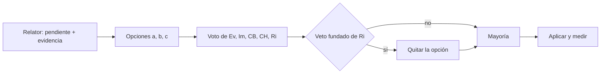

# Pendientes de la etapa 2: mesa breve y arreglos

> Origen: `Verificacion-Etapa-2.md` §5, pendientes 2, 3, 4 y 5. Fecha: 2026-11-01. Registro de sólo agregado.
> Regla de mesa: la de `../04-Aprobacion.md` §1 (mayoría por opción entre cinco jurados; veto fundado del jurado de riesgo). La mesa decide y queda aprobado.
> La guía no se tocó. `{B}` es la bitácora `Prompt-02/`; `{G}` la carpeta de la guía en LD; `<privado>` el worktree g16 del repo privado.

## Índice

1. [Definiciones](#1-definiciones)
2. [Cómo trabajó la mesa](#2-cómo-trabajó-la-mesa)
3. [Votos y decisiones](#3-votos-y-decisiones)
4. [Arreglos aplicados y evidencia](#4-arreglos-aplicados-y-evidencia)
5. [Compuertas](#5-compuertas)
6. [Pendientes que quedan](#6-pendientes-que-quedan)

## 1. Definiciones

- **Relator:** presenta cada pendiente con su evidencia y las opciones; no vota.
- **Jurados (lentes):** **Ev** evidencia, **Im** impacto, **CB** costo-beneficio, **CH** coherencia histórica, **Ri** riesgo.
- **Nota de redacción:** párrafo agregado al final de un archivo que dice qué se reemplazó, cuándo y por qué; el resto del archivo queda igual.
- **Marcador:** texto entre corchetes que ocupa el lugar de un nombre privado, por ejemplo `[recurso de modelo]`.
- **Filtro U-7.1:** `grep -i -F -f <lista negra privada>` sobre lo público; la lista vive sólo en `<privado>`.

## 2. Cómo trabajó la mesa

## 3. Votos y decisiones

### 3.1 Pendiente 2: el ejemplo 12 en T-qwen

**Evidencia del relator** (`../E1/Ensayos.md` l. 78–80 y 117): el ejemplo 12 envía `hash_herramientas` = sha256 de la cadena vacía en las 20 llamadas; el redactor recibe los datos del executor `Datos` (código) y el corrector no se llamó (0 vueltas). No ofrece herramientas al modelo, así que no mide lo que D-04 c mide.

| Opción | Ev | Im | CB | CH | Ri |
|---|---|---|---|---|---|
| a · sacar 12 de la lista D-04 c, constando el motivo | a | a | a | a | a |
| b · dejarlo y marcarlo NO VERIFICADO | | | | | |
| c · volver a correrlo con herramientas | | | | | |

**Decisión: a (5-0).** La lista D-04 c queda en 08, 09, 11, 13 y 16; los cinco tienen 5/5 (`Verificacion-Etapa-2.md` §2). El criterio T-qwen de E1 pasa a **Cumple**. El 12 sigue cubierto por su prueba propia (`porcentajes-del-servicio` 2 de 2 por variante). Ri: sin veto, porque la decisión se apoya en un dato medido y no cambia ninguna afirmación de la guía.

### 3.2 Pendiente 3: el nombre del servicio privado y la lista negra

**Evidencia:** el nombre aparecía en `../00-Coordinacion-Entre-Sesiones.md` (8 lugares, con el número del expediente privado en uno), `../Propuestas/P-01-Requisitos.md:276` y `../Relevamiento/R5-Marco.md:87`. Con la lista de 26 términos, el filtro daba además falsos positivos: el prefijo de ADR compartido con Geometría y el número del expediente suelto dentro de sha256 y marcas de tiempo.

| Opción | Ev | Im | CB | CH | Ri |
|---|---|---|---|---|---|
| a · fórmula abstracta en los 3 archivos, con nota; afinar la lista | a | a | a | a | a |
| b · dejar los 3 archivos y excluirlos del filtro | | | | | (veto: R-PRIV) |
| c · borrar las líneas | | | | b | |

**Decisión: a (5-0; b vetada por Ri).** Sólo se reemplazó el nombre (y el número del expediente) por «el servicio privado de notificaciones» o «[un servicio privado de notificaciones]» dentro de las citas. Lista afinada: se quitó el prefijo de ADR (convención compartida, no identifica nada privado) y el número suelto pasó a tres formas con contexto (el número con el nombre de la carpeta, «expediente» + número, «expedientes/» + número). Quedó en 27 líneas.

**Excepción declarada:** el prompt del PO (`PROMPTs/Guides/16-IA-Layer/02-…md`) nombra el servicio y su carpeta (2 líneas). Es del usuario y no se escribe; queda fuera del alcance del filtro y se resuelve en E11 (el PR de LDD no debe llevarlo o el PO decide).

### 3.3 Pendiente 4: los 8 hallazgos R-PRIV de turnos e identificadores

**Evidencia:** `compuerta-rpriv.sh` con las clases privadas dio 8 hallazgos en 6 líneas: el nombre del recurso de modelo, el envoltorio de turnos y el gestor de recursos con su ruta.

| Opción | Ev | Im | CB | CH | Ri |
|---|---|---|---|---|---|
| a · marcadores en el lugar, nota de redacción, sha256 viejo y nuevo | a | a | a | b | a |
| b · dejar los registros y redactar sólo al publicar | | | | | |
| c · mover los registros a `<privado>` | | | | | |

**Decisión: a (4-1).** CH prefería b por ser registros de sólo agregado; la nota de redacción conserva la trazabilidad y el sha256 viejo sigue citado. El criterio R-LLM cambió de sha256:

| Archivo | sha256 antes (citado) | sha256 después |
|---|---|---|
| `../E1/Criterio-R-LLM.md` | `c1d4979e1abfd3944a4a06fa7985ff3b0d1b0d98f87c7024aa273e81d7fede78` | `cf2dda0ead085c131bb03151df20fe8638d60f17648a3c55bedc8ddbf18b93ad` |

El sha256 viejo es el que probó que el criterio se escribió antes de correr (mtime 16:41, primera corrida 16:56); la nota sólo cambia nombres por marcadores.

### 3.4 Pendiente 5: rutas del plan que no existen

| Opción | Ev | Im | CB | CH | Ri |
|---|---|---|---|---|---|
| a · fe de erratas al final del plan, apuntando a `Ejecucion/` | a | a | a | a | a |
| b · crear las carpetas con copias | | | | | |

**Decisión: a (5-0).** Se agregó «Fe de erratas (2026-11-01)» al final de `../05-Plan-Integrado.md`: E4 → `Ejecucion/E4-*`, E5 → `Ejecucion/E5.md` §7, E6 → `Ejecucion/E6.md` §2.

## 4. Arreglos aplicados y evidencia

| Archivo | Cambio | sha256 antes | sha256 después |
|---|---|---|---|
| `../00-Coordinacion-Entre-Sesiones.md` | fórmula abstracta + nota | `0ac9d448…89d6aa`[^a] | `39f7b2f556260a968bf534a27785c752396e0d804af79e958b8643de19caa97c` |
| `../Propuestas/P-01-Requisitos.md` | idem | `fd754a52…bb933`[^a] | `76cfb9bb62e08e21188913899bdaad1e1a4ce47122c4bfe4775820ff7649fb98` |
| `../Relevamiento/R5-Marco.md` | idem | `e1e23145…def5c0` | `09c73649e580096489d74031cf09f78e597db5f76cfde38c42c9c1dcee85d4f1` |
| `../E1/Criterio-R-LLM.md` | marcadores + nota | `c1d4979e…fede78` | `cf2dda0ead085c131bb03151df20fe8638d60f17648a3c55bedc8ddbf18b93ad` |
| `../E1/Ensayos.md` | marcadores + nota | `46467cff…e062d` | `d052baa882391db8d3b12b2387ddb58ab2e3f91467edebdaa0b9536a5991a6e5` |
| `E1.md` | marcadores + nota | `d03fda80…174e70` | `8103ede6769c625ea359147d7288bf7c6fdfee53706d1137b5f9f8989bc4a5a0` |
| `E5.md` | marcadores + nota | `529bfd5c…f19ee` | `3b3ec0f5aa01df4c1d278885bded3e8f97b0e58212d67025055d0a07ccfcba89` |
| `../05-Plan-Integrado.md` | fe de erratas | `d57f4da1…8bcbe` | `9b1371e59c483c2ed35bf7bd712eeab8dd67447d0845e9d42503e4dd144adccb` |
| lista negra en `<privado>` | afinada, commit local `121d3b9` en `g16/ai-layer-v1`, sin push | `0ebc6bbb455fe12e4e8f4bce310393fa2ba544d0558e6e99e4a162bd44fcd3b8` | `5481e71443df3ee03ada964cce54b921346f6559806be54433346e541c643da2` |

[^a]: Abreviaturas de los sha256 completos `0ac9d4480a70402597b69a5cd08315397a0b979e06efea1e796711b4e989d6aa` y `fd754a52f710c0fb9837bceb569f3bbc798ed1804322d990e45e65f4441bb933`.

## 5. Compuertas

| Compuerta | Alcance | rc | Resultado |
|---|---|---|---|
| filtro U-7.1 (lista afinada) | `{G}` y `PROMPTs/Guides/16-IA-Layer/OUTPUTs/` de LDD | 1 de grep | **0 coincidencias** |
| filtro U-7.1 | prompt 02 del PO (excepción §3.2) | — | 2 líneas, no se toca |
| `compuerta-rpriv.sh` con clases privadas | `{B}/E1`, `{B}/E2`, `{B}/Ejecucion` | 0 | 0 hallazgos (antes 8) |
| `mermaid.sh` | este archivo | 0 | 1/1 ok; sin arroba (control mermaid-arroba) |
| sha256 de la guía | `{G}/Dot-Net-Integration-AI-Layer-Guide.md` | — | `c8defd8324497c4279a3dfd57ce5d2757326ad966813a9f9797d0196d9b7ce3d` (sin cambios) |

## 6. Pendientes que quedan

1. **R-PRIV en archivos anteriores a la etapa 2.** La misma compuerta sobre toda `{B}` da 22 hallazgos en archivos de núcleos y propuestas (por ejemplo `Nucleos/00-Cohesion.md:119`, `Propuestas/P-03-Arquitecto-MEAI.md:253`, `Propuestas/P-05-Analista-Decisiones.md:99`). Fuera del encargo; aplicar el mismo criterio (§3.3) antes de E11.
2. **Prompt 02 del PO** nombra el servicio privado: decidir en E11 si el PR de LDD lo excluye.
3. Siguen abiertos los pendientes 1, 6 y 7 de `Verificacion-Etapa-2.md` (revisión humana D-23, upstream de ramas g16, U-9.1 del gestor).
