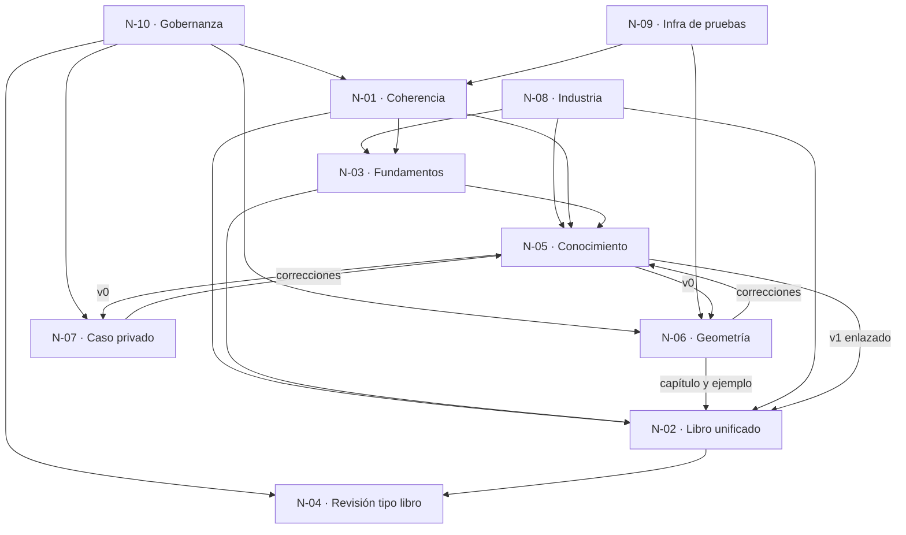

# 00 · Cohesión de los núcleos del prompt 02

> Documento de cohesión global de la descomposición conceptual del prompt 02 (guía 16). Etapa: planificación. Fuentes: el prompt 02, `00-Coordinacion-Entre-Sesiones.md` y los relevamientos R1–R6 en `../Relevamiento/`.

## Índice

1. [Criterio de segmentación](#1-criterio-de-segmentación)
2. [Núcleos](#2-núcleos)
3. [Grafo de dependencias](#3-grafo-de-dependencias)
4. [Orden de trabajo](#4-orden-de-trabajo)
5. [Relaciones y referencias cruzadas](#5-relaciones-y-referencias-cruzadas)
6. [Matriz núcleo × artefacto](#6-matriz-núcleo--artefacto)
7. [Trazabilidad al texto del prompt](#7-trazabilidad-al-texto-del-prompt)
8. [Contradicciones a resolver en la integración](#8-contradicciones-a-resolver-en-la-integración)
9. [Fase de integración](#9-fase-de-integración)

## 1. Criterio de segmentación

Se agrupó por afinidad y dependencia, no por párrafo:

- La solicitud 2 del prompt mezcla dos objetos distintos: la **forma** del libro (N-02) y su **revisión** (N-04), que depende de tener la forma cerrada. La «sección inicial de fundamentos» es contenido conceptual con dependientes propios (N-05), así que va aparte (N-03).
- Contexto + «aplicar el conocimiento» + «enriquecer con Geometría» forman un ciclo con el Conocimiento. Se separan dos casos (N-06, N-07) porque tienen restricciones de publicación opuestas (público / privado).
- La mesa, los expedientes y el reparto entre sesiones atraviesan todo: van en un núcleo transversal (N-10).
- La infraestructura (N-09) se separa porque R4 contradice una premisa del prompt (el gateway compartido no está disponible).

## 2. Núcleos

| Id | Núcleo | Archivo | Solicitud del prompt |
|---|---|---|---|
| N-01 | Coherencia texto ↔ ejemplos y demo | [N-01](N-01-Coherencia-Texto-Ejemplos-Demo.md) | 1 |
| N-02 | Libro unificado y arquitectura editorial | [N-02](N-02-Libro-Unificado-Arquitectura-Editorial.md) | 2, Reglas |
| N-03 | Sección inicial de fundamentos | [N-03](N-03-Fundamentos-Del-Framework.md) | 2 (último párrafo) |
| N-04 | Ronda de revisión tipo libro | [N-04](N-04-Ronda-De-Revision-Tipo-Libro.md) | 2, tabla de intervenciones |
| N-05 | Conocimiento de especificación | [N-05](N-05-Conocimiento-De-Especificacion.md) | Contexto, 3 |
| N-06 | Caso de uso Geometría | [N-06](N-06-Caso-De-Uso-Geometria.md) | Contexto, Objetivos |
| N-07 | Caso de uso del servicio privado | [N-07](N-07-Caso-De-Uso-Privado.md) | Contexto, Objetivos |
| N-08 | Referencias y casos de industria | [N-08](N-08-Referencias-Y-Casos-De-Industria.md) | 4, «tendencias y estándares» |
| N-09 | Infraestructura de pruebas | [N-09](N-09-Infraestructura-De-Pruebas.md) | Contexto (infra) |
| N-10 | Gobernanza: mesa, expedientes, coordinación | [N-10](N-10-Gobernanza-Mesa-Expedientes-Coordinacion.md) | Mesa, Reglas, Framework |

## 3. Grafo de dependencias

El único ciclo es N-05 ↔ N-06/N-07, y es intencional: v0 → aplicación → v1.

## 4. Orden de trabajo

| Ola | Núcleos | Puede ir en paralelo | Motivo |
|---|---|---|---|
| 0 | N-10 | — | Panel, expedientes y avisos antes de despachar |
| 1 | N-09, N-08, N-01 | sí | Base mecánica: entorno, fuentes y evidencia sana |
| 2 | N-03 | — | Necesita N-01 y N-08 |
| 3 | N-05 v0 | — | Necesita N-03 |
| 4 | N-06, N-07 | sí | Aplicar v0 |
| 5 | N-05 v1 | — | Correcciones de los casos |
| 6 | N-02 | — | Integra todo en el libro |
| 7 | N-04 | — | Revisión del libro final; un PR único y último en LD/LDD |

## 5. Relaciones y referencias cruzadas

| Desde | Hacia | Qué fluye |
|---|---|---|
| N-01 | N-02, N-05 | Texto corregido y evidencia verificada |
| N-03 | N-05 | Principios P-n (la misma lista o un subconjunto: pregunta abierta) |
| N-05 | N-06, N-07 | Procedimiento de especificación |
| N-06 | N-05, N-02, N-01 | Correcciones, capítulo de caso, posible ejemplo nuevo |
| N-07 | N-05 | Correcciones en abstracto (nada vuelve a lo público con detalle) |
| N-08 | N-03, N-05, N-02, N-01 | Referencias; MCP 2026-07-28 puede afectar ejemplos |
| N-09 | N-01, N-06 | Modelo con tool calling y turnos |
| N-10 | todos | Roles, folios, expedientes, territorios |

## 6. Matriz núcleo × artefacto

E = edita (en la etapa de ejecución) · L = lee · P = produce en la bitácora · — = no toca

| Artefacto | N-01 | N-02 | N-03 | N-04 | N-05 | N-06 | N-07 | N-08 | N-09 | N-10 |
|---|---|---|---|---|---|---|---|---|---|---|
| Guía `.md` | E | E | E | E | L | L | — | E | L | — |
| `Examples/01…17` | E | L | — | — | L | E? | — | L | L | — |
| Demo | E | L | — | — | L | L | — | — | L | — |
| `tools/` (compuertas) | L | — | — | L | — | — | — | — | L | — |
| Conocimiento de especificación | — | L | L | — | E | L | L | L | — | — |
| Lab-Geometria (+ Documentacion) | — | — | — | — | — | E (rama, exp. 0002) | — | — | — | L |
| Repo privado | — | — | — | — | — | — | E (privado) | — | — | L |
| Ollama propio | L | — | — | — | — | L | L | — | L | — |
| Bitácora Prompt-02 | P | P | P | P | P | P | P (abstracto) | P | P | P |

## 7. Trazabilidad al texto del prompt

| Texto del prompt | Núcleo(s) |
|---|---|
| «diseñar un conocimiento de especificación … aplicarlos en nuevos o ya existentes proyectos» | N-05 |
| «aplicar el conocimiento … Geometria y PushDistpatch … realizar las correcciones» | N-06, N-07, N-05 |
| «enriquecer ejemplos y guía relativo a … Geometría» / proyecto privado | N-06, N-02, N-07 |
| «infra [host-dev] … apis de [api-de-modelos] para pruebas» | N-09 |
| Objetivo: «armonizar con respecto a ejemplos y demo» | N-01 |
| Solicitud 1: coherencia | N-01 |
| Solicitud 2: documento unificado, jerárquico, no delta, con índices | N-02 |
| «ronda de revisión como si fuera un libro» + tabla de intervenciones | N-04 |
| «sección inicial que explique estos fundamentos» | N-03 |
| Solicitud 3: conocimiento de especificación | N-05 |
| Solicitud 4: referencias y casos de la industria | N-08 |
| Mesa (Consulta a un tercero, A pedido), especialistas, expedientes | N-10 |
| «simplicidad, practicidad, escalabilidad» | N-05, N-02 (criterio de decisión) |
| Reglas: descomposición, no inventar, evidencia verificable | N-10 (control), todos |
| Profile Study-Guide | N-02, N-03 |

## 8. Contradicciones a resolver en la integración

| # | Contradicción | Núcleos | Fuente |
|---|---|---|---|
| C1 | El prompt da por operativo el gateway compartido; R4 mide que no está disponible | N-09, N-01 | R4 |
| C2 | Sumar fundamentos y caso Geometría frente a una guía ya al 130 % de extensión | N-02, N-03, N-06 | R1 |
| C3 | Forma del Conocimiento: Rule-Forma (§0–§10) frente al Conocimiento MAUI (§0–§13) | N-05, N-10 | R5 T3 |
| C4 | Ejemplos bajo `Application/` frente a ADR-01 | N-01, N-03 | R1 I-5 |
| C5 | Roles pedidos por el prompt frente al techo de cinco variables | N-10, N-04 | R5 T2 |
| C6 | Enriquecer la guía con IA en Geometría frente a un intake sin IA (decisión del PO) | N-06 | R2 |
| C7 | MCP vigente 2026-07-28 frente a ejemplos y texto en 2025-06-18 | N-08, N-01 | R6 |

## 9. Fase de integración

La integración ocurre en N-02 (contenido) y se valida en N-04 (forma). Antes de N-02 se cierran C1, C3, C4 y C7; C2 se resuelve con el presupuesto de extensión de N-02; C5 se cierra en la composición del panel (N-10); C6 va al lote de dudas del PO. La integración en LD/LDD va última y en un solo PR, después de FC y DAC (00-Coordinacion).
