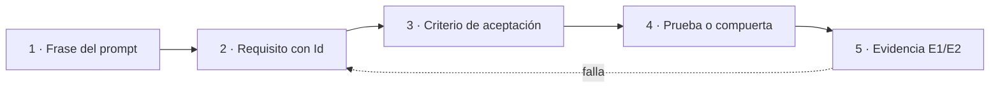

# P-01 · Propuesta del especialista E-01 (Analista de sistemas / ingeniería de requisitos)

**Prompt:** 02 de la guía 16 · **Etapa:** planificación (nadie aplica) · **Fecha:** 2026-11-01 · **Rol:** E-01, comisión a ciegas · **Núcleos:** N-01, N-05, N-06, N-07 · **Cohesión:** [`../Nucleos/00-Cohesion.md`](../Nucleos/00-Cohesion.md)

Convenciones: anclas `[R1 §4]` = relevamiento de esta bitácora; `[F16]` = ficha de `R6-Industria.md`; `[ruta:líneas]` = archivo; **propuesta** = criterio propio de E-01, sin fuente externa; **NO VERIFICADO** = referencia que R6 no leyó y que E-09 debe verificar antes de citarla en un repo. Rutas: `{guia}` = `Lab-Documentos/Guides/IA/Dot-Net-Integration-AI-Layer-Guide/`; `{geo}` = `Lab-Geometria/`; el servicio privado es `<privado>`.

## Índice

1. [Definiciones](#1-definiciones)
2. [Posición transversal: un solo modelo de requisitos](#2-posición-transversal-un-solo-modelo-de-requisitos)
3. [N-01 · Coherencia texto ↔ ejemplos y demo](#3-n-01--coherencia-texto--ejemplos-y-demo)
4. [N-05 · Conocimiento de especificación](#4-n-05--conocimiento-de-especificación)
5. [N-06 · Caso de uso Geometría](#5-n-06--caso-de-uso-geometría)
6. [N-07 · Caso de uso del servicio privado](#6-n-07--caso-de-uso-del-servicio-privado)
7. [Matriz de requisitos del prompt 02 → núcleos](#7-matriz-de-requisitos-del-prompt-02--núcleos)
8. [Conflictos con otros núcleos](#8-conflictos-con-otros-núcleos)
9. [Dudas en formato F2](#9-dudas-en-formato-f2)
10. [Fuentes y lo no verificado](#10-fuentes-y-lo-no-verificado)

## 1. Definiciones

| Término | Definición en esta propuesta | Fuente |
|---|---|---|
| Requisito (RQ) | Enunciado verificable con Id estable, origen (frase del prompt, regla o caso), criterio de aceptación y prueba que lo cubre | **propuesta**; forma usada por los CU de Geometría (§8 Criterios, §9 Trazabilidad) `[{geo}/SDD/Docs/Unidades-Entrega/GeometriaFactory-Api/02-Especificacion-Funcional/Casos-De-Uso/CU-00022-…md]` |
| Criterio de aceptación (CA) | Condición observable con resultado binario; incluye al menos un criterio negativo cuando el positivo podría pasar trivialmente | Patrón del cubo «primer/segundo ejemplo» `[{geo}/SDD/Docs/00-Contexto/Alcance-Producto.md §8]` |
| Afirmación (AF) | Frase de la guía que describe una conducta de un Example o de la demo | Filtro descripción/decisión de F1 §3.3 `[R5 §4.5]` |
| Escenario de calidad (EQ) | Requisito no funcional con estímulo, respuesta y medida | arc42 §10 `[F16]` |
| Caso de uso (CU) | Interacción actor ↔ sistema con flujo principal, alternativos, pre/postcondiciones, CA y trazabilidad | Plantilla viva de Geometría (11 secciones, CU-00021…00029) |
| Clase de evidencia | E1 ejecutable, E2 cita literal, E3 contraejemplo, E4 regla declarada, C conjetura | `[R5 §2]` |

## 2. Posición transversal: un solo modelo de requisitos

**Decisión D-0 (propuesta):** los cuatro núcleos comparten el mismo modelo de requisitos y la misma matriz de trazabilidad; cambia sólo el prefijo.

| Prefijo | Ámbito | Dónde vive |
|---|---|---|
| `AF-nnn` | Afirmación de la guía ↔ artefacto (N-01) | Bitácora; anexo de la guía si la mesa lo decide |
| `RQ-K-nn` | Requisito del Conocimiento sobre sí mismo (N-05) | Bitácora (v0) → Conocimiento (v1) |
| `RQ-IA-nn` / `EQ-IA-nn` | Plantilla que el Conocimiento ofrece a un proyecto (N-05) | Conocimiento |
| `RQ-GEO-nn` | Requisitos de la capa de IA de Geometría (N-06) | Expediente 0002 de `{geo}` |
| `RQ-PRV-nn` | Requisitos del caso privado (N-07) | `<privado>`; en público sólo cuenta y correcciones abstractas |

Criterio: simplicidad (una sola tabla y un solo formato de Id) y escalabilidad (un proyecto nuevo agrega prefijo, no plantilla). Alternativa descartada: herramienta de gestión de requisitos externa: suma dependencia y no vive en docs-as-code.

## 3. N-01 · Coherencia texto ↔ ejemplos y demo

### 3.1 Estructura recomendada

**Matriz afirmación ↔ artefacto** con columnas: `Id | Sección guía (línea) | Afirmación literal | Clase (describe/decide) | Artefacto (ruta) | Comando | Resultado esperado | Resultado obtenido (fecha) | Acción`.

Acción ∈ {`corrige-texto`, `corrige-ejemplo`, `declara-divergencia`, `ADR`}. Regla de decisión (F1 §3.3, `[R5 §4.5]`): si el texto **describe**, manda el artefacto; si **decide** (ADR), manda la decisión y el ejemplo se rotula o se corrige.

Alternativas:

| Opción | Ventaja | Costo | Elección |
|---|---|---|---|
| A · Matriz completa sobre las 229 secciones | Exhaustiva | Desproporcionado | No |
| B · Matriz por muestreo dirigido: I-1…I-9, tabla E.1 (17 filas), PD-1…PD-6, cada «En este laboratorio» con cifra o archivo citado | Cubre lo verificable | Puede dejar huecos | **Sí** |
| C · Sólo I-1…I-9 | Rápida | No mide la coherencia general | No |

### 3.2 Decisiones

| Id | Decisión | Criterio | Análisis |
|---|---|---|---|
| D-1.1 | I-1 (cifras de §0.5) se resuelve sacando la cifra del texto y remitiendo a `tools/contar.sh` con fecha | Una cifra autodeclarada envejece; la herramienta es la fuente | Cumple «no delta» y «evidencia verificable» `[R1 §4 I-1]` |
| D-1.2 | I-2, I-3, I-4 son `corrige-ejemplo`/`corrige-texto` mecánicos | Describen, no deciden | Bajo costo, E1 por `grep`/`find` |
| D-1.3 | I-5 (ejemplos bajo `Application/` vs ADR-01) va a `ADR`, no a corrección: E-01 recomienda **reafirmar la excepción didáctica en el texto principal de §4 y en cada «En este laboratorio»**, no mover código | Mover 17 ejemplos cuesta más que rotular; el lector necesita saber la excepción donde la ve | La decide E-04/E-05 y el jurado; E-01 sólo exige que quede como requisito trazado (RQ con CA «toda sección que cite un Example bajo `Application/` remite a la excepción») |
| D-1.4 | Modelo de referencia para herramientas: `qwen3.5:4b`, condicionado a medir tool calling | R4 midió que el 0.5b no emite `tool_calls` `[R4 §4]` | Si el 4b falla o no entra en 5 GiB/4096 tokens, el texto declara NO EJECUTADO; no se inventa un modelo |
| D-1.5 | La matriz vive en la bitácora; a la guía sólo pasa una tabla resumen en el Anexo E | Autocontención del libro sin cargarlo de trazas | Coherente con «cifras fuera del texto» del libro MAUI `[R5 §6]` |

### 3.3 Ensayos

| Ensayo | Cómo | Evaluación |
|---|---|---|
| T-1.1 Referencias a archivos | Extraer rutas citadas en guía y READMEs; comparar con `find {guia}` | 0 inexistentes |
| T-1.2 Compuertas | `bash {guia}/tools/verificar.sh` y las compuertas listadas en `[R1 §3]` | Todas en verde, salida guardada con fecha |
| T-1.3 Conteo | `bash {guia}/tools/contar.sh` | Coincide con lo que publique N-02 |
| T-1.4 Ejemplos con herramientas contra modelo | Examples 08, 09, 11, 12, 13, 16 con el 4b, con turno del gestor `[gestor-de-turnos]` | Cada uno: `tool_calls` presente y oráculo `.jq` en verde, o NO EJECUTADO con motivo |
| T-1.5 Demo | `Demos/MovilidadUrbana.Asistente/tools/demo.sh` | 81/81 como en `05-Cierre` o diferencia explicada |

### 3.4 Entregables

- `Prompt-02/N-01/Matriz-Afirmaciones.md` (bitácora).
- `Prompt-02/N-01/Corridas/<fecha>-<ensayo>.md` con comando y salida.
- Lista de correcciones clasificadas, insumo de N-02.

### 3.5 Criterios de aceptación

| CA | Medida |
|---|---|
| CA-1.1 | 100 % de filas de la matriz con evidencia E1 o E2 |
| CA-1.2 | I-1…I-9 con acción decidida y responsable |
| CA-1.3 | 0 rutas citadas inexistentes (T-1.1) |
| CA-1.4 | 17/17 filas de E.1 verificadas contra el árbol |
| CA-1.5 | Ningún Example con herramientas declarado como funcional sin corrida fechada |

### 3.6 Riesgos y qué no hacer

- No «corregir» una decisión (ADR) como si fuera una descripción.
- No re-ejecutar contra modelos sin turno; no usar la pasarela caída (C1).
- No editar Examples en esta etapa.

## 4. N-05 · Conocimiento de especificación

### 4.1 Estructura recomendada

Seguir la plantilla **propuesta** de R5 §7 (forma del Conocimiento MAUI, regla/razón/evidencia en columnas) `[R5 §7]`, con tres exigencias de requisitos:

1. **§1 «Cuándo usarlo y cuándo no»** como árbol de decisión con criterios numerados: «si una función determinista resuelve, no hace falta IA» `[F2]`.
2. **Plantilla de especificación (§n+1)** con campos obligatorios: escenario, contexto, actores (ejes del perfil Study-Guide `[R5 §5]`); valor; CU; `RQ-IA-nn` funcionales; `EQ-IA-nn` de calidad; exclusiones; riesgos → control; decisiones (ADR); pruebas.
3. **Trazabilidad cerrada:** toda `RQ` → al menos un CA → al menos una prueba; todo riesgo OWASP retenido → control → RQ.

Subconjunto de arc42 (D-5.2): §1 metas, §3 contexto, §5 bloques (la capa de IA como bloque), §8 conceptos transversales (prompts, evaluación, observabilidad), §9 decisiones, §10 calidad, §11 riesgos `[F16]`. C4 sólo niveles contexto y contenedor en mermaid `[F17]`. ADR en formato del Anexo A.13 de la guía `[{guia}/Dot-Net-Integration-AI-Layer-Guide.md:4488]`, con referencia a adr.github.io `[F18]`.

Requisitos-tipo que la plantilla trae precargados (todos **propuesta**, cada uno con su fuente):

| Id | Requisito-tipo | Fuente |
|---|---|---|
| RQ-IA-01 | La salida del modelo es una propuesta: ninguna acción con efecto la ejecuta sin validación determinista o confirmación humana | Guía ADR-08 (§13.9) `[R1 §2]` |
| RQ-IA-02 | El dominio depende de la abstracción (`IChatClient` o puerto propio), no del proveedor | `[F1]`, guía §4.4 |
| RQ-IA-03 | Herramientas de sólo lectura por defecto; las que escriben, con aprobación | Guía §8.5, ADR-06; `[F8]` LLM06 |
| RQ-IA-04 | Degradación: si el modelo no responde, el caso de uso sigue con su camino sin IA | R2 §7 (arquitectura sugerida) |
| EQ-IA-01 | Calidad medida con evaluadores (p. ej. Groundedness, ToolCallAccuracy) sobre un conjunto de oro | `[F4]`, guía A.10 |
| EQ-IA-02 | Aviso de interacción con IA donde aplique | `[F12]` (fuente secundaria: NO VERIFICADO en EUR-Lex) |
| EQ-IA-03 | Latencia y tope de tokens declarados por escenario, medidos en el entorno de prueba | `[R4 §4-§5]` |

### 4.2 Decisiones

| Id | Decisión | Criterio | Alternativas |
|---|---|---|---|
| D-5.1 | Forma MAUI (F10) con divergencia declarada en §0 | Coherencia entre libros acordada con FC `[00-Coordinacion]` | Rule-Forma §0–§10 (T3): más simple, pero rompe la simetría con el otro libro |
| D-5.2 | arc42 subconjunto (7 de 12 secciones) | Simplicidad pedida; las demás no cambian por tener IA | arc42 completo: escalable pero pesado |
| D-5.3 | El Conocimiento no repite la guía: cada regla remite a `[Guía §x]` | Riesgo «duplicar» de N-05 | Autocontenido total: duplica 57 k palabras |
| D-5.4 | La efectividad se mide por **prueba de autocontención**: un agente sin la guía, con sólo el Conocimiento y el repo del caso, produce la especificación | Pedido literal: «en otro contexto diferente» | Juicio experto libre: no reproducible |

### 4.3 Ensayos

| Ensayo | Cómo | Evaluación |
|---|---|---|
| T-5.1 Lint de trazabilidad | Script en la bitácora que lee la especificación producida y verifica: cada `RQ` tiene CA y prueba; cada riesgo tiene control | 0 huérfanos |
| T-5.2 Autocontención (ciego) | Subagente con el Conocimiento v0 + `{geo}` (sin la guía) produce la especificación de N-06 | Rúbrica de completitud: 10 campos obligatorios de la plantilla presentes y trazados; ≥ 9/10 |
| T-5.3 Comparación con especialista | E-12 produce en paralelo la misma especificación con la guía | Diferencias → correcciones `K-nn` al Conocimiento |
| T-5.4 Repetición en el caso privado | Igual que T-5.2 en `<privado>` | Sólo se publica el puntaje y las correcciones abstractas |
| T-5.5 Fuentes | Cada fila «Fuente» resuelve a sección existente, ruta existente o `[Rn]` de la guía | 100 % |

### 4.4 Entregables

- `Prompt-02/N-05/Conocimiento-v0.md` (bitácora; el archivo del repo no se toca en esta etapa).
- `Prompt-02/N-05/Rubrica-Completitud.md` y `lint-trazabilidad` (script en la bitácora).
- `Prompt-02/N-05/Correcciones.md`: tabla `K-nn | Caso origen | Hallazgo | Regla afectada | Cambio`.
- En ejecución: `{guia}/Conocimientos/knowledge-AI-Layer-Integration-Designing-Specification.md` v1, no delta.

### 4.5 Criterios de aceptación

| CA | Medida |
|---|---|
| CA-5.1 | 100 % de principios P-n con fila «Fuente» verificable (T-5.5) |
| CA-5.2 | T-5.2 ≥ 9/10 en ambos casos |
| CA-5.3 | Toda corrección `K-nn` trazada caso → regla |
| CA-5.4 | Decisión sobre T3 escrita en §0 del Conocimiento |
| CA-5.5 | 0 nombres, rutas o hosts privados (grep antes de PR) |

### 4.6 Riesgos y qué no hacer

- Sobreajuste: una regla que sólo vale para un caso va a «Casos de uso», no a «Principios».
- No inventar requisitos-tipo sin fuente: lo propio se marca **propuesta**.
- No usar la norma ISO de requisitos ni plantillas de casos de uso externas como cita hasta que E-09 las verifique (ver §10).

## 5. N-06 · Caso de uso Geometría

### 5.1 Estructura recomendada

Reusar **la forma de CU que Geometría ya usa** (11 secciones, CU-00021…00029) para no introducir una segunda norma en el repo. La capa de IA entra como **extensión** de CU existentes:

| Valor `[R2 §7]` | CU que extiende | Nuevo CU (propuesto) |
|---|---|---|
| V1 Explicar observaciones con pistas | CU-00026 Enviar un trabajo y ver sus observaciones | CU-IA-01 Pedir una pista sobre una observación |
| V2 Borrador del comentario docente | CU-00029 Dar desenlace a la revisión | CU-IA-02 Pedir borrador de comentario |
| V3 Resumen de errores frecuentes | CU-00028 Consultar listado y detalle | CU-IA-03 |
| V4 Consulta sobre el formato | — | CU-IA-04 |

**Piloto: V1** (D-6.1). Criterio: es el valor central del producto («el alumno entienda la discrepancia», `[R2 §1]`), ya existe el dato (`Observation` con declarado/derivado), y su CA negativo es claro.

Requisitos borrador del piloto (a confirmar con E-12):

| Id | Requisito | CA | Prueba |
|---|---|---|---|
| RQ-GEO-01 | La pista se genera a partir de una `Observation` existente; no hay pista sin observación | Pedir pista sin observación → error del contrato, sin llamada al modelo | Integración con adaptador falso |
| RQ-GEO-02 | La pista no contiene el JSON corregido ni el valor correcto calculado (X-4) | Oráculo: la salida no incluye el valor derivado ni un bloque JSON | Prueba con conjunto de oro + verificador determinista |
| RQ-GEO-03 | El veredicto no cambia por la IA (G-6) | Mismo texto → mismas observaciones con IA activa o apagada | Prueba de igualdad |
| RQ-GEO-04 | Puerto asincrónico propio, separado de `IFigureValidator` | `IFigureValidator` sin cambios en el diff | Revisión de diff + `build.sh` sin advertencias |
| RQ-GEO-05 | Sin modelo, la pantalla de observaciones funciona igual | Adaptador caído → observación visible, pista «no disponible» | E2E `pruebas-e2e.sh` |
| RQ-GEO-06 | El navegador nunca llama al modelo (RA-01) y el visor no cambia (RA-03) | 0 cambios en `visor/`; llamadas sólo desde Api | Revisión de diff |
| EQ-GEO-01 | Calidad de la pista | ≥ umbral fijado por la mesa en el conjunto de oro (no se fija aquí) | Evaluador LLM calibrado contra docente `[F4]`, `[F20]` |

Criterio negativo explícito (patrón del cubo): una pista que «revela el valor correcto» debe fallar RQ-GEO-02 aunque sea útil.

### 5.2 Decisiones

| Id | Decisión | Criterio |
|---|---|---|
| D-6.1 | Piloto V1; V2–V4 sólo enunciados | Simplicidad; un caso completo prueba mejor el Conocimiento que cuatro a medias |
| D-6.2 | Esta pasada: **sólo especificación** en el expediente 0002; implementación condicionada a decisión del PO (C6) | El intake no tiene capacidad F-n de IA y es documento humano `[R2 §7]` |
| D-6.3 | Términos nuevos primero en la Norma de Nomenclatura §6 del repo | Regla del repo `[R2 §8]` |
| D-6.4 | El caso entra a la guía como capítulo de caso + Ejemplo candidato 18 sólo si se implementa | Un ejemplo sin código contradice N-01 |

### 5.3 Ensayos

T-5.2/T-5.3 (arriba) sobre Geometría; además T-6.1: barrido de la especificación contra G-6, G-7, X-4, RA-01, RA-03 (tabla regla → RQ que la protege, 5/5 cubiertas).

### 5.4 Entregables

- En `{geo}` (cuando se abra, con aviso en `00-Coordinacion`): `SDD/Expedientes/0002-…/` con actuaciones: especificación, matriz RQ↔CA↔prueba, ADR propuesta, elevación al PO sobre el intake. Carpeta de caso `ai-layer`.
- En la bitácora: `Prompt-02/N-06/` con borradores y correcciones `K-nn`.

### 5.5 Criterios de aceptación

CA-6.1 los 5 invariantes del repo cubiertos por al menos un RQ; CA-6.2 cada RQ con CA y prueba ejecutable con scripts del repo; CA-6.3 al menos un CA negativo por RQ de contenido; CA-6.4 especificación producida por T-5.2 ≥ 9/10.

### 5.6 Riesgos y qué no hacer

- No tocar `IFigureValidator`, `visor/`, intake, `PROMPTs/`, `_legacy/`, ia-db.
- No especificar calificación con nota (sigue excluida).
- No usar la carpeta `docs-as-code` (de DAC).

## 6. N-07 · Caso de uso del servicio privado

### 6.1 Estructura recomendada

Misma plantilla del Conocimiento, aplicada en `<privado>` bajo la norma propia del repo (`Prompts/`, correlativo). Piloto propuesto: **consulta en lenguaje natural con herramientas tipadas de sólo lectura** `[R3]`. Criterio: ejercita RQ-IA-03 (sólo lectura), aislamiento por inquilino y «sin SQL libre», que Geometría no ejercita; complementa al piloto V1 (generación pedagógica) en vez de repetirlo. Alternativa: segmentación con confirmación humana (prueba RQ-IA-01 con acción irreversible), más valiosa pero más riesgosa: segunda en orden.

Requisitos-tipo en abstracto (lo único que vuelve a lo público):

| Id público | Enunciado abstracto |
|---|---|
| RQ-PRV-a | Cada herramienta recibe el inquilino desde la identidad, nunca desde el modelo |
| RQ-PRV-b | No hay herramienta que acepte consulta libre |
| RQ-PRV-c | Toda acción masiva irreversible exige confirmación humana explícita |
| RQ-PRV-d | Datos personales de destinatarios fuera del contexto del modelo salvo necesidad declarada |

### 6.2 Decisiones

| Id | Decisión | Criterio |
|---|---|---|
| D-7.1 | El aporte al Conocimiento vuelve como **fila K-nn abstracta** (regla general + criterio), nunca como ejemplo | Público/privado del prompt |
| D-7.2 | Filtro de fuga como requisito: grep de una lista negra (guardada sólo en `<privado>`) sobre LD/LDD antes de cualquier PR | Riesgo principal del núcleo |

### 6.3 Ensayos, entregables y aceptación

- T-5.4 en privado; T-7.1 grep de fuga con salida «0 coincidencias» registrada en la bitácora sin mostrar la lista.
- Entregables: especificación y matriz en `<privado>`; en la bitácora sólo `Prompt-02/N-07/Correcciones-Abstractas.md`.
- CA-7.1 0 coincidencias de la lista negra en LD/LDD; CA-7.2 100 % de herramientas especificadas de sólo lectura o con confirmación; CA-7.3 al menos una corrección K-nn que Geometría no habría producido (prueba de que el segundo caso aporta).

### 6.4 Riesgos y qué no hacer

No cifras, versiones, nombres ni rutas del servicio en público; no confundir su norma con IA.SDD; no crear el expediente sin mirar el último número en main ese día y avisar.

## 7. Matriz de requisitos del prompt 02 → núcleos

| Id | Frase del prompt (literal resumida) | Clase | Núcleo | CA principal |
|---|---|---|---|---|
| RP-01 | «Coherencia … congruente con las ejemplificaciones» | requisito | N-01 | CA-1.1, CA-1.3 |
| RP-02 | «documento unificado … jerárquico … autocontenida y no delta … índices» | requisito | N-02 | (de N-02) |
| RP-03 | «ronda de revisión como si fuera un libro» | requisito | N-04 | (de N-04) |
| RP-04 | «sección inicial que explique estos fundamentos» | requisito | N-03 | (de N-03) |
| RP-05 | «conocimiento de especificación … aplicarlos en nuevos o ya existentes proyectos» | requisito | N-05 | CA-5.2 |
| RP-06 | «aplicar … Geometría y [un servicio privado de notificaciones] … realizar las correcciones» | requisito | N-06, N-07, N-05 | CA-5.3, CA-7.3 |
| RP-07 | «enriquecer ejemplos y guía relativo a … Geometría» | deseable | N-06, N-02 | D-6.4 |
| RP-08 | proyecto privado vs repositorio público | restricción | N-07 | CA-5.5, CA-7.1 |
| RP-09 | «referencias y casos … industria» | requisito | N-08 | (de N-08) |
| RP-10 | «No inventar» / «evidencia verificable» | restricción | todos | CA-1.1, CA-5.1 |
| RP-11 | «simplicidad y practicidad, escalabilidad» | criterio | N-05, N-02 | D-5.2 |

## 8. Conflictos con otros núcleos

| # | Con | Conflicto | Propuesta de E-01 |
|---|---|---|---|
| X-1 | N-03 | ¿Los P-n del Conocimiento son la misma lista que los fundamentos? | Misma lista con Id compartido; el Conocimiento agrega columna «Criterio» y «Fuente» |
| X-2 | N-02 / C2 | Anexo E con tabla resumen de la matriz y capítulo de caso suman palabras a una guía al 130 % | La matriz completa queda en bitácora; el capítulo de caso reemplaza parte de §14, no se suma |
| X-3 | N-04 / ADR-01 (C4) | D-1.3 (rotular, no mover) choca con quien quiera alinear código | Decide jurado; E-01 sólo exige que la elección quede trazada |
| X-4 | N-09 | T-1.4 y EQ-GEO-01 dependen del 4b medido; si no entra, quedan NO EJECUTADO | Aceptar NO EJECUTADO como resultado válido, no como fallo |
| X-5 | N-10 / DAC | Expediente 0002 y carpeta `ai-layer` en Geometría; DAC ensaya en el mismo repo | Aviso previo; carpetas disjuntas |
| X-6 | N-08 | Normas de requisitos (ISO 29148, casos de uso) no relevadas | Pedido a E-09 (§10) |
| X-7 | N-06 / C6 | Especificar IA en Geometría sin capacidad F-n en el intake | Elevar al PO; esta pasada sólo especificación |

## 9. Dudas en formato F2

| Rol | Pregunta | Por qué | Prioridad | Si no contesta |
|---|---|---|---|---|
| E-01 | ¿El PO admite agregar una capacidad de IA al intake de Geometría o sólo una especificación exploratoria? | Intake es documento humano | P1 | Sólo especificación en el expediente, sin código |
| E-01 | ¿Quién fija el umbral de EQ-GEO-01? | No hay dato | P2 | Se publica la medida sin umbral, marcada |
| E-01 | ¿Qué valor del servicio privado se especifica primero? | N-07 §8 | P2 | Consulta con herramientas de sólo lectura |

## 10. Fuentes y lo no verificado

- Leídos: prompt 02; `00-Coordinacion-Entre-Sesiones.md`; `01-Convocatoria.md`; `Nucleos/00-Cohesion.md`, N-01, N-05, N-06, N-07; R1–R6; `{geo}/SDD/Docs/00-Contexto/Alcance-Producto.md` §8; índice de CU-00022; listado de CU en `{geo}`; Anexo A de la guía (encabezados).
- **NO VERIFICADO** (no están en R6; pedido a E-09 antes de citarlos en un repo): ISO/IEC/IEEE 29148 (ingeniería de requisitos), A. Cockburn *Writing Effective Use Cases*, formato Given/When/Then para CA. Esta propuesta no se apoya en ellos: sus decisiones se fundan en las plantillas vivas de Geometría, arc42/C4/ADR `[F16–F18]` y OWASP `[F8]`.
- Mensajes ajenos a la carta durante el trabajo: ninguno.

> **Nota de redacción** 2026-11-01: el nombre del servicio privado se reemplazó por la fórmula abstracta «un servicio privado de notificaciones» (pendiente 3 de `Ejecucion/Verificacion-Etapa-2.md`, `Ejecucion/Pendientes-Etapa-2.md`). No se cambió nada más.
