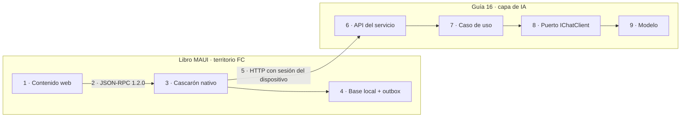

# P-02 · Propuesta del especialista «Arquitecto de aplicaciones móviles MAUI .NET»

> Mesa del prompt 02 (guía 16). Etapa: **planificación**; nada de lo propuesto se aplica todavía. Núcleos atendidos: N-02, N-03, N-05. Trabajo a ciegas respecto de los otros especialistas. Fuentes: prompt 02; `00-Coordinacion-Entre-Sesiones.md`; `Nucleos/00-Cohesion.md`, `N-02`, `N-03`, `N-05`; relevamientos R1, R5, R6; guía 0.11.0 (encabezados y §3.0–§3.1, §13); libro y Conocimiento MAUI de `Concepts/Framework-Concept/` (sólo lectura, territorio FC).
> Rutas relativas a la raíz del workspace salvo aviso. Marcas: **propuesta** = decisión de este especialista sujeta a jurado; NO VERIFICADO = sin ensayo.

## Índice

1. [Definiciones](#1-definiciones)
2. [Posición del especialista y frontera con el libro MAUI](#2-posición-del-especialista-y-frontera-con-el-libro-maui)
3. [N-02 · Libro unificado y arquitectura editorial](#3-n-02--libro-unificado-y-arquitectura-editorial)
4. [N-03 · Sección inicial de fundamentos](#4-n-03--sección-inicial-de-fundamentos)
5. [N-05 · Conocimiento de especificación](#5-n-05--conocimiento-de-especificación)
6. [Ensayos comunes a los tres núcleos](#6-ensayos-comunes-a-los-tres-núcleos)
7. [Conflictos con otros núcleos](#7-conflictos-con-otros-núcleos)
8. [Qué no hacer](#8-qué-no-hacer)
9. [Mensajes ajenos recibidos](#9-mensajes-ajenos-recibidos)

## 1. Definiciones

| Término | Definición en esta propuesta | Fuente |
|---|---|---|
| Libro | Documento único, jerárquico, autocontenido y no delta, con índice, que el prompt pide en `Dot-Net-Integration-AI-Layer-Guide.md` | prompt 02, Solicitud 2 |
| Conocimiento | Documento que separa regla (P-n), razón (criterio) y evidencia (fuente) y «no repite el libro: lo condensa» | R5 §6 (F10) |
| Frontera | Punto donde la guía 16 toca un tema que es norma del libro MAUI (puente JSON-RPC, OTA firmada, offline-first con outbox) y lo **referencia sin redefinirlo** | 00-Coordinacion, respuesta de FC |
| Cliente híbrido | App con cascarón nativo y contenido web actualizable; el contenido pide y el cascarón decide | `Concepts/Framework-Concept/Conocimientos/Knowledge-App-Hibrida-OTA-Offline-First.md` §2 P-3 |

## 2. Posición del especialista y frontera con el libro MAUI

Hechos verificados:

- La guía 0.11.0 no trata clientes móviles: el único rastro es Foundry Local en el dispositivo (l. 3470, [REF-179]) y la franja «FRONTEND · web · móvil» de la diapositiva de §1 (l. 189–197). Grep de «maui», «offline», «sin conexión» sin coincidencias.
- El libro MAUI y su Conocimiento no mencionan IA (grep «llm», «modelo de lenguaje», « ia»: sólo coincidencias de metadatos y de biometría).
- FC fijó tres puntos de contacto que se referencian y no se redefinen: puente JSON-RPC versionado (1.2.0), contenido OTA firmado, offline-first con outbox (00-Coordinacion).

Consecuencia (**propuesta**): la intersección «capa de IA consumida desde una app híbrida» hoy no tiene evidencia propia en ningún libro. No se inventa: se plantea como **frontera declarada** de una página en el libro y una sección corta en el Conocimiento, con las reglas que ya tienen fuente en uno u otro libro, y lo que no la tiene va marcado NO VERIFICADO hasta que un caso de uso lo ejercite (ver §5.6).

Figura P-02.1. La frontera pasa por la flecha 5: la guía 16 empieza en la API del servicio; todo lo que está a la izquierda se cita del libro MAUI.

## 3. N-02 · Libro unificado y arquitectura editorial

### 3.1 Estructura recomendada

**Propuesta A (recomendada): un solo archivo, siete partes, numeración § estable, convenciones del libro MAUI.**

| Parte | Contenido | Origen en 0.11.0 |
|---|---|---|
| Prólogo | Cómo usar el libro, rutas de lectura por perfil (tabla), mermaid de dependencias | Parte 0 §0 (recortada) |
| I · Fundamentos del framework | Capítulo nuevo de N-03 + marco de escenarios, contextos y actores | §1, §2, §3 (consolidados) |
| II · Arquitectura y SDK | Renombre de la actual «Fundamentos» (resuelve I-6) | §4, §5 |
| III · Conocimiento | sin cambio de alcance | §6, §7 |
| IV · Agencia | sin cambio de alcance | §8, §9 |
| V · Producción | + frontera con clientes móviles e híbridos (una página, §12.x) | §10–§12 |
| VI · Integración y casos | ADR, demo, caso Geometría (N-06) | §13, §14 + nuevo |
| Anexos | Plantillas, listas, glosario único bilingüe, referencias con fecha de consulta, laboratorio, versiones, lecturas, **procedencia** | A–G + nuevo |

Criterios: (1) el prompt pide **un** documento, no una carpeta (Solicitud 2); (2) coherencia entre libros acordada con FC: capítulos numerados, índice al inicio, glosario y referencias al final (00-Coordinacion); (3) conservar § evita romper las remisiones de Examples y demo (I-8 muestra el costo de renumerar).

**Alternativa B: carpeta de capítulos + compilado** (patrón `Concepts/Framework-Concept/00…08` + `MAUI-Framework-Developer-Guide.md`). Más escalable para editar en paralelo, pero duplica fuente y exige un generador; los generadores ya se retiraron en otro proyecto por mantenimiento. Descartada para esta edición; queda como opción si el libro supera el presupuesto aun recortado.

**Alternativa C: libro corto + Prácticas a los README de cada ejemplo.** No es excluyente con A: **propuesta** adoptar A con C parcial — las Prácticas de más de ~150 líneas (§5 ~300, §8 ~380 según R1) se mudan al `README.md` del ejemplo y el libro conserva definición, criterio y un extracto con `[ruta:líneas]`.

### 3.2 Decisiones con criterio

| Id | Decisión (**propuesta**) | Criterio | Fuente |
|---|---|---|---|
| D-02.1 | La procedencia sale del cuerpo: los 62 bloques «Historia» van a la bitácora; el libro conserva un Anexo «Procedencia» de una tabla (versión, fecha, bitácora) | «autocontenida y no delta» | prompt 02, Reglas; R1 |
| D-02.2 | Unicidad: cada término se define una vez en Parte I o en el glosario; §3.0, §4.1 y Anexo C se fusionan | «consistente», «interconectado» | RuleSet Study-Guide (R5 §5); R1 §5 |
| D-02.3 | Se mantiene el patrón por sección «Definición · Aplicación por escenario · Ejemplo · Preguntas guía · Criterios de calidad · Qué decisión toca (ADR)», que es el del perfil más la caja ADR existente | perfil exige estructura idéntica por tema | R5 §5 (F3) |
| D-02.4 | Presupuesto: el libro final no supera la extensión de la 0.11.0 medida con `tools/contar.sh` (57.753 palabras); lo nuevo (fundamentos, caso, frontera) se paga con lo que sale (historia, duplicados, Prácticas largas) | resuelve C2 sin pedir tope al PO | R1 §7; 00-Cohesion C2 |
| D-02.5 | Convenciones del libro MAUI: front matter YAML, «Tabla n.m.»/«Figura n.m.», marcas NO VERIFICADO/NO EJECUTADO/HISTÓRICO, citas `[Rn]`, mermaid «1 · Texto» sin URL | coherencia entre libros | R5 §6; 00-Coordinacion |

### 3.3 Entregables

| Entregable | Ruta |
|---|---|
| Índice objetivo y mapa §0.11.0 → §nuevo (tabla, sin huérfanos) | `{bitácora}/Prompt-02/N-02/Mapa-Secciones.md` |
| Política de procedencia y unicidad | `{bitácora}/Prompt-02/N-02/Politicas-Editoriales.md` |
| Presupuesto por parte (salida de `contar.sh` antes/después) | `{bitácora}/Prompt-02/N-02/Presupuesto.md` |
| Libro editado (ejecución, no ahora) | `Guides/IA/Dot-Net-Integration-AI-Layer-Guide/Dot-Net-Integration-AI-Layer-Guide.md` (LD) |

`{bitácora}` = `Lab-Documentos.Documentacion/PROMPTs/Guides/16-IA-Layer/OUTPUTs/Bitacoras`.

### 3.4 Criterios de aceptación medibles

1. Mapa sin huérfanos: 100 % de los encabezados `^#{1,3} ` de la 0.11.0 tienen destino (script de comparación sobre el mapa).
2. `grep -c "Historia (hasta"` = 0 en el cuerpo; «histórico» sólo en el Anexo Procedencia.
3. Cada término del glosario: exactamente 1 definición (grep del término en negrita/tabla de definición).
4. `tools/contar.sh` ≤ 57.753 palabras de prosa.
5. `tools/verificar.sh` y `tools/medios/mermaid.sh` en verde.
6. Lista de control de las 9 reglas del RuleSet con 9/9 marcadas y evidencia.

### 3.5 Riesgos

- Renumerar rompe remisiones desde Examples/demo → mitigación D-02 de numeración estable + verificación de anclas por `verificar-markdown.py`.
- Mudar Prácticas a README dispersa evidencia → cada extracto del libro lleva `[ruta:líneas]` vigente.

## 4. N-03 · Sección inicial de fundamentos

### 4.1 Estructura recomendada

Capítulo «§1 Fundamentos del framework» al comienzo de la Parte I (**propuesta**), con tres bloques:

1. **Problema y postura** (de §1 actual: de la diapositiva a una solución).
2. **Principios P-1…P-n** en tabla `Id | Principio | Por qué | Dónde se aplica (§/ADR) | Fuente externa`.
3. **Mapa** mermaid principios → capas → escalera de agencia.

Frontera fundamento/arquitectura (respuesta a la pregunta 1 de N-03): **fundamento** es lo que vale aunque cambie el SDK o el proveedor; **arquitectura** es cómo se cumple en .NET. Por eso Microsoft.Extensions.AI va a Parte II, no a fundamentos.

### 4.2 Lista inicial de principios con fuente interna (a validar; ninguno nuevo)

| Id | Principio | Fuente en la 0.11.0 |
|---|---|---|
| P-1 | La llamada al modelo vive detrás de un puerto en infraestructura; el caso de uso no conoce ni prompt ni modelo | ADR-01 §13.2; l. 255 |
| P-2 | Un contrato de acceso y adaptadores por proveedor | ADR-02 §13.3 |
| P-3 | La salida del modelo es una propuesta; decide el dominio | ADR-08 §13.9 |
| P-4 | Ninguna flecha va del modelo al repositorio (salvo excepciones rotuladas) | §3.1, §4.3 |
| P-5 | Menor escalón de agencia que resuelve: herramienta < workflow < agente | ADR-07 §13.8; R6 F2 («si alcanza una función, no usar un agente») |
| P-6 | Herramientas sobre casos de uso existentes y con aprobación cuando escriben | ADR-06 §13.7 |
| P-7 | El conocimiento se elige por costo y frescura: contexto fijo, completo con prefijo, RAG | ADR-04 §13.5 |
| P-8 | Local por defecto; dónde corre el modelo se elige en la raíz de composición | ADR-03 §13.4, §12.10 |
| P-9 | Pipeline transversal: telemetría, límites y seguridad como middleware | ADR-09 §13.10 |
| P-10 | Se prueba y se evalúa; lo medido manda sobre lo escrito | ADR-10 §13.11 |

La regla de Agent Framework entra como **criterio** de P-5, no como principio aparte (pregunta 3 de N-03): es una fuente externa que respalda un principio propio.

### 4.3 Decisiones

| Id | Decisión (**propuesta**) | Criterio |
|---|---|---|
| D-03.1 | **Una sola lista P-n** para libro y Conocimiento, con los mismos Ids; el libro la define y el Conocimiento la cita y agrega columna «criterio para aplicarlo» | unicidad (D-02.2); evita deriva entre documentos |
| D-03.2 | Escenarios/contextos/actores (§2) siguen en Parte I pero después de los principios | el perfil los pide primero en el **marco**, no en los fundamentos (R5 §5) |
| D-03.3 | Tope de extensión del capítulo: ≤ 2.500 palabras; lo que excede se remite a §/ADR | riesgo «inflar con resúmenes» (N-03 §7) |

Industria: F1 (puerto `IChatClient`), F2 (agente vs workflow), F8/F9 OWASP (P-3, P-6), F10 NIST AI RMF (P-10) de R6.

### 4.4 Entregables, aceptación, riesgos

- Entregable: `{bitácora}/Prompt-02/N-03/Principios-Pn.md` (tabla + mermaid + mapa de qué se quita de §3/§4).
- Aceptación: 100 % de P-n con fuente interna (§/ADR) y ≥ 1 fuente externa R6 o Anexo D; 0 P-n definidos en dos lugares tras integrar; prueba del lector frío (§6) con ≥ 8/10 principios enunciados correctamente.
- Riesgo: que el examen I-5 (ejemplos bajo `Application/`) contradiga P-1 → el capítulo declara la excepción «prototipo y deuda» igual que ADR-01, sin suavizar el principio.

## 5. N-05 · Conocimiento de especificación

### 5.1 Forma (respuesta a T3/C3)

**Propuesta: forma del Conocimiento MAUI** (§0–§13 con cabecera de 11 campos, tabla P-n · Criterio · Fuente, «Límites» al final), tal como R5 §7 la adapta. Criterio: coherencia entre libros acordada con FC y un precedente vigente del mismo repo (`Knowledge-App-Hibrida-OTA-Offline-First.md`, v1.0, 2026-11-01). Si N-10 decide que rige Rule-Forma (§0–§10), se registra ficha de excepción en la bitácora; las secciones extra (plantilla, casos, industria) caben como anexos sin cambiar el contenido.

### 5.2 Estructura recomendada

| § | Sección | Nota del especialista |
|---|---|---|
| 0 | Propósito, regla de evidencia, mapa de carga | Mapa por tarea: «¿hace falta IA?», «especificar», «revisar» |
| 1 | Cuándo usarlo y cuándo no | Incluye «si alcanza una función, no hay capa de IA» (P-5) |
| 2 | Principios P-n con criterio | Mismos Ids que el libro (D-03.1) |
| 3 | Arquitectura de referencia (C4 nivel 1–2 en mermaid) | Incluye la frontera de la Figura P-02.1 |
| 4 | Contratos (puerto, herramientas, salida estructurada, versionado) | |
| 5 | **Clientes y fronteras** | Ver §5.6 |
| 6 | Catálogo de decisiones: ADR-01…13 como preguntas que un proyecto responde | Deriva de §13 de la guía (R1) |
| 7 | Plantilla de especificación (arc42 mínimo) | Ver §5.3 |
| 8 | Riesgos (OWASP LLM 2025 + Agentic 2026) | R6 F8, F9 |
| 9 | Métricas y pruebas (evaluadores .NET, compuertas) | R6 F4; `tools/` |
| 10 | Procedimiento de aplicación paso a paso | |
| 11 | Checklist de arranque | |
| 12 | Casos de uso: Geometría por nombre; «un servicio privado de notificaciones» en abstracto | carta común |
| 13 | Referencias e industria; Límites | NO VERIFICADO explícitos |

### 5.3 arc42: subconjunto mínimo (respuesta a la pregunta 2 de N-05)

**Propuesta:** cinco secciones de arc42 (3 contexto, 5 bloques, 8 conceptos transversales, 10 calidad, 11 riesgos) + C4 niveles 1–2 + log ADR [R6 F16–F18]. Criterio: simplicidad pedida en el prompt; las demás secciones de arc42 (restricciones, despliegue, glosario) ya las cubre el proyecto anfitrión. Alternativa: arc42 completo (descartada por costo para proyectos existentes); alternativa mínima: sólo ADR (descartada: no fija calidad ni riesgos medibles).

Cada requisito de la plantilla: `REQ-n | enunciado | escenario ESC-x | criterio de aceptación | prueba (ejemplo o evaluador) | riesgo OWASP`.

### 5.4 Decisiones

| Id | Decisión (**propuesta**) | Criterio |
|---|---|---|
| D-05.1 | Forma MAUI (§5.1) | coherencia entre libros |
| D-05.2 | arc42 mínimo + C4 1–2 + ADR | simplicidad / escalabilidad |
| D-05.3 | El Conocimiento no repite el libro: cada regla remite a `[Guía §x]` o `[ruta:líneas]` | R5 §6 (F10) |
| D-05.4 | Borrador v0 sólo en la bitácora; el archivo del repo se escribe en la ejecución, ya en v1 | carta común (no editar el Conocimiento en esta etapa) |
| D-05.5 | Cambios caso→regla en una tabla trazada en la bitácora; el Conocimiento final queda no delta | prompt 02, Reglas |

### 5.5 Ensayos de efectividad (respuesta a la pregunta 3 de N-05)

| Ensayo | Cómo | Evaluación |
|---|---|---|
| E-05.1 Autocontención | Un subagente sin la guía cargada aplica v0 a Geometría (N-06) y produce la especificación | % de campos de la plantilla llenados con fuente; meta ≥ 90 %; huecos → correcciones v1 |
| E-05.2 Caso privado | Mismo procedimiento sobre el servicio privado, en su propio repo y bitácora privada | Sólo vuelven a lo público las reglas corregidas en abstracto (grep de nombres privados = 0) |
| E-05.3 Juez cruzado | Otro rol de la mesa revisa cada especificación contra la checklist §11 | Desacuerdos → regla ambigua → corregir |
| E-05.4 Frontera móvil | Si uno de los casos tiene cliente móvil o híbrido, verificar las reglas de §5.6 contra él | Lo no ejercitado queda NO VERIFICADO en §13 |

### 5.6 Sección «Clientes y fronteras» (contenido mínimo, con fuente)

Reglas que **ya tienen fuente** y sólo se citan:

- El contenido pide, el cascarón decide; ningún token cruza el puente [Knowledge MAUI P-3, P-4]. Consecuencia citable: ninguna clave del proveedor de IA vive en el contenido web.
- La operación se agrega como fila de la tabla del puente, no como método nuevo [Knowledge MAUI P-2, §4].
- Modelo en el dispositivo: Foundry Local [Guía l. 3470, REF-179] como opción de ADR-03, no recomendación.

Reglas **sin fuente** (van como pregunta del catálogo, NO VERIFICADO, no como regla): si un pedido a la capa de IA puede encolarse en el outbox (la salida es una propuesta no idempotente y caduca: P-3 la hace revisable, pero no hay ensayo); cómo degradar la UI sin red; streaming a través del puente. No se redactan como norma hasta un ensayo.

### 5.7 Entregables y aceptación

| Entregable | Ruta |
|---|---|
| v0 del Conocimiento | `{bitácora}/Prompt-02/N-05/knowledge-v0.md` |
| Tabla caso → regla | `{bitácora}/Prompt-02/N-05/Correcciones-v0-v1.md` |
| v1 (ejecución) | `Guides/IA/Dot-Net-Integration-AI-Layer-Guide/Conocimientos/knowledge-AI-Layer-Integration-Designing-Specification.md` |

Aceptación: 100 % de filas P-n con «Fuente» no vacía; E-05.1 ≥ 90 %; 0 coincidencias del grep de nombres privados en LD/LDD; mermaid validado; la guía enlaza el Conocimiento desde el Prólogo y desde §13.

## 6. Ensayos comunes a los tres núcleos

- **Lector frío**: subagente con sólo el Prólogo + Parte I enuncia P-n y decide un escenario; se compara con la tabla (N-03).
- **Compuertas**: `tools/verificar.sh`, `tools/contar.sh`, `tools/medios/mermaid.sh`. Ninguna prueba contra modelos hace falta en estos núcleos; si E-05.1 la necesitara, va con turno del gestor (`[gestor-de-turnos]`).

## 7. Conflictos con otros núcleos

| # | Con | Conflicto | Propuesta |
|---|---|---|---|
| K1 | N-01 / C4 | P-1 frente a ejemplos bajo `Application/` (I-5) | Principio intacto; excepción rotulada por ejemplo |
| K2 | N-06 / C2 | Caso Geometría + fundamentos + frontera móvil frente al presupuesto | D-02.4: se paga con historia y Prácticas |
| K3 | N-10 / C3 | Forma MAUI vs Rule-Forma | D-05.1 o ficha de excepción |
| K4 | N-08 / C7 | MCP 2026-07-28: la Parte IV y el catálogo de contratos del Conocimiento deben citar la misma versión | Fijar versión en Anexo F y citarla en §4 del Conocimiento |
| K5 | N-08 | Numeración `[REF-n]` (guía) vs `[Rn]` (libro MAUI) | Mantener `[REF-n]` en esta edición; cambiar sólo si N-04 lo pide |
| K6 | FC | Frontera móvil: si FC cambia el puente (1.2.0) o P-n del Conocimiento MAUI, la cita queda vieja | Citar con versión y fecha; aviso a FC, sin editar su territorio |
| K7 | N-07 | El caso privado podría ser el único con cliente móvil: lo que enseñe sólo vuelve en abstracto | E-05.2/E-05.4 |
| K8 | N-02 / N-04 | Renombrar Parte II cambia anclas citadas por Examples | Numeración § estable; sólo cambia el título |

## 8. Qué no hacer

- No redefinir en la guía 16 puente, OTA ni outbox: se citan del libro MAUI.
- No escribir reglas móviles sin ensayo (offline de pedidos a IA, streaming por el puente).
- No editar el Conocimiento ni la guía en esta etapa; nada en territorio FC/DAC ni archivos comunes.
- No convertir el libro en carpeta de capítulos sin decisión de la mesa.
- No nombrar el servicio privado ni su infraestructura en LD/LDD ni en esta bitácora.

## 9. Mensajes ajenos recibidos

Ninguno durante este trabajo.
