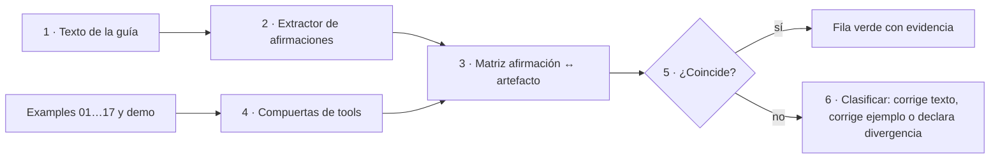
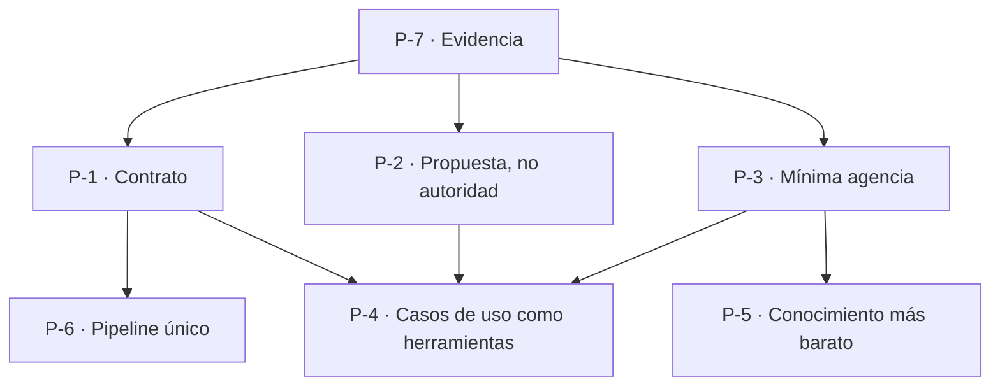
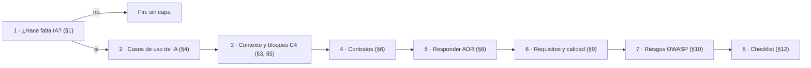
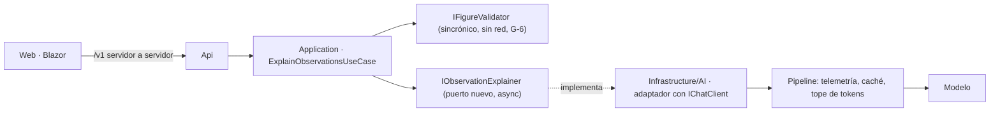

# P-03 · Propuesta del Arquitecto .NET / Microsoft.Extensions.AI (E-03)

> Mesa del prompt 02 de la guía 16 · Etapa: planificación (nada se aplica) · Fecha: 2026-11-01 · Especialista: E-03 (`01-Convocatoria.md` §3) · Núcleos: N-01, N-03, N-05, N-06 · Trabajo a ciegas respecto de los demás especialistas.
> Rutas: `{guia}` = `Lab-Documentos/Guides/IA/Dot-Net-Integration-AI-Layer-Guide/`; `{geo}` = repositorio Lab-Geometria. Fuentes externas con su Id de `../Relevamiento/R6-Industria.md` (F1…F24). El caso privado se cita sólo en abstracto («servicio privado de notificaciones»).

## Índice

1. [Definiciones y punto de partida](#1-definiciones-y-punto-de-partida)
2. [Hechos verificados que sostienen la propuesta](#2-hechos-verificados-que-sostienen-la-propuesta)
3. [N-01 · Coherencia texto ↔ ejemplos y demo](#3-n-01--coherencia-texto--ejemplos-y-demo)
4. [N-03 · Fundamentos del framework](#4-n-03--fundamentos-del-framework)
5. [N-05 · Conocimiento de especificación](#5-n-05--conocimiento-de-especificación)
6. [N-06 · Caso de uso Geometría](#6-n-06--caso-de-uso-geometría)
7. [Ensayos y pruebas que hacen falta](#7-ensayos-y-pruebas-que-hacen-falta)
8. [Conflictos con otros núcleos y preguntas abiertas](#8-conflictos-con-otros-núcleos-y-preguntas-abiertas)
9. [Qué no hacer](#9-qué-no-hacer)

## 1. Definiciones y punto de partida

| Término | Definición usada en esta propuesta | Fuente |
|---|---|---|
| Capa de IA | Conjunto de puertos, adaptadores y pipeline que aíslan al núcleo de la aplicación de los modelos | guía §3.1, §4; F1 |
| `IChatClient` | Abstracción de `Microsoft.Extensions.AI.Abstractions` para chat; se compone con middleware (función, telemetría, caché) por DI | F1 |
| Puerto propio | Interfaz definida en Application cuyo contrato es de la funcionalidad (no del chat); el adaptador en Infrastructure/AI usa `IChatClient` | guía ADR-01 opción (c), §13.2 |
| Herramienta tipada | Función .NET expuesta al modelo con esquema generado; en la guía, sobre casos de uso existentes | guía §8.2–§8.4, ADR-06 |
| Escalón de agencia | Grado de autonomía: función fija → herramienta → workflow → agente | guía §3.2, ADR-07; F2 |
| Propuesta vs autoridad | La salida del modelo nunca es veredicto; la aplica código determinista o una persona | guía ADR-08 (§13.9) |

Criterio rector de toda la propuesta, pedido por el prompt: **simplicidad, practicidad y escalabilidad**, en ese orden de desempate. Se lee así: entre dos alternativas que cumplen, gana la que agrega menos tipos, paquetes o servicios; si empatan, la que un desarrollador aplica sin herramientas nuevas; escalabilidad sólo desempata cuando hay crecimiento medido o declarado.

## 2. Hechos verificados que sostienen la propuesta

| # | Hecho | Evidencia (E1 comando / E2 cita) |
|---|---|---|
| H1 | Versiones centralizadas e iguales en Examples y demo: `Microsoft.Extensions.AI` 10.11.0, `OllamaSharp` 5.5.0; Examples suma `Microsoft.Agents.AI*` 1.26.0 y `ModelContextProtocol*` 2.3.0 | E1: `grep Version {guia}/Examples/Directory.Packages.props {guia}/Demos/Directory.Packages.props` (2026-11-01) |
| H2 | ADR-01 decide (c) puerto propio + (d) sesión de chat en Infrastructure/AI; (b) `IChatClient` en Application «sólo en un prototipo y como deuda» | E2: guía §13.2 l. 3697-3707 |
| H3 | Los ejemplos ponen `IChatClient`, herramientas o workflow bajo `Application/` (I-5) | E2: R1 §4, guía E.1 l. 4947 |
| H4 | El texto cita MCP 2025-06-18 (4 apariciones); la versión vigente es 2026-07-28 sin handshake, con `server/discover` | E1: `grep -c 2025-06-18` = 4; F5 |
| H5 | `qwen2.5:0.5b` no emite `tool_calls`; `qwen3.5:4b` declara tools pero no se midió; contexto efectivo 4096 | R4 §3–§4 |
| H6 | La guía no tiene sección de fundamentos; Parte II «Fundamentos» trata ubicación y MEAI | R1 §2, I-6 |
| H7 | En Geometría `IFigureValidator` es sincrónico y sin red por contrato (G-6); X-4 excluye editar el JSON del alumno | R2 §4 |
| H8 | Agent Framework fija «si alcanza una función, no uses un agente» | F2 |

## 3. N-01 · Coherencia texto ↔ ejemplos y demo

### 3.1 Arquitectura de la verificación recomendada

Una **matriz afirmación ↔ artefacto** generada en parte por herramienta y cerrada a mano, con tres clases de fila: *afirmación de API* (tipo, método, paquete), *afirmación de conducta* (lo que el ejemplo muestra al correr) y *afirmación de cifra* (conteos, tiempos).

| Alternativa | Ventaja | Costo | Veredicto |
|---|---|---|---|
| A · Matriz manual completa | Sin herramientas | Miles de afirmaciones; no se re-verifica | Descartada |
| B · Extracción de símbolos (`grep` de identificadores en código entre comillas invertidas) + cruce con `find`/compilación; lo demás a mano | Reutiliza `tools/`; re-ejecutable | Un script chico nuevo | **Recomendada** |
| C · Analizador Roslyn que verifique fragmentos | Máxima precisión | Desproporcionado para un libro | Descartada (no escala en simplicidad) |

### 3.2 Decisiones

| Id | Decisión | Criterio | Análisis |
|---|---|---|---|
| D-01.1 | **I-5: los ejemplos se quedan como están y la excepción se declara en el texto principal**, en cada «En este laboratorio» que use `IChatClient` en Application, con remisión a ADR-01 (b). La demo es la referencia normativa | Simplicidad: 17 ejemplos son unidades didácticas de un archivo de foco; mover a `Infrastructure/` duplica tipos sin enseñar más. ADR-01 ya admite (b) en prototipo | Alternativa: mover a puerto propio en los ejemplos 03, 04, 07, 08 (los que el lector copiaría). Costo: re-ejecutar compuertas y oráculos de esos 4. Se eleva como opción si el jurado de Coherencia lo pide |
| D-01.2 | Modelo de referencia para herramientas: `qwen3.5:4b`, condicionado a medirlo (§7, ensayo T-1). Si no emite `tool_calls` fiables, los ejemplos 08, 09, 11, 12, 13, 16 declaran el modo `--fake` como camino primario y el modelo real como opcional | No inventar: hoy no hay medición (H5) | Retirar `qwen2.5:0.5b` del texto conceptual (22 apariciones, R1 §5) y dejarlo sólo en el anexo de procedencia |
| D-01.3 | MCP: el texto adopta 2026-07-28 como vigente y conserva 2025-06-18 sólo como nota de compatibilidad, **después** de comprobar qué revisión negocia el SDK 2.3.0 (ensayo T-3) | El ejemplo 13 es la verdad; el texto describe lo que el ejemplo hace | Si el SDK 2.3.0 no habla 2026-07-28, el texto dice exactamente eso con la versión, no se actualiza el paquete en esta pasada |
| D-01.4 | I-1…I-4 se corrigen mecánicamente (cifra de `contar.sh`, `comparar-ac9.py`, vocabulario «servidor de chat / segundo servidor», `03-Salida-Estructurada.csproj`) | Son errores, no decisiones | I-4 implica renombrar un `.csproj`: verificar oráculos y `verificar.sh` |
| D-01.5 | La matriz queda en la bitácora; al libro va sólo el Anexo E.1 actualizado | No delta: el libro no publica el proceso | — |

### 3.3 Estándares que lo respaldan

- F1: el paquete `Microsoft.Extensions.AI` y la composición por middleware son lo que los ejemplos deben mostrar; cualquier afirmación de API se coteja con esa página.
- F5: versionado MCP por fecha; F6: selección de paquete por rol (`ModelContextProtocol.AspNetCore` para servidores HTTP), coincidente con el ejemplo 13 (H1).

### 3.4 Entregables y aceptación

| Entregable | Ruta | Criterio de aceptación medible |
|---|---|---|
| Matriz afirmación ↔ artefacto | `Prompt-02/Nucleos/N-01/Matriz-Afirmacion-Artefacto.md` | 100 % de identificadores de código citados en la guía resueltos (existe en código o en F1/F6) o marcados; 0 archivos citados inexistentes |
| Lista de correcciones clasificada | `Prompt-02/Nucleos/N-01/Correcciones.md` | Cada fila con clase, sección, archivo y evidencia E1/E2 |
| Nota D-01.1 (excepción I-5) | bitácora; luego guía en N-02 | Toda sección con ejemplo que usa `IChatClient` en Application remite a ADR-01 |
| Estado de compuertas | bitácora | `tools/verificar.sh` y la demo en verde tras correcciones (hoy 81/81 y 561/561, 05-Cierre) |

### 3.5 Riesgos

- Que T-1 muestre que el 4b tampoco sirve para herramientas en CPU con 4096 de contexto: entonces el camino real queda sin evidencia y debe decirse.
- Renombrar `.csproj` o tocar ejemplos rompe oráculos `.jq`: siempre `recalcular-oraculos.sh` y diff.

## 4. N-03 · Fundamentos del framework

### 4.1 Estructura recomendada

Capítulo nuevo **«Parte 0bis / Capítulo 1 · Fundamentos»** (ubicación final la decide N-02) con **siete principios** extraídos de la guía, cada uno en el formato *Enunciado · Por qué · Dónde se aplica · Fuente*. Propuesta de lista (cerrada a lo que la 0.11.0 ya sostiene; nada nuevo):

| Id | Principio | Fuente interna | Fuente externa |
|---|---|---|---|
| P-1 | **El modelo es un detalle de infraestructura detrás de un contrato** (el núcleo depende de abstracciones) | §3.1, §4.4, ADR-01, ADR-02 | F1 (Abstractions vs paquete completo) |
| P-2 | **La salida del modelo es una propuesta; la autoridad es código o persona** | ADR-08, §5.3 | F8 LLM05, LLM09 |
| P-3 | **Mínima agencia**: subir de escalón sólo con motivo medido | §3.2, ADR-07 | F2 (regla de la función), F20 |
| P-4 | **El modelo actúa sólo a través de casos de uso existentes**; escrituras con aprobación | §8.4–§8.5, ADR-06, ADR-12 | F8 LLM06, F9 |
| P-5 | **Conocimiento por el camino más barato que alcance** (contexto fijo → prefijo estable → RAG) | §3.2, §6, ADR-04 | F22 |
| P-6 | **Lo transversal en un solo pipeline** (telemetría, caché, límites, opciones) | §5.4, ADR-09 | F1, F7 |
| P-7 | **Sin evidencia no hay afirmación**: toda conducta se prueba sin modelo y se evalúa con modelo | §0.4, §10, ADR-10 | F4, F20 |

| Alternativa | Veredicto |
|---|---|
| A · Fundamentos = resumen de toda la guía | Descartada (riesgo de N-03 §7: inflar) |
| B · Fundamentos = principios + diagrama + mapa a ADR (≈ 1.200 palabras) | **Recomendada** |
| C · Fundamentos sólo en el Conocimiento | Descartada: el prompt lo pide en el libro |

### 4.2 Decisiones

| Id | Decisión | Criterio |
|---|---|---|
| D-03.1 | **Una sola lista P-1…P-7 compartida por libro y Conocimiento**, con Ids estables; el Conocimiento la reproduce condensada (regla/razón/fuente) y remite | Evita dos verdades (N-03 §5 «ningún principio en dos lugares» + N-05 «no duplicar»); responde N-03 pregunta 2 |
| D-03.2 | La regla de Agent Framework entra **como criterio de P-3**, no como principio propio | Es una fuente que respalda un principio ya presente (ADR-07) |
| D-03.3 | Renombrar Parte II a **«La capa en .NET»** (o equivalente que decida N-02) | I-6: dos «fundamentos» confunden; frontera: *fundamento = por qué y qué invariante*, *arquitectura = dónde y con qué tipo* |
| D-03.4 | §3.0 (doce términos) queda como vocabulario previo; los principios van **después** del vocabulario y antes de §4 | Un principio usa términos que deben estar definidos (autocontención) |

### 4.3 Entregables y aceptación

| Entregable | Ruta | Aceptación |
|---|---|---|
| Borrador del capítulo de fundamentos | `Prompt-02/Nucleos/N-03/Borrador-Fundamentos.md` | 7 principios, cada uno con ≥1 fuente interna y ≥1 externa de R6 o Anexo D; ≤ 1.500 palabras |
| Tabla de lo que se quita de §3/§4 por duplicado | ídem | 0 principios definidos en dos lugares tras N-02 |
| Prueba con lector sin contexto (E-14) | bitácora | E-14 enuncia los 7 principios leyendo sólo el capítulo (≥ 6/7 correctos) |

## 5. N-05 · Conocimiento de especificación

### 5.1 Arquitectura del documento

Forma **del Conocimiento MAUI** (F10 de R5: §0–§13, regla/razón/evidencia en columnas) con la **especificación organizada como subconjunto de arc42 + C4 + ADR** (F16–F18). Es la opción más simple que cubre «otro contexto» sin la guía.

| Sección | Contenido | Base |
|---|---|---|
| §0 Cabecera y mapa de carga | Cuándo cargar, qué secciones según tarea; declaración de la divergencia de forma (T3) | R5 §7 |
| §1 Decidir si hace falta capa de IA | Árbol de decisión (mermaid) con P-3: ¿alcanza una función o regla? → no hay capa | F2, ADR-07 |
| §2 Principios P-1…P-7 | Tabla Principio · Criterio · Fuente (misma lista que N-03) | D-03.1 |
| §3 Contexto y alcance (arc42 §3, C4 contexto) | Actores, sistemas, qué decide el modelo y qué no | F16, F17 |
| §4 Valor y casos de uso de IA | Ficha por caso: Id, actor, valor, límite, propuesta vs autoridad | guía §2.4 |
| §5 Bloques (arc42 §5, C4 contenedor/componente) | Puerto propio, adaptador, pipeline, herramientas; plantilla mermaid | ADR-01, ADR-02, ADR-09 |
| §6 Contratos | Plantilla de puerto (firma async, `CancellationToken`, resultado con estado de degradación); plantilla de herramienta tipada | §4.4, A.4, §8.3 |
| §7 Conceptos transversales (arc42 §8) | Prompts versionados, telemetría GenAI, caché, límites de costo, aviso de IA | F7, F12 |
| §8 Decisiones (decision log) | ADR-01…ADR-12 como **preguntas obligatorias** con opciones y criterio; el proyecto responde | §13, F18 |
| §9 Requisitos y calidad (arc42 §10) | Requisitos con Id, criterio de aceptación y prueba; escenarios de calidad medidos con evaluadores .NET | F4, F14, F20 |
| §10 Riesgos (arc42 §11) | Matriz riesgo → control con OWASP LLM/Agentic | F8, F9 |
| §11 Procedimiento de aplicación | Pasos y entregables (ver 5.3) | — |
| §12 Lista de verificación | Checklist por actor | Anexo B |
| §13 Límites | Lo no ensayado, NO VERIFICADO | R5 §7 |

### 5.2 Decisiones

| Id | Decisión | Criterio | Alternativa descartada |
|---|---|---|---|
| D-05.1 | Forma MAUI (§0–§13) con divergencia de Rule-Forma declarada en §0 (T3 / C3) | Coherencia entre libros acordada con FC (`00-Coordinacion`) | Rule-Forma §0–§10 pura: obliga a fusionar secciones y rompe el paralelo con el libro MAUI |
| D-05.2 | **arc42 subconjunto: §1, §3, §5, §8, §9, §10, §11**; sin vista de despliegue ni de ejecución salvo que el proyecto tenga llamadas remotas a modelos | Simplicidad pedida; responde N-05 pregunta 2 | arc42 completo (12 secciones): costo alto para un puerto |
| D-05.3 | Contrato de puerto **mínimo normativo**: `Task<Resultado<T>> XAsync(entrada, CancellationToken)`; `Resultado` distingue *ok*, *degradado* (modelo no responde) y *rechazado* (validación) | P-1, P-2; degradación elegante necesaria en Geometría (R2 §7) | Exponer `IChatClient` al caso de uso: acopla al chat |
| D-05.4 | Herramientas: sólo sobre casos de uso; lectura por defecto; escritura con aprobación (`ApprovalRequiredAIFunction` o equivalente vigente en MEAI/MAF, **a verificar en T-4**) | P-4, ADR-06, F9 | Herramientas que tocan repositorios directo |
| D-05.5 | MCP como **opción**, no requisito: sólo cuando la herramienta la consumen clientes externos | P-3 simplicidad; F6 | MCP por defecto |
| D-05.6 | Agent Framework sólo a partir del escalón «workflow con estado» o «agente»; un puerto con una llamada no lo usa | F2 regla; ADR-07 | MAF como base de toda capa |
| D-05.7 | Prueba de efectividad: **la especificación de un caso es «completa» si responde las 12 preguntas de §8, tiene ≥1 requisito con prueba por caso de uso de §4, y la matriz §10 cubre LLM01, LLM02, LLM05, LLM06** | Medible; responde N-05 pregunta 3. Juzga el jurado (Evidencia + Impacto), no el autor | «Juicio experto» sin rúbrica |

### 5.3 Procedimiento de aplicación (resumen del §11 propuesto)

### 5.4 Entregables y aceptación

| Entregable | Ruta | Aceptación |
|---|---|---|
| v0 del Conocimiento | `Prompt-02/Nucleos/N-05/Conocimiento-v0.md` (en esta etapa no se toca `{guia}/Conocimientos/`) | Toda fila de §2 con fuente; 0 párrafos copiados de la guía > 3 líneas (destila, no duplica) |
| Plantillas (puerto, herramienta, ADR, escenario de calidad, ficha de riesgo) | dentro de v0 | Cada plantilla instanciada al menos una vez con la demo como ejemplo |
| Registro caso → regla | `Prompt-02/Nucleos/N-05/Correcciones-Por-Caso.md` | Cada cambio v0→v1 con caso de origen; las del caso privado, en abstracto |
| v1 | `{guia}/Conocimientos/knowledge-AI-Layer-Integration-Designing-Specification.md` (etapa de ejecución) | Pasa D-05.7 en Geometría y en el caso privado sin consultar la guía |

## 6. N-06 · Caso de uso Geometría

### 6.1 Arquitectura recomendada

Piloto **V1 (explicar observaciones con pistas)**: es el valor con mayor ligazón al propósito del producto (R2 §7), datos ya estructurados (`Observation`) y riesgo pedagógico controlable.

| Alternativa | Ventaja | Costo | Veredicto |
|---|---|---|---|
| A · Extender `IFigureValidator` con explicación | Un tipo menos | Rompe G-6 (red en un puerto sincrónico) | **Prohibida** |
| B · Puerto nuevo `IObservationExplainer` + endpoint separado (p. ej. `POST /v1/interpretaciones/explicaciones`) llamado después de A-18 | Respeta G-6/G-7; degradación aislada; opt-in | Un endpoint y un caso de uso más | **Recomendada** |
| C · Herramienta tipada en un chat de consulta (V4) | Más flexible | Escalón de agencia mayor sin motivo medido (P-3); riesgo de que genere el JSON | Fase 2, no piloto |
| D · Agente MAF | — | Desproporcionado (F2) | Descartada |

Contrato propuesto (a especificar con la norma de nomenclatura de `{geo}`): entrada = observaciones ya calculadas (campo, valor declarado, derivado, tipo de figura), **nunca** el JSON completo del alumno ni datos de cuenta; salida = lista de pistas, una por observación, sin valores corregidos; estado *degradado* si el modelo no responde (la previsualización funciona igual).

### 6.2 Decisiones

| Id | Decisión | Criterio |
|---|---|---|
| D-06.1 | Piloto V1; V2 segundo (docente firma); V3 y V4 fuera de esta pasada | Valor/costo; P-3 |
| D-06.2 | **Sólo especificación en esta pasada** (expediente 0002, ADR nueva, requisitos con prueba); implementación como fase posterior con aviso | Coordinación, intake sin IA (C6) |
| D-06.3 | Guarda de salida determinista: la explicación se rechaza si contiene un número igual al valor derivado o un fragmento JSON (control de X-4 y del principio «el alumno construye») | P-2: el modelo propone, el código valida |
| D-06.4 | El caso entra a la guía como **capítulo de caso + ejemplo 18 opcional** que reproduce el puerto con dominio simplificado, no como dependencia de `{geo}` | Autocontención del libro; `{geo}` evoluciona aparte |
| D-06.5 | Elevación al PO: el intake no contempla IA (C6); se presenta como documento de elevación, no se edita el intake | Regla del repo (R2 §8) |

### 6.3 Entregables y aceptación

| Entregable | Ruta | Aceptación |
|---|---|---|
| Especificación V1 con el Conocimiento v0 | `Prompt-02/Nucleos/N-06/Especificacion-V1.md`; en ejecución, expediente `{geo}`/`SDD/Expedientes/0002-…/` carpeta `ai-layer` (rama `g16/…`, aviso previo) | Cumple D-05.7; respeta G-6, G-7, X-4, RA-01, RA-03 (revisión contra R2, 0 violaciones) |
| ADR «explicador de observaciones» | dentro del expediente | Formato de ADR del repo; alternativas A–D con criterio |
| Requisitos con prueba | ídem | Cada requisito con prueba ejecutable en `scripts/test.sh` usando doble del puerto (sin modelo) + ≥1 escenario de calidad con evaluador (F4) |
| Elevación del intake | ídem | Documento separado, sin cambios al intake |
| Correcciones al Conocimiento | `Prompt-02/Nucleos/N-05/Correcciones-Por-Caso.md` | ≥1 fila o constancia de «sin correcciones» motivada |

## 7. Ensayos y pruebas que hacen falta

Todos con turno del gestor de recursos (`[gestor-de-turnos]`), contra la estación con Ollama directo (R4); nada en [host-ia] con emuladores.

| Id | Ensayo | Cómo se evalúa | Núcleo |
|---|---|---|---|
| T-1 | Tool calling de `qwen3.5:4b` con la herramienta del ejemplo 08, 20 corridas | Tasa de `tool_calls` válidos (esquema y argumentos) ≥ 18/20 para declararlo modelo de referencia; latencia p50 registrada | N-01 |
| T-2 | Ejemplos 01–17 en modo `--fake` y con modelo real donde aplique | `tools/verificar.sh` en verde; oráculos `.jq` sin diferencia | N-01 |
| T-3 | Versión MCP negociada por `ModelContextProtocol` 2.3.0 en el ejemplo 13 | Captura del encabezado `MCP-Protocol-Version` / `_meta` (F5) | N-01 |
| T-4 | API vigente de aprobación de herramientas en MEAI 10.11.0 / MAF 1.26.0 | Compilar un fragmento mínimo; citar el tipo exacto | N-05 |
| T-5 | Prototipo desechable del puerto V1 fuera de `{geo}` (scratch) con 10 observaciones reales de `samples/` | Rúbrica: 0 valores corregidos filtrados (guarda D-06.3), pistas pertinentes ≥ 8/10 según dos jueces humanos (F20: calibrar) | N-06 |
| T-6 | Degradación: modelo apagado | La previsualización A-18 responde igual; explicación en estado *degradado* | N-06 |
| T-7 | Autocontención del Conocimiento: un agente sin la guía especifica un tercer caso ficticio | Pasa D-05.7 | N-05 |

## 8. Conflictos con otros núcleos y preguntas abiertas

| # | Conflicto | Con | Mi posición |
|---|---|---|---|
| K-1 | D-01.1 (no mover ejemplos) frente a quien pida alinear ejemplos con ADR-01 | N-01 (E-04, E-05) | Declarar en texto; mover sólo 03/04/07/08 si el jurado lo exige |
| K-2 | Capítulo de fundamentos (+~1.200 palabras) frente al presupuesto ya al 130 % | N-02 (C2) | Compensar quitando duplicados de §3/§4 y los 62 bloques «Historia» |
| K-3 | Lista única P-n para libro y Conocimiento | N-03 ↔ N-05, E-13 | Una lista con Ids estables |
| K-4 | Forma MAUI vs Rule-Forma (C3) | N-05, N-10 (E-13) | Forma MAUI con divergencia declarada |
| K-5 | Actualizar MCP a 2026-07-28 vs no tocar paquetes | N-08 (C7) | Medir primero (T-3) |
| K-6 | Ejemplo 18 de Geometría vs extensión y vs la carpeta `ai-layer` en `{geo}` | N-02, N-06 | Ejemplo autocontenido, sin dependencia del repo |
| K-7 | Implementar V1 en esta pasada | N-06, N-10 (C6) | Sólo especificación y prototipo desechable fuera del repo |
| K-8 | Modelo de referencia depende de N-09 | N-09 (C1) | Condicionado a T-1 |

## 9. Qué no hacer

- No poner `IChatClient` en Application del código de `{geo}` ni del Conocimiento como patrón recomendado (ADR-01).
- No extender `IFigureValidator` ni introducir red en él (G-6).
- No dejar que el modelo vea el JSON completo del alumno ni devuelva valores corregidos (X-4).
- No adoptar MAF ni MCP «por si acaso» (P-3, F2).
- No actualizar paquetes ni la versión MCP sin ensayo (T-3, T-4).
- No copiar la guía en el Conocimiento; condensar y remitir.
- No nombrar ni detallar el servicio privado en ningún artefacto público.
- No editar guía, Examples, demo, Conocimiento ni `{geo}` en esta etapa.
