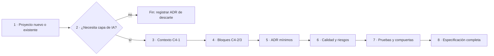

# P-04 · Arquitecto de software (arc42, C4, ADR) — plan para N-05 y N-01

> Propuesta de especialista de la mesa del prompt 02 (guía 16). Etapa: **planificación** (QUIÉN APLICA: nadie, sólo plan). Trabajo a ciegas respecto de los demás especialistas. Fuentes: prompt 02, `00-Coordinacion-Entre-Sesiones.md`, `Nucleos/00-Cohesion.md`, `N-05`, `N-01`, `Relevamiento/R1-Guia.md`, `R5-Marco.md`, `R6-Industria.md`, la guía 0.11.0 y `Examples/`. Rutas relativas: `{guia}` = `Guides/IA/Dot-Net-Integration-AI-Layer-Guide/` de LD; `{bit}` = esta carpeta `Prompt-02/`.

## Índice

1. [Definiciones](#1-definiciones)
2. [Evidencia propia medida](#2-evidencia-propia-medida)
3. [N-05 · Conocimiento de especificación](#3-n-05--conocimiento-de-especificación)
4. [N-01 · Coherencia, con foco en I-5 / ADR-01](#4-n-01--coherencia-con-foco-en-i-5--adr-01)
5. [Ensayos y pruebas](#5-ensayos-y-pruebas)
6. [Entregables y criterios de aceptación](#6-entregables-y-criterios-de-aceptación)
7. [Riesgos y qué no hacer](#7-riesgos-y-qué-no-hacer)
8. [Conflictos con otros núcleos](#8-conflictos-con-otros-núcleos)

## 1. Definiciones

| Término | Definición | Fuente |
|---|---|---|
| arc42 | Plantilla de 12 secciones para documentar arquitectura (metas, restricciones, contexto, estrategia, bloques, ejecución, despliegue, conceptos transversales, decisiones, calidad, riesgos, glosario) | R6 F16, https://arc42.org/overview |
| C4 | Diagramas por nivel: contexto, contenedor, componente, código; suplementarios dinámico y despliegue | R6 F17, https://c4model.com/ |
| ADR | Registro de una decisión de diseño con razón, compromisos y consecuencias; el conjunto es el *decision log* | R6 F18, https://adr.github.io/ |
| Requisito arquitectónicamente significativo (ASR) | El requisito que justifica abrir un ADR | R6 F18 |
| Especificación completa | Definición operativa propuesta acá: todos los campos obligatorios de la plantilla (§3.3) llenos con fuente o marcados NO APLICA con motivo | **propuesta** |

## 2. Evidencia propia medida

Medido el 2026-11-01 en `{guia}Examples/` con `grep -rlE "IChatClient" --include=*.cs <NN> | grep /Application/`:

| Ejemplo | `.cs` bajo Application | con `IChatClient` en Application |
|---|---|---|
| 01 Chat y streaming | 2 | 1 |
| 05 Contexto completo | 5 | 1 |
| 07 RAG con citas | 7 | 1 |
| 12 Uno o varios agentes | 7 | 1 |
| 17 Observabilidad | 2 | 1 |
| resto (12 carpetas) | 0–8 | 0 |

Es decir, **5 de 17** ejemplos usan la alternativa (b) de ADR-01 (guía §13.2, l. 3697-3707: «(b), sólo en un prototipo y como deuda»). La divergencia está declarada sólo en el Anexo E.1 (l. 4945). La medición no cubre herramientas, almacén ni workflow bajo Application, que E.1 también nombra: queda para el ensayo E-2.

## 3. N-05 · Conocimiento de especificación

### 3.1 Estructura recomendada y alternativas

| Alt. | Forma | Ventaja | Costo |
|---|---|---|---|
| A | arc42 completo (12 secciones) como esqueleto | Estándar reconocible | Mucho vacío para una capa que es un bloque de un sistema existente; contradice «simplicidad» |
| B | Forma del Conocimiento MAUI (plantilla de R5 §7) + **subconjunto arc42 de 6 secciones** dentro de la «Plantilla de especificación» | Coherencia entre libros (00-Coordinacion), regla/razón/evidencia separadas, arc42 donde aporta | Divergencia con Rule-Forma (T3) a declarar |
| C | Rule-Forma §0–§10 pura | Norma de LD | Pierde la coherencia con el libro MAUI acordada con FC |

**Recomendación: B.** Subconjunto arc42 a exigir en la especificación de cada proyecto (la capa de IA entra como bloque de un sistema que ya tiene su arquitectura):

| arc42 | Qué se pide para la capa de IA | Origen en la guía |
|---|---|---|
| 3 Contexto y alcance | C4 nivel 1: sistema, actores, servidor de modelos, fuentes de conocimiento | §2.1-§2.3 (ESC, CTX, ACT) |
| 5 Vista de bloques | C4 nivel 2/3: dónde vive la capa (Application puerto / Infrastructure.AI adaptador) | §3.1, §4, ADR-01, ADR-11 |
| 6 Vista de ejecución | Un diagrama dinámico por capacidad que use herramientas o agentes | §8 |
| 8 Conceptos transversales | Prompts, evaluación, observabilidad, seguridad | §10-§12 |
| 9 Decisiones | ADR obligatorios mínimos (ver §3.2) | §13 |
| 10-11 Calidad y riesgos | Escenarios de calidad medibles; matriz OWASP LLM/Agentic | §10, §11; R6 F8, F9 |

Se omiten 1, 2, 4, 7 y 12 porque los cubre la documentación del sistema anfitrión o el glosario de la guía (remisión, no repetición).

### 3.2 Decisiones con criterio

| Id | Decisión | Criterio | Análisis |
|---|---|---|---|
| D-A1 | Forma B (MAUI + subconjunto arc42) | Coherencia entre libros; simplicidad | Resuelve T3/C3 declarando la divergencia en §0; ficha de excepción sólo si N-10 dictamina que Rule-Forma rige en LD |
| D-A2 | Diagramas C4 en mermaid (`flowchart`), no C4-PlantUML | Lo renderiza GitHub; validación con `tools/medios/mermaid.sh` | `C4Context` de mermaid es experimental: no usarlo (NO VERIFICADO su estado actual; ensayo E-4) |
| D-A3 | ADR en formato de la guía (Contexto · Alternativas · Criterio · Decisión · Consecuencias · Confianza · Deja de valer si) | Ya probado en §13; R6 F18 lo compatibiliza con Nygard/MADR | Agregar sólo «ASR que lo origina» |
| D-A4 | ADR mínimos obligatorios: ADR-01 (ubicación de la llamada), ADR-02 (contrato/adaptador), ADR-11 (capas carpetas/proyectos) y uno por capacidad agéntica (escrituras y aprobación) | Son los que la guía verifica con pruebas de arquitectura (Anexo B, l. 4560, 4576) | Los demás ADR de §13 quedan como «considerar» |
| D-A5 | El Conocimiento **no** copia §13: lo destila en reglas P-n con fuente `[Guía §13.x]` | Riesgo «duplicar la guía» (N-05 §7) | Autocontención = poder especificar; justificar remite a la guía |
| D-A6 | Requisitos con Id `REQ-IA-nn`, criterio de aceptación y prueba nombrada | Base mecánica para N-06/N-07 | Permite compuerta de completitud |

### 3.3 Plantilla de especificación (campos obligatorios)

Escenario · Contexto (CTX) · Actores (ACT) · Capacidades de IA (lista) · C4-1 · C4-2/3 · Dinámico por capacidad agéntica · ADR mínimos (D-A4) · `REQ-IA-nn` con criterio y prueba · Escenarios de calidad (estímulo, respuesta, medida) · Matriz de riesgos OWASP · Pruebas de arquitectura (equivalentes a `Cableado/ArquitecturaTests.cs` de la demo) · Límites.

### 3.4 Estándares que respaldan

arc42 (R6 F16), C4 (R6 F17), ADR/Nygard/MADR (R6 F18), OWASP LLM 2025 y Agentic 2026 (R6 F8, F9, este último con nombres ASI aún de fuente secundaria: citar como NO VERIFICADO hasta leer el PDF), y la propia guía §13 como implementación de referencia.

## 4. N-01 · Coherencia, con foco en I-5 / ADR-01

### 4.1 Alternativas para I-5 (C4 de la cohesión)

| Alt. | Acción | Pro | Contra |
|---|---|---|---|
| X | Mover `IChatClient` de Application a Infrastructure/AI en los 5 ejemplos | Texto y código coinciden | Agrega un puerto y un adaptador a ejemplos que aíslan un mecanismo; rompe la didáctica de «un mecanismo por carpeta»; reoráculos y compuertas |
| Y | Mantener el código; declarar la excepción en cada sección que cita esos ejemplos y en el README del ejemplo | Barato; honesto | La regla sigue con «excepción» dispersa |
| **Z** | Reencuadrar en ADR: nuevo **ADR-01b «Ejemplos de un mecanismo usan (b)»** (o enmienda a ADR-01 en «Consecuencias») + rótulo en el README de los 5 ejemplos + mover la declaración de E.1 a §4.6 | Una sola fuente normativa; la excepción queda dentro del decision log; cero código | Requiere que N-02 acepte el cambio en §4.6/§13.2 |

**Recomendación: Z.** Criterio: la guía ya declara (b) admisible «en un prototipo»; un ejemplo aislado es un prototipo por definición, así que lo coherente es nombrarlo en el ADR, no cambiar el código. Se aplica lo mismo a I-7: la excepción de `Chat.razor` (alternativa (d)) se anticipa en §3.1 con remisión a §13.2, no sólo en §14.2.

### 4.2 Matriz afirmación ↔ artefacto (forma)

Columnas: `Id | Afirmación (guía §, línea) | Artefacto (ruta) | Comando de prueba | Resultado | Clase (corrige texto / corrige ejemplo / declara divergencia)`. Vive en `{bit}` (no se publica como anexo: la guía ya es extensa, C2); en la guía queda sólo E.1 actualizado.

## 5. Ensayos y pruebas

| Id | Ensayo | Cómo se evalúa |
|---|---|---|
| E-1 | Repetir la medición de §2 tras aplicar Z | README de los 5 ejemplos con rótulo «ADR-01 (b)»: `grep -l "ADR-01" Examples/{01,05,07,12,17}*/README.md` = 5 |
| E-2 | Extender la medición a herramientas, almacén y workflow bajo Application | Tabla completa en `{bit}`; toda fila con E1 (comando y salida) |
| E-3 | Prueba de autocontención del Conocimiento v0: un agente sin la guía cargada especifica N-06 | Especificación completa (§1) por compuerta de campos; desvíos registrados como correcciones v1 |
| E-4 | Render de los mermaid del Conocimiento | `tools/medios/mermaid.sh` sin error; etiquetas «n · Texto» |
| E-5 | Las pruebas de arquitectura de la demo siguen verdes | `tools/verificar.sh` sin cambios de resultado |

## 6. Entregables y criterios de aceptación

| Entregable (etapa de ejecución) | Ruta | Aceptación |
|---|---|---|
| Conocimiento v0 | `{bit}Conocimiento/v0-AI-Layer-Spec.md` | Plantilla §3.3 completa; 100 % de P-n con columna Fuente no vacía |
| Conocimiento v1 | `{guia}Conocimientos/knowledge-AI-Layer-Integration-Designing-Specification.md` | Aplicado a N-06 y N-07 da especificación completa; cada cambio v0→v1 trazado caso→regla en `{bit}`; 0 nombres del servicio privado (`grep` de la compuerta `compuerta-rpriv.sh` en verde) |
| ADR-01 enmendado / ADR-01b | guía §13.2 y §4.6 (vía N-02) | E.1 deja de ser la única declaración; E-1 = 5 |
| Matriz afirmación↔artefacto | `{bit}N-01-Matriz.md` | Cada fila con E1 o E2; 0 archivos citados inexistentes |
| Diagramas C4 de la demo (referencia) | dentro del Conocimiento §3 | E-4 verde |

## 7. Riesgos y qué no hacer

- No usar arc42 completo ni C4 nivel 4 (código): ruido sin decisión.
- No mover código de ejemplos para «limpiar» I-5: cambia oráculos y compuertas por una ganancia sólo estética.
- No redefinir puente JSON-RPC, OTA ni outbox: se remite al libro MAUI (00-Coordinacion).
- No citar el caso privado con detalle en el Conocimiento ni en esta bitácora.
- Riesgo de sobreajuste a dos casos: v1 sólo incorpora reglas que valgan para ambos o se marcan «según caso».
- No editar nada en esta etapa.

## 8. Conflictos con otros núcleos

| Con | Conflicto | Propuesta |
|---|---|---|
| N-02 / N-04 | Z exige tocar §4.6, §13.2, §3.1 y E.1 | Entrar como cambio de contenido de N-02, no como parche de N-01 |
| N-03 | Si los fundamentos fijan su lista P-n, el Conocimiento debe usar la misma numeración o un subconjunto | Una sola lista P-n, propiedad de N-03; N-05 la referencia |
| N-10 | T3 (forma) puede requerir ficha de excepción | Dictamen de N-10 antes de v0 |
| N-08 | OWASP Agentic con nombres no verificados | Matriz con NO VERIFICADO hasta la lectura del PDF |
| N-06 | Si Geometría mantiene el intake sin IA (C6), la especificación puede concluir «no necesita capa»: es un resultado válido (rama «no» del diagrama) | Aceptarlo como caso de prueba de la rama de descarte |
| N-01 (modelos) | Modelo de referencia con herramientas (el 0.5b no emite `tool_calls`, R4) | Ajeno a I-5; lo decide N-09 |
