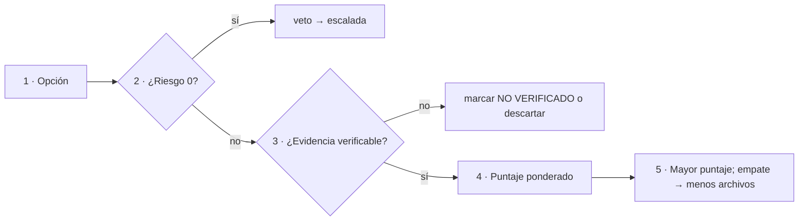

# P-05 · Analista de decisiones y criterios — propuesta para N-01, N-05 y N-07

**Etapa:** planificación (nadie aplica) · **Fecha:** 2026-11-01 · **Rol:** E-05 (`01-Convocatoria.md` §3) · **Trabajo a ciegas** respecto de los demás especialistas · **QUIÉN APLICA:** nadie: sólo plan.

Fuentes leídas: `Nucleos/00-Cohesion.md`, `N-01`, `N-05`, `N-07`, `01-Convocatoria.md`, `00-Coordinacion-Entre-Sesiones.md`, `Relevamiento/R1-Guia.md` §3–§4, `R3-Caso-Privado.md`, `R4-Infra-Modelos.md`, `R5-Marco.md` §7–§8, `R6-Industria.md`; guía 0.11.0 §4.6 (l. 870-872) y l. 1336; `tools/` (listado). Marcas: **propuesta** = criterio de esta mesa sin fuente externa; **NO VERIFICADO** = no se midió.

## Índice

- [1. Método: matriz de decisión común](#1-método-matriz-de-decisión-común)
- [2. N-01 · Coherencia texto ↔ ejemplos y demo](#2-n-01--coherencia-texto--ejemplos-y-demo)
- [3. N-05 · Conocimiento de especificación](#3-n-05--conocimiento-de-especificación)
- [4. N-07 · Caso del servicio privado](#4-n-07--caso-del-servicio-privado)
- [5. Conflictos con otros núcleos](#5-conflictos-con-otros-núcleos)
- [6. Dudas en formato F2](#6-dudas-en-formato-f2)

## 1. Método: matriz de decisión común

Toda decisión de estos núcleos se puntúa con la misma matriz (**propuesta**), para que el jurado de costo-beneficio compare manzanas con manzanas.

| Criterio | Pregunta | Escala | Peso |
|---|---|---|---|
| Simplicidad | ¿Cuántas piezas/archivos/conceptos nuevos agrega? | 0 (muchas) – 3 (ninguna) | 3 |
| Practicidad | ¿Lo verifica una compuerta o comando existente? | 0 – 3 | 3 |
| Escalabilidad | ¿Sirve igual para un tercer caso de uso o un Example 18? | 0 – 3 | 2 |
| Costo de cumplir | Archivos a tocar × compuertas a re-correr | 0 (alto) – 3 (bajo) | 2 |
| Riesgo | Irreversibilidad o fuga público/privado | 0 (alto) – 3 (nulo) | veto si 0 |

Regla de prioridad al chocar (**propuesta**): Riesgo > Evidencia verificable (Reglas del prompt: «no inventar») > Simplicidad > Practicidad > Escalabilidad. La simplicidad va antes que la escalabilidad porque el prompt pide «ventajas de simplicidad y practicidad, escalabilidad» en ese orden (prompt 02, l. 71) y porque la guía ya está al 130 % de extensión (R1 I-1).

## 2. N-01 · Coherencia texto ↔ ejemplos y demo

### 2.1 Estructura recomendada

**Matriz afirmación ↔ artefacto en la bitácora** (`Prompt-02/N-01/Matriz-Afirmacion-Artefacto.md`), una fila por afirmación verificable: `Id · §guía:línea · artefacto · comando · resultado esperado · resultado obtenido · clase (corrige texto / corrige ejemplo / declara divergencia)`.

| Alternativa | Simpl. | Práct. | Escal. | Costo | Total |
|---|---|---|---|---|---|
| A. Matriz en la bitácora + correcciones (recomendada) | 3 | 3 | 2 | 3 | 28 |
| B. Matriz publicada como anexo nuevo de la guía | 1 | 2 | 2 | 1 | 15 |
| C. Matriz generada por script en `tools/` | 1 | 3 | 3 | 1 | 20 |

Criterio: B suma extensión a una guía ya al 130 % (choca con N-02); C agrega una pieza que debe mantenerse. El Anexo E.1 ya cumple la parte pública (17 carpetas 1:1, R1).

### 2.2 Decisiones

| Id | Decisión | Opción elegida | Criterio |
|---|---|---|---|
| D-01.1 | I-1 (cifras §0.5) | Corrige texto **con la salida de `tools/contar.sh` del día del PR único**, nunca antes | Practicidad: la cifra cambia con cada edición de N-02/N-04; fijarla antes es trabajo perdido |
| D-01.2 | I-2 (`comparar-bloques.py`) | Corrige el README a `comparar-ac9.py` | 1 línea; el archivo existe (`tools/` listado) |
| D-01.3 | I-3 (vocabulario) | Adoptar el de la guía («servidor de chat / segundo servidor») en `Examples/README.md` | La guía ya declara los históricos (E.3); un solo vocabulario |
| D-01.4 | I-4 (`SalidaEstructurada.csproj`) | Renombrar a `03-Salida-Estructurada.csproj` **sólo si** `verificar.sh` y la solución no lo nombran de forma rígida; si no, declarar divergencia | Costo de cumplir: medir referencias con grep antes |
| D-01.5 | **I-5 (`IChatClient` bajo `Application/` vs ADR-01)** | **Reafirmar la excepción didáctica en el texto principal**: una línea en §4.6 y un rótulo «ejemplo didáctico: prototipo, deuda según ADR-01» en cada sección que remite a un Example afectado. No mover código. La demo (implementación de referencia) ya sigue ADR-01 | Matriz abajo |
| D-01.6 | I-7 (excepción de §3.1 definida en §14.2) | Mover la mención (una oración con enlace) a §3.1 | Autocontención (Reglas del prompt) |
| D-01.7 | Modelo de referencia con herramientas | `qwen3.5:4b` para Examples con herramientas; `qwen2.5:0.5b` sólo para los sin herramientas. Si el 4b no emite `tool_calls` medidos, se marca NO VERIFICADO y la decisión vuelve a la mesa | R4: el 0.5b no emite `tool_calls`; el 4b no se midió |

Dictamen sobre I-5:

| Alternativa | Simpl. | Práct. | Escal. | Costo | Riesgo | Total |
|---|---|---|---|---|---|---|
| a. Mover a `Infrastructure/AI` los 17 Examples | 1 | 1 | 3 | 0 | 2 | 15 |
| b. Reafirmar excepción en texto principal (recomendada) | 3 | 3 | 2 | 3 | 3 | 28 |
| c. Mover sólo los Examples que cita §4 | 1 | 2 | 2 | 1 | 2 | 15 |

Razón: el Example enseña una pieza por vez; agregar puerto + adaptador en cada uno duplica la demo, que ya muestra la forma normativa. ADR-01 admite el prototipo «como deuda» (guía l. 872, l. 1336), así que (b) es conforme a la propia norma; sólo falta que se vea sin leer E.1. Requiere ADR consecuente o nota en ADR-01 (lo redacta E-04).

### 2.3 Estándares

- ADR (adr.github.io, R6): la excepción se registra como consecuencia de ADR-01, no como regla nueva.
- arc42 §9 «decisiones» (arc42.org/overview, R6): mismo tratamiento.

### 2.4 Ensayos

| Ensayo | Cómo | Se evalúa |
|---|---|---|
| E-N01-1 Referencias muertas | grep de nombres de archivo citados en guía y READMEs vs `find` | 0 inexistentes |
| E-N01-2 Compuertas | `tools/verificar.sh` completo | todas verdes; build y demo como en 05-Cierre (561/561, 81/81) |
| E-N01-3 Tool calling 4b | Example con herramientas contra `qwen3.5:4b` con turno del gestor (`[gestor-de-turnos]`) | `tool_calls` no vacío en ≥ 4 de 5 corridas (**propuesta** de umbral); si no, NO VERIFICADO |

### 2.5 Entregables y aceptación

- `Prompt-02/N-01/Matriz-Afirmacion-Artefacto.md` — cada fila con E1 (comando+salida) o E2 (cita con línea).
- `Prompt-02/N-01/Correcciones.md` — lista clasificada para N-02.
- Aceptación: I-1…I-7 con decisión y clase; 0 referencias muertas; `contar.sh` = cifra publicada; compuertas verdes.

### 2.6 Riesgos y qué no hacer

- No mover código por estética (alternativa a) sin ADR.
- No fijar cifras de extensión antes del cierre editorial.
- No re-ejecutar contra modelos sin turno del gestor; nada de emuladores ni KVM en [host-ia].

## 3. N-05 · Conocimiento de especificación

### 3.1 Estructura recomendada

**Forma del Conocimiento MAUI (F10) + plantilla de R5 §7**, con un subconjunto mínimo de arc42 y un árbol de decisión al frente.

| Alternativa de forma (T3/C3) | Simpl. | Práct. | Escal. | Costo | Total |
|---|---|---|---|---|---|
| F10 (§0–§13, `Compatible-con:` guía), divergencia declarada en §0 (recomendada) | 2 | 3 | 3 | 3 | 27 |
| F8 Rule-Forma (§0–§10) | 3 | 2 | 2 | 2 | 23 |
| F10 + ficha `Excepcion-A-Un-Conocimiento` | 1 | 2 | 3 | 1 | 17 |

Criterio: coherencia entre libros acordada con FC (00-Coordinacion: «el Conocimiento separa regla, razón y evidencia»); F10 tiene la tabla P-n · Criterio · Fuente que el prompt pide («criterios de decisión»). Diferencia de puntaje chica: la decide E-13 si tiene un argumento normativo.

| Alternativa arc42 | Total | Nota |
|---|---|---|
| arc42 completo (12 secciones) | 14 | Duplica la guía (riesgo N-05) |
| **Subconjunto: 3 contexto, 5 bloques, 8 conceptos transversales, 9 decisiones, 10 calidad, 11 riesgos** (recomendado) | 27 | Lo que R6 propone; lo demás remite a la guía |
| Sin arc42 | 18 | Pierde el respaldo de estándar pedido |

### 3.2 Secciones a cargo de este rol

1. **§1 Cuándo usarlo y cuándo no** como árbol de decisión «¿necesita capa de IA?» (mermaid). Preguntas: ¿la tarea tolera salida no determinista? ¿existe validación determinista posterior? ¿la acción es reversible o tiene confirmación humana? ¿hay datos personales? ¿hay un modelo disponible con la capacidad requerida (p. ej. herramientas)? Cada rama con fuente (`[Guía §x]`, OWASP LLM/Agentic `[Rn]`). Rama «no»: resolver sin IA (precedente público: el intake sin IA de Geometría, R2, C6).
2. **§2 Principios P-n** en tabla `Id · Principio · Criterio · Fuente · Prioridad al chocar`. La lista sale de N-03 (no la invento aquí); este rol aporta la columna de prioridad con la regla de §1 de esta propuesta.
3. **Costo de cumplir** por requisito de la plantilla: columna `Obligatorio / Recomendado / Opcional` según tamaño del proyecto (proyecto nuevo pequeño, existente, multi-inquilino). Así el Conocimiento escala sin obligar a un proyecto chico a llenar todo.

### 3.3 Decisiones

| Id | Decisión | Elegida | Criterio |
|---|---|---|---|
| D-05.1 | Origen del contenido | Destilar de §13 (ADR), Anexos A y B; el Conocimiento **remite**, no copia | R1 §8 punto 4; riesgo de duplicar |
| D-05.2 | Requisitos | `REQ-n · enunciado · criterio de aceptación medible · prueba que lo referencia` | R5 §7 regla 2 |
| D-05.3 | Riesgos | Matriz mapeada a OWASP LLM Top 10 y Agentic 2026 | R6 (genai.owasp.org) |
| D-05.4 | Calidad | Escenarios de calidad medidos con Microsoft.Extensions.AI.Evaluation | R6 (learn.microsoft.com/…/evaluation/libraries) |
| D-05.5 | Juez de «especificación completa» | Checklist binario (§n+4) aplicado por un agente sin acceso a la guía (E-14) + un humano; completa = 100 % de obligatorios llenos con fuente | Mide autocontención |
| D-05.6 | Versionado | v0 en bitácora, v1 tras N-06/N-07; el archivo final no es delta, cambios en bitácora | N-05 §4 |

### 3.4 Ensayos

| Ensayo | Cómo | Se evalúa |
|---|---|---|
| E-N05-1 Autocontención | Agente nuevo con sólo el Conocimiento v0 especifica N-06 | checklist obligatorio 100 %; preguntas que obligaron a abrir la guía = defectos |
| E-N05-2 Trazabilidad | grep de cada P-n y REQ en columna Fuente | 0 filas sin fuente |
| E-N05-3 Sobreajuste | Aplicar v1 a un tercer caso de papel (la demo MovilidadUrbana) | ningún campo obligatorio inaplicable |
| E-N05-4 Mermaid | `tools/medios/mermaid.sh` | todos renderizan |

### 3.5 Entregables y aceptación

- `Prompt-02/N-05/Conocimiento-v0.md`, `Conocimiento-v1.md`, `Registro-Caso-A-Regla.md` (caso → regla cambiada).
- `Prompt-02/N-05/Arbol-Necesita-IA.md` (insumo de §1).
- Destino final (etapa de ejecución, no ahora): `Guides/IA/Dot-Net-Integration-AI-Layer-Guide/Conocimientos/knowledge-AI-Layer-Integration-Designing-Specification.md`, dentro del PR único y último de LD.
- Aceptación: E-N05-1…4 cumplidos; extensión ≤ 15 % de la guía (**propuesta**, medido con `wc -w`); cero menciones identificables del caso privado.

### 3.6 Riesgos y qué no hacer

- No copiar capítulos de la guía; no arc42 completo; no reglas sin fuente.
- No sobreajustar a dos casos (E-N05-3).

## 4. N-07 · Caso del servicio privado

### 4.1 Estructura

Dos capas físicamente separadas:

| Capa | Dónde | Contenido |
|---|---|---|
| Privada | Repo privado, expediente correlativo según su norma en `Prompts/` (último en main + 1, avisando antes) | Especificación completa con nombres reales |
| Pública | `Prompt-02/N-07/Aportes-Abstractos.md` | Sólo correcciones al Conocimiento como criterio general, formato `Patrón · Regla afectada · Cambio` |

### 4.2 Qué valor se especifica (respuesta a N-07 §8.1)

Priorización por matriz (valor para el caso × riesgo × costo), sobre las cinco capacidades de R3:

| Capacidad | Valor | Riesgo | Costo | Prioridad (**propuesta**) |
|---|---|---|---|---|
| Consulta en lenguaje natural con herramientas tipadas de sólo lectura | alto | bajo (sólo lectura, aislamiento) | medio | 1 |
| Clasificación y resumen de fallos de entrega | alto | bajo | bajo | 2 |
| Redacción asistida con validación determinista | medio | medio (contenido enviado) | bajo | 3 |
| RAG sobre documentación | medio | bajo | medio | 4 |
| Segmentación propuesta + confirmación humana | medio | alto (envío masivo irreversible) | alto | 5, sólo diseño |

Razón: empezar por lo reversible y de sólo lectura enseña al Conocimiento las reglas de aislamiento por inquilino sin exponer el envío irreversible; la 5 sirve para probar la rama «confirmación humana» del árbol de §3.2, en papel.

### 4.3 Ensayos y aceptación

- Aplicar Conocimiento v0 a las capacidades 1–3 en privado; checklist obligatorio 100 %.
- Cada herramienta especificada: sólo lectura, parámetro de inquilino obligatorio, sin SQL libre (criterios R3).
- Antes de cualquier escritura en LD/LDD: grep de nombres, rutas, hosts y versiones del caso → 0 coincidencias (compuerta `rpriv` de `tools/` si cubre el patrón; si no, lista de patrones privada).

### 4.4 Riesgos y qué no hacer

- No llevar cifras, nombres ni capturas al material público; no ejemplos públicos desde este caso.
- No confundir su norma propia con IA.SDD; no abrir expediente sin aviso.

## 5. Conflictos con otros núcleos

| # | Con | Conflicto | Propuesta |
|---|---|---|---|
| K1 | N-02 / N-04 | D-01.1: cifras de §0.5 sólo al cierre; N-02 puede querer el presupuesto fijo antes | Presupuesto en N-02 como meta; cifra publicada se recalcula al final |
| K2 | N-03 / E-04 | D-01.5 (I-5, reafirmar excepción) vs una lectura estricta de ADR-01 que prefiera mover código | ADR consecuente; jurado de costo-beneficio |
| K3 | N-03 | La lista P-n la produce N-03; este rol sólo pone prioridad | Una sola lista, el Conocimiento referencia subconjunto |
| K4 | E-13 / N-10 | T3: recomiendo F10; si E-13 sostiene que F8 rige en LD, cambia el esqueleto | Decide el jurado; diferencia de puntaje chica |
| K5 | N-06 | El árbol «¿necesita IA?» puede devolver «no» para Geometría (intake sin IA, C6) | Es resultado válido; va al lote de dudas del PO |
| K6 | N-09 | D-01.7 depende de medir el 4b (CPU, 5 GiB, 4096 tokens; R4) | Sin medición, NO VERIFICADO y se mantiene texto actual |
| K7 | N-08 | MCP 2026-07-28 (C7) puede obligar a tocar Examples: aumenta el costo de N-01 | Actualizar texto y referencias; código sólo si una compuerta falla |

## 6. Dudas en formato F2

| Rol | Pregunta | Por qué | Prioridad | Si no contesta |
|---|---|---|---|---|
| E-05 | ¿Acepta el PO que los Examples sigan bajo `Application/` rotulados como prototipo (I-5)? | Decisión de arquitectura | P1 | Se aplica D-01.5 con ADR consecuente |
| E-05 | ¿Tope de extensión del Conocimiento? | Simplicidad | P2 | ≤ 15 % de la guía |
| E-05 | ¿Qué capacidad del caso privado prefiere especificar primero? | Valor | P2 | Orden de §4.2 |
