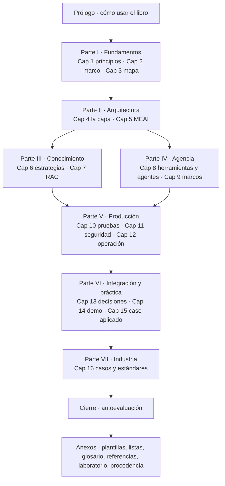

# P-06 · Propuesta del especialista en documentación técnica (N-02, N-03)

> Mesa del prompt 02 de la guía 16 · Etapa: planificación (no se edita nada fuera de esta bitácora) · Rol: especialista en documentación técnica de usuario y de sistemas (guías de estudio, manuales, docs-as-code, arquitectura del libro) · Trabajo a ciegas respecto de los otros especialistas · Fecha: 2026-11-01.
>
> Rutas relativas: `{guia}` = `Lab-Documentos/Guides/IA/Dot-Net-Integration-AI-Layer-Guide/`; `{bit}` = `PROMPTs/Guides/16-IA-Layer/OUTPUTs/Bitacoras/Prompt-02/` en Lab-Documentos.Documentacion.

## Índice

1. [Evidencia de partida](#1-evidencia-de-partida)
2. [N-02 · Arquitectura del libro unificado](#2-n-02--arquitectura-del-libro-unificado)
   1. [Alternativas](#21-alternativas)
   2. [Recomendación: índice objetivo](#22-recomendación-índice-objetivo)
   3. [Decisiones y criterio](#23-decisiones-y-criterio)
   4. [Política de procedencia (no delta)](#24-política-de-procedencia-no-delta)
   5. [Política de unicidad](#25-política-de-unicidad)
   6. [Presupuesto de extensión](#26-presupuesto-de-extensión)
3. [N-03 · Capítulo de fundamentos](#3-n-03--capítulo-de-fundamentos)
   1. [Frontera fundamento / arquitectura](#31-frontera-fundamento--arquitectura)
   2. [Lista candidata de principios](#32-lista-candidata-de-principios)
   3. [Estructura del capítulo](#33-estructura-del-capítulo)
   4. [Relación con el Conocimiento (N-05)](#34-relación-con-el-conocimiento-n-05)
4. [Estándares y respaldo](#4-estándares-y-respaldo)
5. [Ensayos y cómo se evalúan](#5-ensayos-y-cómo-se-evalúan)
6. [Entregables](#6-entregables)
7. [Criterios de aceptación medibles](#7-criterios-de-aceptación-medibles)
8. [Riesgos](#8-riesgos)
9. [Qué no hacer](#9-qué-no-hacer)
10. [Respuestas a las preguntas de los núcleos](#10-respuestas-a-las-preguntas-de-los-núcleos)
11. [Conflictos con otros núcleos](#11-conflictos-con-otros-núcleos)

## 1. Evidencia de partida

Todo lo de esta sección se verificó el 2026-11-01 sobre `{guia}` o está en `{bit}Relevamiento/`.

| Hecho | Evidencia |
|---|---|
| Archivo único de 5.268 líneas y 72.364 palabras (`wc`) | `wc -l -w {guia}/Dot-Net-Integration-AI-Layer-Guide.md` |
| 62 bloques «Historia (hasta …» en el cuerpo | `grep -c "Historia (hasta"` sobre la guía |
| Prosa a 130 % del tope (57.753 / 44.330), anexos a 170 % | R1 §7 (`tools/contar.sh`) |
| Parte II se llama «Fundamentos» y trata ubicación arquitectónica y MEAI | Guía l. 602-1349; R1 I-6 |
| Principios dispersos en §1, §3.0-§3.2, §4.1-§4.2, ADR-08 (§13.9) | R1 §2 |
| Patrón de sección actual: Definición → subsecciones → «En este laboratorio» → «Práctica» → «Qué decisión toca» | Guía §0.4, l. 144-158 |
| El perfil Study-Guide pide: marco (escenarios, contextos, actores) definido una vez; por tema Definición, Aplicación por escenario, Ejemplos, Preguntas guía, Criterios de calidad, Anexo-plantilla | Perfil `Study-Guide-Documentation.md`, §Enfoque y §Estructura |
| El libro MAUI (otra sesión, sólo lectura) usa Prólogo, Partes I-V con capítulos numerados, Parte I «Fundamentos» (cap. 1 fundamentos, cap. 2 marco de referencia), anexos con glosario, referencias, mapa libro↔demo, plantillas e historia en anexo propio (Anexo H) | `Concepts/Framework-Concept/MAUI-Framework-Developer-Guide.md` l. 23-52 |
| Acuerdo entre sesiones: capítulos numerados, índice al inicio, glosario y referencias con fecha de consulta al final; el Conocimiento separa regla, razón y evidencia | `{bit}00-Coordinacion-Entre-Sesiones.md` |
| Herramientas existentes que sirven de compuerta: `verificar-markdown.py` (anclas), `contar.sh` (extensión) | `ls {guia}/tools` |

## 2. N-02 · Arquitectura del libro unificado

### 2.1 Alternativas

| Alt. | Forma | A favor | En contra |
|---|---|---|---|
| A | Mantener el árbol 0.11.0 (§0-§15, Partes 0-VI, Anexos A-G) y sólo limpiar | Mínimo riesgo de anclas rotas; las 283 anclas y 574 `REF-` siguen | No resuelve el doble «Fundamentos» (I-6), ni la falta de capítulo inicial, ni la divergencia de forma con el libro MAUI |
| B | **Reestructurar a capítulos numerados alineados con el libro MAUI** (Prólogo, Parte I Fundamentos con capítulo de principios + marco, Partes temáticas, Parte de práctica/casos, Parte Industria, Anexos) conservando anclas `sN` vía tabla de correspondencia | Coherencia entre libros acordada; capítulo de fundamentos tiene lugar natural; escala para sumar el caso Geometría | Remapeo de remisiones internas; costo de verificación |
| C | Partir en varios archivos (un `.md` por capítulo + README) | Diffs chicos, revisión paralela | Contradice la solicitud 2 del prompt («un solo documento llamado …Guide.md») |

**Recomendación: B.** Criterio: el prompt exige documento único (descarta C) y sección inicial de fundamentos (A no la acomoda sin forzar una «Parte 0½»); B es la de menor costo que cumple ambos y la coherencia entre libros. Escalabilidad: los casos aplicados entran como capítulos de una Parte propia sin tocar las demás.

### 2.2 Recomendación: índice objetivo

| Nuevo | Contenido | Origen en 0.11.0 | Núcleo dueño del contenido |
|---|---|---|---|
| Prólogo | Objetivos por actor, rutas, requisitos, cómo leer la evidencia | §0.1-§0.4 (recortado) | N-02 |
| Cap 1 Fundamentos del framework | Principios P-n (§3.2 de esta propuesta) | §1 (parte), §3.0 parcial, §4.1-§4.2, ADR-08 | N-03 |
| Cap 2 Marco de referencia | Escenarios, contextos, actores, valor, diseño para el error | §2 | N-02 (sin cambios de fondo) |
| Cap 3 Mapa conceptual | Doce términos, capas, dos escaleras, tablas «estoy acá → qué aplico» | §3 | N-02/N-03 (capas y escaleras se enuncian en Cap 1 y se desarrollan acá) |
| Parte II **Arquitectura** (antes «Fundamentos») | Cap 4 ubicación y contratos; Cap 5 MEAI | §4.3-§4.6, §5 | N-01 |
| Partes III-V | sin cambio de orden | §6-§12 | N-01 / N-08 |
| Cap 13 Decisiones | ADR-01…13 como único lugar de las ADR | §13 | N-02 |
| Cap 14 Demo | PD-1…PD-6 | §14 | N-01 |
| Cap 15 Caso aplicado | Aplicación del Conocimiento a un servicio existente (Geometría) | nuevo | N-06 |
| Cap 16 Industria | Casos públicos y estándares | parte del Anexo D/G + R6 | N-08 |
| Cierre | Autoevaluación, un ítem por objetivo | §15 | N-02 |
| Anexo A Plantillas (renumeradas A.1…) | | Anexo A | N-02 |
| Anexo B Listas por actor | | Anexo B | — |
| Anexo C Glosario (único lugar de definiciones cortas) | | §3.0 en una línea + Anexo C | N-02 |
| Anexo D Referencias con fecha de consulta | | Anexo D + G | N-08 |
| Anexo E Laboratorio y reproducción (incluye versiones: hoy F) | | E + F | N-01 |
| Anexo F Mapa libro ↔ ejemplos ↔ demo (único mapa) | | §0.5, §3.4-§3.5, E.1-E.2 | N-02 |
| Anexo G Procedencia (historia fechada) | | los 62 bloques «Historia» | N-02 |

Patrón interno de cada capítulo temático (decisión D-3): **Definición → Aplicación por escenario/contexto → Ejemplo (enlace al ejemplo NN o demo) → Preguntas guía → Criterios de calidad → Decisión (remite a Cap 13 y plantilla del Anexo A)**. «En este laboratorio» se funde en «Ejemplo»; la «Práctica» paso a paso pasa al `README.md` del ejemplo y en el libro queda un resumen de ≤ 15 líneas con el enlace.

### 2.3 Decisiones y criterio

| Id | Decisión | Criterio | Alternativa descartada y por qué |
|---|---|---|---|
| D-1 | Estructura B (capítulos numerados, Partes I-VII, anexos A-G) | Solicitud 2 + coherencia entre libros (00-Coordinacion) | A (no aloja fundamentos), C (contradice el documento único) |
| D-2 | Parte II pasa a llamarse «Arquitectura»; «Fundamentos» queda sólo para la Parte I | Un término, un significado (Perfil, «Consistente»); R1 I-6 | Llamar al capítulo nuevo «Principios» y dejar Parte II «Fundamentos»: mantiene la ambigüedad que el prompt nombra |
| D-3 | Patrón por capítulo del perfil Study-Guide, con «Decisión» como sexto paso | El perfil manda; la ADR es el «anexo-plantilla» de este dominio | Conservar el patrón 0.11.0: no tiene «Aplicación por escenario» ni «Criterios de calidad» explícitos |
| D-4 | Prácticas largas a los README de ejemplos | §5, §7, §8 suman ~990 líneas de práctica (R1 §1); el README ya es el lugar ejecutable; baja el exceso | Dejarlas: el libro sigue a 130 % |
| D-5 | Anclas estables: se conservan los `id` `sN-k` existentes como alias (`<a id>`) durante la versión 1.0, y se publica la tabla vieja→nueva en la bitácora | Las 574 remisiones `REF-` y los enlaces externos no se rompen; `verificar-markdown.py` lo comprueba | Renumerar sin alias: rompe remisiones de ejemplos y demo |
| D-6 | Un solo mapa de ejemplos (Anexo F) | R1 §5: hoy está en cuatro lugares | — |
| D-7 | Versión resultante 1.0.0-rc (cambio de estructura) | Convención semver de la guía (frontmatter) — la fija N-04/N-10 | — |

### 2.4 Política de procedencia (no delta)

- **Regla:** el cuerpo describe el estado vigente en presente; ninguna frase compara con versiones anteriores («era», «antes», «histórico», «Historia (hasta …)»).
- **Destino:** la procedencia que sostiene una afirmación vigente (por qué se retiró un modelo, una medición previa citada) va al **Anexo G Procedencia**, una entrada por hecho, con fecha y enlace a la bitácora; lo que no sostiene nada del texto vigente sale a la bitácora (`{bit}` o la de la mesa de recuperación) y no al libro.
- **Precedente:** el libro MAUI ya separa la historia en su Anexo H.
- Respuesta a la pregunta 1 de N-02: **anexo único y corto + bitácora**, no ninguna de las dos sola.

### 2.5 Política de unicidad

| Objeto | Único lugar | Las demás apariciones |
|---|---|---|
| Definición corta de un término | Anexo C Glosario | enlazan |
| Definición desarrollada | el capítulo temático | Cap 3 la resume en una línea con enlace |
| Principio P-n | Cap 1 | se cita «(P-3)» |
| ADR | Cap 13 | cada capítulo termina con «Decisión: ADR-0n» y una línea |
| Mapa de ejemplos | Anexo F | cada capítulo enlaza su ejemplo |
| Versiones, digests, servidores | Anexo E | el cuerpo no repite digests |
| Objetivos | Prólogo (OA) | Cierre los referencia por id |

### 2.6 Presupuesto de extensión

Tope propuesto (a fijar por la mesa, pregunta 4 de N-02): **no superar 100 % del tope vigente de `contar.sh` (44.330)** con el capítulo de fundamentos y el caso aplicado dentro. Fuentes de recorte estimadas por origen, a medir con `contar.sh` después de cada paso (no son cifras medidas):

| Recorte | Origen | Medición |
|---|---|---|
| Prácticas a README | §5, §7, §8, §10, §11 | `contar.sh` antes/después |
| 62 bloques «Historia» al Anexo G o fuera | todo el cuerpo | `grep -c` = 0 en cuerpo |
| ADR repetidas al final de cada sección | §4-§12, A.13 | una línea por capítulo |
| Mapas duplicados | §0.5, §3.4-§3.5, E.1-E.2 | un solo anexo |
| Anexos 170 % | A, B, D, E | tope por anexo |

Nuevos presupuestos: Cap 1 ≤ 1.500 palabras; Cap 15 (caso aplicado) ≤ 2.500; se descuentan del recorte. Si tras los recortes el total excede, la mesa decide si se eleva el tope (acto explícito, registrado) — no se maquilla redefiniendo qué cuenta.

## 3. N-03 · Capítulo de fundamentos

### 3.1 Frontera fundamento / arquitectura

- **Fundamento (Cap 1):** enunciado normativo independiente de la tecnología, que justifica decisiones en más de un capítulo y que seguiría valiendo si se cambiara MEAI por otro SDK. Formato: enunciado · razón · consecuencia de diseño · dónde se aplica · fuente.
- **Arquitectura (Parte II):** cómo se materializa en .NET (capas concretas, `IChatClient`, DI, pipeline).
- **Prueba de frontera:** si el enunciado nombra un tipo .NET, no es fundamento.
- Respuesta a la pregunta 1 de N-03.

### 3.2 Lista candidata de principios

Sólo principios **ya presentes** en la 0.11.0 (regla «no inventar»); el ensayo T-3 confirma la trazabilidad antes de cerrar la lista.

| Id | Enunciado candidato | Dónde está hoy | Respaldo externo (R6 / Anexo D) |
|---|---|---|---|
| P-1 | La IA es una capa con contrato propio, no una dependencia que atraviesa el sistema | §3.1, §4.2-§4.4, ADR-01 | F1 (MEAI como abstracción) |
| P-2 | La salida del modelo es una propuesta; la autoridad es la aplicación (dominio y casos de uso) | ADR-08 §13.9, §3.0, §5.3 | F8/F9 OWASP (salida insegura, agencia excesiva) |
| P-3 | El dato exacto se consulta, no se genera (carril aparte) | §6.1, ADR-04 | — (criterio de la guía, declarado) |
| P-4 | Dos escaleras independientes —saber y hacer—; se sube un escalón sólo cuando el de abajo no alcanza | §3.2, §6, §8.1 | F2 Agent Framework («si alcanza una función, no un agente»), F20 |
| P-5 | Diseñar para la respuesta equivocada: valor, error y éxito se definen antes de construir | §2.4-§2.5 | F10 NIST AI RMF |
| P-6 | Toda afirmación sobre el sistema no determinista se respalda con evidencia del tipo correcto (conducta, tasa, criterio declarado) | §0.4, §10.1 | F4, F13 |
| P-7 | Riesgo con mínimo privilegio y aprobación humana proporcional a la acción | §8.5, §11.3, ADR-06/12 | F8, F9 |
| P-8 | Lo observable se diseña: telemetría con contenido sólo por ambiente | §12.1-§12.2 | F7 OTel GenAI |

Respuesta a la pregunta 3 de N-03: la regla de Agent Framework entra como **respaldo de P-4**, y su forma operativa («si es función, no agente») como **criterio de decisión** en Cap 8 y en el Conocimiento; no es principio propio.

### 3.3 Estructura del capítulo

1. Definición: qué es un fundamento en este libro (frontera §3.1).
2. Los principios P-1…P-n, cada uno con: enunciado (una frase) · por qué · qué decide · dónde se aplica (capítulos, ejemplos) · fuente.
3. Mermaid: relación principios → capas → escaleras → ADR (un diagrama).
4. Ejemplo transversal: un mismo pedido de la demo leído a través de los principios (tomado de PD-1, sin código nuevo).
5. Preguntas guía y criterios de calidad (perfil).
6. Qué no son fundamentos (remite a Parte II).

Qué se quita para no duplicar: §1 queda como motivación en el Prólogo o Cap 1 §0 (≤ 300 palabras); §4.1 «qué no es» se funde en el glosario; §4.2 (hitos fechados) pasa a Cap 16 Industria o al Anexo D como cronología; los enunciados de §3.1/§3.2 que son principios se reemplazan por la cita «(P-n)».

### 3.4 Relación con el Conocimiento (N-05)

Respuesta a la pregunta 2 de N-03: **una sola lista, un solo dueño**. Los P-n se definen en el Cap 1 y el Conocimiento los importa por id (regla · razón · evidencia, según el acuerdo con FC), sin redactarlos de nuevo. El Conocimiento puede agregar reglas operativas R-n derivadas, cada una con «deriva de P-k». Si N-05 descubre al aplicarse (N-06/N-07) que falta un principio, se agrega primero al Cap 1 con evidencia.

## 4. Estándares y respaldo

| Práctica propuesta | Respaldo verificable |
|---|---|
| Capítulos numerados, índice inicial, glosario y referencias al final | Acuerdo con FC (`{bit}00-Coordinacion-Entre-Sesiones.md`); libro MAUI l. 23-52 |
| Patrón por tema y marco de ejes definido una vez | Perfil `Study-Guide-Documentation.md` §Enfoque, §Estructura |
| Separar tipos de documentación (aprendizaje, procedimiento, referencia, explicación) — Prácticas a README, glosario/referencias a anexos, capítulos explicativos | Diátaxis, https://diataxis.fr/ (marco de documentación técnica; **no leído en esta ronda**, a verificar por N-08 antes de citarlo en el libro) |
| ADR como registro único de decisiones | F18 adr.github.io (R6) |
| Vistas y conceptos transversales para la especificación (lo usa N-05, el libro remite) | F16 arc42, F17 C4 (R6) |
| Docs-as-code: compuertas automáticas de anclas y extensión | `tools/verificar-markdown.py`, `tools/contar.sh` del propio repo |
| Mermaid sin URLs y etiquetas «1 · Texto» | Acuerdo con FC (00-Coordinacion) |

## 5. Ensayos y cómo se evalúan

| Id | Ensayo | Cómo | Pasa si |
|---|---|---|---|
| T-1 | Mapa sin huérfanos | Script que extrae los 229 encabezados de 0.11.0 y los cruza con la tabla vieja→nueva | 0 encabezados sin destino (o destino «sale a bitácora» justificado) |
| T-2 | No delta | `grep -nE "Historia \(hasta|histórico|era \`|antes se"` sobre el cuerpo (fuera del Anexo G) | 0 coincidencias |
| T-3 | Trazabilidad de P-n | Para cada P-n, enlace a la sección 0.11.0 y a la fuente; revisor distinto del redactor | 8/8 con ambas columnas; los que no, se retiran |
| T-4 | Lector sin contexto | Un subagente nuevo lee sólo el Cap 1 y enuncia los principios y una decisión de la demo que cada uno justifica | ≥ 7/8 correctos sin abrir otros capítulos |
| T-5 | Unicidad | Script que busca en el cuerpo filas «término — definición» fuera del glosario/capítulo dueño | 0 duplicados |
| T-6 | Anclas | `tools/verificar-markdown.py` | 0 anclas rotas, alias `sN-k` resolviendo |
| T-7 | Extensión | `tools/contar.sh` | total ≤ tope acordado; Cap 1 ≤ 1.500 |
| T-8 | Mermaid | `tools/medios/mermaid.sh` (raíz del workspace) | todos renderizan |
| T-9 | Cumplimiento RuleSet | Lista de control de las 9 reglas del RuleSet Study-Guide | 9/9 con evidencia |

T-1, T-2, T-5 son scripts chicos que viven en la bitácora (`{bit}Ensayos/`), no en `{guia}/tools` (archivo común de la guía: decide N-10).

## 6. Entregables

| Entregable | Ruta | Etapa |
|---|---|---|
| Índice objetivo y tabla vieja→nueva | `{bit}Integracion/N-02-Indice-Objetivo.md` | planificación (siguiente paso) |
| Políticas de procedencia, unicidad y extensión | `{bit}Integracion/N-02-Politicas-Editoriales.md` | planificación |
| Lista cerrada de P-n con trazabilidad | `{bit}Integracion/N-03-Principios.md` | planificación |
| Scripts T-1, T-2, T-5 | `{bit}Ensayos/` | ejecución |
| Capítulo 1 y reestructuración | `{guia}/Dot-Net-Integration-AI-Layer-Guide.md` | ejecución (ola 6 de 00-Cohesion) |
| Prácticas trasladadas | `{guia}/Examples/NN-*/README.md` | ejecución, coordinado con N-01 |

## 7. Criterios de aceptación medibles

1. T-1…T-9 en verde, con salida archivada en la bitácora.
2. El índice del libro coincide con el índice objetivo aprobado (diff de encabezados nivel 1-2).
3. «Fundamentos» aparece como título sólo una vez (Parte I).
4. Cada capítulo temático tiene los seis pasos del patrón (verificación por encabezados).
5. Cada P-n se cita al menos en un capítulo posterior y en el Conocimiento.

## 8. Riesgos

| Riesgo | Mitigación |
|---|---|
| Reestructurar rompe remisiones desde ejemplos, demo y Conocimiento | D-5 alias + T-6 |
| Recortar Prácticas pierde reproducibilidad | Mover, no borrar; T-1 confirma destino; N-01 valida el README |
| El Cap 1 se vuelve resumen de toda la guía | Tope 1.500 palabras; formato fijo por principio |
| Divergir del libro MAUI en forma | Usar su índice como plantilla; diferencias declaradas en el Prólogo |
| El caso aplicado (N-06) llega tarde y obliga a reabrir | Cap 15 reservado con presupuesto; si no llega, se publica sin él y el índice lo declara |
| Colisión con otras sesiones al tocar archivos comunes | No tocar `Guides/README.md`, CHANGELOG ni ia-db; lo necesario va al PR común (N-10) |

## 9. Qué no hacer

- No partir el libro en varios archivos.
- No inventar principios ni hitos; lo que no tenga fuente se declara criterio de la guía o se retira.
- No dejar «Historia» ni «era/antes» en el cuerpo.
- No reescribir contenido técnico de los capítulos temáticos (es de N-01/N-08); N-02 sólo mueve, deduplica y fija forma.
- No citar el servicio privado ni la infraestructura propia en el libro ni en el Cap 1; el caso aplicado público es Geometría.
- No modificar `tools/` de la guía ni archivos comunes de LD sin pasar por N-10.
- No cambiar la ruta ni el nombre del archivo del libro (lo fija el prompt).

## 10. Respuestas a las preguntas de los núcleos

| Pregunta | Respuesta |
|---|---|
| N-02.1 Procedencia | Anexo G corto + bitácora (§2.4) |
| N-02.2 Patrón | Perfil Study-Guide + «Decisión» como sexto paso (D-3) |
| N-02.3 Prácticas largas | Sí, a los README de cada ejemplo; resumen ≤ 15 líneas en el libro (D-4) |
| N-02.4 Tope | 100 % del tope vigente; sólo la mesa lo eleva, registrado (§2.6) |
| N-03.1 Frontera | Prueba «nombra un tipo .NET» (§3.1) |
| N-03.2 Misma lista | Sí; dueño Cap 1, el Conocimiento importa por id (§3.4) |
| N-03.3 Regla de Agent Framework | Respaldo de P-4 y criterio de decisión, no principio (§3.2) |

## 11. Conflictos con otros núcleos

- **N-01:** mover Prácticas a README toca `Examples/` que N-01 edita; hace falta un orden (N-01 primero, N-02 mueve después) y un único dueño por README.
- **N-04:** si la revisión tipo libro llega con criterios de estructura propios, choca con el índice objetivo; propuesta: N-04 no reabre estructura salvo hallazgo bloqueante.
- **N-05:** si el Conocimiento quiere su propia lista de principios o una forma arc42 con otros nombres, rompe la unicidad P-n; regla: importa por id.
- **N-06:** el Cap 15 depende de que el caso Geometría llegue en presupuesto (≤ 2.500 palabras).
- **N-08:** §4.2 (hitos) y el Anexo D cambian de lugar (Cap 16 / Anexo D unificado con G); N-08 debe redactar sobre el índice nuevo. Diátaxis queda por verificar.
- **N-10:** la renumeración de anexos y la versión 1.0.0-rc requieren decisión de mesa; los alias de anclas implican tocar el libro en una sola pasada al final (ola 6), no en paralelo con N-01.
- **Libro MAUI (otra sesión):** sólo se lee; no se le pide alinear nada.
