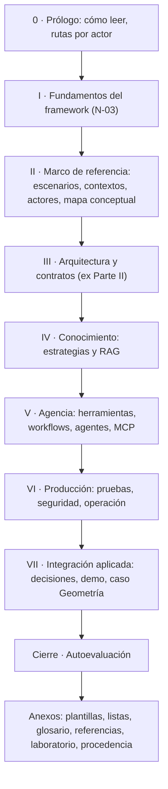
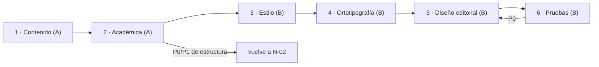

# P-07 · Comisión editorial A (edición de contenido y edición académica)

> Propuesta de plan de la especialista E-07 (01-Convocatoria §3) para los núcleos N-02, N-04 y N-03. Etapa: planificación; nadie aplica. Trabajada a ciegas respecto de las otras propuestas. Fecha: 2026-11-01. Fuentes: prompt 02; `Nucleos/00-Cohesion.md`, N-02, N-03, N-04; `Relevamiento/R1-Guia.md`, `R5-Marco.md` (§5–§7), `R6-Industria.md` (§6, §8, §9); perfil Study-Guide-Documentation y su RuleSet; `00-Coordinacion-Entre-Sesiones.md`. Cifras re-medidas el 2026-11-01 sobre la guía 0.11.0: 5.268 líneas, 72.364 palabras (`wc -lw`), 62 «Historia (hasta», 23 bloques mermaid (`grep -c`).

## Índice

1. [Definiciones de trabajo](#1-definiciones-de-trabajo)
2. [Postura general de la comisión](#2-postura-general-de-la-comisión)
3. [N-02 · Libro unificado y arquitectura editorial](#3-n-02--libro-unificado-y-arquitectura-editorial)
   - [3.1 Estructura recomendada](#31-estructura-recomendada)
   - [3.2 Alternativas](#32-alternativas)
   - [3.3 Decisiones con criterio](#33-decisiones-con-criterio)
   - [3.4 Presupuesto de extensión](#34-presupuesto-de-extensión)
   - [3.5 Entregables, aceptación, riesgos](#35-entregables-aceptación-riesgos)
4. [N-03 · Sección inicial de fundamentos](#4-n-03--sección-inicial-de-fundamentos)
5. [N-04 · Ronda de revisión tipo libro](#5-n-04--ronda-de-revisión-tipo-libro)
6. [Estándares y respaldo](#6-estándares-y-respaldo)
7. [Ensayos y pruebas](#7-ensayos-y-pruebas)
8. [Qué no hacer](#8-qué-no-hacer)
9. [Conflictos con otros núcleos](#9-conflictos-con-otros-núcleos)
10. [Respuestas a las preguntas de los núcleos](#10-respuestas-a-las-preguntas-de-los-núcleos)

## 1. Definiciones de trabajo

| Término | Definición en esta propuesta |
|---|---|
| Edición de contenido | Intervención sobre ideas, estructura y argumentos (tabla del prompt 02): qué va, en qué orden y con qué hilo argumental |
| Edición académica | Intervención sobre rigor, fuentes y consistencia: cada afirmación con ancla, referencias fechadas, término definido una vez |
| No delta | El texto describe el estado vigente; no narra cómo se llegó a él («antes era…», «Historia hasta…», «nombre histórico») |
| Aparato académico | Citas, glosario, referencias, marcas de estado (NO VERIFICADO, NO EJECUTADO, ESPECULACIÓN) y anexo de procedencia |
| Fundamento | Principio del framework que justifica decisiones en varias partes del libro y que no depende de una tecnología concreta |
| Mapa de destino | Tabla «encabezado 0.11.0 → sección nueva / anexo / bitácora / se elimina» |

## 2. Postura general de la comisión

La guía ya es un único archivo (R1 §6): «unificar» no es juntar archivos sino **reorganizar un texto que creció por acumulación** (62 bloques históricos, mapas de ejemplos en cuatro lugares, ADR repetidas en §4–§12, §13 y A.13). El trabajo editorial de fondo es de **sustracción y reubicación**, no de adición. Toda adición (fundamentos, caso Geometría) se financia con recortes medidos.

## 3. N-02 · Libro unificado y arquitectura editorial

### 3.1 Estructura recomendada

Alineada con la convención acordada con FC (00-Coordinacion: capítulos numerados, índice al inicio, glosario y referencias con fecha al final) y con el perfil Study-Guide (marco de ejes antes que temas).

Figura 7.1. Esqueleto objetivo propuesto (propuesta, a votar).

Reglas de la estructura:

1. **Patrón temático único** por capítulo, fusionando el de la guía (§0.4: Definición → … → En este laboratorio → Práctica → Qué decisión toca) con el del perfil (Definición · Aplicación por escenario · Ejemplos · Preguntas guía · Criterios de calidad · Plantilla). Resultado: *Definición → Aplicación por escenario → Ejemplo (remite a `Examples/NN`) → Decisión (remite al ADR en VII) → Preguntas guía → Criterios de calidad*. La plantilla va al Anexo A.
2. **Unicidad**: cada concepto se define en un solo lugar (§3.0 queda como la definición; §4.1 «qué no es» se integra al mismo bloque; el Anexo C sólo remite). Cada ADR se enuncia una vez (VII); los capítulos dicen «decisión: ADR-n» en una línea.
3. **Mapa de ejemplos único** en el Anexo de laboratorio; en el cuerpo, una línea «Ejemplo: `Examples/NN`» por sección.
4. **Procedencia fuera del cuerpo**: los 62 bloques «Historia (hasta…)» y nombres históricos salen a un **Anexo de procedencia** breve (una tabla: qué cambió, fecha, enlace a la bitácora pública) y el detalle queda en las bitácoras de LDD.
5. **Prácticas largas** (§5 ~300 líneas, §7 ~220, §8 ~380; R1 §1) pasan al `README.md` de cada ejemplo; en el libro queda un resumen de ≤ 15 líneas con el comando y el resultado esperado.
6. **Numeración de tablas y figuras** con leyenda («Tabla n.m.», «Figura n.m.»), como el libro MAUI (R5 §6).

### 3.2 Alternativas

| Alt. | Descripción | Ventaja | Desventaja | Veredicto |
|---|---|---|---|---|
| A1 | Reorden mínimo: mantener Partes 0–VI, insertar Fundamentos y caso, limpiar delta | Menor riesgo de romper anclas y compuertas | No resuelve duplicaciones; extensión sube | Descartada salvo falta de tiempo |
| **A2** | Esqueleto de §3.1 en un solo archivo, con Prácticas a los README | Cumple «autocontenido y no delta» y el perfil; baja extensión | Reescribe anclas; requiere mapa de destino y ajuste de compuertas | **Recomendada** |
| A3 | Partir el libro en varios archivos (un capítulo por archivo) | Escala mejor, revisiones más chicas | Contradice el pedido literal de «un solo documento» | Rechazada |

Criterio: simplicidad (un archivo, un patrón), practicidad (las Prácticas viven junto al código que ejecutan), escalabilidad (agregar un caso de uso = un capítulo en VII, sin tocar el resto).

### 3.3 Decisiones con criterio

| Id | Decisión | Criterio | Ancla |
|---|---|---|---|
| D-A1 | Procedencia a anexo breve + bitácora | Regla «no delta» del prompt; trazabilidad se conserva por enlace | Prompt 02 Reglas; R1 §5 |
| D-A2 | Patrón temático fusionado (§3.1 regla 1) | Perfil exige estructura idéntica; la guía ya tiene un patrón propio que funciona | F3 «Estructura»; R1 §1 |
| D-A3 | Marco de ejes (ESC/CTX/ACT) en una parte propia antes de los temas | Perfil: «los ejes se definen una sola vez … de lo general a lo particular» | F3 «Enfoque»; T7 de R5 |
| D-A4 | Renombrar la actual Parte II a «Arquitectura y contratos» | Evita dos «Fundamentos» (I-6) | R1 I-6 |
| D-A5 | Cifras medidas fuera de la prosa (anexo de laboratorio con la corrida fechada) | Evita I-1 (cifras autodeclaradas que envejecen) | R1 I-1; R5 §6 |
| D-A6 | Glosario único bilingüe (Término · Definición · Equivalente · §) | Coherencia con el libro MAUI | R5 §6 |
| D-A7 | Referencias con formato `R<n>. Autor. *Título*. URL. Consulta: fecha.` | Coherencia entre libros; verificabilidad | 00-Coordinacion; R5 §6 |

### 3.4 Presupuesto de extensión

Dato de partida: 57.753 palabras de prosa contra tope 44.330 (130 %; R1 §7). Propuesta (a votar; los topes los fija el jurado, no la comisión):

| Fuente de recorte / adición | Estimación | Cómo se mide |
|---|---|---|
| Prácticas largas → README | − (a medir) | `contar.sh` antes/después |
| 62 bloques Historia → anexo de procedencia | − (a medir) | `grep -c "Historia (hasta"` = 0 en cuerpo |
| ADR repetidas en §4–§12 y A.13 → una línea | − (a medir) | `grep -c "Qué decisión toca"` |
| Mapas de ejemplos duplicados (§0.5, §3.4–3.5) | − (a medir) | conteo de tablas de ejemplos = 1 |
| Parte I · Fundamentos (nueva) | + ≤ 2.000 | `contar.sh` |
| Capítulo caso Geometría (N-06) | + ≤ 2.500 | `contar.sh` |

No se fija un número antes de medir: el primer ensayo (§7, ensayo E-A1) produce la cifra real de cada recorte. Meta propuesta: **total ≤ 100 % del tope vigente o un tope nuevo votado y declarado en el frontmatter**, nunca un exceso no declarado.

### 3.5 Entregables, aceptación, riesgos

Entregables (en la bitácora, ruta `Prompt-02/Editorial/`):

- `N02-Esqueleto-Objetivo.md`: índice objetivo con anclas nuevas.
- `N02-Mapa-De-Destino.md`: los 229 encabezados de 0.11.0 → destino.
- `N02-Politica-Unicidad-Y-Procedencia.md`.
- `N02-Presupuesto.md` con la medición de E-A1.

Criterios de aceptación medibles:

- Mapa de destino sin huérfanos: 229/229 encabezados con destino (script que compara la lista de `^#` con el mapa).
- `grep -c "Historia (hasta"` = 0 en el libro; procedencia sólo en el anexo.
- Cada término del glosario: 1 definición; otras apariciones enlazan (lista de control por término).
- Ningún «Qué decisión toca» con texto de ADR fuera de la parte VII.
- Las 9 reglas del RuleSet Study-Guide con su casilla marcada y evidencia.
- `verificar-markdown.py` sin anclas rotas; `contar.sh` dentro del presupuesto votado.

Riesgos: rotura de anclas y de compuertas que cuentan secciones (mitigación: mapa de destino + ajuste de oráculos coordinado con N-01); pérdida de trazabilidad (mitigación: anexo de procedencia); divergencia con el libro MAUI (mitigación: comparar índices al final, §7).

## 4. N-03 · Sección inicial de fundamentos

### 4.1 Estructura recomendada

Parte I «Fundamentos del framework», ≤ 2.000 palabras, con este orden:

1. Qué problema resuelve el framework (una página; sale de §1, sin la «diapositiva»).
2. Principios P-n: tabla `Id | Enunciado | Razón | Dónde se aplica (§) | Fuente`. Inventario **sólo de lo ya presente** en 0.11.0 (regla «no inventar»). Candidatos rastreados en R1 §2 y §6: capa de IA con contrato propio (§4.4, ADR-02); la salida del modelo es propuesta, no autoridad (ADR-08); dos escaleras saber/hacer (§3.2); invariante de dependencias entre capas (§3.1, §4.3); aprobación humana para acciones con efecto (§8.5, ADR-06/12); evidencia antes que afirmación (§0.4). La regla «si alcanza una función, no un agente» (R6 F2, F20) entra como **criterio de decisión** dentro del principio de escaleras, no como principio aparte.
3. Figura: relación principios ↔ capas ↔ escaleras (mermaid).
4. «Qué no es» (frontera fundamento/arquitectura): un fundamento no nombra tipos ni paquetes; si nombra `IChatClient`, es arquitectura (Parte III).

### 4.2 Alternativas

| Alt. | Descripción | Veredicto |
|---|---|---|
| F1 | Capítulo nuevo autónomo que repite los principios y deja §3/§4 como están | Rechazada: duplica |
| **F2** | Capítulo nuevo que **absorbe** los enunciados; §3, §4, §13 los citan por Id | **Recomendada** |
| F3 | Prólogo extendido sin capítulo propio | Rechazada: el prompt pide «sección inicial que explique» |

### 4.3 Decisiones

- D-A8: lista única de P-n compartida por libro y Conocimiento (N-05): el Conocimiento usa los mismos Id y condensa; no renumera. Criterio: una sola fuente de verdad; coherente con F10 (R5 §6: el Conocimiento «no repite el libro: lo condensa»).
- D-A9: cada P-n con ancla interna (§/ADR) **y** al menos una externa de R6 cuando exista (p. ej. F1 para el contrato `IChatClient`, F8/F9 para aprobación humana); si no hay externa, se declara «criterio propio» (Rule-Evidences).

### 4.4 Entregables y aceptación

- `Prompt-02/Editorial/N03-Inventario-Principios.md`: tabla P-n con ancla verificada (línea de la 0.11.0).
- `Prompt-02/Editorial/N03-Borrador-Capitulo.md` (borrador de bitácora, no se toca la guía).
- Aceptación: 100 % de P-n con ancla interna verificable por `sed -n`; ningún P-n sin fuente; prueba del lector frío (§7, E-A3) ≥ 80 % de principios enunciados correctamente.

Riesgos: inflar con resúmenes de toda la guía (tope de palabras); confundir fundamentos con MEAI (regla «qué no es»).

## 5. N-04 · Ronda de revisión tipo libro

### 5.1 Orden y reparto

Secuencia clásica de producción editorial: lo estructural antes que lo superficial, para no corregir estilo de texto que luego se borra.

Figura 7.2. Fases de la ronda; A = esta comisión, B = comisión editorial B. Dos roles cubren seis intervenciones (respeta el techo de cinco variables, T2 de R5).

### 5.2 Fases de esta comisión

| Fase | Lista de control | Salida |
|---|---|---|
| 1 · Contenido | Cada capítulo responde una pregunta del lector; hilo Parte I → VII sin saltos; ninguna sección sin escenario o contexto (perfil); excepciones definidas junto a la regla (I-7) | Informe F1 con hallazgos P0–P3 y parche propuesto |
| 2 · Académica | Cada afirmación factual con ancla E1–E4; referencias con fecha de consulta; marcas NO VERIFICADO donde R6 §9 lo indica (ISO 42001, OWASP Agentic, AI Act, Uber); cifras sólo en el anexo de laboratorio; glosario uno-a-uno | Informe F2 + lista de referencias a corregir (entra N-08) |

Umbral de publicación: **0 P0 y 0 P1 abiertos** al cerrar la fase 6; P2/P3 se aceptan declarados en el anexo de procedencia o en la bitácora. Cierre «por criterio» si dos rondas seguidas no dan hallazgos interpretativos (R5 §1, F6 §3.5.7).

### 5.3 Entregables y aceptación

- `Prompt-02/Editorial/N04-Fase1-Contenido.md`, `N04-Fase2-Academica.md` (esta comisión).
- `Prompt-02/Editorial/Hoja-De-Estilo.md` (co-autoría con B: términos, mayúsculas, cifras, formato de cita).
- Aceptación: seis informes presentes; muestreo académico de 30 afirmaciones al azar (semilla declarada) con 30/30 anclas resolubles; 0 P0/P1.

Pregunta abierta (respuesta propuesta): la corrección de pruebas se hace sobre el **render de GitHub** (es la «versión diagramada» real del público) más la salida de `tools/medios/mermaid.sh`.

## 6. Estándares y respaldo

| Tema | Respaldo | Estado |
|---|---|---|
| Estructura de guía de estudio | Perfil Study-Guide-Documentation y RuleSet (rutas en la carta) | Leído |
| Convención de libro (índice, glosario, referencias fechadas, tablas/figuras numeradas, marcas de estado) | Libro MAUI vía R5 §6; 00-Coordinacion | Leído (vía R5) |
| Separación regla / razón / evidencia | Conocimiento MAUI vía R5 §6 | Leído (vía R5) |
| Especificación de arquitectura en el libro y el Conocimiento | arc42, C4, ADR (R6 F16–F18) | URL en R6 |
| Fuentes de los principios | MEAI (R6 F1), Agent Framework (F2), OWASP LLM/Agentic (F8, F9), NIST AI RMF (F10) | URL en R6; F9 parcialmente NO VERIFICADO |
| Normas de estilo y ortotipografía en español (p. ej. Ortografía de la RAE) | Candidata para la hoja de estilo | **NO VERIFICADO**: no leída en esta ronda; E-09 debe confirmar edición y URL antes de citarla |

## 7. Ensayos y pruebas

| Id | Ensayo | Cómo se evalúa |
|---|---|---|
| E-A1 | Medición de recortes: copia de trabajo de la guía en el scratchpad (no en el repo); aplicar el mapa de destino de forma mecánica y correr `contar.sh` | Cifra por recorte; decide el presupuesto real |
| E-A2 | Compuertas sobre la copia: `verificar-markdown.py` y `mermaid.sh` | 0 anclas rotas, 23+ diagramas renderizan |
| E-A3 | Lector frío: un subagente sin contexto lee sólo la Parte I y enuncia los principios | ≥ 80 % de P-n correctos frente al inventario |
| E-A4 | Muestreo académico de 30 afirmaciones | 30/30 con ancla resoluble |
| E-A5 | Comparación de índices con el libro MAUI | Mismas convenciones de §6; divergencias declaradas |

Ninguno requiere modelos ni turno del gestor; ninguno toca repos (todo sobre copias en el scratchpad).

## 8. Qué no hacer

- No agregar principios, casos ni cifras sin ancla (regla «no inventar»).
- No corregir estilo antes de cerrar contenido y académica.
- No partir el libro en varios archivos (pedido literal: un documento).
- No borrar la historia sin destino: va al anexo de procedencia o a la bitácora.
- No nombrar el servicio privado ni su infraestructura en el libro, el anexo de procedencia ni esta bitácora.
- No tocar territorio de FC/DAC (Concepts/**, Documentacion-Tecnica/**) ni archivos comunes; la integración en LD es el PR único y último de la guía 16.

## 9. Conflictos con otros núcleos

| Con | Conflicto | Propuesta |
|---|---|---|
| N-01 | Mover Prácticas a README y renombrar anclas cambia lo que verifican las compuertas y oráculos de `tools/` | N-01 corrige primero; N-02 entrega mapa de destino y N-01/E-11 ajustan oráculos en el mismo lote |
| N-01 (C4) | I-5: ejemplos bajo `Application/` frente a ADR-01 | Editorialmente: la excepción se enuncia junto a la regla (en el mismo capítulo), no 3.400 líneas después; la decisión técnica es de E-03/E-05 |
| N-05 (C3) | Lista P-n compartida; forma §0–§13 del Conocimiento | D-A8: mismos Id; la forma la decide N-05 |
| N-06 (C2, C6) | Capítulo Geometría suma extensión; intake sin IA por decisión del PO | Capítulo con tope ≤ 2.500 palabras; si el caso no usa IA, se presenta como caso «la capa no hace falta» (aplica el árbol de decisión), sin inventar uso |
| N-07 | Nada del caso privado entra al libro salvo una mención abstracta | Coincide con la carta |
| N-08 (C7) | MCP 2026-07-28 cambia texto del capítulo de agencia | La fase académica no cierra hasta que N-08 entregue referencias fechadas |
| N-10 (C5) | Seis intervenciones, techo de cinco | Dos comisiones (A, B), ya en la convocatoria |

## 10. Respuestas a las preguntas de los núcleos

| Núcleo · pregunta | Respuesta propuesta |
|---|---|
| N-02 · 1 Procedencia | Anexo breve + bitácora (D-A1) |
| N-02 · 2 Patrón | Fusión de ambos (D-A2) |
| N-02 · 3 Prácticas largas | Sí, a los README; resumen ≤ 15 líneas en el libro |
| N-02 · 4 Tope | Lo vota el jurado tras E-A1; se declara en el frontmatter |
| N-03 · 1 Fundamento vs arquitectura | Fundamento no nombra tipos ni paquetes (§4.1 punto 4) |
| N-03 · 2 Misma lista | Sí, mismos Id (D-A8) |
| N-03 · 3 Regla de Agent Framework | Criterio de decisión, no principio |
| N-04 · 1 Fusión de intervenciones | A = contenido + académica; B = estilo + ortotipografía + diseño + pruebas |
| N-04 · 2 Pruebas | Render de GitHub + `mermaid.sh` |
| N-04 · 3 Umbral | 0 P0 y 0 P1 |
