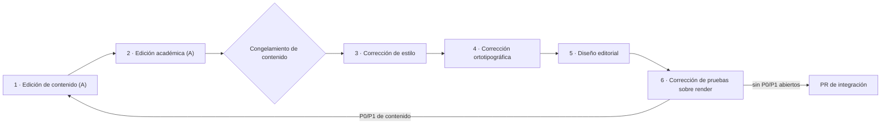

# P-08 · Comisión editorial B — estilo, ortotipografía, diseño editorial y corrección de pruebas

> Especialista E-08 de la [convocatoria](../01-Convocatoria.md). Núcleos: [N-04](../Nucleos/N-04-Ronda-De-Revision-Tipo-Libro.md) (principal) y [N-02](../Nucleos/N-02-Libro-Unificado-Arquitectura-Editorial.md) (aporte). Etapa: planificación; no se edita la guía. Trabajo a ciegas respecto de las demás propuestas. Fecha: 2026-11-01.

## Índice

1. [Definiciones](#1-definiciones)
2. [Evidencia de partida medida](#2-evidencia-de-partida-medida)
3. [N-04 · Arquitectura de la ronda (fases 3–6)](#3-n-04--arquitectura-de-la-ronda-fases-36)
4. [N-04 · Hoja de estilo propuesta](#4-n-04--hoja-de-estilo-propuesta)
5. [N-04 · Diseño editorial y mermaid](#5-n-04--diseño-editorial-y-mermaid)
6. [N-04 · Corrección de pruebas](#6-n-04--corrección-de-pruebas)
7. [N-02 · Aporte a la arquitectura editorial](#7-n-02--aporte-a-la-arquitectura-editorial)
8. [Decisiones con criterio](#8-decisiones-con-criterio)
9. [Estándares y respaldo](#9-estándares-y-respaldo)
10. [Ensayos necesarios](#10-ensayos-necesarios)
11. [Entregables](#11-entregables)
12. [Criterios de aceptación](#12-criterios-de-aceptación)
13. [Riesgos y qué no hacer](#13-riesgos-y-qué-no-hacer)
14. [Conflictos previsibles con otros núcleos](#14-conflictos-previsibles-con-otros-núcleos)
15. [Preguntas en formato F2](#15-preguntas-en-formato-f2)

## 1. Definiciones

| Término | Definición operativa en esta propuesta |
|---|---|
| Corrección de estilo | Cambia lenguaje y expresión (claridad, registro, longitud de oración, voz) sin alterar el contenido ni la estructura. |
| Corrección ortotipográfica | Ortografía y convenciones tipográficas: comillas, rayas, cifras, fechas, mayúsculas, cursivas/código, abreviaturas. |
| Diseño editorial | Presentación visual en el medio de publicación (Markdown renderizado): jerarquía de encabezados, tablas, figuras mermaid, avisos, numeración. |
| Corrección de pruebas | Revisión de la versión **diagramada** (render), no del fuente: errores que sólo aparecen al dibujar (tablas rotas, anclas, mermaid fallidos, desbordes). |
| Hoja de estilo | Documento de decisiones tipográficas y terminológicas, con ejemplos correcto/incorrecto y la regla mecánica (grep o compuerta) que la verifica. |
| Hallazgo P0–P3 | Escala única de la mesa (R5 l. 83): P0 viola restricción dura; P1 retrabajo/interpretación divergente; P2 pérdida acotada; P3 claridad. |

## 2. Evidencia de partida medida

Mediciones propias del 2026-11-01 sobre `Dot-Net-Integration-AI-Layer-Guide.md` 0.11.0 (sólo lectura), más R1:

| Rasgo | Medida | Origen |
|---|---|---|
| Extensión | 5.268 líneas, 72.364 palabras; prosa 130 % del tope, Anexos 170 % | R1 l. 18, l. 91 |
| Mermaid | 23 bloques; 0 etiquetas «N. Texto» y 0 URLs dentro de bloques mermaid | R1 l. 18; `awk` sobre bloques mermaid |
| Comillas | 1.548 `"` rectas frente a 546 `«` (sin separar código de prosa: hay que depurar) | `grep -o` |
| Fechas ISO | 615 apariciones `AAAA-MM-DD` | `grep -oE` |
| Figuras/tablas numeradas | 0 pies «Figura n»/«Tabla n» | `grep -cE` |
| «Historia (hasta…» | 62 bloques (delta) | R1 l. 107 |
| Abreviatura de ejemplo | «p. ej.» sólo 2 veces; sin «e.g.» | `grep` |
| Compuertas existentes | `tools/verificar-markdown.py` (229 encabezados, 283 anclas según 05-Cierre), `tools/contar.sh`, `tools/medios/mermaid.sh` del workspace (mermaid-cli 11.4.2, sale 1 ante «Unsupported markdown: list|link») | R1 l. 18; cabecera de `mermaid.sh` |

Lectura: la convención mermaid acordada con FC ya se cumple en la 0.11.0; el mayor trabajo ortotipográfico probable está en comillas, cifras y uniformidad de fechas/términos, y en dotar de pies a figuras.

## 3. N-04 · Arquitectura de la ronda (fases 3–6)

La Comisión A cubre fases 1–2 (contenido, académica). La B entra cuando el texto está **congelado en contenido** (N-02 integrado y A cerrada).

Alternativas evaluadas:

| Alternativa | Ventaja | Desventaja | Veredicto |
|---|---|---|---|
| R-1 Secuencial 3→4→5→6 sobre el libro entero | Simple; cada fase ve texto estable | Lenta en 72 k palabras | **Recomendada** para 4–6 |
| R-2 Por partes en paralelo (cada parte pasa 3–6) | Escala; permite repartir subagentes | Riesgo de deriva de estilo entre partes | Usar sólo para la fase 3, con hoja de estilo cerrada antes |
| R-3 Una sola pasada «todo junto» | Menos coordinación | Mezcla criterios, no deja informe por intervención (incumple N-04 §5) | Descartada |

Plan recomendado: **R-2 para estilo (fase 3) + R-1 para 4–6**. Primero se cierra la hoja de estilo (§4), luego se reparte estilo por partes y ortotipografía, diseño y pruebas se aplican de forma global con reglas mecánicas.

Cada fase deja un informe con: alcance, reglas aplicadas, hallazgos (Id, P0–P3, ancla `[archivo:línea]`, propuesta), parches (diff) y «lo revisado y está bien» (hasta tres, R5 l. 116).

## 4. N-04 · Hoja de estilo propuesta

Decisiones a ratificar por la mesa; cada una con su verificación mecánica.

| # | Tema | Regla propuesta | Verificación |
|---|---|---|---|
| HE-01 | Comillas | Prosa: latinas «»; anidadas “”; rectas sólo dentro de código | `grep` de `"` fuera de bloques/código en línea = 0 |
| HE-02 | Términos técnicos | Identificadores (`IChatClient`, rutas, comandos) siempre en código; nombres de producto en redonda, sin cursiva | Lista de términos del glosario vs. `grep` |
| HE-03 | Extranjerismos | Patrón en inglés, dominio en español (convención del workspace); extranjerismo no técnico en cursiva la primera vez y con equivalente | Revisión humana + lista |
| HE-04 | Fechas | ISO `AAAA-MM-DD` en tablas, referencias y evidencia; en prosa también ISO para no mezclar | `grep` de formatos dd/mm/aaaa = 0 |
| HE-05 | Cifras | Separador de miles con punto en prosa (72.364), decimal con coma; en código, como lo imprime la herramienta | `grep` de `[0-9],[0-9]{3}` en prosa = 0 |
| HE-06 | Mayúsculas | Encabezados en mayúscula sólo inicial (oración), no Title Case | `grep` de encabezados con ≥3 palabras capitalizadas |
| HE-07 | Abreviaturas | «p. ej.», «etc.»; sin «e.g.», «i.e.» | `grep` |
| HE-08 | Rayas y guiones | Raya (—) para incisos, semirraya (–) en intervalos (P0–P3, 01–17), guion en compuestos | Revisión + `grep` de « - » en prosa |
| HE-09 | Voz y registro | Impersonal o segunda persona coherente con el perfil Study-Guide (a fijar con E-06); oraciones ≤ 35 palabras como objetivo | Muestra aleatoria por parte |
| HE-10 | Referencias | `[REF-…]` como ancla única; fecha de consulta al final (acuerdo con FC) | `verificar-markdown.py` |
| HE-11 | No delta | Prohibidas «Historia (hasta…», «antes era», «ahora», «versión anterior» en el cuerpo | `grep` = 0 fuera del anexo de procedencia |

La hoja se escribe como documento autocontenido con ejemplos correcto/incorrecto y queda **reutilizable por el libro MAUI** (coherencia entre libros), sin editar territorio de FC: FC decide si la adopta.

## 5. N-04 · Diseño editorial y mermaid

- **Figuras**: cada mermaid lleva pie «Figura n.m · Título» en la línea siguiente al bloque y se cita en el texto antes de aparecer. Numeración por capítulo (n = capítulo) para que no se renumere todo al mover una parte.
- **Tablas**: pie «Tabla n.m · Título» sólo en tablas de referencia (>5 filas o citadas desde otra sección); las tablas de paso no se numeran (simplicidad).
- **Mermaid**: etiquetas «1 · Texto», sin URLs, sin HTML; un diagrama ≤ ~15 nodos (si supera, partir); dirección fija por tipo (flujo LR, capas TB). Validación obligatoria con `tools/medios/mermaid.sh` (raíz del workspace), salida archivada en la bitácora.
- **Jerarquía**: máximo cuatro niveles (`#` libro, `##` parte/capítulo, `###` sección, `####` subsección); el patrón por tema del perfil Study-Guide (definición, aplicación, ejemplos, preguntas guía, criterios de calidad) se marca siempre con los mismos rótulos.
- **Avisos**: un único formato para «Nota», «Advertencia» y «Evidencia» (blockquote con rótulo en negrita); se elimina la variedad.
- **Medio de publicación**: el render de GitHub es la versión diagramada de referencia (es donde el lector público la lee).

## 6. N-04 · Corrección de pruebas

Sobre el render, no sobre el fuente.

| Prueba | Cómo | Evidencia |
|---|---|---|
| PR-1 Anclas e índices | `tools/verificar-markdown.py` | Salida con 0 anclas rotas |
| PR-2 Mermaid | `tools/medios/mermaid.sh <guía>` | Salida exit 0 + PNG/SVG archivados |
| PR-3 Render visual | Captura del archivo en GitHub con `tools/medios/web.sh` (Chromium en contenedor; sin emuladores ni KVM) en ancho escritorio y móvil | Capturas por parte en la bitácora |
| PR-4 Tablas | Inspección de capturas: columnas desbordadas, celdas con `|` sin escapar | Lista de hallazgos |
| PR-5 Cifras autodeclaradas | `tools/contar.sh` vs. cifras del texto (I-1 de R1) | Diferencia = 0 |
| PR-6 Lectura en frío | Muestra de 10 % de páginas leída de principio a fin por un corrector que no corrigió esa parte | Hallazgos P0–P3 |

Umbral de publicación propuesto: **0 P0 y 0 P1 abiertos**; P2 con decisión registrada; P3 pueden quedar en lista para la siguiente versión.

## 7. N-02 · Aporte a la arquitectura editorial

Desde lo editorial (la estructura la decide E-06/E-07):

1. **Procedencia fuera del cuerpo**: la historia sale del libro a la bitácora (LDD), y el libro conserva sólo un anexo breve «Procedencia y versiones» con una tabla (versión, fecha, enlace a bitácora). Criterio: «no delta» es regla dura del prompt; un anexo de 62 bloques seguiría siendo delta dentro del libro.
2. **Unicidad**: cada término se define una vez en el glosario final; en el cuerpo, primera aparición con enlace. Elimina los tres niveles de definición (R1).
3. **Prácticas largas**: los pasos de >~100 líneas pasan al README de cada Example; el libro deja objetivo, diagrama y extracto. Reduce extensión sin perder ejemplos (regla «ejemplos claros» se cumple con el extracto).
4. **Presupuesto**: la extensión no se corrige en fase de estilo; si la fase 3 encuentra exceso, se reporta a N-02 (no se recorta contenido desde B).
5. **Forma común con el libro MAUI**: capítulos numerados, índice inicial, glosario y referencias con fecha al final (00-Coordinacion).

## 8. Decisiones con criterio

| Id | Decisión | Criterio | Análisis |
|---|---|---|---|
| D-B1 | Agrupar 4 intervenciones en una comisión, ejecutadas en fases separadas con informe propio | Techo de 5 roles (T2 de R5) + trazabilidad por intervención | Fusiona el rol, no el informe: N-04 §5 se cumple |
| D-B2 | Hoja de estilo antes de corregir | Escalabilidad (paralelizar fase 3 sin deriva) | Costo bajo; evita rehacer |
| D-B3 | Toda regla tipográfica con verificación mecánica | Evidencia verificable (regla del prompt) | Las reglas sin grep quedan como «revisión humana» explícita |
| D-B4 | Render de GitHub como prueba | Practicidad: medio real del lector | Alternativa PDF (pandoc) descartada: no es medio de publicación y suma herramienta |
| D-B5 | Pies de figura numerados por capítulo | Estabilidad ante reordenamientos | Numeración global obligaría a renumerar tras cada cambio de N-02 |
| D-B6 | Umbral 0 P0/P1 | Coherente con F1 §5.1 | P2 con decisión evita bloqueo por detalles |
| D-B7 | B no cambia contenido ni estructura | Separación de intervenciones (tabla del prompt) | Hallazgo de contenido → solicitud a A/N-02, no parche |

## 9. Estándares y respaldo

| Respaldo | Uso | Estado |
|---|---|---|
| Tabla de intervenciones del prompt 02 | Define fases y alcance de cada una | Leída |
| R5-Marco l. 55, 83, 116, 271 (P0–P3, carta, techo T2) | Escala, informe, agrupación | Leído |
| 00-Coordinacion: convención mermaid y forma común con FC | HE-10, §5 | Leído |
| `tools/medios/mermaid.sh` (mermaid-cli 11.4.2) | PR-2 | Leído (cabecera) |
| RuleSet-Study-Guide.md y perfil Study-Guide | Rótulos por tema, §5 | A contrastar regla por regla en la fase 5 |
| arc42 / C4 (R6 F16–F17) | Sólo convención de vistas en diagramas de arquitectura | R6 |
| Ortografía de la lengua española (RAE-ASALE) para comillas, rayas, cifras y abreviaturas | HE-01, 05, 07, 08 | **NO VERIFICADO** en esta ronda: R6 no releva normas editoriales; E-09 debe leer la fuente primaria (y, si se usa, el Manual de estilo de Fundéu) y fijar cita con fecha antes de ratificar la hoja |

## 10. Ensayos necesarios

| Ensayo | Hipótesis | Evaluación |
|---|---|---|
| E-B1 Barrido base | Medir HE-01…HE-11 sobre la 0.11.0 separando código de prosa | Script en `tools/` propuesto a N-01/N-09 (no se crea ahora); cifras de línea base en la bitácora |
| E-B2 Mermaid base | Los 23 diagramas compilan hoy | `mermaid.sh` exit 0; si falla, P1 |
| E-B3 Piloto de estilo | Aplicar la hoja a un capítulo (copia en la bitácora, no en la guía) | Dos correctores independientes; concordancia ≥ 90 % en las reglas mecánicas |
| E-B4 Render | GitHub dibuja tablas anchas y mermaid de la guía | Capturas escritorio/móvil sin desbordes P1 |

## 11. Entregables

Todos en `OUTPUTs/Bitacoras/Prompt-02/` salvo indicación:

| Entregable | Ruta | Etapa |
|---|---|---|
| Esta propuesta | `Propuestas/P-08-Comision-Editorial-B.md` | Planificación |
| Hoja de estilo | `Ronda-Libro/Hoja-De-Estilo.md` | Antes de fase 3 |
| Informes por fase | `Ronda-Libro/F3-Estilo.md`, `F4-Ortotipografia.md`, `F5-Diseno-Editorial.md`, `F6-Pruebas.md` | Ejecución |
| Evidencia mermaid y capturas | `Ronda-Libro/evidencia/` | Ejecución |
| Parches | Sólo aplicados en la guía por quien la mesa designe, en el PR único de integración (último, según reparto) | Ejecución |

## 12. Criterios de aceptación

- Cuatro informes (fases 3–6) con hallazgos P0–P3 anclados y parches.
- HE-01, 04, 05, 07, 11: 0 ocurrencias fuera de código y del anexo de procedencia (salida del barrido archivada).
- `mermaid.sh` exit 0 sobre la guía; 100 % de mermaid con pie «Figura n.m».
- `verificar-markdown.py`: 0 anclas rotas.
- Cifras declaradas = salida de `contar.sh`.
- 0 P0 y 0 P1 abiertos al pedir el PR.

## 13. Riesgos y qué no hacer

| Riesgo | Mitigación |
|---|---|
| Corregir estilo antes del congelamiento → rehacer | Puerta de congelamiento en el diagrama de §3 |
| Deriva entre partes en paralelo | Hoja cerrada + E-B3 |
| Reglas mecánicas tocando código | Barrido que excluye bloques y código en línea |
| Hoja de estilo inventa norma | Toda regla lingüística con cita verificada por E-09 o marcada «convención de la casa» |
| Fuga público/privado al ilustrar | Ejemplos sólo de la guía y de Geometría |

No hacer: reescribir argumentos o recortar contenido desde B; renumerar por cambios cosméticos; añadir dependencias de herramientas (pandoc, linters nuevos) sin necesidad; tocar territorio de FC/DAC o archivos comunes; editar la guía en esta etapa.

## 14. Conflictos previsibles con otros núcleos

- **N-02/E-06**: si la procedencia queda como anexo largo, choca con HE-11 y con «no delta»; también el rótulo «En este laboratorio / Práctica» vs. patrón Study-Guide condiciona §5.
- **N-01**: sus correcciones de deriva texto↔código deben entrar **antes** del congelamiento; si llegan tarde, reabren fases 3–6.
- **N-03 y N-06**: capítulos nuevos aumentan la extensión ya al 130 %; B no recorta.
- **N-08/E-09**: cambia formato `[REF-…]` y fechas; debe alinearse con HE-04/HE-10 antes de la fase 4.
- **N-05**: el Conocimiento tiene forma propia (regla/razón/evidencia); la hoja de estilo le aplica ortotipografía pero no estructura.
- **FC**: la hoja de estilo puede diferir de la que use el libro MAUI; se ofrece, no se impone.

## 15. Preguntas en formato F2

| Rol | Pregunta | Por qué | Prioridad | Si no contesta |
|---|---|---|---|---|
| E-08 | ¿La prosa usa segunda persona («vos/tú») o impersonal? | HE-09; el perfil Study-Guide no lo fija explícitamente en lo leído | P2 | Impersonal, coherente con la 0.11.0 |
| E-08 | ¿Se adopta RAE-ASALE como norma de referencia? | HE-01/05/08 requieren fuente | P2 | Se adopta, marcada como convención de la casa hasta verificar cita |
