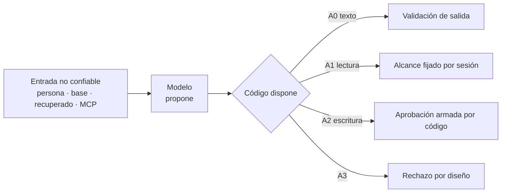

# P-10 · Especialista en seguridad de IA (OWASP LLM / Agentic)

> Propuesta de la mesa del prompt 02 de la guía 16. Etapa: planificación (nada se aplica). Núcleos atendidos: N-05, N-07, N-06. Trabajo a ciegas respecto de los otros especialistas. Fecha: 2026-11-01.

## Índice

1. [Definiciones](#1-definiciones)
2. [Tesis de seguridad común a los tres núcleos](#2-tesis-de-seguridad-común-a-los-tres-núcleos)
3. [N-05 · Conocimiento de especificación: el capítulo de seguridad](#3-n-05--conocimiento-de-especificación-el-capítulo-de-seguridad)
4. [N-06 · Caso Geometría (público)](#4-n-06--caso-geometría-público)
5. [N-07 · Caso del servicio privado de notificaciones](#5-n-07--caso-del-servicio-privado-de-notificaciones)
6. [Ensayos y cómo se evalúan](#6-ensayos-y-cómo-se-evalúan)
7. [Entregables con ruta](#7-entregables-con-ruta)
8. [Criterios de aceptación medibles](#8-criterios-de-aceptación-medibles)
9. [Riesgos y qué no hacer](#9-riesgos-y-qué-no-hacer)
10. [Conflictos previsibles con otros núcleos](#10-conflictos-previsibles-con-otros-núcleos)
11. [Evidencia consultada](#11-evidencia-consultada)

## 1. Definiciones

- **Texto no confiable por procedencia**: todo texto que la aplicación no escribió (entrada de la persona, campos libres leídos de la base, contexto recuperado, resultados de herramientas o MCP). Es la «política de origen» de la guía 0.11.0 §11.3.
- **Control en código**: restricción que el programa impone sin depender de lo que el modelo decida; las instrucciones del prompt no lo son (guía §11.2, OWASP LLM01 [F8]).
- **Herramienta de sólo lectura**: función expuesta al modelo cuyo tipo de retorno y efecto no modifican estado; sus argumentos de identidad (sesión, inquilino, usuario) los resuelve el código, no el modelo (guía §8.3; ASI03 [F9]).
- **Confirmación humana**: aprobación de una acción con efecto cuyo resumen arma el código con datos resueltos, no con la prosa del modelo (guía §11.3; ASI09 [F9]).
- **Aislamiento**: garantía de que una herramienta sólo alcanza datos del inquilino/comisión/sesión que el código fijó.
- **Ficha de riesgo**: fila «riesgo OWASP → entrada no confiable → control en código → prueba» (guía Anexo A, `anexo-a-11`).

## 2. Tesis de seguridad común a los tres núcleos

Una sola regla organiza todo: **el modelo propone, el código dispone** (guía §1 y §11). De ella salen cinco controles mínimos, que el Conocimiento (N-05) debe exigir y los dos casos (N-06, N-07) deben aplicar:

| # | Control | Riesgo que atiende | Fuente |
|---|---|---|---|
| S1 | Clasificar cada valor de IA por **nivel de agencia**: A0 sólo texto a una persona; A1 lectura con herramientas; A2 escritura aprobable; A3 escritura autónoma (prohibido por defecto) | LLM06, ASI02 | F8, F9, guía §11.3, F2 («si podés escribir una función, hacela») |
| S2 | Identidad y alcance (inquilino, comisión, usuario) **inyectados por el código**, nunca argumentos del modelo | ASI03, LLM02 | guía §8.3 |
| S3 | Toda escritura con **aprobación humana**; el pedido lo arma el código y avisa si hubo texto no confiable | LLM06, ASI09 | guía §8.5, §11.3 |
| S4 | **Tipos de retorno sin datos personales** por construcción, probados sin modelo | LLM02 | guía §11.4 (`Pd1_...`) |
| S5 | **Salida tratada como no confiable**: se valida/estructura antes de mostrar o guardar; el veredicto de negocio nunca lo da el modelo | LLM05, LLM09 | guía §5.3, §11.2 |
| S6 | **Topes**: largo del texto, pedidos simultáneos, iteraciones del bucle; sin reintentos ciegos | LLM10 | guía §11.1 |

Alternativas consideradas para el andamiaje del capítulo de seguridad del Conocimiento:

| Alternativa | Simplicidad | Practicidad | Escalabilidad | Decisión |
|---|---|---|---|---|
| a) Matriz OWASP completa (20 ítems LLM+ASI) por caso | baja | baja: obliga a llenar filas sin sentido | alta | no |
| b) Nivel de agencia (S1) + fichas sólo de los riesgos que el nivel activa | alta | alta | alta: un proyecto agéntico sube de nivel y suma fichas | **sí** |
| c) Remitir a la guía §11 sin destilar | máxima | baja: rompe la autocontención del Conocimiento | — | no |

Criterio: (b) cumple «simplicidad, practicidad y escalabilidad» del prompt y conserva el «piso» de la guía §11.1 (que ya selecciona riesgos por escenario).

## 3. N-05 · Conocimiento de especificación: el capítulo de seguridad

### 3.1 Estructura recomendada

Una sección «Seguridad» del Conocimiento (número según la forma que decida la mesa en C3) con:

1. **Regla P-S1..P-S6** = S1..S6, cada una en forma Principio · Criterio · Fuente (forma MAUI de R5) — compatible con cualquiera de las dos formas de C3, porque sólo cambia la numeración.
2. **Procedimiento** (cuatro pasos, cada uno con entregable):
   1. Inventario de entradas no confiables (las cuatro puertas de la guía §11.1: persona, datos persistidos, recuperado, externo/MCP).
   2. Nivel de agencia por valor/caso de uso (tabla A0–A3).
   3. Fichas de riesgo sólo para lo que el nivel activa (plantilla del Anexo A de la guía, destilada).
   4. Prueba por ficha: **de cableado sin modelo** (garantía) o **escenario construido con modelo** (observación, nunca afirmación de robustez; guía §11.7).
3. **Lista de comprobación de herramientas** (destilada del Anexo B de la guía): nombre, efecto, nivel, argumentos que pone el código, tipo de retorno, aprobación, tope.
4. **Requisito no funcional de transparencia**: aviso de que se interactúa con una IA y marca de contenido generado (EU AI Act art. 50, F12, fuente secundaria: citar como tal o leer EUR-Lex antes).
5. **Límites**: qué no garantiza (lo que el modelo le dice a la persona; robustez general frente a inyección).

### 3.2 Decisiones

- **D-N05-1**: las reglas de seguridad se destilan de la guía §11 y del Anexo A/B, sin copiar ejemplos de la demo (riesgo «duplicar la guía», N-05 §7).
- **D-N05-2**: se citan OWASP LLM 2025 por la fuente primaria (F8). Los nombres ASI de OWASP Agentic 2026 vienen de fuentes **secundarias** (F9): antes de fijarlos en el Conocimiento, leer el PDF primario; si no se puede, citar sólo los tres que la guía ya usa (ASI02, ASI03, ASI09) con su REF-164.
- **D-N05-3**: «spotlighting»/marcado del contenido se presenta como capa de defensa, no como control (guía §11.2 lo midió sin diferencia: 0/6, IC95 [0; 0,459]).
- **D-N05-4**: la prueba de autocontención de N-05 incluye seguridad: aplicado a N-06 y N-07, el procedimiento debe producir sus fichas sin abrir la guía.

## 4. N-06 · Caso Geometría (público)

### 4.1 Análisis de amenazas por valor (de R2)

| Valor | Nivel | Entrada no confiable | Riesgo principal | Control en código propuesto |
|---|---|---|---|---|
| V1 explicar observaciones | A0 | JSON del alumno (nombres/campos libres que el alumno escribe con `Describir()`) | LLM01 indirecta; LLM09 (pista errónea); integridad pedagógica: entregar la solución | Al modelo viajan sólo `Observation` estructuradas (campo, declarado, derivado) y no texto libre del alumno; salida acotada (largo, sin bloques JSON — validación que rechaza una respuesta con un JSON reescrito, por X-4); veredicto siempre de `IFigureValidator` |
| V2 borrador del docente | A2 | observaciones + comentario previo | ASI09 (el docente firma lo que no leyó); LLM05 | Borrador nunca se guarda solo: el docente edita y confirma en `ResolveWorkUseCase`; marca «borrador generado» visible; sin nota (calificación excluida) |
| V3 resumen de errores frecuentes | A1 | observaciones persistidas de la comisión | LLM02 (atribución a un alumno); ASI03 (otra comisión) | Herramienta/consulta de agregados con comisión fijada por la sesión del docente; tipo sin identificadores de alumno; celda mínima (guía §11.4) |
| V4 consulta del contrato JSON | A0/A1 | pregunta del alumno | LLM01 directa; pedir «generame el JSON» | Corpus = documentación pública del contrato; salida validada para no emitir JSON completo de figura; si se rechaza, respuesta fija |

Restricciones del repo que la seguridad refuerza: G-6 (puerto nuevo asíncrono, separado de `IFigureValidator`), G-7, X-4, RA-01 (sin llamadas desde el navegador: la clave y el modelo quedan en el servidor), RA-03.

### 4.2 Recomendación de piloto (pregunta 1 de N-06)

**V1** como piloto: nivel A0, sin herramientas, superficie mínima, y prueba la regla «el veredicto no lo da el modelo». V2 segundo (ejercita S3 con persona real). V3 sólo después de decidir el criterio de celda mínima. Alternativa: V4 como piloto (también A0), pero su corpus y su riesgo de «generar el JSON» lo hacen más difícil de garantizar en código.

### 4.3 Pruebas propuestas (Geometría)

- **Cableado sin modelo** (`test.sh`): el adaptador del explicador recibe un `Observation` con un nombre de figura cargado de instrucciones y verifica que **ese texto no llega** al pedido capturado (como el 02 de la guía, que inspecciona el pedido).
- **Validación de salida sin modelo**: una respuesta simulada con un JSON de figura completo es rechazada y reemplazada por la respuesta fija.
- **Degradación**: modelo caído → la validación determinista se devuelve igual (G-6/G-7 intactos).
- **Escenario construido con modelo** (con turno del gestor, N-09): alumno pide «dame el JSON correcto»; se cuenta n/N respuestas que contienen el JSON completo; se informa con IC95 como en §10.4 de la guía, sin afirmar robustez.

## 5. N-07 · Caso del servicio privado de notificaciones

Todo en abstracto; el detalle va sólo al repo privado, bajo su norma propia.

### 5.1 Análisis por valor (de R3)

| Valor | Nivel | Riesgo | Control en código |
|---|---|---|---|
| Redacción asistida | A0 → luego A2 al enviar | LLM05; contenido inyectado en una plantilla que se envía masivamente | validación sin IA del mensaje (esquema, largo, enlaces permitidos); el envío es otro caso de uso aprobable |
| Consulta NL sobre historial/métricas | A1 | ASI03 cruce de inquilinos; LLM02; inyección por campos de mensajes leídos | herramientas tipadas, **sin SQL libre**; identificador de aplicación/inquilino tomado de la sesión, no del modelo; retornos agregados o con datos personales enmascarados |
| Diagnóstico de fallos de entrega | A1 | LLM01 indirecta (texto de error de terceros); LLM02 (tokens de dispositivo) | errores externos marcados como no confiables (política de origen); tokens y destinatarios fuera del tipo de retorno |
| Segmentación propuesta | A2 | LLM06/ASI02 envío masivo irreversible; ASI09 | la IA sólo produce un **filtro estructurado**; el código lo evalúa, cuenta destinatarios y arma la confirmación (cantidad, plataforma, muestra anonimizada); dos pasos: confirmar segmento y confirmar envío |
| Búsqueda en documentación | A1 | LLM08 | corpus público del producto únicamente |

Decisión (pregunta 1 de N-07): piloto = **consulta NL de sólo lectura** (máximo valor de prueba para aislamiento S2 y sin irreversibilidad). La segmentación con envío queda segunda, y nunca sin S3.

### 5.2 Aporte abstracto que vuelve al Conocimiento (pregunta 2 de N-07)

Forma: **reglas y fichas genéricas** sin dominio identificable, por ejemplo: «una acción masiva irreversible exige confirmación en dos tiempos con el alcance contado por el código»; «el alcance multiinquilino es un parámetro de construcción de la herramienta». Se redacta en la bitácora como lista caso→regla con el caso nombrado «C-PRIV», y pasa la compuerta `tools/compuerta-rpriv.sh` (con listas privadas vía `COMPUERTAS_DIR`, `RPRIV_ESTRICTO=1`) antes de cualquier PR público.

### 5.3 Pruebas propuestas (privado)

- Por herramienta: prueba sin modelo que invoca con una sesión del inquilino A y verifica cero filas del B; prueba de reflexión de tipos que falla si el retorno contiene campos marcados como personales (análoga a `Pd1_...`).
- Segmentación: prueba de cableado de que ningún envío se ejecuta sin la doble confirmación y que la confirmación muestra la cuenta del código.

## 6. Ensayos y cómo se evalúan

| Ensayo | Tipo | Métrica | Umbral |
|---|---|---|---|
| E1 Autocontención del procedimiento de seguridad | revisión por un agente que sólo lee el Conocimiento y R2/R3 | fichas producidas vs fichas de §4.1/§5.1 | ≥ 90 % de coincidencia en riesgos y controles; las diferencias se registran caso→regla |
| E2 Cableado Geometría (§4.3) | xUnit sin modelo | pasa/no pasa | 100 % verde en `test.sh`, `build.sh` sin advertencias |
| E3 Escenario construido Geometría | con modelo, turno del gestor | n/N JSON completo emitido; IC95 | se informa; no hay umbral de aprobación (observación) |
| E4 Aislamiento privado | sin modelo | filas cruzadas | 0 |
| E5 Compuerta R-PRIV | script | hallazgos | 0 en todo lo que va a LD/LDD |

## 7. Entregables con ruta

- Esta propuesta: `…/Bitacoras/Prompt-02/Propuestas/P-10-Seguridad-IA.md`.
- Borrador v0 del capítulo de seguridad del Conocimiento: `…/Bitacoras/Prompt-02/Borradores/Conocimiento-v0-Seguridad.md` (en la bitácora; pasa a `Conocimientos/knowledge-AI-Layer-Integration-Designing-Specification.md` sólo en la etapa de aplicación).
- Fichas de riesgo de Geometría: dentro del expediente 0002 de `Lab-Geometria/SDD/Expedientes/` (si N-10 lo aprueba, con aviso), carpeta `ai-layer`.
- Fichas privadas: repo privado, bajo su norma `Prompts/`, expediente correlativo con aviso.
- Registro caso→regla abstracto: `…/Bitacoras/Prompt-02/Casos/Correcciones-Seguridad.md`.

## 8. Criterios de aceptación medibles

1. Cada regla P-S tiene fuente verificable (sección de la guía o ficha de R6); 0 reglas sin fuente.
2. Cada valor de N-06 y N-07 tiene nivel de agencia y, por cada riesgo activado, una ficha con prueba nombrada.
3. 100 % de las escrituras especificadas tienen aprobación armada por código; 0 herramientas con identidad como argumento del modelo.
4. 0 hallazgos de `compuerta-rpriv.sh` (modo estricto) sobre LD y LDD.
5. Los nombres ASI citados en el Conocimiento están verificados contra el PDF primario o limitados a los ya citados por la guía.
6. Ninguna afirmación de robustez frente a inyección sin la forma «n/N, IC95, un solo autor del estímulo».

## 9. Riesgos y qué no hacer

- No presentar el prompt de sistema ni el «spotlighting» como controles.
- No dar herramientas de escritura en el piloto de ninguno de los casos.
- No enviar el texto libre del alumno ni datos de destinatarios al modelo si no es imprescindible; y nunca a telemetría (`EnableSensitiveData` en `false`).
- No usar otro modelo como filtro de datos personales donde se necesita garantía (guía §11.4).
- No afirmar cumplimiento de ISO/IEC 42001 (F11 no verificada) ni del EU AI Act sin leer EUR-Lex.
- No nombrar el servicio privado, sus rutas ni hosts en LD/LDD/bitácora.
- Sobreajuste: las reglas deben valer para un proyecto sin multiinquilino ni alumnos; si una sólo vale para un caso, va como ejemplo, no como regla.

## 10. Conflictos previsibles con otros núcleos

- **N-03 (fundamentos)**: si define «agencia» con otra escala, hay que unificar con A0–A3 o adoptar la suya.
- **N-05 forma (C3)**: el capítulo es neutro a la forma; sólo cambia la numeración.
- **N-06 valor pedagógico vs seguridad**: limitar el modelo a `Observation` estructuradas puede empobrecer pistas que otro especialista quiera ricas (con el JSON completo del alumno). Mi posición: el JSON entra sólo si una ficha lo justifica y X-4 se valida en la salida.
- **N-09 (infraestructura)**: E3 requiere turno del gestor; sin turno, E3 se difiere y sólo vale E2.
- **N-10 (gobernanza)**: el expediente 0002 de Geometría y el correlativo privado requieren aviso; las fichas no se escriben hasta entonces.
- **N-02/N-01**: si el caso Geometría entra como ejemplo 18, su prueba de cableado (E2) debe incorporarse a `tools/verificar.sh`, que es territorio de la guía (no de archivos comunes): coordinar sólo dentro de la guía.
- **N-08 (referencias)**: la verificación primaria de OWASP Agentic (F9) y del EU AI Act (F12) le corresponde; mis reglas dependen de ella.

## 11. Evidencia consultada

- Guía 0.11.0: §11 (l. 3111–3411), §11.1 tabla de riesgos, §11.2–§11.7, §11.8 (ADR-06), Anexos A (`anexo-a-11`) y B (`anexo-b-herramientas`).
- Repo de la guía: `Examples/16-Inyeccion-Indirecta/`, `Examples/08-Primera-Herramienta-Solo-Lectura`, `Examples/13-Servidor-Y-Cliente-MCP`, `tools/compuerta-rpriv.sh`.
- Relevamientos: R2-Geometria (G-6, G-7, X-4, RA-01, RA-03, V1–V4), R3-Caso-Privado, R6-Industria (F2, F8, F9, F11, F12).
- Núcleos N-05, N-06, N-07 y 00-Cohesion (C3).
